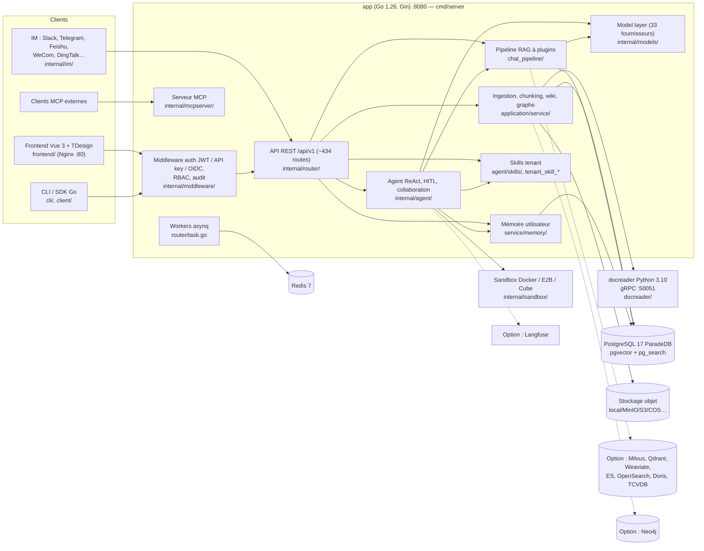
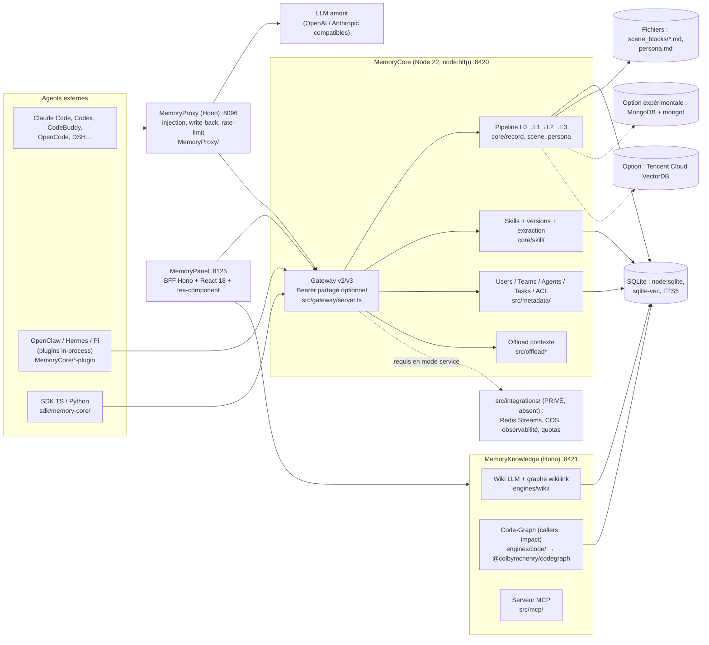

# Architecture actuelle des deux projets

Diagrammes Mermaid (rendus par GitHub, GitLab, VS Code, Obsidian). Chaque boîte renvoie à un chemin vérifié.

## WeKnora (`main@40192ac`)

## TencentDB Agent Memory (`feat/server_team@ecc01a5`)

