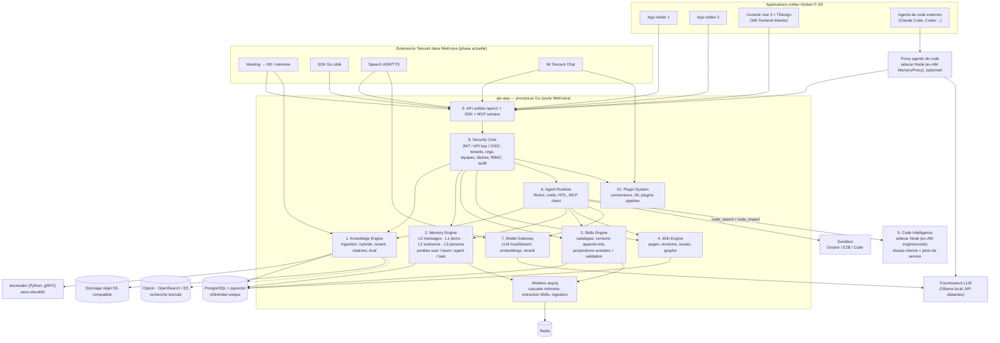

# Architecture cible — Global-IT-SS AI Engine (stratégie A)

Un seul produit, une API, une identité, une base de référence ; un processus Go principal issu de WeKnora et des modules internes spécialisés.

> **Périmètre WeKnora aujourd’hui (extensions Tencent, sans métier GIS)** : voir [architecture-weknora-tencent-extensions.md](./architecture-weknora-tencent-extensions.md) et le plan [12-integration-plan-tencent-extensions.md](../12-integration-plan-tencent-extensions.md). Le schéma ci-dessous reste la **cible long terme** (mémoire L2/L3 portée depuis Agent Memory + apps métier GIS).

## Lecture du diagramme
- Les blocs 1, 2, 3, 4, 6, 7, 8, 9, 10 vivent dans le même processus Go, partagent l'identité et les transactions PostgreSQL.
- Le bloc 5 (Code Intelligence) et le proxy sont des **modules internes isolés** : ils n'ont pas de base partagée, reçoivent une identité signée et ne sont pas exposés publiquement.
- docreader et sandbox restent séparés comme aujourd'hui dans WeKnora.
