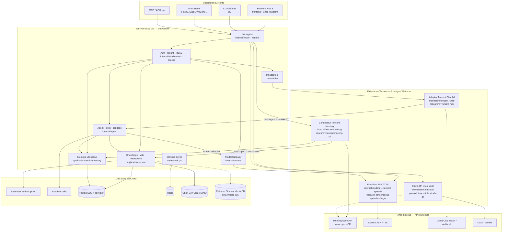

# Architecture — WeKnora + extensions Tencent (périmètre actuel)

WeKnora reste **un processus Go principal** + frontend Vue + docreader Python. Les quatre repos Tencent s’intègrent comme **connecteurs et providers**, pas comme second moteur. Pas de cœur métier GIS (9 axes) sur ce schéma.

Voir le plan détaillé : [12-integration-plan-tencent-extensions.md](../12-integration-plan-tencent-extensions.md).

## Légende des priorités

| Priorité | Bloc | Statut |
|----------|------|--------|
| 1 | Tencent Meeting → KB / mémoire | Plan P1 |
| 2 | tencentcloud-sdk-go (modules ciblés) | Avec Meeting P2 |
| 3 | Speech ASR/TTS | Plan P3 |
| 4 | TIM IM adapter | Plan P4 si besoin |

## Hors scope (inchangé)

- **Agent Memory** Node (MemoryCore / Proxy) → `research/tencentdb-agent-memory`, portage L2/L3 ultérieur.
- **TIM UIKit** React/Vue embarqué dans le frontend WeKnora.
- **Pages métier GIS** (9 axes) dans le shell.
