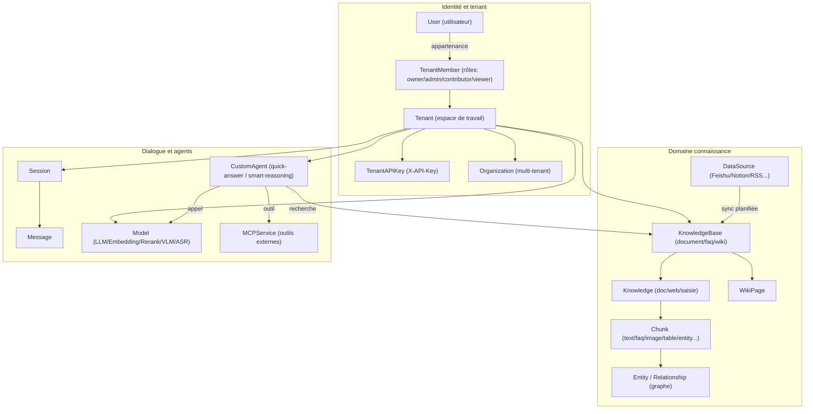
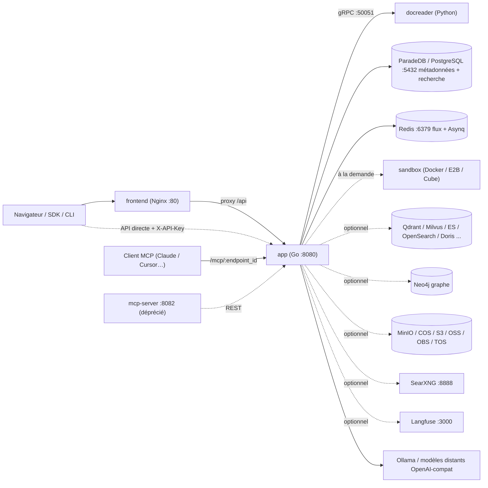

# Présentation de WeKnora

WeKnora est un système open source de questions-réponses sur base de connaissances, publié par Tencent. Il permet d’importer des PDF, Word, pages web et des contenus depuis Feishu, Notion, Confluence, Yuque, DingTalk, etc. Les utilisateurs posent des questions sur ces sources et consultent les citations vers le texte original dans les réponses.

Le système repose sur la génération augmentée par récupération (RAG) : les documents sont analysés et indexés, puis des passages pertinents sont récupérés pour que un grand modèle de langage produise la réponse.

L’architecture comprend un backend Go, une interface Vue 3 et le service Python docreader pour l’analyse documentaire. Déploiement possible via Docker Compose, Helm, binaire Lite ou application de bureau.

<Screenshot
  src="/screenshots/introduction-overview.png"
  caption="Interface principale WeKnora : bases de connaissances et sessions à gauche, zone de Q&R à droite"
  hint="Vue d’ensemble après connexion : barre latérale (bases, agents, paramètres) et un échange avec citations." />

## Nouveautés v0.9.0

- [Assistant WeKnora](../03-features/26-weknora-assistant.md) : réponses sur versions, fonctionnalités et configuration, contextualisées à la page, recherche et tâches avec votre identité.
- [Collaboration multi-agents](../03-features/26-weknora-assistant.md#collaboration) : sous-tâches indépendantes puis synthèse.
- [Automatisations](../03-features/27-automations.md) : travail répétitif ponctuel ou planifié.
- [Permissions d’exécution et approbations](../03-features/28-agent-permissions.md) : lecture seule, confirmation avant modification ou exécution automatique, autorisations limitées.

Détails complets et exigences de montée de version : [notes de version v0.9.0](../07-releases/v0.9.0.md).

## Cas d’usage {#_cas-dusage}

| Besoin | Fonctionnalité |
| --- | --- |
| Formats variés, PDF scannés ou tableaux difficiles à structurer | Pipeline documentaire : mise en page PDF, OCR, conversion Office, capture web, description d’images ; parsing hybride OpenDataLoader/Docling en option |
| Rappel instable avec la seule recherche vectorielle | Hybride vecteur + mots-clés (BM25), fusion RRF, rerank ; GraphRAG et navigation Wiki en option |
| Dépendance à un seul fournisseur de modèles | Couche d’abstraction : Ollama local et nombreux fournisseurs intégrés (OpenAI compatible, Anthropic Messages, Gemini natif, etc.) ; LLM / Embedding / Rerank / VLM / ASR ; voir [Gestion des modèles](../03-features/06-models.md) |
| Sécurité et déploiement privé | Stack entièrement auto-hébergeable ; secrets (clés API, etc.) chiffrés AES-256 au repos (`SYSTEM_AES_KEY`) ; multi-tenant + RBAC |
| Tâches multi-étapes et outils | Agent ReAct, outils MCP, Agent Skills en sandbox, recherche web (SearXNG, etc.), analyse de données (SQL sur CSV/Excel) |
| Travail d’équipe | Espaces (tenants), rôles membres, organisations pour partager bases et agents entre espaces, invitations |

## Concepts clés

Les bases de connaissances regroupent les sources ; l’espace de travail gère membres et droits ; l’agent choisit modèles et outils pour répondre. Les termes ci-dessous correspondent à l’interface ; définitions complètes dans `internal/types/`.

### Tenant et identité

| Concept | Description |
| --- | --- |
| Tenant | Espace de travail : bases, modèles, agents, sessions, quotas de stockage. Voir [Espace et permissions](../03-features/01-tenant-auth.md) |
| User | Compte de connexion ; un utilisateur peut rejoindre plusieurs espaces |
| TenantMember | Appartenance à un espace, avec rôle et statut |
| TenantRole | Owner, Admin, Contributor, Viewer — droits dans l’espace |
| API Key (TenantAPIKey) | Accès programmatique, capacités et périmètre de bases ; clés espace vs plateforme gérées séparément |
| Organization | Relie plusieurs espaces ; partage de bases et d’agents selon les rôles organisationnels |

### Domaine connaissance

| Concept | Description |
| --- | --- |
| KnowledgeBase | Regroupe les sources ; modèles, découpage et index. Types document, FAQ, Wiki |
| Knowledge | Fichier, page web ou contenu saisi dans une base ; statut de parsing après ingestion |
| Chunk | Unité de recherche après parsing : texte, image, tableau, etc. |
| FAQ | Questions standard, similaires, contre-exemples et réponses ; voir [FAQ](../03-features/17-faq.md) |
| WikiPage | Page thématique générée depuis les docs, citations et liens, édition et versions |
| Entity / Relationship | Entités et relations pour le graphe (Neo4j), recherche associée |
| DataSource | Sync continue depuis l’extérieur : Feishu/Lark, Notion, Confluence, Yuque, DingTalk, Tencent IMA, GitLab, RSS ; voir [Import de sources](../03-features/10-datasource.md) |
| RetrievalConfig | Nombre de candidats, seuils, pondérations de fusion, rerank ; voir [Moteurs de recherche](../03-features/05-retrieval-engines.md) |

### Dialogue et agents

| Concept | Description |
| --- | --- |
| Session | Historique multi-tours, agent, modèles, périmètre de connaissance et outils |
| Message | Question ou réponse ; pièces jointes, citations, résultats d’outils |
| Model | Connexion LLM, embedding, rerank, vision ou ASR ; voir [Gestion des modèles](../03-features/06-models.md) |
| CustomAgent | Agent personnalisé : modèles, sources, outils ; Q&R rapide ou raisonnement avancé |
| Agents intégrés | Q&R rapide, raisonnement, analyse de données, Wiki ; voir [Moteur Agent](../03-features/07-agent.md) |
| Skills et sandbox | Catalogue d’skills, installation selon sandbox, liaison à l’agent ; Docker/Cube/E2B, variables perso ; voir [Skills et sandbox](../03-features/22-skills-sandbox.md) |
| Mémoire long terme | Préférences et faits par espace et appelant ; désactivée par défaut ; voir [Mémoire](../03-features/23-memory.md) |
| MCPService | Outils externes pour l’agent ; SSE et Streamable HTTP ; auth API Key, Bearer ou OAuth 2.0 |

### Schéma des relations

## Liste des fonctionnalités

- **Ingestion** : upload (PDF, Office, Markdown, HTML, EPUB, XMind, images, audio…), URL, Markdown saisi, dossiers entiers ; sync Feishu/Lark, Notion, Confluence, Yuque, DingTalk, IMA, GitLab, RSS.
- **Compréhension documentaire** : mise en page, OCR, tableaux, description multimodale (VLM), transcription (ASR), moteurs par type (`ParserEngineRules`, MinerU / OpenDataLoader).
- **Indexation** : découpage configurable (parent/enfant, adaptatif), index vectoriel et full-text, FAQ, génération Wiki, graphe, questions pré-générées.
- **Recherche** : hybride vecteur + BM25, RRF, rerank, reformulation et extension, intention (greeting, chitchat, web_search… — `config/prompt_templates/intent_prompts.yaml`).
- **Q&R et Agent** : SSE, compression de contexte, citations ; ReAct (`search_knowledge`, `read_document`, `list_documents`, `wiki_search`, `data_analysis`…), MCP, Agent Skills (Docker/Cube/E2B), recherche web.
- **Expérience de chat** : contraintes en cours de réponse, bifurcation ou rollback depuis l’historique (checkpoints sandbox), intensité de réflexion par session, page « artefacts » ; voir [Expérience de session](../03-features/18-chat-experience.md).
- **Multi-tenant et sécurité** : RBAC (`WEKNORA_TENANT_ENABLE_RBAC`), audit (90 j par défaut), modes d’inscription (ouvert, `invite_register`, `invite_only` / `DISABLE_REGISTRATION=true`), OIDC, SSRF (`SSRF_DNS_WHITELIST_ONLY`), chiffrement AES-256. UI : zh simplifié/traditionnel, en, ja, ko, ru.
- **Observabilité** : traçage Langfuse, health checks, Swagger si `GIN_MODE=debug`.
- **Écosystème** : REST `/api/v1` + clé API, MCP Server intégré par espace ([MCP](../03-features/08-mcp.md)), CLI, mini-programme WeChat, extension navigateur, [navigateur local](../05-clients/09-local-browser.md). Lite (macOS) exécute des commandes agent en sandbox locale.

## Composants système

| Composant | Stack | Code | Port | Rôle |
| --- | --- | --- | --- | --- |
| app | Go / Gin | `cmd/server`, `internal/` | 8080 | API REST, RAG, Agent, tâches Asynq |
| frontend | Vue 3 + Nginx | `frontend/` | 80 | Console web, proxy `/api` vers app |
| docreader | Python / gRPC | `docreader/` | 50051 (réseau conteneur) | Fichiers → Markdown, web, images |
| postgres | ParadeDB (PG 17 + BM25/vecteur) | `paradedb/paradedb` | 5432 | Métadonnées + recherche hybride (`RETRIEVE_DRIVER=postgres`) |
| redis | Redis 7 | — | 6379 | Flux SSE, file Asynq |
| sandbox | Python 3.12 + Node 20 | `docker/Dockerfile.sandbox` | — | Image sandbox Agent Skills |
| Option : qdrant / milvus / weaviate / doris | — | profiles compose | divers | Moteurs vectoriels (`RETRIEVE_DRIVER`) |
| Option : opensearch | — | `docker-compose.dev.yml` | 9200 | Dev ; prod : cluster dédié |
| Option : elasticsearch / tencent_vectordb | — | hors compose | — | Support code, déploiement manuel |
| Option : neo4j | Neo4j | profile `neo4j` | 7474 / 7687 | Graphe (GraphRAG) |
| Option : minio | MinIO | profile `minio` | 9000 / 9001 | Objet S3 (`STORAGE_TYPE=minio`) |
| Option : searxng | SearXNG | profile `searxng` | 8888 | Moteur web self-hosted |
| Option : langfuse | Langfuse 3 + CH + MinIO | profile `langfuse` | 3000 | Observabilité LLM |
| Option : mcp (déprécié) | Python | `mcp-server/`, profile `full` | 8082 | Ancien MCP ; préférer MCP intégré dans app |
| Option : odl-hybrid | Docling | profile `odl-hybrid` | 5002 | PDF hybride OpenDataLoader |

## Suite

- [Installation](./02-installation.md) : choisir un mode de déploiement et démarrer.
- [Premiers pas](./03-quickstart.md) : créer une base, importer des documents, première Q&R.
- [Configuration](./04-configuration.md) : paramètres et priorités.
