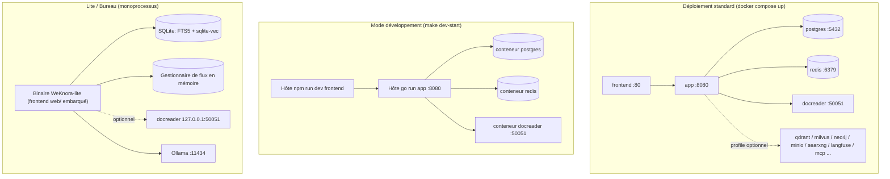
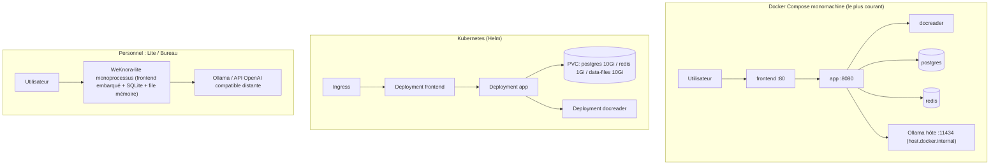

# Installation et déploiement

WeKnora prend en charge Docker Compose, Kubernetes Helm, le binaire unique Lite et l’application de bureau. Pour un serveur, choisissez Compose ou Helm ; en local, Lite ; pour le développement, une orchestration dédiée. Ci-dessous : dépendances, commandes de démarrage et répertoires de données pour chaque mode.

## Vue d’ensemble des modes de déploiement

| Mode | Point d’entrée | Base de données | File / flux | Cas d’usage |
| --- | --- | --- | --- | --- |
| Docker Compose (standard) | `docker-compose.yml` | ParadeDB (PostgreSQL) | Redis + Asynq | Production / auto-hébergement d’équipe, recommandé |
| Docker Compose (développement) | `docker-compose.dev.yml` | Idem (seule l’infra en conteneurs) | Idem | Développement local : app / frontend sur l’hôte |
| Helm | `helm/` | ParadeDB (intégré au chart) | Redis (intégré au chart) | Kubernetes >= 1.25 |
| Binaire Lite | `make build-lite` / `scripts/package-lite.sh` | SQLite (FTS5 + sqlite-vec) | Mémoire (sans Redis) | Usage personnel / hors ligne / faibles ressources |
| Application de bureau (**non publiée officiellement**) | `cmd/desktop` (Wails v2) + `scripts/package-mac-app.sh` | SQLite | Mémoire | Poste de travail avec interface graphique et données locales |



## Exigences matérielles et dépendances

- **Déploiement Docker standard** : Docker 20.10+ et Docker Compose v2 (v1 `docker-compose` également pris en charge ; `scripts/start_all.sh` détecte automatiquement) ; 4 cœurs CPU / 8 Go RAM recommandés au minimum (docreader inclut LibreOffice, Playwright, gourmand en mémoire), espace disque selon la taille de la base de connaissances (volume Postgres + volume fichiers `/data/files`). Activer Milvus / OpenSearch / Langfuse, etc. augmente les besoins en RAM.
- **Service de modèles** : inférence locale via [Ollama](https://ollama.com) (adresse par défaut `http://host.docker.internal:11434` ; si indisponible avec `OLLAMA_OPTIONAL=true`, avertissement sans blocage) ; ou toute API compatible OpenAI (DeepSeek, Tongyi, Zhipu, SiliconFlow, etc.). Les 8 Go de départ n’incluent pas les poids des modèles Ollama ; Neo4j est désactivé par défaut (profile `neo4j` requis).
- **Compilation depuis les sources** : Go 1.26 (voir `docker/Dockerfile.app`, étape builder `golang:1.26-bookworm`), CGO (`libsqlite3-dev`), Node.js + npm (frontend), Python 3.10 + uv (docreader).
- **Kubernetes** : >= 1.25.0 (`helm/Chart.yaml`).

À partir de l’image ParadeDB par défaut `v0.22.6-pg17`, la baseline CPU x86 est `x86-64-v2` (SSE4.2, POPCNT), sans exiger AVX2 ; pour les versions d’image plus récentes, se référer aux notes ParadeDB. Cela ne garantit pas la compatibilité de tous les CPU ARM ou des services optionnels.

## I. Déploiement Docker Compose standard (`docker-compose.yml`)

Chemin le plus rapide :

```bash
git clone https://github.com/Tencent/WeKnora.git && cd WeKnora
cp .env.example .env              # Renseigner : DB_USER/DB_PASSWORD/DB_NAME, REDIS_PASSWORD, JWT_SECRET, SYSTEM_AES_KEY
make start-all                # équivalent à ./scripts/start_all.sh (pull des dernières images par défaut)
# ou directement :
docker compose pull           # images alignées sur WEKNORA_VERSION
docker compose up -d
docker compose ps                 # attendre healthy/running sur tous les services
```

Les champs `JWT_SECRET` et `SYSTEM_AES_KEY` dans `.env.example` sont vides par défaut : les générer une fois au premier déploiement et les conserver : `JWT_SECRET` avec `openssl rand -hex 32`, `SYSTEM_AES_KEY` sur 32 octets avec `openssl rand -hex 16`. Lors d’une mise à niveau, conserver le même `SYSTEM_AES_KEY`, sinon les secrets chiffrés ne pourront pas être déchiffrés. Voir [Configuration détaillée](./04-configuration.md) pour le rôle de chaque clé.

Arrêt avec `docker compose down` (`-v` supprime aussi les volumes, à utiliser avec prudence). `make start-all` encapsule la même commande (`scripts/start_all.sh`, avec contrôle Ollama, repli `.env`, pré-pull de l’image sandbox) ; l’un ou l’autre suffit.

Après le démarrage, ouvrir `http://localhost` dans le navigateur (port `FRONTEND_PORT`, défaut 80) ; la première visite mène à l’inscription. Nginx du frontend proxy `/api/` vers le backend, donc les appels passent par `http://localhost/api/v1` ; le port `8080` du backend est mappé sur l’hôte, `curl http://localhost:8080/health` confirme que le backend est prêt.

> Note : le service app dans `docker-compose.yml` utilise `env_file: [.env]` ; l’absence de `.env` fait échouer le parsing compose. `make docker-run` / `start_all.sh` copient automatiquement `.env.example` vers `.env` ou créent un `.env` vide.

### Mise à niveau de version

Si un déploiement existe déjà et qu’une release plus récente a été téléchargée :

> Si la base reste sur ParadeDB `v0.22.2-pg17`, suivre d’abord [Instructions de mise à niveau ParadeDB](06-paradedb-upgrade.md) : arrêter les écritures, sauvegarder, conserver les volumes, changer l’image et mettre à jour l’extension `pg_search`, puis relancer l’application. Remplacer l’image seule ne met pas à jour le SQL d’extension des bases existantes ; la migration `000099` traite les bases WeKnora en `0.22.2–0.22.5`, les autres bases doivent être vérifiées séparément.

```bash
# Dans .env, définir WEKNORA_VERSION (ex. 0.9.0) ou laisser latest
docker compose pull
docker compose up -d
```

> Exécuter uniquement `docker compose up -d` réutilise les images en cache et peut afficher une version UI différente de la release téléchargée.

### Services principaux (démarrage par défaut)

| Service | Image | Port (hôte:conteneur) | Dépendances | Description |
| --- | --- | --- | --- | --- |
| `frontend` | `wechatopenai/weknora-ui:${WEKNORA_VERSION:-latest}` | `${FRONTEND_PORT:-80}:80` | app (healthy) | Nginx sert la SPA et proxy vers app ; `APP_HOST`/`APP_BACKEND_PORT`/`APP_SCHEME` peuvent cibler un backend distant |
| `app` | `wechatopenai/weknora-app` | `${APP_PORT:-8080}:8080` | postgres (healthy), redis, docreader (healthy) | Backend Go ; monte `./config/config.yaml`, volume `data-files` ; health check `GET /health` |
| `docreader` | `wechatopenai/weknora-docreader` | `expose: 50051` uniquement (non publié sur l’hôte) | — | Parsing de documents gRPC ; health check `grpc_health_probe` ; volume `docreader-tmp` partagé avec app pour les images |
| `postgres` | `paradedb/paradedb:v0.25.11-pg17` | Port hôte non mappé | — | ParadeDB = PostgreSQL 17 + extensions BM25/vecteur, moteur de recherche par défaut |
| `redis` | `redis:7.0-alpine` | Port hôte non mappé | — | `--appendonly yes --requirepass ${REDIS_PASSWORD}` |

### Services optionnels et profiles

Activer selon les besoins avec `docker compose --profile <name> up -d` :

| profile | Service | Port | Usage |
| --- | --- | --- | --- |
| `searxng` (incl. `full`) | `searxng-init` + `searxng` | `127.0.0.1:8888` (`SEARXNG_BIND`/`SEARXNG_PORT`) | Recherche Web auto-hébergée ; liaison loopback par défaut, rotation obligatoire de `SEARXNG_SECRET` avant exposition publique |
| `minio` (incl. `full`) | `minio` | 9000 (S3) / 9001 (console) | Stockage objet compatible S3 (`STORAGE_TYPE=minio`), compte par défaut `minioadmin/minioadmin` |
| `neo4j` (incl. `full`) | `neo4j` | 7474 / 7687 | Graphe de connaissances (`NEO4J_ENABLE=true`), défaut `neo4j/password` |
| `qdrant` (incl. `full`) | `qdrant` | 6333 (REST) / 6334 (gRPC) | Base vectorielle (`RETRIEVE_DRIVER=qdrant`) |
| `milvus` | `milvus` | 19530 / 9091 | Base vectorielle (standalone, etcd intégré) |
| `weaviate` | `weaviate` | 9035 (HTTP) / 50052 (gRPC) | Base vectorielle |
| `doris` | `doris-fe` + `doris-be` | 8030 (FE HTTP) / 9030 (FE MySQL) / 8040 (BE) | Moteur Apache Doris 4.1 (>= 3.0, HNSW ANN) |
| `dex` (incl. `full`) | `dex` | 5556 | IdP OIDC de test (config dans `misc/dex-config.yaml`) |
| `langfuse` (incl. `full`) | `langfuse-db-init`, `langfuse-clickhouse`, `langfuse-minio`, `langfuse-worker`, `langfuse-web` | 3000 (UI) / 9100/9101 (MinIO dédié) | Stack Langfuse auto-hébergée, réutilise postgres WeKnora (base `langfuse`) et redis (DB 1) |
| `odl-hybrid` | `odl-hybrid` | expose 5002 | Backend PDF hybride OpenDataLoader/Docling (build local uniquement, avec `DOCREADER_ODL_HYBRID`) |
| `full` | `sandbox`, `mcp` et services marqués full ci-dessus | mcp: `${MCP_PORT:-8082}:8000` | `sandbox` sert au build/pull d’image (`command: ["true"]`, non résident). Sandbox Docker désactivée par défaut ; `WEKNORA_SANDBOX_DOCKER_ENABLED=true` et montage `docker.sock` (équivalent root hôte). Cube/E2B n’utilisent pas le daemon local. `mcp` = serveur MCP |

Le bloc `environment` du conteneur app liste toutes les variables (base, vectoriel, stockage, réglages docreader, tenant, OIDC, etc.), voir [04-configuration.md](./04-configuration.md).

## II. Mode développement (`docker-compose.dev.yml` + `scripts/dev.sh`)

L’orchestration de dev ne met en conteneur que **l’infrastructure** (postgres, redis, docreader avec ports mappés sur l’hôte) ; app et frontend tournent sur l’hôte avec rechargement à chaud :

```bash
make dev-start          # ./scripts/dev.sh start ; DEV_ARGS=--odl-hybrid / --minio / --qdrant / --neo4j / --dex / --full
make dev-app            # backend Go sur l'hôte (DB_HOST/REDIS_ADDR -> localhost)
make dev-frontend       # serveur de dev Vue frontend sur l'hôte
make dev-logs / dev-status / dev-stop / dev-restart
```

Différences avec la prod :

- postgres (`5432`), redis (`6379`), docreader (`50051`) publiés sur l’hôte pour connexion directe ;
- `opensearch` (9200) et `opensearch-dashboards` (5601, profile `opensearch-ui`) en nœud unique pour le dev (plugin security désactivé) ;
- `dev.sh` charge `.env` et `.env.local` (ce dernier écrase le premier), et `DEV_REMOTE_HOST` pour une infra distante.

## III. Construction des images (`docker/`)

| Dockerfile | Image produite | Points clés |
| --- | --- | --- |
| `docker/Dockerfile.app` | `wechatopenai/weknora-app` | Trois étapes : build BrowserSkill `bsk` + extension Chrome (`/opt/weknora/browserskill/`, voir [Navigateur local](../05-clients/09-local-browser.md)) ; compile avec `golang:1.26-bookworm` (`make build-prod`, défaut `WITH_ANYDOC=1`, version injectée, extension DuckDB `cmd/download/duckdb`) → runtime `debian:12.12-slim` (`migrate`, python3/node/uvx pour MCP stdio, ffmpeg ASR, gosu, licences tierces). Entrée `scripts/docker-entrypoint.sh` : propriétaire des montages ; si docker.sock monté, ajoute appuser au GID du socket (compose `group_add` inefficace après gosu), puis `./WeKnora` en appuser. `EXPOSE 8080` |
| `docker/Dockerfile.docreader` | `wechatopenai/weknora-docreader` | Python 3.10 + uv verrouillé ; protobuf ; runtime LibreOffice, OpenJDK 17, antiword, Playwright (webkit), `grpc_health_probe`. Version légère sans PaddleOCR. `EXPOSE 50051`. Args `APT_MIRROR`, `PLAYWRIGHT_DOWNLOAD_HOST`, `PLAYWRIGHT_WEBKIT_DOWNLOAD_HOST` |
| `docker/Dockerfile.odl-hybrid` | `weknora-odl-hybrid:local` | `opendataloader-pdf[hybrid]` (Docling), port 5002, défaut `--no-ocr` ; build local non publié |
| `docker/Dockerfile.sandbox` | `wechatopenai/weknora-sandbox` | Image sandbox de session Agent. Python 3.12-slim + Node 20 + uv/pnpm, `root` par défaut, `user` (UID 1000) optionnel. Cible `sandbox` pour Docker ; aussi `cube`, `desktop` / `desktop-cube`, voir [Déploiement sandbox](../06-development/04-sandbox-deployment.md) |
| `frontend/Dockerfile` | `wechatopenai/weknora-ui` | Deux étapes : `node:24-bookworm-slim` digest verrouillé (`$BUILDPLATFORM`) `npm ci` + `npm run build` (`VITE_IS_DOCKER` / `VITE_FRONTEND_COMMIT`), `NPM_REGISTRY` / `NODE_MAX_OLD_SPACE_SIZE` optionnels ; runtime `nginx:1.30.3-alpine` digest fixe. Pas besoin de `dist/` pré-buildé sur l’hôte |

Build de toutes les images depuis les sources :

```bash
make build-images        # ./scripts/build_images.sh ; options --app/--docreader/--frontend/--sandbox/--clean
# ou séparément :
make docker-build-app
make docker-build-docreader
make docker-build-frontend
```

Pour docreader derrière un miroir ou réseau d’entreprise, basculer APT et Playwright :

```bash
APT_MIRROR=https://your-apt-mirror.example.com \
PLAYWRIGHT_WEBKIT_DOWNLOAD_HOST=https://your-playwright-mirror.example.com \
./scripts/build_images.sh --docreader
```

`APT_MIRROR` doit être la racine du miroir conservant `/debian` et `/debian-security` ; le miroir Playwright doit conserver la structure des artefacts officiels. `PLAYWRIGHT_WEBKIT_DOWNLOAD_HOST` prime sur `PLAYWRIGHT_DOWNLOAD_HOST`.

## IV. Référence rapide des cibles Makefile (déploiement)

| Cible | Rôle |
| --- | --- |
| `make start-all` / `stop-all` | Appelle `scripts/start_all.sh` pour tout démarrer/arrêter (Ollama, repli `.env`, pré-pull sandbox) |
| `make start-ollama` / `start-docker` | Ollama seul / services Docker seuls |
| `make docker-run` / `docker-stop` / `docker-restart` | `docker-compose up/down/restart` classique (repli `.env` auto) |
| `make build-images*` / `clean-images` / `pull-images` | Build sources / nettoyage / pull images |
| `make check-env` / `list-containers` / `show-platform` | Vérification env (`scripts/check-env.sh` : variables `.env` et toolchain Go/npm/Docker/Air) / liste conteneurs / plateforme build (amd64/arm64) |
| `make migrate-up` / `migrate-down` / `migrate-version` / `migrate-create name=x` / `migrate-force version=n` / `migrate-goto version=n` | Migrations BDD (`scripts/migrate.sh` ; `AUTO_MIGRATE=true` au démarrage conteneur) |
| `make dev-*` | Mode dev (ci-dessus) |
| `make build` / `run` / `build-prod` | Compile et lance `cmd/server` localement (`build-prod` requiert CGO, version et `Edition=standard`) |
| `make build-lite` / `run-lite` / `package-lite` | Build Lite / run (lit `.env.lite`) / package release |
| `make package-mac-app` | Package application bureau macOS |
| `make docs` / `install-swagger` | Génère Swagger (`http://localhost:8080/swagger/index.html`, désactivé en release) |
| `make clean-db` | Supprime volumes postgres/minio/redis (opération dangereuse) |

## V. Scripts de démarrage (`scripts/`)

| Script | Rôle |
| --- | --- |
| `scripts/start_all.sh` | Démarrage en un clic : `-o` (Ollama seul), `-d` (Docker seul), `-a` (tout, défaut), `-s` (stop), `-c` (check env), `-l` (liste), `-p` (pull images) ; détecte compose v1/v2, `PLATFORM` via `uname -m`, pré-pull sandbox en arrière-plan |
| `scripts/dev.sh` | Orchestration dev (ci-dessus), sous-commandes `start/stop/restart/logs/status/app/frontend` |
| `scripts/check-env.sh` | Valide variables `.env` obligatoires (DB_*, STORAGE_TYPE, REDIS_ADDR, OLLAMA_BASE_URL, etc.) et toolchain Go/npm/Docker/Air |
| `scripts/build_images.sh` | Build images avec version (git tag / commit / build time), multi-arch |
| `scripts/build_frontend_dist.sh` | Build statique `frontend/dist` sur l’hôte (Lite / bureau hors Docker ; l’image UI se build via Dockerfile multi-étapes) |
| `scripts/migrate.sh` | Encapsulation golang-migrate |
| `scripts/docker-entrypoint.sh` | Entrée conteneur app (fix propriétaire + groupe GID socket sans changer permissions socket + gosu, compatible Docker Desktop `root:root 0660`) |
| `scripts/package-lite.sh` / `package-mac-app.sh` | Tarball Lite / package macOS `.app` |

## VI. Déploiement Helm (`helm/`)

`helm/Chart.yaml` : apiVersion v2, chart `weknora`, appVersion alignée (ex. v0.9.0), Kubernetes >= 1.25.0 requis.

Le chart comprend : `app` (`wechatopenai/weknora-app`), `frontend` (`wechatopenai/weknora-ui`), `docreader`, `postgresql` (ParadeDB, défaut chart `paradedb/paradedb:v0.18.9-pg17`, version différente de Compose), `redis` (`redis:7-alpine`), et optionnellement `minio` et `neo4j`.

Configuration clé dans `helm/values.yaml` :

```yaml
app:
  replicaCount: 1
  env:
    GIN_MODE: release
    RETRIEVE_DRIVER: postgres      # postgres / elasticsearch_v7 / elasticsearch_v8 / qdrant ...
    STORAGE_TYPE: local            # local / minio / cos / tos / s3
    STREAM_MANAGER_TYPE: redis
postgresql:
  enabled: true
  persistence: { enabled: true, size: 10Gi }
redis:
  enabled: true
  persistence: { enabled: true, size: 1Gi }
dataFiles:
  persistence: { enabled: true, size: 10Gi }
global:
  maxFileSizeMB: 50                 # taille max upload ; frontend / app / docreader
secrets:                            # obligatoire, ou existingSecret
  dbPassword: ""
  redisPassword: ""
  jwtSecret: ""
  systemAesKey: ""                  # clé AES-256 maître, 32 octets
```

`global.maxFileSizeMB` équivaut à `MAX_FILE_SIZE_MB` sous Compose ; le chart l’applique au frontend (limite corps Nginx), app (upload) et docreader (messages gRPC). MinIO optionnel : image communautaire `pgsty/minio`.

```bash
helm install weknora ./helm -n weknora --create-namespace \
  --set secrets.dbPassword=xxx --set secrets.redisPassword=xxx \
  --set secrets.jwtSecret=xxx --set secrets.systemAesKey=$(openssl rand -hex 16)
```

## VII. Poste de travail (mode Lite / application bureau)

Cible l’usage local et faibles ressources : même runtime Lite (monoprocessus + SQLite + file en mémoire), distribution et lancement différents : **binaire unique** (CLI, aussi service en arrière-plan) ou **application bureau** (GUI, double-clic). Capacités base de connaissances identiques ; inscription optionnelle, sandbox locale et liaison de répertoires projet réservées à l’app bureau.

### Runtime Lite (zéro dépendance externe) {#_7-1-runtime-lite-zero-dependance-externe}

Le mode Lite via `EDITION=lite` à la compilation et `.env.lite` à l’exécution : un processus pour tout :

- **Base** : `DB_DRIVER=sqlite` + `DB_PATH=./data/weknora.db`, build avec `-tags "sqlite_fts5"` ;
- **Recherche** : `RETRIEVE_DRIVER=sqlite`, FTS5 + sqlite-vec, sans base vectorielle externe ;
- **File / flux** : `STREAM_MANAGER_TYPE=memory` (`internal/stream/factory.go`), pas de Redis ; file Asynq distribuée en no-op / mémoire en Lite ;
- **Frontend** : `make build-lite` copie `frontend/dist` vers `web/` à la racine ; le binaire sert les statiques (`WEKNORA_WEB_DIR`, `serveFrontendStatic`) ;
- **Parsing** : docreader local optionnel (`DOCREADER_ADDR=127.0.0.1:50051`) ;
- **Sandbox** : pas de backend préconfiguré au démarrage binaire ; réglages par espace Docker, CubeSandbox ou E2B ; l’app bureau utilise le sandbox OS local sans sandbox distant, voir [Client bureau](../05-clients/05-desktop.md).

```bash
cp .env.lite.example .env.lite      # SYSTEM_AES_KEY (openssl rand -hex 16) et JWT_SECRET
make run-lite                       # build et lancement ./WeKnora-lite avec .env.lite
make package-lite                   # tarball release (scripts/package-lite.sh)
```

Le binaire via navigateur exige inscription et connexion comme la version standard. L’app bureau obtient des identifiants aléatoires par processus via le pont natif, appelle `POST /auth/auto-setup` pour créer et connecter un compte local ; cette API n’accepte pas de requêtes HTTP anonymes.

### Application bureau (`cmd/desktop`, Wails v2) {#_7-2-application-bureau-wails-v2}

Interface graphique locale : double-clic, backend et SQLite intégrés, données dans le répertoire applicatif système ; réglages port, liaison LAN, mises à jour. Mêmes capacités runtime que [Runtime Lite (zéro dépendance externe)](#_7-1-runtime-lite-zero-dependance-externe).

::: warning Pas encore publiée officiellement
L’application bureau **n’est pas fournie dans les Release** ; build manuel ci-dessous. `release-lite.yml` contient des jobs multi-plateforme (macOS universal/amd64/arm64, Linux amd64, Windows amd64), mais le déclenchement par tag est commenté (déclenchement manuel uniquement) et les dernières Release n’incluent aucun artefact.
:::

- Entrée `cmd/desktop/main.go` + `cmd/desktop/wails.json` ; `cmd/desktop/app.go` expose `GetAPIBaseURL` (`http://127.0.0.1:PORT/api/v1`), port HTTP, liaison LAN, `CheckForUpdates`, etc.
- `scripts/package-mac-app.sh` : build frontend vers `web/`, puis `wails build -tags "sqlite_fts5"`, assemblage `.app` — `Contents/MacOS/WeKnora Lite` exécutable, `Contents/Resources` avec `.env`, config, `migrations/sqlite`, web ; chemins relatifs redirigés vers `~/Library/Application Support/WeKnora Lite/data/`, logs `~/Library/Logs/WeKnora Lite/`.

```bash
make package-mac-app
```

## VIII. Compilation et exécution depuis les sources

```bash
# Backend (standard ; postgres/redis/docreader locaux, voir mode dev)
go mod download
make build && ./WeKnora                       # ou make build-prod

# Frontend
cd frontend && npm ci && npm run dev          # dev ; npm run build -> dist/

# docreader
cd docreader && uv sync --locked && bash scripts/generate_proto.sh && uv run -m docreader.main  # identique au CMD de l'image
```

Ordre de recherche de config (`LoadConfig` dans `internal/config/config.go`) : répertoire courant → `./config` → `$HOME/.appname` → `/etc/appname/`, fichier `config.yaml`.

### Frontend hébergé optionnel (version standard)

La version standard n’expose que l’API par défaut ; le frontend est un service séparé. Pour servir l’UI Web depuis le même processus standard, définir `WEKNORA_WEB_DIR` vers un répertoire frontend buildé contenant `index.html`. Sans variable, comportement par défaut ; répertoire absent ou sans `index.html` : pas d’hébergement frontend.

Depuis la racine du dépôt, avec Go 1.26, outils CGO, Node.js/npm, et config/ dépendances standard (BDD, Redis, stockage, modèles, parsing) :

```bash
(cd frontend && npm ci && npm run build)
make build-prod
SERVER_HOST=127.0.0.1 WEKNORA_WEB_DIR="$PWD/frontend/dist" ./WeKnora
```

Accès via `http://127.0.0.1:8080` (port `SERVER_PORT` par défaut). `WEKNORA_WEB_DIR` ne doit contenir que les artefacts frontend, pas de données, config ou secrets ; les routes backend enregistrées (dont `/mcp/`) priment sur statiques et fallback SPA ; auth inchangée.

Cette option évite un service frontend séparé, pas les dépendances backend. Pour un déploiement minimal sans Docker (SQLite + file mémoire), voir [Runtime Lite](#_7-1-runtime-lite-zero-dependance-externe).

## Topologies de déploiement courantes



## Étape suivante

Après le déploiement, lire [03-quickstart.md](./03-quickstart.md) pour l’initialisation et la première question-réponse.
