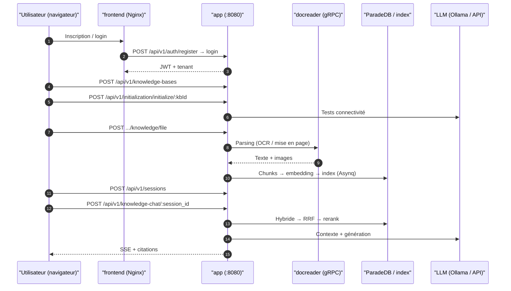

# Premiers pas

En vous inscrivant, en créant une base de connaissances, en configurant les modèles, en important des documents et en posant une question, vous réalisez une première Q&R avec citations vers les sources. Les étapes ci-dessous passent par l’interface web ; des exemples API sont en fin de page.

Terminez d’abord [l’installation](02-installation.md) et préparez un modèle de dialogue et un modèle d’embedding opérationnels.

::: tip Besoin d’aide ?
Ouvrez l’[assistant WeKnora](../03-features/26-weknora-assistant.md) dans la barre latérale pour consulter la doc, vérifier le parsing ou obtenir de l’aide à la configuration. Au premier usage, choisissez « lecture seule » ou « confirmation avant modification » pour cadrer les actions.
:::

## Avant de commencer {#_1-avant-de-commencer}

- **Services** : après [l’installation](./02-installation.md), le frontend est sur `http://localhost`, le backend sur `http://localhost:8080` ;
- **Modèles** : Ollama local (dans le conteneur : `http://host.docker.internal:11434`) ou service OpenAI-compatible (`base_url` + `api_key`). Il faut au minimum un LLM et un modèle d’embedding ;
- **Santé** : `curl http://localhost:8080/health` doit renvoyer `{"status":"ok"}`.

## Inscription et connexion {#_2-inscription-et-connexion}

La première visite affiche la page de connexion. Si l’inscription publique est autorisée (`self_serve`), l’onglet inscription apparaît ; il n’y a pas de compte par défaut. En configuration standard, l’inscription crée un espace personnel et vous en fait Owner.

<Screenshot
  src="/screenshots/quickstart-register.png"
  caption="Page d’inscription lors de la première visite"
  hint="Formulaire (identifiant / e-mail / mot de passe) et lien connexion." />

Règles et différences selon le déploiement :

- Identifiant 2–50 caractères ; mot de passe 8–32 avec lettres et chiffres. Politique complexe : majuscules, minuscules et caractères spéciaux (UI et API alignées) ;
- Équipe avec inscription sur invitation : l’admin plateforme règle `auth.registration_mode` sur `invite_register` dans Paramètres → Système (effet immédiat). `invite_only` / `DISABLE_REGISTRATION=true` interdit l’inscription par mot de passe ; les invitations ne créent pas de compte, seuls les comptes existants peuvent rejoindre ;
- Si `auth.default_tenant_mode` vaut `tenantless`, **aucun** espace n’est créé à l’inscription : redirection vers `/onboarding/workspace` (créer ou accepter une invitation) ;
- L’app de bureau crée un compte local au lancement ; le binaire Lite dans le navigateur exige inscription et connexion.

::: tip Espace vs plateforme
L’Owner gère membres, modèles et bases de son espace. Paramètres globaux, files plateforme et audit inter-espaces exigent le rôle administrateur système — indépendant de l’Owner.

Pour le premier admin système : inscrivez-vous, configurez `WEKNORA_BOOTSTRAP_SYSTEM_ADMIN_EMAIL=<e-mail>` sur app et redémarrez. Uniquement tant qu’aucun admin système n’existe. Voir [Administration plateforme](../03-features/20-platform-admin.md).
:::

## Créer une base et configurer les modèles {#_3-creer-une-base-et-configurer-les-modeles}

Sur la page Bases de connaissances, créez une base ; l’assistant d’initialisation guide le choix des modèles pour cette base (chaque base a les siens).

1. Nouvelle base : nom, type `document` (documents) ou `faq` (paires Q&R) ;
2. Dans l’assistant :
   - **LLM** : génération des réponses ;
   - **Embedding** : vecteurs documentaires ; changement ⇒ réindexation ;
   - Rerank, VLM, ASR, graphe et génération de questions selon vos besoins ;
3. Testez la connectivité dans l’assistant, puis enregistrez.

<Screenshot
  src="/screenshots/quickstart-init-wizard.png"
  caption="Assistant : choix LLM et embedding"
  hint="Source (Ollama / API distante), nom, Base URL, test OK." />

::: tip Ollama depuis un conteneur
Dans le conteneur backend, `localhost` est le conteneur lui-même. Pour Ollama sur l’hôte : `http://host.docker.internal:11434`.
:::

## Importer des documents {#_4-importer-des-documents}

Dans la base, glissez-déposez des fichiers ou collez une URL. La boîte de confirmation permet tags et options de parsing.

Formats : PDF, Office, Markdown, HTML, EPUB, images, audio, etc. — liste complète dans [Parsing documentaire](../03-features/03-document-parsing.md).

<Screenshot
  src="/screenshots/quickstart-upload.png"
  caption="Confirmation d’upload : fichiers, tags, parsing"
  hint="Liste des fichiers, tags, moteur de parsing." />

Parsing asynchrone : `pending → processing → finalizing → completed`. PDF scannés et gros fichiers prennent plus de temps ; la liste se rafraîchit.

<Screenshot
  src="/screenshots/quickstart-document-list.png"
  caption="Liste : trois documents terminés"
  hint="Nom, type, statut « terminé », nombre de chunks." />

## Poser une question {#_5-poser-une-question}

Ouvrez une conversation, choisissez la base, posez votre question. L’agent « Q&R rapide » récupère des passages et répond ; cliquez les citations pour le source.

<Screenshot
  src="/screenshots/quickstart-chat.png"
  caption="Q&R avec citations cliquables"
  hint="Réponse, repères de citation, panneau source." />

Réponse affichée et citations ouvrables ⇒ ingestion et Q&R OK.

## Aller plus loin {#_6-aller-plus-loin}

- [Configurer un agent](../03-features/07-agent.md) : raisonnement multi-étapes, recherche web, MCP.
- [Découpage](../03-features/04-chunking.md) et [recherche](../03-features/05-retrieval-engines.md).
- [Sources de données](../03-features/10-datasource.md) : Feishu, Notion, Yuque, RSS…
- [IM](../03-features/12-im-integration.md) ou [embed web](../03-features/13-embed-channel.md).

## Même parcours via l’API {#_7-meme-parcours-via-lapi}

Exemples dans l’ordre inscription, login, base, init modèles, upload, chat. Préfixe `/api/v1`, Bash, curl, jq. Le compte doit appartenir à un espace ; sans `active_tenant` dans le login, créez ou rejoignez un espace puis reconnectez-vous.

```bash
BASE=http://localhost:8080/api/v1

# 1) Inscription (premier déploiement ; identifiant 2–50 ; mot de passe 8–32 avec lettres/chiffres)
curl -s -X POST $BASE/auth/register -H "Content-Type: application/json" \
  -d '{"username":"admin","email":"admin@example.com","password":"pass123456"}'

# 2) Login — JWT et espace actif (pour créer une clé API)
LOGIN_RESPONSE=$(curl -s -X POST $BASE/auth/login -H "Content-Type: application/json" \
  -d '{"email":"admin@example.com","password":"pass123456"}')
TOKEN=$(printf '%s\n' "$LOGIN_RESPONSE" | jq -r '.token')
TENANT_ID=$(printf '%s\n' "$LOGIN_RESPONSE" | jq -r '.active_tenant.id')
AUTH="Authorization: Bearer $TOKEN"

# 3) Créer une base
KB_ID=$(curl -s -X POST $BASE/knowledge-bases -H "$AUTH" -H "Content-Type: application/json" \
  -d '{"name":"Ma base","description":"demo","type":"document"}' | jq -r '.data.id')

# 4) Initialiser (Ollama local ; distant : source/baseUrl/apiKey)
curl -s -X POST $BASE/initialization/initialize/$KB_ID -H "$AUTH" -H "Content-Type: application/json" -d '{
  "llm":       {"source":"local","modelName":"qwen3:8b"},
  "embedding": {"source":"local","modelName":"bge-m3","dimension":1024},
  "rerank":    {"enabled":false},
  "multimodal":{"enabled":false},
  "documentSplitting":{"chunkSize":512,"chunkOverlap":50,"separators":["\n\n","\n","。"]},
  "nodeExtract":{"enabled":false},
  "questionGeneration":{"enabled":false}}'

# 5) Upload (multipart, champ file)
curl -s -X POST $BASE/knowledge-bases/$KB_ID/knowledge/file -H "$AUTH" \
  -F "file=@./demo.pdf"
# Attendre parse_status=completed : GET /knowledge-bases/$KB_ID/knowledge

# 6) Session
SESSION_ID=$(curl -s -X POST $BASE/sessions -H "$AUTH" -H "Content-Type: application/json" \
  -d '{"title":"Première conversation"}' | jq -r '.data.id')

# 7) Q&R base (SSE)
curl -N -X POST $BASE/knowledge-chat/$SESSION_ID -H "$AUTH" -H "Content-Type: application/json" \
  -d '{"query":"De quoi parle ce document ?","knowledge_base_ids":["'$KB_ID'"]}'

# 7b) Agent (SSE ; ex. builtin-smart-reasoning)
curl -N -X POST $BASE/agent-chat/$SESSION_ID -H "$AUTH" -H "Content-Type: application/json" \
  -d '{"query":"Résume les points clés avec sources","agent_enabled":true,"agent_id":"builtin-smart-reasoning","knowledge_base_ids":["'$KB_ID'"]}'

# 8) Recherche seule (JSON)
curl -s -X POST $BASE/knowledge-search -H "$AUTH" -H "Content-Type: application/json" \
  -d '{"query":"mot-clé","knowledge_base_ids":["'$KB_ID'"]}'
```

Le corps de requête chat accepte aussi `knowledge_ids`, `web_search_enabled`, `summary_model_id`, `mcp_service_ids`, `skill_names`, `images` / `attachment_uploads` — voir [API sessions et chat](../04-api/02-api-chat.md).

### Trois modes d’authentification

| Mode | En-tête | Usage |
| --- | --- | --- |
| JWT | `Authorization: Bearer <token>` | Navigateur / interactif |
| API Key | `X-API-Key: <key>` | Intégration serveur ; création dans Paramètres espace ou `POST /api/v1/tenants/:id/api-keys` (`retrieve`/`chat`/`ingest`/`manage_kbs`…) |
| Espace explicite | `X-Tenant-ID: <id>` | Utilisateur multi-espaces |

Intégration serveur : préférez la clé API au JWT :

```bash
curl -s -X POST $BASE/tenants/$TENANT_ID/api-keys -H "$AUTH" -H "Content-Type: application/json" \
  -d '{"name":"ci-bot","full_access":true}'
curl -s $BASE/knowledge-bases -H "X-API-Key: <clé retournée>"
```

### Endpoints de l’assistant d’initialisation

| Étape | Endpoint | Description |
| --- | --- | --- |
| Lire la config | `GET /api/v1/initialization/config/:kbId` | llm, embedding, rerank, multimodal, documentSplitting, nodeExtract, questionGeneration, `hasFiles` |
| Ollama | `GET .../ollama/status`, `GET .../ollama/models` | Disponibilité et modèles installés |
| Télécharger modèle Ollama | `POST .../ollama/models/download` → `GET .../download/progress/:taskId` | Async |
| Tester modèles distants | `POST .../remote/check`, `/embedding/test`, `/rerank/check`, `/asr/check`, `/multimodal/test` | Avant enregistrement |
| Aperçu graphe | `POST .../extract/text-relation` | Entités/relations |
| Enregistrer | `POST .../initialize/:kbId` / `PUT .../config/:kbId` | Models + config base |

`source` : `local` ou fournisseur (`openai`, `deepseek`, `aliyun`, `zhipu`, `siliconflow`…). `chunkSize` : 100–10000.

### Déroulement de la chaîne



## En cas de blocage {#_8-en-cas-de-blocage}

| Symptôme | Vérifier |
| --- | --- |
| Upload bloqué en `processing` | `docker logs WeKnora-docreader` ; `MAX_FILE_SIZE_MB` (50 par défaut), `WEKNORA_DOCUMENT_PROCESS_TIMEOUT` (2 h) |
| Ollama introuvable à l’init | `http://host.docker.internal:11434` (`OLLAMA_BASE_URL`) ; Linux : `extra_hosts: host.docker.internal:host-gateway` |
| Pas de citations / rappel vide | Parsing `completed` ; baisser `vector_threshold` ; même embedding qu’à l’indexation |
| Onglet inscription absent | `GET /auth/config` → `registration_mode` (aussi en base via Paramètres système) |
| API Key 403 | Capabilities ou whitelist `knowledge_base_ids` |

Ensuite : [Configuration](./04-configuration.md) pour les détails, [Architecture](../02-architecture/01-overview.md) pour le fonctionnement.
