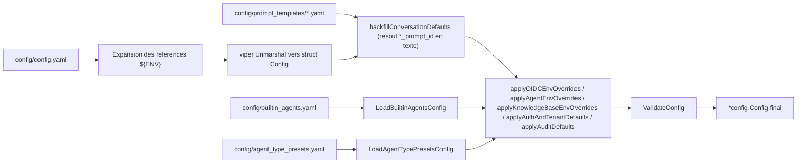

# Guide de configuration

La configuration de WeKnora repose sur **quatre couches**, par **priorité croissante** :

| Couche | Emplacement | Rôle |
| --- | --- | --- |
| Fichier principal | `config/config.yaml` | Valeurs par défaut structurées, distribuées avec l’image |
| Modèles / préréglages | `config/prompt_templates/*.yaml`, `builtin_agents.yaml`, `agent_type_presets.yaml`, `builtin_models.yaml`, `models.json` | Prompts, agents intégrés, modèles intégrés, catalogue des fournisseurs |
| Variables d’environnement | `.env` / environment du conteneur | Surcharges au déploiement ; redémarrage requis après modification |
| Paramètres système à l’exécution | Table `system_settings` en base, interface « Paramètres → Système » | Paramètres modifiables en ligne, prioritaires sur les variables d’environnement ; effet immédiat pour la plupart |

Le mode d’inscription, les politiques d’espaces et quotas, la liste blanche SSRF, la concurrence des tâches et les plafonds de concurrence des modèles sont configurables à l’exécution. Après modification dans la console, la valeur en base prime sur la variable d’environnement ; seule la réinitialisation d’un paramètre (`DELETE /api/v1/system/admin/settings/:key`) rétablit la variable d’environnement ou la valeur par défaut intégrée. Si une variable d’environnement ne semble pas appliquée, vérifiez d’abord qu’aucune configuration à l’exécution n’existe pour cette clé. Liste complète dans [Administration plateforme et administrateur système](../03-features/20-platform-admin.md).

La structure principale est définie dans `internal/config/config.go`. Signification, valeurs par défaut et conditions d’application de chaque option ci-dessous.

## Mécanisme de chargement

Flux de `LoadConfig()` dans `internal/config/config.go` :

1. viper recherche `config.yaml` dans l’ordre : répertoire courant → `./config` → `$HOME/.appname` → `/etc/appname/` ;
2. **Expansion des variables d’environnement** : remplacement par regex dans le fichier ; `${ENV_VAR}` est remplacé par la valeur homonyme ; si la variable est absente, le littéral `${ENV_VAR}` est conservé (pour exposer les erreurs de config) ;
3. viper active `AutomaticEnv()` avec le séparateur de clé `.` mappé en `_` (ex. `server.port` peut être surchargé par `SERVER_PORT`) ;
4. chargement des modèles de prompts depuis `config/prompt_templates/*.yaml`, puis **remplissage** des champs `xxx_prompt_id` dans la config conversation (`backfillConversationDefaults`) ;
5. chargement de `builtin_agents.yaml` (agents intégrés) et `agent_type_presets.yaml` (préréglages de type Agent), résolution des références `system_prompt_id` ;
6. application des surcharges par variables d’environnement (groupes OIDC, Agent, KnowledgeBase, Auth/Tenant, Audit) puis `ValidateConfig`.



## `config/config.yaml` section par section

### server (`ServerConfig`)

| Nom | Type | Défaut | Description |
| --- | --- | --- | --- |
| `server.port` | int | 8080 | Port d’écoute HTTP, plage validée 1–65535 |
| `server.host` | string | "0.0.0.0" | Adresse d’écoute |
| `server.log_path` | string | vide | Chemin du fichier de logs (aussi `LOG_PATH`) |
| `server.shutdown_timeout` | duration | 30s | Budget total d’arrêt gracieux ; vidage des connexions et nettoyage partagent ce délai, 5s réservés au nettoyage par défaut |

### conversation (`ConversationConfig`) — pipeline Q&R avec recherche

| Nom | Type | Défaut (config.yaml) | Description |
| --- | --- | --- | --- |
| `max_rounds` | int | 5 | Nombre de tours d’historique multi-tours conservés |
| `keyword_threshold` | float | 0.3 | Score minimum pour la recherche par mots-clés |
| `embedding_top_k` | int | 30 | Nombre de résultats en recherche vectorielle (>=0) |
| `vector_threshold` | float | 0.2 | Seuil de similarité vectorielle (0–1) |
| `rerank_top_k` | int | 30 | Nombre conservé après rerank |
| `rerank_threshold` | float | 0.3 | Score minimum rerank (-10–10) |
| `fallback_strategy` | string | "model" | Si aucun rappel : `model` (modèle en secours) ou réponse fixe |
| `fallback_response` | string | "Sorry, I am unable to answer this question." | Texte de secours fixe |
| `enable_rewrite` | bool | true | Résolution de coréférence / réécriture de requête multi-tours |
| `enable_query_expansion` | bool | true | Expansion de requête |
| `enable_rerank` | bool | true | Activer le rerank |
| `fallback_prompt_id` | string | "default_fallback_prompt" | ID du modèle de prompt de secours (`prompt_templates/fallback.yaml`, mode:"model") |
| `rewrite_prompt_id` | string | "default_rewrite" | ID du modèle de réécriture (content côté système + user côté utilisateur) |
| `generate_summary_prompt_id` | string | "default_summary" | ID du modèle de profil document (résumé court + gist/thème/type/questions typiques, sortie JSON) |
| `generate_kb_description_prompt_id` | string | "default_kb_description" | ID pour la description de base de connaissances (agrégat de profils, pas le corps du document) |
| `generate_session_title_prompt_id` | string | "default_session_title" | ID pour le titre de session |
| `extract_entities_prompt_id` / `extract_relationships_prompt_id` | string | "default_extract_entities" / "default_extract_relationships" | ID d’extraction graphe (`graph_extraction.yaml`) |
| `generate_questions_prompt_id` | string | "default_generate_questions" | ID pour questions pré-générées |

`conversation.summary` (`SummaryConfig`, paramètres de génération de réponse) :

| Nom | Type | Défaut | Description |
| --- | --- | --- | --- |
| `max_input_chars` | int | 8192 | Caractères max envoyés au LLM. Le profil document n’a besoin que du début pour le thème ; 8k suffit ; 16384/24576 multiplient le coût de résumé par document |
| `temperature` | float | 0.3 | Température de génération |
| `repeat_penalty` | float | 1.0 | Pénalité de répétition |
| `max_completion_tokens` | int | 1024 | Tokens max générés (champs JSON du profil courts) |
| `no_match_prefix` | string | `<think>\n</think>\nNO_MATCH` | Préfixe de sortie modèle déclenchant le fallback « non trouvé » |
| `prompt_id` | string | "default_kb" | ID du prompt système (`system_prompt.yaml`) |
| `context_template_id` | string | "default_context" | ID d’assemblage du contexte (`context_template.yaml`) |
| `max_tokens` / `top_k` / `top_p` / `frequency_penalty` / `presence_penalty` / `seed` / `thinking` | divers | non définis | Paramètres d’échantillonnage optionnels passés au modèle ; `thinking` est `*bool` pour le mode réflexion |

### knowledge_base (`KnowledgeBaseConfig`) — découpage global par défaut

| Nom | Type | Défaut | Description |
| --- | --- | --- | --- |
| `chunk_size` | int | 512 | Taille de chunk par défaut (>0 et > overlap) |
| `chunk_overlap` | int | 50 | Chevauchement |
| `split_markers` | []string | `["\n\n", "\n", "。"]` | Marqueurs de découpage |
| `keep_separator` | bool | false | Conserver le séparateur |
| `document_process_timeout` | duration | 2h | Timeout total par tâche de traitement document (env `WEKNORA_DOCUMENT_PROCESS_TIMEOUT`) |
| `docreader_call_timeout` | duration | 30m | Timeout par appel RPC DocReader (env `WEKNORA_DOCREADER_CALL_TIMEOUT`), doit être inférieur au précédent |
| `image_processing.enable_multimodal` | bool | true | Traitement multimodal des images à l’upload (OCR/Caption) |

> Chaque base de connaissances peut surcharger ces défauts via `ChunkingConfig`.

### extract (`ExtractManagerConfig`) — modèles d’extraction graphe

`extract.extract_graph` / `extract.extract_entity` / `extract.fabri_text` définissent les textes d’instruction (`description`), les étiquettes de relation autorisées (`tags`, défaut `Author`, `Alias`) et les exemples few-shot (`examples` : `text` + `node` + `relation`). L’assistant d’initialisation « essai d’extraction / génération de texte exemple » utilise ces réglages (`%s` dans `fabri_text.with_tag` / `with_no_tag` remplacé par la liste de tags).

### tenant (`TenantConfig`)

| Nom | Type | Défaut | Description |
| --- | --- | --- | --- |
| `enable_cross_tenant_access` | bool | false | Accès inter-espaces pour utilisateurs avec `CanAccessAllTenants` (réseau interne) |
| `enable_rbac` | *bool | true | RBAC strict par espace ; `false` explicite = mode gris : contrôles de rôle logués sans blocage dans l’espace, accès inter-espaces toujours bloqué (env `WEKNORA_TENANT_ENABLE_RBAC`) |
| `max_owned_per_user` | int | 0 (défaut handler) | Nombre max d’espaces créés par un non super-admin ; <0 désactive la limite (env `WEKNORA_TENANT_MAX_OWNED_PER_USER`) |
| `self_service_creation_enabled` | *bool | true | Les utilisateurs peuvent-ils créer un espace (env `WEKNORA_TENANT_SELF_SERVICE_CREATION_ENABLED`) |
| `default_session_name` / `default_session_title` / `default_session_description` | string | vide | Textes par défaut des nouvelles sessions |

### Sections supportées par le struct mais absentes du fichier par défaut

Segments présents dans `Config`, ajoutables à `config.yaml` (souvent aussi via variables d’environnement) :

| Segment | Struct | Champs clés et défauts |
| --- | --- | --- |
| `auth` | `AuthConfig` | `registration_mode` : `self_serve` (défaut, inscription ouverte) / `invite_register` (sur invitation) / `invite_only` (inscription interdite, avec `DISABLE_REGISTRATION=true`) ; `default_tenant_mode` : `create_personal` (défaut) / `tenantless` |
| `audit` | `AuditConfig` | `retention_days` : rétention des logs d’audit, 90 si omis ; 0 désactive le nettoyage ; <0 erreur de validation (env `WEKNORA_AUDIT_RETENTION_DAYS`) |
| `oidc_auth` | `OIDCAuthConfig` | `enable`, `issuer_url`, `jwks_uri`, `discovery_url` (sinon dérivé de issuer + `/.well-known/openid-configuration`), `client_id`, `client_secret`, endpoints, `scopes` (défaut `openid profile email`), `user_info_mapping.username` (défaut `name`) / `email` (défaut `email`) ; tout surchargeable via `OIDC_AUTH_*` |
| `agent` | `AgentConfig` | `llm_call_timeout` : timeout appel LLM en secondes (défaut 120, env `WEKNORA_AGENT_LLM_TIMEOUT`) ; `tool_approval_timeout_seconds` : attente approbation outil MCP (défaut 600, env `WEKNORA_AGENT_TOOL_APPROVAL_TIMEOUT`) |
| `im` | `IMConfig` | Concurrence Q&R canaux IM : `workers` (5), `global_max_workers` (0=illimité, Redis requis), `max_queue_size` (50), `max_per_user` (3), `rate_limit_window` (60s), `rate_limit_max` (10) |
| `docreader` | `DocReaderConfig` | `addr` (gRPC ex. `docreader:50051` ou URL HTTP), `transport` : `grpc` (défaut) / `http` ; souvent `DOCREADER_ADDR` / `DOCREADER_TRANSPORT` |
| `vector_database` | `VectorDatabaseConfig` | `driver` (souvent env `RETRIEVE_DRIVER`) |
| `stream_manager` | `StreamManagerConfig` | `type` : `memory` / `redis` ; `redis.address/username/password/db/prefix/ttl` ; `cleanup_timeout` (env `STREAM_MANAGER_TYPE`, `REDIS_*`) |
| `web_search` | `WebSearchConfig` | `timeout` : timeout recherche web en secondes |
| `models` | `[]ModelConfig` | Liste statique legacy (`type`/`source`/`model_name`/`parameters`) ; préférer `builtin_models.yaml` ou l’interface |
| `frontend_base_url` | string | vide | Origin public du SPA pour liens absolus (invitations, etc.) (env `FRONTEND_BASE_URL`) |

## Variables d’environnement importantes

Variables issues de la section `environment` app/docreader dans `docker-compose.yml`, `.env.example` et `os.Getenv` dans le code. En production, modifier au minimum : `DB_USER/DB_PASSWORD/DB_NAME`, `REDIS_PASSWORD`, `JWT_SECRET`, `SYSTEM_AES_KEY`.

### Base d’exécution

| Nom | Défaut | Description |
| --- | --- | --- |
| `GIN_MODE` | release | `debug` (Swagger) / `release` production |
| `LOG_LEVEL` / `LOG_PATH` / `WEKNORA_LOG_FORMAT` | debug / vide / vide | Niveau, fichier (vide = stdout seulement), format personnalisé (doit contenir `%msg` si défini ; compatibilité `LOG_FORMAT` si non défini ; pas le mot-clé `json`) |
| `LLM_DEBUG_LOG` | false | true écrit `llm_debug.log` à côté de LOG_PATH |
| `TZ` | Asia/Shanghai | Fuseau horaire |
| `DEFAULT_LOCALE` | vide | Langue par défaut de l’interface (conteneur frontend) : `zh-CN` / `en-US` / `ru-RU` / `ko-KR` / `ja-JP`, valeurs invalides ignorées. Utilisateurs n’ayant pas changé la langue : langue choisie > cette variable > `zh-CN` ; redémarrer le conteneur frontend, pas de rebuild |
| `WEKNORA_LANGUAGE` | vide | Langue de traitement documentaire (questions/résumés). Priorité : cette variable > `Accept-Language` > `zh-CN` intégré. Indépendant de la langue UI (ex. UI anglais, documents coréens). Canaux IM sans langue de réponse utilisent aussi cette variable (sinon `zh-CN`) |
| `AUTO_MIGRATE` | true | Migrations DB au démarrage |
| `AUTO_RECOVER_DIRTY` | true | Répare l’état dirty de golang-migrate. Pour diagnostic manuel, mettre temporairement false, sinon le démarrage réécrit la version — voir [Base de données et migrations](../06-development/02-database-schema.md) |
| `WEKNORA_TRUSTED_PROXIES` | vide | CIDR de proxies de confiance gin (séparés par virgules) |
| `MAX_SKILL_BUNDLE_SIZE_MB` | 256 MiB (min MAX_FILE_SIZE_MB, max 512 MiB) | Limite upload/téléchargement ZIP de skills ; le proxy doit accepter la même taille de corps |
| `MAX_FILE_SIZE_MB` | 50 | Taille max upload (app/frontend/docreader) ; Helm : `global.maxFileSizeMB` |
| `CONCURRENCY_POOL_SIZE` | 5 | Pool de concurrence générique |
| `APP_EXTERNAL_URL` / `FRONTEND_BASE_URL` | vide | URL externe pour images/fichiers IM / origin frontend |
| `RESOURCE_URL_MODE` | handle | Forme des références fichiers dans les réponses API : `handle` = `resource://` interne, `public` = lien signé temporaire. Surcharge par requête `?resource_urls=`, voir [Vue d’ensemble API](../04-api/01-api-overview.md) |

`APP_EXTERNAL_URL` affecte le rendu d’images de base de connaissances dans les canaux IM. La plateforme IM a besoin d’URL http(s) publiques, deux options :

1. Backend de stockage public (endpoint objet public, ou `MINIO_ENDPOINT` public) : `resource://` retombe sur URL présignée, pas besoin de cette variable ;
2. Définir `APP_EXTERNAL_URL` : images `resource://` réécrites en `<APP_EXTERNAL_URL>/r/<token>` via WeKnora (nginx doit proxy `/r/`, image frontend officielle inclut cette location).

MinIO interne et backend `local` nécessitent l’option 2. Canaux IM actifs sans variable : WARN au démarrage ; si la réécriture n’est pas http(s), référence conservée avec alerte actionnable.

Les quatre formes d’URL et la prise en charge par canal : [Accès public aux images et fichiers](../03-features/21-file-access.md).

### Base de données et files

| Nom | Défaut | Description |
| --- | --- | --- |
| `DB_DRIVER` | postgres | `postgres` / `sqlite` (Lite) |
| `DB_HOST` / `DB_PORT` / `DB_USER` / `DB_PASSWORD` / `DB_NAME` | postgres / 5432 / vide / vide / vide | Connexion PostgreSQL (obligatoire) |
| `DB_PATH` | — | Chemin fichier si `DB_DRIVER=sqlite` |
| `STREAM_MANAGER_TYPE` | vide (compose utilise redis) | `redis` / `memory` |
| `REDIS_ADDR` / `REDIS_USERNAME` / `REDIS_PASSWORD` / `REDIS_DB` / `REDIS_PREFIX` | redis:6379 / … | Connexion Redis |
| `REDIS_USE_TLS` | false | **Active TLS** pour Redis managé ; `REDIS_TLS_SERVER_NAME` pour SNI/validation ; `REDIS_TLS_INSECURE_SKIP_VERIFY` pour certificats auto-signés (dev uniquement) |
| `WEKNORA_REDIS_NAMESPACE` | vide | Suffixe d’espace de noms si Redis partagé |
| `WEKNORA_SANDBOX_USER_ALLOCATION` | vide | `enabled` : sessions d’un même utilisateur partagent un sandbox (Redis requis, mettre à jour toutes les instances avant activation) |
| `WEKNORA_ASYNQ_CORE_CONCURRENCY` etc. | 8 / 2 / 12 / 4 / 6 | Concurrence Asynq par file (core/postprocess/enrichment/maintenance/shared), aussi `WEKNORA_WIKI_ASYNQ_CONCURRENCY=8`, `WEKNORA_MODEL_MAX_CONCURRENCY=32` |

### Moteur de recherche et base vectorielle

| Nom | Défaut | Description |
| --- | --- | --- |
| `RETRIEVE_DRIVER` | postgres | `postgres` / `elasticsearch_v7` / `elasticsearch_v8` / `qdrant` / `milvus` / `weaviate` / `opensearch` / `doris` / `tencent_vectordb` / `sqlite` (Lite) ; plusieurs drivers séparés par virgule |
| `ELASTICSEARCH_ADDR/USERNAME/PASSWORD/INDEX` | vide | Elasticsearch |
| `QDRANT_HOST/PORT/COLLECTION/API_KEY/USE_TLS` | qdrant / 6334 / weknora_embeddings / vide / false | Qdrant |
| `MILVUS_ADDRESS/COLLECTION/METRIC_TYPE/...` | milvus:19530 / weknora_embeddings / IP | Milvus |
| `OPENSEARCH_ADDR/USERNAME/PASSWORD/INDEX/INSECURE_SKIP_VERIFY` | vide | OpenSearch |
| `WEAVIATE_HOST/GRPC_ADDRESS/SCHEME/AUTH_ENABLED/API_KEY` | vide | Weaviate |
| `DORIS_ADDR/HTTP_PORT/DATABASE/USERNAME/PASSWORD/TABLE_PREFIX/COMPAT_MODE` | vide | Apache Doris 4.1+ |
| `TENCENT_VECTORDB_ADDR/USERNAME/API_KEY/DATABASE/COLLECTION/REPLICA_NUMBER` | vide | Tencent VectorDB |
| `MULTI_STORE_RETRIEVE_TIMEOUT_SEC` | vide | Timeout recherche parallèle multi-moteurs |
| `NEO4J_ENABLE` / `NEO4J_URI` / `NEO4J_USERNAME` / `NEO4J_PASSWORD` | vide / bolt://neo4j:7687 / neo4j / password | Seul interrupteur graphe de connaissances (`ENABLE_GRAPH_RAG` obsolète depuis v0.1.6) |

### Stockage de fichiers

| Nom | Défaut | Description |
| --- | --- | --- |
| `STORAGE_TYPE` | local | `local` / `minio` / `cos` / `tos` / `s3` / `obs` / `oss` |
| `STORAGE_ALLOW_LIST` | vide | Liste blanche des types choisissables : `local`, `minio`, `cos`, `tos`, `s3`, `oss`, `ks3`, `obs` |
| `LOCAL_STORAGE_BASE_DIR` | /data/files | Racine stockage local |
| `MINIO_ENDPOINT/ACCESS_KEY_ID/SECRET_ACCESS_KEY/BUCKET_NAME/USE_SSL` | minio:9000 / minioadmin / minioadmin / vide / false | MinIO |
| `COS_SECRET_ID/SECRET_KEY/REGION/BUCKET_NAME/APP_ID/PATH_PREFIX` | vide | Tencent COS (TEMP_BUCKET/TEMP_REGION) |
| `S3_*` / `OBS_*` / `OSS_*` / `TOS_*` | voir `.env.example` section B4 | AWS S3 / Huawei OBS / Alibaba OSS / Volcano TOS |

Pour AWS S3, `S3_ACCESS_KEY` / `S3_SECRET_KEY` peuvent être **tous deux vides** : chaîne de credentials SDK (IAM Role EC2/ECS/EKS, IRSA, env, profil). Les deux doivent être renseignés ou vides ensemble. `S3_ENDPOINT` vide = endpoint standard de la région.

### Modèles et inférence

| Nom | Défaut | Description |
| --- | --- | --- |
| `OLLAMA_BASE_URL` | http://host.docker.internal:11434 | URL Ollama locale unique ; modèles vectoriels et chat `source=local` ; sinon `http://localhost:11434` |
| `OLLAMA_OPTIONAL` | true | Ollama indisponible : alerte sans bloquer le démarrage |
| `BATCH_EMBED_SIZE` | vide | Taille des batchs d’embedding |
| `VLM_HTTP_TIMEOUT_SECONDS` | 180 | Timeout requête VLM |
| `GENERATE_QUESTIONS_MAX_TOKENS` | 2048 | Budget complétion pour questions document ; modèles de raisonnement incluent tokens de réflexion |
| `VLM_MAX_TOKENS` | 5000 | Budget tokens complétion VLM distant (inclut réflexion ; `finish_reason=length` sur scan → augmenter) |
| `BUILTIN_MODELS_CONFIG` | config/builtin_models.yaml | Chemin des modèles intégrés (ci-dessous) |
| `MODELS_CONFIG` | config/models.json | Fichier de surcharge catalogue fournisseurs, voir [Gestion des modèles](../03-features/06-models.md) |
| `WEKNORA_LLM_STREAM_RAW_DUMP` / `_DIR` | vide | Dump brut du flux LLM (dépannage) |

Le nom du modèle vectoriel ne vient pas d’une variable d’environnement seule : enregistrement `type=Embedding`, `source=local`, `name` = modèle Ollama (ex. CLI `nomic-embed-text` dim 768 ; démarrage rapide `bge-m3` dim 1024). Nom vide → `nomic-embed-text`. `EMBEDDING_MODEL_NAME` seulement si référencé dans `builtin_models.yaml` (section « config/builtin_models.yaml.example » et `config/builtin_models.yaml.example`). Guide 8 Go sans poids Ollama ; Neo4j off par défaut (profile `neo4j`).

### Authentification, locataires et sécurité

| Nom | Défaut | Description |
| --- | --- | --- |
| `JWT_SECRET` | vide | Clé JWT (obligatoire, `openssl rand -hex 32`). Vide ou exemple → aléatoire à chaque démarrage, reconnexion requise ; réplicas identiques |
| `SYSTEM_AES_KEY` | vide | Clé AES-256 pour champs sensibles en base, **32 octets** (`openssl rand -hex 16`) ; perte = données chiffrées irrécupérables ; v0.4.0+ remplace `TENANT_AES_KEY`/`CRYPTO_*` |
| `SYSTEM_SIGNING_KEY` | vide (fallback `SYSTEM_AES_KEY`) | Signature liens de session et fichiers présignés (`openssl rand -hex 32`). Non défini → `SYSTEM_AES_KEY` ; manquant/court/exemple → pas de liens signés. Rotation invalide les liens existants ; même valeur sur tous les réplicas |
| `DISABLE_REGISTRATION` | false | true → `invite_only` au démarrage ; paramètres runtime DB prioritaires |
| `WEKNORA_AUTH_DEFAULT_TENANT_MODE` | create_personal | Politique après inscription (`create_personal` / `tenantless`) |
| `WEKNORA_TENANT_ENABLE_RBAC` | (true par défaut) | RBAC par espace |
| `WEKNORA_TENANT_ENABLE_CROSS_TENANT_ACCESS` | false | Accès inter-espaces |
| `WEKNORA_TENANT_SELF_SERVICE_CREATION_ENABLED` | true | Création d’espace par utilisateurs |
| `WEKNORA_TENANT_MAX_OWNED_PER_USER` | vide | Plafond d’espaces possédés |
| `WEKNORA_TENANT_AUTO_CREATE_API_KEY` | false | Clé API full_access à la création d’espace (legacy) |
| `WEKNORA_TENANT_DEFAULT_STORAGE_QUOTA_GB` | 10 | Quota stockage nouvel espace (Go) |
| `WEKNORA_TENANT_DEFAULT_STORAGE_QUOTA_MB` | 0 | Si >0, prime sur Go |
| `WEKNORA_AUTH_COMPLEX_PASSWORD_ENABLED` | false | Politique mot de passe complexe ; paramètre système `auth.complex_password_enabled` prioritaire |
| `WEKNORA_TENANT_AUTO_ACCEPT_INVITATION` | false | Invitation e-mail rejoint directement si compte existe ; `tenant.auto_accept_invitation` prioritaire |
| `OIDC_AUTH_JWKS_URI` | vide | JWKS pour id_token ; discovery possible |
| `WEKNORA_INVITATION_TTL` | 168h | Validité lien d’invitation |
| `WEKNORA_AUDIT_RETENTION_DAYS` | 90 | Rétention logs d’audit |
| `WEKNORA_BOOTSTRAP_SYSTEM_ADMIN_EMAIL` | vide | Premier admin système : **ne crée pas l’utilisateur** ; l’e-mail doit déjà être inscrit, promotion au prochain démarrage si aucun admin ; ignoré si admin existe — voir [Locataires, utilisateurs et auth](../03-features/01-tenant-auth.md) |
| `OIDC_AUTH_ENABLE` et `OIDC_AUTH_*` / `OIDC_USER_INFO_MAPPING_*` | false / vide | OIDC complet |
| `SSRF_WHITELIST` / `SSRF_WHITELIST_EXTRA` | vide / `searxng,qdrant,milvus,weaviate,doris-fe,doris-be,minio` (app seulement) | Liste blanche SSRF sortante. `SSRF_WHITELIST` partagé app/docreader ; compose ne met `SSRF_WHITELIST_EXTRA` que sur app |
| `SSRF_DNS_WHITELIST_ONLY` | false | Sorties uniquement liste blanche (app et docreader). Hosts hors liste refusés **avant DNS** ; IP directe hors liste refusée à la validation URL ; CIDR n’appliquent pas aux noms de domaine. Booléen (`1/t/true` on) ; **valeur non vide non parsable = activé**. Préparation ci-dessous |
| `IMAGE_HOST_KEEP_URL` | vide | Domaines conservant l’URL originale des images |

#### Avant d’activer `SSRF_DNS_WHITELIST_ONLY`

La liste blanche devient la politique sortante complète : inclure tous les hôtes dans `SSRF_WHITELIST` ou `SSRF_WHITELIST_EXTRA`. Pour docreader et services compose, utiliser `SSRF_WHITELIST` partagé (`SSRF_WHITELIST_EXTRA` vide par défaut sur docreader). Ajouter typiquement :

- Adresses modèles (chat / embedding / rerank / VLM / ASR, Ollama local `localhost`)
- OIDC (`dex` ou IdP), MCP, `docreader`
- Object storage externe, bases vectorielles, Langfuse
- Plan de contrôle sandbox : « endpoints privés autorisés » ne contourne plus la liste

Chemins sortants non couverts, par impact :

1. **Résolution runtime gRPC vectoriel** : clients qdrant/milvus résolvent la cible côté gRPC ; contrôle par nom **avant** création client (env au démarrage, config console via validation URL).
2. **Export OTLP Langfuse** : client HTTP propre, hors mécanisme. `LANGFUSE_HOST` SaaS par défaut ; déploiement offline → désactiver traçage ou URL interne.
3. **`HTTP(S)_PROXY`** : proxy autorisé si host du dial == host de l’URL proxy ; sinon refusé. Offline → unset proxy ou ajouter l’hôte proxy à la liste blanche.

### Paramètres de build d’image (build depuis les sources)

Uniquement pour `docker compose build` / `make docker-build-frontend`. Autres paramètres (proxy Go, miroirs apt) : `.env.example` A1.

| Nom | Défaut | Description |
| --- | --- | --- |
| `VITE_FRONTEND_COMMIT` | unknown | Commit court frontend page « Infos système » ; rempli par `make docker-build-frontend` / `start_all.sh --no-pull` |
| `VERSION_ARG` | vide (fallback `VERSION`) | Version app page « Infos système » |
| `COMMIT_ID_ARG` / `BUILD_TIME_ARG` / `GO_VERSION_ARG` | vide (unknown) | Commit / heure build / version Go |
| `NPM_REGISTRY` | vide | Registry npm en build, ex. `https://registry.npmmirror.com` |
| `NODE_MAX_OLD_SPACE_SIZE` | 4096 | Heap Node pour build Vite (MB), 2048 si Docker Desktop limité |

### Parsing Docreader (conteneur docreader)

| Nom | Défaut | Description |
| --- | --- | --- |
| `DOCREADER_ADDR` / `DOCREADER_TRANSPORT` | docreader:50051 / grpc | Adresse et transport app (`grpc`/`http`) |
| `DOCREADER_GRPC_MAX_WORKERS` / `DOCREADER_GRPC_PORT` / `DOCREADER_GRPC_MAX_FILE_SIZE_MB` | 4 / 50051 / suit MAX_FILE_SIZE_MB | Paramètres serveur gRPC |
| `GRPC_TLS_ENABLED/CERT/KEY/CA/SERVER_NAME`, `GRPC_MTLS_REQUIRE_CLIENT_CERT`, `GRPC_AUTH_TOKEN` | false / vide | TLS/mTLS et token app↔docreader |
| `DOCREADER_PDF_RENDER_DPI` / `DOCREADER_PDF_JPEG_QUALITY` / `DOCREADER_PDF_RENDER_MAX_EDGE` | 200 / 85 / 2000 | Rendu PDF |
| `DOCREADER_PDF_FORCE_SCANNED` / `DOCREADER_PDF_SCAN_IMAGE_RATIO` / `DOCREADER_PDF_SCAN_MIN_CHARS` | false / défaut code | Détection scan |
| `DOCREADER_ODL_HYBRID` / `DOCREADER_ODL_HYBRID_URL` / `DOCREADER_ODL_HYBRID_MODE` / `DOCREADER_ODL_HYBRID_FALLBACK` | off / http://odl-hybrid:5002 / auto / false | Parsing hybride OpenDataLoader |
| `DOCREADER_XLSX_PERCENT_AS_TEXT` / `DOCREADER_XLSX_PCT_ROW_HINT_MIN` | false / 0 | Affichage pourcentage et inférence ligne ; voir [Parsing](../03-features/03-document-parsing.md) |
| `DOCREADER_HTML_MAIN_CONTENT` | false | HTML upload : indexer le corps principal (même stratégie qu’import URL) |
| Autres `DOCREADER_PDF_*` (20+ options) | voir commentaires compose docreader | Mise en page et extraction PDF |
| `DOCREADER_EXTERNAL_HTTP_PROXY` / `_HTTPS_PROXY` | vide | Proxy sortant docreader |

### Prétraitement OCR des images {#image-preprocess}

Limites ressources du prétraitement Docreader ; n’active pas automatiquement les options de base de connaissances.

| Nom | Défaut | Description |
| --- | --- | --- |
| `DOCREADER_PREPROCESS_MAX_WORKERS` | 1 | Concurrence max prétraitement |
| `DOCREADER_PREPROCESS_TIMEOUT_SECONDS` | 30 | Délai par tâche |
| `DOCREADER_PREPROCESS_THREADS` | 2 | Threads par tâche |
| `DOCREADER_PREPROCESS_MEMORY_MB` | 2048 | Limite mémoire processus (MiB) |
| `DOCREADER_PREPROCESS_MAX_PIXELS` | 16000000 | Plafond pixels entrée |
| `DOCREADER_PREPROCESS_MAX_EDGE` / `DOCREADER_PREPROCESS_PROBE_EDGE` | 2000 / 2000 | Bord max sortie et sonde |

Base de connaissances : prétraitement `off` / `auto` / `always`. Retour image originale si charge ou échec — voir [Parsing documentaire](../03-features/03-document-parsing.md).

### Génération de descriptions et connexions sortantes

| Variable | Défaut | Effet |
| --- | --- | --- |
| `KNOWLEDGE_BASE_PROFILE_MAX_TOKENS` | 2048 | Budget tokens description de base ; invalide → défaut ; `no gist` sur modèle de raisonnement → augmenter |
| `WEKNORA_OUTBOUND_DIAL_TIMEOUT` | 5s | Timeout dial connexions sortantes SSRF (duration Go ex. `10s`) ; pas le timeout total requête/modèle |

### Agent, Skills et pièces jointes

| Nom | Défaut | Description |
| --- | --- | --- |
| Config sandbox | Page paramètres par espace | Backend, identifiants, modèles, timeouts, accès réseau privé |
| `WEKNORA_SANDBOX_USER_ALLOCATION` | non activé | `enabled` pour réutilisation sandbox par utilisateur, Redis requis — voir [Allocation](../03-features/22-skills-sandbox.md#user-sandbox) |
| `WEKNORA_SANDBOX_DOCKER_ENABLED` | false | Fallback backend Docker sandbox ; admin peut activer en UI (DB prioritaire). Désactivé par défaut (`docker.sock` ≈ root hôte) |
| `WEKNORA_AGENT_LLM_TIMEOUT` | 120s | Timeout appel LLM Agent |
| `WEKNORA_WEB_FETCH_TIMEOUT` | 3m | Budget `web_fetch` par page (HTTP et chromedp partagent ce budget). Vide/invalide → défaut ; couche outil +5s. Pipeline quick-answer reste 15s |
| `WEKNORA_AGENT_TOOL_APPROVAL_TIMEOUT` / `_FAIL_OPEN` | 600s / fail-close | Approbation outil MCP |
| `WEKNORA_CHAT_ATTACHMENT_TTL_HOURS` / `_WAIT_TIMEOUT_SEC` / `_OCR_CONCURRENCY` / `_OCR_MAX_PAGES` | 24 / 60 / 8 / 8 | TTL pièces non référencées, attente lecture/OCR ; pièces en session/fork non purgées par TTL |
| `WEKNORA_HOUSEKEEPING_ENABLED` | activé | Nettoie données bloquées en processing |
| `WEKNORA_DOCUMENT_PROCESS_TIMEOUT` / `WEKNORA_DOCREADER_CALL_TIMEOUT` | 2h / 30m | Tâche document et RPC |
| `WEKNORA_PADDLEOCR_VL_TIMEOUT` | 1000s | Timeout HTTP PaddleOCR-VL self-hosted (duration positive) ; marge sur timeouts externes |
| `WEKNORA_MINERU_TIMEOUT` | 1000s | Timeout MinerU self-hosted (V1 tâche entière, legacy `/file_parse`) |
| `WEKNORA_MINERU_CLOUD_TIMEOUT` | 30m | Polling MinerU cloud (mineru.net) |
| `WEKNORA_PADDLEOCR_VL_CLOUD_TIMEOUT` | 600s | Polling PaddleOCR-VL cloud (AI Studio) |
| `WEKNORA_WEKNORACLOUD_TIMEOUT` | 20m | Polling docreader managé WeKnoraCloud ; < `WEKNORA_DOCREADER_CALL_TIMEOUT` |

Sandbox : config par espace/API — [Skills et sandbox](../03-features/22-skills-sandbox.md). Mémoire long terme et auto-tags désactivés par défaut (`memory_config`, `auto_tag_config`), pas de variables globales à la place.

### Navigateur local (BrowserSkill, optionnel)

Extension Chrome connecte le navigateur local à WeKnora. Image Docker app inclut `bsk` et l’extension ; URL dérivée de la page courante en général.

| Nom | Défaut | Description |
| --- | --- | --- |
| `BROWSERSKILL_BINARY` | `/opt/weknora/browserskill/bsk` dans l’image | Chemin `bsk` ; déploiement natif : build + config ; vide désactive |
| `BROWSERSKILL_EXTENSION_PATH` | preset image Docker | ZIP extension « installation manuelle » dans Boîte à outils → Connexion navigateur |
| `BROWSERSKILL_PUBLIC_URL` | vide (dérivé page) | Override si gateway domaine/chemin dédié ; distant : `wss://` |
| `BROWSERSKILL_MAX_CONNECTIONS` | 32 | Appareils navigateur simultanés par instance |
| `BROWSERSKILL_INTERNAL_URL` / `BROWSERSKILL_CLUSTER_SECRET` | vide | Multi-réplicas : URL directe entre nœuds (pas LB), secret identique ≥32 caractères |

Voir [Navigateur local](../05-clients/09-local-browser.md).

### Observabilité (Langfuse)

`LANGFUSE_PUBLIC_KEY` + `LANGFUSE_SECRET_KEY` activent automatiquement ; `LANGFUSE_HOST` (défaut SaaS, self-host `http://langfuse-web:3000`), tuning `LANGFUSE_*` ; profile `langfuse` : `LANGFUSE_SALT`, clés, `LANGFUSE_INIT_*`, voir `.env.example` I1/I2.

### Services optionnels : SearXNG et MCP Server

Variables nécessaires seulement avec le profile compose correspondant.

**SearXNG** (`--profile searxng` / `full`) :

| Nom | Défaut | Description |
| --- | --- | --- |
| `SEARXNG_PORT` | 8888 | Port hôte ; ne pas confondre avec `APP_PORT` (8080) — collision → login reçoit HTML 404 SearXNG |
| `SEARXNG_BIND` | 127.0.0.1 | **Localhost seulement** ; rate limit SearXNG désactivé dans le pack WeKnora — ne pas exposer LAN sans durcissement ; `0.0.0.0` explicite si besoin |
| `SEARXNG_SECRET` | vide | Remplace `secret_key` dans `settings.yml` si exposé |

Ajouter `127.0.0.1` à `SSRF_WHITELIST` pour SearXNG local. Voir [Recherche web](../03-features/11-web-search.md).

**MCP Server** (WeKnora pour clients MCP, `--profile full`) :

| Nom | Défaut | Description |
| --- | --- | --- |
| `WEKNORA_API_KEY` | vide | Clé REST pour mcp-server, générée dans Paramètres → API Keys |
| `MCP_SERVER_AUTH_TOKEN` | vide | **Obligatoire HTTP/SSE**, sinon refus au démarrage ; `Authorization: Bearer` |
| `WEKNORA_CHAT_TIMEOUT` | 300 | Timeout lecture REST (secondes) |
| `WEKNORA_VERIFY_SSL` | true | Vérification certificat backend |
| `MCP_ALLOWED_UPLOAD_DIRS` | vide | Répertoires upload autorisés ; vide = outil upload désactivé |

Voir [Intégration MCP](../03-features/08-mcp.md).

## `config/prompt_templates/` : modèles de prompts

Un fichier YAML par type ; structure `templates:` ; champs `PromptTemplate` (`internal/config/config.go`) :

| Champ | Description |
| --- | --- |
| `id` | ID unique, référencé par `*_prompt_id`, agents intégrés, préréglages |
| `name` / `description` | Libellés |
| `content` | Corps prompt système (obligatoire) |
| `user` | Prompt utilisateur (paires system+user, ex. rewrite) |
| `default` | Modèle par défaut du type |
| `mode` | Sous-type (ex. fallback `model`) |
| `has_knowledge_base` / `has_web_search` | Scénarios applicables |
| `i18n` | name/description multilingues (clés locale ex. `zh-CN`) |

Fichiers et IDs :

| Fichier | Usage | IDs de modèles |
| --- | --- | --- |
| `system_prompt.yaml` | Prompt système Q&R (quick-answer / RAG) | `default_kb`, `expert_assistant`, `customer_service`, `technical_support`, `pure_chat`, `web_search_assistant` |
| `context_template.yaml` | Assemblage contexte de recherche | `default_context`, `detailed_context`, `simple_context`, `qa_context` |
| `rewrite.yaml` | Réécriture multi-tours (content+user) | `default_rewrite`, `standard_rewrite`, `strict_rewrite` |
| `fallback.yaml` | Secours non trouvé | `default_fallback`, `polite_fallback`, `brief_fallback`, `model_fallback`, `default_fallback_prompt` |
| `generate_session_title.yaml` | Titre de session | `default_session_title` |
| `generate_summary.yaml` | Résumé document | `default_summary` |
| `generate_questions.yaml` | Questions pré-générées | `default_generate_questions` |
| `keywords_extraction.yaml` | Extraction mots-clés | `default_keywords_extraction` |
| `graph_extraction.yaml` | Entités/relations graphe | `default_extract_entities`, `default_extract_relationships` |
| `agent_system_prompt.yaml` | Agent smart-reasoning | `pure_agent`, `progressive_rag_agent`, `data_analyst`, `wiki_researcher`, `wiki_fixer`, `hybrid_rag_wiki_agent` |
| `intent_prompts.yaml` | Prompts par intention (ID = intention) | `greeting`, `chitchat`, `follow_up`, `image_only`, `summarize`, `web_search`, `doc_only` |

**Personnalisation** : éditer `content` ou ajouter une entrée et changer `*_prompt_id` dans config.yaml ; redémarrage (compose monte `./config/config.yaml`). ID introuvable → log `Warning: xxx_prompt_id not found`.

## `config/agent_type_presets.yaml` : préréglages de type Agent

Préremplissage pour agents smart-reasoning personnalisés : `AgentTypePresetEntry` avec `id`, `i18n`, `config` (zéro ignoré), `kb_filter` optionnel (`any_of` / `all_of` / `none_of`, capacités `vector`, `keyword`, `wiki`, `graph`, `faq`). API `GET /agents/type-presets`.

Cinq préréglages intégrés :

| id | Prompt système | Outils autorisés | Notes |
| --- | --- | --- | --- |
| `rag-qa` | `progressive_rag_agent` | search_knowledge, read_document, list_documents | temperature 0.7, max_iterations 30, FAQ prioritaire |
| `wiki-qa` | `wiki_researcher` | wiki_search, wiki_read_page, read_document, wiki_flag_issue | Base Wiki activée requise |
| `hybrid-rag-wiki` | `hybrid_rag_wiki_agent` | outils Wiki + RAG | max_iterations 40 |
| `data-analysis` | `data_analyst` | data_schema, data_analysis | temperature 0.3 ; `kb_filter: none_of: [faq]` ; csv/xlsx |
| `custom` | aucun | aucun | Configuration manuelle |

Anciens noms d’outils mappés automatiquement à l’exécution (`knowledge_search`, `grep_chunks` → `search_knowledge` ; etc.).

## `config/builtin_agents.yaml` : agents intégrés

Agents distribués visibles par tous les locataires (`BuiltinAgentEntry`). Champs `id`, `avatar`, `is_builtin: true`, `i18n`, `config` complet. Cinq agents :

- `builtin-quick-answer` : `agent_mode: quick-answer`, `system_prompt_id: default_kb`, `context_template_id: default_context`, paramètres de recherche (`embedding_top_k: 10`, seuils FAQ 0.9, etc.) ;
- `builtin-smart-reasoning` : `smart-reasoning`, `agent_type: rag-qa`, `max_iterations: 50` ;
- `builtin-data-analyst`, `builtin-wiki-researcher`, `builtin-wiki-fixer` : analyse tabulaire et Wiki.

`system_prompt_id` résolu au démarrage via `resolveBuiltinAgentPromptIDs`. Modifier le fichier + redémarrage.

## `config/builtin_models.yaml.example` : modèles intégrés déclaratifs

Copier en `config/builtin_models.yaml` (ou `BUILTIN_MODELS_CONFIG`) : entrées écrites à **chaque démarrage** dans `models` avec `is_builtin=true` (décommenter le volume compose). Format :

```yaml
builtin_models:
  - id: builtin-llm-default        # ID stable, mises a jour idempotentes par ID a chaque demarrage
    type: KnowledgeQA              # KnowledgeQA | Embedding | Rerank | VLLM | ASR
    source: remote                 # remote (defaut) | local
    is_default: true               # modele par defaut pour ce type
    name: ${LLM_MODEL_NAME}        # champs string : references ${ENV} (.env via env_file)
    parameters:
      base_url: ${LLM_BASE_URL}
      api_key: ${LLM_API_KEY}
      provider: ${LLM_PROVIDER}    # openai | generic | aliyun | moonshot | ...
      embedding_parameters:        # type Embedding uniquement
        dimension: 1536
        truncate_prompt_tokens: 0
```

Note : `${ENV}` non défini reste littéral ; champs non string en littéraux ; supprimer une entrée du fichier **ne supprime pas** la ligne en base.

Ollama local : `source: local`, `name` = modèle Ollama, `${EMBEDDING_MODEL_NAME}` pour embedding ; `dimension` littéral (ex. `nomic-embed-text` → 768). Voir section « one local Ollama » dans l’exemple.

## Priorité de configuration (mémo)

Pour une même sémantique : **DB `system_settings` (clés enregistrées) > variables d’environnement > config.yaml > défauts code** ; config locataire/base (`RetrievalConfig`, `ChunkingConfig`, etc. en DB) surcharge les défauts globaux à l’exécution. Après `.env`, redémarrer (`docker compose up -d app`) ; air en dev ne relit pas `.env`.
