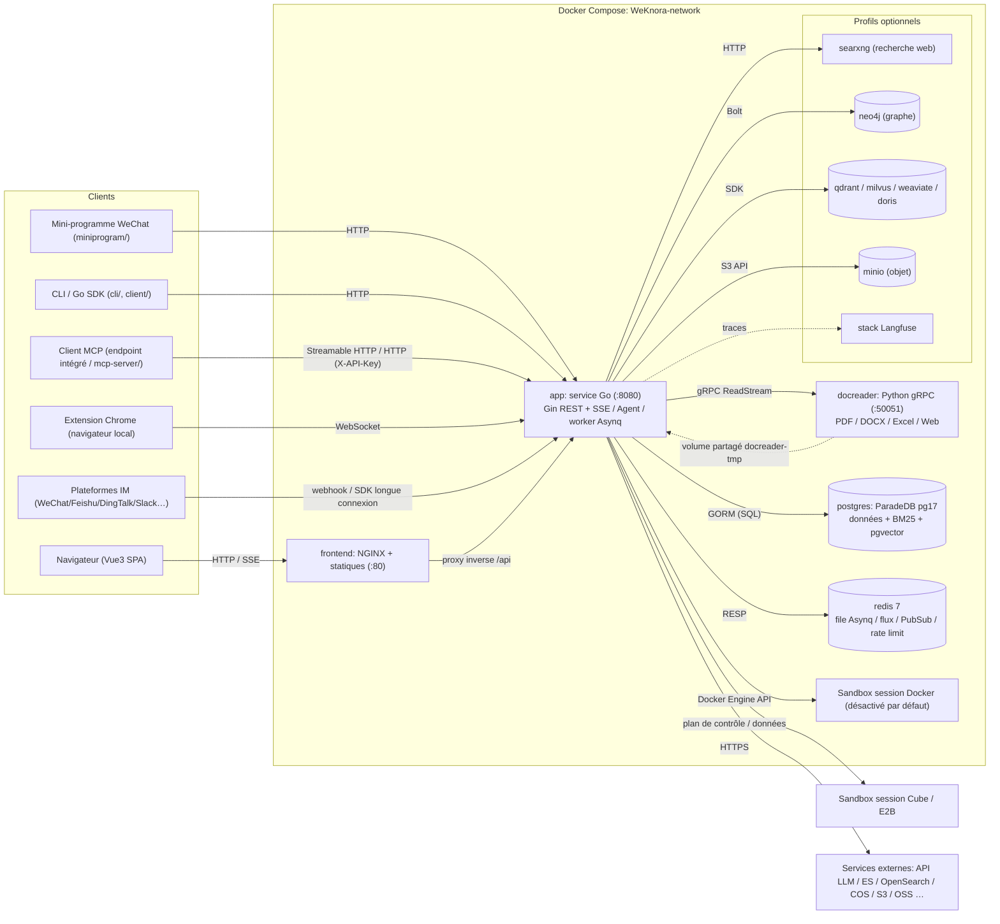
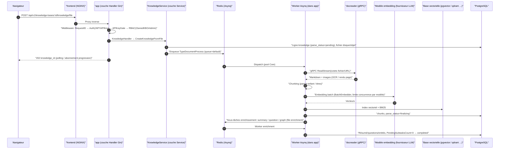

# Architecture globale

WeKnora est composé d’une interface Web, d’un service principal Go et d’un service Python d’analyse de documents. Les données métier sont persistées en base ; Redis planifie les tâches asynchrones. Le stockage vectoriel, le stockage objet, le graphe de connaissances et les services de modèles sont configurables selon le déploiement.

## Assistant et tâches persistantes

L’assistant WeKnora intégré s’appuie sur le moteur Agent existant, un catalogue d’opérations d’administration et la documentation produit livrée avec l’application. Le contexte de page aide à comprendre la tâche ; les actions effectives passent toujours par les autorisations de rôle et de ressource. Les instances de collaboration, les approbations et les suspensions d’exécution sont persistées ; le planificateur d’automatisations démarre des sessions assistant au nom du propriétaire de la tâche et enregistre les exécutions ainsi que les notifications in-app.

Points d’entrée utilisateur : [Assistant](../03-features/26-weknora-assistant.md), [Automatisations](../03-features/27-automations.md) et [Permissions d’exécution](../03-features/28-agent-permissions.md).

## Composition du système {#_1-composition-du-systeme}

WeKnora repose sur une architecture cœur à trois processus — service principal, frontend et microservice d’analyse de documents — plus deux dépendances d’infrastructure, PostgreSQL et Redis. Les autres composants (base vectorielle, graphe de connaissances, recherche Web, etc.) sont optionnels et activables via les profils Docker Compose.

### Services cœur (démarrage par défaut) {#_1-1-services-cur-demarrage-par-defaut}

| Service | Image / build | Port | Rôle |
| --- | --- | --- | --- |
| `app` | `wechatopenai/weknora-app` (`docker/Dockerfile.app`, Go) | `8080` | Backend principal : API REST, recherche RAG, moteur Agent, workers de tâches asynchrones, canaux IM/Embed. Contrôle de santé `GET /health` |
| `frontend` | `wechatopenai/weknora-ui` (`frontend/`, NGINX + artefacts statiques Vue3) | `80` | UI Web ; NGINX sert aussi de reverse proxy et transfère `/api` vers `app` (`APP_HOST` / `APP_BACKEND_PORT` / `APP_SCHEME` peuvent cibler un backend distant) |
| `docreader` | `wechatopenai/weknora-docreader` (`docker/Dockerfile.docreader`, Python) | `50051` (expose uniquement sur le réseau compose, non mappé sur l’hôte) | Microservice d’analyse : serveur gRPC, parsing et rendu de pages pour PDF/DOCX/Excel/EPUB/Web et plus de 25 formats. Contrôle de santé `grpc_health_probe` |
| `postgres` | `paradedb/paradedb:v0.25.11-pg17` | `5432` (réseau interne) | Base principale. La distribution ParadeDB inclut BM25 et pgvector ; **le déploiement par défaut n’exige pas de base vectorielle séparée** (`RETRIEVE_DRIVER=postgres`) |
| `redis` | `redis:7.0-alpine` (`appendonly` + `requirepass`) | `6379` (réseau interne) | File Asynq, gestion des flux SSE (multi-instance), pub/sub `system_settings`, limitation de débit et barrières de concurrence distribuées par modèle |
| `sandbox` | `wechatopenai/weknora-sandbox` (`docker/Dockerfile.sandbox`) | — | Image d’exécution standard WeKnora ; utilisable directement pour le backend Docker d’espace, ou enregistrée via l’API de modèles lors de l’intégration CubeSandbox/E2B pour les Agent Skills |

Entre `app` et `docreader`, le volume partagé `docreader-tmp` (monté sur `/tmp/docreader`) transporte les images issues du parsing ; le volume de stockage local de `app` est `data-files` (`/data/files`).

### Composants optionnels (profil Compose) {#_1-2-composants-optionnels-profil-compose}

| Service | profile | Usage |
| --- | --- | --- |
| `searxng` (+ `searxng-init` one-shot) | `searxng` / `full` | Métamoteur auto-hébergé pour la recherche Web de l’Agent (par défaut lié à `127.0.0.1:8888`) |
| `neo4j` | `neo4j` / `full` | Stockage du graphe de connaissances (GraphRAG), activé via `NEO4J_ENABLE`, protocole Bolt `7687` |
| `minio` | `minio` / `full` | Stockage objet (`STORAGE_TYPE=minio`) |
| `qdrant` / `milvus` / `weaviate` | profil homonyme | Bases vectorielles dédiées (commutation via `RETRIEVE_DRIVER`) |
| `doris-fe` + `doris-be` | `doris` | Moteur de recherche Apache Doris 4.1 (FE MySQL 9030 / FE HTTP 8030 Stream Load / BE 8040) |
| `odl-hybrid` | `odl-hybrid` | Backend hybride OpenDataLoader PDF (docreader appelle en HTTP `:5002`) |
| `dex` | `dex` / `full` | IdP OIDC de test (avec `OIDC_AUTH_ENABLE`) |
| `langfuse-*` (web/worker/clickhouse/minio/db-init) | `langfuse` | Stack d’observabilité LLM auto-hébergée, réutilise postgres WeKnora (nouvelle base `langfuse`) et redis (DB 1) |

De plus, le backend Go peut se connecter directement à des moteurs externes absents du compose : Elasticsearch v7/v8, OpenSearch, Tencent Cloud VectorDB, et huit backends de stockage objet (local/MinIO/COS/TOS/S3/OSS/KS3/OBS).

### Formes de déploiement {#_1-3-formes-de-deploiement}

Outre le déploiement Docker Compose standard, le dépôt prend en charge :

- **Mode Lite** : `DB_DRIVER=sqlite` (extension vectorielle sqlite-vec intégrée) + absence de `REDIS_ADDR` (Asynq bascule vers `SyncTaskExecutor` in-process), binaire unique, ressources statiques du frontend embarquées (servies par le processus Go lorsque `handler.Edition == "lite"`) ;
- **Édition bureau** : `cmd/desktop` empaqueté avec Wails v2 ; les sessions peuvent s’exécuter dans un bac à sable OS local (macOS uniquement pour l’instant, via Seatbelt) ;
- **Kubernetes** : chart `helm/` ; **bare metal** : unités systemd `deploy/`.

## Inventaire de la stack technique {#_2-inventaire-de-la-stack-technique}

| Couche | Technologie | Version / notes |
| --- | --- | --- |
| Langage backend | Go | `go.mod` déclare `go 1.26.0` |
| Framework Web | `github.com/gin-gonic/gin` | v1.12.0 |
| ORM | `gorm.io/gorm` + drivers postgres/sqlite | v1.31.1 ; SQLite avec extension vectorielle `sqlite-vec` |
| Injection de dépendances | `go.uber.org/dig` | v1.19.0 (injection par constructeurs, voir la conception backend) |
| Tâches asynchrones | `github.com/hibiken/asynq` | v0.26.0 (basé sur Redis, 6 pools worker) |
| Cache / files | `github.com/redis/go-redis/v9` | v9.14.1 |
| Authentification | `github.com/golang-jwt/jwt/v5` + OIDC | JWT Bearer / X-API-Key / OIDC (trois modes) |
| Migrations BDD | `github.com/golang-migrate/migrate/v4` | `migrations/versioned/*.up.sql`, exécution au démarrage si `AUTO_MIGRATE` |
| Journalisation | `github.com/sirupsen/logrus` + rotation lumberjack | formatter maison, `request_id` propagé |
| Configuration | `github.com/spf13/viper` + `config/config.yaml` + variables d’environnement | — |
| Observabilité | OpenTelemetry + Langfuse (`internal/tracing/langfuse`) | traces au niveau des appels LLM |
| gRPC | `google.golang.org/grpc` v1.81.0 | appels docreader |
| Intégration LLM | couche protocole maison `internal/models/api` (un package par format OpenAI / Anthropic / Gemini / DashScope, etc.), Ollama, SDK Tencent LKE, etc. | 27 fournisseurs déclarés dans `internal/models/providers`, voir [Gestion des modèles](../03-features/06-models.md) |
| Vectoriel / recherche | pgvector, ES v7/v8, OpenSearch, Qdrant, Milvus, Weaviate, Doris, Tencent VectorDB, sqlite-vec | assemblage dynamique via `RETRIEVE_DRIVER` et la table `vector_stores` |
| Graphe de connaissances | `neo4j-go-driver/v6` | optionnel |
| Analyse de données | DuckDB (`duckdb-go/v2`), validation SQL `pg_query_go` | outils d’analyse de données Agent |
| Pool de goroutines | `panjf2000/ants/v2` | pool de concurrence pour le traitement documentaire (`CONCURRENCY_POOL_SIZE`) |
| MCP | `mark3labs/mcp-go` v0.52.0 | outils MCP externes pour l’Agent (OAuth inclus) |
| Documentation API | swaggo/gin-swagger | `/swagger` exposé hors mode release |
| Framework frontend | Vue 3 (^3.5) + TypeScript + Vite 7 | `frontend/package.json` |
| UI / état frontend | TDesign Vue Next, Pinia, Vue Router 4, vue-i18n | rendu riche Marked/KaTeX/Mermaid/highlight.js |
| Service d’analyse | Python + grpcio | `docreader/main.py` ; parseurs dans `docreader/parser/` (pdf/docx/excel/epub/web/image/markitdown/opendataloader, etc.) |
| Bureau | Wails v2 | `cmd/desktop` |

## Communication inter-processus {#_3-communication-inter-processus}

| Lien | Protocole | Description |
| --- | --- | --- |
| Navigateur → `frontend` (NGINX) → `app` | HTTP/HTTPS (REST + SSE) | NGINX reverse-proxy `/api` ; le chat utilise des réponses SSE en flux |
| `app` → `docreader` | **gRPC** (par défaut `docreader:50051`, `DOCREADER_TRANSPORT=grpc`, TLS/mTLS et `GRPC_AUTH_TOKEN` supportés) | proto dans `docreader/proto/` ; gros fichiers via `ReadStream` en flux |
| `app` → `postgres` | fil PostgreSQL (GORM/pgx) | données métier + BM25 + pgvector |
| `app` ↔ `redis` | RESP (TLS supporté) | ① file Asynq (parsing documentaire/enrichissement/Wiki/mémoire, etc.) ; ② Stream Manager SSE pour reprise après coupure (`STREAM_MANAGER_TYPE`) ; ③ Pub/Sub changements `system_settings` ; ④ limitation Embed ; ⑤ sémaphores distribués de concurrence par modèle |
| `app` → `neo4j` | Bolt (`bolt://neo4j:7687`) | accès entités/relations GraphRAG |
| `app` → `searxng` / fournisseur recherche Web | HTTP | validation liste blanche SSRF (`SSRF_WHITELIST_EXTRA` autorise par défaut `searxng,qdrant,milvus,weaviate,doris-fe,doris-be,minio` dans compose ; avec `SSRF_DNS_WHITELIST_ONLY`, seules les sorties listées) |
| `app` → base vectorielle / stockage objet / fournisseurs LLM | SDK respectifs (HTTP/gRPC/protocole MySQL) | Doris via MySQL + Stream Load HTTP |
| `app` → backend sandbox | API Docker Engine / plans de contrôle et données Cube/E2B | exécution de session, installation de skills et artefacts fichiers ; selon la config sandbox de l’espace |
| Client MCP → `app` | Streamable HTTP (`/mcp/:endpoint_id`, Bearer Token distinct par point de terminaison) | serveur MCP intégré exposant recherche en base de connaissances, etc., aux clients MCP externes, voir [Intégration MCP](../03-features/08-mcp.md) |
| Extension Chrome ↔ `app` | WebSocket (`/api/v1/local-browser/extension`, WSS requis en déploiement distant) | capacités navigateur local : le processus app héberge le daemon BrowserSkill, l’extension exécute les tâches Web dans le navigateur utilisateur, voir [Navigateur local](../05-clients/09-local-browser.md) |
| `app` ↔ plateformes IM | webhook HTTP / SDK connexion longue | WeChat, WeCom, Feishu, DingTalk, Slack, Telegram, QQ, Mattermost, Cloud Hub (`internal/im/`) |

## Schéma d’architecture globale {#_4-schema-darchitecture-globale}

## Chaîne de requête type : téléversement et indexation document {#_5-chaine-de-requete-type-televersement-et-indexation-document}

Le schéma ci-dessous montre le parcours complet d’un document, du téléversement à la disponibilité en recherche, couvrant la plupart des interactions (API synchrone, tâches Asynq, parsing gRPC, embedding, écriture vectorielle, sous-tâches d’enrichissement) :

La chaîne de dialogue (`POST /api/v1/knowledge-chat/:session_id` ou agent-chat) est synchrone en SSE : Handler → `SessionService` → pipeline de plugins `chat_pipeline` (compréhension de requête → recherche parallèle → rerank → fusion → assemblage du prompt → complétion LLM en flux) → tokens poussés au client via le Stream Manager (Redis/mémoire). Voir la conception backend.

## Guide des répertoires racine du dépôt {#_6-guide-des-repertoires-racine-du-depot}

| Répertoire | Rôle |
| --- | --- |
| `cmd/` | Points d’entrée exécutables. `cmd/server` : service principal (main/bootstrap/listen + signaux plateforme) ; `cmd/desktop` : édition bureau Wails ; `cmd/download` : utilitaire de téléchargement modèles/ressources |
| `internal/` | Tout le code métier Go backend (structure en couches, voir conception backend) : `handler`, `application/service`, `application/repository`, `container` (DI), `router`, `middleware`, `types`, `agent`, `im`, `mcp`, `stream`, `sandbox`, etc. |
| `frontend/` | Frontend Web Vue3 + Vite + TDesign ; artefacts servis par NGINX ou embarqués en mode Lite |
| `docreader/` | Microservice Python gRPC : `main.py`, `parser/` (25+ parseurs), `splitter/`, `proto/`, build `Dockerfile.docreader` |
| `cli/` | CLI `weknora` : bases, documents, recherche, sessions, agents, modèles, MCP, skills, `doctor`, voir [CLI](../05-clients/02-cli.md) |
| `client/` | SDK Go encapsulant l’API WeKnora en client HTTP |
| `mcp-server/` | Serveur MCP Python (`weknora_mcp_server.py`) exposant l’API WeKnora comme outils MCP |
| `miniprogram/` | Client mini-programme WeChat (WXML/WXSS/JS) |
| `migrations/` | Migrations golang-migrate : `versioned/` (Postgres `NNNNNN_*.up/down.sql`), `sqlite/` (Lite), `paradedb/`, `mysql/` |
| `config/` | Config runtime : `config.yaml`, `builtin_agents.yaml`, `agent_type_presets.yaml`, `builtin_models.yaml.example`, `models.json.example`, `prompt_templates/` |
| `docker/` | Dockerfiles (app/docreader/sandbox/odl-hybrid) et config searxng |
| `deploy/` | Ressources bare metal (unités systemd, etc.) |
| `helm/` | Chart Helm Kubernetes |
| `examples/` | Exemples d’utilisation API ; `examples/skills/` pour des packs Agent Skill |
| `dataset/` | Jeux QA d’évaluation et scripts de génération |
| `scripts/` | Scripts build/démarrage/migration (`start_all.sh` ; `build_frontend_dist.sh` pour Lite/bureau ; image UI via build multi-stage `frontend/Dockerfile`) |
| `tests/`、`testdata/` | Tests d’intégration et données de test |
| `misc/` | Divers (`dex-config.yaml` OIDC test, etc.) |
| `packages/` | Paquets d’intégration publiés séparément, ex. plugin DeepSeek Harness `packages/dsh-weknora`, voir [DeepSeek Harness](../05-clients/08-deepseek-harness.md) |
| `docs/` | Ancienne documentation non maintenue ; staging Swagger, ressources release, images historiques |

> Note : le module Go est `github.com/Tencent/WeKnora` ; la racine contient aussi `docker-compose.yml` (prod), `docker-compose.dev.yml` (dev), `Makefile`, `VERSION`, etc.

L’article suivant, « Conception backend Go », approfondit `internal/` : couches, injection dig, démarrage, routage et RBAC, middleware, modèle de domaine, erreurs et journalisation.
