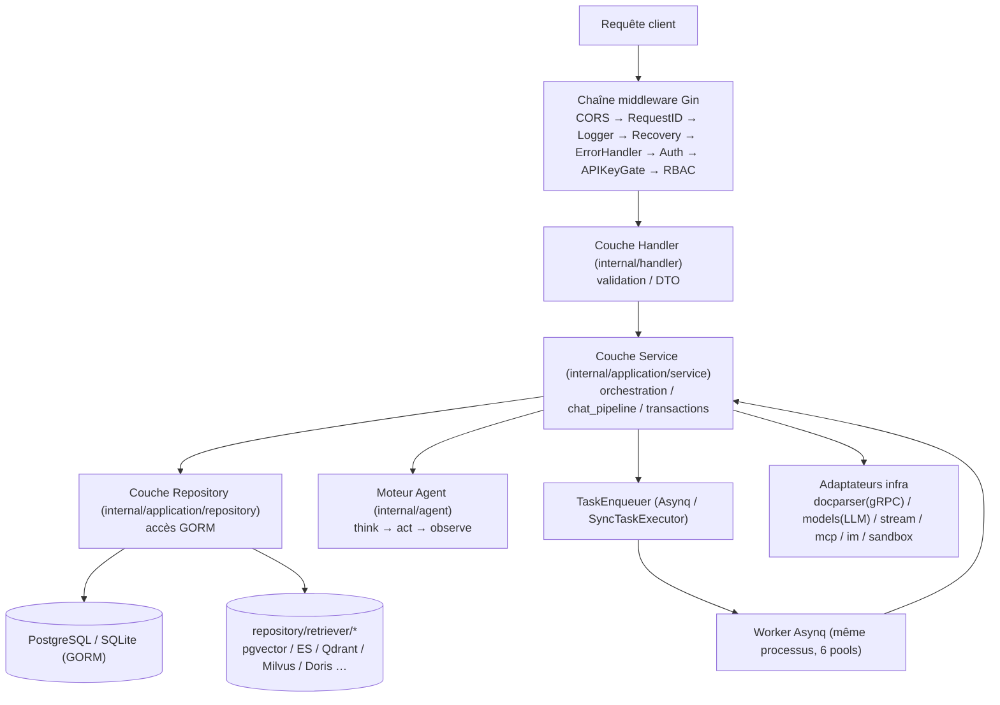
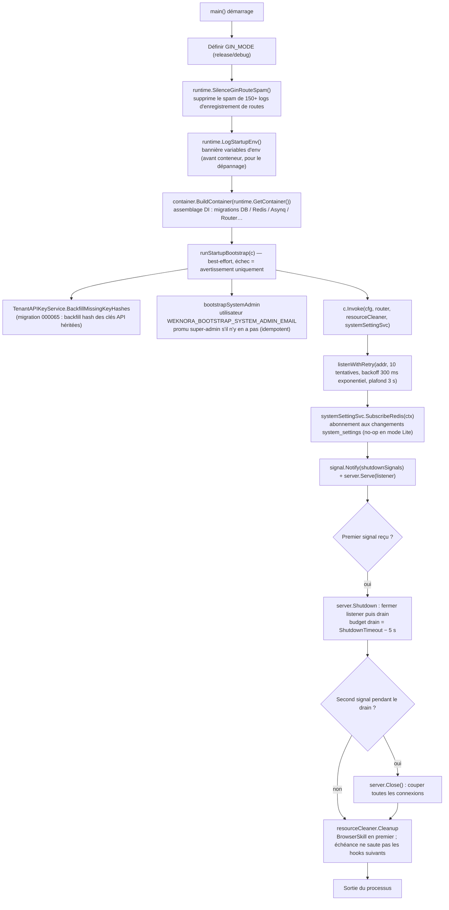

# Conception backend Go

Le backend Go organise le traitement des requêtes en couches Handler, Service, Repository et infrastructure, avec assemblage des dépendances via uber/dig. `cmd/server` gère le démarrage et l’arrêt ; `internal/` implémente routage, authentification, services métier et accès aux données.


## Module assistant et exécution de tâches

`internal/agent/policy` unifie les décisions lecture, sonde, écriture et opérations destructives ; `agent_prompts` et `agent_run_suspensions` conservent les interactions humaines reprises ; `agent_grants` stocke les autorisations à portée limitée. `agent_collaborations` enregistre l’état des sous-agents ; le service d’automatisations maintient plans, exécutions et notifications. Le shell d’arrière-plan utilise un identifiant de travail distinct avec interfaces d’attente et d’annulation, distinct du terminal interactif.

Ces capacités d’exécution ont un périmètre différent de la file d’indexation documentaire classique : reprendre un état en attente d’approbation ne signifie pas réexécuter arbitrairement des écritures externes.

## Architecture en couches {#_1-architecture-en-couches}

Le backend suit la structure classique **Handler → Service → Repository → base de données**. Les dépendances inter-couches passent par des interfaces (`internal/types/interfaces/`), assemblées au démarrage par le conteneur DI :

| Couche | Emplacement | Rôle |
| --- | --- | --- |
| Router / Middleware | `internal/router/`、`internal/middleware/` | Enregistrement des routes, auth, RBAC, rate limiting, logs, enveloppe d’erreur |
| Handler | `internal/handler/` (session dans `internal/handler/session/`) | Parsing des requêtes (DTO dans `internal/handler/dto/`), appel Service, réponse ; sans logique métier |
| Contrôle d’accès | `internal/application/access/` | Règles d’autorisation partagées hors Gin : résolution d’accès KB à trois niveaux, partage organisation, portée KB des agents partagés, autorisation fichiers et artefacts de messages, clonage/déplacement inter-bases |
| Service | `internal/application/service/` (~160+ fichiers) | Orchestration : KB/connaissances/chunks, sessions et pipeline `chat_pipeline/`, Agent, tenant et membres, modèles, sync sources de données, Wiki, audit, etc. |
| Repository | `internal/application/repository/` (~60 fichiers) | Accès données via **GORM** (`type knowledgeRepository struct { db *gorm.DB }`, `r.db.WithContext(ctx)`) ; implémentations moteur de recherche par package sous `repository/retriever/{postgres,elasticsearch,qdrant,milvus,weaviate,doris,opensearch,tencentvectordb,sqlite,neo4j}` |
| Modèle de domaine | `internal/types/` | Entités GORM, énumérations, clés context, interfaces (`types/interfaces`) |
| Infrastructure | `internal/infrastructure/` (client gRPC docparser, web_search), `internal/models/`, `internal/stream/`, `internal/sandbox/`, `internal/mcp/`, `internal/im/` | Adaptateurs systèmes externes |



Conventions clés :

- Un Handler ne dépend que d’interfaces Service (ex. `interfaces.KnowledgeService`) ; un Service ne dépend que d’interfaces Repository et d’autres Services ;
- Toutes les interfaces sont déclarées dans `internal/types/interfaces/`, liées via dig ;
- Les workers Asynq et le serveur HTTP tournent dans **le même processus**, les handlers réutilisent les mêmes Services.

## Injection de dépendances : internal/container (uber/dig) {#_2-injection-de-dependances-internal-container-uber-dig}

WeKnora utilise **`go.uber.org/dig` v1.19.0** (conteneur par constructeurs, sans wire généré). Point d’entrée : `BuildContainer` dans `internal/container/container.go` :

```go
// cmd/server/main.go
c := container.BuildContainer(runtime.GetContainer())

// internal/container/container.go
func BuildContainer(container *dig.Container) *dig.Container {
    must(container.Provide(NewResourceCleaner, dig.As(new(interfaces.ResourceCleaner))))
    must(container.Provide(config.LoadConfig))
    must(container.Provide(initDatabase))     // *gorm.DB
    must(container.Provide(initRedisClient))  // *redis.Client (peut être nil : mode Lite)
    ...
    must(container.Provide(repository.NewTenantRepository))
    must(container.Provide(service.NewTenantService))
    ...
    must(container.Provide(router.NewRouter)) // produit final *gin.Engine
    return container
}
```

`runtime.GetContainer()` (`internal/runtime/container.go`) détient le singleton global `dig.Container` ; `must(err)` panic si l’enregistrement échoue — erreur DI fatale au démarrage.

### Fonctionnalités dig utilisées {#_2-1-fonctionnalites-dig-utilisees}

| Fonctionnalité | Exemple |
| --- | --- |
| `dig.As` | Lier une implémentation à une interface : `container.Provide(NewResourceCleaner, dig.As(new(interfaces.ResourceCleaner)))` ; `router.NewAsyncqClient` lié à `interfaces.TaskEnqueuer` |
| Dépendances nommées `dig.Name` | Plusieurs instances d’une même interface : 4 services d’extraction, 6 serveurs Asynq, `wikiIngest` |
| Struct param `dig.In` | `router.RouterParams` avec `dig.In`, ~60 handlers/services injectés |
| `container.Invoke` pour effets de bord | Composants démarrés à l’enregistrement : cleanup pool, web search providers, schedulers, plugins `chatpipeline`, `router.RunAsynqServer`, etc. |
| Provide adaptateur | Closures de conversion d’interface ; `RetrieveEngineRegistry` aussi exposé comme `StoreRegistry` |

### Ordre d’enregistrement et assemblage conditionnel {#_2-2-ordre-denregistrement-et-assemblage-conditionnel}

`BuildContainer` comporte neuf phases (logs correspondants dans les sources) : ① infra cœur → ② registre moteurs de recherche → ③ clients externes → ④ Repository → ⑤ Service → ⑥ **exécuteur de tâches conditionnel** → ⑦ plugins chat_pipeline → ⑧ Handlers + IM → ⑨ Router et démarrage Asynq.

L’étape ⑥ est la branche la plus importante — **présence ou absence de Redis** :

```go
redisAvailable := os.Getenv("REDIS_ADDR") != ""
if redisAvailable {
    must(container.Provide(router.NewAsyncqClient, dig.As(new(interfaces.TaskEnqueuer))))
    must(container.Provide(router.NewCoreAsynqServer, dig.Name("coreAsynqServer")))
    ... // 6 pools worker + AsynqInspector
    must(container.Invoke(registerModelConcurrencyLimiter))   // Redis : porte de concurrence distribuée par modèle
} else {
    syncExec := router.NewSyncTaskExecutor()                  // mode Lite : exécuteur synchrone in-process
    must(container.Provide(func() interfaces.TaskEnqueuer { return syncExec }))
    must(container.Provide(router.NewNoopTaskInspector))
    must(container.Invoke(registerLiteModelConcurrencyLimiter)) // sémaphore in-process
}
```

Concurrence des 6 pools Asynq ajustable via system settings / env (Core=8, PostProcess=2, Enrichment=12, Maintenance=4, Shared=6, Wiki=8 par défaut, `WEKNORA_ASYNQ_*_CONCURRENCY`) ; topologie des files dans `internal/types/task.go`.

### Nettoyage des ressources et usines {#_2-3-nettoyage-des-ressources-et-usines}

- `ResourceCleaner` : enregistrement de destructeurs, `Cleanup(ctx)` à l’arrêt ;
- `EngineFactory` : création runtime des moteurs selon `vector_stores` ;
- `initDatabase` : migrations, backfill, modèles builtin UPSERT ; SQLite `SetMaxOpenConns(1)`.

## Flux de démarrage cmd/server {#_3-flux-de-demarrage-cmd-server}

`cmd/server` : `main.go`, `bootstrap.go`, `listen.go`, signaux `signals_unix.go` / `signals_windows.go`.



Points clés :

- **Échec du bootstrap ne bloque pas le démarrage** : `logger.Warnf` ; promotion admin système uniquement s’il n’y en a pas encore ;
- **Arrêt gracieux en deux temps** : premier SIGTERM/SIGINT → `server.Shutdown` ; second signal → `Close` forcé ;
- **Retry port occupé** : `listenWithRetry`, 10 tentatives, backoff exponentiel à partir de 300 ms.

## Organisation des routes et RBAC (internal/router) {#_4-organisation-des-routes-et-rbac-internal-router}

### Ordre d’assemblage NewRouter {#_4-1-ordre-dassemblage-newrouter}

`NewRouter(params RouterParams)` dans `internal/router/router.go` — **l’ordre est sémantique pour la sécurité** :

1. `gin.New()` + `MultipartFormCleanup` + `SetTrustedProxies` (`WEKNORA_TRUSTED_PROXIES`) ;
2. Middleware global : cors → RequestID → Language → Logger → Recovery → ErrorHandler ;
3. Endpoints sans auth : `GET /health` ; `/swagger` hors release ;
4. CSP Embed ; statiques Lite si `handler.Edition == "lite"` ;
5. **Avant auth** : callbacks IM, routes Embed publiques, MCP Server, grants URL, WebSocket sandbox/ticket, extension navigateur local ;
6. `middleware.Auth` ; proxy fichiers authentifié ; presigned ; Langfuse ; `AuditServiceProvider` ;
7. `v1 := r.Group("/api/v1")` : `apiKeyAuthorizer` puis ~30 `RegisterXxxRoutes` ;
8. Self-check : `assertAPIKeyPoliciesMatchRoutes` — panic si politique API Key pointe vers une route inexistante.

### Aperçu des groupes de routes {#_4-2-apercu-des-groupes-de-routes}

| Préfixe | Register | Exemple politique API Key |
| --- | --- | --- |
| `/auth`、`/me` | RegisterAuthRoutes / RegisterMyInvitationRoutes | souvent sans clé |
| `/tenants`、`/tenants/:id/*` | RegisterTenantRoutes | `manage_members` / `manage_spaces` ; `PathTenantMatch()` |
| `/knowledge-bases`… | RegisterKnowledgeBaseRoutes, etc. | `retrieve` / `ingest` |
| `/knowledge`、`/chunks` | RegisterKnowledgeRoutes / RegisterChunkRoutes | `ingest` |
| sessions, chat, search, messages | RegisterSessionRoutes / RegisterChatRoutes, etc. | `chat` / `retrieve` |
| `/models`、`/evaluation` | RegisterModelRoutes / RegisterEvaluationRoutes | `manage_models` / `run_evaluations` |
| sandbox, `/me/*` | RegisterSandboxConfigRoutes, etc. | `full_access` ; `/me/*` JWT utilisateur |
| `/system`、`/system/admin` | RegisterSystemRoutes / RegisterSystemAdminRoutes | admin : `g.SystemAdmin()` |
| MCP, agent, web-search | divers | `manage_mcp_services` / `manage_web_search` |
| vector-stores, storage-backends | RegisterVectorStoreRoutes, etc. | `manage_vector_stores` / `manage_storage_backends` |
| agents, organizations, skills | divers | `full_access` / `manage_spaces`, etc. |
| canaux IM/embed/MCP/wechat | divers | `manage_channels` |
| datasource, wiki, chunker preview | divers | `manage_datasources` / `ingest` |

### rbacGuards : matrice centralisée {#_4-3-rbacguards-matrice-centralisee}

`internal/router/rbac.go` — trois familles de gardes :

```go
kb.PUT("/:id", g.OwnedKBOrAdmin(), handler.UpdateKnowledgeBase)
```

- **Gardes de rôle** : `Viewer()` / `Contributor()` / `Admin()` / `Owner()` / `SystemAdmin()`, etc. ;
- **Gardes de propriété** : `OwnedKBOrAdmin()`, `OwnedAgentOrAdmin()`, lookups via URL vers `creator_id` ;
- **Accès KB** : `KBAccessRead|Write` et variantes From*ID ;
- **Frontière tenant** : `CrossTenant()`, `PathTenantMatch()`.

Tous respectent `cfg.Tenant.EnableRBAC` (mode grâce avec log si désactivé).

**Politiques API Key** orthogonales : `apiKeyGroup`, 17 capacités ; routes non déclarées → **refus par défaut** pour clé API.

## Liste des middleware (internal/middleware) {#_5-liste-des-middleware-internal-middleware}

Ordre de passage :

| Middleware | Fichier | Rôle |
| --- | --- | --- |
| `MultipartFormCleanup()` | multipart_cleanup.go | Supprime fichiers temp multipart après requête |
| `cors.New` | router.go | En-têtes autorisés incl. MCP Streamable HTTP |
| `RequestID()` | logger.go | UUID ou réutilisation `X-Request-ID` |
| `Language()` | language.go | Langue traitement doc : `WEKNORA_LANGUAGE` > `Accept-Language` > défaut `zh-CN` |
| `Logger()` | logger.go | Logs requête/réponse, masquage secrets, limite 10 KB |
| `Recovery()` | recovery.go | Panic → 500 |
| `ErrorHandler()` | error_handler.go | Enveloppe `{success:false, error:{code,message,details}}` pour `*errors.AppError` |
| `EmbedAuth` / `MCPEndpointAuth` | embed_auth.go, mcp_endpoint_auth.go | Auth canaux publics |
| `AttachAuthenticatedUser` | ws_auth.go | Ticket court pour WebSocket |
| `PublicAuthRateLimit()` | auth_public_ratelimit.go | 30 req/60 s/IP en mémoire |
| `Auth(...)` | auth.go | JWT, API Key, whitelist ; context tenant/rôle |
| `langfuse.GinMiddleware()` | tracing | Trace LLM ou no-op |
| `AuditServiceProvider()` | audit_provider.go | Injection audit |
| `APIKeyRouteAuthorizer` | api_key_gate.go | Gateway par route pour clés API |
| `RequireRole`, KB access, etc. | rbac.go, kb_access.go | RBAC ; réécriture `TenantIDContextKey` pour KB partagée |
| `asynqdl.Middleware()` | asynqdl/ | Dead letter Asynq |

## Modèle de domaine (internal/types) {#_6-modele-de-domaine-internal-types}

~26 entités GORM persistées. Relations principales :

```mermaid
erDiagram
    TENANT ||--o{ USER : "tenant principal (users.tenant_id)"
    TENANT ||--o{ TENANT_MEMBER : "membres"
    USER ||--o{ TENANT_MEMBER : "rejoint plusieurs espaces"
    TENANT ||--o{ TENANT_API_KEY : "clé API (tenant_id vide = niveau plateforme)"
    TENANT ||--o{ KNOWLEDGE_BASE : "possède"
    TENANT ||--o{ MODEL : "config modèles"
    TENANT ||--o{ CUSTOM_AGENT : "Agent personnalisé"
    TENANT ||--o{ VECTOR_STORE : "instance vectorielle"
    TENANT ||--o{ STORAGE_BACKEND : "backend stockage"
    TENANT ||--o{ DATA_SOURCE : "source de données externe"
    TENANT ||--o{ SESSION : "session"
    TENANT ||--o{ AUDIT_LOG : "audit (tenant_id=0 = niveau système)"
    KNOWLEDGE_BASE ||--o{ KNOWLEDGE : "document (knowledge.knowledge_base_id)"
    KNOWLEDGE_BASE ||--o{ KNOWLEDGE_TAG : "étiquettes"
    KNOWLEDGE_BASE ||--o| VECTOR_STORE : "lié à la création vector_store_id"
    KNOWLEDGE_BASE ||--o| STORAGE_BACKEND : "lié à la création storage_backend_id"
    KNOWLEDGE_BASE ||--o{ WIKI_PAGE : "page Wiki"
    KNOWLEDGE_BASE ||--o{ WIKI_FOLDER : "arborescence Wiki"
    KNOWLEDGE ||--o{ CHUNK : "segment (chunk.knowledge_id)"
    DATA_SOURCE ||--o{ SYNC_LOG : "journal de sync"
    SESSION ||--o{ MESSAGE : "message (message.session_id)"
    MESSAGE }o--|| CUSTOM_AGENT : "agent_id"
    MESSAGE }o--|| MODEL : "model_id"

    TENANT {
        uint64 id PK
        string name
        int64 storage_quota
        json retriever_engines
        json credentials_config "AES-256 chiffré"
    }
    USER {
        string id PK "UUID"
        string username UK
        string email UK
        uint64 tenant_id FK
        bool is_system_admin
        bool can_access_all_tenants
    }
    TENANT_MEMBER {
        uint64 id PK
        string user_id FK "uniq(user_id,tenant_id)"
        uint64 tenant_id FK
        string role "owner/admin/contributor/viewer"
        string status "active/invited/suspended"
    }
    KNOWLEDGE_BASE {
        string id PK "UUID"
        uint64 tenant_id FK
        string creator_id FK "RBAC propriété"
        string type "document/faq/wiki"
        json chunking_config
        json indexing_strategy "vector/keyword/wiki/graph — 4 pipelines"
        string embedding_model_id FK
    }
    KNOWLEDGE {
        string id PK "UUID"
        string knowledge_base_id FK
        string parse_status "pending→processing→finalizing→completed — 7 états"
        string channel "web/api/wechat/feishu… — 14 valeurs"
        int pending_subtasks_count
    }
    CHUNK {
        string id PK "UUID"
        string knowledge_id FK
        string chunk_type "text/parent_text/faq/entity/wiki_page… — 12 types"
        string parent_chunk_id "segment parent/enfant"
        string content_hash
    }
    SESSION {
        string id PK "UUID"
        uint64 tenant_id FK
        string user_id "utilisateur / sujet API / visiteur embed"
        json last_request_state
    }
    MESSAGE {
        string id PK "UUID"
        string session_id FK
        string role "user/assistant/system"
        json knowledge_references "citations retrieval"
        json agent_steps "trace raisonnement Agent"
        text rendered_content "prompt complet enrichi RAG"
    }
    MODEL {
        string id PK
        uint64 tenant_id FK
        string type "Embedding/Rerank/KnowledgeQA/VLLM/ASR"
        string source "local / remote / identifiant fournisseur"
        json parameters "APIKey chiffrée AES"
    }
```



Points de conception :

- **Isolation multi-tenant** : `TenantID` quasi partout ; `tenant_id=0` = système ;
- **Chiffrement statique** : AES-256-GCM via `SYSTEM_AES_KEY` sur champs sensibles ;
- **Bindings immuables à la création** : `VectorStoreID`, `StorageBackendID` ;
- **Machine à états async** : `ParseStatus` sept états + `PendingSubtasksCount` ;
- **Audit append-only** : 50+ `AuditAction` ;
- Types non entité : `SearchResult`, `Task`, configs JSONB, helpers context.

## Gestion des erreurs (internal/errors) {#_7-gestion-des-erreurs-internal-errors}

```go
// internal/errors/errors.go
type AppError struct {
    Code     ErrorCode // code métier
    Message  string
    Details  any
    HTTPCode int       // mapping statut HTTP
}
```

- **Codes segmentés** : 1000–1999 HTTP sémantique ; 2000+ tenant ; 2100+ Agent ; 2200+ vector store ;
- Constructeurs `NewBadRequestError`, etc. ;
- Handler : `c.Error(appErr)` → `ErrorHandler` → i18n frontend via `error.code` ;
- Codes parsing document dans `parse_error_codes.go` → `Knowledge.ErrorMessage`.

## Journalisation (internal/logger) {#_8-journalisation-internal-logger}

- **logrus**, formatter personnalisé, rotation `LOG_PATH` ;
- **request_id** via context ;
- **LLM debug** (`llm_logger.go`) si `LLM_DEBUG_LOG=true`, rétention 7 jours.

## Utilitaires (internal/common, internal/utils) {#_9-utilitaires-internal-common-internal-utils}

| Emplacement | Outil | Usage |
| --- | --- | --- |
| `common/tools.go` | Deduplicate, ParseLLMJsonResponse, etc. | RAG, UTF-8 |
| `common/db_retry.go` | `WithDeadlockRetry` | Deadlock DB |
| `common/redis_tls.go` | `RedisTLSConfig()` | TLS Redis |
| `utils/crypto.go` | AES-GCM `enc:v1:` | Secrets |
| `utils/security.go` | SanitizeHTML, ValidateFilePath | XSS, path traversal |
| `utils/inject.go` | `ValidateSQL` | Agent SQL |
| `utils/presign.go` | HMAC URLs fichiers | 2 h défaut |
| `utils/oidc_state.go` | State OIDC 10 min | CSRF |
| autres | taskid, fileutil, httputil, json | divers |

---

La chaîne complète du démarrage à la persistance est bouclée. Les chapitres suivants détaillent le pipeline RAG (`chat_pipeline`), le moteur Agent (`internal/agent`) et docreader.
