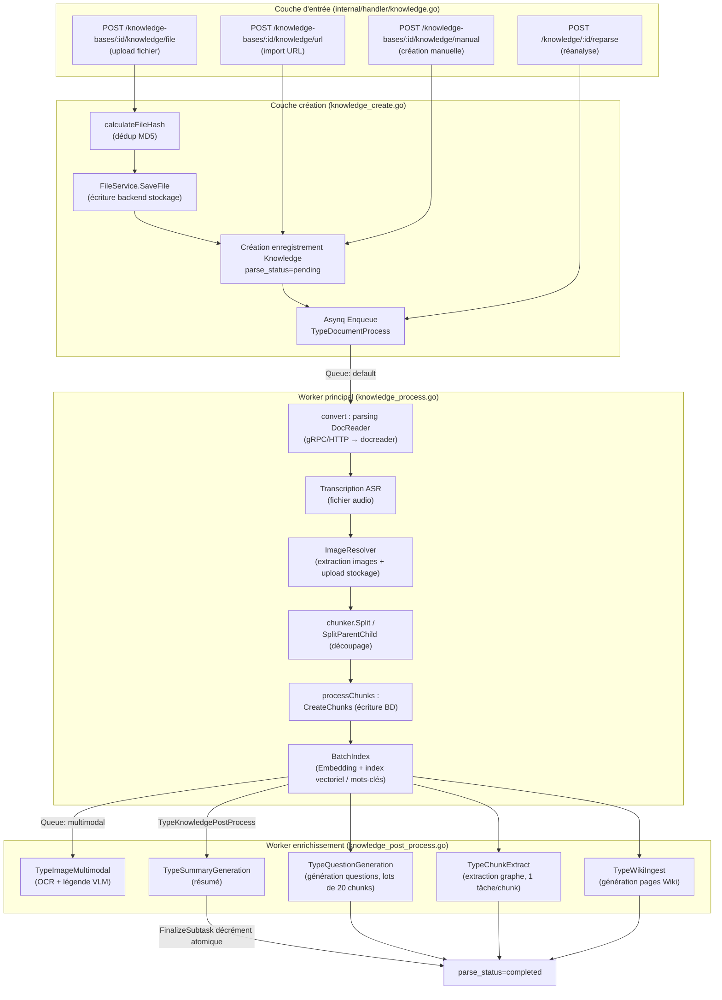
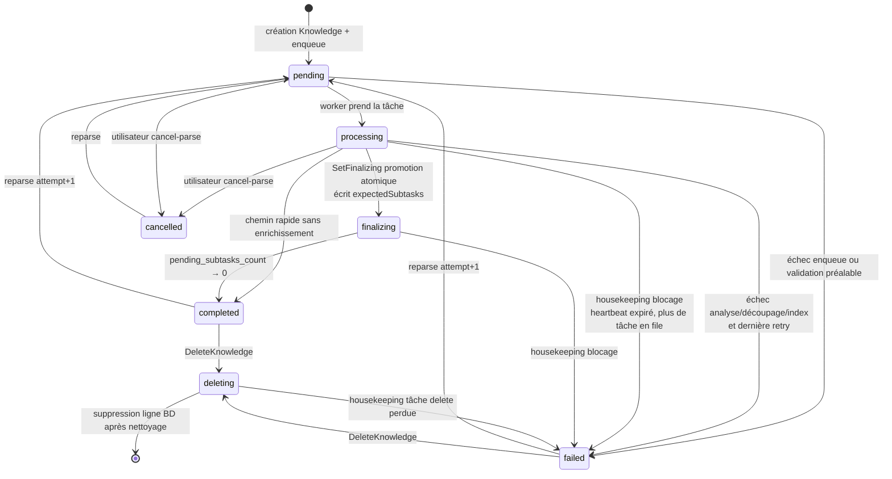

# Pipeline d’ingestion documentaire (Document Ingestion Pipeline)

Les documents entrent dans le système par upload de fichier, import d’URL ou création manuelle. Le serveur persiste le contenu et soumet une tâche de traitement qui enchaîne analyse, découpage et indexation, puis — selon la configuration de la base de connaissances — génère résumé, questions, graphe et pages Wiki. État et progression suivent les étapes ; les échecs sont repris par les reprises automatiques et le housekeeping.


## Pipeline de traitement des images

Après enregistrement, l’image suit la pipeline `default` ou `smartocr` définie par la KB : actions manuelles ou décision après observation. Le prétraitement OCR est désactivé par défaut et activable par KB ; la configuration de pipeline est figée à la soumission de la tâche — une modification ultérieure ne bascule pas les tâches déjà enfilées. La trace d’exécution enregistre la pipeline réelle et le résultat de chaque étape ; voir [Traitement des images](../03-features/03-document-parsing.md#images-et-multimodal).

## Architecture globale {#_1-architecture-globale}

La chaîne d’ingestion WeKnora est une **pipeline asynchrone distribuée basée sur Asynq (Redis)**. Le handler HTTP ne fait que persister et enfiler ; tout le travail coûteux (parsing, vectorisation, enrichissement LLM) est consommé par des pools de workers indépendants.



## Couche d’entrée : trois modes de création {#_2-couche-dentree-trois-modes-de-creation}

Les routes sont enregistrées dans `internal/router/routes_knowledge.go` :

```go
kb.POST("/file",   g.OwnedKBOrAdmin(), g.KBAccessWrite("id"), handler.CreateKnowledgeFromFile)
kb.POST("/url",    g.OwnedKBOrAdmin(), g.KBAccessWrite("id"), handler.CreateKnowledgeFromURL)
kb.POST("/manual", g.OwnedKBOrAdmin(), g.KBAccessWrite("id"), handler.CreateManualKnowledge)
```

Endpoints d’administration associés : `POST /knowledge/:id/reparse` (réanalyse), `POST /knowledge/:id/cancel-parse` (annuler l’analyse), `POST /knowledge/batch-reparse`, `POST /knowledge/batch-delete`, `POST /knowledge/move` (déplacement inter-bases).

### Upload fichier (CreateKnowledgeFromFile) {#_2-1-upload-fichier-createknowledgefromfile}

- Paramètres formulaire : `file`, `fileName`, `metadata`, `enable_multimodel`, `tag_ids`, `process_config` (surcharge possible à chaque upload de la config KB ; voir [Configuration de traitement : défauts KB + surcharge par upload](#_5-configuration-de-traitement-defauts-kb-surcharge-par-upload)).
- Enchaînement : validation extension → déduplication MD5 → stockage `FileService.SaveFile` → création enregistrement `Knowledge` → enqueue.

### Porte d’extensions unifiée {#_2-1-1-porte-dextensions-unifiee}

Dans `internal/application/service/knowledge_util.go`, `supportedImportFileExtensions` est la **source unique de vérité** pour tous les chemins d’import — upload direct, téléchargement URL fichier et recontrôle après téléchargement côté worker utilisent la même liste :

```
pdf txt docx doc epub html htm mhtml md markdown xmind
png jpg jpeg gif csv xlsx xls pptx ppt json
mp3 wav m4a flac ogg
```

Auparavant, l’import URL maintenait une whitelist plus courte, d’où des incohérences du type « xlsx en upload direct OK, xlsx en URL refusé » (#2447) ; tout passe désormais par `isSupportedImportExtension()` / `validateImportFileType()` ; les vidéos reçoivent le message explicite « envoi de fichiers vidéo non pris en charge pour l’instant ».

Les extensions tabulaires (`csv` / `xlsx` / `xls`, `dataTableFileExtensions`) déclenchent en plus, après la tâche document, un résumé de table (`enqueueDataTableSummaryIfNeeded`).

Les contrôles préalables image/audio (stockage objet complet, modèles VLM / ASR configurés) et la validation `process_config` convergent dans `resolveFileImportProcessConfig()`, partagé entre upload et import URL.

### Import URL (CreateKnowledgeFromURL) {#_2-2-import-url-createknowledgefromurl}

- Corps JSON : `{url, file_name?, file_type?, enable_multimodel?, title?, tag_ids?, channel?, process_config?}`.
- `isFileURL()` décide, via le même jeu d’extensions, entre « télécharger un fichier » et « capturer une page Web ».
- Protection SSRF en double couche Handler + Service (`internal/handler/knowledge.go` et `knowledge_create.go`) :

```go
if err := secutils.ValidateURLForSSRF(req.URL); err != nil {
    c.Error(errors.NewBadRequestError(secutils.FormatSSRFError("URL", req.URL, err)))
    return
}
```

Côté worker, nouvelle validation avant le fetch réel (`convert()` dans `knowledge_process.go`) — triple barrière anti-TOCTOU.

### Création manuelle (CreateManualKnowledge) {#_2-3-creation-manuelle-createmanualknowledge}

- Corps JSON : `types.ManualKnowledgePayload{Title, Content, Status, TagIDs, Channel, ProcessConfig}` ; état brouillon (Draft) supporté ; à la publication, `triggerManualProcessing()` rejoint la même pipeline découpage/index que les fichiers (sans étape DocReader).

### Déduplication {#_2-4-deduplication}

`knowledge_create.go` calcule le MD5 des fichiers uploadés et interroge la base sur un quadruplet :

```go
hash, err := calculateFileHash(file) // MD5
exists, existingKnowledge, err := s.repo.CheckKnowledgeExists(ctx, tenantID, kbID,
    &types.KnowledgeCheckParams{
        Type:     "file",
        FileName: fileName,
        FileType: getFileType(fileName),
        FileSize: file.Size,
        FileHash: hash,
    })
if exists {
    return existingKnowledge, types.NewDuplicateFileError(existingKnowledge)
}
```

En cas de hit, pas de nouvel enregistrement : retour de la `Knowledge` existante avec `DuplicateFileError` (l’UI affiche « fichier déjà présent »). Les lignes en `parse_status` `failed` ou `deleting` sont exclues de la dédup, ce qui permet de ré-uploader pendant une suppression inachevée ou bloquée. `FileType` entre dans le jugement : la duplication ne vaut qu’**à type identique** — `notes.md` et `notes.txt` au contenu identique coexistent (`CheckKnowledgeExists` ajoute `LOWER(file_type)` sur les branches hash et « nom + taille »).

### État initial {#_2-5-etat-initial}

Champs initiaux clés d’une `Knowledge` neuve (`knowledge_create.go`) :

```go
knowledge := &types.Knowledge{
    ID:           uuid.New().String(),
    Type:         "file",        // ou "url" / "manual"
    ParseStatus:  "pending",     // état d'analyse initial
    EnableStatus: "disabled",    // non consultable tant que l'indexation n'est pas terminée
    FileHash:     hash,
    ...
}
```

Pour les connaissances table CSV/Excel, création suivie d’un enqueue `TypeDataTableSummary` (`datatable:summary`) produisant des chunks `table_summary` / `table_column` pour le Q&R tabulaire.

## Couche stockage fichiers (FileService et backends) {#_3-couche-stockage-fichiers-fileservice-et-backends}

### Définition d’interface {#_3-1-definition-dinterface}

`internal/types/interfaces/file.go` :

```go
type FileService interface {
    CheckConnectivity(ctx context.Context) error
    SaveFile(ctx context.Context, file *multipart.FileHeader, tenantID uint64, knowledgeID string) (string, error)
    SaveBytes(ctx context.Context, data []byte, tenantID uint64, fileName string, temp bool) (string, error)
    GetFile(ctx context.Context, filePath string) (io.ReadCloser, error)
    GetFileURL(ctx context.Context, filePath string) (string, error)
    DeleteFile(ctx context.Context, filePath string) error
    CopyFile(ctx context.Context, srcPath string, tenantID uint64, knowledgeID string) (string, error)
}
```

### Backends de stockage pris en charge {#_3-2-backends-de-stockage-pris-en-charge}

La fabrique `NewFileServiceFromStorageConfig()` (`internal/application/service/file/factory.go`) choisit le backend via `types.StorageEngineConfig.DefaultProvider`. Liste effective :

| Provider | Préfixe chemin | Fichier | Description | Config clé |
|----------|----------|----------|------|----------|
| `local` | `local://` | `file/local.go` | Disque local mono-instance | `LocalEngineConfig.PathPrefix`, répertoire de base `LOCAL_STORAGE_BASE_DIR`, signature URL externe `APP_EXTERNAL_URL` |
| `minio` | `minio://` | `file/minio.go` | MinIO / compatible S3 | `MinIOEngineConfig` (`mode: docker` → variables `MINIO_ENDPOINT` / `MINIO_ACCESS_KEY_ID` / `MINIO_SECRET_ACCESS_KEY` / `MINIO_BUCKET_NAME` ; `mode: remote` → champs config) |
| `cos` | `cos://` | `file/cos.go` | Tencent Cloud COS | `SecretID/SecretKey/Region/BucketName/AppID`, bucket temporaire `TempBucketName/TempRegion` |
| `oss` | `oss://` | `file/oss.go` | Alibaba Cloud OSS | `Endpoint/Region/AccessKey/SecretKey/BucketName`, bucket temporaire |
| `s3` | `s3://` | `file/s3.go` | AWS S3 / protocole compatible | `Endpoint/Region/AccessKey/SecretKey/BucketName/UseSSL/ForcePathStyle` |
| `tos` | `tos://` | `file/tos.go` | Volcengine TOS | Idem, bucket temporaire |
| `obs` | `obs://` | `file/obs.go` | Huawei Cloud OBS | `Endpoint/Region/AccessKey/SecretKey/BucketName/UseSSL` |
| `ks3` | `ks3://` | `file/ks3.go` | Kingsoft Cloud KS3 | `Endpoint/Region/AccessKey/SecretKey/BucketName` |
| `dummy` | `dummy://` | `file/dummy.go` | Implémentation vide (tests) | — |

### Règles d’organisation des clés objet {#_3-3-regles-dorganisation-des-cles-objet}

- Fichiers définitifs : `{tenantID}/{knowledgeID}/{uuid ou horodatage nanosecondes}{ext}`, ex. `local://12345/kb-001/1722045600000000000.pdf`.
- Export / temporaire / clone : `{tenantID}/exports/{fileName}_{timestamp}{ext}`.
- Sécurité des chemins : `secutils.SafePathUnderBase` (anti traversal), `secutils.SafeFileName`, côté objet `utils.SafeObjectKey`.

### Deux couches d’encapsulation {#_3-4-deux-couches-dencapsulation}

- **`backend_scoped.go`** : en déploiement multi-backend, préfixe d’instance `storage://{backendID}/{innerPath}`, encode/décode `wrap/unwrap`, refuse les opérations cross-backend. Une KB peut se lier à une instance via `StorageBackendID`.
- **`resource_catalog.go`** : enregistre le chemin physique en référence stable `resource://{uuid}` ; `Bind` (ressource ↔ owner knowledge), `MarkDeleted`, `CreateAccessGrant` (jeton temporaire → URL `/r/{token}`). L’application ne tient que des `resource://` pour migrer le stockage sous-jacent sans changement visible.

## Mécanisme de tâches asynchrones (Asynq + Redis) {#_4-mecanisme-de-taches-asynchrones-asynq-redis}

### Enfilement {#_4-1-enfilement}

`knowledge_create.go` assemble `types.DocumentProcessPayload` (`TenantID`, `KnowledgeID`, `KnowledgeBaseID`, `FilePath`, `FileName`, `FileType`, `EnableMultimodel`, `EnableQuestionGeneration`, `QuestionCount`, `Language`, `Attempt`, etc.) ; options depuis `knowledge_task_options.go` :

```go
opts := []asynq.Option{
    asynq.Queue(types.QueueDefault),
    asynq.Timeout(config.DocumentProcessTimeout(cfg)), // défaut 2 h
    asynq.MaxRetry(3),                                  // au plus 3 reprises en échec
}
task := asynq.NewTask(types.TypeDocumentProcess, payloadBytes, opts...)
info, err := s.task.Enqueue(task)
```

En cas d’échec d’enqueue, `ParseStatus` passe à `failed` (le fichier est déjà enregistré ; relancer via reparse).

### Topologie des files et pools worker {#_4-2-topologie-des-files-et-pools-worker}

Files définies dans `internal/types/task.go` :

| Constante | Nom | Usage |
|----------|------|------|
| `QueueDefault` | `default` | Traitement document cœur (parse / chunk / embed / index) |
| `QueueChatAttachment` | `chat_attachment` | Documents temporaires de session |
| `QueuePostProcess` | `postprocess` | Orchestration post-traitement |
| `QueueSummary` | `summary` | Résumé, résumé table, auto-tag, description KB |
| `QueueMultimodal` | `multimodal` | OCR image / légende VLM |
| `QueueQuestion` | `question` | Génération de questions |
| `QueueGraph` | `graph` | Extraction graphe |
| `QueueWiki` | `wiki` | Génération et finalisation Wiki |
| `QueueMaintenance` | `low` | Maintenance (import FAQ, clone/delete KB, delete/reparse batch, move, etc.) |

Files additionnelles `sync` (sync sources) et `memory` (extraction mémoire). Concurrences par défaut (`internal/types/task.go`) : core `DefaultCoreWorkerConcurrency = 8`, postprocess `2`, enrichment `12`, maintenance `4`, shared `6`, wiki `8` — topologie complète dans [Système de tâches asynchrones](05-async-tasks.md#_4-1-six-pools-workers-independants).

### Sémantique des reprises en échec {#_4-3-semantique-des-reprises-en-echec}

- `TypeDocumentProcess` : `MaxRetry(3)` → 1 tentative initiale + 3 reprises = 4 essais ; chaque essai limité par `DocumentProcessTimeout` (défaut 2 h, `WEKNORA_DOCUMENT_PROCESS_TIMEOUT`) ; un appel docreader isolé par `WEKNORA_DOCREADER_CALL_TIMEOUT` (défaut 30 min).
- Les panic du handler deviennent des erreurs pour reprise/dead-letter ; dernier échec → document `failed` ; l’exécuteur Lite capture aussi les panic sans quitter le processus.
- Payload avec `Attempt` (reparse : max historique + 1) ; Span Tracker isole l’arbre de progression par attempt ; un nouvel attempt **supersede** le finaliseur de l’ancien.
- Distinction `isLastRetry` : avant-dernier échec → erreur pour asynq ; dernier → `ParseStatus=failed` + `ErrorMessage`. Erreurs DB transitoires (lecture tenant/connaissance, écriture `processing`) → retry, plus d’ack silencieux sauf si la ligne n’existe plus.
- Reparse : nouvel attempt seulement si validation des overrides et cleanup des anciennes ressources OK ; reparse refusé n’impacte pas la vague en cours. Si la précédente est encore `pending`/`processing`/`finalizing`, annulation des tâches en file et signal d’arrêt aux actives. Tâches d’un ancien attempt ignorées : plus d’écriture ligne/chunk/compteur pour `ProcessDocument`, chunking, post-process, multimodal ; ops Wiki portent l’attempt d’enqueue — expirées, elles ne libèrent plus le compteur de la nouvelle vague ; le dead-letter ne marque pas la nouvelle vague en `failed`.

## Configuration de traitement : défauts KB + surcharge par upload {#_5-configuration-de-traitement-defauts-kb-surcharge-par-upload}

`ResolveProcessConfig(kb, overrides)` dans `knowledge_process_config.go` fusionne la config KB et le `process_config` upload (`types.KnowledgeProcessOverrides`) en `types.EffectiveProcessConfig` :

- Surcharges : `ChunkingConfig` (taille/overlap/stratégie/parent-enfant), `EnableMultimodel`, `VLMConfig`, `ASRConfig`, `QuestionGenerationConfig`, `GraphEnabled`, `ExtractConfig`, `ParserEngineRules`.
- Contrainte : `eff.GraphEnabled = eff.GraphEnabled && eff.ExtractConfig.Enabled` (graphe conditionné à l’extraction).
- `ValidateProcessOverrides` : image → modèle VLM requis ; audio → ASR ; multimodal → stockage objet complet (`validateImageMultimodalConfig`).
- Overrides persistés via `knowledge.SetProcessOverrides`, réutilisés au reparse.

Les pipelines exécutés dépendent de `IndexingStrategy` KB (`internal/types/indexing_strategy.go`) :

```go
type IndexingStrategy struct {
    VectorEnabled  bool // index vectoriel sémantique
    KeywordEnabled bool // index mots-clés BM25
    WikiEnabled    bool // génération automatique de pages Wiki
    GraphEnabled   bool // extraction graphe de connaissances
}
```

`NeedsEmbedding() = Vector || Keyword` ; `NeedsChunks() = l’un des flags activé`. Valeurs par défaut : vector et keyword activés.

## Pipeline de traitement principal (`knowledge_process.go`) {#_6-pipeline-de-traitement-principal}

Après consommation de `TypeDocumentProcess`, le worker avance en cinq étapes canoniques ; chaque étape correspond à un Span (voir [Housekeeping et auto-réparation (`knowledge_housekeeping.go`)](#_8-housekeeping-et-auto-reparation)) :

`docreader → chunking → embedding → multimodal → postprocess`

### Analyse (`convert`, stage : docreader) {#_6-1-analyse-stage-docreader}

1. `beginStage(StageDocReader)` enregistre les entrées (`file_name` / `file_type` / `is_url`).
2. En mode URL, nouvelle passe `ValidateURLForSSRF` ; en échec → `failStage` + `ParseStatus=failed`.
3. Choix du moteur : `eff.ChunkingConfig.ResolveParserEngine(fileType)` (type virtuel `"url"` pour les URL), routage via `ParserEngineRules` de la KB (type de fichier → moteur) ; `MergeParserEngineOverrides` fusionne les surcharges moteur au niveau tenant et upload.
4. `resolveDocReader` renvoie un `interfaces.DocReader` :
   - **builtin** : appel du service Python **docreader** en gRPC (`docparser/grpc_parser.go`) ou HTTP (`http_parser.go`) ;
   - **simple** : parsing natif Go pour md/txt/csv/json/images/audio (`builtin_converter.go` : CSV → table Markdown, JSON → blocs de code découpés récursivement, images/audio → références placeholder) ;
   - **anydoc** : parsing in-process Go pour docx/doc/pptx/ppt/xlsx/xls/odf/rtf/epub/csv/pdf (`anydoc_reader.go`), bibliothèque Rust anydoc liée via cgo. Les images embarquées des documents Office sont réinsérées au bon endroit dans le Markdown ; les PDF scannés sans couche texte basculent vers le rendu page entière **builtin** si DocReader est disponible. Avec extraction d’images activée, les PPTX contenant `ppt/media/*.emf` ou `*.wmf` passent par le chemin MarkItDown de DocReader (rasterisation ImageMagick) ; sans DocReader connecté, erreur explicite. PPTX bitmap classiques et fichiers avec `anydoc_extract_images=false` restent sur anydoc ; cette détection ne couvre pas l’ancien PPT binaire. Si anydoc est lié, les formats complexes sans règle configurée vont par défaut sur anydoc, sauf le PDF qui reste **builtin** par défaut. Disponible uniquement dans les binaires tagués `anydoc` ; sinon le moteur apparaît indisponible dans la liste.
   - **weknoracloud / mineru / mineru_cloud / paddleocr_vl / paddleocr_vl_cloud** : convertisseurs HTTP (enregistrés dans `engines.go`, disponibilité selon `mineru_endpoint`, `mineru_api_key`, `paddleocr_vl_endpoint`, etc. ; l’instance self-hosted `mineru` détecte automatiquement l’API V1 de MinerU 4.0 et l’ancien `/file_parse`, voir [Service d’analyse documentaire](../03-features/03-document-parsing.md#mineru-self-hosted)).

Le catalogue moteur est centralisé dans `internal/infrastructure/docparser/engines.go` : chaque moteur déclare métadonnées (nom, description, types de fichiers, sonde de disponibilité) et une fabrique `NewReader` ; `docparser.NewReader` dispatch par nom ; les noms non enregistrés (ex. `markitdown`, présent seulement côté docreader) retombent sur le client docreader.
5. Mode fichier : lecture des octets via `FileService.GetFile(payload.FilePath)` dans `ReadRequest.FileContent`.

**Côté service docreader** (`docreader/`, Python gRPC) : proto `docreader/proto/docreader.proto`, méthodes `Read` / `ReadStream` (flux : meta en première frame + une frame par image, pour éviter la limite de message gRPC sur gros PDF scannés) / `ListEngines`. Parsers intégrés : docx/doc/pdf/md/xlsx/xls/pptx/ppt/epub/html/htm/mhtml/xmind/images/pages web (`WebParser` pour les URL), plus `markitdown` (Microsoft MarkItDown) et `opendataloader` (analyse de mise en page PDF, Java 11+). La liste des moteurs est maintenue côté Go dans `engine_registry.go` ; l’app Go n’appelle plus `ListEngines`. Retour unifié `ReadResult{MarkdownContent, ImageRefs, Metadata, IsAudio, AudioData}` — **le produit d’analyse est toujours du Markdown + octets d’images** ; la persistance des images est assurée côté Go.

### Transcription ASR (fichiers audio) {#_6-2-transcription-asr-fichiers-audio}

Lorsque `convertResult.IsAudio` est vrai (fichier audio analysé en placeholder + octets bruts) :

```go
asrModel, err := s.modelService.GetASRModel(ctx, eff.ASRConfig.ModelID)
transcriptionResult, err := asrModel.Transcribe(ctx, convertResult.AudioData, knowledge.FileName)
```

Le texte transcrit remplace `MarkdownContent`, puis la pipeline texte standard continue ; sans ASR configuré, échec immédiat.

### Extraction et upload d’images {#_6-3-extraction-et-upload-dimages}

`ImageResolver.ResolveAndStore` dans `docparser/image_resolver.go` :

1. Traitement successif des images enveloppées `<!link>`, URI `data:`, base64 inline HTML, base64 nu, octets inline des `ImageRefs` renvoyés par docreader ;
2. Filtrage des miniatures type icône (largeur/hauteur &lt; 64 px ou &lt; 512 octets, sauf pièce jointe d’origine avec `IsOriginal=true`) ;
3. `SaveBytes` vers le backend de stockage de la KB courante, déduplication via cache `savedRefs` ;
4. Réécriture des références Markdown en URL de stockage (`markdown_image_scanner.go` localise précisément ``).

Ensuite `ResolveRemoteImages` télécharge et stocke les images externes `http(s)` du Markdown (même protection SSRF). Produit `storedImages []docparser.StoredImage` pour la phase multimodale.

### Découpage (stage : chunking) {#_6-4-decoupage-stage-chunking}

Le découpage s’effectue **côté Go** (`internal/infrastructure/chunker`, voir le chapitre sur le mécanisme de découpage) :

```go
chunkCfg := buildSplitterConfigFromChunking(eff.ChunkingConfig)
if eff.ChunkingConfig.EnableParentChild {
    parentCfg, childCfg := buildParentChildConfigs(eff.ChunkingConfig, chunkCfg)
    pcResult := chunker.SplitParentChild(convertResult.MarkdownContent, parentCfg, childCfg)
    // children → types.ParsedChunk (avec ParentIndex) ; parents → ParsedParentChunk
} else {
    splitChunks := chunker.Split(convertResult.MarkdownContent, chunkCfg)
}
```

### Écriture en base et indexation (`processChunks`, stages : chunking + embedding) {#_6-5-ecriture-en-base-et-indexation-stages-chunking-embedding}

`processChunks` est la fonction d’assemblage centrale :

1. **Blocs parent** (mode parent-enfant) : un enregistrement `ChunkTypeParentText` par parent, chaîne `PreChunkID` / `NextChunkID` ; les parents **ne vont qu’en BD, pas dans l’index vectoriel** (le contenu parent est récupéré après hit sur un enfant).
2. **Blocs texte** : chaque `ParsedChunk` → `ChunkTypeText` avec `StartAt` / `EndAt` (offsets rune dans l’original, pour restitution/surbrillance) et `ContextHeader` (fil d’Ariane de titres, stocké dans `chunks.context_header`, absent des réponses API) ; en mode parent-enfant, `ParentChunkID`. Avant découpage, les tableaux HTML inline des moteurs sont normalisés en tableaux Markdown (`NormalizeHTMLTables`).
3. `chunkService.CreateChunks(ctx, insertChunks)` en lot ; échec → `ParseStatus=failed` + `failStage(StageChunking)`.
4. **Vectorisation et index** (si `kb.NeedsEmbeddingModel()`). Si le modèle d’embedding ou le stockage vectoriel lié à la KB est introuvable (modèle supprimé, identifiants invalides, etc.), la tentative échoue avec motif dans `error_message`, sans rester bloquée en `processing` :

```go
indexContent := titlePrefix + chunk.EmbeddingContent() // titre + fil d'Ariane + contenu
indexInfoList = append(indexInfoList, &types.IndexInfo{
    Content: indexContent, SourceID: chunk.ID, SourceType: types.ChunkSourceType,
    ChunkID: chunk.ID, KnowledgeID: knowledge.ID, KnowledgeBaseID: ..., IsEnabled: true,
})
err = retrieveEngine.BatchIndex(ctx, embeddingModel, indexInfoList)
```

   En cas d’échec d’indexation, **rollback compensatoire** : suppression des chunks écrits (`DeleteChunksByKnowledgeID`) et de l’index vectoriel (`DeleteByKnowledgeIDList`), passage en `failed`, sans laisser d’état partiel.
5. **Fan-out tâches multimodales image** : si `enableMultimodel && len(storedImages) > 0`, `enqueueImageMultimodalTasks` enfile un `TypeImageMultimodal` **par image** (`QueueMultimodal`), payload `ImageURL` / `EnableOCR` / `EnableCaption` / `Attempt` / `ImageIndex`. Échec d’enqueue pour une image libère immédiatement le compteur correspondant ; si tout échoue, passage direct au post-traitement pour éviter un blocage en `processing`.
6. `finalizeIndexedKnowledgeState` : reste en `processing` s’il reste du multimodal/post-traitement, sinon `completed` ; pose `EnableStatus="enabled"` (document consultable dès lors) et cumule l’usage stockage tenant.

### Orchestration du post-traitement (`knowledge_post_process.go`, stage : postprocess) {#_6-6-orchestration-du-post-traitement-stage-postprocess}

Une fois le multimodal terminé (ou absent), enqueue de `TypeKnowledgePostProcess`. Cette tâche **orchestre les sous-tâches d’enrichissement** et garantit la convergence de l’état final via un compteur atomique :

```go
willSpawnSummary  := eff.SummaryEnabled && len(textChunks) > 0   // résumé désactivable par upload
willSpawnQuestion := len(textChunks) > 0 && kb.NeedsEmbeddingModel() && eff.QuestionGenerationConfig.Enabled
willSpawnWiki     := kb.IndexingStrategy.WikiEnabled && len(textChunks) > 0
graphChunks       := selectGraphChunks(textChunks)                // voir ci-dessous
// questionGenChunkBatchSize = 20 : génération de questions par lots de 20 chunks (ignore les chunks avec seulement des liens image)
expectedSubtasks = summary(0/1) + questionBatchCount + wiki(0/1) + len(graphChunks) (si graphe activé)

// Promotion atomique parse_status processing → finalizing et écriture pending_subtasks_count
promoted, err := s.knowledgeRepo.SetFinalizing(ctx, payload.KnowledgeID, expectedSubtasks)
```

- Si `expectedSubtasks == 0`, chemin rapide vers `completed`.
- Entrées extraction graphe (`selectGraphChunks`) : blocs texte avec corps ; blocs ne contenant que des liens image (ex. page PDF scannée) utilisent leur sous-bloc `image_ocr` ; les sous-blocs `image_caption` sont exclus pour éviter le doublon avec l’OCR.
- Si l’écriture `processing → finalizing` échoue, la tâche renvoie une erreur à asynq (retry), sans succès trompeur laissant le document en `processing`.
- Chaque sous-tâche appelle `FinalizeSubtask` à la sortie pour décrémenter atomiquement `pending_subtasks_count` ; à 0 → `completed`.
- **Coordination des déficits** : si le nombre réel enfilé est inférieur au plan (échec d’enqueue sur une file), compensation immédiate du delta pour éviter un blocage permanent en `finalizing`.
- `finalizeSubtaskDetached` (`knowledge.go`) : décrément exécuté **hors contexte** avec `context.WithoutCancel` + timeout 10 s, pour éviter la perte de compteur à l’arrêt gracieux du worker et un `finalizing` permanent.

Quatre types de sous-tâches d’enrichissement :

| Tâche | File | Granularité | Description |
|------|------|------|------|
| `TypeSummaryGeneration` | `summary` | 1 par connaissance | Génère le résumé document ; machine d’état `summary_status` séparée ; pas de génération si `process_config.summary_enabled=false` à l’upload |
| `TypeQuestionGeneration` | file `question` | lot de 20 chunks | Questions de recherche par chunk |
| `TypeChunkExtract` | file `graph` | 1 par chunk | Extraction entités/relations vers le moteur de graphe |
| `TypeWikiIngest` | file `wiki` | lot avec anti-rebond | Crée/met à jour les pages Wiki |

#### Étiquetage automatique des documents

Après analyse, le post-traitement peut enfiler `knowledge:auto_tag` (file `summary`) selon `auto_tag_config` de la KB. Le processeur choisit parmi les étiquettes existantes de la KB, repli modèle sur `summary_model_id` ; `max_tags` défaut 3, plafond 10, par défaut ignore les documents déjà étiquetés. Association incrémentale uniquement : pas de nouvelles catégories, pas de suppression d’étiquettes manuelles ; l’échec ne bloque pas l’ingestion. Portée config / nouvelle analyse / réanalyse : voir [Gestion des bases de connaissances](../03-features/02-knowledge-base.md).

#### Rafraîchissement du profil de base (`knowledgebase_profile.go`)

À chaque fin de tâche de résumé, fin d’orchestration post-traitement, suppression de document ou fin de déplacement inter-KB, `requestKnowledgeBaseProfileRefresh` enfile un `kb:profile` (file `summary`). L’ID de tâche est bucketé par KB et fenêtre de 30 s : un lot d’uploads ou suppressions ne déclenche qu’une agrégation. Le processeur recalcule l’agrégat de profil documentaire ; si le hash est inchangé, pas d’appel modèle. Seules les KB documentaires avec `profile_config.enabled` sont enfilées ; déclenchement manuel (`POST /knowledge-bases/:id/profile/generate`) sans cette limite.

#### Rafraîchissement de résumé (`knowledge_summary_refresh.go`)

Hors première ingestion, édition de chunk, activation/désactivation de chunk ou changement de métadonnées personnalisées invalident le résumé existant → enqueue d’un **rafraîchissement de résumé** (ou manuel via `POST /knowledge/:id/regenerate-summary`) :

- Au démarrage, snapshot d’entrée : `content_revision` / `is_enabled` de chaque chunk source et version de `custom_metadata` ;
- Après génération, `summarySourceChanged()` revérifie le snapshot. Si réédition entre-temps → `ErrSummaryRefreshStale`, **résultat jeté sans toucher `summary_status`**, pour laisser le rafraîchissement plus récent terminer — sinon un ancien résumé écraserait le nouveau ;
- Erreurs de lecture BD et « entrée modifiée » sont traitées séparément, pour ne pas jeter silencieusement une tâche périmée à cause d’une erreur transitoire ;
- La tâche tourne dans un worker Asynq sans contexte tenant injecté par middleware HTTP ; `restoreSummaryRefreshTenantInfo()` reconstruit la config tenant complète — requise par la fabrique de moteur de recherche.

### Multimodal image (`image_multimodal.go`) {#_6-7-multimodal-image}

`ImageMultimodalService.Handle` consomme une tâche par image :

1. `readImageBytes` lit l’image depuis le stockage ou l’URL ; `resolveVLM` charge la config VLM de la KB ;
2. Génération de légende (VLM, prompt via `buildVLMCaptionPrompt` selon `DescriptionLanguage` / `CustomInstructions`) et texte OCR ;
3. Résultats écrits dans `ImageInfo` (JSON) du chunk texte parent, création/mise à jour de deux **sous-chunks** `ChunkTypeImageCaption` et `ChunkTypeImageOCR`, `ParentChunkID` pointant vers le bloc texte, puis `indexChunks` séparé — pour que la recherche sur la description d’image rappelle aussi le bloc source ;
   - **Vecteur image** : si la KB active les vecteurs image (`ImageProcessingConfig.ImageVectorEnabled`, désactivé par défaut, voir `KnowledgeBase.IsImageVectorEnabled`) et que le modèle d’embedding accepte les images (capacité `input` contenant `image`, protocole fournisseur compatible, voir `embedding.AsImageEmbedder`), `indexImageVector` encode l’image directement en troisième sous-chunk `ChunkTypeImageVector` : `SourceType` = `ImageSourceType`, vecteur de l’image (écrit via `CompositeRetrieveEngine.BatchIndexVectors`), `Content` = description (ou OCR si absent) pour rerank et contexte de réponse. L’image passe par `imageprep.Prepare` (format/compression selon le fournisseur) ; pas pour les pages PDF scannées (OCR préférable). Échec ici : log seulement, tâche non bloquée ;
   - Le vecteur `ChunkTypeImageVector` n’est pas reconstruisible depuis le texte : `syncChunkIndex` ne synchronise que l’état activé, `updateChunkVector` l’ignore ; modification de la description → mise à jour de `Content` uniquement ;
4. `shouldDropOrphanedMultimodal` vérifie si le parent a été supprimé/remplacé ; tâche orpheline abandonnée ;
5. `checkAndFinalizeAllImages` : une fois toutes les images traitées, `enqueueKnowledgePostProcessTask` déclenche l’[orchestration du post-traitement](#_6-6-orchestration-du-post-traitement-stage-postprocess). Enqueue post-traitement : 3 tentatives sur place ; échec persistant → erreur pour retry asynq, sans ack laissant le document en `processing`. Dernière tentative : l’image compte comme terminée même si la lecture de la ligne Knowledge échoue. Mode Lite sans Redis : compteur en mémoire processus ; post-traitement seulement quand toutes les images sont finies.

## Machine d’états {#_7-machine-detats}

### État principal Knowledge (`ParseStatus`) {#_7-1-etat-principal-knowledge}

Valeurs complètes définies dans `internal/types/knowledge.go` :

| Valeur | Signification |
|----|------|
| `pending` | Créé, en attente de prise en charge par un worker |
| `processing` | Analyse / découpage / embedding / multimodal en cours |
| `finalizing` | Pipeline principal terminé, sous-tâches d’enrichissement en attente (`pending_subtasks_count > 0`) |
| `completed` | Tout terminé |
| `failed` | Échec de traitement (motif dans `ErrorMessage`) |
| `deleting` | Suppression en cours (marqueur anti-concurrence ; non compté dans le nombre de documents KB, exclu de la dédup fichier) |
| `cancelled` | Analyse annulée par l’utilisateur |

États auxiliaires : `EnableStatus ∈ {enabled, disabled}` (consultabilité ; `enabled` dès index OK, sans attendre l’enrichissement) ; `SummaryStatus ∈ {none, pending, processing, completed, failed}`.



### Progression par phase (Span Tracker) {#_7-2-progression-par-phase-span-tracker}

`knowledge_span_tracker.go` + `internal/types/knowledge_span.go` fournissent l’arbre de progression par étape (timeline UI) :

- Cinq étapes canoniques : `StageDocReader / StageChunking / StageEmbedding / StageMultimodal / StagePostProcess` (`types.AllStages`).
- États de span : `pending / running / done / failed / skipped / cancelled`. `skipped` = saut volontaire (ex. multimodal désactivé) ; `cancelled` = annulation en cascade après échec amont.
- Chaque cycle a un `Attempt` distinct (`repo.NextAttempt`), span racine `name="knowledge_processing"`, `Kind=SpanKindRoot` ; étapes tracées via `beginStage / endStage / failStage / skipStage`, entrées/sorties dans `JSONMap` (ex. `chunks_planned` / `chunks_written` / `total_text_chars`).
- À chaque enregistrement de progression, `touchKnowledgeHeartbeat` rafraîchit le heartbeat pour que Housekeeping distingue traitement actif et tâche figée.

## Housekeeping et auto-réparation (`knowledge_housekeeping.go`) {#_8-housekeeping-et-auto-reparation}

En arrière-plan, cycle toutes les **5 minutes** (`WEKNORA_HOUSEKEEPING_ENABLED` pour désactiver), corrige les états zombies (crash worker / tâche Redis perdue) :

**Sweep A — récupération des connaissances bloquées**, filtrage en trois phases :

1. Pré-filtre : `parse_status IN (pending, processing, finalizing) AND updated_at < cutoff` ;
2. `filterByLastSpanActivity` : heartbeat `MAX(updated_at)` sur `knowledge_processing_spans` ; conservé si encore dans le seuil (traitement actif) ; sans span → bloqué ;
3. `filterOutQueued` : via asynq TaskInspector, conserve s’il reste une tâche en file (simple attente).

Les connaissances jugées bloquées passent ligne par ligne en `parse_status = 'failed'`, `pending_subtasks_count = 0`, `error_message` indiquant l’étape et la dernière activité, par ex. :

```text
task stuck in processing at docreader stage: no progress since 2026-09-22T09:37:54Z (> 2h10m0s), recovered by housekeeping
```

Les spans encore `pending` / `running` du dernier attempt sont fermés, code d’erreur `TASK_STALLED`, `duration_ms` complété : l’emplacement bloqué → `failed`, le reste → `cancelled`. Le blocage correspond au span d’étape en cours ; sans étape active (post-traitement déjà clos en `finalizing`), c’est le sous-span le plus interne encore actif, nom inclus dans le message, ex. `at postprocess stage (postprocess.summary)`. Si la requête heartbeat span échoue, pas d’horodatage dans le texte. La timeline indique ainsi où ça coince au lieu de tourner indéfiniment.

Côté UI, avant le verdict serveur : les requêtes batch et l’API spans renvoient `last_activity_at` pour les connaissances en cours ; après 20 minutes sans progrès, `stall_state` serveur (même logique que Sweep A). `stalled` → « suspecté bloqué » (liste, carte, timeline) avec entrée « arrêter l’analyse » ; `queued` → « en file », sans arrêt ; échec de sonde → affichage analyse normale. Polling espacé à 15 s en période calme.

Seuil `staleThreshold() = max(1h, DocumentProcessTimeout) + 10min`.

**Sweep B — résumés bloqués** : `summary_status = 'processing' AND updated_at < il y a 1 h` → `failed`. `summary_status = 'pending'` alors que l’analyse est terminée (`completed` / `failed` / `cancelled`), &gt; 1 h et plus de tâche en file → `failed`, pour éviter l’UI bloquée sur « génération du résumé ». Sweep A et annulation utilisateur clôturent aussi les résumés incomplets (`failed` ou `none`).

**Sweep C — suppressions bloquées** : `parse_status = 'deleting'`, dépassement du seuil et absence de tâche `knowledge:list_delete` couvrante en file → `failed` avec motif, document de nouveau visible, nouvelle suppression possible. Échec sonde file → report au cycle suivant ; mode Lite sans file → récupération directe selon le cas.

**File Wiki de secours** : documents bloqués en `finalizing` faute de consommation de la file Wiki persistante → la patrouille relance une génération Wiki pour la KB (au plus une fois par période de seuil et par KB). Si Wiki désactivé, modèle de synthèse absent ou supprimé, les opérations Wiki non prises en charge sont vidées et les documents libérés pour terminer `finalizing`. Modèle présent mais non constructible (ex. URL rejetée SSRF) → même libération au dernier retry Wiki. Protection Wiki max 48 h : sans progrès → Sweep A → `failed`, opérations Wiki supprimées.

## Chaîne de suppression et nettoyage (`knowledge_delete.go`) {#_9-chaine-de-suppression-et-nettoyage}

L’ordre de `DeleteKnowledge(ctx, id)` est volontaire (**ligne BD d’abord, fichiers ensuite**, reprises possibles) :

1. `ParseStatus = deleting` (bloque les écritures concurrentes) ;
2. Pour `pending` / `processing`, `dequeueKnowledgeTasks()` annule les tâches aval en file ;
3. **Nettoyage parallèle errgroup** de quatre ressources :
   - Index vectoriel / mots-clés : `retrieveEngine.DeleteByKnowledgeIDList` (routage par dimension embedding et type KB) ;
   - Wiki : `cleanupWikiOnKnowledgeDelete` (tombstone Redis → purge ingest pending → réconciliation pages → enqueue WikiRetract) ;
   - Chunks : `chunkService.DeleteChunksByKnowledgeID` ;
   - Graphe : `graphEngine.DelGraph` ;
4. Suppression associations Tag → ligne Knowledge en BD ;
5. **Enfin, nettoyage best-effort des fichiers** : fichier source + images extraites depuis `chunk_image_info` (`collectImageURLs` + `deleteExtractedImages`), ajustement stats stockage tenant.

`DeleteKnowledgeList` précharge FileService par KB, groupe URLs images par KB, suppressions d’index par modèle embedding, pour éviter les requêtes redondantes dans les goroutines.

## Import de connaissances FAQ (`knowledge_faq.go` / `knowledge_faq_import.go`) {#_10-import-de-connaissances-faq}

Les KB FAQ n’utilisent pas la pipeline documentaire : une KB FAQ n’a qu’**une** instance Knowledge (`ensureFAQKnowledge`) ; chaque paire Q/R est un chunk `ChunkTypeFAQ`, métadonnées dans `Chunk.Metadata` :

```go
type FAQChunkMetadata struct {
    StandardQuestion  string   // question standard
    SimilarQuestions  []string // questions similaires
    NegativeQuestions []string // contre-exemples (filtrage négatif, hors index)
    Answers           []string
    AnswerStrategy    AnswerStrategy // "all" | "random"
    ...
}
```

- **Création unitaire** `CreateFAQEntry` : nettoyage/validation → dédup (`checkFAQQuestionDuplicate`) → construction chunk (`buildFAQChunkContent` inclut ou non la réponse dans Content selon `FAQIndexMode`) → `indexFAQChunks` index synchrone → `ChunkStatusIndexed`.
- **Modes d’index** (config KB) : `FAQIndexModeQuestionOnly` (`question_only`, questions seules) / `FAQIndexModeQuestionAnswer` (`question_answer`, question + réponse) ; sous-modes questions : `FAQQuestionIndexModeCombined` (standard + similaires → un vecteur) et `FAQQuestionIndexModeSeparate` (un vecteur par question similaire, `source_id` `{chunkID}-{index}`, index incrémental `incrementalIndexFAQEntry`).
- **Import batch** `UpsertFAQEntries` :
  - Modes `append` (fusion) ou `replace` (remplacement total), `DryRun` pour validation seule ;
  - &gt; 200 entrées ou 50 Ko → `SaveBytes` objet, payload avec `EntriesURL` uniquement ;
  - Enqueue `TypeFAQImport` → `QueueMaintenance`, `MaxRetry 5` (dry-run 3), timeout 2 h ; un seul import simultané par KB (verrou Redis) ;
  - Dédup via `CalculateFAQContentHash` : **normalisation** questions/réponses/contre-exemples (retrait URL, minuscules, trad. simplifiée, pleine → demi-largeur, espaces) puis SHA256 ;
  - Mode append : validation en quatre phases (conflit question standard → échec ligne entière ; conflit similaire/contre-exemple → échec partiel, retrait des seuls items en conflit ; standard existante → union) ;
  - Progression Redis (`FAQImportProgress` : `pending/processing/completed/failed`, compteurs succès/échec/partiel/ignoré), export CSV UTF-8 BOM des échecs.

## Clonage et déplacement de connaissances (`knowledge_clone_move.go`) {#_11-clonage-et-deplacement-de-connaissances}

### Clonage (`CloneKnowledgeBase` / `CloneChunk`) {#_11-1-clonage}

- Clonage KB : copie config KB, puis diff d’ensembles (`AminusB`) pour ajouter/supprimer Knowledge en parallèle (suppressions par 10, clonage unitaire).
- Clonage chunk (lots de 100) : types `Text` / `ParentText` / `Summary` / `ImageCaption` / `ImageOCR` :
  - **Copie profonde images** : `cloneChunkImageInfo` lit octets source → écrit tenant cible espace `exports/`, dédup `urlCache` ; `rewriteContentImageURLs` remplace toutes les URL dans Content (URL la plus longue en premier) ;
  - Tags : `getOrCreateTagInTarget` (réutilise même nom, sinon crée) ;
  - Reconstruction mappings `PreChunkID` / `NextChunkID` / `ParentChunkID`, insertion batch ;
  - Index vectoriel : `retrieveEngine.CopyIndices()` sans recalcul embedding.
- Clonage KB FAQ : sync différentielle `chunkRepo.FAQChunkDiff` par `content_hash` (ajouts/suppressions/correspondances) ; paires correspondantes → sync état (`IsEnabled` / `Flags` / `TagID` / `AnswerStrategy`).
- Progression Redis (`KBCloneProgress`).

### Déplacement (`ProcessKnowledgeMove`) {#_11-2-deplacement}

Prérequis : KB source et cible **même type** et **même `EmbeddingModelID`**. Deux modes :

- `reuse_vectors` : `sourceKB.SharesStoreWith(targetKB)` (même instance vectorielle), `CopyIndices` → suppression index source → `MoveChunksByKnowledgeID` → clear tags → mise à jour KB ID sur Knowledge ;
- `reparse` : stockages vectoriels distincts. `cleanupKnowledgeResources` (index/chunks/graphe/stats stockage) → Knowledge `pending` sur KB cible → re-enqueue `TypeDocumentProcess` (manuel via `triggerManualProcessing`).

## Synthèse chronologique de bout en bout {#_12-synthese-chronologique-de-bout-en-bout}

Parcours complet d’un PDF avec multimodal, génération de questions et graphe :

1. `POST /knowledge-bases/:id/knowledge/file` → dédup MD5 → `cos://tenant/kb/uuid.pdf` → Knowledge(`pending`) → asynq `document:process` ;
2. Worker : span racine attempt=1 → étape `docreader` gRPC Python → Markdown + octets images → upload images + réécriture URL → `chunking` Go → écriture chunks → `embedding` BatchIndex → `EnableStatus=enabled` (consultable) → une tâche multimodal par image ;
3. Worker multimodal : OCR + légende par image, sous-chunks `image_caption` / `image_ocr` indexés ; fin → post-process ;
4. Orchestrateur : `expectedSubtasks` (1 résumé + N/20 lots questions + M graphe + 0/1 Wiki) → `SetFinalizing` → fan-out ; chaque sous-tâche `FinalizeSubtask` → à 0, `completed` ;
5. Blocage quelconque : Housekeeping toutes les 5 min selon `updated_at` + heartbeat span + file → `failed` ; l’utilisateur peut relancer via reparse (attempt+1).

## Références d’implémentation

Emplacements source par étape :

| Étape | Emplacement source |
|------|----------|
| Entrée HTTP | `internal/handler/knowledge.go`, `internal/router/routes_knowledge.go` |
| Création et enqueue | `internal/application/service/knowledge_create.go`, `knowledge_task_options.go` |
| Stockage fichiers | `internal/application/service/file/` (`factory.go`, implémentations backends) |
| Infra parsing | `internal/infrastructure/docparser/`, `docreader/` (service Python) |
| Pipeline principale | `internal/application/service/knowledge_process.go` |
| Fusion config traitement | `internal/application/service/knowledge_process_config.go` |
| Post-traitement | `internal/application/service/knowledge_post_process.go`, `image_multimodal.go` |
| Suivi progression | `internal/application/service/knowledge_span_tracker.go`, `internal/types/knowledge_span.go` |
| Auto-réparation | `internal/application/service/knowledge_housekeeping.go` |
| Suppression | `internal/application/service/knowledge_delete.go` |
| FAQ | `internal/application/service/knowledge_faq.go`, `knowledge_faq_import.go` |
| Clonage / déplacement | `internal/application/service/knowledge_clone_move.go` |
