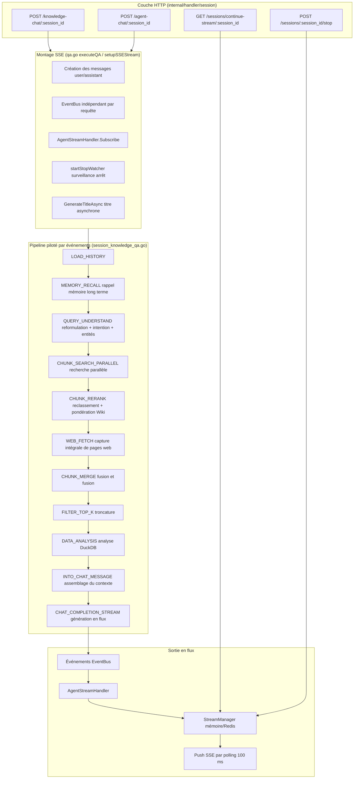
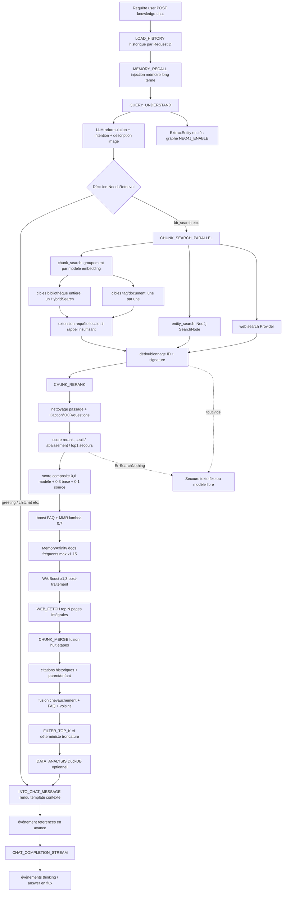
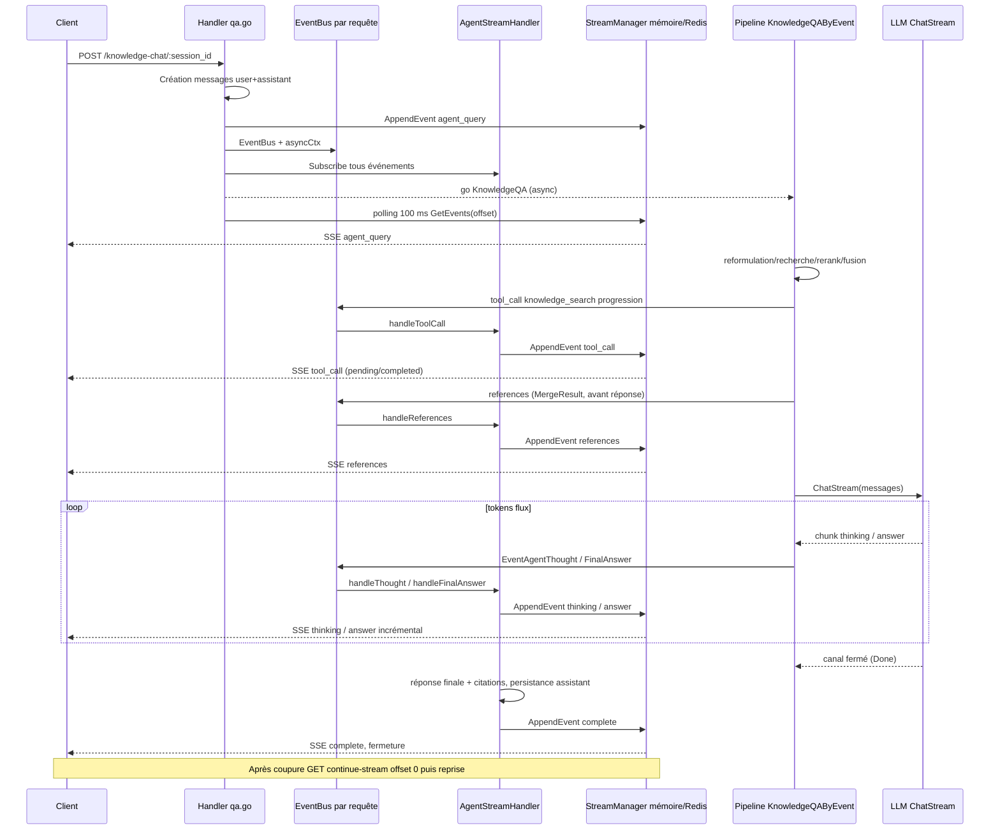

# Pipeline RAG complet (question-réponse par récupération)

Les requêtes de question-réponse sur la base de connaissances entrent dans un pipeline RAG piloté par événements : reconnaissance d’intention, reformulation, recherche, reclassement et assemblage du contexte, puis génération de la réponse. La réponse est renvoyée en flux SSE ; les citations sont développées à la sortie ; le gestionnaire de flux assure la reprise des événements après déconnexion.

## Architecture générale {#_1-architecture-generale}

La chaîne de question-réponse WeKnora est un **pipeline de plugins piloté par événements (Event-Driven Plugin Pipeline)** : chaque étape est un plugin implémentant l’interface `Plugin`, enregistré sur `EventManager` ; l’orchestrateur (`KnowledgeQAByEvent`) déclenche les événements un par un selon une liste `EventType` assemblée dynamiquement ; les plugins s’enchaînent via une chaîne de responsabilité (`next()`). Le résultat n’est pas écrit directement dans la réponse HTTP : chaque requête dispose d’un `EventBus` dédié qui publie des événements, consommés par `AgentStreamHandler` et stockés dans un `StreamManager` partagé (mémoire ou Redis) ; la couche HTTP interroge toutes les 100 ms pour pousser les événements vers le client SSE — ce design permet nativement la **reprise de flux après coupure** et le **déploiement distribué multi-répliques**.



## Cadre de plugins piloté par événements {#_2-cadre-de-plugins-pilote-par-evenements}

### Interface Plugin et chaîne de responsabilité {#_2-1-interface-plugin-et-chaine-de-responsabilite}

`internal/application/service/chat_pipeline/chat_pipeline.go` définit l’abstraction centrale :

```go
type Plugin interface {
    OnEvent(ctx context.Context, eventType types.EventType,
        chatManage *types.ChatManage, next func() *PluginError) *PluginError
    ActivationEvents() []types.EventType
}
```

`EventManager` maintient une table `eventType → []Plugin`. À l’enregistrement, les plugins sont ajoutés dans l’ordre ; `buildHandler` construit des closures imbriquées de l’arrière vers l’avant : **pour un même événement, le plugin enregistré en premier est à l’extérieur de la chaîne, le dernier à l’intérieur** ; le plugin externe n’entre dans la couche interne qu’en appelant `next()` dans `OnEvent`. Un plugin peut traiter en amont de `next()` (cas majoritaire) ou appeler `next()` d’abord puis post-traiter (ex. `PluginWikiBoost` pondère après le reclassement).

Les erreurs se propagent via `*PluginError` ; erreurs prédéfinies : `ErrSearchNothing` (aucun résultat de recherche → réponse de secours plutôt qu’échec), `ErrRerank`, `ErrGetChatModel`, `ErrModelCall`, etc. (`chat_pipeline.go`).

### Ordre d’enregistrement (container.go) {#_2-2-ordre-denregistrement-container-go}

Tous les plugins sont construits via `container.Invoke` dans le conteneur DI et s’auto-enregistrent (`internal/container/container.go`) ; l’ordre d’enregistrement est l’ordre d’exécution sur la chaîne d’un même événement :

```go
must(container.Provide(chatpipeline.NewEventManager))
must(container.Invoke(chatpipeline.NewPluginSearch))               // CHUNK_SEARCH
must(container.Invoke(chatpipeline.NewPluginRerank))               // CHUNK_RERANK (couche externe)
must(container.Invoke(chatpipeline.NewPluginWebFetch))             // WEB_FETCH
must(container.Invoke(chatpipeline.NewPluginMerge))                // CHUNK_MERGE
must(container.Invoke(chatpipeline.NewPluginDataAnalysis))         // DATA_ANALYSIS
must(container.Invoke(chatpipeline.NewPluginIntoChatMessage))      // INTO_CHAT_MESSAGE
must(container.Invoke(chatpipeline.NewPluginChatCompletion))       // CHAT_COMPLETION
must(container.Invoke(chatpipeline.NewPluginChatCompletionStream)) // CHAT_COMPLETION_STREAM
must(container.Invoke(chatpipeline.NewPluginFilterTopK))           // FILTER_TOP_K
must(container.Invoke(chatpipeline.NewPluginQueryUnderstand))      // QUERY_UNDERSTAND (couche externe)
must(container.Invoke(chatpipeline.NewPluginLoadHistory))          // LOAD_HISTORY
must(container.Invoke(chatpipeline.NewPluginMemoryRecall))         // MEMORY_RECALL
must(container.Invoke(chatpipeline.NewPluginExtractEntity))        // QUERY_UNDERSTAND (couche interne)
must(container.Invoke(chatpipeline.NewPluginSearchEntity))         // ENTITY_SEARCH
must(container.Invoke(chatpipeline.NewPluginSearchParallel))       // CHUNK_SEARCH_PARALLEL
must(container.Invoke(chatpipeline.NewPluginWikiBoost))            // CHUNK_RERANK (couche intermédiaire)
must(container.Invoke(chatpipeline.NewPluginMemoryAffinity))       // CHUNK_RERANK (couche la plus interne)
```

Correspondance complète événement → plugins (avec ordre sur la chaîne) :

| EventType | Plugin (ordre chaîne) | Fichier source |
|-----------|---------------|--------|
| `load_history` | PluginLoadHistory | `load_history.go` |
| `memory_recall` | PluginMemoryRecall | `memory_recall.go` |
| `query_understand` | PluginQueryUnderstand → PluginExtractEntity | `query_understand.go`、`extract_entity.go` |
| `chunk_search` | PluginSearch | `search.go`、`query_expansion.go` |
| `chunk_search_parallel` | PluginSearchParallel (compose en interne PluginSearch + PluginSearchEntity) | `search_parallel.go` |
| `entity_search` | PluginSearchEntity | `search_entity.go` |
| `chunk_rerank` | PluginRerank → PluginWikiBoost → PluginMemoryAffinity | `rerank.go`、`wiki_boost.go`、`memory_affinity.go` |
| `web_fetch` | PluginWebFetch | `web_fetch.go` |
| `chunk_merge` | PluginMerge | `merge.go`、`merge_overlap.go`、`merge_expand.go`、`merge_faq.go`、`merge_history.go` |
| `data_analysis` | PluginDataAnalysis | `data_analysis.go` |
| `into_chat_message` | PluginIntoChatMessage | `into_chat_message.go` |
| `chat_completion` | PluginChatCompletion | `chat_completion.go` |
| `chat_completion_stream` | PluginChatCompletionStream | `chat_completion_stream.go` |
| `filter_top_k` | PluginFilterTopK | `filter_top_k.go` |

### ChatManage : objet d’état traversant tout le pipeline {#_2-3-chatmanage-objet-detat-traversant-tout-le-pipeline}

Dans `internal/types/chat_manage.go`, `ChatManage` est composé de trois parties embarquées :

- **PipelineRequest** (configuration de requête immuable) : `Query`, `KnowledgeBaseIDs`/`KnowledgeIDs`/`SearchTargets`, `VectorThreshold`/`KeywordThreshold`/`EmbeddingTopK`, `RerankModelID`/`RerankTopK`/`RerankThreshold`, `ChatModelID`/`SummaryConfig`, `FallbackStrategy`, `CitationEnabled`, `EnableRewrite`/`EnableQueryExpansion`, stratégie FAQ (`FAQPriorityEnabled`/`FAQDirectAnswerThreshold`/`FAQScoreBoost`), `DataAnalysisEnabled`, multimodal (`Images`/`VLMModelID`/`ChatModelSupportsVision`), recherche web (`WebSearchEnabled`/`WebFetchEnabled`/`WebFetchTopN`), etc.
- **PipelineState** (état intermédiaire lu/écrit entre plugins) : `RewriteQuery`, `Intent`, `History`, résultats en cascade `SearchResult` → `RerankResult` → `MergeResult`, `Entity`/`EntityKBIDs`/`GraphResult`, `UserContent`, `RenderedContexts`, `SystemPromptOverride`, etc.
- **PipelineContext** (poignées d’exécution) : `EventBus`, `MessageID` (ID message assistant), `UserMessageID`.

`ChatManage.Clone()` fournit une copie profonde (évite les accès concurrents aux slices partagées lors de recherches parallèles), mais **ne** copie **pas** `PipelineContext`.

### Assemblage dynamique du pipeline (PipelineBuilder) {#_2-4-assemblage-dynamique-du-pipeline-pipelinebuilder}

Dans `session_knowledge_qa.go`, `KnowledgeQA` assemble dynamiquement la liste d’événements selon les caractéristiques de la requête :

```go
// Chat pur (sans KB et sans recherche web)
pipeline = types.NewPipelineBuilder().
    AddIf(hasHistory, types.LOAD_HISTORY).
    Add(types.MEMORY_RECALL).
    Add(types.CHAT_COMPLETION_STREAM).Build()

// RAG
pipeline = types.NewPipelineBuilder().
    AddIf(hasHistory, types.LOAD_HISTORY).
    Add(types.MEMORY_RECALL).
    Add(types.QUERY_UNDERSTAND).
    Add(types.CHUNK_SEARCH_PARALLEL).
    Add(types.CHUNK_RERANK).
    AddIf(webSearchEnabled, types.WEB_FETCH).
    Add(types.CHUNK_MERGE).
    Add(types.FILTER_TOP_K).
    AddIf(chatManage.DataAnalysisEnabled, types.DATA_ANALYSIS).
    Add(types.INTO_CHAT_MESSAGE).
    Add(types.CHAT_COMPLETION_STREAM).Build()
```

La map `types.Pipeline` conserve aussi des préréglages statiques `chat` / `chat_stream` / `chat_history_stream` / `rag` / `rag_stream` pour les appelants qui n’ont pas besoin d’un assemblage dynamique.

### Orchestrateur KnowledgeQAByEvent {#_2-5-orchestrateur-knowledgeqabyevent}

`KnowledgeQAByEvent` (`session_knowledge_qa.go`) déclenche `eventManager.Trigger` étape par étape et effectue de nombreuses tâches périphériques :

- Chaque phase est enveloppée dans un span Langfuse (`pipeline.<event_type>`) ; exception : `CHAT_COMPLETION_STREAM` (son `OnEvent` retourne immédiatement, le span se ferme avant la fin du flux).
- **Événements de progression** : `progress.go` fusionne `CHUNK_SEARCH_PARALLEL → CHUNK_RERANK → CHUNK_MERGE → FILTER_TOP_K` (plus `WEB_FETCH`/`DATA_ANALYSIS` si conditionnels) en une fenêtre de progression `knowledge_search` visible côté frontend ; `QUERY_UNDERSTAND` a sa propre fenêtre `query_understand`. Les chemins d’erreur/court-circuit ferment aussi la fenêtre pour éviter un spinner « recherche en cours » infini.
- **Citations en avance** : avant `CHAT_COMPLETION_STREAM`, `emitKnowledgeReferencesEvent` envoie `MergeResult` via un événement `references` — le client reçoit la liste des citations avant la fermeture de la connexion SSE.
- **Annulation prioritaire** : après chaque phase, vérifier d’abord `ctx.Err()` (un stop utilisateur annule le contexte), **avant** `ErrSearchNothing`, sinon l’arrêt est pris pour « aucun résultat » et une réponse de secours est écrite.
- **Secours** : `ErrSearchNothing` → `handleFallbackResponse` : `FallbackStrategyFixed` envoie le texte fixe `FallbackResponse` ; `FallbackStrategyModel` utilise `FallbackPrompt` pour laisser le modèle répondre librement.

## Détail des plugins par étape {#_3-detail-des-plugins-par-etape}

### LOAD_HISTORY — Chargement de l’historique de session {#_3-1-load-history-chargement-de-lhistorique-de-session}

`load_history.go`. `MaxRounds <= 0` signifie que l’Agent a explicitement désactivé le multi-tour (`MultiTurnEnabled=false`) : étape ignorée, **sans** repli sur la valeur globale par défaut. Sinon, appel à `loadAndProcessHistory` (`common.go`) :

1. `messageService.GetRecentMessagesBySession` récupère les `maxRounds*2+10` messages les plus récents ;
2. Appariement user/assistant par `RequestID` en `types.History` (côté user : légendes d’images et prompts de pièces jointes ; côté assistant : suppression des balises de réflexion via regex `regThinkTags`, avec `KnowledgeReferences`) ;
3. Troncature à `maxRounds` tours en ordre chronologique inverse, puis réinversion en ordre chronologique, écriture dans `chatManage.History`.

Note : les messages user historiques rejouent le `Content` original et non `RenderedContent` (évite de mélanger d’anciens enveloppes de contexte avec le protocole actuel) ; les citations historiques sont injectées séparément via `merge_history.go`.

### MEMORY_RECALL — Rappel de la mémoire long terme {#_3-1a-memory-recall}

`memory_recall.go`. Si la mémoire long terme est activée pour l’espace, rappel des souvenirs de l’appelant pour la question courante dans `chatManage.MemoryPrompt`, et émission de l’événement `memory_recalled` pour affichage frontend. Pas d’appel modèle ; l’échec ne bloque pas la Q&R. Activation et gestion : [Mémoire long terme inter-sessions](../03-features/23-memory.md).

### QUERY_UNDERSTAND — Reformulation + intention (+ extraction d’entités) {#_3-2-query-understand-reformulation-intention-extraction-dentites}

Deux plugins enchaînés sur le même événement :

**PluginQueryUnderstand** (`query_understand.go`) : reformulation et classification d’intention :

- Trois combinaisons d’entrée : texte seul (chat model), texte + image, image seule (modèle chat vision en priorité, sinon `VLMModelID`).
- Prompts depuis `config/prompt_templates/rewrite.yaml` (paires system + user), surchargeables au niveau Agent par `RewritePromptSystem`/`RewritePromptUser` ; placeholders `{conversation}` / `{query}` / `{language}` rendus par `types.RenderPromptPlaceholders`.
- Le modèle doit produire du JSON : `{"rewrite_query":"...","intent":"kb_search","image_description":"..."}` ; tolérance au parsing (markdown, alias de champs, fusion champs OCR) ; si la réponse est tronquée par la limite de sortie, récupération partielle de `rewrite_query`, `intent` et `image_description` ; en cas d’échec total, requête originale conservée, intention vide (traitée comme besoin de recherche). Tours avec image : plafond 2048 tokens (le prompt exige le texte OCR complet dans `image_description`).
- Énumération d’intention (`types.QueryIntent`) : `kb_search`, `web_search`, `greeting`, `chitchat`, `follow_up`, `image_only`, `doc_only`, `summarize`, `clarification`. Normalisation via `types.NormalizeQueryIntent` (casse, `-`/espaces ignorés, ex. `KB-Search` → `kb_search`) ; libellés inconnus → vide. `NeedsKBRetrieval()` vrai seulement pour `kb_search`/`clarification`/`summarize`/vide ; `ChatManage.NeedsRetrieval()` traite en plus `web_search` selon `WebSearchEnabled` (si désactivé, prompt d’intention indiquant l’impossibilité de recherche web). **Tous les plugins de recherche utilisent `NeedsRetrieval()` comme condition de skip.**
- Intentions non recherche : `applyIntentPromptOverride` avec `config/prompt_templates/intent_prompts.yaml` (id de template = valeur d’intention, ex. `greeting`) ou surcharge Agent → `SystemPromptOverride`.
- Description d’image écrite de façon asynchrone dans `Images[0].Caption` du message user (pour l’historique du tour suivant).
- `QueryUnderstandModelID` peut désigner un petit modèle dédié ; échec → repli sur `ChatModelID`.

**PluginExtractEntity** (`extract_entity.go`, couche interne) : uniquement si `NEO4J_ENABLE=true`, intention nécessitant la KB (pas pour salutations, bavardage, etc.) et au moins une KB avec `ExtractConfig.Enabled` dans le périmètre de recherche ; requête reformulée en priorité ; template `config.ExtractManager.ExtractEntity` (`graph_extraction.yaml`) ; entités dans `chatManage.Entity` / `EntityKBIDs` / `EntityKnowledge` pour `ENTITY_SEARCH`.

### CHUNK_SEARCH_PARALLEL — Recherche parallèle (chunks + entités graphe) {#_3-3-chunk-search-parallel-recherche-parallele-chunks-entites-graphe}

`search_parallel.go`. Skip si `NeedsRetrieval()` est faux. Sinon `Clone()` de `chatManage` en deux exemplaires, exécution concurrente via `RunParallel` :

- `chunk_search` : en interne `PluginSearch.OnEvent(CHUNK_SEARCH, ...)` (non enregistré seul) ;
- `entity_search` : si entités présentes, `PluginSearchEntity.OnEvent(ENTITY_SEARCH, ...)` ; recherche parallèle `SearchNode` dans Neo4j par `NameSpace{KnowledgeBase, Knowledge}` ; nœuds/arêtes convertis en SearchResult et `GraphResult`. Chunks et documents chargés par ID (hors espace de travail courant, pour résoudre les hits graphe sur KB partagées org) ; conservation des chunks appartenant aux KB du tour, encore activés, document existant ; max 30 ; hits graphe sans score de recherche (`Score=0`), score modèle au reclassement.

Fusion des deux branches puis `removeDuplicateResults` (ID chunk + signature de contenu `searchutil.BuildContentSignature`). Si les deux sont vides → `ErrSearchNothing`.

**PluginSearch** (`search.go`) : encore deux branches concurrentes :

1. **Recherche KB** `searchByTargets` :
   - Groupement des `SearchTargets` par identité de modèle d’embedding (`model.Name + BaseURL`, partageable inter-locataires) via `ResolveEmbeddingModelKeys`, un seul vecteur de requête par groupe (`GetQueryEmbedding`) ;
   - Dans un groupe, cibles « bibliothèque entière » sans contrainte tag/document fusionnées en **un** appel `HybridSearch` (`params.KnowledgeBaseIDs` multi-KB) ; cibles contraintes une par une via `searchSingleTarget` (`KnowledgeIDs`/`TagIDs`/`ScopeTagIDs`, `DisableRecallThresholds` possible si périmètre explicite) ;
2. **Recherche web** `searchWebIfEnabled` : si `WebSearchEnabled`, `WebSearchProviderID` locataire/Agent → `webSearchService.Search`, conversion `searchutil.ConvertWebSearchResults` (URL comme ID, `KnowledgeSource="web_search"`).

**Extension de requête** (`query_expansion.go`) : si `EnableQueryExpansion` et premier rappel inférieur à `EmbeddingTopK`. Sans LLM : variantes locales (stop words, permutation, phrases clés, etc.). Segmentation chinois via `types.Jieba.CutForSearch` : segments han continus passés à jieba ; mélange scripts découpé par script ; filtres longueur/stop words en runes. Pour chaque (variante × SearchTarget), concurrence plafonnée à 16, **keyword-only** `HybridSearch` (variantes côté mot-clé ; embedding quasi identique au vecteur de la requête originale). Seuil mot-clé à 0,8×, TopK `max(EmbeddingTopK, RerankTopK) * 2` ; pas d’extension si recherche par mots-clés désactivée.

### CHUNK_RERANK — Reclassement, score composite, MMR, pondération Wiki {#_3-4-chunk-rerank-reclassement-score-composite-mmr-ponderation-wiki}

**PluginRerank** (`rerank.go`, ~720 lignes) :

1. **Nettoyage des passages** `reranking.CleanPassage` : le modèle de reclassement mesure la similarité sémantique ; la syntaxe Markdown structurelle est du bruit. Clôtures de code backtick/tilde de premier niveau : seuls les délimiteurs sont retirés, le corps n’est plus nettoyé HTML/URL/Markdown (évite de supprimer balises XML, URLs d’API, opérateurs). Fences non fermées protégées jusqu’à la fin du chunk. Seules les fences de premier niveau avec ≤3 espaces initiaux ; pas le code inline, indenté ou dans citations/listes. Blocs `$$...$$` hors fence : délimiteurs retirés, contenu conservé ; balises HTML, images, liens (texte conservé), URLs nues, séparateurs de tableaux (lignes données en CSV), titres/citations/gras/listes retirés ; espaces compressés hors fences. Passage entier trim ; contenu chunk original inchangé.
2. **Enrichissement** `getEnrichedPassage` : Caption/OCR `ImageInfo` et questions générées dans `ChunkMetadata` ; pas de duplication si identique au corps. Troncature depuis la fin si limite longueur modèle ; max 200 candidats par score de recherche.
3. `rerankModel.Rerank(ctx, RewriteQuery, passages)`, filtre `RerankThreshold` :
   - Tous sous le seuil et top1 ≥ `rerankFallbackMinScore` (défaut 0,15 ; 0 si périmètre tag/document explicite) → garder top1 ;
   - Aucun résultat et seuil &gt; 0,3 → **abaissement de seuil** une fois (`threshold * 0.7`, plancher 0,3) ;
   - Échec chargement modèle ou API (timeout 60 s par défaut) → repli sur résultats de recherche bruts.
   - **Hits image** (`image_vector`, voir [Rappel d’images](#_8-recherche-concurrente-multi-kb-et-fusion-hybridsearch)) : le rerank texte ne voit que description/OCR. Deux cas (`internal/reranking/image.go`) :
     - Modèle vision (`input` contient `image`, ex. `jina-reranker-m0`, `nvidia/llama-nemotron-rerank-vl-1b-v2`) : lecture image (`KnowledgeBaseService.ReadChunkImage`, conversion/compression selon fournisseur), **score sur l’image**, même échelle/seuil ; échec → score texte.
     - Modèle texte : OCR ≥ 200 caractères traité comme texte ; sinon si rejeté et `VectorScore` ≥ `max(seuil vecteur, 0.25)`, garder jusqu’à 2 images par score vecteur après le tri texte, `Metadata["kept_by"]="image_vector"`. Si aucun texte ne passe le seuil, retourner quand même ces images.
     - Diagnostics `images_scored` / `images_kept`.
4. **Score composite** `compositeScore` : `0,6×score modèle + 0,3×score base recherche + 0,1×poids source` (web_search 0,95, sinon 1,0), clamp [0,1]. Chunks entité graphe sans score recherche : base = score modèle. Métadonnées `base_score` / `model_score` / `composite_score`. Prior positionnel document (±0,05) retiré (couplage aux offsets après édition de chunks).
5. **Boost FAQ** : si `FAQPriorityEnabled` et `FAQScoreBoost > 1.0`, multiplication du score FAQ, `Metadata["faq_boosted"]`. Pas de plafond à 1,0 (évite égalités artificielles).
6. **Sélection MMR** `reranking.SelectMMR` (λ=0,7, k=`RerankTopK`) : `mmr = 0,7×pertinence - 0,3×max_redondance_jaccard`. Tokenisation `searchutil.TokenizeSimple` une fois, index inversé token → indices candidats. Jaccard `intersection / (|A|+|B|-intersection)` ; `k=1` : pertinence seule, sans nettoyage/index. Partagé chat, outil Agent, API recherche.

**PluginMemoryAffinity** (`memory_affinity.go`, couche la plus interne) : post-traitement après `next()` : documents cités ≥2 fois dans les réponses passées de l’appelant, boost logarithmique max ×1,15 pour départager candidats proches ; puis WikiBoost.

**PluginWikiBoost** (`wiki_boost.go`, couche intermédiaire) : `next()` d’abord ; si chunk `wiki_page` et KB Wiki activée dans les cibles, × `wikiBoostFactor = 1.3` et tri stable — pages Wiki pré-synthétisées par LLM prioritaires sur chunks bruts.

### WEB_FETCH — Capture intégrale de pages web {#_3-5-web-fetch-capture-integrale-de-pages-web}

`web_fetch.go`. Uniquement si `WebFetchEnabled && WebSearchEnabled`. Top `WebFetchTopN` (défaut 3) résultats web de `RerankResult`, parallèle `web_fetch.FetchURLContent(ctx, url)`, remplace le snippet (troncature 8000 octets). Après reclassement, avant fusion — coût de fetch seulement pour pages web bien classées.

### CHUNK_MERGE — Fusion en huit étapes {#_3-6-chunk-merge-fusion-en-huit-etapes}

Commentaire `OnEvent` dans `merge.go` :

1. **Entrée** : `RerankResult` en priorité, sinon `SearchResult` (tri par score, troncature `RerankTopK`) ;
2. **Dédoublonnage** : ID + signature ;
3. **Citations historiques** (`merge_history.go`) : dernière tour avec `KnowledgeReferences`, filtre recouvrement requête (`|q∩c|/min(|q|,|c|)` ≥ 0,3 ; Jaccard sur union), score ×0,6, max 3, `MatchTypeHistory` ;
4. **Résolution parent/enfant** `resolveParentChunks` : sous-chunks text et image_* complétés par contenu `parent_text` **actuel** ; images Markdown via URL stable (`PruneMarkdownImagesByImageInfo`) ; `ImageInfo` strictement sur sous-chunk texte hit ;
5. **Fusion séquentielle par groupe** `groupAndMergeCurrentContent` : groupe `KnowledgeID + ChunkType`, tri `ChunkIndex`, `mergeSequentialChunks` — indices contigus ou inclusion → `searchutil.JoinChunkContent`, score max, `SubChunkID`, `mergeImageInfo` dédupliqué par URL ;
6. **FAQ** (`merge_faq.go`) : batch `FAQMetadata`, contenu `Q: … + Answer: …` ;
7. **Extension voisins** (`merge_expand.go`) : texte &lt; 350 caractères → voisins `PreChunkID`/`NextChunkID` jusqu’à ~850 caractères, même document, KB org partagées OK ;
8. **Second passage** dédoublonnage + `removePartialOverlaps` (inclusion normalisée / Jaccard ≥ 0,85, ratio tailles ≤3×). Hit `image_vector` vs description : dédup peut garder l’un ou l’autre ; si image perdue, `Metadata["image_vector_match"]="true"` sur le conservé.

Résultat dans `chatManage.MergeResult`.

::: tip Pourquoi plus d’offsets caractères
Après édition manuelle des chunks, `StartAt`/`EndAt` ne reflètent plus fidèlement la position dans le source. Fusion basée sur **contenu courant + `ChunkIndex`** (`JoinChunkContent` / `ContainsChunkContent`) ; offsets source réservés aux citations. Clés de départage `FILTER_TOP_K` : `ChunkIndex` au lieu de `StartAt`/`EndAt`.
:::

### FILTER_TOP_K — Tri déterministe et troncature {#_3-7-filter-top-k-tri-deterministe-et-troncature}

`filter_top_k.go`. `sortSearchResultsDeterministically` sur `MergeResult` (repli `RerankResult`/`SearchResult`) — score décroissant, tie-break `KnowledgeID`/`ChunkType`/`ChunkIndex`/`ID`, puis troncature `RerankTopK`. Résultats hors TopK conservés au rerank (`kept_by`, images) n’occupent pas les places, ajoutés après.

### DATA_ANALYSIS — Analyse tabulaire DuckDB {#_3-8-data-analysis-analyse-tabulaire-duckdb}

`data_analysis.go`. Désactivé par défaut (`DataAnalysisEnabled` Agent). Si CSV/Excel dans `MergeResult` : filtrer `table_column`/`table_summary`, premier fichier données, `tools.NewDataAnalysisTool` → DuckDB schema, LLM décide SQL DuckDB (`DataAnalysisInput`), résultat synthétique `MatchTypeDataAnalysis`, score=1,0 ajouté à `MergeResult`.

### INTO_CHAT_MESSAGE — Assemblage du contexte {#_3-9-into-chat-message-assemblage-du-contexte}

`into_chat_message.go` :

- `utils.ValidateInput` (protection injection) ;
- Intentions non recherche : `ContextTemplate` avec `contexts` vide, métadonnées `current_time`, etc. ;
- **FAQ prioritaire** : sections `source type="faq" priority="high"` et `source type="document" priority="supplementary"` ; première FAQ avec score **avant** boost ≥ `FAQDirectAnswerThreshold` → `match="exact"` ;
- Chemin standard : passages enrichis `context id="N"` (`getEnrichedPassageForChat` inline images Markdown) ;
- En-tête `buildDocumentHeader` (title/description dédupliqués) ;
- Rendu `SummaryConfig.ContextTemplate` (`config/prompt_templates/context_template.yaml`), placeholders `{query}` / `{contexts}` / `{language}` ; descriptions image (modèle non vision), `QuotedContext`, prompts pièces jointes ;
- **Images recherche** : si vision, lecture images des contextes `image_vector` ou `image_vector_match` (dédup, max 3, PNG/JPEG/WebP/GIF ≤ 5 Mo) → `ContextImages`, après images user ; identité conservée avant expansion parent (`matched_images`) ; alias chunk dans le message modèle. Mode Agent : `search_knowledge` garde candidats image avant rerank, même logique outil + alias en historique (identité, pas octets).
- `UserContent` **écrit asynchrone** dans `RenderedContent` user (`persistRenderedContent`) ; `RenderedContexts` pour remplacement citations.

### CHAT_COMPLETION / CHAT_COMPLETION_STREAM — Génération {#_3-10-chat-completion-chat-completion-stream-generation}

Plugins partageant les helpers `common.go` :

- `prepareChatModel` : modèle chat + `ChatOptions` depuis `SummaryConfig` ;
- `prepareMessagesWithHistory` : system = `SystemPromptOverride` ou `SummaryConfig.Prompt` (`system_prompt.yaml`), placeholders, paragraphe exigences images si Markdown dans le contexte (`appendRetrievedImageOutputRequirement`) ; historique Q/A chronologique ; message user courant (+ `Images` si vision).

`references.go` `prepareMessagesWithModelContext` : **alias de sources** (voir [Mécanisme de citation](#_7-mecanisme-de-generation-des-citations-citation)) : `RenderedContexts` → vue alias chunk via `modelcontext.Registry` isolée par requête ; protocole citation en fin de system prompt.

**Flux** (`chat_completion_stream.go`) : `EventBus` obligatoire, `chatModel.ChatStream`, goroutine consommatrice :

- `ResponseTypeThinking` → `EventAgentThought` via `modelcontext.StreamDecoder` (res:// + ref) ;
- `ResponseTypeAnswer` → `EventAgentFinalAnswer`, même décodage ; réponse finale avec `Done` **une seule fois** (évite doublon après `complete`) ;
- Troncature : `length` / `max_tokens` / `max_output_tokens` → `truncated` ; si aucun texte avant troncature, message fixe suggérant question plus courte ou `max_completion_tokens` plus élevé. Secours `handleFallbackResponse` idem ;
- `ResponseTypeError` → `EventError` ;
- Fin canal ou annulation ctx : `flushDecoders` puis fermeture flux thinking.

**Non flux** (`chat_completion.go`) : `Chat`, `modelContext.DecodeResponse`, `chatManage.ChatResponse`.

## Schéma complet du pipeline RAG {#_4-schema-complet-du-pipeline-rag}



## Gestion des sessions et messages {#_5-gestion-des-sessions-et-messages}

### Session Service (`session.go`) {#_5-1-session-service-session-go}

- CRUD : `CreateSession` / `GetSession` (locataire + partage) / `GetOwnedSession` (propriétaire strict, stop, etc.) / liste paginée / `SetSessionPinned` / `UpdateSessionLastRequestState` (état barre mémoire : Agent/modèle/KB/web/pensée, UI) / suppression simple, batch, purge.
- **Fourche et retour arrière** : `session_fork.go` copie l’historique (`parent_session_id` / `forked_from_message_id`) ; `session_rewind.go` supprime les messages après un point ; checkpoint git sandbox (`workspace_checkpointer.go`) pour `/workspace` — voir [API session et chat](../04-api/02-api-chat.md).
- **Titre** : `GenerateTitleAsync` au montage SSE (si pas de titre), template `generate_session_title.yaml`, `EventSessionTitle` (SSE `response_type=session_title`), attente max 3 s après complete côté HTTP.

### Message Service (`message.go`) {#_5-2-message-service-message-go}

- User et assistant liés par `RequestID` ; user `IsCompleted=true` à la requête ; assistant complété en fin de flux ou stop via `completeAssistantMessage`.
- `UpdateMessageRenderedContent` / `UpdateMessageImages` appelés async par `INTO_CHAT_MESSAGE` et `QUERY_UNDERSTAND`.
- `GetRecentMessagesBySession` source du chargement historique.
- `IndexMessageToKB`, `SearchMessages` (vecteur + rerank).

## Mécanisme de sortie en flux {#_6-mecanisme-de-sortie-en-flux}

### StreamManager : flux d’événements append-only {#_6-1-streammanager-flux-devenements-append-only}

`internal/stream/factory.go` selon `STREAM_MANAGER_TYPE` :

| Implémentation | Stockage | Points clés |
|------|------|--------|
| `memory` (défaut) | `map[sessionID]map[messageID]*events` + RWMutex process | Mono-instance ; `GetEvents` copie pour éviter les courses |
| `redis` | Liste Redis, clé `{REDIS_PREFIX ou stream:events}:{sessionID}:{messageID}` | `AppendEvent` = RPUSH + TTL (1 h) ; `GetEvents` = LRANGE offset..-1 ; multi-répliques ; événements stop partagés |

Deux méthodes : `AppendEvent` et `GetEvents(..., fromOffset)` — **producteurs append-only, consommateurs par offset**, rejeu depuis le début à tout moment.

### Flux : EventBus → AgentStreamHandler → StreamManager → SSE {#_6-2-flux-eventbus-agentstreamhandler-streammanager-sse}

1. `setupSSEStream` (`qa.go`) : `event.EventBus` et `asyncCtx` annulable par requête ;
2. `AgentStreamHandler.Subscribe()` (`agent_stream_handler.go`) : `thought` / `tool_call` / `tool_result` / `references` / `final_answer` / `reflection` / `error` / `session_title` / `agent.complete` / approbation outil / OAuth MCP → `StreamEvent` dans StreamManager ; accumulation `answerSegments` et `knowledgeRefs`, persistance assistant en fin de flux ;
3. HTTP `handleAgentEventsForSSE` (`stream.go`) : ticker 100 ms, `buildStreamResponse` → `c.SSEvent("message", response)` ; `complete` termine (nouvelle session : +3 s titre).

### Protocole SSE et types `response_type` {#_6-3-protocole-sse-et-types}

En-têtes SSE `setSSEHeaders` (`text/event-stream`, `no-cache`, `keep-alive`, `X-Accel-Buffering: no`). Chaque `message` est un JSON `StreamResponse` (`internal/types/chat.go`) :

```go
type StreamResponse struct {
    ID                  string       `json:"id"`            // request_id
    ResponseType        ResponseType `json:"response_type"`
    Content             string       `json:"content"`       // chunk incrémental, cumul côté client
    Done                bool         `json:"done"`
    KnowledgeReferences References   `json:"knowledge_references,omitempty"`
    SessionID           string       `json:"session_id,omitempty"`
    AssistantMessageID  string       `json:"assistant_message_id,omitempty"`
    Data                map[string]interface{} `json:"data,omitempty"`
    ...
}
```

Liste `response_type` (`internal/types/chat.go` ; handler `stop` ; `steer` côté serveur uniquement, absent du SSE) :

| response_type | Signification |
|---------------|------|
| `agent_query` | Requête acceptée, `session_id` / `assistant_message_id` (reprise) |
| `thinking` | Incrément raisonnement (`reasoning_content`) |
| `answer` | Incrément réponse ; `data.truncated: true` si limite de sortie |
| `references` | Liste citations (`knowledge_references`) |
| `tool_call` / `tool_result` | Agent / progression (`knowledge_search`, `query_understand`) ; échec outil : `tool_result`, `data.success=false` |
| `command_output` / `install_output` | Sortie commande / installation, carte outil en cours |
| `reflection` | Réflexion Agent |
| `session_title` | Titre généré async |
| `error` | Échec du tour (`Done=true`) ; échec outil isolé : pas ce type |
| `complete` | Fin de flux |
| `tool_approval_required` / `tool_approval_resolved` | Approbation outil MCP dangereux |
| `mcp_oauth_required` / `mcp_oauth_resolved` | OAuth MCP |
| `memory_recalled` | Mémoire long terme injectée |
| `artifacts_pending` | Réponse finie, artefacts sandbox en cours ; liste avec `complete` |
| `user_message_injected` | Message injecté en cours d’exécution |
| `context_compacted` | Contexte Agent compacté |
| `install_prompt` | Premier événement installation compétence |
| `stop` | Notification arrêt utilisateur (handler) |

### Reprise de flux (continue-stream) et arrêt {#_6-4-reprise-de-flux-continue-stream-et-arret}

**Reprise** : `GET /sessions/continue-stream/:session_id?message_id=...` (`stream.go` ContinueStream). Validation session/message, `GetEvents` offset 0 **rejeu complet** (`continue_stream_coalesce.go` fusionne incréments answer/thinking/reflection consécutifs même id) ; si `complete` présent → fin ; sinon polling 100 ms — génération découplée du SSE, refresh/réseau n’interrompt pas la génération.

**Arrêt** : `POST /sessions/:id/stop` (propriétaire strict) append `stop` ; SSE détecte → `EventStop` ; `startStopWatcher` (300 ms, 2 h max) si client déconnecté. `setupStopEventHandler` : `cancel()` asyncCtx, contenu partiel sauvé via `context.WithoutCancel`.

### Diagramme de séquence Q&R en flux {#_6-5-diagramme-de-sequence-q-r-en-flux}



## Mécanisme de génération des citations (Citation) {#_7-mecanisme-de-generation-des-citations-citation}

### Alias de sources par requête et expansion ref (sources.go / citations.go) {#_7-1-alias-de-sources-par-requete-et-expansion-ref-sources-go-citations-go}

`internal/modelcontext/` (`sources.go`, `citations.go`, `Registry` dans `registry.go` ; ancien `internal/llmreference/` fusionné). Objectif : **pas d’ID internes dans le contexte modèle ; citations modèle expansibles en sécurité**.

- `Registry` (une instance par réponse, tous tours outils Agent, jamais persistée entre requêtes) : alias faible entropie `cN` chunk KB, `wN` web, `dN` document, `bN` KB.
- `ProtocolPrompt()` en fin de system (citations selon `NewRegistry(citationsEnabled)`) : balises auto-fermantes `ref id="cN"` si activé ; interdit d’inventer kb/web ; si `CitationEnabled=false` (défaut activé), aucune citation.
- `prepareMessagesWithModelContext` : `RegisterSearchResults` ordre FAQ, `ModelToolResult` / `ModelOutput` → XML compact (`display_type=search_results` / `web_search_results`), **remplace** `RenderedContexts`.
- `ExpandText` / `StreamDecoder` : chunk → balise `kb` ; web → `web url title` ; alias inconnu supprimé (fail-closed). Panneau « résultats rappelés » via événement SSE `references` même si citations inline désactivées.

### Alias de handles de ressources stockage (resources.go) {#_7-2-alias-de-handles-de-ressources-stockage-resources-go}

`internal/modelcontext/resources.go` (ex `internal/llmresource/`) : `resource://`, `minio://`, `cos://`, slugs wiki `summary/<uuid>` → `Registry.EncodeMessages` en `res://0001` (ressources avant sources, ordre fixe `registry.go`) ; `StreamDecoder` + `Flush` ; `DecodeToolCalls` pour paramètres outils.

## Recherche concurrente multi-KB et fusion (HybridSearch) {#_8-recherche-concurrente-multi-kb-et-fusion-hybridsearch}

`internal/application/service/knowledgebase_search.go` (pipeline chat, outils Agent, API recherche) :

1. **Autorisation** : chargement batch KB (partage Organization), `authorizeKBAccess` ; `validateSameEmbeddingModel` refuse mélange d’espaces embedding (exemption wiki/graph sans vecteur).
2. **Normalisation + sur-rappel** : `MatchCount <= 0` → `normalizedMatchCount` → `types.DefaultRetrievalTopK` (50) ; puis `matchCount = max(MatchCount*5, 50) * len(KBs)`, plafond `maxRetrievalPoolSize` (500).
3. **Vecteur requête calculé une fois**, propagé via `params.QueryEmbedding`.
4. **Groupement storeGroup** (`knowledgebase_search_storegroup.go`) : par `(VectorStoreID, locataire propriétaire)` ; `retriever.CreateRetrieveEngineForKB` → `CompositeRetrieveEngine`. `buildRetrievalParams` : FAQ → index vecteur FAQ ; documents → vecteur + mots-clés.
5. **Rappel images** (`knowledgebase_search_image.go`) : `applyImageRecall` si KB avec `ImageProcessingConfig.ImageVectorEnabled` et modèle vecteur image ; `ImageKBIDs`, TopK ×1,5 (max 500), seuil `min(VectorThreshold, 0.1)`. `filterImageHits` : texte = `VectorThreshold`, image = seuil image ; lignes image keyword-only rejetées ; KB sans image vector : hits image rejetés. `refillPastDroppedImages` si pool plein avec images rejetées (TopK doublé, max 500, max ~4 requêtes pour pool 50). Best-effort si erreur partielle.
6. **Fan-out** (`knowledgebase_search_fanout.go`) : un groupe direct ; multi-groupes `errgroup` max 4, timeout `MULTI_STORE_RETRIEVE_TIMEOUT_SEC` (30 s), échec all-or-nothing ; `EngineAwareNormalizer` scores [0,1].
7. **Fusion** (`knowledgebase_search_fusion.go`) : un seul moteur → `deduplicateByScore` ; hybride → **RRF pondéré** normalisé [0,1] ; config locataire `RetrievalConfig`.
8. **FAQ** (`knowledgebase_search_faq.go`) : itération TopK si FAQ principal et pool insuffisant ; filtre `NegativeQuestions` (match exact normalisé).
9. Troncature `MatchCount`, `processSearchResults` ; pipeline `SkipContextEnrichment=true`.

Stratégies FAQ côté pipeline : [CHUNK_RERANK](#_3-4-chunk-rerank-reclassement-score-composite-mmr-ponderation-wiki) et [INTO_CHAT_MESSAGE](#_3-9-into-chat-message-assemblage-du-contexte).

## Extraction de mots-clés et searchutil {#_9-extraction-de-mots-cles-et-searchutil}

`config/prompt_templates/keywords_extraction.yaml` : max 5 mots-clés, chargé par `loadPromptTemplates`, API templates locataire (`internal/handler/tenant.go`). Extension de requête pipeline : heuristiques locales sans LLM ([CHUNK_SEARCH_PARALLEL](#_3-3-chunk-search-parallel-recherche-parallele-chunks-entites-graphe)).

`internal/searchutil/` :

| Fichier | Fonctions clés | Usage |
|------|----------|------|
| `textutil.go` | `BuildContentSignature` / `NormalizeContent` / `IsContentContained` / `ContentOverlapRatio` | Signatures, dédup merge |
| `textutil.go` | `TokenizeSimple` / `Jaccard` | MMR, filtres historique |
| `chunkmerge.go` | `AppendWithOverlap` / `MergeTextChunks` | Fusion chunks |
| `imageinfo.go` / `imageinfo_match.go` | collecte/enrichissement/filtrage images | Contexte multimodal |
| `conversion.go` | `ConvertWebSearchResults` | Web → SearchResult |
| `normalize.go` | `NormalizeKeywordScores` | Normalisation scores keyword |

## Correspondance templates prompt / code {#_10-correspondance-templates-prompt-code}

`loadPromptTemplates` depuis `config/prompt_templates/` → `PromptTemplatesConfig` ; résolution par id (`system_prompt_id`, etc.).

| Fichier template | Champ config | Emploi |
|----------|----------|----------|
| `rewrite.yaml` | `Conversation.RewritePromptSystem/User` | `query_understand.go` |
| `intent_prompts.yaml` | `Conversation.IntentSystemPrompts` | Intentions non recherche |
| `system_prompt.yaml` | `Conversation.Summary.Prompt` | System RAG (`common.go`) |
| `context_template.yaml` | `Conversation.Summary.ContextTemplate` | `into_chat_message.go` |
| `fallback.yaml` | `Conversation.FallbackPrompt/Response` | Secours recherche vide |
| `generate_session_title.yaml` | — | Titre session |
| `keywords_extraction.yaml` | `PromptTemplates.KeywordsExtraction` | API locataire |
| `generate_questions.yaml` / `generate_summary.yaml` | — | Enrichissement ingestion |
| `generate_kb_description.yaml` | `Conversation.GenerateKBDescriptionPrompt` | Description KB |
| `graph_extraction.yaml` | `ExtractManager.ExtractEntity/ExtractGraph` | Entités / graphe |
| `agent_system_prompt.yaml` | — | Mode Agent |

Placeholders : `types.RenderPromptPlaceholders`. Protocole citation ([§7.1](#_7-1-alias-de-sources-par-requete-et-expansion-ref-sources-go-citations-go)) : ajout système, **hors** templates utilisateur.

## Références d’implémentation

Emplacements source par étape :

| Étape | Emplacement source |
|------|----------|
| Entrée HTTP / montage SSE | `internal/handler/session/qa.go`、`helpers.go`、`stream.go` |
| Pont EventBus → flux | `internal/handler/session/agent_stream_handler.go` |
| Orchestration pipeline | `internal/application/service/session_knowledge_qa.go` |
| Cadre plugins et étapes | `internal/application/service/chat_pipeline/` |
| Enregistrement DI | `internal/container/container.go` |
| Types événement/état | `internal/types/chat_manage.go`、`internal/types/chat.go`、`internal/event/event.go` |
| Recherche hybride multi-KB | `internal/application/service/knowledgebase_search*.go` |
| StreamManager (reprise) | `internal/stream/`（`factory.go`、`memory_manager.go`、`redis_manager.go`） |
| Session / messages | `internal/application/service/session.go`、`message.go` |
| Citations alias/expansion | `internal/modelcontext/`（`sources.go`、`citations.go`、`resources.go`、`stream.go`） |
| Utilitaires texte | `internal/searchutil/` |
| Templates prompt | `config/prompt_templates/`、`internal/config/config.go` |
