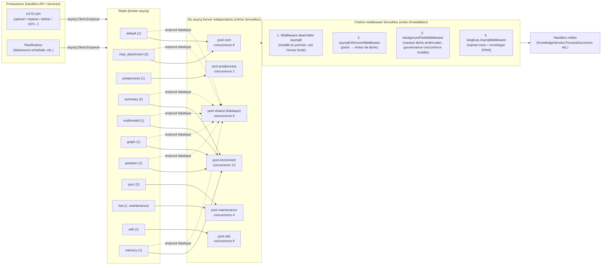
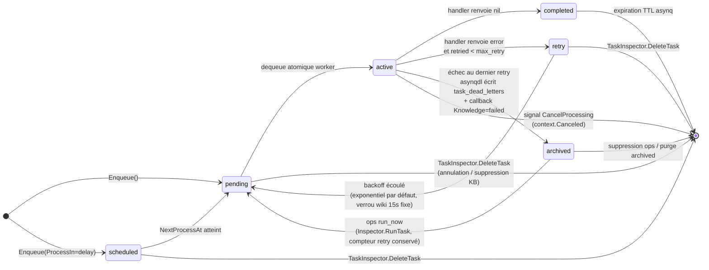
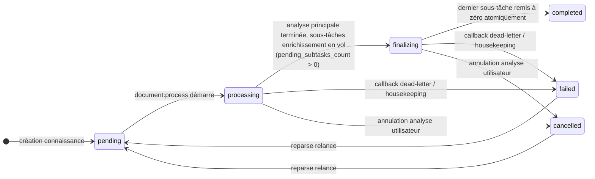

# Système de tâches asynchrones

L’analyse documentaire, la construction d’index, la génération de résumés et de questions, l’extraction de graphe, la génération Wiki, la synchronisation des sources de données et les opérations par lot sont planifiées par le système de tâches. Un déploiement standard s’appuie sur [asynq](https://github.com/hibiken/asynq) et Redis ; le mode Lite utilise un exécuteur sans Redis. Les deux modes partagent la même logique de traitement ; seuls l’exécution et les capacités d’exploitation diffèrent.


## Automatisations et travail d’arrière-plan

Ce document décrit surtout les files métier (documents, Wiki, etc.). Les plans d’automatisations v0.9.0, les agents de collaboration et le shell d’arrière-plan ont chacun leur cycle de vie : les automatisations sont lancées par l’assistant, les attentes d’approbation peuvent être persistées, le shell se consulte et s’annule via `work_id`. Après une interruption de service, les écritures incertaines ne sont pas rejouées automatiquement comme des tâches d’indexation idempotentes classiques.

Configuration utilisateur : [Automatisations](../03-features/27-automations.md) ; API : [Tâches d’arrière-plan](../04-api/02-api-chat.md#assistant-runtime).

## Architecture globale : double mode d’exécution {#_1-architecture-globale-double-mode-dexecution}

WeKnora propose deux modes d’exécution des tâches, choisis selon la forme de déploiement :

- **Mode asynq (déploiement standard)** : les tâches sont sérialisées en payload JSON via `asynq.Client`, écrites dans une file Redis, puis consommées par plusieurs `asynq.Server` indépendants (pools de workers). Dans `internal/router/task.go`, `RunAsynqServer()` construit un `asynq.ServeMux` unifié et l’exécute sur 6 pools.
- **Mode Lite (instance unique / app macOS, sans Redis)** : `SyncTaskExecutor` dans `internal/router/sync_task.go` implémente la même interface `interfaces.TaskEnqueuer` ; `Enqueue` dispatch la tâche directement dans une goroutine. Les options `ProcessIn` / `ProcessAt` (délai), `MaxRetry`, `Timeout` et `Deadline` sont prises en charge, que l’on les passe à `asynq.NewTask` ou à `Enqueue` (priorité à `Enqueue`). Sans timeout explicite, la tâche n’est pas limitée dans le temps — contrairement au défaut asynq de 30 minutes. Les reprises utilisent un backoff linéaire (`attempt * 5s`, plafond 30s) ; une tâche qui renvoie `asynq.SkipRetry` n’est plus reprise. Un panic dans le handler est capturé et traité comme un échec, sans faire quitter le processus. Après épuisement des reprises, le même finaliseur que le callback dead-letter du mode standard s’applique : pour les tâches documentaires, la connaissance passe à `failed`.

```go
// internal/router/sync_task.go
// SyncTaskExecutor executes tasks synchronously (in a goroutine) without Redis.
// Used in Lite mode as a drop-in replacement for *asynq.Client.
```

L’ensemble des handlers enregistrés est identique dans les deux modes (comparer `RunAsynqServer` et `RegisterSyncHandlers`), afin que la sémantique des tâches ne dérive pas selon le déploiement.

## Rôle de Redis dans le système {#_2-role-de-redis-dans-le-systeme}

| Rôle | Description | Emplacement source |
| --- | --- | --- |
| Broker asynq | Toutes les files (listes pending, ZSET scheduled/retry, ZSET archived) vivent dans Redis ; le dequeue est atomique (`BRPOPLPUSH`), une tâche n’est exécutée que par un seul worker | `internal/router/task.go` `getAsynqRedisClientOpt()` |
| Source pour l’inspection des tâches | `asynq.Inspector` + lectures paginées directes `LPos` / `ZRank` / `ZRevRank` | `internal/router/task_inspector.go` |
| Verrous mutex Wiki ingest | `wiki:active:<kbID>`, verrous finalize et slug : `SetNX` + TTL | `internal/application/service/wiki_ingest.go`, `wiki_ingest_batch.go` |
| Compteurs sous-tâches multimodales | Compteur de complétion des sous-tâches image (DECR), finalize déclenché au dernier attempt ; en mode Lite, compteur en mémoire processus | services liés à `image_multimodal` |
| Limitation de débit | Fenêtre glissante via ZSET (voir doc observabilité) | `internal/ratelimit/limiter.go` |

Les paramètres de connexion Redis viennent des variables d’environnement `REDIS_ADDR` / `REDIS_USERNAME` / `REDIS_PASSWORD` / `REDIS_DB` et de la config TLS. Les timeouts lecture/écriture sont pilotés par `WEKNORA_REDIS_OP_TIMEOUT_MS`, 500 ms par défaut (écriture = 2× pour absorber le blocage en tête de file) :

```go
// internal/router/task.go
const defaultRedisOpTimeoutMs = 500
opt := &asynq.RedisClientOpt{
    Addr:        os.Getenv("REDIS_ADDR"),
    ReadTimeout: time.Duration(timeoutMs) * time.Millisecond,
    WriteTimeout: time.Duration(timeoutMs*2) * time.Millisecond,
    ...
}
```

## Inventaire des types de tâches {#_3-inventaire-des-types-de-taches}

Les constantes de type sont définies dans `internal/types/task.go` :

| Type de tâche | Constante | Usage | File |
| --- | --- | --- | --- |
| `document:process` | `TypeDocumentProcess` | Entrée analyse documentaire (DocReader / découpage / vectorisation) | `default` |
| `manual:process` | `TypeManualProcess` | Mise à jour manuelle (cleanup + réindexation) | `default` |
| `temporary_document:process` | `TypeTemporaryDocumentProcess` | Analyse de documents temporaires de session (pièces jointes chat) | `chat_attachment` |
| `knowledge:post_process` | `TypeKnowledgePostProcess` | Orchestration post-traitement (fan-out des sous-tâches d’enrichissement) | `postprocess` |
| `knowledge:auto_tag` | `TypeKnowledgeAutoTag` | Association automatique des tags déjà présents sur le document | `summary` |
| `memory:extract` | `TypeMemoryExtract` | Extraction mémoire personnelle en arrière-plan | `memory` |
| `summary:generation` | `TypeSummaryGeneration` | Résumé + profil documentaire | `summary` |
| `kb:profile` | `TypeKnowledgeBaseProfile` | Description de la KB (agrégat de profil + un appel petit modèle ; ignoré si le hash est inchangé) | `summary` |
| `datatable:summary` | `TypeDataTableSummary` | Résumé de tableau | `summary` |
| `image:multimodal` | `TypeImageMultimodal` | OCR image + légende VLM | `multimodal` |
| `chunk:extract` | `TypeChunkExtract` | Extraction entités/relations graphe (par chunk) | `graph` |
| `question:generation` | `TypeQuestionGeneration` | Génération de questions (fan-out par lots de chunks) | `question` |
| `datasource:sync` | `TypeDataSourceSync` | Synchronisation source de données | `sync` |
| `faq:import` | `TypeFAQImport` | Import FAQ (dry run inclus) | `low` (maintenance) |
| `kb:clone` | `TypeKBClone` | Clonage de base de connaissances | `low` |
| `kb:delete` | `TypeKBDelete` | Suppression de base de connaissances | `low` |
| `index:delete` | `TypeIndexDelete` | Suppression d’index | `low` |
| `knowledge:list_delete` | `TypeKnowledgeListDelete` | Suppression en lot de connaissances | `low` |
| `knowledge:list_reparse` | `TypeKnowledgeListReparse` | Réanalyse en lot | `low` |
| `knowledge:move` | `TypeKnowledgeMove` | Déplacement de connaissances | `low` |
| `wiki:ingest` | `TypeWikiIngest` | Génération / sync de pages Wiki | `wiki` |
| `wiki:finalize` | `TypeWikiFinalize` | Finalisation au niveau KB Wiki (debounce : rebuild index / liens morts / liens croisés) | `wiki` |

Toutes les structures de payload (ex. `DocumentProcessPayload`, `ImageMultimodalPayload`) embarquent `types.TracingContext` pour propager traceparent Langfuse/W3C entre processus (voir observabilité), plus `tenant_id` / `knowledge_id` / `knowledge_base_id` et autres champs de routage pour l’archivage dead-letter et l’annulation.

Auto-tag, résumé et profil KB partagent la file `summary` (enrichissement optionnel) ; l’auto-tag n’est enfilé que si `auto_tag_config` est actif sur une KB documentaire ; `kb:profile` n’est déclenché (avec déduplication fenêtre 30 s) à la fin du résumé / suppression / déplacement que si `profile_config` est activé — les échecs n’invalident pas une analyse déjà terminée. L’extraction mémoire utilise la file `memory` dédiée, consommée par le pool enrichment, avec poids 1 dans l’emprunt élastique du shared pool ; le nombre total de pools workers reste 6.

Les tâches mémoire sont dédupliquées par sujet personnel et agrégées avec délai ; `extract_cursor`, `pending_sessions` et l’heure planifiée sur `memory_subjects` permettent la reprise sans lancer une extraction modèle à chaque question. Pas de distillation en arrière-plan si la mémoire est fermée pour l’espace ou si `write_mode` ≠ `auto`. L’exécuteur synchrone Lite enregistre aussi auto-tag et mémoire, avec les mêmes interrupteurs métier.

## Topologie des worker pools et gouvernance {#_4-topologie-des-worker-pools-et-gouvernance}

Dans `internal/types/task.go`, `queueDefinitions` est la **source unique de vérité** de la topologie des files : construction des servers worker (`QueueWeightsForPool`) et tableau de bord ops (`QueueStats`) s’y alignent pour éviter la dérive des poids.

### Six pools workers indépendants {#_4-1-six-pools-workers-independants}

Chaque pool est un `asynq.Server` distinct ; la concurrence y est **strictement isolée** (pas seulement un biais de poids). Concurrence par défaut et clés de config (clés `system_settings` / variables d’env., voir `types.ResolveWorkerPoolConcurrency`) :

| Pool | Concurrence par défaut | Files consommées (poids) | Clé config / variable d’env. |
| --- | --- | --- | --- |
| `core` | 8 | `default`(1), `chat_attachment`(3) | `asynq.core_concurrency` / `WEKNORA_ASYNQ_CORE_CONCURRENCY` |
| `postprocess` | 2 | `postprocess`(1) | `asynq.postprocess_concurrency` / `WEKNORA_ASYNQ_POSTPROCESS_CONCURRENCY` |
| `enrichment` | 12 | `summary`(2), `multimodal`(1), `graph`(1), `question`(1), `memory`(1) | `asynq.enrichment_concurrency` / `WEKNORA_ASYNQ_ENRICHMENT_CONCURRENCY` |
| `maintenance` | 4 | `sync`(2), `low`(1) | `asynq.maintenance_concurrency` / `WEKNORA_ASYNQ_MAINTENANCE_CONCURRENCY` |
| `shared` (couche élastique) | 6 | files core + enrichment avec `SharedWeight > 0` | `asynq.shared_concurrency` / `WEKNORA_ASYNQ_SHARED_CONCURRENCY` |
| `wiki` | 8 | `wiki`(1) | `asynq.wiki_concurrency` / `WEKNORA_WIKI_ASYNQ_CONCURRENCY` |

Points de conception (commentaires source) :

- **Capacité garantie + emprunt élastique** : core/postprocess/enrichment/maintenance offrent un plancher ; le pool `shared` s’abonne aux files core et enrichment — la capacité idle peut servir l’une ou l’autre phase (`NewSharedAsynqServer` : dequeue Redis atomique, plusieurs servers sur la même file n’exécutent chaque tâche qu’une fois). Post-process et maintenance ne participent pas au shared pool : le premier a besoin d’un délai garanti isolé, le second a des exécutions longues qui pourraient absorber la capacité de burst des tâches interactives. Périmètre défini par `QueueWeightsForSharedPool`.
- **Isolation stricte Wiki** : le pool `wiki` ne tire que la file `wiki`, pour éviter que la pipeline d’analyse et la génération Wiki s’affament mutuellement (commentaire `NewWikiAsynqServer`).
- **Priorité pièces jointes chat** : `chat_attachment` poids 3 dans core vs `default` à 1 — un import massif de KB ne bloque pas les uploads chat interactifs.
- **Compatibilité rolling upgrade** : le nom physique Redis de `QueueMaintenance` reste `"low"` ; les tâches enfilées par d’anciennes versions restent consommables pendant un déploiement progressif.

### Dimensionnement et montée en charge {#capacity-planning}

L’agrégat historique `asynq.concurrency` / `WEKNORA_ASYNQ_CONCURRENCY` est retiré ; les déploiements existants doivent adopter les clés par pool ci-dessus. Un redémarrage du service est nécessaire après modification. Par défaut, les cinq premiers pools totalisent 32 workers par instance ; les 8 du pool Wiki s’ajoutent.

Point de départ (à affiner avec le tableau de bord et la charge réelle) :

```text
workers requis ≈ ceil(taux d’arrivée pic × durée moyenne d’exécution / 0.70)
```

0,70 est un objectif d’utilisation illustratif, pas un paramètre système ni une garantie de capacité. Le taux d’arrivée doit compter les tâches après fan-out : un document peut générer plusieurs lots de questions, du graphe chunk par chunk et plusieurs tâches image. Le nombre de files ne reflète pas à lui seul la capacité de traitement.

Les workers limitent les exécutions simultanées **par instance** ; les quotas modèles limitent concurrence, RPM et TPM **entre réplicas** ; DocReader, base vectorielle, base de données et stockage objet ont leurs propres plafonds. Si la file d’attente côté modèle est déjà élevée, ajouter des workers n’augmente que le nombre d’attente. Croiser âge de la plus vieille tâche, capacité cluster, utilisation workers et ressources aval : augmenter le pool concerné si l’aval a de la marge et l’arriéré croît ; réduire l’admission core si DocReader est saturé.

### Schéma d’architecture des worker pools {#_4-2-schema-darchitecture-des-worker-pools}



### Gouvernance par middleware {#_4-3-gouvernance-par-middleware}

`RunAsynqServer` (`internal/router/task.go`) installe quatre middlewares dans l’ordre sur le même mux :

1. **`asynqdl.MiddlewareWithCallback` (dead-letter)** — doit être en premier pour voir l’erreur brute du handler (les middlewares suivants peuvent la transformer). Voir [Échecs, reprises et dead-letter](#_7-echecs-reprises-et-traitement-dead-letter).
2. **`asynqdl.RecoverMiddleware`** — convertit les panic du handler en erreur de tâche ordinaire. asynq ne récupère les panic qu’en dehors de la chaîne middleware ; sans cela, le callback dead-letter ne voit pas l’erreur et un document peut rester indéfiniment en `processing` au dernier attempt.
3. **`backgroundTaskMiddleware`** — marque le contexte avec `types.WithBackgroundTask` pour que le gouverneur de concurrence chat par modèle limite les appels LLM d’ingestion/enrichissement sans affecter le chat utilisateur interactif.
4. **`langfuse.AsynqMiddleware`** — no-op si Langfuse est désactivé ; sinon reprise de la trace HTTP amont ou nouvelle trace, handler exécuté dans un SPAN.

### Stratégie de backoff des reprises {#_4-4-strategie-de-backoff-des-reprises}

Par défaut, backoff exponentiel asynq (~10s, 40s, 90s, 2,5 min…), avec personnalisation pour les conflits de verrou Wiki ingest (`asynqRetryDelayFunc`) :

```go
// internal/router/task.go
func asynqRetryDelayFunc(n int, e error, t *asynq.Task) time.Duration {
    if errors.Is(e, service.ErrWikiIngestConcurrent) {
        return wikiIngestRetryDelay // fixe 15s
    }
    return asynq.DefaultRetryDelayFunc(n, e, t)
}
```

Raison : TTL des verrous orphelins ≤ 60s ; une reprise fixe à 15s réussit presque toujours ; le backoff exponentiel peut laisser une KB bloquée 7–10 minutes après un crash/redémarrage.

## Machine à états du cycle de vie des tâches {#_5-machine-a-etats-du-cycle-de-vie-des-taches}

États runtime côté asynq (`runtimeTaskState` dans `internal/router/task_inspector.go` → `types.RuntimeTaskState`) : `pending`, `active`, `scheduled`, `retry`, `archived`, `completed`. Côté métier, `parse_status` sur la ligne connaissance (`internal/types/knowledge.go`) : `pending` → `processing` → `finalizing` → `completed`, plus `failed` / `deleting` / `cancelled`.



États correspondants de la ligne connaissance (pilotés par les tâches) :



## Inspection, annulation et tableau de bord ops (TaskInspector) {#_6-inspection-annulation-et-tableau-de-bord-ops-taskinspector}

`internal/router/task_inspector.go` implémente `interfaces.TaskInspector` : en mode asynq, `asynq.Inspector` + client Redis natif ; en mode Lite, `noopTaskInspector` (impossible de retirer une goroutine avant démarrage — seul un arrêt par checkpoint peut l’interrompre).

### Annulation par connaissance / base de connaissances {#_6-1-annulation-par-connaissance-base-de-connaissances}

- `CancelTasksForKnowledge(ctx, knowledgeID)` : parcourt toutes les files enregistrées (`queuesScanned` depuis `types.QueueDefinitions()`) dans pending/scheduled/retry/active ; toute tâche dont le payload contient le `knowledge_id` est traitée. Liste blanche `taskTypesForKnowledgeCancel` : `document:process`, `manual:process`, `image:multimodal`, `knowledge:post_process`, `question:generation`, `summary:generation`, `chunk:extract` (pas l’import FAQ ni les tâches au niveau KB).
- Annulation en trois phases (`cancelMatchingTasks`) : ① supprimer les états en file ; ② snapshot des tâches active puis `Inspector.CancelProcessing`, fenêtre de stabilisation 1s avec polling 25ms pour supprimer les transitions vers retry après `context.Canceled` (`deleteCancelledTransitions`) ; ③ nouveau passage file pour les sous-tâches enfilées pendant l’annulation.
- `CancelTasksForKnowledgeBase` : nettoyage des tâches orphelines après suppression KB ; `kb:delete` et `index:delete` exclus explicitement (snapshots, nettoyage stockage réel — les supprimer fuirait des ressources). Les champs KB sémantiques clone/move (`source_id`/`target_id`/`source_kb_id`/`target_kb_id`) participent aussi au matching.
- Tout est best-effort : jitter Redis → log Warn et continuation ; l’API d’annulation renvoie quand même succès.
- `HasQueuedTasksForKnowledge` : sonde lecture seule ; le housekeeping l’utilise pour distinguer « en file mais pas orphelin » et éviter un `failed` erroné. `HasQueuedDeleteTasksForKnowledge` cible le payload batch `knowledge:list_delete` pour la reprise des suppressions bloquées.
- `QueuedKnowledgeIDs` : scan unique de toutes les files, ensemble des IDs connaissance encore référencés ; la liste connaissances en déduit `stall_state` (`queued` / `stalled`), cache 60s partagé entre requêtes concurrentes, pas de cache si le scan échoue.

### Tableau de bord ops (SystemAdmin Runtime Dashboard) {#_6-2-tableau-de-bord-ops-systemadmin-runtime-dashboard}

- `QueueStats()` : `GetQueueInfo` par file → `types.QueueStat` (size/pending/active/scheduled/retry/archived/completed, processed/failed du jour, paused, `latency_ms` = âge de la plus vieille tâche pending, empreinte mémoire) + métadonnées statiques pool/poids. File jamais créée → ligne zéro (`isAsynqQueueNotFound` gère aussi la chaîne d’erreur interne `NOT_FOUND` fuitée par asynq v0.26, voir `task_inspector_errors.go`).
- `ListRuntimeTasks()` : pagination directe sur clés Redis `asynq:{<queue>}:<state>` — pending/active en LIST (plus récent d’abord), scheduled/retry en ZSET trié par `NextProcessAt` croissant, archived/completed par score décroissant. Curseur = fenêtre d’ancres encodée base64 (max 32 ancres, `runtimeTaskCursorMaxAnchors`) ; pagination possible si une ancre disparaît. Payload projeté : métadonnées de routage en liste blanche (IDs tenant/kb/knowledge/task/sync, etc.) — **jamais le contenu document ni les secrets**.
- Actions contrôlées par `runtimeTaskActions` : `cancel` (pending/active/scheduled/retry + types annulables), `run_now` (scheduled/retry/archived, asynq conserve le compteur retry), `delete` (archived uniquement) ; `PurgeArchivedRuntimeTasks` vide la file archived d’une queue.
- `WorkerServerStats()` : heartbeat asynq server (concurrence, workers actifs, état, poids des files), agrégé multi-réplica : capacité configurée par instance vs capacité cluster effective.

API HTTP associée (`internal/router/routes_auth_tenant.go`, SystemAdmin + capability clé API plateforme) :

| Méthode | Chemin | Description |
| --- | --- | --- |
| GET | `/api/v1/system/admin/runtime/queues` | Instantané profondeur files + heartbeat workers |
| GET | `/api/v1/system/admin/runtime/queues/:queue/tasks` | Liste paginée par état |
| POST | `/api/v1/system/admin/runtime/queues/:queue/tasks/:task_id/actions/:action` | `cancel` / `run_now` / `delete` (audit plateforme) |
| DELETE | `/api/v1/system/admin/runtime/queues/:queue/archived` | Purge archived (audit `system.queue_archived_purged`) |

## Échecs, reprises et traitement dead-letter {#_7-echecs-reprises-et-traitement-dead-letter}

### Middleware dead-letter asynq (`internal/middleware/asynqdl/asynqdl.go`) {#_7-1-middleware-dead-letter-asynq}

- Écriture dans `task_dead_letters` uniquement à l’**échec du dernier attempt** (`isFinalAttempt` : `retried >= max_retry`), pour éviter une ligne à chaque jitter transient.
- `buildDeadLetter` extrait via `payloadProbe` tolérant `tenant_id` / `knowledge_base_id` / `kb_id` / `knowledge_id` / `source_kb_id` ; `inferScope` déduit le scope par « rayon d’explosion » (`knowledge_base` > `knowledge` > `tenant` > `unknown`). Payload conservé tel quel (rejouabilité future), `last_error` tronqué à 8 Ko.
- Insertion best-effort : échec DB → log seulement ; l’erreur originale remonte toujours à asynq (→ archived).
- Callback `OnDeadLetter` (`newDeadLetterKnowledgeFailer` dans `internal/router/task.go`) : pour `document:process` / `knowledge:post_process` / `manual:process` après épuisement des reprises, mise à jour conditionnelle unique vers `parse_status=failed` + `error_message` seulement si la ligne est encore `pending` / `processing` / `finalizing` et tenant/KB cohérents avec le payload (pas de demi-mise à jour, pas d’écrasement annulé/supprimé ; fin par `SkipRetry` sans déclenchement) ; `SpanTracker.FinalizeAttempt` ferme le span racine de l’attempt pour que la timeline ne reste pas « en cours ». Branche dédiée `knowledge:list_delete` → `markKnowledgeListDeleteFailed`. `image:multimodal` ne marque pas la connaissance parente en échec (finalize au dernier attempt garantit la progression). Callback en `context.Background()`, panic capturé, n’altère jamais l’erreur de tâche originale.

### File persistée et dead-letter au niveau service (`internal/application/repository/task_queue.go`) {#_7-2-file-persistee-et-dead-letter-au-niveau-service}

La table `task_pending_ops` remplace durablement la file Redis (survit au redémarrage, pas d’éviction TTL). Identité de file = triplet `(task_type, scope, scope_id)` ; consommateur principal actuel : Wiki ingest.

- `Enqueue` / `EnqueueIfKnowledgeBaseActive` : le second verrouille en transaction Postgres (`SHARE`) que la KB est active et le tenant non supprimé (soft delete), pour éviter d’enfiler du travail après suppression KB/tenant.
- **Tenant supprimé** : suppression tenant = soft delete ; KB et lignes `task_pending_ops` restent. Au démarrage, purge des ops en attente des tenants soft-deleted ; Wiki ingest/finalize vérifie le tenant avant appel modèle et abandonne la file de la KB si le tenant est mort (plus de requêtes modèle).
- `ClaimBatch` : revendication atomique **par groupe** `dedup_key` (= document). Invariant : plusieurs ops du même document (ex. ingest puis retract) ne se retrouvent jamais dans deux lots concurrents ; clé avec claim frais (`claimed_at >= staleBefore`) entièrement ignorée, ops frères tardifs attendent fin ou expiration du claim. Postgres : ligne anchor `FOR UPDATE SKIP LOCKED` par clé → ensembles de clés disjoints entre claimants ; SQLite (Lite/tests) moteur mono-writer. Ordre : `fail_count` croissant, puis ordre d’enfilage — les documents qui échouent en boucle ne monopolisent pas la tête ; les nouveaux documents ne sont pas affamés (`PeekBatch` Lite même ordre).
- `IncrFailCount` (`UPDATE ... RETURNING` atomique) + plafond service (ex. `wikiMaxFailRetries` pour wiki) : dépassement → op retirée de `task_pending_ops` vers `task_dead_letters` (`deadLetterRepo.Insert` dans `wiki_ingest.go`).
- `ReleaseByIDs` / `DeleteByIDs` / `DeleteByScope` / `DeleteByDedupKey` / `PendingCount` : libération, accusé de consommation, cleanup cycle de vie KB, observation de l’arriéré.

Le dépôt dead-letter `taskDeadLetterRepository` expose `ListByScope` / `ListByTaskType` (pagination curseur id décroissant, limit 1–200) et `DeleteByID` ; requêtes SQL ops par type / scope / tenant sans fouiller les logs.

### Filet de sécurité : housekeeping {#_7-3-filet-de-securite-housekeeping}

`internal/application/service/knowledge_housekeeping.go` : cron toutes les 5 minutes (`0 */5 * * * *`), dernier recours après reprises asynq, callback dead-letter et finalize multimodal (worker tué au milieu du handler, defer non exécuté, etc.). Désactivable via `WEKNORA_HOUSEKEEPING_ENABLED=false`.

Seuil = `max(1h, WEKNORA_DOCUMENT_PROCESS_TIMEOUT) + 10min`. Chaque tour :

| Passage | Cible | Action |
| --- | --- | --- |
| Analyse bloquée | `pending` / `processing` / `finalizing` au-delà du seuil, heartbeat span aussi, et aucune tâche liée dans asynq ni file persistée Wiki | `failed`, `error_message` indique la phase et la dernière progression ; spans ouverts du dernier attempt fermés `TASK_STALLED` (phase bloquée `failed`, autres `cancelled`) |
| Résumé bloqué | `summary_status = processing` > 1 h | `summary_status` → `failed` |
| Suppression bloquée | `deleting` au-delà du seuil sans tâche de suppression couvrante en file | `failed` avec motif, document à nouveau visible/supprimable ; sonde file en échec → report |
| Relance file Wiki | documents en `finalizing` uniquement parce que la file persistée Wiki n’a pas été consommée | ré-enfile déclencheur Wiki par KB, au plus une fois par KB et par période de seuil |

Des logs répétés « tasks still queued (backpressure, not stuck) » indiquent un goulot de capacité de file : augmenter la concurrence du pool concerné, pas une fausse alerte d’inspection.

## Bus d’événements (`internal/event`) {#_8-bus-devenements}

Le bus sert à la **distribution in-process** d’événements de session/Agent en streaming (SSE, callbacks IM), en complément d’asynq (tâches persistées inter-processus).

### Structure et garanties de livraison {#_8-1-structure-et-garanties-de-livraison}

```go
// internal/event/event.go
type Event struct {
    ID        string                 // ID événement (UUID auto, suivi mises à jour stream)
    Type      EventType
    SessionID string
    Data      interface{}
    Metadata  map[string]interface{}
    RequestID string
}
```

- `EventBus.On(type, handler)` enregistre (plusieurs handlers par type), `Off` / `Clear` retire ; `HasHandlers` / `GetHandlerCount` pour introspection.
- **Mode synchrone** (`NewEventBus`, défaut) : `Emit` exécute les handlers séquentiellement ; la première erreur interrompt (at-most-once pour la suite).
- **Mode asynchrone** (`NewAsyncEventBus`) : `Emit` lance une goroutine par handler, fire-and-forget, erreurs ignorées, panic recover + log.
- `EmitAndWait` : les deux modes exécutent tous les handlers en parallèle et attendent, agrège erreurs et panic.
- **Livraison in-process, non persistée** : sans handler enregistré, l’événement est ignoré (nil) ; crash processus = perte des événements en vol. Pour la persistance, utiliser asynq ou `task_pending_ops`.
- `global.go` : singleton global (`event.On` / `event.Emit`) ; en pratique le streaming session utilise une **instance de bus dédiée** (voir abonnés).
- `middleware.go` : middleware handler — `WithLogging`, `WithTiming`, `WithRecovery` ; `Chain` / `ApplyMiddleware`.
- `adapter.go` : `EventBusAdapter` adapte `*EventBus` à `types.EventBusInterface` (évite dépendances circulaires).

### Inventaire des types d’événements (`internal/event/event.go`) {#_8-2-inventaire-des-types-devenements}

| Groupe | Types d’événement |
| --- | --- |
| Traitement requête | `query.received`, `query.validated`, `query.preprocess`, `query.rewrite`, `query.rewritten` |
| Retrieval | `retrieval.start`, `retrieval.vector`, `retrieval.keyword`, `retrieval.entity`, `retrieval.complete` |
| Rerank | `rerank.start`, `rerank.complete` |
| Fusion | `merge.start`, `merge.complete` |
| Génération chat | `chat.start`, `chat.complete`, `chat.stream` |
| Cycle de vie Agent | `agent.query`, `agent.plan`, `agent.step`, `agent.tool`, `agent.complete` |
| Agent streaming (retour temps réel) | `thought`, `tool_call`, `tool_result`, `reflection`, `references`, `final_answer` |
| Approbation humaine outil MCP | `tool_approval_required`, `tool_approval_resolved` |
| OAuth MCP en session | `mcp_oauth_required`, `mcp_oauth_resolved` |
| Erreur / session / contrôle | `error`, `session_title`, `stop` |

Structures de données par type dans `internal/event/event_data.go` (ex. `AgentToolCallData` avec `tool_call_id`/`tool_name`/`arguments`/`hint`, `AgentFinalAnswerData` avec `content`/`done`/`is_fallback`, etc.).

### Principaux abonnés {#_8-3-principaux-abonnes}

| Abonné | Source | Abonnements |
| --- | --- | --- |
| Handler streaming Agent SSE | `internal/handler/session/agent_stream_handler.go` | `thought`, `tool_call`, `tool_result`, `references`, `final_answer`, `reflection`, `error`, `session_title`, `agent.complete`, approbation outil et OAuth MCP (quatre types) |
| Handler Q&R connaissances | `internal/handler/session/qa.go`, `helpers.go` | `thought`, `final_answer`, `stop` |
| Intégration IM (WeCom, etc.) | `internal/im/service.go` | `final_answer`, `error`, `references`, `agent.complete`, `thought`, `tool_call`, `tool_result`, `mcp_oauth_required`, etc. → messages plateforme IM |

## Package `internal/runtime` {#_9-package}

Petit package d’infrastructure runtime, distinct de la logique worker :

- `container.go` : `init()` crée le `*dig.Container` global (uber dig), `GetContainer()` pour enregistrement/résolution ; tous les servers asynq, handlers et repositories s’y branchent (assemblage massif dans `internal/container/container.go`).
- `server.go` : `MarkServerStarted()` / `ServerStartedAt()` / `ServerUptime()` — horodatage démarrage pour uptime sur le tableau de bord ops.
- `startup.go` : `SilenceGinRouteSpam()` réduit ~150 lignes de log d’enregistrement de routes Gin à un résumé (`LogGinRouteCount`) ; `LogStartupEnv()` bannière de variables d’env. sélectionnées (secrets en `set (N chars)`) et avertissements explicites (ex. `SYSTEM_AES_KEY` ≠ 32 caractères → chiffrement réellement désactivé, `REDIS_TLS_INSECURE_SKIP_VERIFY=true`).

## Surveiller les tâches {#_10-surveiller-les-taches}

1. **Tableau de bord ops / API Runtime** (§ 6.2) : profondeur des files, délai du plus vieux pending (`latency_ms`), processed/failed du jour, heartbeat workers ; parcourir par état, voir `last_error`, `retried/max_retry`, actions `run_now`/`cancel`/`delete`.
2. **SQL dead-letter** : `SELECT * FROM task_dead_letters WHERE scope='knowledge_base' AND scope_id='<kbID>' ORDER BY id DESC;` ou agrégation par `task_type` ; `PendingCount` / `enqueued_at` sur `task_pending_ops` pour arriérés jamais vidés.
3. **Logs** : workers via `internal/logger` ; préfixes `[TaskInspector]`, `asynq dead-letter`, `[SyncTask]` (Lite), `[Housekeeping]` ; au démarrage chaque pool log `asynq <pool> server starting with concurrency=...`.
4. **Trace Langfuse** : si activé, chaque tâche asynq = SPAN `asynq.<task_type>` (métadonnées file, retry, taille payload), même trace que la requête HTTP déclencheuse (voir observabilité).
5. **Audit plateforme** : `run_now`/`delete`/purge sur archived → `audit_logs` (`system.queue_task_*`), traçabilité.

## Références d’implémentation

| Module | Chemin source |
| --- | --- |
| Enregistrement tâches et construction worker pools | `internal/router/task.go` |
| Exécuteur synchrone mode Lite (sans Redis) | `internal/router/sync_task.go` |
| Inspection / annulation / tableau de bord ops | `internal/router/task_inspector.go`, `internal/router/task_inspector_errors.go` |
| Topologie files et types de tâches | `internal/types/task.go` |
| Middleware dead-letter | `internal/middleware/asynqdl/asynqdl.go` |
| File persistée / dépôt dead-letter | `internal/application/repository/task_queue.go` |
| Modèles dead-letter / ops en attente | `internal/types/task_dead_letter.go`, `internal/types/task_pending_op.go` |
| Bus d’événements | `internal/event/` (`event.go`, `event_data.go`, `global.go`, `middleware.go`, `adapter.go`) |
| Utilitaires runtime (conteneur DI, bannière démarrage, uptime) | `internal/runtime/` (`container.go`, `server.go`, `startup.go`) |
| Housekeeping tâches bloquées | `internal/application/service/knowledge_housekeeping.go` |
