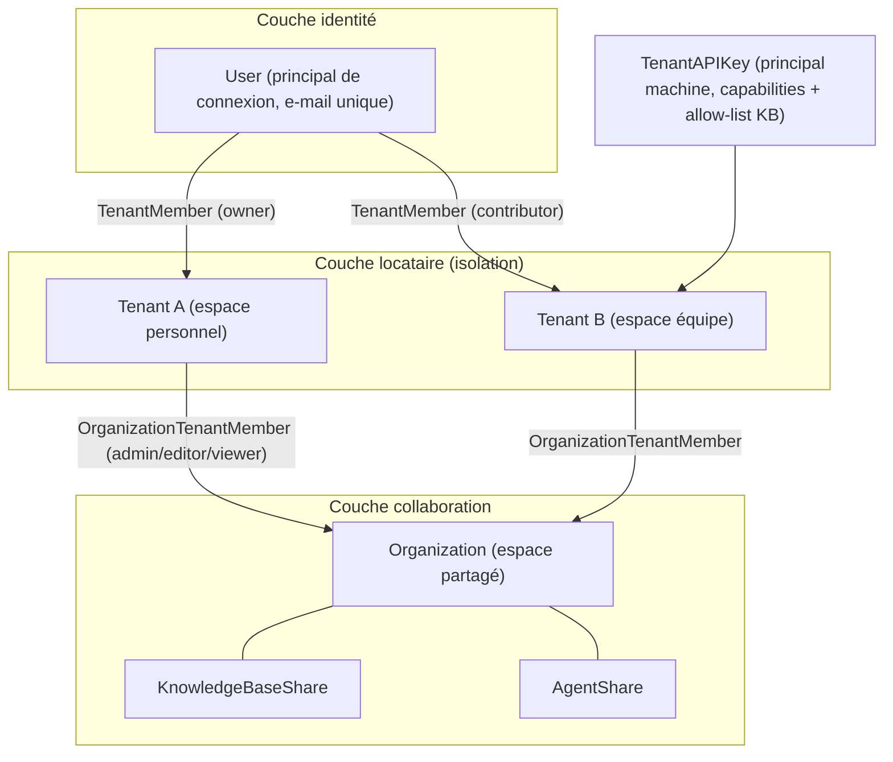
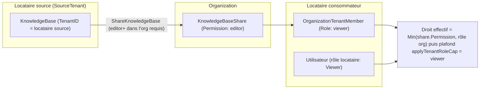
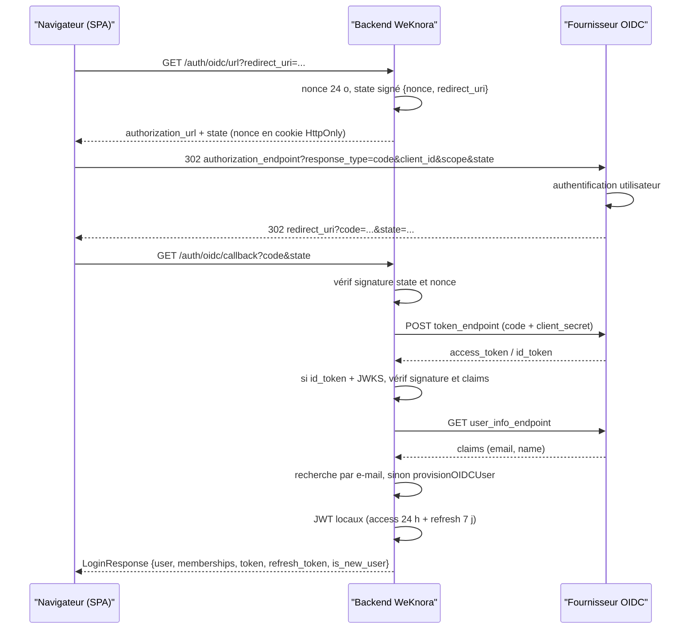

# Tenants, utilisateurs et authentification

L’**espace de travail** est la frontière des ressources et des droits dans WeKnora : bases de connaissances, modèles, agents, sessions et quota de stockage y sont rattachés. Un utilisateur peut appartenir à plusieurs espaces avec un rôle distinct dans chacun. Les **organisations** relient plusieurs espaces pour partager bases de connaissances et agents. Côté backend, un espace est modélisé par **Tenant**.

Voici les entrées pour inviter des membres, partager des ressources et brancher l’API. L’administration de l’ensemble du déploiement requiert des droits plateforme séparés.

| Action | Entrée et exigences |
| --- | --- |
| Inviter des collègues | Paramètres de l’espace → Membres → Inviter, avec un rôle (Owner / Admin / Contributor / Viewer) |
| Partager une KB avec une autre équipe | Créer une organisation → y ajouter les deux espaces → « Partager vers l’organisation » sur la KB |
| Intégration API | Paramètres → Clé API : cocher les capacités (recherche / chat / ingestion / admin), restreindre les KB si besoin |
| Administer le déploiement (paramètres globaux, files de tâches, audit inter-espaces) | Rôle **administrateur système**, indépendant du Owner d’espace — voir [Administration plateforme](20-platform-admin.md) |
| Supprimer un espace | **Owner** dans les paramètres (`DELETE /tenants/:id`) ; espace et membres soft-deleted, accès révoqué immédiatement, pas de restauration UI |

<Screenshot
  src="/screenshots/settings-members.png"
  caption="Gestion des membres : rôles et invitations"
  hint="Liste des membres, menu des rôles et bouton « Inviter », de préférence avec une invitation en attente." />

**Viewer** : lecture et questions ; **Contributor** : créer des KB et importer des documents ; **Admin** : membres et paramètres d’espace ; **Owner** : suppression ou transfert d’espace. Les modifications de ressources dépendent aussi de la propriété ou du partage — matrice détaillée en référence.

Connexion utilisateur : mot de passe ou SSO OIDC ; accès programme : clé API. Droits utilisateur = rôle dans l’espace + appartenance aux ressources ; clé API = capacités accordées et périmètre KB.

## Inviter des membres et attribuer des rôles

Dans Paramètres → Membres, invitez par e-mail et choisissez le rôle. L’invité rejoint l’espace à l’acceptation ; si l’inscription publique est fermée, une invitation valide permet encore de s’inscrire. Un compte existant peut accepter une invitation sans second compte.

Les rôles **membre d’espace** et **membre d’organisation** sont gérés séparément. Pour le partage, vérifiez la permission sur la KB, le rôle de l’espace receveur dans l’organisation et le rôle de l’utilisateur dans son espace.

## Partager bases de connaissances et agents

Placez espaces source et receveur dans la même organisation, puis partagez KB ou agent vers cette organisation (membre autorisé). Les droits effectifs combinent l’enregistrement de partage et le rôle organisationnel ; le partage n’élève pas automatiquement le rôle dans l’espace.

## Configurer une clé API pour les programmes

Créez une clé dans les paramètres d’espace : recherche, chat, ingestion ou administration ; limitez les KB accessibles si nécessaire. Envoyez la clé dans l’en-tête `X-API-Key`. Capacités et restrictions : section référence.

## Gérer l’espace et la plateforme

Seul le **Owner** peut supprimer l’espace (soft delete des membres ; données KB/modèles non effacées physiquement de suite). Depuis v0.8.2, les tâches Wiki en file pour un espace supprimé n’appellent plus les modèles. Paramètres globaux, files plateforme et audit inter-espaces : **administrateur système** — voir [Administration plateforme](20-platform-admin.md).

## Vue d’ensemble des concepts



Points clés :

- Un **User** peut appartenir à plusieurs **Tenant** via `tenant_members`, avec un rôle par lien.
- L’appartenance organisationnelle est **au niveau locataire** (`OrganizationTenantMember` par `tenant_id`) ; le partage est « un locataire partage une KB vers une organisation ».
- La **clé API** est un principal machine distinct du JWT : elle ne réutilise pas la hiérarchie de rôles locataire.

## Référence authentification et autorisation

### Inscription et connexion {#inscription-et-connexion}

#### Modes d’inscription (invite-only) {#modes-d-inscription-invite-only}

`internal/handler/auth.go` + `internal/config/config.go` :

```go
type AuthConfig struct {
    RegistrationMode  string // "self_serve" (défaut, inscription publique) | "invite_register" (inscription sur invitation) | "invite_only" (inscription interdite, valeur legacy)
    DefaultTenantMode string // "create_personal" (défaut, crée un locataire personnel) | "tenantless" (sans locataire, en attente d’invitation)
}

func (c *AuthConfig) IsInviteOnly() bool {
    return c != nil && c.RegistrationMode == AuthRegistrationModeInviteOnly
}
```

La décision se fait en **deux niveaux** — indispensable pour comprendre « l’env ne semble pas appliqué » :

**Au démarrage** (`applyAuthAndTenantDefaults()`), synthèse de `cfg.Auth.RegistrationMode` : `DISABLE_REGISTRATION=true` force `invite_only` et **prime sur le YAML**, pour aligner refus API et masquage UI (`/auth/config`).

**À chaque requête** (`resolveRegistrationMode()`) : ligne `auth.registration_mode` dans `system_settings` > cfg synthétisée > défaut `self_serve`. `DISABLE_REGISTRATION` n’est **pas** relu par requête.

Conséquence : un admin peut rouvrir l’inscription publique via l’UI (`self_serve`) même si `DISABLE_REGISTRATION=true` reste dans le déploiement. Pour fermer définitivement : supprimer la ligne en base (`DELETE /system/admin/settings/auth.registration_mode`).

Trois modes, commutables dans les paramètres globaux :

| Mode | Inscription publique | Inscription via lien d’invitation | Compte existant accepte invitation |
| --- | --- | --- | --- |
| `self_serve` | Oui | Oui | Oui |
| `invite_register` | Non | Oui | Oui |
| `invite_only` (legacy) | Non | Non | Oui |

`DISABLE_REGISTRATION=true` mappe toujours vers `invite_only`. Pour permettre l’inscription des nouveaux invités : `invite_register`. En mode sans inscription, `POST /auth/register-by-invite` renvoie 403.

Ces modes concernent l’inscription **par mot de passe**. La **première connexion OIDC** dépend du IdP ; la création de compte par un admin n’est pas limitée ici.

#### Mot de passe : inscription / connexion {#mot-de-passe-inscription-connexion}

- `POST /auth/register` : `{username(2-50), email, password}` ; selon `DefaultTenantMode`, création automatique ou non d’un locataire personnel (`TenantProvisioningCreatePersonal` / `TenantProvisioningTenantless`).
- `POST /auth/login` : `{email, password}`, renvoie `LoginResponse{user, active_tenant, memberships[], token, refresh_token}` ; le locataire actif est restauré via `Preferences.LastActiveTenantID`.
- Inscription, inscription par invitation, changement de mot de passe et définition par un admin appliquent la même politique : par défaut 8–32 caractères, lettres et chiffres requis. `GET /auth/config` expose `complex_password_enabled` ; si activé, majuscules, minuscules et caractères spéciaux sont exigés.
- Un administrateur système peut régler `auth.complex_password_enabled` ; sans valeur en base, repli sur `WEKNORA_AUTH_COMPLEX_PASSWORD_ENABLED`. Un changement de politique ne contraint que les mots de passe créés ou modifiés ensuite, sans forcer les comptes existants.
- En libre-service (profil), l’ancien mot de passe est requis et le nouveau doit différer ; succès = révocation de toutes les sessions et reconnexion. Erreurs et paramètres : [API d’authentification](../04-api/02-api-auth.md).

#### Inscription par invitation (register-by-invite) {#inscription-par-invitation-register-by-invite}

`internal/handler/auth_register_by_invite.go`. Le **lien d’invitation partagé** (share link) généré par l’Owner du locataire (voir [Lien d’invitation partagé (invite link)](#lien-d-invitation-partage-invite-link)) porte un token ; la page d’inscription s’en sert pour s’inscrire en modes `self_serve` et `invite_register` :

```go
// POST /auth/register-by-invite
type registerByInviteRequest struct {
    Token    string `binding:"required"`
    Email    string `binding:"required,email"` // saisi par l’inscrit, non lié au token
    Username string `binding:"required"`
    Password string `binding:"required"`       // + politique unifiée (8–32 car., lettres et chiffres)
}
```

Flux : valider le token (`LookupByToken`) → vérifier que l’e-mail n’est pas déjà enregistré (409 si oui) → créer l’utilisateur en mode `tenantless` → définir le locataire invité comme premier locataire → `AcceptByToken` crée la ligne `tenant_members` (`active`, rôle de l’invitation).

`POST /auth/invitations/lookup` (sans auth) renvoie `{tenant_id, tenant_name, role, expires_at}` pour la page d’inscription ; le token passe dans le corps POST (pas dans l’URL / les logs) ; token invalide ou révoqué → 410.

#### Compte existant : rejoindre via un lien d’invitation

En déploiement `invite_only`, la page d’invitation demande de se connecter puis d’envoyer le token à `POST /me/invitations/accept-by-token` ; pas de second compte pour un e-mail déjà enregistré. Sans espace par défaut, le premier espace rejoint devient le défaut. En `invite_register`, les nouveaux peuvent s’inscrire avec une invitation valide ; les comptes existants peuvent basculer vers la connexion pour rejoindre, et revenir au formulaire d’inscription.

Les invitations e-mail aux utilisateurs déjà inscrits dépendent de `tenant.auto_accept_invitation` : par défaut `false` (invitation `pending`, confirmation boîte de réception) ; `true` = adhésion directe, membre `active`, invitations `pending` traitées. Le front lit le flag via `GET /auth/me` → `capabilities.auto_accept_invitation`. Cela ne transforme pas n’importe quel lien partagé en entrée sans connexion.

### Membres du locataire, invitations et liens {#membres-du-locataire-invitations-et-liens}

#### Gestion des membres et invitations ciblées {#gestion-des-membres-et-invitations-ciblees}

Handlers : `internal/handler/tenant_member.go`, `tenant_invitation.go`. Le groupe `/tenants/:id` applique `PathTenantMatch()` (locataire URL = locataire actif du token, sauf super-utilisateur).

| Point de terminaison | Rôle minimum | Description |
| --- | --- | --- |
| `GET /tenants/:id/members` | Viewer | Membres `active` paginés ; `q` filtre e-mail / nom |
| `POST /tenants/:id/members` | Owner | Ajouter un utilisateur existant `{email, role}` |
| `PUT /tenants/:id/members/:user_id` | Owner | Modifier le rôle |
| `DELETE /tenants/:id/members/:user_id` | Owner | Retirer un membre |
| `POST /tenants/:id/invitations` | Owner | Inviter un utilisateur existant `{email, role, message}` |
| `GET /tenants/:id/invitations` | Viewer | Lister les invitations |
| `DELETE /tenants/:id/invitations/:inv_id` | Owner | Révoquer une invitation |
| `GET /me/invitations` | soi | Boîte de réception des invitations |
| `POST /me/invitations/:inv_id/accept` / `.../decline` | soi | Accepter / refuser |

Machine à états `TenantInvitation` : `pending → accepted / declined / revoked / expired` (expiration par balayage paresseux, audit `rbac.invitation_expired`). Événements d’audit sur tout le cycle : `rbac.member_added` / `member_removed` / `member_role_changed` / `member_left` / `invitation_sent` / `invitation_accepted` / `invitation_declined` / `invitation_revoked` (`internal/types/audit_log.go`).

#### Lien d’invitation partagé (invite link) {#lien-d-invitation-partage-invite-link}

`internal/handler/tenant_invite_link.go`. Même table que les invitations ciblées : `InviteeUserID` vide = lien partagé (multi-usages, compteur `AcceptedCount`) ; non vide = invitation ciblée.

- `POST /tenants/:id/invite-links` (Owner) : `{role, message}` → `invite_url` (`{FrontendBaseURL}/register?token=...`, `FrontendBaseURL` : YAML `frontend_base_url` → `FRONTEND_BASE_URL` → chemin relatif) ;
- Liens et invitations ciblées : liste `GET /tenants/:id/invitations` (Viewer), révocation `DELETE /tenants/:id/invitations/:inv_id` (Owner).

Le lien reste valide jusqu’à expiration ou révocation ; avec [Inscription par invitation](#inscription-par-invitation-register-by-invite) (`register-by-invite`), boucle complète d’ouverture de compte en mode invite-only.

### Organisations et espaces partagés {#organisations-et-espaces-partages}

#### Cycle de vie d’une organisation {#cycle-de-vie-d-une-organisation}

`internal/application/service/organization.go` :

- À la création, génération d’un `InviteCode` unique, validité `invite_code_validity_days ∈ {0 (permanent), 1, 7, 30}`, défaut 7 jours (`ValidInviteCodeValidityDays`, valeur invalide → `ErrInvalidValidityDays`) ;
- `GetOrganizationByInviteCode` adhère via le code (distingue `ErrInviteCodeNotFound` / `ErrInviteCodeExpired`) ; `RequireApproval=true` → demande d’adhésion à approuver ;
- `Searchable=true` → organisation visible via `SearchSearchableOrganizations` ;
- Code d’invitation et nombre en attente visibles seulement pour admin d’organisation ou locataire owner (`isAdmin || isOwner` dans `internal/handler/organization.go`).

#### Candidats à l’invitation : résolution par ID d’espace {#candidats-a-l-invitation-resolution-par-id-d-espace}

Les invitations visent un espace de travail. `GET /organizations/:id/search-tenants?q=<ID espace>` (admin org. uniquement) : depuis v0.8.2, résolution par **ID d’espace exact** uniquement, plus de recherche inter-espaces par nom (évite l’énumération) : `q` invalide, espace déjà membre ou inexistant → liste vide ; sinon `{tenant_id, tenant_name}` unique. L’invité peut lire son ID dans les paramètres d’espace ; code ou lien d’organisation restent possibles.

`GET /organizations/:id/search-users` reste un alias compatible, même comportement que `search-tenants`.

`POST /organizations/:id/invite` (admin org.) ajoute un membre : priorité `tenant_id`, compatibilité SDK ancien `user_id` (espace par défaut de l’utilisateur). `representative_user_id` ignoré ; la liste des membres ne renvoie l’e-mail du représentant qu’au locataire appelant.

#### Modèle de partage KB et calcul des droits {#modele-de-partage-kb-et-calcul-des-droits}

`internal/types/organization.go` + `internal/application/service/kbshare.go` :

```go
type KnowledgeBaseShare struct {
    ID              string
    KnowledgeBaseID string
    OrganizationID  string
    SharedByUserID  string
    SourceTenantID  uint64        // locataire source du partage
    Permission      OrgMemberRole // plafond de droits accordé (viewer/editor/admin)
}
// AgentShare : même forme, pour les Agent.
```

**Prérequis du partage** (`ShareKnowledgeBase`) : le locataire appelant doit **posséder** la KB (`kb.TenantID == tenantID`) et avoir le rôle **editor+** dans l’organisation cible. Un second partage met à jour les droits.

**Qui peut gérer un partage** (`canManageShare`, commun aux partages KB et Agent — modifier les droits / révoquer) :

1. l’auteur initial du partage, toujours membre du locataire source, avec rôle locataire Contributor+ ;
2. un Admin+ du locataire source (la propriété est au niveau locataire : l’Admin peut gérer même si l’auteur est parti) ;
3. un locataire **admin** dans l’organisation cible : ses Admin+ peuvent révoquer ou **abaisser** les droits, mais pas les élever au-delà de la valeur actuelle (sinon droits d’écriture sur la KB d’autrui pour tous les editor).

Le `share_id` dans l’URL doit appartenir à la KB / Agent du chemin, sinon 404.

**Limites côté receveur sur la config KB** : seul l’espace hébergeant la KB peut appeler `POST /initialization/initialize/:kbId` ; un autre espace qui modifie la config (`PUT /initialization/config/:kbId`) exige un partage de niveau admin et ne peut pas changer le binding stockage ; à la lecture, le receveur voit seulement si des identifiants sont configurés, pas l’URL de base du modèle, le bucket, etc. ; le détail KB ne renvoie plus les anciens identifiants stockage/VLM inline.

**Quand le partage cesse** : tant que l’organisation existe et que le locataire source en est membre. Si le locataire source quitte ou est retiré, ses KB et Agent partagés dans cette organisation sont révoqués ; les requêtes filtrent aussi par appartenance du locataire source (y compris partages hérités d’anciennes versions).

**Droit effectif = intersection multi-niveaux (minimum)** :

```go
// droit final = Min(Permission de l’enregistrement de partage, OrgMemberRole du locataire appelant dans l’org)
// puis plafond par rôle locataire :
func applyTenantRoleCap(p types.OrgMemberRole, callerTenantRole types.TenantRole) types.OrgMemberRole {
    // un Viewer dans le locataire reste viewer même si le partage accorde editor+
    if callerTenantRole == types.TenantRoleViewer && p.HasPermission(types.OrgRoleEditor) {
        return types.OrgRoleViewer
    }
    return p
}
```

Les opérations de partage alimentent le flux d’activité KB : `kb.share_added` / `kb.share_permission_changed` / `kb.share_removed`.

**Règles supplémentaires pour le partage d’Agent** (`internal/application/service/agent_share.go`, `agent_share_scope.go`) :

- les agents intégrés ne sont pas partageables : chaque espace a le même ID intégré, le receveur ne pourrait pas distinguer ; sans espace source explicite, la conversation utilise d’abord l’agent de l’espace local ;
- partager un Agent expose son périmètre KB en lecture seule aux membres de l’organisation : le partageur doit pouvoir partager ces KB directement (créateur de KB ou Admin+ locataire). `kb_selection_mode: all` inclut les KB créées ensuite ; seuls Admin+ peuvent partager ainsi. Même règle si l’Agent partagé est édité et de nouvelles KB entrent dans le périmètre ;
- à l’exécution partagée, absence de mode de sélection MCP = « aucun », cohérent avec l’UI du périmètre ; la recherche web en mode Q&R rapide exige que l’Agent l’active ; `summary_model_id` dans la requête est ignoré ;
- l’Agent partagé vu par le receveur masque le prompt système et l’ID créateur ; capacités et périmètre KB restent visibles ;
- un Agent avec skills exécute les skills dans le bac à sable du locataire source, avec les variables d’environnement configurées par l’admin (ex. clé API) ; un membre peut inciter l’agent à les lire — la page de partage l’indique.



### RBAC : rôles, propriété et matrice de gardes {#rbac-roles-propriete-et-matrice-de-gardes}

L’autorisation repose sur trois mécanismes orthogonaux, regroupés dans `rbacGuards` (`internal/router/rbac.go`) :

1. **Garde de rôle** (role-only) : `Viewer()` / `Contributor()` / `Admin()` / `Owner()` / `SystemAdmin()` — « quel est le rôle de l’appelant dans ce locataire ? »
2. **Garde de propriété** (ownership-or-role) : `OwnedKBOrAdmin()` etc. — « l’appelant est-il le **créateur** de cette ressource, ou au moins Admin+ ? »
3. **Garde d’accès KB** (KB-access) : `KBAccessRead()` / `KBAccessWrite()` — « le locataire de l’appelant peut-il atteindre cette KB ? » (propre / partagée via org / visible via Agent partagé).

#### Matrice des capacités par rôle {#matrice-des-capacites-par-role}

| Capacité | Owner (40) | Admin (30) | Contributor (20) | Viewer (10) |
| --- | --- | --- | --- | --- |
| Supprimer locataire / transférer propriété / gérer clés API | ✓ | ✗ | ✗ | ✗ |
| Ajouter / retirer membres, changer rôles, envoyer invitations | ✓ | ✗ (handler réservé Owner) | ✗ | ✗ |
| Configurer l’infra locataire (modèles / vector store / IM / MCP / recherche Web / stockage / sources) | ✓ | ✓ | ✗ | ✗ |
| Vider le contenu d’une KB (`DELETE /knowledge-bases/:id/knowledge`) | ✓ | ✓ | ✗ | ✗ |
| Modifier / supprimer KB / Agent / connaissances / chunks / Wiki / tags **créés par autrui** | ✓ | ✓ | ✗ | ✗ |
| Créer KB / Agent ; copier un Agent pour soi | ✓ | ✓ | ✓ | ✗ |
| Modifier / supprimer sa **propre** KB et sous-ressources | ✓ | ✓ | ✓ | ✗ |
| Créer/gérer ses sessions, poser des questions (`/sessions`, `/knowledge-chat`, `/agent-chat` : Viewer+) | ✓ | ✓ | ✓ | ✓ |
| Voir membres / invitations / listes KB / connaissances / recherche / aperçu | ✓ | ✓ | ✓ | ✓ |

Le commentaire de conception en tête de `internal/router/rbac.go` résume la sémantique produit :

> - Owner / Admin : tout gérer dans le locataire ;
> - Contributor : gérer ce qu’il a créé, le reste en lecture seule ;
> - Viewer : tout en lecture ;
> - créer une ressource exige au minimum Contributor ; configurer l’infra locataire exige Admin+.

Deux exceptions fréquentes : **ajout/retrait/changement de rôle et invitations = Owner seul**, Admin inclus (`routes_auth_tenant.go` : `g.Owner()` ; la liste des membres reste Viewer+) ; **Viewer n’est pas « incapable de tout créer »** — les sessions sont des données de travail personnelles : Viewer peut ouvrir une session et poser des questions, pas créer KB ni Agent.

#### Règles de choix des gardes (Q1 / Q2) {#regles-de-choix-des-gardes-q1-q2}

`rbac.go` fixe la méthode pour les nouvelles routes :

- **Q1 : la ressource a-t-elle un créateur ?** Oui (KB, Agent, document, chunk, WikiPage, entrée FAQ, tag KB) → routes de mutation : `OwnedXxxOrAdmin` ; non (Model, VectorStore, canal IM, WebSearchProvider, DataSource, MCPService, infra locataire) → `Admin()` ; point de création (ressource inexistante) → `Contributor()`.
- **Q2 : effet privé ou public ?** Privé (ex. `POST /agents/:id/copy` pour soi seul) → `Contributor()` suffit ; public (partager KB vers org, désactiver un Agent pour tout le locataire, transfert de propriété) → `OwnedXxxOrAdmin` ou `Admin`.

#### Liste des gardes de propriété {#liste-des-gardes-de-propriete}

| Garde | Résolution | Routes |
| --- | --- | --- |
| `OwnedKBOrAdmin` | `:id` → KB.CreatorID | mise à jour / suppression KB, pin, upload, tags CRUD |
| `OwnedKBOrAdminFromKbIDParam` | `:kbId` → KB.CreatorID | `/initialization/*` config KB |
| `OwnedAgentOrAdmin` | `:id` → Agent.CreatorID (Agent intégré : creator vide, Admin+ seulement) | mutations Agent |
| `OwnedKnowledgeKBOrAdmin` | knowledge `:id` → KB.CreatorID | mise à jour / suppression / reparse / édition image |
| `OwnedChunkKBOrAdmin` / `...FromChunkID` | `:knowledge_id` ou chunk `:id` → KB.CreatorID | mutations chunk |
| `OwnedWikiKBOrAdmin` | `:kb_id` → KB.CreatorID | CRUD pages Wiki |

Les sous-ressources héritent du garde de la KB parente (le commentaire cite des corrections FAQ/Tag, agent share, KB share mal câblés).

#### Sémantique middleware (`internal/middleware/rbac.go`) {#semantique-middleware-internal-middleware-rbac-go}

Ordre de décision pour `RequireRole` / `RequireOwnershipOrRole` :

1. principal API Key → passage direct (autorisation via [déclaration de routes](#declaration-des-routes) APIKeyGate ; utilisateur système synthétique ne matche pas `creator_id`) ;
2. rôle suffisant → passage ;
3. super-utilisateur inter-locataires (`IsCrossTenantSuperuser`) → passage ;
4. RBAC non forcé (`tenant.enable_rbac=false`, mode grisé) → log seulement, passage ;
5. garde ownership : requête créateur — ressource absente → passage pour 404 handler ; échec requête → 503 ; créateur == utilisateur courant → passage ;
6. sinon 403 + audit (`AuditActionAccessDenied = "rbac.access_denied"`).

Interrupteur `TenantConfig.EnableRBAC` : `nil` ou `true` = forcé (défaut), `false` = log sans refus (transition de déploiement) ; surcharge `WEKNORA_TENANT_ENABLE_RBAC`. Ne concerne que les rôles dans l’espace ; `RequireKBAccess` bloque toujours l’accès inter-espace.

`RequireSystemAdmin` : JWT avec `IsSystemAdmin=true` ; API Key = platform key (clé locataire → 403).

#### Garde d’accès KB (canal partage inter-locataires) {#garde-d-acces-kb-canal-partage-inter-locataires}

`middleware/kb_access.go` (wrappers `KBAccess*` dans `rbac.go`, règles dans `internal/application/access`) unifie trois chemins :

```text
1. KB propre                    → accès complet équivalent Admin
2. KB partagée via org (Plan 3) → plafonnée par le partage
3. Visible via Agent partagé    → lecture seule (couche KBAccessRead)
```

Après succès, `(KB, ID locataire effectif, permission)` est mis en contexte et **l’ID locataire de la requête est réécrit** ; les handlers aval ignorent propre vs partagé. Variantes `KBAccessReadFromKnowledgeIDParam` / `...FromChunkIDParam` résolvent la KB depuis knowledge / chunk. Lecture : minimum `OrgRoleViewer` ; écriture : minimum `OrgRoleEditor`.

### Système de clés API {#systeme-de-cles-api}

#### Liste des capacités (Capabilities) {#liste-des-capacites-capabilities}

`internal/types/tenant_api_key.go`. La clé API **ne réutilise pas les rôles locataire** : soit `FullAccess`, soit un ensemble explicite de capacités ; routes sans politique déclarée → refus par défaut (default-deny).

| Capacité | Description |
| --- | --- |
| `retrieve` | lire / rechercher dans les KB (listes, détail, hybrid-search, découverte de KB partagées, etc.) |
| `chat` | flux de session : créer session, knowledge-chat / agent-chat, charger et supprimer messages |
| `read_agents` | lister et consulter les Agent (sans création ni modification) |
| `ingest` | écriture : upload, édition chunk / FAQ / tags / Wiki, suppression et déplacement en lot |
| `manage_kbs` | cycle de vie KB : créer / copier / répliquer / mettre à jour / supprimer / initialiser config |
| `manage_agents` | CRUD Agent et copie |
| `message_history` | recherche et historique chat au niveau locataire (`POST /messages/search`, etc., distinct de `chat`) |
| `manage_models` | modèles et identifiants |
| `manage_mcp_services` | services MCP et identifiants |
| `manage_datasources` | connecteurs et tâches de sync |
| `manage_channels` | intégrations Embed / IM |
| `manage_vector_stores` | vector stores et parseurs |
| `manage_storage_backends` | backends objet |
| `manage_web_search` | config recherche Web |
| `run_evaluations` | lancer et consulter évaluations |
| `manage_members` | membres et invitations locataire |
| `manage_spaces` | appartenance org / espaces partagés |
| `manage_tenant_settings` | paramètres consolidés du locataire |
| `system_tenants_read` / `system_tenants_manage` | plateforme : gestion locataires (platform key seulement) |
| `system_settings_read` / `system_settings_manage` | plateforme : paramètres système |
| `system_runtime_read` / `system_runtime_manage` | plateforme : files / tâches runtime |
| `system_audit_read` | plateforme : journaux d’audit |

#### Déclaration des routes {#declaration-des-routes}

Dans `internal/router/rbac.go`, chaque route accessible par API Key est enregistrée via `apiKeyGroup` / `apiKeyRoute` avec une `APIKeyRoutePolicy` (`middleware.APIKeyRouteAuthorizer` = source de vérité) :

```go
// constructeurs de politique
apiKeyAny()                    // toute clé valide
apiKeyFullAccess()             // clé FullAccess uniquement
apiKeyPlatform(caps...)        // platform key + capacités
apiKeyRetrieve(base) / apiKeyChat(base) / apiKeyIngest(base) / ...
```

Au démarrage, `assertAPIKeyPoliciesMatchRoutes` vérifie que chaque politique correspond à une route enregistrée ; dérive → panic. Exemples (`router_api_key_capabilities_test.go`) :

| Route | Capacité requise |
| --- | --- |
| `POST /sessions`、`POST /knowledge-chat/:session_id`、`POST /agent-chat/:session_id`、`GET /messages/:session_id/load` | `chat` |
| `GET /agents`、`GET /agents/:id`、`GET /agents/:id/suggested-questions` | `read_agents` |
| `POST/PUT/DELETE /agents`、`POST /agents/:id/copy` | `manage_agents` |
| `PUT/DELETE /knowledge-bases/:id`、`POST /initialization/initialize/:kbId` | `manage_kbs` |
| `POST /messages/search`、`GET /messages/chat-history-stats` | `message_history` (pas `chat`) |
| `GET /system/admin/settings` | platform key + `system_settings_read` |
| `POST /system/admin/runtime/queues/:queue/tasks/:task_id/actions/:action` | platform key + `system_runtime_manage` |

#### KB Allow-list {#_4-3-kb-allow-list}

Si `KnowledgeBaseIDs` est non vide, la clé n’atteint que les KB listées (`knowledge_api_key_scope_test.go`) :

```go
// KB hors périmètre → 403
requireTenantAPIKeyKnowledgeBase(ctx, "kb-2") // scope kb-1 seulement → forbidden
// lot : une KB hors liste → 403 global (pas de chevauchement partiel)
requireTenantAPIKeyKnowledgeBases(ctx, "kb-1", "kb-2") // → forbidden
```

Autres limites : une platform key ne crée pas d’autre platform key ; le principal API Key n’entre pas dans le jugement ownership (voir [RBAC](#rbac-roles-propriete-et-matrice-de-gardes)).

### SSO OIDC {#sso-oidc}

#### Configuration {#configuration}

`OIDCAuthConfig` dans `internal/config/config.go` :

| Paramètre | Description |
| --- | --- |
| `enable` | activer OIDC |
| `issuer_url` | Issuer attendu, validation id_token |
| `jwks_uri` | URL JWKS ; variable `OIDC_AUTH_JWKS_URI` |
| `discovery_url` | Discovery OpenID (`.well-known/openid-configuration`) |
| `provider_display_name` | libellé bouton de connexion |
| `client_id` / `client_secret` | identifiants client (secret `json:"-"`, jamais au front) |
| `authorization_endpoint` / `token_endpoint` / `user_info_endpoint` | endpoints explicites |
| `scopes` | scopes demandés (ex. `openid email profile`) |
| `user_info_mapping.username` / `.email` | mapping des claims (défaut `name` / `email`) |

Les endpoints auth/token peuvent être fixés ; si issuer ou jwks_uri manquent, discovery complète la config de validation. Sans validation fiable, on ne se connecte pas en décodant seulement le payload id_token.

Routes (`internal/router/routes_auth_tenant.go`) :

```go
r.GET("/auth/oidc/config",   handler.GetOIDCConfig)           // le front détecte l’activation
r.GET("/auth/oidc/url",      handler.GetOIDCAuthorizationURL) // URL d’autorisation
r.GET("/auth/oidc/start",    handler.OIDCStart)              // 302 direct vers connexion
r.GET("/auth/oidc/callback", handler.OIDCRedirectCallback)    // callback code autorisation
```

Un portail entreprise peut lier `/api/v1/auth/oidc/start` : 302 vers l’IdP, callback construit depuis l’origin de la requête. Derrière reverse proxy, transmettre scheme/host externes et enregistrer le callback chez l’IdP. Pas de redirection post-login arbitraire.

#### Flux et sécurité {#flux-et-securite}

`internal/application/service/user.go` :

- `GetOIDCAuthorizationURL` : nonce aléatoire 24 octets ; `secutils.SignOIDCState` **signe** `{nonce, redirect_uri}` dans state (anti-CSRF / rejeu / falsification callback) ; nonce en cookie HttpOnly (omis du JSON via `json:"-"`).
- `LoginWithOIDC` : échange code → token ; si id_token, validation JWKS (signature, issuer, audience, expiry) → fusion UserInfo selon `user_info_mapping` → **appariement par e-mail** ; sinon `provisionOIDCUser` → paire JWT locale identique au mot de passe.

Avec access_token seul : identité via UserInfo. Sans JWKS : pas de claims id_token non vérifiés ; access_token + UserInfo suffisent. id_token vérifié = repli si UserInfo échoue.

Détails provision automatique :

- mode locataire : `auth.default_tenant_mode` (`create_personal` vs `tenantless`) ;
- nom : username OIDC → préfixe e-mail → `oidc-user`, suffixes `-1..-20`, puis timestamp Unix ;
- mot de passe aléatoire 32 caractères (inconnu de l’utilisateur, connexion OIDC seulement) ;
- réponse `is_new_user` pour onboarding SPA ; `IsActive=false` → refus.



### Aide-mémoire configuration {#aide-memoire-configuration}

| Paramètre | Valeurs | Défaut | Effet |
| --- | --- | --- | --- |
| `auth.registration_mode` | `self_serve` / `invite_register` / `invite_only` | `self_serve` | mode inscription mot de passe (modifiable à chaud en DB) |
| `auth.default_tenant_mode` | `create_personal` / `tenantless` | `create_personal` | locataire personnel auto pour nouveaux comptes |
| `tenant.enable_rbac` | `true` / `false` | `true` | RBAC forcé / log seulement |
| `JWT_SECRET` (env) | chaîne | 32 octets aléatoires | clé HMAC JWT |
| `SYSTEM_AES_KEY` (env) | clé AES | non défini | chiffrement clés API en base |
| `oidc.*` | voir [Configuration](#configuration) | désactivé | SSO OIDC |
| `frontend_base_url` / `FRONTEND_BASE_URL` | URL | chemin relatif | URL page inscription par invitation |
| `Tenant.StorageQuota` | octets | 10737418240 (10 Go) | quota stockage locataire |

### Mécanisme JWT {#mecanisme-jwt}

Implémenté dans `internal/application/service/user.go` avec `github.com/golang-jwt/jwt` (HMAC-SHA256).

#### Source de la clé {#source-de-la-cle}

```go
func getJwtSecret() string {
    // 1) variable d’environnement JWT_SECRET
    // 2) sinon 32 octets aléatoires au démarrage (Base64) — redémarrage invalide les anciens tokens
}
```

#### Émission (double token Access + Refresh) {#emission-double-token-access-refresh}

```go
accessClaims := jwt.MapClaims{
    "user_id":   user.ID,
    "email":     user.Email,
    "tenant_id": activeTenantID, // périmètre locataire figé dans le token
    "exp":       time.Now().Add(24 * time.Hour).Unix(),
    "iat":       time.Now().Unix(),
    "type":      "access",
}
refreshClaims := jwt.MapClaims{
    "user_id": user.ID,
    "exp":     time.Now().Add(7 * 24 * time.Hour).Unix(),
    "type":    "refresh",
}
```

| Token | Durée | Claims |
| --- | --- | --- |
| Access Token | 24 h | `user_id` / `email` / `tenant_id` / `type=access` |
| Refresh Token | 7 j | `user_id` / `type=refresh` (sans `tenant_id`) |

Les deux tokens sont enregistrés dans `auth_tokens` pour **révocation côté serveur**.

#### Validation et refresh {#validation-et-refresh}

Chaîne `ValidateToken` :

1. algorithme de signature = famille HMAC (anti confusion d’algorithme) ;
2. token `type=refresh` **interdit** comme access (`isRefreshTokenClaims`) ;
3. table `auth_tokens` : `IsRevoked` (déconnexion = révocation) ;
4. claims → charger utilisateur (`user_id`), locataire actif (`tenant_id`).

**Changer de locataire = nouvelle paire de tokens** : `SwitchTenant` vérifie l’appartenance active (sauf super-utilisateur inter-locataires), enregistre l’espace cible dans `Preferences.LastActiveTenantID`, émet une paire avec le nouveau `tenant_id`, révoque l’ancien refresh si possible. Le refresh JWT n’a pas `tenant_id` : login et refresh suivent la préférence ; échec d’écriture de préférence = échec du changement. Retour « home » = ID home (équivalent sémantique au `0` SPA pour effacer la préférence). Préférence au niveau compte : un changement affecte le prochain point d’atterrissage sur tous les appareils.

### Modèle de données {#modele-de-donnees}

#### Tenant (locataire / espace de travail) {#tenant-locataire-espace-de-travail}

`internal/types/tenant.go`：

```go
type Tenant struct {
    ID                      uint64               `json:"id" gorm:"primaryKey"`
    Name                    string               `json:"name"`
    Description             string               `json:"description"`
    Status                  string               `json:"status" gorm:"default:'active'"`
    RetrieverEngines        RetrieverEngines     `json:"retriever_engines" gorm:"type:json"`
    Business                string               `json:"business"`
    StorageQuota            int64                `json:"storage_quota" gorm:"default:10737418240"` // 10 Go par défaut
    StorageUsed             int64                `json:"storage_used"  gorm:"default:0"`
    ContextConfig           *ContextConfig       `json:"context_config" gorm:"type:jsonb"`
    WebSearchConfig         *WebSearchConfig     `json:"web_search_config" gorm:"type:jsonb"`
    ParserEngineConfig      *ParserEngineConfig  `json:"parser_engine_config" gorm:"type:jsonb"`
    Credentials             *CredentialsConfig   `json:"credentials" gorm:"type:jsonb"`
    StorageEngineConfig     *StorageEngineConfig `json:"storage_engine_config" gorm:"type:jsonb"`
    DefaultStorageBackendID *string              `json:"default_storage_backend_id,omitempty"`
    ChatHistoryConfig       *ChatHistoryConfig   `json:"chat_history_config" gorm:"type:jsonb"`
    RetrievalConfig         *RetrievalConfig     `json:"retrieval_config" gorm:"type:jsonb"`
    APIPrincipalConfig      *APIPrincipalConfig  `json:"-" gorm:"type:jsonb"`
    // CreatedAt / UpdatedAt / DeletedAt (soft delete)
}
```

Le locataire porte les quotas (`StorageQuota` / `StorageUsed`, 10 Go par défaut) et la config locataire (moteurs de recherche, Web, parseur, identifiants, stockage, historique chat, etc.).

#### User (utilisateur) {#user-utilisateur}

`internal/types/user.go`：

```go
type User struct {
    ID                  string          `json:"id" gorm:"type:varchar(36);primaryKey"`
    Username            string          `json:"username" gorm:"uniqueIndex;not null"`
    Email               string          `json:"email" gorm:"uniqueIndex;not null"`
    PasswordHash        string          `json:"-" gorm:"not null"`
    Avatar              string          `json:"avatar"`
    TenantID            uint64          `json:"tenant_id" gorm:"index"` // locataire par défaut
    IsActive            bool            `json:"is_active" gorm:"default:true"`
    CanAccessAllTenants bool            `json:"can_access_all_tenants" gorm:"default:false"` // super-utilisateur inter-locataires
    IsSystemAdmin       bool            `json:"is_system_admin" gorm:"default:false;index"`  // administrateur plateforme
    Preferences         UserPreferences `json:"preferences" gorm:"type:jsonb"`
}

type UserPreferences struct {
    // dernier locataire actif, restauré à la connexion
    LastActiveTenantID *uint64 `json:"last_active_tenant_id,omitempty"`
}
```

Deux indicateurs particuliers :

- `CanAccessAllTenants` : super-utilisateur inter-espaces. **Les deux conditions** : flag utilisateur **et** `tenant.enable_cross_tenant_access` / `WEKNORA_TENANT_ENABLE_CROSS_TENANT_ACCESS` (`IsCrossTenantSuperuser()` dans `middleware/access.go` ; si config off, le champ est masqué à la connexion). Permet de contourner les rôles d’espace pour `/tenants/all`, `/tenants/search`, etc. `POST /tenants` (créer un espace) **n’est pas** inter-locataire : tout utilisateur connecté peut l’appeler (politique de création et quotas).
- `IsSystemAdmin` : admin plateforme, indépendant des rôles locataire, pour `/system/admin/*`. Portée = déploiement entier ; premier admin et capacités : [Administration plateforme](20-platform-admin.md).

#### TenantMember et rôles locataire {#tenantmember-et-roles-locataire}

`internal/types/tenant_member.go`：

```go
type TenantRole string

const (
    TenantRoleOwner       TenantRole = "owner"       // contrôle total : suppression, transfert, clés API, membres
    TenantRoleAdmin       TenantRole = "admin"       // infra locataire : modèles, vector store, MCP, IM, etc.
    TenantRoleContributor TenantRole = "contributor" // créer KB / Agent, éditer ses ressources
    TenantRoleViewer      TenantRole = "viewer"      // lecture seule
)

var tenantRoleLevel = map[TenantRole]int{
    TenantRoleOwner: 40, TenantRoleAdmin: 30,
    TenantRoleContributor: 20, TenantRoleViewer: 10,
}

func (r TenantRole) HasPermission(required TenantRole) bool {
    return r.Level() >= required.Level()
}
```

```go
type TenantMember struct {
    ID        uint64
    UserID    string
    TenantID  uint64
    Role      TenantRole         // contributor par défaut
    Status    TenantMemberStatus // active / invited / suspended
    InvitedBy *string
    JoinedAt  time.Time
}
```

La réponse de connexion inclut une liste `Membership{TenantID, TenantName, Role}` pour le sélecteur d’espaces côté front.

#### TenantAPIKey (clé API) {#_1-4-tenantapikey-api-key}

`internal/types/tenant_api_key.go`：

```go
type TenantAPIKey struct {
    ID               uint64
    TenantID         *uint64         // NULL pour platform key
    ScopeType        APIKeyScopeType // "tenant" | "platform"
    Name             string
    KeyHash          string      `json:"-" gorm:"uniqueIndex"` // hash pour lookup
    APIKey           string      // clair (AES-256-GCM avant save, voir BeforeSave/AfterFind)
    FullAccess       bool        // accès total (hors liste de capacités)
    KnowledgeBaseIDs StringArray // allow-list KB (vide = sans limite)
    Capabilities     StringArray // liste de capacités
    LastUsedAt / ExpiresAt / RevokedAt *time.Time
}
```

- **Chiffrement en base** : avec `SYSTEM_AES_KEY`, hook `BeforeSave` chiffre la colonne `api_key` (AES-GCM), `AfterFind` déchiffre ; lookup via `KeyHash` irréversible.
- **Validation** : en-tête `X-API-Key` → hash → lookup `KeyHash` → `RevokedAt` / `ExpiresAt` → injection contexte `TenantAPIKeyScope{...}` ; lecture via `types.TenantAPIKeyScopeFromContext`.

#### Organization (organisation / espace partagé) {#organization-organisation-espace-partage}

`internal/types/organization.go`：

```go
type Organization struct {
    ID                     string
    Name / Description / Avatar string
    OwnerID                string  // utilisateur créateur
    OwnerTenantID          uint64  // locataire propriétaire de l’organisation
    InviteCode             string  `gorm:"uniqueIndex"` // code d’invitation org
    InviteCodeExpiresAt    *time.Time
    InviteCodeValidityDays int     // 0 (permanent) / 1 / 7 / 30, défaut 7
    RequireApproval        bool    // adhésion soumise à approbation
    Searchable             bool    // visible dans la recherche
    MemberLimit            int     // défaut 50
}

type OrganizationTenantMember struct { // membre = locataire
    OrganizationID       string
    TenantID             uint64
    Role                 OrgMemberRole // admin / editor / viewer, défaut viewer
    RepresentativeUserID string        // utilisateur représentant (informatif)
}

const (
    OrgRoleAdmin  OrgMemberRole = "admin"  // contrôle org et ressources partagées
    OrgRoleEditor OrgMemberRole = "editor" // édition contenu KB partagées, pas réglages org
    OrgRoleViewer OrgMemberRole = "viewer" // lecture seule
)
```

## Références d’implémentation

Chemins relatifs à la racine du dépôt :

| Couche | Fichier |
| --- | --- |
| Modèle locataire | `internal/types/tenant.go` |
| Modèle utilisateur | `internal/types/user.go` |
| Membres et rôles locataire | `internal/types/tenant_member.go` |
| Invitations locataire | `internal/types/tenant_invitation.go` |
| Modèle et capacités clé API | `internal/types/tenant_api_key.go` |
| Organisation / partage | `internal/types/organization.go` |
| Handlers inscription / connexion | `internal/handler/auth.go` |
| Handler inscription par invitation | `internal/handler/auth_register_by_invite.go` |
| Handlers membres / invitations / liens | `internal/handler/tenant_member.go`, `tenant_invitation.go`, `tenant_invite_link.go` |
| Handler organisation | `internal/handler/organization.go` |
| Service JWT / OIDC / utilisateur | `internal/application/service/user.go` |
| Services org / partage KB | `internal/application/service/organization.go`, `kbshare.go` |
| Middleware RBAC | `internal/middleware/rbac.go` |
| Matrice gardes routes RBAC | `internal/router/rbac.go` |
| Config auth | `internal/config/config.go` (`AuthConfig` / `OIDCAuthConfig` / `TenantConfig`) |
