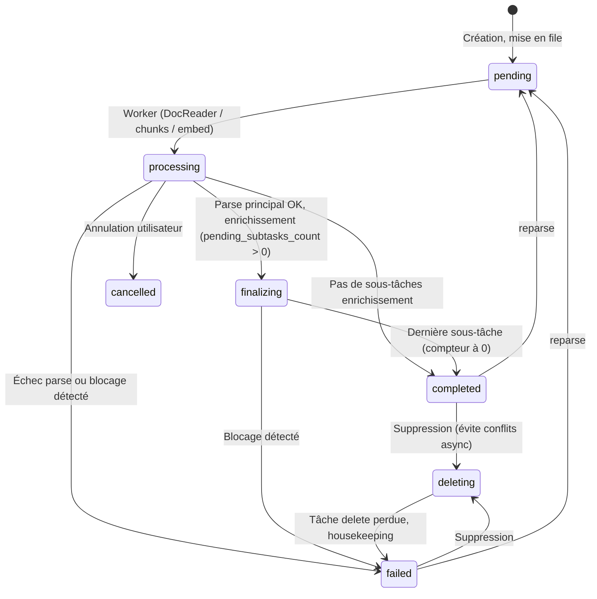

# Bases de connaissances et gestion des sources

Une base de connaissances regroupe les sources et unifie découpage, modèle vectoriel, index, Wiki et graphe. Fichiers, pages web, Markdown manuel et FAQ deviennent des entrées parsées et indexées selon la config.

Chaque KB peut avoir sa propre chaîne de traitement ; les questions peuvent cibler un périmètre ; accès membre et partage organisationnel se font par KB.

<Screenshot
  src="/screenshots/kb-document-list.png"
  caption="Liste des documents : statut de parsing, tags et actions groupées"
  hint="Liste avec statut, tags, filtres, tri et barre d’actions (tags, déplacer, téléchargement groupé)." />

## Entrées des opérations courantes {#_0-operations-courantes}

| Action | Entrée dans l’interface |
| --- | --- |
| Créer une KB, taille de chunks et index | Dialogue d’édition KB, onglets « Découpage » et « Stratégie d’index » |
| Importer fichiers, URL ou Markdown | Zone d’upload ou menu « Nouveau » ; progression dans le panneau en bas à droite |
| Trier la liste | Barre d’outils « Tri » : date de mise à jour, création/import (défaut : plus récent) ou nom |
| Suivre le parsing ou un blocage | Statut sur la carte, ou chronologie (voir [Suivi du parsing](#suivi-du-parsing)) |
| Dossiers | Arborescence à gauche ; upload de répertoire conserve la structure (voir [Arborescence](#_3-4-arborescence-dossiers)) |
| Tags (plusieurs par document) | Détail d’un document ou action groupée « Tags » (voir [Tags](#_3-5-tags-knowledgetag)) |
| Corriger le parsing | Document → liste de chunks → édition (voir [Édition de chunks](#edition-chunks-historique)) |
| Métadonnées personnalisées | Détail document (voir [Modèle](#_3-1-modele-knowledge)) |
| Journal d’activité | Paramètres KB → Activité (voir [Activité KB](#_6-flux-activite-kb)) |
| Copier KB ou déplacer des documents | Copie depuis la liste KB ou déplacement groupé (voir [Copie et déplacement](#_4-copie-deplacement-kb)) |
| Téléchargement groupé des originaux | Sélection → « Téléchargement groupé » (voir [Téléchargement groupé](#telechargement-groupe-fichiers-originaux)) |

<Screenshot
  src="/screenshots/kb-settings.png"
  caption="Paramètres KB : découpage et stratégie d’index"
  hint="Taille/chevauchement/découpage parent-enfant et les quatre interrupteurs vectoriel, mots-clés, Wiki, graphe." />

## Créer une base et importer des sources

À la création, choisissez le type de contenu, les modèles et l’indexation, puis importez fichiers, pages web ou Markdown. Documents courants → bibliothèque document ; Q&R standard → [bibliothèque FAQ](17-faq.md). Le vector store est figé après création : le choisir avant la création.

La page de confirmation d’upload permet tags et options d’analyse du lot, dont le résumé document (activé par défaut ; désactivé, le reste du pipeline continue). Priorité : overrides par document > config KB > défauts de l’espace. Les documents existants exigent un reparse pour appliquer un nouveau découpage.

En upload groupé, le panneau en bas à droite agrège les fichiers : 3 transferts simultanés max, octets envoyés, temps restant, compteurs « searchable / en cours / échec / déjà présent ». Annulation ou retry par fichier ; une fois tout envoyé, vous pouvez quitter — l’analyse continue en arrière-plan. Timeout d’upload prolongé automatiquement pour les gros fichiers.

<Screenshot
  src="/screenshots/kb-upload-tasks.png"
  caption="Panneau de tâches d’upload : progression globale et par fichier"
  hint="Panneau flottant : anneau de progression, titre « upload x/y », temps restant, barres par statut, annuler/retry par ligne." />

### Suivi du parsing {#suivi-du-parsing}

La liste et les cartes affichent le statut d’analyse. Sans progrès depuis 20 minutes : « en file » ou « suspecté bloqué » — la file a encore des tâches (souvent rien à faire) vs plus aucune tâche ne fait avancer le document (ouvrir la chronologie, arrêter/reparser). Après longue stagnation, échec auto avec code `TASK_STALLED`.

La chronologie détaille durées et résultats par étape. En échec, une carte en tête indique l’étape, la cause et un bouton de retry.

<Screenshot
  src="/screenshots/kb-parse-timeline.png"
  caption="Chronologie d’analyse : durées, erreurs et alerte blocage"
  hint="Tiroir chronologie : cascade parse/découpage/vectorisation/multimodal/post-traitement, carte d’erreur, bandeau « N minutes sans progrès »." />

## Parcourir la galerie {#image-gallery}

L’onglet « Galerie » d’une base document regroupe les images extraites des documents, chargées en continu en flux type masonry. Vous pouvez rechercher dans les descriptions et le texte OCR, filtrer par attributs d’image fournis par le système, document source, etc. ; un clic ouvre l’aperçu, la description, l’OCR et la source. Le filtre par document source accepte une sélection multiple, pratique pour contrôler le parsing d’un lot de fichiers.

La galerie affiche les ressources image existantes ; la recherche vectorielle d’images n’est pas requise.

<Screenshot src="/screenshots/kb-image-gallery.png" caption="Galerie KB : flux d’images et filtre par document source" hint="Onglet galerie, recherche et filtre multi-documents ; détail avec OCR, description et lien source." />

<Screenshot src="/screenshots/kb-image-gallery-detail.png" caption="Détail galerie : image, description, OCR et document source" />

## Embedding multimodal et recherche d’images {#multimodal-embedding}

Les modèles d’embedding acceptant des images placent texte et image dans le même espace vectoriel pour rappeler des visuels via des questions textuelles. Exemples : WeMM-Embedding (Tencent), Qwen3-VL-Embedding, etc. — respecter capacité « entrée image » et protocole ; déploiement WeMM dans [Configuration des modèles](06-models.md#wemm-embedding).

Activez le traitement multimodal et « recherche vectorielle d’images » dans les paramètres KB, avec un modèle vectoriel compatible images. Vecteurs image désactivés par défaut ; reparse nécessaire pour les documents existants ; pages PDF scannées sans vecteur image. Détails dans « vecteurs image » ci-dessous.

<Screenshot src="/screenshots/kb-image-vector-settings.png" caption="Embedding multimodal : activer la recherche vectorielle d’images" hint="Modèle vectoriel avec entrée image, multimodal, interrupteur « recherche vectorielle d’images » ; WeMM-Embedding en exemple." />

## Dossiers et tags

Les dossiers archivent par arborescence : un document n’a qu’un dossier. Upload de répertoire entier conserve la hiérarchie ; renommer/déplacer un dossier met à jour les sous-chemins et fusionne si la cible existe. Déplacer un document dans la même KB ne reparse pas.

Les tags classent en transversal : plusieurs tags par document. Presets à l’upload ou modification groupée ; le dialogue pré-sélectionne les tags communs. Filtre multi-tags : union (OR).

L’auto-tagging, après analyse, choisit parmi les tags candidats existants (max 3 par défaut, skip si déjà tagué). N’affecte que les futurs parses ; pas de rattrapage historique ; échec modèle non bloquant.

<Screenshot
  src="/screenshots/kb-batch-tag.png"
  caption="Tags groupés : tags communs pré-cochés"
  hint="Dialogue tags après sélection multiple : zone tags choisis, recherche, liste." />

## Édition de chunks et métadonnées

Dans le détail document, éditez les chunks texte pour corriger l’analyse et reconstruire l’index. Chaque édition ou rollback crée une version ; conflit de révision → message de rafraîchissement. Échec d’indexation : contenu conservé, statut failed, retry possible.

Métadonnées personnalisées (département, classification, version, etc.), max 20 entrées. Toute modification relance le résumé ; longueurs et types en référence.

<Screenshot
  src="/screenshots/kb-chunk-edit.png"
  caption="Édition de chunk : corps, historique et rollback"
  hint="Mode édition, liste des versions (auteur, date), entrée rollback." />

## Copier et déplacer du contenu

Copier une KB réutilise config et contenu. Déplacement inter-KB : réutiliser les vecteurs (même vector store) ou reparser (config cible). Tâche asynchrone avec suivi de progression.

### Téléchargement groupé des fichiers originaux {#telechargement-groupe-fichiers-originaux}

Sélection → « Téléchargement groupé » : ZIP des originaux avec arborescence de dossiers KB. Max 200 documents et 512 Mio d’originaux par lot ; entrées sans fichier (URL, etc.) ignorées. « Tout sélectionner (chargé) » = page courante seulement. Même permission que téléchargement unitaire : Contributor+ et droit d’édition sur la KB.

## Activité et consommation

L’onglet « Activité » des paramètres KB trace config, documents, chunks, partages et Wiki. Réservé aux utilisateurs JWT avec droits de gestion ; pas d’accès clé API. Les actions via clé API affichent le nom de la clé sous l’auteur.

KB partagée en Viewer via organisation : pas d’upload, édition, suppression ni paramètres.

Quota stockage au niveau espace (fichiers, texte, vecteurs, index). Vérification à la création KB et à l’upload ; libération à la suppression.

<Screenshot
  src="/screenshots/kb-activity.png"
  caption="Flux d’activité KB : opérations par date décroissante"
  hint="Liste activité (auteur, action, cible, horodatage) et tiroir de détail." />

## Référence configuration et API

### Modèle KB et options de configuration {#_1-modele-kb-et-configuration}

#### Types de KB {#_1-1-types-kb}

`internal/types/knowledgebase.go` :

```go
const (
    KnowledgeBaseTypeDocument = "document" // documents
    KnowledgeBaseTypeFAQ      = "faq"      // FAQ
    KnowledgeBaseTypeWiki     = "wiki"     // Wiki
)
```

À la mise à jour, les configs incompatibles avec le type sont retirées (ex. `FAQConfig` hors KB FAQ). `VectorStoreID` a le tag GORM `<-:create` : **immuable après création** (cohérence index / stockage).

#### Vue d’ensemble de la structure {#_1-2-vue-ensemble-structure}

```mermaid
graph TB
    KB["KnowledgeBase (id, name, type, tenant_id, creator_id)"]
    KB --> CC["ChunkingConfig (découpage)"]
    KB --> IS["IndexingStrategy (interrupteurs pipeline)"]
    KB --> EMB["EmbeddingModelID / SummaryModelID"]
    KB --> VLM["VLMConfig (modèle vision)"]
    KB --> ASR["ASRConfig (reconnaissance vocale)"]
    KB --> IMG["ImageProcessingConfig (images)"]
    IMG --> ICP["ImageAttrsEnabled + ImageActions (observation + OCR conditionnel)"]
    KB --> EXT["ExtractConfig (graphe de connaissances)"]
    KB --> FAQ["FAQConfig (type faq uniquement)"]
    KB --> QG["QuestionGenerationConfig (génération de questions)"]
    KB --> WIKI["WikiConfig (si wiki_enabled)"]
    KB --> ST["StorageProviderConfig / StorageBackendID / StorageConfig (legacy)"]
    KB --> VS["VectorStoreID (figé après création)"]
    CC --> PCR["ParserEngineRules (moteur par type de fichier)"]
    CC --> PC["Parent-enfant (parent_chunk_size / child_chunk_size)"]
    EXT --> GN["GraphNode / GraphRelation"]
    IS --> V["vector (défaut true)"]
    IS --> KW["keyword / BM25 (défaut true)"]
    IS --> WK["wiki (défaut false)"]
    IS --> GR["graph (défaut false)"]
```



#### ChunkingConfig {#_1-3-chunkingconfig}

| Champ | Type | Défaut | Description |
| --- | --- | --- | --- |
| `chunk_size` | int | requis | Taille de chunk (caractères) |
| `chunk_overlap` | int | - | Chevauchement entre chunks voisins |
| `separators` | []string | - | Liste de séparateurs |
| `parser_engine_rules` | []ParserEngineRule | - | Moteur par type : `{file_types, engine, xlsx_first_row_as_header?}` |
| `enable_parent_child` | bool | false | Stratégie parent-enfant |
| `parent_chunk_size` | int | 4096 | Taille parent (contexte retourné) |
| `child_chunk_size` | int | 384 | Taille enfant (embedding / recherche) |
| `strategy` | string | vide (= `legacy`) | `legacy` / `auto` / `heading` / `heuristic` / `recursive` — voir [Découpage](04-chunking.md) |
| `token_limit` | int | 0 | Plafond tokens (0 = illimité) |
| `languages` | []string | auto | Indice de langue |
| `table_metadata_instructions` | string | - | Consignes métadonnées table |

#### IndexingStrategy {#_1-4-indexingstrategy}

| Champ | Défaut | Description |
| --- | --- | --- |
| `vector_enabled` | true | Recherche vectorielle sémantique |
| `keyword_enabled` | true | Recherche mots-clés (BM25) |
| `wiki_enabled` | false | Génération pages Wiki |
| `graph_enabled` | false | Extraction graphe de connaissances |
#### Multimodal et enrichissement {#_1-5-multimodal-enrichissement}

**VLMConfig (modèle vision-langage)** :

| Champ | Description |
| --- | --- |
| `enabled` / `model_id` | Version actuelle : interrupteur + ID de modèle |
| `description_language` | Langue des descriptions d’image (vide = langue du document) |
| `custom_instructions` | Consignes d’interprétation d’images au niveau KB |
| `model_name` / `base_url` / `api_key` / `interface_type` | Champs de compatibilité legacy (ollama / openai) |

Activation : `Enabled && ModelID != ""`, ou en legacy `ModelName != "" && BaseURL != ""`.

**ASRConfig** : `enabled` / `model_id` / `language` (indice de langue, optionnel).

**ImageProcessingConfig (observation d’attributs, OCR conditionnel et vecteurs image)** :

| Champ | Type | Défaut | Description |
| --- | --- | --- | --- |
| `model_id` | string | - | ID du modèle VLM pour la compréhension d’images (suivi d’usage) |
| `image_pipeline` | string | compat. legacy | Choix explicite `default` (manuel) ou `smartocr` (OCR intelligent), prioritaire sur l’ancien interrupteur |
| `image_pipeline_params` | object | défauts par pipeline | Paramètres du pipeline, ex. `default.caption_enabled`, `default.ocr_enabled` ; schéma via `GET /api/v1/image-pipelines` |
| `image_attrs_enabled` | bool | false | Compat. ; sans pipeline explicite, false = manuel, true = smart OCR |
| `image_actions` | object | voir ci-dessous | Conditions OCR : `{ ocr: { on: ImageAttrCondition[], on_unobserved: bool } }`. `on` = liste « attribut=valeur » ; `on_unobserved` = repli si attribut non observé (défaut true = OCR quand même) |
| `image_vector_enabled` | bool | false | Vecteurs image. Si activé et le modèle vectoriel accepte les images, après la description l’image est encodée en vecteur et rappelée à la recherche ; voir « Vecteurs image » ci-dessous |

Avec `smartocr`, le modèle observe les attributs un par un et produit une description. La décision OCR repose surtout sur les attributs suivants ; avec prétraitement auto, des attributs de mise en page sont aussi observés (registre complet : `GET /api/v1/image-attrs/schema`, lecture seule, droit Viewer ; registre global, indépendant de la KB) :

| Attribut | Valeurs | Signification |
| --- | --- | --- |
| `contain.text` | `none` / `sparse` / `block` | Densité de texte en paragraphes dans l’image. `block` = texte digne d’un OCR |
| `contain.data_visual` | `true` / `false` | Présence de graphiques / visualisations de données (libellés d’axes possibles) |

La décision OCR est la fonction pure `DecideOCR` (`internal/application/service/image_attr_decision.go`), non persistée :

- `contain.text == block` **ou** `contain.data_visual == true` → OCR ;
- attribut **absent** dans la réponse (ou valeur invalide) → repli `on_unobserved` (défaut : OCR) ;
- tous les attributs observés et aucune condition remplie → pas d’OCR.

Réponse hors sujet ou attributs manquants : politique `on_unobserved`, OCR par défaut ; si `false`, les images non observées sont aussi ignorées. Des observations négatives complètes peuvent faire sauter l’OCR : contrôler ponctuellement jugement du modèle et extraction. **Absence de clé d’attribut est normale** : en échec d’observation, pas de valeur par défaut conservative (schéma `attrs/2`), donc `image_attrs` peut être `{}` ; distinguer « non observé » et « observé négatif ».

Pipeline et observations sont journalisés dans la trace de traitement d’image. Identifiants actuels : `default` / `smartocr` (plus `caption_ocr` / `observation_driven`). La trace montre observation, description, prétraitement, OCR, motifs de skip ou d’échec.

Le prétraitement OCR est désactivé par défaut. Dans le pipeline : auto ou toujours sur les pages traitables ; en échec ou saturation, image d’origine. Les changements de config n’affectent que les parses suivants ; reparse nécessaire pour les images déjà indexées.
L’OCR rejette avant indexation les réponses vides, le contenu réduit à des séparateurs et les répétitions longues dominantes ; libellés courts, chiffres et tableaux restent acceptés. VLM compatible OpenAI avec `finish_reason=length` : sortie tronquée non vide = échec. Prompt image standard : transcription du texte visible, boutons et libellés de capture ligne par ligne, tableaux Markdown uniquement pour de vrais tableaux ; PDF scannés : prompt mise en page document.

Appels modèle OCR et validation de sortie sont tracés séparément. Échec, troncature ou répétition anormale ne produit pas de chunk OCR indexé ; description réussie peut rester : distinguer échec global vs étape partielle. Contenu anormal existant : consulter la trace puis reparser.

Via `WEKNORA_OCR_TEST_FIXTURE`, fichier JSON local (`{"model": <config>, "image_paths": [<chemins>]}`), exécuter `go test ./internal/application/service -run '^TestLiveImageOCRValidation$' -v -count=1`. Endpoints privés : `SSRF_WHITELIST`. Test en mémoire, sans DB métier ; configs avec secrets et images hors dépôt.

Upload ou reparse unitaire : dans `process_config` (`KnowledgeProcessOverrides`), surcharger `image_pipeline`, `image_pipeline_params`, `image_attrs_enabled`, `image_actions` ; omis = réglages KB. `image_actions` fusionné par clé d’action (`on` remplacé en bloc). Champs API : [API bases de connaissances](../04-api/02-api-knowledge.md) ; détails pipeline : [Analyse documentaire](03-document-parsing.md).

**Vecteurs image (`image_vector_enabled`)** : désactivé par défaut ; les KB existantes après upgrade le restent (clé absente en base → false). Activer dans Paramètres KB « Traitement d’images → Recherche vectorielle d’images » (après multimodal) ou via API. Effet seulement si **interrupteur ON et modèle vectoriel image-capable** ; sinon pas de vecteur à l’indexation ni rappel. Pas d’activation auto avec capacité image : ces modèles servent souvent au texte seul ; l’auto-activer ajouterait un encodage par image et modifierait la recherche — pool candidats vectoriel document ×1,5, hits image filtrés avec `min(VectorThreshold, 0.1)`.

- Génération dans la tâche multimodal → VLM requis : `Content` du vecteur image = description (sinon texte OCR) ; pas de vecteur sur pages PDF scannées ;
- Interrupteur : documents indexés ou reparse après activation ; reparse pour rattraper l’historique ;
- OFF : vecteurs existants (créés avant OFF ou **déplacés** depuis une KB avec vecteurs) et chunks conservés, mais exclus du rappel ; suppression avec document/KB ; réactivation → rappel à nouveau. **Copie** vers KB sans vecteurs : pas de copie des vecteurs image ;
- Recherche multi-KB : selon l’interrupteur de chaque KB ;
- Le moteur ne filtre pas par type de source : lignes image non rappelées (vecteurs image KB OFF, hits image BM25) sont écartées après coup. Si le pool vectoriel ou BM25 est plein avec de telles lignes, TopK est doublé jusqu’à assez de candidats texte (et images des KB activées), épuisement d’index ou plafond 500 (pool 50 par défaut, +4 requêtes max par pool). Stores avec beaucoup d’images peuvent multiplier les requêtes ; > ~500 lignes image avant le texte, des hits texte peuvent manquer. Échec de complément : résultat complet du tour précédent.

**QuestionGenerationConfig** : `enabled` ; `question_count` par chunk (défaut 3, max 10) ; `custom_instructions` public / style.

**ExtractConfig (graphe)** : `enabled`, `text`, `tags`, `nodes []*GraphNode{...}`, `relations []*GraphRelation{...}`, `custom_instructions`.

**FAQConfig (KB FAQ uniquement)** : `index_mode`, `question_index_mode` — voir l’article FAQ.

**WikiConfig (KB avec `indexing_strategy.wiki_enabled`)** — pas réservé à `type = "wiki"` : une KB document avec Wiki reçoit un `WikiConfig` vide via `UpdateKnowledgeBase` :

| Champ | Défaut | Description |
| --- | --- | --- |
| `synthesis_model_id` | - | LLM de génération Wiki |
| `max_pages_per_ingest` | 0 (illimité) | Pages créées/mises à jour par ingestion |
| `extraction_granularity` | `standard` | `focused` / `standard` / `exhaustive` |
| `content_instructions` / `extraction_instructions` | - | Style génération / extraction |
| `ingest_batch_size` / … | 5 / 10 / 10 / 4 | Concurrence d’ingestion |

Tous les champs `custom_instructions` sont validés à la mise à jour par `validateKnowledgeBasePromptInstructions` (`internal/handler/knowledgebase.go`).

#### Stockage {#_1-6-stockage}

- **StorageProviderConfig** (nouveau) : `provider ∈ {local, minio, cos, tos, s3, oss, ks3, obs}` ;
- **StorageBackendID** : instance de backend ;
- **StorageConfig** (legacy colonne `cos_config`) : `secret_id / secret_key / region / bucket_name / app_id / path_prefix / provider / endpoint / use_ssl / force_path_style`.

#### Champs calculés KB {#_1-7-champs-calcules-kb}

Réponses liste / détail : `knowledge_count` (hors docs en suppression, aligné liste), `chunk_count`, `is_processing` (FAQ), `processing_count` (docs en cours), `share_count`, `creator_name`, `is_pinned` / `pinned_at`.

Champ `is_temporary` : **KB éphémère**, absente des listes normales ; usage interne (cache web pour recherche connectée). Création manuelle : pas de KB temporaire.

#### Étiquetage automatique

Dans les réglages tags d’une KB document : activer l’auto-tag, préparer des tags candidats, choisir un modèle de chat. Après parsing, sélection asynchrone parmi les tags existants, sans en créer. `auto_tag_config` : type `document` uniquement :

| Champ | Défaut | Description |
| --- | --- | --- |
| enabled | false | Activer l’auto-tag |
| model_id | vide | Sinon `summary_model_id` de la KB |
| max_tags | 3 | Max par document (plafond 10) |
| skip_if_tagged | true | Ignorer si déjà tagué (manuel ou source) ; false = ajout incrémental |

Effet sur parses futurs seulement. Échec modèle non bloquant, retry async. Candidats : 500 premiers tags triés ; ne supprime pas les tags manuels. Tag par nom de source de données : mécanisme distinct.

#### Description KB générée par IA

Deux descriptions : `description` (saisie utilisateur) et `generated_profile` (déduit des profils document). Les deux coexistent ; l’agent les lit pour choisir une KB liée.

Trois niveaux, seul le dernier appelle un modèle :

1. **Profil document** : avec le résumé court, profil structuré (`knowledges.profile`) : gist, 3–5 thèmes, type, question type. Lié au document.
2. **Agrégat KB** : stats SQL — comptes, types, tags, thèmes normalisés, questions type échantillonnées, titres, hash d’entrée. Recalcul exact après delete/move/reparse.
3. **Texte de description** : agrégat (~1–2k tokens) → modèle → gist, thèmes fusionnés, 3–5 questions. Hash inchangé → pas d’appel modèle.

`profile_config` : type `document` :

| Champ | Défaut | Description |
| --- | --- | --- |
| enabled | false | Rafraîchissement auto après add/delete/résumé (debounce 30 s) |
| model_id | vide | Sinon `summary_model_id` |
| custom_instructions | vide | Ajout au prompt système |

Bouton « Générer description IA » toujours disponible ; adoption du gist en description manuelle. `generated_profile.status` : `ready` / `empty` / `failed`. Sans résumé document : titre, type, tags seulement.

### Gestion des connaissances (Knowledge) {#_3-gestion-knowledge}

#### Modèle {#_3-1-modele-knowledge}

`internal/types/knowledge.go`. Champs clés : `type`, `source` / `channel`, `parse_status`, `summary_status`, `enable_status`, fichiers, `storage_size`, `metadata`, `custom_metadata`, `last_faq_import_result`.

`custom_metadata` : champs descriptifs utilisateur ; `metadata` : état interne du pipeline. Max 20 entrées, clés 1–64 car., valeurs string/number/bool/null ≤ 1000 car. ; modification → refresh résumé.

`Knowledge.CustomMetadataText()` : texte `clé: valeur` trié pour résumé et contexte modèle. Migration `000078`.

Canaux : `web`, `api`, `browser_extension`, `wechat`, `wecom`, `feishu`, `feishu_drive`, `lark_drive`, `dingtalk`, `slack`, `im`, `notion`, `confluence`, `yuque`, `rss`, `ima`.

Machine à états de parsing :



Échec d’une sous-tâche d’enrichissement (résumé, questions, graphe, Wiki) ne met pas le document en `failed` ; `completed` quand tout est terminé. Documents bloqués en `pending` / `processing` / `finalizing` / `deleting` : housekeeping, voir [Tâches asynchrones](../02-architecture/05-async-tasks.md#_7-3-filet-de-securite-housekeeping).

Résumé : `summary_status ∈ {none, pending, processing, completed, failed}`.

#### Routes Knowledge {#_3-2-routes-knowledge}

| Méthode | Chemin | Description | Contrôle d’accès |
| --- | --- | --- | --- |
| POST | `/knowledge-bases/:id/knowledge/file` | Upload fichier | OwnedKBOrAdmin + KBAccessWrite |
| POST | `/knowledge-bases/:id/knowledge/url` | Import URL | idem |
| POST | `/knowledge-bases/:id/knowledge/manual` | Markdown manuel | idem |
| GET | `/knowledge-bases/:id/knowledge` | Liste (pagination, filtres, tri) | Viewer+ + KBAccessRead |
| POST | `/knowledge-bases/:id/knowledge/batch-download` | ZIP originaux | Contributor+ + KBAccessWrite |
| GET / PUT | `/knowledge-bases/:id/knowledge/folders` | Arborescence / renommer-déplacer dossiers | Viewer+ read / OwnedKBOrAdmin write |
| DELETE | `/knowledge-bases/:id/knowledge` | Vider la KB | Admin + KBAccessWrite |
| GET | `/knowledge/:id`, `/knowledge/batch` | Détail / lot | Viewer+ |
| GET | `/knowledge/:id/stages`, `/knowledge/:id/spans` | Étapes / spans | Viewer+ |
| PUT / DELETE | `/knowledge/:id`, `/knowledge/manual/:id` | Mise à jour (`custom_metadata`) / suppression | OwnedKnowledgeKBOrAdmin + KBAccessWrite |
| POST | `/knowledge/:id/reparse`, `/knowledge/:id/cancel-parse` | Reparse / annuler | idem |
| POST | `/knowledge/:id/regenerate-summary` | Régénérer résumé | idem |
| GET | `/knowledge/:id/download` | Télécharger original | Contributor+ + KBAccessWrite |
| GET | `/knowledge/:id/preview` | Aperçu | Viewer+ + KBAccessRead |
| PUT | `/knowledge/tags` | Tags en lot | Contributor+ / `ingest` |
| POST | `/knowledge/batch-reparse`, `/knowledge/batch-delete` | Reparse / delete lot | Contributor+ / `ingest` |
| POST | `/knowledge/folder` | Classer en dossier | Contributor+ / `ingest` |
| POST | `/knowledge/move` | Déplacer | Contributor+ / `ingest` |
| GET | `/knowledge/move/progress/:task_id` | Progression déplacement | Viewer+ |

#### Filtres de liste {#_3-3-filtres-liste}

`KnowledgeListFilter` + handler :

| Paramètre | Description |
| --- | --- |
| `page` / `page_size` | Pagination (défaut 1 / 20) |
| `sort_by` / `sort_order` | `updated_at` / `created_at` / `file_name`, `asc` / `desc` ; défaut `created_at desc` |
| `keyword` | Recherche nom / titre |
| `file_type` | Type (`pdf`, `manual`, `url`, …) |
| `parse_status` | Statut parsing |
| `source` | Canal (`api`, `web`, `feishu`, …) |
| `tag_ids` | Tags, séparés par virgules (**OR**) |
| `start_time` / `end_time` | Plage MAJ (RFC3339) |
| `folder_path` | **Présence du paramètre = mode liste** : absent = vue plate ; `""` = racine sans sous-dossiers |
| `folder_recursive` | Avec `folder_path`, inclure sous-dossiers si `true` |

#### Arborescence {#_3-4-arborescence-dossiers}

Organisation par projet, source ou hiérarchie ; upload répertoire ; renommage et déplacement après indexation.

- **Upload répertoire entier** : structure conservée ;
- **Créer / renommer / déplacer dossier** : arbre à gauche ; renommage met à jour les sous-chemins ; fusion si cible existe ; pas de déplacement dans un sous-dossier de soi ;
- **Reclasser documents** : déplacement sans reparse ni impact index ;
- **Navigation** : `folder_path` comme ci-dessus.

Dossiers vs tags : **dossier = appartenance unique** ; **tags = N-N** pour thèmes, classification, états. Les deux filtrent la recherche.

Chemin : `knowledges.folder_path` ; `file_name` = nom seul. Migration `000079`.

API : `GET/PUT .../folders`, `POST /knowledge/folder` — [API KB](../04-api/02-api-knowledge.md).

#### Tags (KnowledgeTag) {#_3-5-tags-knowledgetag}

`internal/types/tag.go`, `internal/handler/tag.go` :

```go
type KnowledgeTag struct {
    ID              string // UUID
    SeqID           int64  // ID entier auto-incrémenté (API)
    TenantID        uint64
    KnowledgeBaseID string
    Name            string // unique dans la KB
    Color           string
    SortOrder       int
}
type KnowledgeTagRelation struct { KnowledgeID, TagID string } // N-N
```

**Plusieurs tags par document.** Ancien modèle mono-tag (`knowledges.tag_id`) remplacé par `knowledge_tag_relations` (migration `000063`) :

- Lecture : `Knowledge.Tags` via JOIN batch (`gorm:"-"`) ;
- Écriture : remplacement total — `PUT /knowledge/tags` `{knowledge_id: [tag_ids]}` ;
- Filtre `tag_ids` : **OR** ;
- FAQ : tag unique sur `chunks.tag_id`.

Gestion tags : `GET/POST/PUT/DELETE /knowledge-bases/:id/tags` ; `tag_id` = UUID ou `seq_id`.

UI :

- **Tags en lot** : `BatchTagDialog.vue`, tags communs pré-cochés ;
- **À l’upload** : `UploadConfirmDialog.vue` pour tags et options de parse.

#### Édition de chunks et historique {#edition-chunks-historique}

Corriger OCR, tableaux, formules ; sauvegarde → rebuild index et versions pour rollback.

(`internal/application/service/chunk.go`, migration `000078`)

| Champ / table | Rôle |
| --- | --- |
| `chunks.source_content` | Sortie parseur, **immuable** ; remplissage paresseux au 1er edit |
| `chunks.content` | Contenu actif (recherche, citations) |
| `chunks.content_revision` | +1 par edit/rollback, verrou optimiste |
| `chunks.index_status` | `ready` / `processing` / `failed` |
| `chunks.last_editor_id` | Auteur de la version courante |
| `chunk_revisions` | Snapshots historiques |

- Seuls chunks `text` ; non vide après trim, max 200000 octets ;
- `expected_revision` → 409 si conflit ;
- Pas de nouvelles images ; suppression ref image → sous-chunks OCR/caption **désactivés** (réactivables au rollback) ;
- Cohérence parent-enfant : edits enfant propagés au parent ;
- Index failed : contenu sauvé, `index_status = failed`, retry possible ;
- Questions générées conservées, marquées désalignées ; rewrite ou regenerate ;
- Résumé : changement contenu/enable → `summary_status = pending` ou `regenerate-summary`.

Rollback = nouvel edit avec contenu historique.

Voir [API chunks et tags](../04-api/02-api-chunks.md).

#### Résumé manuel et pagination des chunks

Résumé éditable dans l’aperçu. `PUT /knowledge/:id` : description omise = inchangée, `""` = effacement. « Régénérer le résumé » ou changement contenu/métadonnées.

Chunks paginés. [API Knowledge](../04-api/02-api-knowledge.md), [API chunks](../04-api/02-api-chunks.md).

#### Sécurité téléchargement et aperçu {#_3-7-securite-telechargement-apercu}

Tests : `knowledge_preview_security_test.go` :

| Contrôle | Implémentation | Objectif |
| --- | --- | --- |
| `Content-Type` par extension | Inline PDF/image/texte ; exécutable → `application/octet-stream` | Anti XSS stocké |
| `X-Content-Type-Options: nosniff` | En-tête | Anti sniffing MIME |
| `Content-Disposition` | `attachment` vs `inline` | Types dangereux : download only |
| Chemin | `ValidateKBScopedStoragePath()` | Anti traversal |
| Taille | Limite GetFile | Anti surcharge |

HTML avec script servi en binaire. Download : Contributor+ et KBAccessWrite.

L’aperçu sert le fichier brut ; partage org en viewer idem. « Seuls les éditeurs téléchargent » = confort UI, pas frontière ACL : qui lit la KB accède au fichier.

### Copie de KB et déplacement {#_4-copie-deplacement-kb}

#### Copie / duplicate et preflight {#_4-1-copie-preflight}

`knowledge_clone_move.go`, tests preflight :

- `POST /knowledge-bases/copy` : copie complète ; async ; `GET .../copy/progress/:task_id` ; activité `kb.clone_*` ;
- `POST .../duplicate` : **config seule** ; `kb.duplicated`.

Preflight :

1. Isolation locataire ;
2. KB source existe ;
3. **VectorStore** : `reuse_vectors` interdit entre stores différents ;
4. **StorageBackend** : pas de copie cross-backend ;
5. API Key : KB source et cible dans allow-list.

#### Move gate {#_4-2-move-gate}

`POST /knowledge/move` : handler + service (`knowledge_move_gate_test.go`) :

- **`reuse_vectors`** : même VectorStore obligatoire ;
- **`reparse`** : regénération, cross-store OK.

`SharesStoreWith()` :

```text
nil & nil               → true   (env-store)
"" & nil                → true
"store-a" & "store-a"   → true
"store-a" & "store-b"   → false
"store-a" & nil         → false
```

`GET .../move-targets` ; progression `GET /knowledge/move/progress/:task_id`.

### Quota stockage {#_7-quota-stockage}

`internal/types/tenant.go` :

| Champ | Défaut | Description |
| --- | --- | --- |
| `storage_quota` | 10737418240 (10 Go) | Quota locataire |
| `storage_used` | 0 | Fichiers, texte, vecteurs, index |

Contrôle à création KB et upload ; libération à la suppression.

### Routes KB et permissions {#_2-routes-kb-permissions}

(Voir [Tenants et auth](01-tenant-auth.md) ; `KBAccessRead/Write` et partage org.)

| Méthode | Chemin | Handler | Accès |
| --- | --- | --- | --- |
| POST | `/knowledge-bases` | CreateKnowledgeBase | Contributor+ / `manage_kbs` |
| GET | `/knowledge-bases` | ListKnowledgeBases | Viewer+ / `retrieve` |
| GET | `/knowledge-bases/:id` | GetKnowledgeBase | Viewer+ + KBAccessRead |
| PUT | `/knowledge-bases/:id` | UpdateKnowledgeBase | OwnedKBOrAdmin + KBAccessWrite |
| DELETE | `/knowledge-bases/:id` | DeleteKnowledgeBase | OwnedKBOrAdmin + KBAccessWrite |
| PUT | `/knowledge-bases/:id/pin` | TogglePinKnowledgeBase | Viewer+ + KBAccessRead |
| POST/GET | `/knowledge-bases/:id/hybrid-search` | HybridSearch | Viewer+ + KBAccessRead |
| POST | `/knowledge-bases/copy` | CopyKnowledgeBase | Contributor+ / `manage_kbs` |
| POST | `/knowledge-bases/:id/duplicate` | DuplicateKnowledgeBase | Contributor+ / `manage_kbs` + KBAccessRead |
| POST | `/knowledge-bases/:id/profile/generate` | GenerateKnowledgeBaseProfile | OwnedKBOrAdmin + KBAccessWrite / `manage_kbs` |
| GET | `/knowledge-bases/copy/progress/:task_id` | GetKBCloneProgress | Viewer+ / `retrieve` ou `manage_kbs` |
| GET | `/knowledge-bases/:id/move-targets` | ListMoveTargets | Viewer+ + KBAccessRead |
| GET | `/knowledge-bases/:id/activity` | ListKnowledgeBaseActivity | OwnedKBOrAdmin + KBAccessRead (JWT seulement) |

**Création** : Contributor → quota → `EmbeddingModelID` → `VectorStoreID` → création.

**Suppression** : Knowledge → Chunk → index vectoriel → BM25 → Wiki → tags → fichiers → soft delete KB. Éditeur partagé ne peut pas supprimer la KB source.

### Recherche hybride {#_8-recherche-hybride}

`hybrid-search` : vector + BM25, fusion, rerank, graphe optionnel ; multi-KB via fanout/fusion ; KB partagées : `knowledgebase_search_shared.go`. FAQ : stratégie dédiée.

### Pipeline de traitement {#_5-pipeline-traitement}

```text
Upload (file/url/manual)
  → Knowledge (parse_status=pending) → file Asynq
  → Worker: DocReader → chunks (ChunkingConfig)
      → embedding (vector_enabled)
      → index mots-clés (keyword_enabled)
      → graphe (graph_enabled + ExtractConfig)
      → Wiki (wiki_enabled + WikiConfig)
      → questions (QuestionGenerationConfig.enabled)
      → résumé document (summary_enabled, défaut ON)
  → parse_status=finalizing, pending_subtasks_count=N
  → sous-tâches terminées → parse_status=completed
```

**Priorité** (`EffectiveProcessConfig`) : `ProcessOverrides` > config KB > défaut locataire.

Types chunk : `text`, `parent_text`, `image_ocr`, `image_caption`, `summary`, `entity`, `relationship`, `faq`, `web_search`, `table_summary`, `table_column`, `wiki_page` ; `is_enabled`, `flags` (bit0 = recommandable).

### Flux d’activité KB {#_6-flux-activite-kb}

Onglet Activité : config, documents, chunks, partages, Wiki.

`kb_activity.go` + `AuditLog` (scope `knowledge_base`) :

- Actions : `kb.created`, `kb.updated`, …, partages, CRUD knowledge/chunk ;
- `kbActivityTaskMetadata` : `user` / `system`, `processing_status` ;
- API Key : `api_key_id`, `api_key_name` dans details ;
- `kbActivityAppendSampleTitles` : max 5 titres ;
- `withKBActivitySuppressed` : pas de doublons en cascade.

`GET /knowledge-bases/:id/activity` (JWT, pas clé API).

## Références d’implémentation

Chemins relatifs à la racine du dépôt :

| Couche | Fichiers |
| --- | --- |
| Modèle KB | `internal/types/knowledgebase.go`, `indexing_strategy.go` |
| Knowledge / chunk / tag | `internal/types/knowledge.go`, `chunk.go`, `tag.go` |
| Overrides process | `internal/types/knowledge_process.go` |
| Handlers KB / knowledge / tag | `knowledgebase.go`, `knowledge.go`, `tag.go` |
| Services | `knowledgebase.go`, `knowledge_create.go`, `knowledge_process.go`, … |
| Clone / move / activité | `knowledge_clone_move.go`, `kb_activity.go` |
| Routes | `routes_knowledge.go`, `rbac.go` |
| Tests | `knowledge_preview_security_test.go`, `knowledge_move_gate_test.go`, `knowledgebase_copy_preflight_test.go` |
