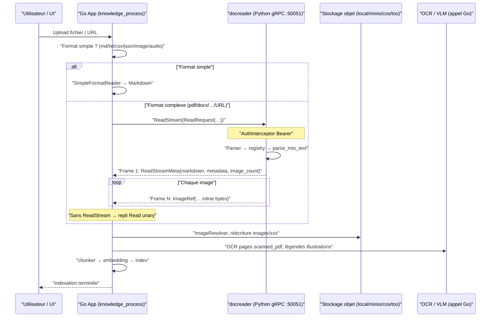
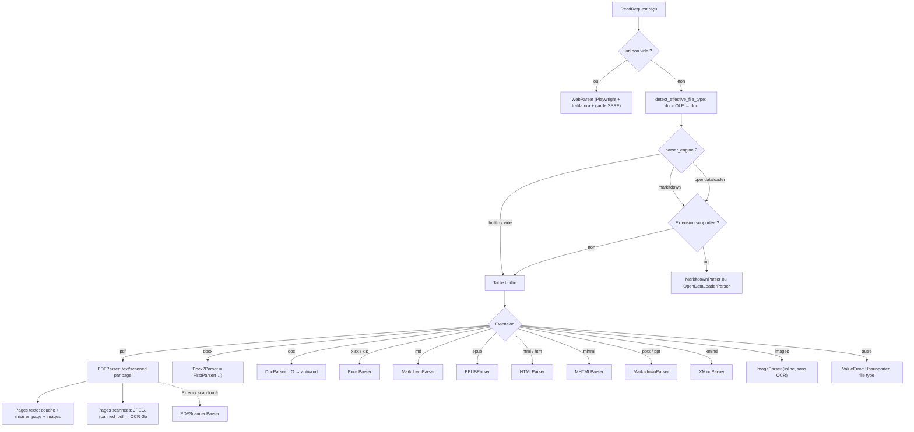

# Service d’analyse documentaire docreader

Le parsing convertit les fichiers importés en texte searchable et extrait les images brutes. Formats multiples, moteur par type de fichier ; scans, images et audio exigent modèles visuels ou ASR.

Formats pris en charge :

| Catégorie | Formats |
| --- | --- |
| Documents | PDF, Word (doc/docx), PPT (ppt/pptx), Excel (xls/xlsx), EPUB, XMind |
| Texte | txt, Markdown, CSV, JSON |
| Web | URL en ligne, HTML / MHTML locaux |
| Images | jpg, png, gif, bmp, tiff, webp (modèle visuel pour le contenu) |
| Audio | mp3, wav, m4a, flac, ogg (modèle ASR) |

Si le résultat est insuffisant :

- **PDF mal structuré / tableaux** : autre moteur pour `pdf` (MarkItDown / OpenDataLoader / MinerU) ;
- **Scan sans texte** : modèle visuel, mode scan forcé ;
- **Excel : en-têtes en première ligne** : option « première ligne comme en-tête » pour `xlsx`/`xls` ;
- **Corriger le texte** : édition des chunks — voir [Bases de connaissances](02-knowledge-base.md#edition-chunks-historique).

## Référence du mécanisme et de la configuration

docreader est un service Python gRPC autonome : fichier ou URL → Markdown + références d’images. Le service Go enchaîne découpage, stockage images, OCR, légendes et vectorisation.

Les rôles du service d’analyse et du traitement aval sont définis dans `docreader/parser/base_parser.py` :

```python
class BaseParser(ABC):
    """Base parser interface.

    After the lightweight refactoring, BaseParser only extracts markdown text
    and raw image references from documents. Chunking, image storage, OCR,
    and VLM caption are handled by the Go App module.
    """
```

### Rôle du service et API {#role-du-service-et-api}

#### Protocole : gRPC uniquement (pas de HTTP) {#protocole-grpc-uniquement-pas-de-http}

Point d’entrée `docreader/main.py` : un serveur gRPC (`grpc.server` + `ThreadPoolExecutor`), port par défaut `50051`, plus le service Health standard `grpc_health.v1` pour K8s/Docker (avec `grpc_health_probe` dans l’image). **Aucune interface HTTP.**

Proto : `docreader/proto/docreader.proto`, 3 RPC :

```protobuf
service DocReader {
  rpc Read(ReadRequest) returns (ReadResponse) {}
  // Version flux : 1 frame meta (markdown/metadata/error), puis 1 image par frame.
  // Évite les gros PDF scannés (centaines de pages) qui dépassent la limite unary (RESOURCE_EXHAUSTED).
  rpc ReadStream(ReadRequest) returns (stream ReadStreamResponse) {}
  rpc ListEngines(ListEnginesRequest) returns (ListEnginesResponse) {}
}
```

`ReadRequest` unifié : `file_content`/`file_name`/`file_type` pour un fichier, `url`/`title` pour une URL ; `config.parser_engine` (`builtin` / `markitdown` / `opendataloader`), `config.parser_engine_overrides` pour les surcharges (ex. `pdf_force_scanned`, `odl_hybrid`).

`ReadResponse` : `markdown_content` + `repeated ImageRef image_refs` (images en **octets inline**, `image_dir_path` toujours vide — persistance côté Go App, champ proto `image_storage` réservé), et optionnellement `repeated SourceBlock source_blocks` : segment de `markdown_content` (offsets Unicode `start`/`end`) mappé vers la position dans le fichier source (`locator_json`) pour les citations — voir [Emplacements source](#source-locators). `ReadStreamMeta` reprend les mêmes champs.

`ReadStream` (`main.py::ReadStream`, `_iter_image_refs`) : frames petites et indépendantes ; décodage base64 et `images.pop(ref_path)` côté serveur pour libérer la mémoire ; évite le pic mémoire/taille message des gros PDF scannés. Go : `grpc_parser.go` appelle `ReadStream` en priorité, repli sur unary `Read` si `Unimplemented` (ancien docreader).

`ListEngines` : compatibilité ; la liste est gérée côté Go (`engine_registry.go`, `docparser.ListAllEngines`). L’App n’appelle plus ce RPC ; MinerU et autres moteurs distants sont traités en Go natif.

#### Authentification et TLS (`auth.py`) {#authentification-et-tls-auth-py}

Deux mécanismes via variables d’environnement :

**Jeton (`AuthInterceptor`)** : avec `GRPC_AUTH_TOKEN`, le client envoie `authorization: Bearer <token>` (ou token seul). Vérification `hmac.compare_digest` ; avertissement si token < 16 octets. Health `Check`/`Watch` exemptés avant auth. Échec : `_make_abort_handler` adapté au type RPC (unary/stream), `UNAUTHENTICATED` plutôt qu’`INTERNAL`.

**TLS / mTLS (`load_tls_credentials`)** : `GRPC_TLS_ENABLED=true` exige `GRPC_TLS_CERT` / `GRPC_TLS_KEY`, `GRPC_TLS_CA` optionnel ; `GRPC_MTLS_REQUIRE_CLIENT_CERT=true` pour certificat client (sinon déduit de la présence de `GRPC_TLS_CA`). Erreur de config TLS → `TLSConfigError`, `main()` → `sys.exit(1)` (**fail-fast, pas de repli silencieux en clair**).

Client Go : `docreader/client/auth.go` (`LoadAuthConfigFromEnv`), `NewClient` avec round_robin et limite `MAX_FILE_SIZE_MB`.

#### Interaction avec le service principal {#interaction-avec-le-service-principal}

`knowledge_process.go` appelle docreader à l’étape parse (timeout `docreader_call_timeout`). **md/markdown/txt/csv/json/images/audio sont traités en Go par `SimpleFormatReader`, sans docreader** (`builtin_converter.go`, `simpleFormats`).

CSV via parseur Go `simple` : Markdown converti plafonné à **64 MiB**, contrôle distinct de la taille d’upload. Avant génération du tableau, estimation de la taille avec lignes complétées et échappement ; dépassement → échec explicite, pas de troncature ni retry automatique. Scinder le CSV et ré-uploader si besoin. Lignes courtes/longues normales : cellules vides complétées, tous les champs conservés.



---

### Registre et dispatch des parseurs {#registre-et-dispatch-des-parseurs}

#### Registre (`parser/registry.py`) {#registre-parser-registry-py}

`ParserEngineRegistry` : `nom moteur → {extension → classe}` + sonde `check_available` par moteur (`ListEngines`).

`_build_default_registry()` — trois moteurs :

| Moteur | Types | Description |
| --- | --- | --- |
| `builtin` | docx, doc, pdf, md, xlsx/xls, pptx/ppt, epub, html, mhtml, xmind, images… | Moteur intégré ; PPT via MarkItDown |
| `markitdown` | md, pdf, office, csv… (MarkitdownParser) | Bibliothèque Microsoft MarkItDown |
| `opendataloader` | pdf (OpenDataLoaderParser) | Analyse de mise en page PDF, Java 11+ ; sonde java, package Python, hybrid |

Règle `get_parser_class` : moteur demandé incompatible avec l’extension → **repli `builtin`** ; sinon `ValueError("Unsupported file type")`.

#### Façade et correction par magic bytes (`parser/parser.py`) {#facade-et-correction-par-magic-bytes-parser-parser-py}

`Parser` : `parse_file()` via registre, `parse_url()` → `WebParser`. `detect_effective_file_type()` : faux `.docx` OLE (`b"\xd0\xcf\x11\xe0…"`) routé vers le parseur DOC.

`engine_overrides` (proto `parser_engine_overrides`) passés en `**kwargs` au constructeur (ex. `pdf_force_scanned` dans `PDFParser.__init__`).

#### Parseurs en chaîne (`parser/chain_parser.py`) {#parseurs-en-chaine-parser-chain-parser-py}

Deux combinateurs via `create(*parser_classes)` :

- **`FirstParser`** : essai séquentiel jusqu’à `document.is_valid()` ; ex. `Docx2Parser = FirstParser.create(MarkitdownParser, DocxParser)`.
- **`PipelineParser`** : sortie texte d’une étape → entrée de la suivante ; images/metadata fusionnés ; ex. `MarkdownParser`, `WebParser`, `MarkitdownParser`.

#### Concurrence (`parser/concurrency.py` et ailleurs) {#concurrence-parser-concurrency-py-et-ailleurs}

Quatre niveaux :

1. **Pool gRPC** : `ThreadPoolExecutor(max_workers=CONFIG.grpc_max_workers)` (défaut 4).
2. **Sémaphores nommés** (`parser_worker_limit`) : `markitdown`, `opendataloader`, `pdf_render` (défaut 1 chacun) ; `max_workers <= 0` = illimité.
3. **Verrou pdfium global** (`_PDFIUM_LOCK`) : bibliothèque non thread-safe ; toutes opérations pdfium sérialisées.
4. **Parallélisme processus** : rendu pages scannées PDF (`ProcessPoolExecutor`, `DOCREADER_PDF_RENDER_PARALLELISM`) ; DOCX par page ; conversions LibreOffice avec profile temporaire, 3 retries.

---

### Détail des parseurs {#detail-des-parseurs}

#### `pdf_parser.py` — PDFParser / PDFScannedParser (PDF builtin) {#pdf-parser-py-pdfparser-pdfscannedparser-pdf-builtin}

**Dépendances** : `pypdfium2`, Pillow. Pas de service externe ; pas d’OCR dans docreader.

**Routage page par page** : classification `"text"` / `"scanned"` ; couverture image / surface page (`DOCREADER_PDF_SCAN_IMAGE_RATIO=0.5`) ; peu de caractères texte + images (`DOCREADER_PDF_SCAN_MIN_CHARS=10`). Évite les mauvaises couches texte pour le RAG.

Trois passes (`_route_locked`) :

1. **Texte + classification** : couche texte ; si `DOCREADER_PDF_LAYOUT_ORDERING` et texte non « well-formed », reconstruction géométrique (glyphs, XY-cut, filigranes, titres `DETECT_HEADINGS`) ; post-traitement ; figures vectorielles en JPEG si caption `Figure N`.
2. **Pages scannées** : JPEG (DPI 200, qualité 85, max edge 2000 px), `image_source_type=scanned_pdf`, **OCR côté Go** (`ocr_prompt` pour `scanned_pdf`).
3. **Images embarquées** : filtres taille/répétition/max 50, ordre top-down.

`_strip_repeating_lines` pour en-têtes/pieds répétés. Échec → **`PDFScannedParser`** ou `pdf_force_scanned` / `DOCREADER_PDF_FORCE_SCANNED`.

**Sortie** : Markdown, dict `images`, metadata (`page_count`, etc.). **Limites** : pas de structure tabulaire fine ; titres heuristiques ; texte scanné = OCR Go.

#### `doc_parser.py` — DocParser (.doc) {#doc-parser-py-docparser-doc}

Chaîne : LibreOffice → DOCX puis chaîne DOCX ; sinon `antiword` (proxy « trou noir ») ; `textract` **désactivé** (SSRF). Timeout 60 s, kill process group. Sans LibreOffice : texte seul.

#### `docx2_parser.py` vs `docx_parser.py` {#docx2-parser-py-vs-docx-parser-py}

- **Docx2Parser** : `FirstParser(MarkitdownParser, DocxParser)`.
- **DocxParser** (~1500 lignes) : patch python-docx, pagination, parallèle par page, images inline, tables HTML, repli simple. `DOCREADER_DOCX_MAX_PAGES` (0 = illimité).

#### `excel_parser.py` et modules auxiliaires {#excel-parser-py-et-modules-auxiliaires}

**ExcelParser** (pandas) : lignes en texte `col: val`, un `Chunk` par ligne ; filtre formules image WPS/Office. Pas d’images.

**Mode en-tête** : ligne 1 = données, colonnes A/B/C par défaut ; `xlsx_first_row_as_header` pour vrais en-têtes. Config KB `parser_engine_rules` ou override upload → `parser_engine_overrides`. `*bool` : null = défaut parseur.

Modules : `excel_convert.py`, `xlsx_merge.py` (cellules fusionnées), `xlsx_repair.py`. Pourcentages : `DOCREADER_XLSX_PERCENT_AS_TEXT`, `DOCREADER_XLSX_PCT_ROW_HINT_MIN`.

#### PPT (`ppt_convert.py`, `pptx_media.py`) {#ppt-ppt-convert-py-pptx-media-py}

Normalisation ppt/pptx, médias WMF/EMF/SVG → PNG pour MarkItDown.

#### `image_parser.py` {#image-parser-py}

Pas d’OCR docreader ; image base64 inline. OCR/caption en Go. Formats image aussi en `SimpleFormatReader` pour le flux principal.

#### `markdown_parser.py` {#_3-7-markdown-parser-py-—-markdownparser-md-markdown}

Tables normalisées, images data-URI extraites. Post-traitement commun Markitdown/Web.

#### `web_parser.py` (URL) {#web-parser-py-url}

Playwright WebKit + trafilatura ; double garde SSRF ; SPA ; WeChat ; proxy `DOCREADER_EXTERNAL_HTTPS_PROXY`.

#### `mhtml_parser.py`, `html_parser.py`, `xmind_parser.py`, `epub_parser.py`, `markitdown_parser.py`, `opendataloader_parser.py`

Comportement identique au doc source : MIME MHTML, HTML local vs URL, mind map, EPUB ebooklib/ZIP, MarkItDown (limites PDF pdfminer), OpenDataLoader + hybrid JVM.

#### Choix du parseur {#choix-du-parseur}



---
### Images et multimodal {#images-et-multimodal}

Contrat image docreader : `Document.images = {"images/<nom>": "<base64>"}` et `` dans le Markdown.

`main.py` :

- unary `Read` : `_resolve_images()` → `ImageRef.image_data` inline (`image_dir_path` vide ; persistance Go uniquement) ;
- `ReadStream` : `_iter_image_refs()` frame par frame, `pop` mémoire.

Go enregistre les images et exécute le pipeline KB (`default` ou `smartocr`, compat. `image_attrs_enabled`). Trace du pipeline et des étapes.

Pipeline manuel : légende et OCR activables séparément ; smart OCR selon attributs. Paramètres dans `image_pipeline_params` par pipeline. Consignes image pour la description, pas injectées dans le prompt OCR.

Prétraitement OCR KB : `off` / `auto` / `always` ; exécution docreader, repli image source si échec. Voir [Configuration](../01-getting-started/04-configuration.md#image-preprocess).

Tableaux HTML inline (MinerU, PaddleOCR-VL, OCR VLM) → Markdown avant chunking ; tableaux non convertibles restent HTML ligne par ligne. **Aucun appel VLM dans docreader** ; champs legacy `vlm_config`/`storage_config` vides.

---

### Emplacements source (source locators) {#source-locators}

Chaque chunk reçoit des `source_locators` pour ouvrir le fichier et surligner (voir [Réponses et sources](18-chat-experience.md)). Mapping intervalle Markdown → position source, puis intersection par chunk :

| Source | Production | Locator |
| --- | --- | --- |
| PDF builtin | Boîtes pdfium / page seule pour scan | `pdf` : `page` + `bbox` |
| MinerU | `content_list`, alignement texte | `pdf` : `page` + `bbox` |
| PaddleOCR-VL | Blocs de page | `pdf` : `page` (+ `bbox`) |
| Office / EPUB (Go) | Structure fichier + alignement Markdown | `docx`/`slide`/`sheet`/`section` |
| Excel builtin | Feuille + numéro de ligne | `sheet` |
| Markdown / TXT | Intervalles caractères | `text` : `start`/`end` |
| Audio | Segments ASR | `time` : `start_ms`/`end_ms` |

Alignement alphanumérique ; remapping après normalisation Go. `quote` ≤ 300 caractères. Anciens doc/ppt/xls/web : recherche texte ou page web.

### `splitter/` et chunker Go {#splitter-et-chunker-go}

`TextSplitter` Python : défaut 512/80, aligné sur `internal/infrastructure/chunker/splitter.go` — **production = chunker Go**. Protections formules, images, liens, tableaux, code. `HeaderTracker` pour en-têtes de table Markdown.

Pas de chunks dans `ReadResponse` ; `ExcelParser` remplit `Document.chunks` mais le flux principal lit `content` seulement.

---

### Table de configuration {#table-de-configuration}

#### `config.py` (`DocReaderConfig`) {#config-py-docreaderconfig}

| Variable (alias) | Défaut | Description |
| --- | --- | --- |
| `DOCREADER_GRPC_MAX_WORKERS` (`GRPC_MAX_WORKERS`) | 4 | Workers pool gRPC |
| `DOCREADER_GRPC_MAX_FILE_SIZE_MB` (`MAX_FILE_SIZE_MB`) | 50 | Taille max messages gRPC |
| `DOCREADER_GRPC_PORT` (`PORT`) | 50051 | Port gRPC |
| `DOCREADER_DOCX_MAX_PAGES` | 0 | Max pages DOCX (0 = illimité) |
| `DOCREADER_MARKITDOWN_MAX_WORKERS` | 1 | Limite MarkItDown |
| `DOCREADER_ODL_MAX_WORKERS` | 1 | Limite OpenDataLoader (JVM) |
| `DOCREADER_ODL_HYBRID` | `off` | Mode hybrid ODL |
| `DOCREADER_ODL_HYBRID_URL` | `http://127.0.0.1:5002` | URL service hybrid |
| `DOCREADER_ODL_HYBRID_MODE` | `auto` | Paramètre hybrid |
| `DOCREADER_ODL_HYBRID_FALLBACK` | false | Repli si hybrid échoue |
| `DOCREADER_ODL_MARKDOWN_WITH_HTML` | false | Markdown ODL avec HTML |
| `DOCREADER_HTML_MAIN_CONTENT` | false | HTML upload : corps seul (trafilatura) |
| `DOCREADER_PDF_RENDER_*` | voir doc | Rendu PDF parallèle, DPI, JPEG, max edge |
| `DOCREADER_EXTERNAL_*_PROXY` | vide | Proxy WebParser / conversions |
| `DOCREADER_IMAGE_OUTPUT_DIR` | `/tmp/docreader` | Temp images (legacy) |

#### PDF (`pdf_parser.py`, extrait) {#pdf-pdf-parser-py-extrait}

| Variable | Défaut | Description |
| --- | --- | --- |
| `DOCREADER_PDF_SCAN_IMAGE_RATIO` | 0.5 | Seuil page scannée (couverture image) |
| `DOCREADER_PDF_SCAN_MIN_CHARS` | 10 | Seuil texte insuffisant |
| `DOCREADER_PDF_FORCE_SCANNED` | false | Tout en mode scan |
| `DOCREADER_PDF_EXTRACT_EMBEDDED_IMAGES` | true | Images embarquées |
| `DOCREADER_PDF_LAYOUT_ORDERING` | true | Ordre de lecture multi-colonnes |
| `DOCREADER_PDF_DETECT_HEADINGS` | true | Titres par taille de police |
| `DOCREADER_PDF_FILTER_HIDDEN_TEXT` | true | Anti injection texte caché |
| `DOCREADER_PDF_SOURCE_BOXES` | true | Boîtes pour surlignage citation |

#### Délais côté Go {#go-side-parse-timeouts}

Variables sur le service Go principal :

| Variable | Type | Défaut | Description |
| --- | --- | --- | --- |
| `WEKNORA_DOCUMENT_PROCESS_TIMEOUT` | duration | `2h` | Timeout tâche document |
| `WEKNORA_DOCREADER_CALL_TIMEOUT` | duration | `30m` | Timeout appel docreader (< document) |
| `WEKNORA_PADDLEOCR_VL_TIMEOUT` | duration | `1000s` | PaddleOCR-VL self-hosted |
| `WEKNORA_MINERU_TIMEOUT` | duration | `1000s` | MinerU self-hosted |
| `WEKNORA_MINERU_CLOUD_TIMEOUT` | duration | `30m` | MinerU cloud (poll par lot) |
| `WEKNORA_PADDLEOCR_VL_CLOUD_TIMEOUT` | duration | `600s` | PaddleOCR-VL cloud |
| `WEKNORA_WEKNORACLOUD_TIMEOUT` | duration | `20m` | WeKnoraCloud docreader (< docreader call) |

Marguer les délais du plus interne au plus externe pour les gros fichiers.

#### Sécurité et divers {#securite-et-divers}

| Variable | Description |
| --- | --- |
| `GRPC_AUTH_TOKEN` | Auth Bearer metadata |
| `GRPC_TLS_*` / `GRPC_MTLS_*` | TLS/mTLS, échec config = pas de démarrage |
| `SSRF_WHITELIST` / `SSRF_WHITELIST_EXTRA` | Liste blanche SSRF |
| `SSRF_DNS_WHITELIST_ONLY` | DNS limité à la whitelist (aligné Go) |
| `LOG_LEVEL` | Niveau de log |
| `LIBREOFFICE_PATH` / `ANTIWORD_PATH` | Chemins binaires |

---

### Déploiement et montée en charge {#deploiement-et-montee-en-charge}

#### Image (`docker/Dockerfile.docreader`) {#image-docker-dockerfile-docreader}

Python 3.10 bookworm, build multi-stage `uv`, port 50051. Dépendances : LibreOffice, antiword, OpenJDK 17, Playwright WebKit (pas de modèles OCR dans l’image), `grpc_health_probe`, ImageMagick optionnel pour PPT. Scripts `generate_proto.sh`, `parse_local.py`.

#### Réglages {#reglages}

- **Scale horizontal** : verrou pdfium → PDF sérialisé par instance ; plusieurs replicas + `round_robin`.
- **Scale vertical** : `DOCREADER_PDF_RENDER_PARALLELISM`, `DOCREADER_GRPC_MAX_WORKERS` ; `ReadStream` si RAM limitée.
- **Gros fichiers** : aligner `MAX_FILE_SIZE_MB` client/serveur ; DPI/qualité JPEG.
- **Isoler JVM/WebKit** : limites ODL/MarkItDown ; hybrid ODL séparé.
- **Timeouts** : `WEKNORA_DOCREADER_CALL_TIMEOUT` (voir [Délais côté Go](#go-side-parse-timeouts)).
- **Prod** : `GRPC_AUTH_TOKEN` (≥16 octets) + TLS ; sinon WARNING clair.

---

### Moteur anydoc (Go in-process, sans docreader) {#moteur-anydoc-go-in-process-sans-docreader}

[anydoc](https://github.com/firecrawl/anydoc) (Rust) lié via cgo → Markdown office **sans** Python ni binaires externes.

Types : doc/docx/ppt/xlsx/epub/csv/pdf, etc.

#### Activation {#activation}

Image Docker : anydoc par défaut. Build local : `make build-anydoc` ou `-tags anydoc`. `WITH_ANYDOC=0` pour build sans Rust.

Règles explicites prioritaires ; sinon anydoc pour formats complexes si lié ; PDF reste souvent `builtin`. PPT sans anydoc → markitdown.

#### Limites {#limites}

- PDF scanné : texte seul ; repli DocReader builtin si connecté ;
- Cellules fusionnées verticales : moins complètes qu’avec docreader DOCX ;
- Images : `anydoc_extract_images=false` pour texte seul ;
- URL/image/audio : autres chemins.

#### Code {#code}

| Chemin | Rôle |
| --- | --- |
| `internal/infrastructure/docparser/anydoc/` | Adaptateur |
| `anydoc_reader.go` | Impl. DocReader |
| `engines.go` | Registre |
| `third_party/anydoc-go/` | Bindings vendored |

### MinerU self-hosted (Go direct) {#mineru-self-hosted}

`mineru_converter.go` ; API V1 si `GET …/v1/health` → `status=ok`, sinon legacy `/file_parse` ou erreur 503.

| Probe | Protocole |
| --- | --- |
| 200 ok | V1 : upload → job → zip markdown + images |
| 404/405 | ≤3.x `/file_parse` sync |
| 503 | V1 non prêt |

Mapping des paramètres `ParserEngineConfig` entre 4.0 et 3.x (voir doc source). Détails V1 : sha256 dédup, API key même origine, poll backoff, DELETE job on cancel, état en RAM, test connexion avec job list.

`mineru_cloud` : API batch v4 inchangée.

---

### Aide-mémoire

- **API** : gRPC `:50051`, `Read` / `ReadStream` / `ListEngines` + Health.
- **Formats docreader** : pdf, office, md, epub, html, mhtml, xmind, images, URL ; txt/csv/json/image/audio → Go `SimpleFormatReader`.
- **OCR/VLM** : zéro dans docreader ; Go pour OCR et légendes.
- **Images** : octets inline ; stockage Go.
- **Chunks** : chunker Go en prod ; Python 512/80 pour sidecar.

### Découpe automatique des gros PDF MinerU Cloud

Mode cloud : qpdf, tranches ≤100 pages, >10 MiB subdivisé par pages. Numéros de page et images préservés. qpdf requis hors image Docker app (Debian/Fedora/macOS/Windows — voir releases qpdf).

Sans qpdf : repli fichier entier ; gros fichiers peuvent être refusés.

Timeouts : PUT/ZIP download 10 min ; `WEKNORA_MINERU_CLOUD_TIMEOUT` 30 min par lot ; toujours borné par `WEKNORA_DOCREADER_CALL_TIMEOUT` (30 min) et `WEKNORA_DOCUMENT_PROCESS_TIMEOUT` (2 h). Config exemple 4 h / 6 h pour très gros ouvrages. Pas de reprise de job cloud entre retries.
