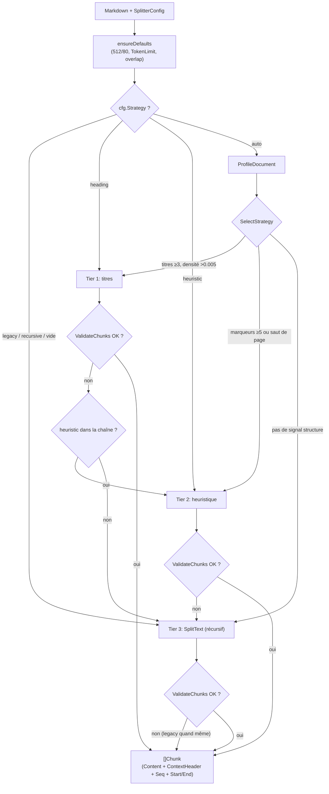
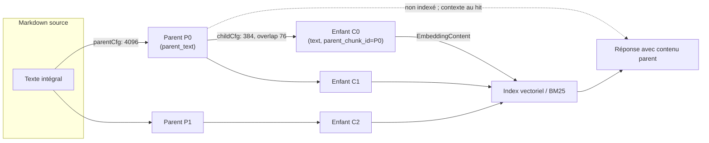

# Découpage (Chunking)

Le découpage divise les documents en unités de recherche. Des blocs plus petits ciblent mieux un sujet ; des blocs plus grands conservent le contexte. Taille et chevauchement dépendent de la structure du document et des résultats observés.

Point de départ recommandé : 512 caractères par bloc, chevauchement 80, stratégie `auto`. Ajustez selon les cas suivants :

| Symptôme | Piste |
| --- | --- |
| Réponses incomplètes, manque de contexte | Augmenter `chunk_size`, ou activer parent-enfant (recherche sur enfants, réponse sur parents) |
| Blocs peu pertinents pour la question | Réduire `chunk_size` pour des thèmes plus focalisés |
| Données en entrées atomiques (FAQ, dictionnaire, paramètres) | Chevauchement 0 pour éviter la contamination entre entrées |
| Récits longs (rapports, articles) | Chevauchement 150–200 pour le lien sémantique inter-blocs |
| Prévisualiser le découpage | `POST /api/v1/chunker/preview` (sans écriture en base) |

Après modification de la configuration, retraiter les documents existants pour appliquer les nouveaux paramètres.

## Aide-mémoire paramètres et réglages {#_10-aide-memoire-parametres-et-reglages}

| Scénario | strategy | chunk_size | chunk_overlap | Autre |
|------|----------|------------|---------------|------|
| Documents généralistes (départ) | `auto` | 512 | 80 | — |
| Docs techniques structurés / manuels | `auto` (souvent `heading`) | 512–1024 | 80 | fil d’Ariane automatique |
| PDF OCR / livres texte | `auto` (souvent `heuristic`) | 512–1024 | 80–150 | `languages` limite les faux positifs |
| Longs récits / argumentation | `auto` | 1000–2000 | 150–200 | parent-enfant possible |
| Recherche fine + long contexte | toute | — | — | `enable_parent_child=true`, parent 4096 / enfant 384 |
| FAQ / enregistrements atomiques | N/A (une entrée = un chunk FAQ) | — | 0 | `FAQIndexMode` pour indexer ou non les réponses |
| Modèle d’embedding à plafond token strict | toute | — | — | `token_limit` → budget caractères |
| Comportement anciennes versions | `legacy` | inchangé | 64 explicite | voir [ChunkingConfig (niveau KB)](#_1-1-chunkingconfig-niveau-kb-surchargeable-upload) |

## Référence du mécanisme de découpage

WeKnora découpe **côté Go** (`internal/infrastructure/chunker`) : profil document → stratégie par paliers → validation → repli progressif. `docreader/splitter/` conserve le découpeur récursif aligné pour le sidecar docreader (chemin de prod = Go ; défauts alignés, voir commentaire dans `splitter.py`).

### Modèle de configuration {#_1-modele-de-configuration}

#### ChunkingConfig (niveau KB, surchargeable à l’upload) {#_1-1-chunkingconfig-niveau-kb-surchargeable-upload}

`internal/types/knowledgebase.go` :

| Champ | Type | Défaut | Description |
|------|------|--------|------|
| `chunk_size` | int | 512 (caractères) | Taille cible d’un bloc (~100–130 tokens EN / ~300 ZH). Contenu atomique FAQ : 200–400 ; longs récits : 1000–2000 |
| `chunk_overlap` | int | 80 (~15 %) | Chevauchement entre blocs adjacents. Données atomiques : 0 ; récits : 150–200. Plafonné à `chunk_size/2` |
| `separators` | []string | `["\n\n", "\n", "\u3002"]` | Priorité des séparateurs pour le découpage récursif (dernier : point idéographique U+3002) |
| `strategy` | string | `""` (= legacy) | `auto` / `heading` / `heuristic` / `recursive` / `legacy` — voir [Stratégie adaptive](#_2-strategie-adaptive-trois-tiers-repli) |
| `token_limit` | int | 0 (désactivé) | Plafond approximatif en tokens ; >0 convertit en budget caractères (×0,9) |
| `languages` | []string | vide (auto) | Indice langue pour l’heuristique, ex. `["zh"]`, `["en","de"]` |
| `enable_parent_child` | bool | false | Découpage parent-enfant — voir [Parent-Child](#_5-decoupage-parent-enfant) |
| `parent_chunk_size` | int | 4096 | Taille parent (mode parent-enfant) |
| `child_chunk_size` | int | 384 | Taille enfant ; chevauchement enfant = `child_size/5` (~20 %) |
| `parser_engine_rules` | []ParserEngineRule | vide | Routage parseur par type de fichier (ex. `xlsx_first_row_as_header`) — parsing, même struct |
| `table_metadata_instructions` | string | vide | Consignes métier pour résumés de tableaux CSV/Excel |

Source unique des défauts : constantes du paquet `chunker` (`splitter.go`) :

```go
const (
    DefaultChunkSize    = 512
    DefaultChunkOverlap = 80
)
```

> Migration (commentaire source) : anciens défauts de chevauchement 64 / 50 / 100 (Go / knowledge.go / docreader) unifiés à 80. KB existante avec `ChunkOverlap=0` en base → 80 à la réindexation ; embeddings plus identiques bit à bit.

#### SplitterConfig (runtime) {#_1-2-splitterconfig-runtime}

`buildSplitterConfigFromChunking` (`knowledge_process.go`) mappe `ChunkingConfig` → `chunker.SplitterConfig` ; `ensureDefaults` complète :

- `TokenLimit > 0` : `charBudget = CharsForTokenLimit(...)` remplace `ChunkSize` si plus petit (`tokens.go` : en 4,0, de 4,5, zh 1,7, mixed 3,0, ×0,9) ;
- `ChunkOverlap > ChunkSize/2` → plafonné à la moitié.

#### IndexingStrategy et découpage {#_1-3-indexingstrategy-et-decoupage}

Quatre commutateurs dans `internal/types/indexing_strategy.go` orientent les chunks :

```go
type IndexingStrategy struct {
    VectorEnabled  bool // index vectoriel
    KeywordEnabled bool // index BM25
    WikiEnabled    bool // génération Wiki
    GraphEnabled   bool // extraction graphe
}
```

- `NeedsChunks()` faux → pas de découpage ;
- `NeedsEmbedding()` faux → chunks en DB seulement, pas de `BatchIndex` ;
- Wiki / Graph consomment les chunks texte en post-traitement.

### Stratégie adaptive : trois tiers et chaîne de repli {#_2-strategie-adaptive-trois-tiers-repli}

Entrées : `chunker.Split` / `SplitWithDiagnostics` (`strategy.go`). Chaîne via `resolveChainWithProfile` :

| Strategy | Chaîne de tiers | Note |
|-------------|----------------------|------|
| `auto` | Sous-séquence de `[heading, heuristic, legacy]` selon profil | Recommandé |
| `heading` | `[heading, legacy]` | Titres forcés, repli legacy |
| `heuristic` | `[heuristic, legacy]` | Heuristique forcée |
| `recursive` | `[legacy]` | Alias public de `legacy` |
| `legacy` / `""` | `[legacy]` | Récursif historique |

Chaque tier passe par **Validator** (`validator.go`) ; sinon tier suivant ; `legacy` garantit un résultat non vide.

Règles de rejet :

| Règle | Raison |
|------|----------------|
| Aucune sortie | `no chunks produced` |
| Doc > `2*chunkSize`, un seul chunk | `single chunk for large document` |
| Trop de micro-blocs <50 car. | `too many tiny chunks` |
| Max < `chunkSize/4` | `all chunks far below target size` |
| Max > `2*chunkSize` | `chunk exceeds 2x target size` |

#### Profil document (`profiler.go`) {#_2-1-profil-document-profiler-go}

`ProfileDocument` produit `DocProfile` en une passe : stats lignes/titres Markdown, sections numérotées, majuscules, sauts de page `\f`, séparateurs, marqueurs de chapitre DE/EN/ZH, pieds de page, tableaux/code, langue (4096 premiers octets).

`SelectStrategy` :

```go
// Candidat tier 1 : titres Markdown
if p.MdHeadingTotal >= 3 && p.HeadingDensity() > 0.005 && p.DominantHeadingLevel() > 0 {
    chain = append(chain, TierHeading)
}
// Candidat tier 2 : limites heuristiques
if p.HeuristicMarkerTotal() >= 5 || p.FormFeedCount > 0 ||
    p.GermanChapterCount+p.EnglishChapterCount+p.ChineseChapterCount > 0 {
    chain = append(chain, TierHeuristic)
}
chain = append(chain, TierLegacy) // repli permanent
```

`DominantHeadingLevel` choisit le niveau de coupe principal : niveau le plus superficiel apparaissant ≥3 fois, sinon le plus profond observé.

#### Schéma de décision {#_2-2-schema-de-decision}



### Trois algorithmes de découpage {#_3-trois-algorithmes-decoupage}

#### Tier 1 : titres (`heading_splitter.go`) {#_3-1-tier-1-titres-heading-splitter-go}

**Pour** : documents avec titres Markdown réguliers (docs techniques, Word exporté, PDF avec signets).

1. `findHeadingBoundaries` sur `DominantHeadingLevel` (ignore faux titres dans blocs de code) ; ≤1 limite → `SplitText`.
2. `HeadingHierarchy` : pile 6 niveaux, fil d’Ariane via `BreadcrumbWithHashes()`.
3. Par section : si taille OK → un chunk, fil d’Ariane dans **`ContextHeader`** ; sinon `SplitText` interne avec `breadcrumbAtOffset`.
4. `coalesceTinyChunks` fusionne micro-blocs adjacents (< `ChunkSize/2`, min 200).

**Invariant** : `End - Start == utf8.RuneCountInString(Content)` (fil d’Ariane hors Content).

#### Tier 2 : heuristique (`heuristic_splitter.go`, `patterns.go`) {#_3-2-tier-2-heuristique-heuristic-splitter-go-patterns-go}

**Pour** : PDF OCR, manuels texte, livres scannés sans titres Markdown.

Limites candidates (priorité max par offset) :

| Type | Regex | Priorité |
|----------|---------------------|--------|
| Saut de page `\f` | `FormFeedPattern` | 100 |
| Section numérotée | `NumberedSectionPattern` | 90 |
| Chapitres EN/DE/ZH | patterns chapitre (+ filtre `Languages`) | 85 |
| Ligne courte MAJUSCULES | `AllCapsHeadingPattern` | 70 |
| Séparateur visuel | `VisualSeparatorPattern` | 60 |
| Pied de page | `PageFooterPattern` | 50 |
| ≥3 sauts de ligne | `ExcessiveBlanksPattern` | 40 |

Puis : `dropBoundsInsideSpans` ; bin packing glouton ; `SplitText` sur segments trop longs ; `applyOverlapAligned` pour le chevauchement sémantique.

#### Tier 3 : récursif legacy (`splitter.go`, port Python) {#_3-3-tier-3-recursif-legacy-splitter-go-port-python}

Implémentation de base portée depuis `docreader/splitter/splitter.py` ; repli et découpe intra-section. Trois étapes :

**Étape 1 — zones protégées** (`protectedSpans`), jamais coupées au milieu :

```go
var protectedPatterns = []*regexp.Regexp{
    regexp.MustCompile(`(?s)\$\$.*?\$\$`),                        // formules LaTeX bloc
    regexp.MustCompile(`!\[[^\]\n]{0,200}\]\([^)\n]{1,500}\)`),   // image Markdown (ligne, longueur limitée)
    regexp.MustCompile(`\[[^\]\n]{1,200}\]\([^)\n]{1,500}\)`),    // lien Markdown (ligne, longueur limitée)
    /* en-tête + séparateur */ /* lignes de données */             // table Markdown
    regexp.MustCompile("(?s)```(?:\\w+)?[\\r\\n].*?```"),          // bloc de code fenced
    regexp.MustCompile("`[^`\\r\\n]+`"),                            // code inline
}
```

Images et liens : une ligne max, texte lien ≤200, URL ≤500 (CommonMark). Évite qu’un `[` OCR isolé protège tout le paragraphe.

Zone > `maxProtectedSize = 7500` runes : coupe forcée sur saut de ligne/espace.

**Étape 2 — séparation récursive** (`splitBySeparators`) : priorité `Separators`, récursion si > `ChunkSize`.

**Étape 3 — fusion** (`mergeUnits`) + `computeOverlap` ; plafond `absoluteMaxSize = 7500`.

`computeOverlap` : suffixe **sémantique** (paragraphe > ligne > fin de phrase) ; pas de chevauchement au milieu d’un mot ; zones protégées exclues.

#### Tableaux : suivi d’en-tête (`header_tracker.go`) {#_3-4-tableaux-suivi-en-tete-header-tracker-go}

`headerTracker` (aligné sur `header_hook.py`) réinjecte la ligne d’en-tête GFM dans chaque fragment de tableau ; gestion en-tête vide, changement de tableau, colonnes incohérentes.

`NormalizeHTMLTables` convertit les `<table>` HTML en GFM avant découpage ; cellules fusionnées non convertibles restent en HTML une ligne par `<tr>`.

#### Images {#_3-5-images}

- `` protégé ;
- `ExtractImageRefs` pour lier chunks et images ;
- sous-chunks `image_caption` / `image_ocr` indexés séparément.

### ContextHeader {#_4-contextheader}

`Chunk.ContextHeader` : fil d’Ariane de titres, **séparé** du `Content` :

```go
// internal/types/chunk.go
// ContextHeader is a Markdown heading breadcrumb prepended when indexing.
// It is persisted so a later content edit can rebuild the same index input.
ContextHeader string `json:"-" gorm:"type:text"`

func (c *Chunk) EmbeddingContent() string {
    body := strings.TrimSpace(c.Content)
    if c.ContextHeader == "" { return body }
    return c.ContextHeader + "\n\n" + body
}
```

Points clés :

- **Embedding seulement** : index = titre du document + `EmbeddingContent()` ; `Content` reste la tranche verbatim ; offsets `Start`/`End` inchangés.
- **Persisté** dans `chunks.context_header` (migration `000078`) pour réindexation après édition manuelle ; `json:"-"` en API.
- Parent-enfant : `mergeBreadcrumbs` fusionne les fils d’Ariane.

### Découpage parent-enfant {#_5-decoupage-parent-enfant}

Si `EnableParentChild = true` (`SplitParentChild`) :

1. Parents avec `parentCfg` (4096 par défaut) ;
2. Enfants avec `childCfg` (384, overlap = taille/5) ;
3. `Seq` global ; parent redondant omis (`ParentIndex = -1`).

Règles `processChunks` : parents `ChunkTypeParentText` non indexés ; enfants seuls embeddés ; recherche sur enfant, contexte parent.

Transmettre `Strategy` dans `buildParentChildConfigs` pour conserver titres et ContextHeader.



### Spécificité FAQ {#_6-specificite-faq}

Les KB FAQ **n’utilisent pas** les algorithmes ci-dessus : une paire Q/R = un chunk `ChunkTypeFAQ` (`knowledge_faq.go`), contenu via `buildFAQChunkContent` :

```go
builder.WriteString(fmt.Sprintf("Q: %s\n", meta.StandardQuestion))
// Questions similaires listées
// NegativeQuestions exclues du Content
if mode == types.FAQIndexModeQuestionAnswer && len(meta.Answers) > 0 {
    // Réponses listées
}
```

- Métadonnées dans `Chunk.Metadata` ; `ContentHash` pour dédup import ;
- Modes : `question_only` / `question_answer` ; index questions `combined` / `separate` ;
- Chevauchement 0 naturellement pour les FAQ.

### Intégration pipeline d’ingestion {#_7-integration-pipeline-ingestion}

Chaîne dans `knowledge_process.go` :

```
processDocument
  └─ convert()                          // docreader → Markdown
  └─ imageResolver.ResolveAndStore()    // stockage images, réécriture URL
  └─ buildSplitterConfigFromChunking()
  └─ chunker.Split / SplitParentChild
  └─ processChunks()                    // BatchIndex
```

Span `StageChunking` ; échec → `ErrCodeChunkingFailed`.

### Aperçu : `POST /api/v1/chunker/preview` (`chunker_debug.go`) {#_8-apercu-post-api-v1-chunker-preview-chunker-debug-go}

Prévisualisation sans écriture DB, sans embedding, sans log du texte.

Corps de requête :

```json
{
  "text": "Texte d’exemple…",
  "chunking_config": {
    "chunk_size": 512, "chunk_overlap": 80,
    "separators": ["\n\n", "\n", "\u3002"],
    "strategy": "auto", "token_limit": 0, "languages": ["zh"],
    "enable_parent_child": false,
    "parent_chunk_size": 4096, "child_chunk_size": 384
  }
}
```

Avec `enable_parent_child: true`, l’aperçu renvoie les **enfants** (granularité de recherche) ; les diagnostics viennent de la passe parent. Même `NormalizeSplitterConfig` / `DeriveParentChildConfigs` que l’ingestion.

Réponse (`PreviewChunkingResponse`) :

| Champ | Description |
|------|------|
| `selected_tier` | Tier retenu (`heading` / `heuristic` / `legacy`) |
| `tier_chain` | Chaîne tentée |
| `rejected` | Tiers rejetés et raisons (`TierRejection`) |
| `profile` | `DocProfile` complet |
| `chunks[]` | seq, offsets, tailles, context_header, content |
| `stats` | statistiques sur l’ensemble complet ; `truncated_to` si tronqué |

Limites : 64k runes (413), 500 chunks max affichés, timeout 5s (504). JSON produit par `SplitWithDiagnostics` (contrat API public).

Route (`internal/router/routes_knowledge.go`) :

```go
g.apiKeyRoute(r, http.MethodPost, "/chunker/preview",
    apiKeyRetrieve(apiKeyIngest(apiKeyFullAccess())), g.Viewer(), handler.PreviewChunking)
```

### Découpeur Python (`docreader/splitter/`) {#_9-decoupeur-python-docreader-splitter}

`TextSplitter` : prototype aligné sur Go (512/80), sidecar docreader ; `HeaderTracker` identique à Go.

## Référence d’implémentation

| Module | Fichier |
|------|------|
| Stratégie | `internal/infrastructure/chunker/strategy.go` |
| Profil | `internal/infrastructure/chunker/profiler.go` |
| Tier 1 titres | `heading_splitter.go`, `heading_hierarchy.go` |
| Tier 2 heuristique | `heuristic_splitter.go`, `patterns.go` |
| Tier 3 legacy | `splitter.go` |
| En-têtes tableaux | `header_tracker.go` |
| Validation | `validator.go` |
| Tokens | `tokens.go` |
| Config | `knowledgebase.go`, `indexing_strategy.go` |
| Pipeline | `knowledge_process.go` |
| Preview | `chunker_debug.go` |
| Python | `docreader/splitter/splitter.py`, `header_hook.py` |
