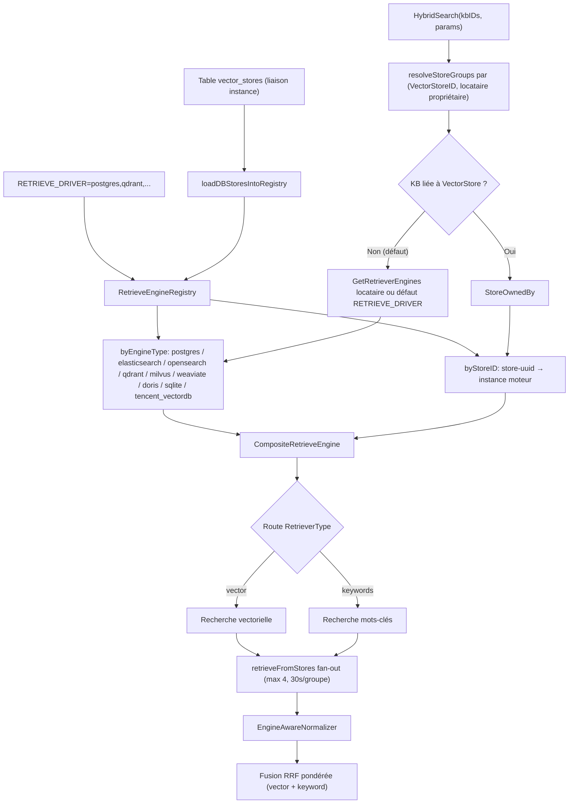
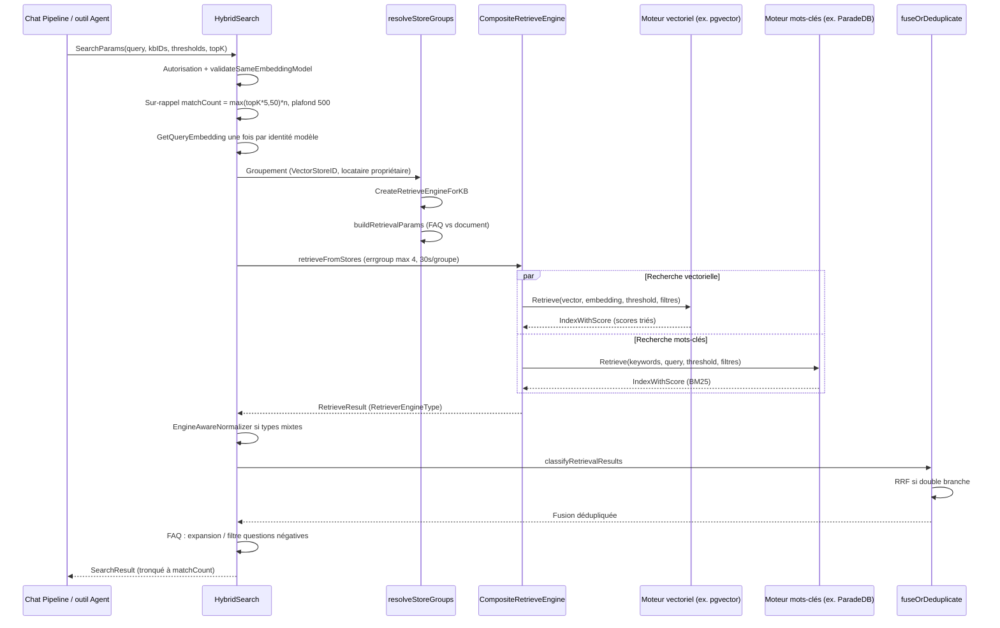

# Moteurs de recherche et stockage vectoriel (Retrieval Engines)

Les moteurs de recherche stockent les index et exécutent la recherche vectorielle, par mots-clés ou hybride. Le déploiement PostgreSQL par défaut utilise l’image ParadeDB pour pgvector et BM25, partageant la base avec les données métier. Pour un scale-out indépendant ou réutiliser une infrastructure existante, d’autres backends sont disponibles.

Lors du choix d’un backend, tenez compte des dépendances de déploiement, de la capacité et de l’isolation des données :

| Situation | Piste |
| --- | --- |
| Déploiement mono-machine ou bureau avec base embarquée | SQLite (intégré, zéro dépendance) |
| Scale-out dédié du service de recherche vectorielle | Qdrant, Milvus |
| Stack Elasticsearch / OpenSearch déjà en place | Réutiliser le cluster existant |
| Séparer les données par base de connaissances | Garder le moteur par défaut, enregistrer des instances dans « Paramètres → Stockage vectoriel » et les lier aux KB concernées |

Changer de moteur impose de reconstruire les index. Le stockage vectoriel lié à une KB est figé après création : choisissez l’instance avant de créer la base.

## Ajuster la recherche hybride

Les paramètres de recherche regroupent rappel, fusion, etc. Le RRF fusionne les classements des branches vectorielle et mots-clés ; vous pouvez ajuster le paramètre de lissage et les poids des deux branches. Comparez les résultats sur un jeu de questions représentatif avant d’enregistrer ; augmenter le poids d’une branche n’augmente pas automatiquement la qualité des réponses du modèle.

Le RRF double branche ne s’applique pas lorsqu’une seule branche renvoie des résultats. Sens des paramètres et valeurs par défaut : [Fusion RRF pondérée](#_5-2-fusion-rrf-ponderee).

## Embedding multimodal et rappel d’images

Un modèle d’embedding acceptant les images peut encoder texte et images dans le même espace. Par défaut, une KB n’active pas les vecteurs d’image : il faut configurer le multimodal et « Recherche vectorielle sur images » ; les documents existants doivent être retraités ; les pages PDF scannées ne génèrent pas de vecteurs d’image. La galerie affiche les images déjà extraites, sans dépendre de ce commutateur. Détails : [Configuration images de la KB](02-knowledge-base.md#multimodal-embedding).

Les images rappelées peuvent être évaluées par un modèle de rerank acceptant les images ; un modèle de dialogue visuel voit les images sources conservées ; un modèle texte seul s’appuie sur la description et le texte OCR. Vecteurs d’image originaux et index texte description/OCR sont gérés séparément : désactiver le commutateur arrête le rappel vectoriel d’images sans supprimer automatiquement les vecteurs existants.

## Matrice des capacités et comparaison {#_3-matrice-capacites-comparaison}

| Moteur | Valeur `RETRIEVE_DRIVER` | Vectoriel | Mots-clés / full-text | Score mots-clés | Segmentation (ex. chinois) | Dimensions | Seuil poussé | Complexité déploiement | Cas d’usage |
|------|-------------------|----------|------------|-----------|---------|----------|---------|-----------|----------|
| PostgreSQL | `postgres` | pgvector halfvec + index HNSW expression | pg_search BM25 (`\|\|\|`) | BM25 (`paradedb.score` prioritaire, compatible `pgsearch.score`) | tokenizer pg_search | table unique multi-dim, cast par dim | seuil distance en SQL | Faible (image par défaut) | Choix par défaut ; même base que le métier, cohérence transactionnelle |
| SQLite | `sqlite` | sqlite-vec vec0 (cosine) | FTS5 contentless | FTS5 | bigram côté app | une table vec0 par dimension | côté app | Très faible (embarqué) | Bureau / dev / micro-déploiement |
| Elasticsearch v8 | `elasticsearch_v8` | script_score cosineSimilarity | match (BM25) | BM25 | analyseur ES | dense_vector, index unique | côté app | Moyenne | Cluster ES 8 existant |
| Elasticsearch v7 | `elasticsearch_v7` | non (Support keywords seulement) | match (BM25) | BM25 | analyseur ES | — | — | Moyenne | ES 7 legacy, moteur mots-clés uniquement, combiner avec un moteur vectoriel |
| OpenSearch | `opensearch` | plugin k-NN knn (HNSW) | match (BM25) | BM25 | analyseur OS | mapping knn_vector + empreinte | k-NN natif | Moyenne | Prod ES-like avec audit / alias / reindex ; 2.11+ / 3.x |
| Qdrant | `qdrant` | HNSW Cosine natif | index full-text MatchText (token OR) | pas de score (Scroll, rang RRF) | tokenizer multilingue | collection par dimension | score_threshold natif | Moyenne | Vectoriel pur + filtres payload |
| Milvus | `milvus` | HNSW (IP/COSINE/L2) | vecteur sparse BM25 Function | BM25 | analyseur Milvus | collection par dimension | côté app | Moyenne–élevée | Grand volume vectoriel + BM25 natif |
| Weaviate | `weaviate` | nearVector (certainty) | BM25 natif | BM25 | tokenizer Weaviate | Class dynamique | certainty natif | Moyenne | Écosystème GraphQL, réplication / sharding |
| Doris | `doris` | ANN HNSW inner_product/cosine | index inversé MATCH_ANY | hit inversé | parser chinese à la création | table par dimension | en SQL | Élevée | Entrepôt Doris existant, recherche + analyse |
| Tencent VectorDB | `tencent_vectordb` | HNSW COSINE | sparse BM25 (SPARSE_INVERTED) | BM25 | SDK SparseEncoder | collection par dimension | côté app | Faible (cloud) | Tencent Cloud managé |

> Quel que soit le « hybride » natif du moteur, WeKnora applique toujours une **fusion RRF unifiée en couche applicative** (`knowledgebase_search_fusion.go`) : vectoriel et mots-clés sont interrogés séparément puis fusionnés par rang (voir [Scores hybrides et normalisation](#_5-scores-hybrides-et-normalisation)). Chaque moteur ne fournit que les deux modes single-modality.

## Synthèse de configuration {#_6-synthese-configuration}

Commutateurs principaux (section C1 de `.env.example`, `docker-compose.yml`) :

| Variable d’environnement | Défaut | Description |
|----------|------|------|
| `RETRIEVE_DRIVER` | `postgres` | Drivers multiples séparés par des virgules : `postgres` / `sqlite` / `elasticsearch_v7` / `elasticsearch_v8` / `opensearch` / `qdrant` / `milvus` / `weaviate` / `doris` / `tencent_vectordb`. Multi-driver : écritures broadcast, recherche routée par type |
| `MULTI_STORE_RETRIEVE_TIMEOUT_SEC` | 30 | Timeout par groupe en recherche parallèle multi-store |
| `ELASTICSEARCH_ADDR` / `_USERNAME` / `_PASSWORD` / `_INDEX` | — / `WeKnora` | ES v7/v8 partagés |
| `OPENSEARCH_ADDR` / `_USERNAME` / `_PASSWORD` / `_INDEX` / `_INSECURE_SKIP_VERIFY` | — | OpenSearch |
| `QDRANT_HOST` / `_PORT` / `_COLLECTION` / `_API_KEY` / `_USE_TLS` | `localhost` / 6334 / `weknora_embeddings` | Qdrant (port gRPC) |
| `MILVUS_ADDRESS` / `_COLLECTION` / `_METRIC_TYPE` / `_USERNAME` / `_PASSWORD` / `_DB_NAME` | `localhost:19530` / `weknora_embeddings` / `IP` | changer metric → reconstruire collection |
| `WEAVIATE_HOST` / `_GRPC_ADDRESS` / `_SCHEME` / `_AUTH_ENABLED` / `_API_KEY` / `_COLLECTION` | `weaviate:8080` / `weaviate:50051` / `http` | noms de service en conteneur |
| `DORIS_ADDR` / `_HTTP_PORT` / `_DATABASE` / `_USERNAME` / `_PASSWORD` / `_TABLE_PREFIX` / `_COMPAT_MODE` | `doris-fe:9030` / 8030 / `weknora` / `root` / — / `weknora_embeddings` / `auto` | Doris 4.1+ ; modes compat non interchangeables après création |
| `TENCENT_VECTORDB_ADDR` / `_USERNAME` / `_API_KEY` / `_DATABASE` / `_COLLECTION` | — | trois clés manquantes → pas d’enregistrement |
| `NEO4J_ENABLE` / `NEO4J_URI` / `_USERNAME` / `_PASSWORD` | `false` / `bolt://neo4j:7687` | recherche graphe (hors registre vectoriel) |

Outre les variables d’environnement (env store, global au processus), l’administration peut créer des enregistrements `VectorStore` (DB store) par locataire et les lier à une KB — plusieurs clusters du même type, routage automatique et contrôle de propriété ([Choix du moteur à la recherche](#_1-2-choix-moteur-recherche)).

## Référence d’implémentation des moteurs

### Architecture en couches : Repository → KVHybridRetrieveEngine → Composite → Registry {#_1-architecture-en-couches-repository-kvhybridretrieveengine-composite-registry}

Chaque backend implémente `interfaces.RetrieveEngineRepository` (`EngineType()` / `Support()` / `Save` / `BatchSave` / `Retrieve` / `DeleteBy*` / `CopyIndices` / `BatchUpdateChunkEnabledStatus` / `BatchUpdateChunkTagID` / `EstimateStorageSize`). Au-dessus :

- **KVHybridRetrieveEngine** (`retriever/keywords_vector_hybrid_indexer.go`) : encapsule le Repository en `RetrieveEngineService`, calcule les embeddings à l’indexation selon les types supportés ;
- **CompositeRetrieveEngine** (`retriever/composite.go`) : composite. `Retrieve` route chaque `RetrieveParams.RetrieverType` (`vector` / `keywords`) vers le premier moteur compatible, en parallèle ; `Index` / `Delete` / `CopyIndices` etc. sont broadcast à tous les membres ;
- **RetrieveEngineRegistry** (`retriever/registry.go`) : double index — `byEngineType` (env store piloté par `RETRIEVE_DRIVER`, un par type) et `byStoreID` (instances `VectorStore` en base, plusieurs clusters du même type).

##### Reconstruction à la demande (rehydrate)

Si un stockage vectoriel est indisponible au démarrage (backend pas prêt, réseau), il n’entre pas dans `byStoreID` : toute KB liée échoue en recherche ou même à la suppression. Le registre supporte donc **rehydrate** :

- `GetOrLoadByStoreID` : si absent, construction via `VectorStoreRepository` + `EngineFactory` puis enregistrement ; si l’un est nil, recherche simple ;
- timeout de build `EngineBuildTimeout` (10 s), `singleflight` pour fusionner les requêtes concurrentes ;
- échec → cooldown `rebuildCooldown` (30 s) ;
- compteur `storeGen` : publication uniquement si la génération n’a pas changé pendant le build.

La suppression d’une KB réessaie aussi ce chemin si le moteur n’était pas prêt.

#### Enregistrement : initRetrieveEngineRegistry {#_1-1-enregistrement-initretrieveengineregistry}

`internal/container/container.go`. Au démarrage : parse `RETRIEVE_DRIVER`, construction client et `registry.Register(retriever.NewKVHybridRetrieveEngine(repo, engineType))` ; échec d’un driver → log seulement. Puis `loadDBStoresIntoRegistry` charge les instances locataire depuis `vector_stores`, `createEngineServiceFromStore` (`engine_factory.go`), `RegisterWithStoreID`.

#### Choix du moteur à la recherche {#_1-2-choix-moteur-recherche}

Entrée `HybridSearch` (`knowledgebase_search.go`) selon le lien KB :

1. `resolveStoreGroups` groupe les KB par `(VectorStoreID, locataire propriétaire)` ;
2. par groupe `retriever.CreateRetrieveEngineForKB` (`factory.go`) :
   - KB sans store (`VectorStoreID` vide, défaut) → `GetRetrieverEngines()` du locataire, sinon `GetDefaultRetrieverEngines()` depuis `RETRIEVE_DRIVER` (`internal/types/tenant.go`) ;
   - KB avec store → `ownership.StoreOwnedBy`, puis `registry.GetByStoreID` (sinon `ErrVectorStoreNotFound`), composite à un membre ;
3. `buildRetrievalParams` : vectoriel + mots-clés selon `SupportRetriever` et type KB (FAQ : index FAQ vectoriel ; document : index vectoriel défaut + mots-clés) ;
4. multi-groupes : `retrieveFromStores` errgroup (max 4 groupes, timeout `MULTI_STORE_RETRIEVE_TIMEOUT_SEC` 30 s par défaut), normalisation si types de moteurs mélangés.



### Détail moteur par moteur {#_2-detail-moteur-par-moteur}

Constantes dans `internal/types/retriever.go` : `postgres`, `elasticsearch`, `opensearch`, `qdrant`, `milvus`, `weaviate`, `doris`, `sqlite`, `tencent_vectordb` (`infinity`, `elasticfaiss` legacy sans implémentation). Sauf mention, `Support()` renvoie `[keywords, vector]`.

#### PostgreSQL (pgvector + ParadeDB) — moteur par défaut {#_2-1-postgresql-pgvector-paradedb-moteur-par-defaut}

`internal/application/repository/retriever/postgres/repository.go`. Même base que le métier (`embeddings`, GORM).

- **Vectoriel** : pgvector `halfvec`. Index HNSW sur `(embedding::halfvec(dim)) halfvec_cosine_ops` — **ORDER BY doit matcher l’index** (cast explicite), sinon scan séquentiel (issues [#702](https://github.com/pgvector/pgvector/issues/702)/[#835](https://github.com/pgvector/pgvector/issues/835)). Sous-requête `expandedTopK`, filtre `distance <= 1-threshold`, `score = 1 - distance`. `SET LOCAL hnsw.ef_search`, `hnsw.iterative_scan = strict_order` si pgvector ≥ 0.8.
- **Mots-clés** : BM25 `pg_search`, `content ||| query`. Détection `paradedb.score` ou `pgsearch.score`.
- **Filtres** : `knowledge_base_id` / `knowledge_id` / `tag_id` IN ; `is_enabled` NULL ou true.
- **Indexation** : `BatchSave` + `ON CONFLICT DO NOTHING` ; suppression physique par chunk/source/knowledge.

#### SQLite (FTS5 + sqlite-vec) — léger {#_2-2-sqlite-fts5-sqlite-vec-leger}

`internal/application/repository/retriever/sqlite/repository.go`.

- **Vectoriel** : `sqlite-vec`, table vec0 par dimension ; `score = 1 - distance`.
- **Mots-clés** : FTS5, bigram manuel (adapté au chinois).
- **Filtres** : sur `lite_embeddings` avant top-k.
- **Seuil** : 0 = pas de filtre par seuil.

#### Elasticsearch v8 {#_2-3-elasticsearch-v8}

`internal/application/repository/retriever/elasticsearch/v8/repository.go`. Client typé, index unique (`ELASTICSEARCH_INDEX`, défaut `WeKnora`), champ `dense_vector`.

- **Vectoriel** : requête `script_score`, script `Math.max(cosineSimilarity(params.query_vector, 'embedding'), 0.0)` ; filtre de seuil côté application. Lucene refuse les scores finaux négatifs : sans troncature, un vecteur opposé à la requête peut faire échouer toute la requête en 400 ; après troncature à 0, domaine [0,1].
- **Mots-clés** : `match` sur le champ content (BM25).
- **Filtres** : bool filter (terms KB/knowledge/tag ; `is_enabled` via must_not, données sans champ = activées) ; sonde de mapping pour le suffixe `.keyword`.
- **Indexation** : Bulk API ; vecteurs vides refusés.

#### Elasticsearch v7 — mots-clés uniquement {#_2-4-elasticsearch-v7-mots-cles-uniquement}

`internal/application/repository/retriever/elasticsearch/v7/repository.go`. **`Support()` ne renvoie que `[keywords]`** — le driver v7 sert de moteur BM25 (construction vectorielle présente mais non déclarée). Pour le vectoriel : combiner (`RETRIEVE_DRIVER=postgres,elasticsearch_v7`) ou migrer en v8.

#### OpenSearch {#_2-5-opensearch}

`internal/application/repository/retriever/opensearch/` (`repository.go`, `retrieve.go`, `query.go`, `mapping.go`, `crud.go`, etc.).

- **`probeVersion`** : rejette ES pur et OS 1.x / 2.0–2.3 ; 2.4–2.10 avec avertissement ; 2.11+ / 3.x acceptés. `probeKNNPlugin` exige `opensearch-knn` sur tous les nœuds.
- **Vectoriel** : requête k-NN ; `COSINESIMIL` → `(1+cosine)/2` ; conversion seuil/score pour aligner sur cosine.
- **Mots-clés** : `match` BM25 ; pas de pipeline hybrid OS natif — RRF applicatif (`query.go`).
- **Index** : mapping déclaratif, empreinte, alias, reindex, audit.
- Config : `OPENSEARCH_INSECURE_SKIP_VERIFY`, transport SSRF (`transport.go`).

#### Qdrant {#_2-6-qdrant}

`internal/application/repository/retriever/qdrant/repository.go`. gRPC (port 6334 par défaut).

- **Collections** : une par dimension `{QDRANT_COLLECTION|weknora_embeddings}_{dim}`, Distance=Cosine ; payload indexés keyword, content en full-text multilingue.
- **Vectoriel** : API `Query`, score ≈ cosine [0,1], `score_threshold` poussé.
- **Mots-clés** : `tokenizeQuery` puis `MatchText` en should (OR), `Scroll` ; pas de score BM25 (rang RRF).
- **Filtres** : `getBaseFilter` avec `MatchKeywords`.
- **Écriture/suppression** : nettoyage UTF-8/NUL ; collection absente à la suppression = rien à supprimer ; mises à jour enabled/tag par collection avec erreur remontée.
- Config : `QDRANT_HOST` / `QDRANT_PORT` / `QDRANT_API_KEY` / `QDRANT_USE_TLS`.

#### Milvus {#_2-7-milvus}

`internal/application/repository/retriever/milvus/repository.go`.

- **Collections** par dimension ; vecteur dense HNSW + sparse `content_sparse` via **BM25 Function** ; analyseurs `english` / `chinese` / `default` selon `language`.
- **Vectoriel** : `Search` ; L2 converti en score cosine-compatible.
- **Mots-clés** : BM25 sur `content_sparse` (Milvus 2.5+).
- **Filtres** : `filter.go`.
- **`BatchUpdateChunkEnabledStatus`** : erreurs agrégées et retournées.
- Config : `MILVUS_*` ; migration `go run ./cmd/milvus-migrate --source <ancien> --target <nouveau>` pour les analyseurs multilingues.

#### Weaviate {#_2-8-weaviate}

HTTP + gRPC ; Class dynamique ; `nearVector` + BM25 GraphQL ; filtres where. Config : `WEAVIATE_HOST` / `WEAVIATE_GRPC_ADDRESS` / `WEAVIATE_SCHEME` / auth.

#### Apache Doris (4.1+) {#_2-9-apache-doris-4-1}

MySQL FE + Stream Load HTTP ; table par dimension ; ANN HNSW + inverted chinese ; modes `DORIS_COMPAT_MODE` non interchangeables après création.

#### Tencent VectorDB {#_2-10-tencent-vectordb}

RpcClient ; collection par dimension ; dense HNSW + sparse BM25 ; trois paramètres core requis pour l’enregistrement.

#### Neo4j — graphe (hors Registry) {#_2-11-neo4j-graphe-hors-registry}

`internal/application/repository/retriever/neo4j/repository.go` implémente `RetrieveGraphRepository` (`SearchNode`), pas vectoriel/mots-clés : entités et relations pour `ENTITY_SEARCH` (GraphRAG). Activation `NEO4J_ENABLE=true`. Jusqu’à 200 entités graines, 2000 lignes max. Voir [Graphe de connaissances](09-knowledge-graph.md).

### Gestion des dimensions d’embedding {#_4-gestion-dimensions-embedding}

| Moteur | Stratégie |
|------|------|
| PostgreSQL | table `embeddings` mixte, colonne `dimension`, index expression |
| SQLite | vec0 par dimension |
| Qdrant / Milvus / TencentVectorDB | `{base}_{dim}` |
| Doris | `{prefix}_{dim}` |
| Elasticsearch | index unique dense_vector |
| OpenSearch | alias par dimension |

Après génération du vecteur de requête, comparaison à la dimension du modèle : incohérence → code 2201 avec détail (nom, attendu, obtenu) — pas d’envoi aveugle au store.

`validateSameEmbeddingModel` (`knowledgebase_search_shared.go`) : toutes les KB d’une recherche multi-base partagent la même identité de modèle (`model.Name + BaseURL`). Vecteur de requête calculé une fois par identité (`ResolveEmbeddingModelKeys` + `GetQueryEmbedding`), propagé via `params.QueryEmbedding`.

### Scores hybrides et normalisation {#_5-scores-hybrides-et-normalisation}

#### EngineAwareNormalizer {#_5-1-engineawarenormalizer}

Tous les drivers renvoient une **similarité cosine** ; seuils interprétés en cosine ; conversion côté driver si l’échelle native diffère :

| Moteur | Score natif | Conversion driver |
|------|---------|--------|
| Postgres / SQLite | distance cosine | `1 - distance` |
| Qdrant / TencentVectorDB / Doris | cosine (ou IP normalisé) | direct |
| Milvus (IP / COSINE) | IP / cosine | direct |
| Milvus (L2) | distance euclidienne au carré | score `1 - d/2`, rayon `2(1 - threshold)` |
| Elasticsearch v8 | script_score cosineSimilarity | direct |
| OpenSearch | k-NN `(1+cos)/2` | score `2*score-1`, seuil `(1+threshold)/2` |
| Weaviate | certainty `(1+cos)/2` | score `2*certainty-1`, seuil `(1+threshold)/2` |

`internal/application/service/retriever/normalizer.go` : si fan-out multi-store et types de moteurs mixtes (`hasMixedEngineTypes`), clamp01 sur les scores vectoriels (cosine négatif théorique, NaN/Inf) ; WARN par requête pour moteur inconnu.

**Les scores BM25 ne sont pas normalisés ici** — domaine non borné ; traitement par liste en fusion. `clamp01` préserve l’ordre faible strict en aval.

#### Fusion RRF pondérée {#_5-2-fusion-rrf-ponderee}

`knowledgebase_search_fusion.go`. Lorsque vectoriel et mots-clés renvoient tous deux des résultats :

```go
// fuseWithRRF
rrf   = vectorWeight/(rrfK + vectorRank) + keywordWeight/(rrfK + keywordRank)
score = rrf / ((vectorWeight + keywordWeight) / (rrfK + 1))   // normalisé [0,1]
```

- Chaque `RetrieveResult` (moteur, groupe store, paramètres doc/FAQ) est **classé séparément** ; un chunk prend son meilleur rang parmi les listes. L’ordre de concaténation des listes n’a pas de sens pour le rang.
- Normalisation par le maximum théorique : premier des deux rangs → 1 ; défaut poids 0,7 / 0,3. RRF brut ~0,016 serait écrasé par des cosine 0,5–0,9 sans cette étape.
- `rrfK`, `vectorWeight`, `keywordWeight` depuis `RetrievalConfig` du locataire.
- Une seule branche : pas de RRF, `deduplicateByScore`. Branche mots-clés seule : chaque liste normalisée par son max local (BM25 incomparable entre moteurs). Trace conserve le BM25 brut.

Sorties dans [0,1] pour fusionner appels hétérogènes. Score composite (rerank 0,6 + base 0,3 + poids source 0,1, MMR, FAQ/Wiki) dans `CHUNK_RERANK` : [Étape rerank du pipeline RAG (CHUNK_RERANK)](../02-architecture/04-rag-pipeline.md).

### Flux d’exécution de la recherche {#_7-flux-execution-recherche}



## Référence d’implémentation

| Étape | Emplacement |
|------|----------|
| Enregistrement (env + DB store) | `internal/container/container.go`, `engine_factory.go` |
| Registre / composite / factory | `internal/application/service/retriever/` |
| Implémentations | `internal/application/repository/retriever/{postgres,sqlite,...}` |
| HybridSearch | `internal/application/service/knowledgebase_search*.go` |
| Types | `internal/types/retriever.go`, `tenant.go` |
| Variables | `.env.example` (C1), `docker-compose.yml` |

## Validation locale et montée de version

- [Montée de version ParadeDB](../01-getting-started/06-paradedb-upgrade.md).

### OpenSearch en local {#opensearch-local-testing}

```bash
docker compose -f docker-compose.dev.yml --profile opensearch up -d opensearch
curl -fsS 'http://localhost:9200/'
curl -fsS 'http://localhost:9200/_cat/plugins?format=json'
```

```dotenv
RETRIEVE_DRIVER=opensearch
OPENSEARCH_ADDR=http://localhost:9200
SSRF_WHITELIST=localhost
```

Vous pouvez aussi enregistrer un stockage `engine_type: opensearch` via l’interface ou l’API, `connection_config.addr` pointant vers ce service. Côté conteneur, utilisez une adresse joignable depuis le backend ; en production : TLS, authentification, règles SSRF adaptées. Voir [API infrastructure](../04-api/02-api-infra.md).

**Limite réplicas mono-nœud** : le driver impose 1 réplica par défaut ; `index_config.number_of_replicas: 0` est ramené à 1 (`opensearch/config.go`). On ne garantit pas Green en mettant 0. Yellow possible si réplicas non assignables : inspecter `/_cluster/health` et `/_cat/shards?v`, puis valider lecture/écriture.

Créez une KB de test liée à ce stockage, uploadez quelques documents, attendez l’indexation, testez vectoriel et mots-clés. Vérifiez `/_cat/indices?v` et `/_cat/aliases?v`, puis modification, désactivation, réactivation et suppression d’entrées ; en cas de copie de KB, contrôlez le contenu cible. Les index apparaissent à la demande, pas dès l’enregistrement du stockage.

À la fin, arrêtez uniquement les services utilisés pour ce test, en conservant les données de dev :

```bash
docker compose -f docker-compose.dev.yml --profile opensearch stop opensearch
# si Dashboards a été lancé
docker compose -f docker-compose.dev.yml --profile opensearch-ui stop opensearch-dashboards
```
