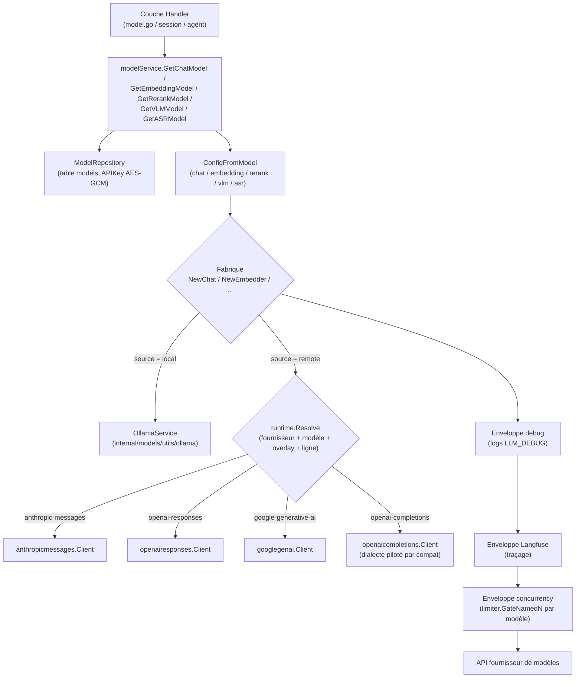

# Gestion des modèles

Ajoutez des modèles de dialogue, de vecteur, de réorganisation, visuels et vocaux dans « Paramètres → Modèles », puis laissez la base de connaissances ou l'agent les utiliser selon les besoins. Les modèles locaux Ollama et les modèles distants peuvent être utilisés en combinaison, par exemple, générer des vecteurs avec le modèle local et des réponses avec le modèle distant.

<Screenshot
  src="/screenshots/settings-models.png"
  caption="Paramètres modèles : gérer les modèles ajoutés par type"
  hint="Liste des modèles (nom, type, icône et nom du fournisseur, marque par défaut) et entrée « Ajouter un modèle »." />

Lors de l'ajout d'un modèle, vous devez vérifier la configuration de connexion et la compatibilité des index :

- **Changer de modèle de vecteur nécessite de reconstruire l'index**. Le modèle détermine l'espace sémantique et les dimensions du vecteur, les anciens et nouveaux vecteurs ne peuvent pas être utilisés directement ensemble ;
- **Tester la connexion avant de sauvegarder**. Assurez-vous que l'adresse du service, les identifiants et le nom du modèle sont disponibles avant d'utiliser le modèle pour la base de connaissances ou l'agent.

Les types de modèles, les champs de configuration et l'état d'utilisation peuvent être consultés selon les instructions suivantes.

## Choisir le type de modèle

| Type | Utilisation |
| --- | --- |
| Modèle de dialogue | Générer des questions-réponses, des résumés et des contenus de raisonnement intelligent |
| Modèle vectoriel | Convertir des documents et des questions en vecteurs, supporter la recherche sémantique |
| Modèle de réorganisation | Réordonner les fragments récupérés |
| Modèle visuel | Identifier les images dans les documents ou les dialogues |
| Modèle vocal | Transcrire l'audio en texte |

## Ajouter et vérifier la connexion

Lors de l'ajout d'un modèle, sélectionnez d'abord le type et la source : « API » pour accéder aux services à distance, « Ollama » pour utiliser un modèle local (le réarrangement de modèles ne prend pas en charge Ollama). Configurez le modèle à distance selon les étapes suivantes :

1. **Choisir le fournisseur de services**. La liste affiche uniquement les fournisseurs qui prennent en charge le type de modèle actuel. Une fois sélectionné, vous pouvez accéder à la page de documentation de ce fournisseur ou de ce modèle. Si aucun fournisseur correspondant n’est disponible, choisissez « Personnalisé (interface compatible OpenAI) ».
2. **Remplir le nom du modèle**. Vous pouvez choisir dans le catalogue de modèles intégré du fournisseur, où les options indiquent la fenêtre de contexte, la dimension vectorielle, les capacités d’inférence et visuelles ; vous pouvez également saisir directement un nom de modèle non présent dans le catalogue. Lorsqu’un modèle du catalogue est sélectionné, la fenêtre de contexte, le nombre maximal de tokens de sortie, le support visuel et la dimension vectorielle non remplis seront automatiquement renseignés.
3. **Remplir l’URL de base et la clé API**, ainsi que tout champ supplémentaire requis par le fournisseur (voir [Champs supplémentaires du fournisseur](#champs-supplementaires-fournisseur)). Si l’accès nécessite une passerelle d’entreprise, des en-têtes de requête personnalisés peuvent être ajoutés.
4. **Vérifier le « mode d’appel réel »**. Les modèles de conversation et visuels afficheront en temps réel le protocole de requête, la source des capacités (dossier de modèle intégré ou défaut général du fournisseur), l’adresse de la requête, les paramètres de l’interrupteur de réflexion, l’intensité de réflexion optionnelle, la fenêtre de contexte et le nombre maximal de tokens de sortie, afin de confirmer comment la configuration sera appelée avant de l’enregistrer.

5. **Enregistrer après le test de connexion**. Le test utilise la configuration actuellement remplie dans le formulaire, il n'est pas nécessaire de sauvegarder d'abord ; lors de l'édition d'un modèle existant, la clé API utilise la valeur déjà enregistrée séparément. Après le test, si la configuration a été modifiée, il faut tester à nouveau.

<Screenshot
  src="/screenshots/model-editor-catalog.png"
  caption="Ajouter un modèle : choisir dans le catalogue fournisseur et voir le mode d'appel réel"
  hint="Tiroir « Ajouter un modèle » : type Conversation, source API, fournisseur (ex. Alibaba Cloud DashScope) ; liste déroulante du nom de modèle avec fenêtre de contexte / raisonnement / vision ; panneau « Mode d'appel réel » (protocole, source des capacités, intensité de réflexion) et bouton « Tester la connexion »." />

Dans « Options avancées », il est également possible de configurer :

| Option | Type applicable | Description |
| --- | --- | --- |
| Dimension du vecteur / Dimension de sortie personnalisée | Vecteur | La dimension doit correspondre à l'index. N'activez la "Dimension de sortie personnalisée" que si vous avez confirmé que le modèle prend en charge la dimension spécifiée |
| Fenêtre contextuelle | Dialogue, Visuel | Laisser vide pour utiliser la valeur par défaut 200000. Remplissez la valeur réelle selon la documentation du fournisseur ; une valeur trop élevée peut empêcher la compression de l'historique de l'agent et le serveur en amont rejettera directement la requête |
| Prise en charge du visuel/multimodal | Dialogue | Si le modèle accepte les entrées d'image |
| Entrée d'image | Vecteur | Si le modèle peut encoder les images dans le même espace vectoriel que le texte. Lorsqu'il est activé et que le protocole du fournisseur prend en charge l'envoi d'images, **la base de connaissances avec "recherche vectorielle d'image" activée** stocke également un vecteur pour chaque image après avoir généré la description, permettant de rappeler des informations non incluses dans la description de l'image (à l'exception des pages PDF scannées) ; ce bouton dans la base de connaissances est désactivé par défaut et la simple déclaration de la capacité du modèle ne modifiera pas le comportement de la base de connaissances existante. Les modèles du catalogue sont détectés automatiquement, n'étant sauvegardés dans ce modèle que s'ils diffèrent du catalogue ; pour les modèles non présents dans le catalogue, une déclaration manuelle est nécessaire |
| Nombre maximal de tokens de sortie | Dialogue, Visuel | Limite de sortie par réponse unique, laisser vide pour utiliser la valeur par défaut de ce modèle dans le catalogue |
| Limite de concurrence en arrière-plan | Dialogue, visuel, vecteur | Limite le nombre de tâches en arrière-plan telles que l'importation ou l'enrichissement de documents pour ce modèle ; 0 ou vide utilise la valeur par défaut globale, n'affecte pas le dialogue interactif |
| Avancé → Surcharge du protocole | Dialogue, visuel | Forcer l'utilisation d'un certain protocole de requête, généralement laisser sur « automatique » |
| Avancé → Nom du modèle distant | Modèle distant | ID du modèle réellement envoyé au fournisseur, à remplir si différent du nom du modèle |
| Avancé → Surcharge de compatibilité du protocole (JSON) | Modèle distant | Corrige les champs de requête qui ne correspondent pas aux valeurs par défaut du répertoire pour certaines interfaces, comme `{"max_tokens_field": "max_tokens"}` ; vide signifie pas de surcharge. La syntaxe et les champs sont indiqués dans [Surcharge de compatibilité du protocole](#couverture-compatibilite-protocole-compat-json) |

Si le modèle de dialogue enregistré dans une ancienne version contient le paramètre `thinking_control`, la zone avancée affichera en supplément « Format des paramètres de réflexion (ancienne configuration) ». Après l'avoir changé en « Suivre les paramètres par défaut du répertoire », la façon d'écrire les paramètres de réflexion sera déterminée par le répertoire du modèle.

Le répertoire des modèles détermine si le modèle de dialogue peut réfléchir et l'intensité de réflexion disponible (désactivé, automatique, très faible, faible, moyen, élevé, très élevé, une partie du maximum). Lorsque l'intensité choisie par l'agent ou dans le dialogue n'est pas prise en charge par le modèle, elle est ajustée au niveau disponible le plus proche.

### Couverture de compatibilité du protocole JSON {#couverture-compatibilite-protocole-compat-json}

Même s'il s'agit d'une interface « compatible OpenAI », les exigences concernant les champs de requête varient selon les fournisseurs : certains n'acceptent que `max_tokens`, d'autres utilisent différents champs pour activer la réflexion, et les modèles de raisonnement peuvent refuser `temperature`. Ces différences entre les fournisseurs intégrés et les modèles déjà répertoriés sont déjà indiquées dans le catalogue de modèles, il n'est généralement pas nécessaire de remplir cette option. Cette option se trouve dans « Options avancées → Avancé » du modèle distant (à l'exception du service cloud WeKnora), et il n'est nécessaire de la modifier manuellement que dans les cas suivants :

- Services d’inférence auto-construits (vLLM, SGLang, etc.) ou passerelle de transit, le comportement de l’interface n’est pas conforme aux valeurs par défaut du fournisseur ;
- Les nouveaux modèles publiés par le fournisseur ne sont pas encore inclus, le panneau « mode d’appel réel » affiche « Par défaut général du fournisseur (modèle non inclus) », et l’appel renvoie une erreur ;
- Le fournisseur a modifié l’interface, une correction temporaire est nécessaire avant la mise à jour.

#### Règles de remplissage

1. **Vérifier d'abord le protocole**. Les champs des modèles de dialogue et visuels dépendent du « protocole de requête » dans le panneau « mode d'appel réel », seuls les champs de ce protocole sont acceptés ; si le « protocole de remplacement » est modifié, le JSON doit également être modifié pour correspondre aux champs du nouveau protocole. Chaque modèle vectoriel, de réarrangement ou vocal utilise un ensemble de champs, indépendamment du protocole.
2. **Écrire uniquement les clés à modifier**. Les clés non écrites continuent d'utiliser les valeurs par défaut du répertoire. Des objets comme ``extra_body`` fusionnent les clés, tandis que les tableaux sont entièrement remplacés.
3. **Vérification lors de l'enregistrement**. L'entrée doit être un objet JSON. En cas d'erreur dans le nom de la clé, de type de valeur incorrect ou de valeur d'énumération inexistante, l'enregistrement échouera et affichera le motif de l'erreur, cela ne sera pas signalé seulement lors du dialogue.
4. **Tester après modification**. Le « test de connexion » utilise la configuration actuelle du formulaire, il n'est pas nécessaire d'enregistrer au préalable.

La priorité de couverture ici est supérieure à celle de la valeur par défaut du fabricant et du répertoire du modèle ; les « formats de paramètres de réflexion » et le « nom du modèle distant » dans l'ancienne configuration restent en vigueur en dernier. Les modèles marqués comme ne supportant pas la réflexion dans le répertoire des modèles verront les champs liés à la réflexion ignorés.

`extra_body` n'ajoute que les champs que WeKnora n'a pas écrits ; il ne peut pas écraser les champs générés par WeKnora tels que `model`, `messages`, `max_tokens`.

#### Scénarios courants

| Phénomène | Remplir |
| --- | --- |
| Erreur inconnue `max_completion_tokens` | `{"max_tokens_field": "max_tokens"}` |
| Modèle de raisonnement refuse `temperature` / `top_p` | `{"supports_temperature": false}` |
| L'interface n'accepte qu'une température fixe (par exemple 1) | `{"fixed_temperature": 1}` |
| Les modèles de pensée hybride déployés par vLLM / SGLang comme Qwen3 ne peuvent pas activer ou désactiver la réflexion | `{"thinking_format": "chat-template-kwargs"}` |
| La passerelle ne prend pas en charge le retour en flux d'utilisation, les requêtes en flux renvoient une erreur | `{"supports_usage_in_streaming": false}` |
| La passerelle refuse la structure de message contenant des images | `{"supports_multi_content": false}` (envoyer uniquement du texte, les images seront supprimées) |
| Nécessite des paramètres propriétaires du fournisseur, comme la recherche connectée Alibaba Cloud | `{"extra_body": {"enable_search": true}}` |
| Erreur lors de la transmission du contenu réfléchi dans les dialogues multi-tours | `{"replay_reasoning_content": false}` |
| Le service vectoriel auto-hébergé n'accepte que 16 entrées par requête | `{"max_batch_size": 16}` |
| Modèle vectoriel multimodal déployé par vLLM (VLM2Vec, GME, etc.) | Activez « entrée image ». Si `image_format` et `image_field` ne sont pas remplis, le protocole compatible OpenAI enverra l'image selon le format `messages` de vLLM. Ajoutez `{"image_prompt": "Represent the given image."}` si le modèle nécessite une instruction ; le texte doit également passer par le modèle de dialogue pour être dans le même espace que l'image en ajoutant `{"text_as_messages": true}` |
| Qwen3-VL-Embedding déployé via vLLM | Pas besoin de remplir : lorsqu'un modèle sous un fournisseur personnalisé contient `qwen3-vl-embedding`, l'entrée d'image et `{"text_as_messages": true, "extra_body": {"add_special_tokens": true}}` sont intégrées. Le texte passe par `input` ordinaire et contourne le modèle de dialogue, n'étant pas dans le même espace que l'image ; si `add_special_tokens` n'est pas ajouté, il manque à la fin `<\|endoftext\|>` pour obtenir le vecteur du modèle, ce qui ne correspond pas aux résultats de la [fiche modèle](https://huggingface.co/Qwen/Qwen3-VL-Embedding-8B). Les index construits avec ce modèle doivent être reconstruits |
| Modèle vectoriel multimodal déployé via SGLang | Activer « Entrée d'image » et remplir `{"image_format": "object", "image_field": "image"}` |
| Les réponses du service de vecteur ou de réorganisation sont lentes, nécessitent un délai d'attente plus long | `{"request_timeout_seconds": 120}` |
| Le service de réorganisation auto-hébergé renvoie des scores non normalisés (logit) | `{"score_scale": "logit"}` |

#### WeMM-Embedding

La liste des modèles vectoriels du fabricant personnalisé (`generic`) comporte les préréglages suivants, qui permettent de reconnaître automatiquement l'entrée d'image et la dimension vectorielle native après sélection :

| Nom du modèle | Dimension native |
| --- | --- |
| `tencent/WeMM-Embedding-2B` | 2048 |
| `tencent/WeMM-Embedding-4B` | 2560 |
| `tencent/WeMM-Embedding-9B` | 4096 |

Vous pouvez choisir le déploiement officiel vLLM, ou utiliser le [script de déploiement Transformers](../06-development/06-wemm-transformers.md) de ce dépôt pour fournir la même interface d'Embedding sur CUDA, MPS ou CPU. MPS est un dispositif de calcul optionnel, et le service peut également être déployé sur un serveur indépendant.

Suivez [les instructions de déploiement officielles](https://github.com/Tencent/WeMM-Embedding#serving) pour utiliser vLLM `0.27.0`, et chargez `embedding_chat_template.jinja` dans le répertoire du modèle. Par exemple, déployez 2B et utilisez `--served-model-name` pour que le nom du service corresponde au paramètre prédéfini :

```bash
MODEL_PATH=/path/to/WeMM-Embedding-2B
vllm serve "$MODEL_PATH" \
  --runner pooling \
  --chat-template "$MODEL_PATH/embedding_chat_template.jinja" \
  --served-model-name tencent/WeMM-Embedding-2B
```

4B et 9B remplacent respectivement le chemin du modèle et le nom du service. Dans WeKnora, sélectionnez le fournisseur « Personnalisé », remplissez l’URL de base avec le service 50, choisissez le modèle vectoriel correspondant, et laissez « Dimension de sortie personnalisée » désactivée lors du premier accès. Si le service n’a pas configuré 51, le nom du modèle doit correspondre au chemin local réel renvoyé par le service ; les noms courts 52 et les chemins se terminant par 53 peuvent également reconnaître les présélections, 4B et 9B de la même manière. Tout alias personnalisé nécessite une configuration supplémentaire des capacités du modèle et de la couverture du protocole.

Les préréglages permettent au texte et aux images de passer tous deux par `messages` dans le modèle de template, le template ajoutant les `<embedding>` tokens nécessaires pour l'extraction de vecteurs ; en activant `batch_messages`, les conversations indépendantes dans le même lot sont fusionnées en une seule requête, chaque conversation retournant toujours ses propres vecteurs. L'appel en lot d'images est limité à 5 images par lot, l'excédent étant automatiquement divisé ; c'est la taille de lot choisie par WeKnora, conforme au préréglage Qwen3-VL-Embedding existant, et ne représente pas la limite officielle du modèle ou de vLLM, peut être ajustée avec `max_image_batch_size` selon la capacité du service. Les tâches d'indexation d'images de la base de connaissances sont encore appelées image par image et ne seront pas automatiquement fusionnées par cette configuration. Les historiques par défaut `truncate_prompt_tokens: 511` ne sont pas envoyés ; en cas de dépassement de la limite de contexte du service, une erreur est renvoyée par le service, sans troncature silencieuse. Il n'est pas nécessaire de fournir des invites JSON ou d'image supplémentaires. Si un index avait auparavant été créé pour ce modèle avec du texte simple `input`, il est nécessaire de reconstruire les vecteurs.

Le modèle de WeMM contient déjà le token spécial requis, conservez les comportements par défaut `add_special_tokens: false` et `add_generation_prompt: false` de vLLM, ne copiez pas les `add_special_tokens: true` prédéfinis de Qwen3-VL-Embedding. L'Embedding de vLLM utilise par défaut le token final et effectue une normalisation L2, il n'est pas nécessaire d'envoyer `normalize` ou de désactiver `use_activation`.

Lorsque la réduction de dimension est nécessaire, activez « Dimension de sortie personnalisée » et choisissez une dimension valide dans la configuration du modèle, WeKnora enverra le même `dimensions` pour les requêtes de texte et d'image ; vLLM découpera d'abord la dimension correspondante, puis effectuera une normalisation :

| Modèle | Dimensions optionnelles |
| --- | --- |
| 2B | 64, 128, 256, 512, 1024, 2048 |
| 4B | 64, 128, 256, 512, 1024, 2560 |
| 9B | 64, 128, 256, 512, 1024, 2048, 4096 |

Ces valeurs proviennent de la [configuration et des instructions officielles du modèle](https://github.com/Tencent/WeMM-Embedding#model-zoo), vLLM rejettera les dimensions en dehors de cette liste. Après avoir changé la dimension de sortie, il est nécessaire de reconstruire l'index des vecteurs existants. Les limites de temps d'attente, de concurrence et de taille d'image restent les valeurs par défaut actuelles, à ajuster selon les performances réelles du service.

La base de connaissances doit également activer l'index vectoriel d'images pour pouvoir rechercher directement le contenu des images. L'accès actuel est configuré pour le texte et les images ; la vidéo, l'entrée croisée de texte et d'image, ainsi que la vectorisation de pages entières de PDF scannés ne sont pas prises en charge dans le cadre du processus métier actuel.

#### Référence des champs

Dans le tableau ci-dessous, « Valeur par défaut du protocole » correspond à la valeur utilisée en l'absence de tout fabricant, répertoire ou couverture ; la valeur réelle pour un fabricant spécifique est indiquée dans le panneau « Mode d'appel réel ».

**OpenAI Chat Completions (`openai-completions`)** : La grande majorité des fournisseurs « compatibles OpenAI », des services internes et des passerelles utilisent ce protocole.

| Champ | Type | Par défaut du protocole | Description |
| --- | --- | --- | --- |
| `max_tokens_field` | string | `max_completion_tokens` | Nom du champ de limite de sortie : `max_tokens` ou `max_completion_tokens`, n'envoyez qu'un seul |
| `thinking_format` | string | `none` | Méthode d'activation de la réflexion : `none` ne pas envoyer ; `openai` envoyer seulement `reasoning_effort` ; `thinking-type` envoyer `{"thinking": {"type": ...}}` ; `enable-thinking` envoyer `enable_thinking` (en combinaison avec le champ de budget) ; `chat-template-kwargs` envoyer `chat_template_kwargs.enable_thinking` (vLLM / SGLang) ; `openrouter` envoyer `{"reasoning": ...}` |
| `thinking_enabled_value` | string | `enabled` | Valeur `type` lors de l'activation de la réflexion par `thinking-type` (par exemple MiniMax utilise `adaptive`) |
| `thinking_always_send` | bool | false | Envoyer l'interrupteur même si aucune préférence de réflexion n'est spécifiée |
| `thinking_disable_on_non_stream` | bool | false | Forcer la désactivation de la réflexion lors d'appels non-flux (certains modèles n'autorisent la réflexion qu'en flux) |
| `thinking_budget_field` | string | vide | Nom du champ de budget de réflexion, comme `thinking_budget` ; si vide, ne pas envoyer || `thinking_budget_excludes_effort` | bool | false | Le fabricant ne permet pas de mettre true lorsque le budget et `reasoning_effort` apparaissent en même temps, ne conserver que l'intensité de réflexion |
| `supports_reasoning_effort` | bool | false | Si envoyer l'intensité de réflexion supplémentaire |
| `reasoning_effort_field` | string | `reasoning_effort` | Nom du champ de l'intensité de réflexion |
| `supports_developer_role` | bool | false | Le système de l'IA de raisonnement utilise le rôle `developer` pour les invites |
| `supports_store` | bool | false | Envoyer `store: false`, demander au serveur de ne pas conserver la conversation |
| `supports_usage_in_streaming` | bool | true | Les requêtes en flux portent `stream_options.include_usage` pour le suivi de l'utilisation |
| `supports_temperature` | bool | true | Ne pas envoyer de paramètres d'échantillonnage (température, top_p, pénalités) lorsque false |
| `fixed_temperature` | number | Non | Valeur de température fixe à envoyer |
| `supports_seed` | bool | true | Si envoyer `seed` || `tool_choice_modes` | string[] | `none`、`auto`、`required`、`function` | Valeurs autorisées de `tool_choice` |
| `supports_parallel_tool_calls` | bool | true | Envoyer `parallel_tool_calls` ? |
| `supports_response_format` | bool | true | Envoyer `response_format` lorsque la sortie JSON est nécessaire ? |
| `supports_multi_content` | bool | true | Lorsque false, les messages mêlant texte et images ne conservent que la partie texte |
| `replay_reasoning_content` | bool | true | Renvoyer le contenu de réflexion précédent au modèle dans les dialogues multiples |
| `reasoning_fields` | string[] | `reasoning_content`、`reasoning`、`reasoning_text` | Champs à lire dans la réponse pour le texte de réflexion, prendre le premier dans l'ordre |
| `tool_call_extra_fields` | string[] | Vide | Champs supplémentaires à renvoyer tels quels lors de l'appel d'outils (comme `extra_content` lors de l'appel Gemini compatible OpenAI) |
| `prompt_cache_key` | bool | false | Envoyer `prompt_cache_key` pour activer le cache d'invite dans la même session || `cache_control_format` | chaîne | vide | Lorsqu'il est défini sur `anthropic`, insérer un point de rupture en cache au format Anthropic |
| `prompt_cache_accounting` | booléen | false | Le fournisseur renverra l'utilisation des hits de cache, utilisé pour les statistiques |
| `extra_body` | objet | vide | Champs ajoutés à chaque requête |

**OpenAI Responses (`openai-responses`)** :Interface officielle OpenAI（`api.openai.com`）utilisée par défaut.

| Champ | Type | Par défaut du protocole | Description |
| --- | --- | --- | --- |
| `supports_developer_role` | bool | true | Le système suggère d'utiliser le rôle `developer` |
| `supports_max_output_tokens` | bool | true | Envoyer `max_output_tokens` ou non |
| `supports_reasoning_summary` | bool | true | Demander un résumé de réflexion ou non |
| `supports_encrypted_reasoning` | bool | true | Demander et renvoyer le contenu réfléchi chiffré ou non |
| `supports_store` | bool | true | Envoyer `store: false` |
| `supports_temperature` | bool | true | Ne pas envoyer les paramètres d'échantillonnage si false |
| `prompt_cache_key` | bool | true | Envoyer la clé du cache de prompt |
| `supports_long_cache_retention` | bool | true | Autoriser un cache long de 24 heures |
| `supports_parallel_tool_calls` | bool | true | Envoyer `parallel_tool_calls` ou non |
| `extra_body` | object | vide | Champ ajouté à chaque requête |

**Anthropic Messages (`anthropic-messages`)** : Anthropic, ainsi que les interfaces compatibles se terminant par `/anthropic` à partir de `base_url`.

| Champ | Type | Par défaut du protocole | Description |
| --- | --- | --- | --- |
| `thinking_mode` | chaîne | `budget` | `budget` Activer la réflexion selon le budget ; `adaptive` Décidé par le modèle, l'intensité est transmise via `output_config.effort` |
| `thinking_off_type` | chaîne | `disabled` | `adaptive` Le `thinking.type` envoyé lorsque la réflexion est désactivée en mode ; Claude Sonnet 5.5 n'accepte pas `disabled`, utiliser `between_tools` |
| `supports_effort` | booléen | faux | Indique si l'intensité de la réflexion doit être envoyée |
| `thinking_budgets` | objet | minimal 1024, faible 2048, moyen 8192, élevé 16384, très élevé 32768, max 63999 | Chaque intensité de réflexion correspond à `budget_tokens`, avec les clés `minimal`/`low`/`medium`/`high`/`xhigh`/`max` |
| `default_max_tokens` | int | 4096 | `max_tokens` utilisé lorsque la limite de sortie n'est pas définie (obligatoire pour ce protocole) |
| `supports_temperature` | bool | true | Envoyer la température ou non |
| `temperature_with_thinking` | bool | false | Envoyer la température même lorsque la réflexion est activée |
| `supports_top_p` | bool | true | Envoyer `top_p` ou non |
| `supports_cache_control` | bool | true | Insérer un point d'arrêt de cache |
| `supports_cache_control_on_tools` | bool | true | Insérer un point d'arrêt de cache sur la définition de l'outil |
| `long_cache_ttl` | string | `1h` | Durée de validité du cache long |
| `version` | string | `2023-06-01` | En-tête de requête `anthropic-version` |
| `beta_headers` | string[] | vide | En-têtes `anthropic-beta` supplémentaires |
| `interleaved_thinking_beta` | string | `interleaved-thinking-2025-05-14` | Marque beta supplémentaire lors de l'utilisation simultanée de la réflexion et de l'outil ; chaîne vide signifie ne pas envoyer |
| `prompt_cache_accounting` | bool | true | Le fournisseur renverra l'utilisation du cache |
| `extra_body` | object | vide | Champs supplémentaires à ajouter à chaque requête |

**Gemini (`google-generative-ai`)** : Interface native de Gemini.

| Champ | Type | Valeur par défaut du protocole | Description |
| --- | --- | --- | --- |
| `thinking_mode` | string | `budget` | `budget` envoyer `thinkingBudget` (Gemini 2.5) ; `level` envoyer `thinkingLevel` (à partir de Gemini 3) ; `none` ne pas envoyer la configuration de réflexion |
| `thinking_budgets` | object | minimal 128, low 2048, medium 8192, high 24576, xhigh 32768, max 32768 | Correspondance entre chaque niveau d'intensité de réflexion et `thinkingBudget` |
| `include_thoughts` | bool | true | Retourner ou non le contenu de la réflexion |
| `supports_seed` | bool | true | Envoyer ou non `seed` |
| `supports_penalty` | bool | true | Envoyer ou non la fréquence / existence d'une pénalité |
| `extra_generation_config` | object | vide | Champs supplémentaires à ajouter à `generationConfig` |
| `prompt_cache_accounting` | bool | true | Le fabricant retournera l'utilisation du cache |
| `api_version_prefix` | string | `/v1beta` | Chemin de version ajouté à `base_url` lorsque seul l'hôte est renseigné |

**Modèle vectoriel**

| Champ | Type | Valeur par défaut du protocole | Description |
| --- | --- | --- | --- |
| `api` | string | Par défaut du fabricant | Protocole vectoriel : `openai-embeddings`, `dashscope-embeddings`, `ark-embeddings`, `google-embeddings` |
| `path` | string | vide | Chemin ajouté après `base_url` |
| `send_encoding_format` | bool | false | Envoyer `encoding_format: "float"` ou non |
| `dimensions_field` | string | vide | Nom du champ de dimension de sortie ; envoyé uniquement si « Dimension de sortie personnalisée » est activée |
| `truncate_field` / `truncate_value` | string | vide | Champ et valeur lorsque le serveur tronque une entrée trop longue |
| `input_type_field` | string | vide | Nom du champ distinguant « document » et « requête » |
| `input_type_values` | object | vide | Valeurs pour les entrées `document` et `query` |
| `max_batch_size` | int | 0 (illimité) | Nombre maximal d'éléments par requête ; excédent traité par lots |
| `max_input_chars` | int | 0 (illimité) | Nombre maximum de caractères pour une seule entrée |
| `accepts_truncate_prompt_tokens` | bool | false | Le service prend-il en charge vLLM `truncate_prompt_tokens` |
| `request_timeout_seconds` | int | 60 | Délai d'attente pour une seule requête (secondes) |
| `extra_body` | object | vide | Champs ajoutés à chaque requête |
| `image_field` | string | vide | Seulement `openai-embeddings` : nom de la clé de l'objet qui contient l'image dans `input` (Jina, SGLang pour `image`). Si le modèle ne déclare pas d'entrée image, laisse vide et que `image_format` n'est pas `messages`, le point de terminaison ne reçoit pas d'images |
| `image_format` | string | vide | Seulement `openai-embeddings` : méthode d'envoi de l'image. `object` place `{image_field: image}` dans `input` ; `messages` place l'image comme un tour de conversation dans `messages` (interface vectorielle multimodale de vLLM). Si le modèle déclare une entrée image, et que ce champ ainsi que `image_field` sont vides, envoyer selon `messages`. Si seulement `image_field` est rempli, traiter selon `object`. Si écrit comme `object` mais qu'il n'y a pas `image_field`, l'image n'est toujours pas envoyée |
| `image_prompt` | string | vide | Seulement `messages` : texte envoyé avec l'image, requis par certains modèles de template (ex. `Represent the given image.` pour VLM2Vec) |
| `text_as_messages` | booléen | faux | Seulement `openai-embeddings` : le texte est également envoyé au format `messages`, un par requête. Applicable aux modèles pour lesquels le texte et l'image doivent passer par le template de dialogue pour être dans le même espace vectoriel (Qwen3-VL-Embedding intégré pour certains fournisseurs) ; les modèles avec index existant nécessitent la reconstruction des vecteurs après modification |
| `max_image_batch_size` | int | 1 | Nombre maximum d'images par requête, au-delà, la requête est automatiquement divisée |
| `max_image_bytes` | int | 0 (illimité) | Limite de taille en octets par image, les images dépassant cette limite sont refusées et non envoyées |
| `image_mime_types` | tableau | vide (illimité) | Formats d'image acceptés par le fournisseur, comme `["image/png", "image/jpeg"]` |

**Modèle de réorganisation**

| Champ | Type | Par défaut du protocole | Description |
| --- | --- | --- | --- |
| `path` | string | vide | Chemin ajouté après `base_url` |
| `send_top_n` | bool | false | Envoyer `top_n` (sinon tous les documents sont renvoyés) |
| `return_documents` | bool | false | Demander au serveur de renvoyer le texte original du document |
| `score_scale` | string | `probability` | Signification du score : `probability` (0–1) ou `logit` (non normalisé). Une mauvaise valeur invalide le seuil de pertinence |
| `truncate_param` | string | vide | Paramètres de troncature côté serveur (ex. NIM `truncate`) |
| `max_documents` | int | 0 (illimité) | Nombre maximal de documents par requête ; excédent traité par lots |
| `max_query_chars` | int | 0 (illimité) | Longueur maximale de la requête ; dépassement = échec d'appel (découper le document ne raccourcit pas la requête) |
| `max_document_chars` | int | 0 (illimité) | Longueur maximale d'un seul document ; dépassement = échec d'appel |
| `max_request_chars` | int | 0 (illimité) | Longueur maximale totale pour une seule requête (requête + tous les documents), si dépassé, automatiquement subdivisé, effet simultané avec `max_documents`, le premier atteint détermine la subdivision ; si la longuer d'un seul document plus la requête dépasse déjà, traité comme un échec d'appel |
| `max_concurrency` | int | 0 (par défaut) | Nombre de requêtes envoyées simultanément après subdivision |
| `accepts_truncate_prompt_tokens` | bool | false | Le service prend-il en charge `truncate_prompt_tokens` de vLLM |
| `request_timeout_seconds` | int | 0 (60 secondes par défaut) | Délai d'expiration pour une seule requête (secondes) ; si dépassement, traité comme un échec d'appel, le retour de recherche se fait dans l'ordre de rappel |
| `extra_body` | object | vide | Champs supplémentaires ajoutés à chaque requête |
| `image_field` | string | vide | Seulement `cohere-rerank` : nom de la clé pour l'objet document image (Jina utilise `image`). Laisser vide signifie que ce point de terminaison accepte uniquement du texte. Le format des paragraphes d'image du protocole NIM est fixe et n'a pas besoin d'être rempli |
| `max_image_batch_size` | int | 1 | Nombre maximal d'images par requête ; images et texte sont demandés séparément, excédent regroupé en lots |
| `max_image_bytes` | int | 0 (illimité) | Taille maximale en octets d'une seule image, les images dépassant cette limite sont directement refusées, aucune requête n'est envoyée |
| `image_mime_types` | array | vide (illimité) | Formats d'image acceptés par le fournisseur |

Seuls les modèles avec des capacités `input` incluant `image` de réarrangement de modèle (dans le répertoire ce sont `jina-reranker-m0` et `nvidia/llama-nemotron-rerank-vl-1b-v2`) recevront des documents image.

**Modèle de reconnaissance vocale**

| Champ | Type | Par défaut du protocole | Description |
| --- | --- | --- | --- |
| `api` | string | Par défaut du fabricant | `openai-transcriptions` (téléverser un fichier audio) ou `openai-chat-audio` (inclure l'audio dans la requête de conversation) |
| `path` | string | `/audio/transcriptions` | Chemin à ajouter après `base_url` |
| `response_format` | string | Vide | `response_format` envoyé, remplir `verbose_json` si un résultat segmenté est nécessaire |
| `language_param` | string | Vide | Emplacement de l'indice linguistique : `form`, `header`, `asr_options` ; si vide, ne pas envoyer |
| `max_file_bytes` / `max_encoded_bytes` | int | 0 (illimité) | Limite de taille pour les fichiers audio et la version encodée en base64 |
| `formats` | string[] | Vide (illimité) | Extensions audio acceptées (sans le point) |
| `request_timeout_seconds` | int | 300 | Timeout pour chaque requête (secondes) |

## Fabricants intégrés {#fabricants-integres}

Intègre 30 fournisseurs, et il est également possible de connecter des modèles locaux via Ollama. Les types de modèles pris en charge par chaque fournisseur sont les suivants (✓ indique le support) :

| Fournisseur | ID | Dialogue | Vecteur | Réorganisation | Visuel | Vocal |
| --- | --- | :-: | :-: | :-: | :-: | :-: |
| Personnalisé (interface compatible OpenAI) | `generic` | ✓ | ✓ | ✓ | ✓ | ✓ |
| WeKnora Cloud Service | `weknoracloud` | ✓ | ✓ | ✓ | ✓ | |
| Alibaba Cloud DashScope | `aliyun` | ✓ | ✓ | ✓ | ✓ | ✓ |
| Zhipu BigModel | `zhipu` | ✓ | ✓ | ✓ | ✓ | ✓ |
| Moteur Volcanique | `volcengine` | ✓ | ✓ | ✓ | ✓ | |
| Tencent HunYuan | `hunyuan` | ✓ | ✓ | | | |
| Silicon Flow | `siliconflow` | ✓ | ✓ | ✓ | ✓ | ✓ |
| MiniMax | `minimax` | ✓ | | | | ✓ |
| Face Cachée de la Lune Moonshot | `moonshot` | ✓ | | | ✓ | |
| Xiaomi MiMo | `mimo` | ✓ | | | | ✓ |
| MoDa ModelScope | `modelscope` | ✓ | ✓ | | ✓ | |
| Baidu Qianfan | `qianfan` | ✓ | ✓ | ✓ | ✓ | |
| Qiniu Cloud | `qiniu` | ✓ | | | | |
| Meituan LongCat | `longcat` | ✓ | | | | |
| Tencent Cloud LKEAP | `lkeap` | ✓ | | ✓ | | |
| DeepSeek | `deepseek` | ✓ | | | | |
| OpenAI | `openai` | ✓ | ✓ | | ✓ | ✓ |
| Azure OpenAI | `azure_openai` | ✓ | ✓ | | ✓ | |
| Anthropic | `anthropic` | ✓ | | | | |
| Google Gemini | `gemini` | ✓ | ✓ | | | |
| OpenRouter | `openrouter` | ✓ | ✓ | ✓ | ✓ | ✓ |
| LiteLLM | `litellm` | ✓ | ✓ | ✓ | ✓ | ✓ |
| Requesty | `requesty` | ✓ | ✓ | | ✓ | ✓ |
| Jina | `jina` | | ✓ | ✓ | | |
| NVIDIA | `nvidia` | ✓ | ✓ | ✓ | ✓ | |
| Novita AI | `novita` | ✓ | ✓ | ✓ | ✓ | |
| GPUStack | `gpustack` | ✓ | ✓ | ✓ | ✓ | ✓ |
| Hugging Face TEI | `huggingface_tei` | | | ✓ | | |
| Pinecone | `pinecone` | | | ✓ | | |
| Cohere | `cohere` | | | ✓ | | |

Dans le tableau, « Visuel » indique que ce fournisseur peut être sélectionné sous le type de modèle visuel ; le fait que le modèle de dialogue accepte les images dépend du catalogue des modèles et du bouton « Prise en charge visuelle/multimodale ». Le service cloud WeKnora nécessite d'abord l'enregistrement des informations d'identification du service cloud dans les paramètres, le nom du modèle peut être choisi parmi `chat`, `embedding`, `rerank`, `vlm`.

La liste des fabricants, l'adresse par défaut et le répertoire des modèles sont fournis par le serveur (`GET /api/v1/models/providers`), et le service opérationnel peut modifier ou ajouter des fabricants via [Déploiement superposé](#deploiement-superpose-config-models-json).

### Réorganisation Cohere

Lors de l'ajout d'un modèle de réorganisation à distance, choisissez **Cohere**, saisissez la clé API Cohere, et sélectionnez `rerank-v4.0-pro`, `rerank-v4.0-fast` ou `rerank-v3.5`. L'adresse par défaut est `https://api.cohere.com/v2`, vous pouvez également saisir l'adresse complète `/v2/rerank`.

Lors de la création via `POST /api/v1/models`, exemple de corps de requête :

```json
{
  "name": "rerank-v4.0-pro",
  "type": "Rerank",
  "source": "remote",
  "parameters": {
    "provider": "cohere",
    "base_url": "https://api.cohere.com/v2",
    "api_key": "your-cohere-api-key"
  }
}
```

Veuillez envoyer uniquement des requêtes de texte et des documents, et restaurer le texte original selon l'index de réponse. WeKnora suit les [recommandations de l'API Cohere](https://docs.cohere.com/v2/reference/rerank), en divisant les ensembles de candidats de plus de 1000 éléments en plusieurs requêtes ; 1000 est la taille de lot recommandée. Omettre `top_n` pour obtenir les scores de tous les candidats, les documents trop longs suivent le comportement de troncature par défaut du serveur. Cette intégration ne fournit que le réarrangement de texte Cohere.

## Définir le modèle par défaut de l'espace {#workspace-defaults}

Dans « Paramètres → Paramètres par défaut », choisissez le modèle courant pour cet espace afin de réduire les sélections répétées lors de la création de ressources ou de l'exécution de tâches. Les membres de l'espace peuvent consulter, les administrateurs et les propriétaires peuvent modifier ; chaque sélection est automatiquement enregistrée, et la page affichera le modèle en vigueur ainsi que sa source.

| Paramètre | Utilité |
| --- | --- |
| Modèle de conversation | Utilisé pour les questions-réponses et la génération lorsqu'aucun modèle spécifique n'est indiqué |
| Modèle de tâches auxiliaires | Utilisé pour la génération de texte court, comme les titres de conversation, les instructions d'utilisation de MCP, l'extraction de mémoire ; si laissé vide, le modèle de conversation par défaut est utilisé |
| Modèle vectoriel | Utilisé pour les configurations et tâches nécessitant le modèle vectoriel par défaut |
| Modèle de réorganisation | Utilisé pour la récupération et l'évaluation nécessitant le modèle de réorganisation par défaut |
| Modèle visuel | Modèle visuel sélectionnable ou modèle de conversation prenant en charge les entrées visuelles |
| Modèle vocal | Utilisé pour les tâches nécessitant le modèle de reconnaissance vocale par défaut |

Les modèles spécifiquement sélectionnés dans l'agent, la base de connaissances ou la tâche sont prioritaires. Si aucun modèle n'est spécifié, ils sont choisis dans l'ordre suivant : modèle par défaut de l'espace, modèle par défaut du déploiement, premier modèle disponible ; si le modèle par défaut de l'espace est supprimé ou désactivé, le choix revient également selon cet ordre. Vider un élément peut rétablir le comportement de retour par défaut. En l'absence de modèle disponible, il est nécessaire d'ajouter et d'activer le modèle correspondant dans « Paramètres → Modèle ».

Modifier les paramètres par défaut de l'espace ne remplacera pas en masse la configuration du modèle des ressources existantes, ni ne reconstruira automatiquement l'index vectoriel. Pour changer le modèle vectoriel d'une base de connaissances existante, il est toujours nécessaire de reconstruire l'index selon le processus prévu pour la base de connaissances.

Sur la même page, vous pouvez également choisir le service de recherche en ligne par défaut, à condition que le déploiement prenne en charge la recherche en ligne et que le service soit configuré. Il utilise les étiquettes par défaut du service de recherche, et l'adresse de connexion ainsi que les identifiants sont toujours gérés dans [Paramètres de recherche en ligne](11-web-search.md). L'interface et les champs complets sont disponibles dans [API des paramètres par défaut de l'espace](../04-api/02-api-tenant.md#default-settings).

## Voir les citations et ajuster la configuration

Les bases de connaissances et les agents conservent des références au modèle. Il est nécessaire de vérifier les détails des dépendances avant de supprimer un modèle ; les modèles intégrés sont gérés par la configuration YAML et doivent être maintenus dans le fichier de configuration.

Le débogueur de modèle envoie en fait des requêtes aux modèles enregistrés, affiche le temps écoulé, les requêtes et réponses désensibilisées, et peut être utilisé pour vérifier la dimension des vecteurs, le score de réarrangement ou la sortie en flux. Les modèles de dialogue capables de penser peuvent sélectionner l'intensité de la réflexion dans le débogueur, et le résultat affichera le protocole de requête réel et les paramètres d'activation de la réflexion. L'utilisation et le cache peuvent être consultés en conjonction avec [Observabilité et audit](16-observability.md).

## Références de configuration et d'appel

### Types de modèles et usages

Le type de modèle est défini dans `internal/types/model.go` :

```go
const (
    ModelTypeEmbedding   ModelType = "Embedding"   // Embedding model
    ModelTypeRerank      ModelType = "Rerank"      // Rerank model
    ModelTypeKnowledgeQA ModelType = "KnowledgeQA" // KnowledgeQA model
    ModelTypeVLLM        ModelType = "VLLM"        // VLLM model
    ModelTypeASR         ModelType = "ASR"         // ASR model
)
```

| Type | Identifiant frontal | Package client | Interface | Utilité |
|------|-----------------|---------------|----------|--------|
| `KnowledgeQA` | `chat` | `internal/models/chat` | `Chat` / `ChatStream` (prend en charge Tools, Thinking, messages multimodaux) | Questions-réponses de connaissances, raisonnement Agent, résumé / génération de questions / extraction de graphes et toutes les autres utilisations de LLM |
| `Embedding` | `embedding` | `internal/models/embedding` | `Embed` / `BatchEmbed` (y compris `GetDimensions`) | Vectorisation de texte, pour indexation et recherche vectorielle |
| `Rerank` | `rerank` | `internal/models/rerank` | `Rerank(query, documents)` retourne `RankResult` | Classement précis des résultats de recherche |
| `VLLM` | `vllm` | `internal/models/vlm` | `Predict(imgBytes, prompt)` | Modèle visuel-langage (VLM), compréhension d’images de documents / analyse multimodale || `ASR` | `asr` | `internal/models/asr` | `Transcribe(audioBytes, fileName)` Retour au texte ; modèle fourni avec horodatage par section (par exemple OpenAI `whisper-1`) | Transcription audio (reconnaissance automatique de la parole) |

La correspondance des types entre le front-end et le back-end est indiquée dans `internal/handler/model_catalog.go` de `modelTypeToFrontend()` (`KnowledgeQA -> chat`, etc.). L'interface REST pour la création de modèle est conservée telle quelle `type`, l'appelant doit passer la valeur du back-end (`KnowledgeQA`, etc.) ; pour les paramètres de requête `model_type`, les deux écritures sont acceptées.

Les valeurs principales de la source du modèle (`ModelSource`) sont deux : `local` (démarré localement par Ollama) et `remote` (API distante) ; les autres valeurs historiques (`aliyun`, `zhipu`, `openai`, etc.) sont conservées pour compatibilité, et le comportement du routage est équivalent à `remote` + le fournisseur correspondant.

### Champs de configuration du modèle {#champs-de-configuration-du-modèle}

Entité du modèle `types.Model` de `Parameters` (`ModelParameters` de `internal/types/model.go`) :

| Nom | Type | Valeur par défaut | Description |
|------|------|----------------|------------|
| `base_url` | string | Vide (utiliser l'adresse par défaut du fournisseur) | Adresse de l'API du modèle, vérifiée via SSRF lors de la création/mise à jour (`ValidateURLForSSRF`) |
| `api_key` | string | Vide | Clé API, **cryptée AES-256-GCM dans la base de données** (`ModelParameters.Value/Scan`). Peut être soumise lors de la création ; ensuite, ne peut être modifiée que via la sous-ressource `PUT /models/:id/credentials` |
| `interface_type` | string | Vide (VLM : local par défaut `ollama`, remote par défaut `openai`) | Type de protocole de l'interface |
| `embedding_parameters.dimension` | int | 0 | Dimension du vecteur |
| `embedding_parameters.truncate_prompt_tokens` | int | 0 | Nombre de tokens tronqués côté serveur. Ceci est un paramètre étendu de vLLM, envoyé uniquement à `generic`, `gpustack` (0 signifie utiliser la valeur historique 511) ; la documentation du fournisseur hébergé ne le mentionne pas, ne jamais l'envoyer || `embedding_parameters.supports_dimension_override` | bool | false | Indique si la dimension du vecteur est spécifiée dans la requête. Le nom du champ est déterminé par le fournisseur (OpenAI `dimensions`, Gemini `outputDimensionality`, Baidu Multimodal `parameters.dimension`) ; pour les modèles dont le paramètre n'existe pas dans la documentation du fournisseur (NVIDIA NIM, HunYuan, Novita, ada-002, etc.), il ne sera pas envoyé même s'il est coché |
| `parameter_size` | string | vide | Taille des paramètres du modèle Ollama (par ex. "7B"), maintenu par le serveur, non modifiable côté client |
| `provider` | string | vide (détecté automatiquement selon BaseURL) | ID du fournisseur, valeurs possibles voir [fournisseurs intégrés](#fabricants-integres) |
| `extra_config` | map[string]string | nil | Champs supplémentaires du fournisseur (voir section suivante) ; clés réservées `api` (protocole de conversation obligatoire), `remote_model_name` (nom du modèle distant), `thinking_control` (ancien format de paramètre de réflexion) |
| `spec` | object | nil | Remplacement de répertoire à une ligne : `api`, `reasoning`, `input`, `context_window`, `max_output_tokens`, `thinking_levels`, `compat` (JSON plat lié au protocole) || `custom_headers` | map[string]string | nil | Ajouter des en-têtes de requête HTTP personnalisés (des en-têtes réservés comme dans le SDK OpenAI `extra_headers`; `Authorization`, `api-key`, etc. sont ignorés à l'exécution) |
| `supports_vision` | bool | false | Le modèle de conversation accepte-t-il les entrées multimodales d'image |
| `context_window` | int | 0 (retombe à 200000) | Fenêtre de contexte pour la conversation/VLM (token). L'agent charge et compresse l'historique selon cette limite ; il faut remplir la taille de fenêtre réellement supportée par le service, une limite trop élevée empêchera la compression de se déclencher à temps |
| `max_output_tokens` | int | 0 (utilise la valeur par défaut du répertoire) | Limite de sortie pour une réponse unique de la conversation/VLM |
| `max_concurrency` | int | 0 (retombe sur le `model.max_concurrency` global) | Limite de concurrence pour les tâches en arrière-plan de ce modèle (valable uniquement pour chat/vlm/embedding) |
| `app_id` / `app_secret` | string | vide | Vérifications du service cloud WeKnora ; la deuxième partie de la clé réorganisée de LKEAP/Volcengine est également stockée dans `app_secret`. Stockage crypté AES `app_secret` |

Les champs au niveau du modèle incluent également `name` (nom du modèle effectivement appelé à l'exécution), `display_name`, `type`, `source`, `is_default` (par défaut unique dans le même `(tenant_id, type)` seau), `is_builtin`, `managed_by`, `status` (`active` / `downloading` / `download_failed`).

Les réponses aux requêtes des modèles de dialogue et visuels à distance sont accompagnées de `capabilities` (protocole, possibilité de réfléchir, niveau de réflexion optionnel, fenêtre contextuelle, etc.), obtenues par le serveur selon l'analyse du répertoire.

### Champs supplémentaires du fournisseur {#champs-supplementaires-fournisseur}

Le fabricant déclare des champs supplémentaires dans la définition, l'éditeur les affiche dynamiquement en conséquence, et les valeurs sont enregistrées dans `extra_config` (les champs marqués comme clés ne sont pas affichés, seulement l'information sur leur configuration est renvoyée) :

| Fournisseur | Champ | Type applicable | Description |
| --- | --- | --- | --- |
| Azure OpenAI | `api_version` | Tous | Laisser vide pour utiliser le plan `/openai/v1` ; remplir le numéro de version (par ex. `2025-04-01-preview`) pour utiliser l'ancien chemin `/openai/deployments/{deployment_name}` |
| Tencent Cloud LKEAP | SecretKey (obligatoire, sauvegardé chiffré par clé), `region` (par défaut `ap-guangzhou`) | Réarrangement | L'interface de réarrangement utilise la signature TC3, remplir la case API Key avec SecretId |
| Volcan Engine | SecretKey (obligatoire, sauvegardé chiffré par clé), `region` (par défaut `cn-beijing`), `instruction` | Réarrangement | L'interface de réarrangement utilise la signature AK/SK, remplir la case API Key avec Access Key ID ; `instruction` par défaut est le texte original de la console |
| Personnalisé, GPUStack, LiteLLM | `score_scale` | Réarrangement | « Échelle de score Rerank » : choisissez `probability` lorsque le point de terminaison renvoie une pertinence normalisée de 0 à 1 ; choisissez `logit` lorsque le point de terminaison renvoie le logit brut (appliquer le sigmoid avant de le comparer au seuil de réarrangement). Choisissez selon la convention de sortie côté serveur, ne vous fiez pas uniquement à la famille de modèles |
| Personnalisé, GPUStack | `truncate_prompt_tokens` | Réarrangement | Paramètre d'extension vLLM, non envoyé par défaut ; ne le remplir que lorsque le back-end renvoie une erreur due à un document trop long |

#### API de gestion (`internal/router/routes_infra.go`)

| Méthode & Chemin | Description |
|-------------|------|
| `GET /models/providers` | Interroger la définition du fournisseur pris en charge par `model_type` (y compris l'icône, l'adresse par défaut, les champs supplémentaires, le répertoire du modèle) |
| `GET` / `POST /models/catalog/resolve` | Analyser la manière réelle d'appeler une ligne de configuration (protocole, niveau de réflexion, contexte), c'est-à-dire « La manière réelle d'appel » dans l'éditeur |
| `POST /models` / `GET /models` / `GET /models/:id` / `PUT /models/:id` / `DELETE /models/:id` | CRUD du modèle |
| `PUT /models/:id/credentials`, `DELETE /models/:id/credentials/:field` | Sous-ressource d'identification ; `PUT /models/:id` dans le corps de la requête de `api_key` sera obligatoirement ignoré et générera une alerte |
| `POST /models/:id/debug` | Débogage du modèle (voir ci-dessous) |
| `GET /models/weknoracloud/status` | État des identifiants du service cloud WeKnora |

Pour voir la requête et la réponse complètes, consultez [Référence API : Modèles et initialisation](../04-api/02-api-model-system.md).

### Vérification de la santé du modèle / Test de connectivité

Deux mécanismes, tous deux maintiennent les certificats côté serveur et ne renvoient pas la clé en clair :

1. **Tester la connexion** (`internal/handler/initialization.go`, pour le bouton « Tester la connexion » de l'éditeur de modèle) :
   - `POST /initialization/remote/check` — Modèle Chat (`CheckRemoteModel` / `checkChatModelConnection`)
   - `POST /initialization/embedding/test` — Embedding (`TestEmbeddingModel`)
   - `POST /initialization/rerank/check` — Rerank (`CheckRerankModel`)
   - `POST /initialization/asr/check` — ASR (`CheckASRModel`)
   - `POST /initialization/multimodal/test` — Analyse multimodale VLM (`TestMultimodalFunction`)

Le corps de la requête `ModelTestRequest` peut contenir `modelId` : `fillSecretsFromStoredModel` complétera les `APIKey` / `AppSecret`, `extraConfig` et `spec` manquants dans la requête à partir du modèle existant (après décryptage), réalisant "changer l'URL de base et vérifier d'un seul clic avec l'ancienne clé", le front-end n'a pas besoin et ne peut pas obtenir la clé en clair. `buildTestModel` Convertir la requête en un `*types.Model` temporaire **non stocké en base**, partageant le même `ConfigFromModel` mapping que le chemin de production.

2. **Débogueur de modèle** (`POST /models/:id/debug`, `ModelHandler.DebugModel`) : Effectue un appel réel sur le modèle enregistré selon le type et renvoie une réponse normalisée complète — Chat est en flux continu, peut spécifier l’intensité de réflexion (`options.reasoning_effort`), et agréger les éléments d’observation tels que le protocole et les paramètres du commutateur de réflexion ; Embedding renvoie le vecteur et la dimension ; Rerank renvoie le résultat du score ; VLM / ASR accepte le téléchargement de fichiers. La réponse comprend `elapsed_ms`, un aperçu de la requête désensibilisée et `observations`.

### Mécanisme de modèle intégré

`internal/types/builtin_models_config.go` implémente un modèle intégré déclaratif : au démarrage, il lit `config/builtin_models.yaml` (ou le chemin indiqué par `BUILTIN_MODELS_CONFIG`, modèle dans `config/builtin_models.yaml.example`), insère ou met à jour chaque entrée dans la table `models`, `is_builtin=true`, `managed_by="yaml"`, par défaut `tenant_id=10000` (`DefaultBuiltinModelTenantID`), visible pour tous les locataires.

Comportement clé (`LoadBuiltinModelsConfig`) :

- Les champs de chaînes arbitraires prennent en charge l'interpolation des variables d'environnement `${ENV_NAME}` ; les variables non définies conservent leur valeur littérale pour exposer les erreurs de configuration.  
- À chaque démarrage, appliquer `id` UPSERT et réinitialiser `deleted_at` à NULL (les entrées réapparaissant dans le fichier seront ressuscitées).  
- **Nettoyage des dérives** : `managed_by='yaml'`, mais les lignes dont l'id n'est plus dans le fichier sont supprimées en douceur — supprimer une entrée du YAML est la manière officielle de désactiver un modèle intégré.  
- Lorsqu'un administrateur prend en charge une ligne à l'exécution (`managed_by` mise à zéro), le chargeur YAML ignore cette ligne (« preserving runtime override »).  
- Les entrées `is_default: true` nettoient d'abord les autres valeurs par défaut dans le même `(tenant_id, type)` bucket, en conservant l'invariant de la seule valeur par défaut correspondant au chemin API.  
- Règles de validation : id non vide et ≤64 caractères (`ModelIDMaxLen`), type doit être `KnowledgeQA | Embedding | Rerank | VLLM | ASR`, status légal ou vide ; en cas d'échec de l'analyse YAML, l’étalonnage est interrompu (le nettoyage des dérives n’est pas exécuté).  
- `parameters` utilise le même ensemble de vérifications de répertoire que l'interface REST (`runtime.ValidateRow`) : les lignes non analysables (protocole inconnu, clé compat mal orthographiée, niveau de réflexion illégal) ne génèrent qu’un WARN, sans bloquer le démarrage.

Exemple YAML (tiré de `builtin_models.yaml.example`) :

```yaml
builtin_models:
  - id: builtin-llm-default
    type: KnowledgeQA
    source: remote
    is_default: true
    name: ${LLM_MODEL_NAME}
    parameters:
      base_url: ${LLM_BASE_URL}
      api_key: ${LLM_API_KEY}
      provider: ${LLM_PROVIDER}
      context_window: 200000     # optionnel ; 200K par défaut si omis
```

#### Téléchargement du modèle local (Ollama)

L'embedding local et la conversation partagent le même `OLLAMA_BASE_URL` ; le nom du modèle vectoriel et l'explication des variables d'environnement sont disponibles dans [la documentation de configuration](../01-getting-started/04-configuration.md).

Le cycle de vie des modèles locaux est géré par `internal/models/utils/ollama/ollama.go` de `OllamaService` (`IsModelAvailable` / `PullModel` / `EnsureModelAvailable` / `ListModelsDetailed` / `DeleteModel`, etc.), l'entrée HTTP se trouve à `internal/handler/initialization.go` :

| Chemin | Description |
|------|------|
| `GET /initialization/ollama/status` | Disponibilité du service Ollama |
| `GET /initialization/ollama/models` | Lister les modèles déjà présents localement |
| `POST /initialization/ollama/models/check` | Vérification en lot si les modèles ont été téléchargés |
| `POST /initialization/ollama/models/download` | Téléchargement asynchrone (`downloadModelAsync` + `pullModelWithProgress`, écrire dans le modèle `status=downloading`) |
| `GET /initialization/ollama/download/progress/:taskId`, `GET /initialization/ollama/download/tasks` | Progression du téléchargement / Liste des tâches |

> Remarque : `cmd/download/duckdb/duckdb.go` n'est pas lié au modèle — il pré-télécharge les extensions `spatial` et `excel` de DuckDB lors de la construction de l'image, pour l'utilisation par les outils d'analyse de données. Le téléchargement des poids du modèle ne se produit que dans le chemin Ollama.

### Déploiement superposé `config/models.json` {#deploiement-superpose-config-models-json}

Ajouter des fabricants, modifier l'adresse, compléter le modèle sans changer le code : copier `config/models.json.example` vers `config/models.json` (ou utiliser `MODELS_CONFIG` pour spécifier le chemin). `providers` Tapez selon l'ID du fabricant, appliquer le correctif si l'ID est connu, déclarer un nouveau fabricant pour un nouvel ID.

| Champ | Description |
| --- | --- |
| `name` / `names` / `description` / `descriptions` / `website` | Nom affiché, nom et description selon la langue, site officiel |
| `api` | Protocole de dialogue par défaut (`openai-completions`, `openai-responses`, `anthropic-messages`, `google-generative-ai`) |
| `base_url` / `base_urls` | Adresse par défaut ; `base_urls` spécifié respectivement par `chat`, `embedding`, `rerank`, `vlm`, `asr` |
| `api_key` | Clé au niveau du déploiement, utilisée lorsque la clé dans la ligne du modèle n'est pas sauvegardée ; supporte l'interpolation `${ENV}` / `$ENV`, les variables non définies sont développées en vide |
| `auth` / `requires_auth` | Mode d'authentification (`bearer`, `api-key`, `x-api-key`, `x-goog-api-key`, `none`) et indication si la clé est obligatoire |
| `headers` | En-têtes de requête supplémentaires |
| `model_types` / `url_patterns` | Types de modèles supportés par le nouveau fournisseur ; les anciennes lignes sans provider sont identifiées par une sous-chaîne de l'URL |
| `compat` / `thinking_levels` | Commutateur de compatibilité du protocole au niveau fournisseur et mappage du niveau de réflexion |
| `models` | Upsert par ID : pour les ID existants, seuls les champs écrits sont remplacés, les champs non écrits `reasoning`, `thinking_levels`, `compat`, `input` restent inchangés ; pour un nouvel ID, la totalité de l'entrée est créée |
| `model_overrides` | Corriger les entrées existantes par ID (comme `context_window`, `max_output_tokens`) |
| `icon` | Chaîne `<svg …>` en ligne ou chemin `.svg` relatif au répertoire contenant le fichier superposé ; les chemins absolus ne sont pas acceptés, il est interdit de sortir de ce répertoire, la taille maximale est de 256 Ko (les icônes seront distribuées via URI de données à tous ceux qui peuvent ouvrir la page du modèle) |

S'applique après une vérification globale au démarrage : en cas de clés inconnues, de méthodes d'authentification illégales ou d'entrées de modèle impossibles à analyser, l'ensemble du superposition n'est pas appliqué, le journal de démarrage affiche `Load models catalog overlay failed`, le service continue à utiliser le répertoire intégré. Actuellement, il n'écoute pas les modifications de fichiers, un redémarrage du service est nécessaire après modification. Pendant l'exécution, les données du modèle ne sont pas récupérées depuis l'extérieur, les noms de champs, le format de réflexion et ce genre de faits de comportement sont maintenus par les humains.

La superposition ne modifie que la définition du fournisseur et le répertoire du modèle ; chaque modèle conserve toujours séparément son propre URL, clé API, champs supplémentaires et `spec`, sans modifier l'ID ou les relations de référence des modèles existants.

### L'administrateur système entretient le répertoire des modèles {#ladministrateur-systeme-entretient-le-repertoire-des-modeles}

Dans « Paramètres → Gestion du système → Répertoire des modèles », consultez tous les modèles du répertoire : la liste affiche pour chaque modèle le fabricant, le type, la fenêtre contextuelle / sortie maximale, les capacités (raisonnement, entrée d'image, etc.) ainsi que la source de configuration (intégré / fichier de déploiement / modification par l'administrateur). Il est possible de filtrer par fabricant, type, ou de ne voir que les entrées modifiées par l'administrateur. Les règles de correspondance génériques sont placées après les modèles spécifiques de chaque fabricant, elles ne fournissent que les paramètres par défaut et ne figurent pas dans la liste des candidats.

Les modifications effectuées par l'administrateur sont stockées séparément dans la base de données, avec la priorité suivante : **répertoire intégré → fichier de déploiement lu au démarrage → modifications de l'administrateur → configuration explicite d'un modèle unique**. La page ne réécrit pas les fichiers de configuration montés ; la modification des fichiers de déploiement nécessite toujours un redémarrage, et chaque instance devrait utiliser des fichiers cohérents.

Les opérations courantes sont toutes « enregistrer pour prendre effet » : cet exemple bascule immédiatement le répertoire complet, les autres exemples vérifient la version et se synchronisent toutes les 5 secondes ; en cas d'échec de la vérification ou de panne de la base de données, le répertoire en vigueur est conservé. Si un autre administrateur publie avant, un retour 409 s'affiche, la page le signale et se rafraîchit sur la version la plus récente.

- **Modifier le modèle** : Cliquez sur un modèle dans la liste pour modifier, dans le tiroir, le nom affiché, la fenêtre contextuelle, et si le modèle est masqué dans la liste des candidats ; les modèles de conversation peuvent également modifier la sortie maximale, le mode d'entrée (image / audio / vidéo, cocher image pour l'utiliser comme modèle visuel), et s'ils prennent en charge la réflexion ainsi que le niveau de réflexion ; les modèles d'Embedding peuvent modifier la dimension du vecteur (préremplie lors de l'ajout du modèle). Chaque élément affiche la valeur par défaut (prise du fichier de déploiement ou du répertoire intégré) et marque les champs modifiés par l'administrateur ; laisser le champ vide revient à la valeur par défaut. La section « Valeurs par couche » compare le répertoire intégré, le fichier de déploiement et la valeur effective actuelle. « Restaurer par défaut » supprime en une seule fois toutes les modifications administratives de ce modèle.  
  - Le niveau de réflexion est affiché selon les résultats d'analyse du serveur (la correspondance des niveaux du fournisseur et les capacités du protocole ont été fusionnées). Décochez pour écrire le marqueur `null` indiquant non pris en charge, recochez pour utiliser la valeur en ligne selon le fournisseur ; les niveaux identiques au défaut ne sont pas écrits en remplacement, suivront le fournisseur. Ne pas cocher « Désactiver » signifie que le modèle réfléchit toujours. La correspondance de niveau personnalisée avec les valeurs du fournisseur reste gérée dans l'édition JSON.
- **Ajouter un modèle** : Ajouter aux fournisseurs les modèles qui ne figurent pas dans le catalogue (fournisseur, type, ID du modèle, affichage optionnel du nom et paramètres par défaut ; le niveau de réflexion utilise la valeur par défaut du fournisseur, pouvant être ajusté après ajout). Les modèles ajoutés par l’administrateur peuvent être supprimés dans le tiroir d’édition.
- **Édition JSON** (menu « Plus ») : Éditer directement le document de modification de l’administrateur au format `models.json` (max 1 MiB, supporte `_comment` au niveau supérieur, supprimé lors de la publication), pratique pour les ajustements ou migrations en masse. Cliquez d'abord sur « Vérifier les modifications » pour que le serveur valide et liste les éléments ajoutés, modifiés ou supprimés ainsi que les champs changés ; confirmez ensuite en cliquant sur « Publier N modifications ». « Importer JSON » charge le fichier dans cet éditeur, publié seulement après confirmation ; « Exporter modifications » permet de télécharger les modifications de l’administrateur actuellement effectives.
- **Historique des versions** (menu « Plus ») : Conserver les 20 dernières versions, affichant l’auteur, la date et le nombre de modèles modifiés ; « Restaurer » publie une nouvelle version contenant le contenu de cette version.

Les documents de catalogue sont utilisés pour la gestion des métadonnées. La console n'accepte pas les fournisseurs `api_key`, `headers`, `base_url` / `base_urls`, `url_patterns`, `auth` ou le chemin des fichiers d'icônes du serveur ; ceux-ci continuent d'être maintenus dans la configuration du modèle / les fichiers de déploiement (les références aux variables d'environnement ne sont développées que dans ces champs des fichiers de déploiement, le `$` dans la documentation de la console étant traité comme du texte normal). La console n'accepte que les SVG en ligne pour les icônes. La structure `version + providers:tableau` du fichier généré `models.generated.json` ne peut pas être importée directement comme document de remplacement, elle doit être rédigée selon la structure `providers:objet` de `config/models.json.example`.

Après la mise à jour du catalogue, la réouverture de l'éditeur de modèles actualisera les candidats fabricants et modèles. La page de gestion des modèles dispose d'une entrée « Catalogue de modèles » réservée à l'administrateur système. Les modèles du catalogue ne sont pas automatiquement créés en tant que modèles configurés, ils ne font que masquer les options de la liste déroulante ; les valeurs explicites telles que la fenêtre contextuelle des modèles existants restent inchangées et ne seront pas écrasées en masse. Les valeurs non substituées ligne par ligne dans le catalogue, telles que API / compat, affecteront les clients de modèles créés ultérieurement ; les clients déjà créés continueront à utiliser l'instantané initial.

### Statistiques d'utilisation du modèle

- **Utilisation des jetons** : `types.TokenUsage` (`internal/types/chat.go`) enregistre `prompt_tokens / completion_tokens / total_tokens` et la segmentation du cache de prompt (`cache_read_tokens / cache_write_tokens / cache_miss_tokens / cache_status`). Tous les clients du protocole produisent une sortie de journaux structurés unifiée via `internal/models/api/usage_log.go` et `LogUsage` :

  ```go
  logger.Infof(ctx,
      "[LLM Usage] model=%s, purpose=%s, prompt_prefix=%s, prompt_tokens=%d, completion_tokens=%d, ...",
      ...)
  ```

Le champ `purpose` provient de `types.WithLLMCallMetadata` (par ex. `document_summary`, `entity_extraction`) et peut être agrégé par usage.
- **Suivi des liens** : lorsque Langfuse est activé, chaque type de modèle dispose d'un décorateur `langfuse_wrapper.go` qui rapporte les appels (y compris l'utilisation) en tant que trace/span.
- **Réponse en flux** : l'utilisation est renvoyée avec le dernier événement `StreamResponse` (le débogueur du modèle l'agrègera dans le champ `usage`).
- **Seuil de concurrence** : `GET /system/admin/runtime/queues` expose l'utilisation en temps réel de chaque modèle (voir ci-dessous [Concurrence et limitation de débit](#concurrence-limitation-debit-limiter)).

## Référence pour l'appel et la mise en œuvre du modèle

### Structure hiérarchique {#structure-hierarchique}

L'accès au modèle est réparti selon le protocole, le fournisseur, le répertoire et le temps d'exécution :

| Couche | Position | Responsabilité |
|----|------|------|
| Couche de protocole | `internal/models/api/<protocol>` | Un protocole filaire par paquet. Dialogue : `openaicompletions`, `openairesponses`, `anthropicmessages`, `googlegenai` ; réorganisation : `cohererank`, `dashscoperank`, `nimrerank`, `tencentlkeap`, `volcengineknowledge`, `teirank`, `pineconerank` ; vecteur : `openaiembeddings`, `dashscopeembeddings`, `arkembeddings`, `googleembeddings` ; voix : `openaitranscriptions`, `openaichataudio`. Chacun détient sa propre structure de requête/réponse et analyse, indépendamment des définitions du fournisseur ou du catalogue de modèles |
| Couche fournisseur | `internal/models/providers/<id>.go` | Une définition par fournisseur, déclarant les types de modèles pris en charge, l'adresse par défaut pour chaque type, le mode d'authentification, les champs supplémentaires, les valeurs par défaut compatibles avec le protocole et les crochets de point de terminaison spécial ; icône placée à `providers/assets/`, explicitement listée à `Builtins()` de `builtin.go` |
| Couche catalogue | `internal/models/catalog` | Chargement du catalogue de modèles généré `catalog/data/models.generated.json`, consultation des entrées par type et nom de modèle ; ne contient pas le comportement des fournisseurs |
| Runtime | `internal/models/runtime` | Combinaison des définitions du fournisseur et du catalogue, superposition du déploiement de l'application (`overlay.go`), fusion de la configuration d'un seul modèle, choix du protocole, assemblage de l'authentification et du point de terminaison, isolation de l'inférence des anciens champs |

L'ordre de fusion de `runtime.Resolve(Ref{Provider, Model, BaseURL, ModelType, Extra, Override})` : du plus bas au plus élevé :

1. Valeurs par défaut du protocole (`DefaultOpenAICompletions()`, etc.) ;
2. Niveau fabricant `Compat` (déclaré dans `providers/<id>.go`, par exemple `max_tokens_field: max_tokens` de DeepSeek ; le niveau fabricant superposé déployé `compat` se trouve également à ce niveau) ;
3. Entrées correspondantes dans le répertoire (id exact → `aliases` → correspondance générique `match`, préfixe littéral le plus long prioritaire ; `models` / `model_overrides` superposés déployés déjà fusionnés dans le répertoire) ;
4. `parameters.spec` sur la ligne du modèle (couverture du protocole dans « Avancé » de l’éditeur et JSON de compatibilité) ;
5. Protocole forcé `extra_config.api`, codage de réflexion ancienne version `extra_config.thinking_control`, `extra_config.remote_model_name`.

Les paramètres du fabricant sont maintenus selon la documentation du fabricant, chaque commentaire `providers/<id>.go` énumère la base et le lien vers la documentation, et le champ `source` de l'entrée du répertoire enregistre la source. Le JSON sortant correspondant est fixé par le test golden de chaque paquet de protocole (comme `openaicompletions/golden_test.go`).

Les champs compat de chaque protocole, les valeurs par défaut du protocole et les usages courants sont présentés dans [Couverture de compatibilité des protocoles](#couverture-compatibilite-protocole-compat-json) ; les définitions de structure se trouvent dans `internal/models/api/compat_settings.go` (protocole de dialogue) ainsi que dans les fichiers `embeddings_settings.go`, `rerank_settings.go`, `transcriptions_settings.go` du même répertoire.

L'intensité de réflexion est uniformisée en interne à `off / auto / minimal / low / medium / high / xhigh / max`, chaque `thinking_levels` du modèle mappe le niveau uniforme aux valeurs du fournisseur (`null` signifie non pris en charge, `"off": null` signifie que la réflexion ne peut pas être désactivée, comme DeepSeek Reasoner, QwQ, Kimi K3). Lorsque le niveau demandé n'est pas pris en charge, choisissez d'abord le niveau pris en charge le plus proche vers le haut, puis vers le bas.

#### Choix du protocole

Anthropic utilise le protocole Messages ; Gemini utilise par défaut le natif `generateContent` (`base_url` pointant vers `/v1beta/openai` reste compatible avec OpenAI) ; OpenAI utilise le protocole Responses sur `api.openai.com`, la transmission/le proxy reste Chat Completions ; tout fournisseur `base_url` se terminant par `/anthropic` passe automatiquement au protocole Messages (MiniMax, Zhipu, Kimi compatible Anthropic). La sélection explicite sur la ligne unique `spec.api` prévaut sur l'URL et la déduction du fournisseur ; la configuration compatible avec l'ancien `extra_config.api` a toujours la plus haute priorité. `extra_config.api` peut forcer la spécification du protocole de conversation, ne s'applique qu'à chat / VLM ; le protocole de la ligne embedding est défini dans `spec.compat` de `"api"`, la valeur étant le protocole de vecteur (`openai-embeddings`, `dashscope-embeddings`, `ark-embeddings`, `google-embeddings`).

Les entrées du catalogue sont recherchées par type de modèle : les lignes embedding ne correspondent qu'aux entrées embedding et ne seront pas couvertes par le compat de dialogue des préfixes de nom identiques (comme `qwen3*` de Bairen, `gpt-5*` d'OpenAI). Les nouveaux ID qui ne sont pas encore dans le catalogue et les instantanés datés sont analysés normalement selon les paramètres par défaut du fournisseur.

Il y a aussi une barrière du côté de l'écriture : `runtime.ValidateRow` analysera cette configuration lors de la création / mise à jour du modèle (REST) et du chargement `config/builtin_models.yaml` (démarrage) (tous types de modèles) ; les protocoles inconnus, les clés compat mal orthographiées et les niveaux de réflexion illégaux sont rejetés lors de l'écriture (la ligne YAML ne fera que générer un WARN sans bloquer le démarrage, afin d'éviter de mettre hors ligne le modèle en production après un redémarrage).

Le processus de développement pour ajouter de nouveaux fournisseurs, maintenir le catalogue des modèles et les comportements des fournisseurs se trouve dans le [Guide des points d’extension](../06-development/03-extension-points.md#nouveau-fournisseur-modeles-internal-models-providers).

### Changements de comportement depuis la mise à niveau vers v0.8.0

Les lignes de modèle de l'ancienne base **n'ont besoin d'aucune migration** : la colonne `parameters` n'a ajouté que le champ optionnel `spec`, toutes les valeurs `provider` de la v0.8.0 restent enregistrées, les clés historiques `extra_config` (`thinking_control` et ses valeurs, `remote_model_name`, `api_version`, `secret_key`, `region`, `instruction`, `truncate_prompt_tokens`) conservent la même sémantique ; les ID de modèles absents du répertoire (fine-tuning personnalisé, modèles retirés) sont analysés normalement et le commutateur de réflexion est conservé. Verrouillé par `internal/models/runtime/legacy_rows_test.go` et `internal/types/legacy_persisted_json_test.go`.

Le comportement d'exécution des modèles existants ci-dessous va changer, il est nécessaire d'en informer les utilisateurs lors de la mise à jour.

Modèle de dialogue (voir les assertions par fabricant `internal/models/parity/parity_test.go`) :

1. **La touche `extra_config.api` devient une touche réservée**. Elle est maintenant le sélecteur de protocole (`openai-completions` / `openai-responses` / `anthropic-messages` / `google-generative-ai` / `ollama`), une valeur illégale renverra 400 lors de la création ou de la mise à jour du modèle. Seules les lignes créées manuellement via REST ou écrites en YAML seront concernées, supprimez-les ou changez-les en valeurs légales avant la mise à niveau.
2. **Les lignes Azure OpenAI sans `api_version` passent au plan de données GA `/openai/v1`**, elles ne sont plus `/openai/deployments/{model}/...?api-version=2024-10-21`. Pour conserver l’ancien chemin, remplissez explicitement un `api_version` dans un champ supplémentaire.
3. **Le trafic d’une partie de `api.openai.com` passe au protocole Responses**. Les divers intermédiaires / passerelles continuent de passer par Chat Completions.
4. **Les champs de limitation de sortie des 7 fournisseurs sont corrigés selon la documentation** : hunyuan, modelscope, qiniu, requesty, longcat, novita passent de `max_completion_tokens` à `max_tokens`, moonshot change en sens inverse vers `max_completion_tokens`. aliyun reste `max_completion_tokens`.

Modèle de réorganisation (demande de sortie par fabricant, voir `internal/models/rerank/wire_test.go`) :

1. **OpenAI n'apparaît plus dans la liste des fournisseurs réordonnés**. OpenAI n'a pas d'interface rerank ; pour les intermédiaires avec style OpenAI disposant de rerank, créez la ligne `generic`. Les lignes existantes sont analysées comme d'habitude.
2. **Le rerank Volcan Engine traite au maximum 200 éléments à la fois** (l'implémentation originale les coupait par 50), et la commande par défaut est modifiée en texte original de la console `Whether the document answers the query or matches the content retrieval intent`. Les lignes dans lesquelles la commande a été sauvegardée dans un champ supplémentaire ne sont pas affectées.

Modèle vectoriel (voir les demandes sortantes par fournisseur `internal/models/embedding/wire_test.go`) :

1. **Les fournisseurs gérés ne reçoivent plus `truncate_prompt_tokens`**, `generic` et `gpustack` sont envoyés comme d'habitude.
2. **La requête de recherche NVIDIA NIM utilise maintenant `input_type: query`** (côté document reste `passage`, les index existants ne sont pas affectés), les entrées trop longues sont tronquées selon `truncate: END`, et `dimensions` n’est plus envoyé ; le répertoire a supprimé les `nv-embed-v1`, `llama-3.2-nemoretriever-300m-embed-v1` et `baai/bge-m3` que NVIDIA a retirés.
3. **Aliyun redirige selon le modèle** : les modèles de texte utilisent `/compatible-mode/v1/embeddings`, `qwen3-vl-embedding`, `qwen2.5-vl-embedding`, `tongyi-embedding-vision*`, `multimodal-embedding*` utilisent l’interface multimodale native. Lorsque `base_url` ne contient que l’hôte, le site international ou le nom de domaine de l’espace de l’entreprise, cet hôte est conservé.
4. **L’interface vectorielle textuelle de Volcano Ark a été archivée et retirée**. Les lignes utilisant `doubao-embedding-text*` / `doubao-embedding-large-text*` sont maintenant envoyées à `/api/v3/embeddings` dans le document archivé, les autres passent par l’interface multimodale.
5. **La réduction de dimension de Gemini est incluse dans `embedContentConfig.outputDimensionality`**, et la demande au niveau supérieur `output_dimensionality` n’est plus envoyée.
6. **SiliconFlow gère au maximum 32 éléments à la fois, Baolian `text-embedding-v1/v2` au maximum 25**, les excédents sont automatiquement divisés en lots ; v1/v2 fixe 1536 dimensions, `dimensions` n’est pas envoyé.7. **Les `task` de Jina, `taskType` de Gemini, `input_type` d'OpenRouter, `instructions` de Volcan, et les interfaces natives `text_type` / `instruct` de Bailian ne sont pas envoyées**, afin d'éviter que les anciens et nouveaux vecteurs dans la même base de connaissances ne se trouvent pas dans le même espace.

Modèle vocal (voir le formulaire de sortie par fabricant `internal/models/asr/wire_test.go`) :

1. **Ne plus envoyer systématiquement `response_format=verbose_json`**. Seuls les modèles indiqués dans la documentation (OpenAI `whisper-1`) renvoient des segments ; les lignes personnalisées nécessitant des segments peuvent être écrites dans `spec.compat` avec `{"response_format": "verbose_json"}`.
2. **Vérifier la taille et le format selon la documentation du fabricant avant le téléchargement** : OpenAI / Zhipu / OpenRouter 25 Mo, Requesty 32 Mo, SiliconFlow / MiniMax 50 Mo ; Alibaba Cloud et Xiaomi comptent 10 Mo selon le URI `data:` après codage base64. Zhipu et Xiaomi n'acceptent que wav/mp3.
3. **Si le champ `text` n'est pas présent dans la réponse, c'est une erreur** ; un fichier audio silencieux renvoie une chaîne vide `text`, à traiter normalement.
4. **Nouveaux fournisseurs prenant en charge la voix** : OpenAI compatible avec les formes (téléversement multipart), openai, siliconflow, gpustack, generic, Zhipu (`glm-asr-2512`, fichier unique ≤30 secondes), MiniMax (`asr-1.0`), OpenRouter, Requesty, LiteLLM ; pour la transmission audio via l'interface de conversation : Alibaba Cloud `qwen3-asr-flash`, Xiaomi `mimo-v2.5-asr`. Les autres modèles vocaux d'Alibaba Cloud seront refusés et la raison sera indiquée.
5. **L’« indication de langue audio » dans la base de connaissances sera envoyée aux fournisseurs pris en charge** (OpenAI / Requesty / OpenRouter / GPUStack / generic / MiniMax / Alibaba Cloud / Xiaomi) ; Zhipu, SiliconFlow, LiteLLM ne prennent pas en charge ce paramètre et ne l’envoient pas. Remplir `auto` équivaut à laisser vide.

Les services suivants n'ont pas encore intégré la transcription vocale : Huoshandoubao Voice, Qianfan, Qiniu, Novita, Tencent Cloud ASR, NVIDIA Riva, Gemini, Azure OpenAI (la transcription audio n’est disponible que dans l’interface v1 preview).

### Chaîne d'appels du modèle



La fonction usine est enveloppée successivement par trois décorateurs à l'extérieur du client réel (voir `chat.NewChat` / `embedding.NewEmbedder` / `vlm.NewVLM`) :

```go
c, err = wrapChatDebug(c, err)
c, err = wrapChatLangfuse(c, err)
// Outermost: hold the per-model concurrency slot only around the real
// provider round-trip, so the wait is excluded from debug/langfuse timing.
return wrapChatConcurrency(c, config.MaxConcurrency, err)
```

### Concurrence et limitation de débit (limiter) {#concurrence-limitation-debit-limiter}

`internal/models/limiter` fournit **une passerelle de concurrence distribuée par ID de modèle**, cœur de la conception (commentaires dans `limiter.go`) : les ressources rares partagées sont le budget de requêtes du fournisseur de modèles, donc le contrôle de flux se fait au niveau du client du modèle (le seul endroit pouvant voir tous les types de tâches), et non au niveau de la file d'attente asynq.

- **Backend Redis** (`NewRedisLimiter`) : sémaphore distribué auto-réparateur. Chaque slot détenu est un membre de ZSET (token unique), le score étant l'heure d'expiration du bail ; un script Lua (`acquireScript`) nettoie de manière atomique les baux expirés, compte, et autorise l'accès dans les limites. TTL du bail 30s, le détenteur renouvelle le bail toutes les TTL/3 battements de cœur (renouvelant également le TTL de la clé ZSET elle-même), et après un crash de processus, le bail expire et est récupéré naturellement. **Toute erreur de backend conduit à un fail-open** — une panne du limiteur de débit ne doit jamais bloquer le flux du modèle.
- **Backend local** (`NewLocalLimiter`) : sémaphore en mémoire à comptage pour le mode Lite (processus unique sans Redis).
- **Seules les tâches en arrière-plan sont limitées** : `GateNamedN` (`governor.go`) ne met en file d'attente que si `types.IsBackgroundTask(ctx)` est vrai (travailleur asynq : résumé, génération de questions, extraction de graphes, amélioration multimodale, etc.) ; les requêtes interactives des utilisateurs ne sont jamais bloquées par le sémaphore.
- Les quotas privilégient d'abord le `max_concurrency` du modèle ; s'il vaut 0, repli sur le défaut global `model.max_concurrency` (mise à jour à chaud via `SetGlobalLimit`).
- Observation à l'exécution : `GET /system/admin/runtime/queues` (`internal/handler/system.go`) retourne `limiter.RuntimeStats()` pour chaque modèle `active / waiting / limit` (le backend Redis actif est au niveau du cluster, en attente au niveau du processus local).

### L'utilisation de rerank_server_demo.py

Le répertoire racine du dépôt `rerank_server_demo.py` est une **implémentation de référence minimale d'un service Rerank auto-hébergé** : FastAPI + HuggingFace `AutoModelForSequenceClassification`, exposant `POST /rerank`, corps de la requête `{query, documents}`, retour `{"results": [{index, document: {text}, score}]}`.

Le service d'exemple retourne le champ `score`, qui peut être utilisé pour vérifier la compatibilité du client. Le protocole `cohererank` (`internal/models/api/cohererank`) lit en priorité `relevance_score`, et lit `score` en cas d'absence ; `document` accepte à la fois les chaînes et l'objet `{text}`. Les services privés de réarrangement conformes à ce protocole peuvent être connectés via le fournisseur `generic`.

### Échelle de score pour les points de réorganisation auto-construits

[La recette officielle de Qwen3-Reranker de vLLM](https://github.com/vllm-project/vllm/blob/main/examples/pooling/score/qwen3_reranker_online.py) utilise `classifier_from_token: ["no", "yes"]` et `is_original_qwen3_reranker: true`. La pertinence de ce type de point de terminaison est déjà normalisée : choisissez `score_scale=probability` et n'appliquez pas de sigmoid une seconde fois. Par exemple, une probabilité de 0,9996 transformée en `logit` deviendrait environ 0,731, ce qui affecterait le seuil et la fusion avec le score de récupération.

La valeur par défaut de GPUStack reste `logit`, selon son [documentation API de réarrangement](https://docs.gpustack.ai/2.0/user-guide/rerank-api/) qui rend des exemples `bge-reranker-v2-m3` retournant des nombres négatifs ou supérieurs à 1 ; cela ne signifie pas que tous les déploiements BGE ou Qwen3 produisent des logits. Si ce point de terminaison a déjà généré des probabilités, veuillez les sélectionner explicitement dans la configuration du modèle `probability`. Les mêmes règles s'appliquent aux points de terminaison personnalisés et LiteLLM. Les logits bruts peuvent également se situer exactement entre 0 et 1, et il ne faut pas se baser uniquement sur la plage de valeurs d'une seule réponse pour en juger automatiquement.

Cette correction ne modifie pas automatiquement les `score_scale` déjà enregistrés, ni ne change les valeurs par défaut du fournisseur. Les modèles existants affectés doivent vérifier la sortie côté serveur et ajuster manuellement l'échelle des scores ; cela n'entraînera pas de nouveaux appels de modèle ni de reconstruction automatique des vecteurs.