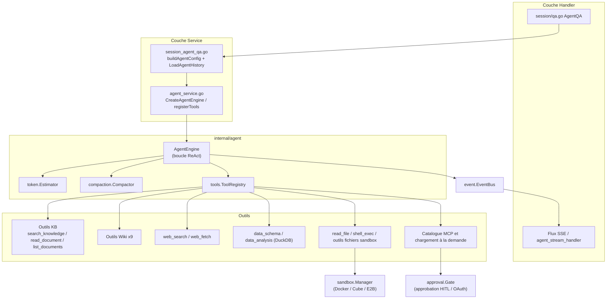
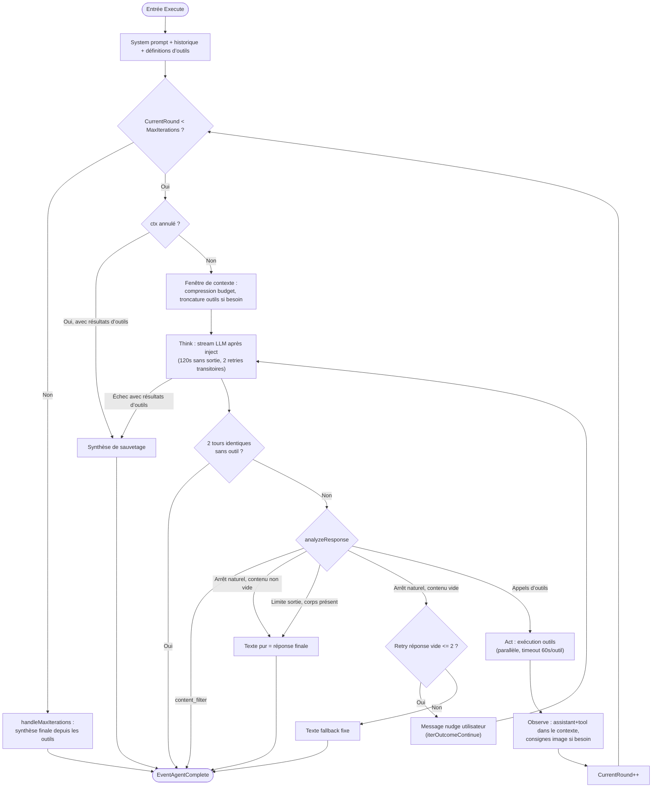
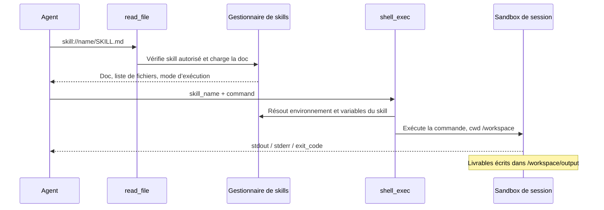

# Moteur Agent

La segmentation des prompts, les références de modèles et le corps personnalisé sont décrits dans [Assemblage des prompts de conversation](../06-development/05-agent-prompts.md) ; l’appairage et le déploiement du navigateur dans [Navigateur local](../05-clients/09-local-browser.md).

Un agent peut combiner recherche dans la base de connaissances, recherche Web et outils externes pour des tâches en plusieurs étapes (par exemple comparer des clauses entre contrats). En mode raisonnement intelligent, il choisit les outils selon la question, enchaîne plusieurs appels, puis rédige la réponse à partir des résultats.

En haut de la zone de dialogue, choisissez réponse rapide ou raisonnement intelligent :

| Mode | Tâches | Comportement |
| --- | --- | --- |
| Réponse rapide (`quick-answer`) | Questions factuelles sur les documents | Génération après retrieval, peu d’appels en général |
| Raisonnement intelligent (`smart-reasoning`) | Analyse multi-documents, Web, outils | Plusieurs tours possibles ; durée et consommation selon la tâche |

Sur la page **Agents**, créez un agent personnalisé : mode, modèle, périmètre des bases, prompt, recherche Web, outils MCP et skills. Une fois enregistré, il sert au chat web et peut être lié à la messagerie ou aux canaux embarqués.

<Screenshot
  src="/screenshots/agent-editor.png"
  caption="Configuration d’agent : mode, modèle, périmètre des connaissances et outils"
  hint="Fenêtre d’édition d’agent : mode, modèle, bases, interrupteur recherche Web et cases MCP." />

<Screenshot
  src="/screenshots/agent-chat.png"
  caption="Conversation agent : raisonnement et chronologie des appels d’outils"
  hint="Réponse agent avec étapes de réflexion, cartes d’outils et citations de la réponse finale." />

La configuration fixe les sources et outils accessibles ; les appels effectifs restent limités par les droits de l’utilisateur ou du canal.

## Assistant, collaboration et droits d’exécution

v0.9.0 ajoute l’[assistant WeKnora](26-weknora-assistant.md) intégré : documentation produit et tâches KB, configuration et administration dans le périmètre autorisé. Pour le travail répétitif, utilisez les [automatisations](27-automations.md).

Le raisonnement intelligent prend en charge la [collaboration multi-agents](26-weknora-assistant.md#collaboration) : sous-tâches puis synthèse. Lecture, écriture et actions destructives passent par [droits d’exécution et approbations](28-agent-permissions.md) ; la collaboration ou une autorisation n’élargit pas les droits sur les ressources.

## Créer et utiliser un agent

1. Sur **Agents**, créez un agent en mode réponse rapide ou raisonnement intelligent.
2. Choisissez modèle, bases et prompt. Les presets de type préremplissent le formulaire, modifiable avant enregistrement.
3. Activez la recherche Web ou des outils MCP selon la tâche ; pour exécuter des scripts de skills, liez un sandbox où les skills sont installés.
4. Enregistrez, sélectionnez l’agent dans le chat, posez une question et vérifiez sources et résultats d’outils.

Au premier usage, les agents intégrés suffisent : réponse rapide pour interroger des docs ; analyste de données pour CSV/Excel ; agents Wiki pour parcourir et maintenir le Wiki.

L’analyse et le résumé de tableaux XLSX ignorent les feuilles sans contenu de cellules (évite des colonnes fantômes). Feuilles avec en-têtes, formules, zéros ou booléens restent gérées par le parseur ; si toutes les feuilles énumérées sont vides, une erreur explicite est renvoyée. Le fichier source n’est pas modifié et les résumés déjà générés ne sont pas reconstruits automatiquement.

L’intensité de réflexion (`reasoning_effort`) dans la config agent est la valeur par défaut ; elle peut être ajustée dans la zone de saisie pendant la conversation, et des consignes peuvent être ajoutées pendant la génération en mode raisonnement. Voir [Expérience de chat](18-chat-experience.md).

## Périmètre des sources et des outils

L’agent peut viser toutes les bases, une sélection ou aucune, idem pour les skills. Les mentions (@) choisissent les sources ou skills prioritaires pour le tour sans contourner l’autorisation ; les menus @skill et @MCP ne listent que ce que l’agent du tour peut utiliser. Avec un agent partagé, les skills viennent de l’espace source et les MCP de la sélection explicite de l’agent. La recherche Web dépend de la config agent et du commutateur de la requête.

En partage organisationnel, le destinataire utilise modèle et données de l’espace source dans son périmètre autorisé. L’agent partagé est en lecture seule côté destinataire :

- Modèle toujours celui de la config agent ; `summary_model_id` dans la requête est ignoré ;
- Sans mode de sélection MCP, aucun service MCP ;
- L’historique va dans la base « conversations » de l’espace du destinataire, pas de l’espace source ;
- Le destinataire voit capacités et ressources (modèle, bases, MCP, Web), pas le prompt ni le créateur.

Si des skills sont activés sur un agent partagé, ils s’exécutent dans le sandbox de l’espace source avec les variables d’environnement définies par l’admin ; les membres peuvent autoriser l’agent à les lire. Règles de partage : [Espace et permissions](01-tenant-auth.md).

## Approbations et autorisations d’outils

Les outils MCP nécessitant une validation humaine affichent une carte avant exécution : approuver, refuser ou modifier les paramètres. Délai d’attente par défaut 10 minutes ; refus, timeout ou annulation reviennent comme résultat d’outil pour que l’agent continue. (Ce mécanisme couvre aussi d’autres politiques d’approbation depuis v0.9.0 — voir plus bas.)

Si un service MCP exige OAuth, l’autorisation se fait dans la conversation puis l’appel est relancé.

## Skills, pièces jointes et mémoire

En raisonnement intelligent, les pièces jointes de session sont lisibles sans sandbox ; avec sandbox, scripts et fichiers générés. Les livrables téléchargeables vont dans `/workspace/output`, prévisualisables après la réponse. Chaque tour enregistre un point de contrôle git sur `/workspace` pour fork/rollback ; les sessions bureau sur répertoire local n’enregistrent pas de checkpoint (fork/rollback = dialogue seulement). Installation et variables : [Skills et sandbox](22-skills-sandbox.md) ; pièces jointes : [Expérience de chat](18-chat-experience.md).

La mémoire long terme est isolée par espace et appelant ; l’agent peut désactiver lecture/écriture. Détails : [Mémoire inter-sessions](23-memory.md).

## Référence de configuration

### Agent personnalisé {#agent-personnalise}

#### Modes et presets de type {#modes-et-presets-de-type}

`CustomAgent` (`internal/types/custom_agent.go`) expose deux modes (`Config.AgentMode`) :

- `quick-answer` : pipeline RAG classique (retrieval → contexte → une génération), sans moteur Agent ;
- `smart-reasoning` : mode ReAct, `IsAgentMode()` true et `MultiTurnEnabled = true` forcé.

En `smart-reasoning`, un **preset de type** (`Config.AgentType`, `config/agent_type_presets.yaml`, chargé par `internal/types/agent_type_preset.go`) **préremplit l’éditeur** ; l’utilisateur peut tout modifier :

| ID preset | Modèle de prompt système | Temp. | Itér. max | Outils préremplis | Filtre KB |
| --- | --- | --- | --- | --- | --- |
| `rag-qa` | `progressive_rag_agent` | 0.7 | 30 | search_knowledge, read_document, list_documents | Dérivé des outils : any_of vector/keyword |
| `wiki-qa` | `wiki_researcher` | 0.7 | 30 | wiki_search, wiki_read_page, read_document, wiki_flag_issue | Dérivé : any_of wiki |
| `hybrid-rag-wiki` | `hybrid_rag_wiki_agent` | 0.7 | 40 | wiki_search, wiki_read_page, search_knowledge, read_document, list_documents, wiki_flag_issue | any_of vector/keyword/wiki |
| `data-analysis` | `data_analyst` | 0.3 | 30 | data_schema, data_analysis ; Web off ; csv/xlsx | Explicite `none_of: [faq]` |
| `custom` | — | — | — | Aucun | Aucune limite |

`thinking` et `todo_write` ne sont pas dans les presets par défaut ; les activer manuellement augmente la consommation de tokens.

#### Champs configurables (`CustomAgentConfig`) {#champs-configurables-customagentconfig}

Principaux champs de `CustomAgentConfig` (`internal/types/custom_agent.go`), reçus tels quels par `CreateAgent` / `UpdateAgent` :

| Catégorie | Champ | Description / défaut (`EnsureDefaults`) |
| --- | --- | --- |
| Base | `agent_mode` | `quick-answer` / `smart-reasoning` |
| Base | `agent_type` | Preset en smart-reasoning ; vide/inconnu → custom |
| Base | `system_prompt` / `system_prompt_id` | Corps direct prioritaire ; templates résolus à la requête via `ResolveCustomAgentPrompts` |
| Base | `context_template` / `context_template_id` | Modèle d’assemblage des extraits en mode normal |
| Modèle | `model_id`, `rerank_model_id`, `temperature`, `max_completion_tokens`, `thinking`, `reasoning_effort`, `citation_enabled` | `temperature`<0 → 0,7 ; `max_completion_tokens`=0 → défauts runtime : quick-answer 2048, smart-reasoning 4096, smart-reasoning + sandbox 24576 ; avec sandbox, minimum 8192 si valeur explicite plus basse ; `reasoning_effort` : `off`/`auto`/`minimal`/`low`/`medium`/`high`/`xhigh`/`max`, prioritaire sur `thinking` (`thinking: true` ≈ `auto`), ajustement si le modèle ne supporte pas un niveau ; les deux absents → pas de réflexion ; la requête peut surcharger `reasoning_effort` ; citation non définie → true |
| Agent | `access_level` | Droits d’exécution : read_only / confirm / auto_write (défaut auto_write) ; l’assistant a aussi un plafond d’espace |
| Agent | `max_iterations` | Défaut 10 ; négatif = illimité (plafond service 100) |
| Agent | `llm_call_timeout` | Secondes sans sortie stream avant annulation (0 → 120 s) ; durée totale côté transport modèle |
| Agent | `allowed_tools` | Liste blanche ; null/non défini → `DefaultAllowedTools` ; `[]` explicite → aucun outil intégré |
| MCP | `mcp_selection_mode`, `mcp_services`, `mcp_auth_wait_timeout` | OAuth : secondes ≤0 → défaut du Gate |
| Skills | `skills_selection_mode`, `selected_skills`, `sandbox_config_id` | Sandbox d’espace et skills installés : [Skills et sandbox](22-skills-sandbox.md) |
| Mémoire | `memory_enabled` | nil → hérite de l’espace ; false → pas de lecture/écriture mémoire pour cet agent |
| KB | `kb_selection_mode`, `knowledge_bases`, `retrieve_kb_only_when_mentioned`, `retain_retrieval_history` | `retain=true` → historique de retrieval KB non masqué |
| Multimodal | `image_upload_enabled`, `vlm_model_id`, `audio_upload_enabled`, `asr_model_id`, `image_storage_provider` | VLM aussi pour décrire les images renvoyées par MCP |
| Fichiers | `supported_file_types`, `chat_parser_engine_rules`, etc. | Agents data limitent souvent csv/xlsx |
| FAQ | `faq_priority_enabled`, `faq_direct_answer_threshold`, `faq_score_boost` | — |
| Web | `web_search_enabled`, `web_search_max_results`, etc. | `max_results` défaut 5 ; `web_fetch_*` surtout pipeline quick-answer ; en smart-reasoning le modèle appelle `web_fetch` |
| Multi-tour | `multi_turn_enabled`, `history_turns` | `history_turns` défaut 5, mode normal seulement ; smart-reasoning force multi-tour et charge l’historique par fenêtre de contexte |
| Retrieval | `embedding_top_k`, seuils, `rerank_*` | Valeurs entre parenthèses = défauts |
| Avancé | query expansion, rewrite, fallback, etc. | Surtout pipeline quick-answer |
| Suggestions | `question_suggestions` | starters hybrid ×6 ; follow_ups off ×3 par défaut |

Handlers (`internal/handler/custom_agent.go`) : CRUD, `GetPlaceholders`, `GetAgentTypePresets`, `GetSuggestedQuestions`. `authorizeAgentKnowledgeScope` vérifie les clés API limitées en KB : `all` → 403 si restreint ; `selected` → contrôle par base.

Mapping runtime : `buildAgentConfig` (`session_agent_qa.go`) → `types.AgentConfig` ; Web si agent **et** requête ; provider Web par défaut du locataire ; `SearchTargets` depuis KB/@doc/@tag ; `MaxContextTokens` 200000 ; priorités @Skill/@MCP sans retirer les autres ressources (MCP partagé limité au preset). `rerank_model_id` requis si `search_knowledge` est disponible (`agentRequiresRerankModel`, anciens noms normalisés via `SuccessorToolName`).

#### Partage (`agent_share`) {#partage-agent-share}

`internal/application/service/agent_share.go` — partage vers une **organisation** :

- Seul le locataire propriétaire peut partager (`ErrNotAgentOwner`) ; le partageur doit être Editor+ dans l’org ;
- Avant partage : `model_id` obligatoire ; si `search_knowledge` est dans le jeu d’outils (ou défaut) et le scope KB n’est pas désactivé, `rerank_model_id` requis sinon `ErrAgentNotConfigured` ;
- **Lecture seule forcée** : `permission = types.OrgRoleViewer` ; re-partage idempotent ;
- Le locataire destinataire peut désactiver un agent partagé via `TenantDisabledSharedAgentRepository` ;
- En conversation : retrieval et modèle basculent sur le **locataire propriétaire** (`resolveRetrievalTenantID`) ; les @MCP du destinataire restent dans le preset de l’agent.

### Agents intégrés (`config/builtin_agents.yaml`) {#agents-integres-config-builtin-agents-yaml}

Définis dans `config/builtin_agents.yaml`, chargés au démarrage via `types.LoadBuiltinAgentsConfig` et `BuiltinAgentRegistry` (`internal/types/builtin_agent_config.go`) ; noms/descriptions i18n (default, zh-CN, zh-TW, ja-JP, ko-KR) ; `system_prompt_id` / `context_template_id` résolus par `ResolveBuiltinAgentPromptRefs`.

| ID | Nom (zh-CN) | agent_mode / agent_type | Config clé |
| --- | --- | --- | --- |
| `builtin-quick-answer` | Q&R rapide | `quick-answer` | `default_kb` + `default_context` ; temp. 0,7 ; FAQ prioritaire ; expansion + rewrite ; Web ×5 ; hors moteur Agent |
| `builtin-smart-reasoning` | Raisonnement avancé | `smart-reasoning` / `rag-qa` | `max_iterations: 50` ; outils search/read/list/graph ; Web on ; multi-tour par fenêtre de contexte |
| `builtin-data-analyst` | Analyste de données | `smart-reasoning` / `data-analysis` | `data_analyst` ; temp. 0,3 ; 30 itér. ; data_schema + data_analysis ; csv/xlsx ; Web off |
| `builtin-wiki-researcher` | Wiki Q&R | `smart-reasoning` / `wiki-qa` | `wiki_researcher` ; 30 itér. ; wiki_* + read + flag_issue ; Web off |
| `builtin-wiki-fixer` | Révision Wiki | `smart-reasoning` / `custom` | `wiki_fixer` ; `retain_retrieval_history: true` ; 9 outils wiki (écriture + issues) ; `kb_selection_mode: selected` |
| `builtin-skill-installer` | Installateur de skills | `smart-reasoning` / `custom` | `skill_installer` ; temp. 0,2 ; tokens 24576 ; shell + write/edit skill ; `kb_selection_mode: none` ; appelé par l’upload de skills |

Notes (`internal/types/custom_agent.go`) :

- `builtin-wiki-fixer` et `builtin-skill-installer` absents de la liste UI (`builtinAgentIDsOrdered`) mais utilisables via `GetAgentByID` (Wiki editor / upload skills) ;
- Des ID réservés (`builtin-deep-researcher`, etc.) existent dans l’ordre mais pas dans le YAML actuel ;
- `reflection_enabled` dans le YAML n’est **pas consommé par le backend** — sans effet sur le comportement.

Les prompts `WikiSummaryPrompt`, etc. (`internal/agent/prompts_wiki.go`) servent l’**ingest Wiki** (génération à l’import), complémentaires aux outils runtime des agents Wiki.

### Questions suggérées (starters et relances) {#questions-suggerees-starters-et-relances}

Questions cliquables : **starters** (session vide) et **follow-ups** (après chaque réponse). Config agent (`QuestionSuggestionConfig`) ; les canaux peuvent masquer l’affichage, pas la politique.

#### Paramètres

Deux blocs indépendants ; `mode` fixe la source :

| mode | Source | Usage |
| --- | --- | --- |
| `curated` | `items` saisis | Starters |
| `knowledge` | Contenu KB | Starters + follow-ups |
| `generated` | Modèle | Follow-ups |
| `hybrid` (défaut) | Mix | Starters + follow-ups |

| Paramètre | Défaut | Description |
| --- | --- | --- |
| `starters.*` | on / hybrid / vide / 6 | `count` 1–8 |
| `follow_ups.*` | off / hybrid / 3 | `count` 1–5 |
| `follow_ups.model_id` | session | Modèle dédié possible (coût) |
| `follow_ups.categories` | tout | `clarify` / `deepen` / `action` |
| `follow_ups.max_context_turns` | 2 | 1–5 tours pour la génération |
| `follow_ups.additional_instruction` | vide | ≤ 2000 car. |
| `follow_ups.suppress_on_fallback` | on | Pas de suggestion si fallback |
| `follow_ups.suppress_when_answer_asks_question` | on | Pas si la réponse pose une question |
| `follow_ups.knowledge_fallback` | on | Repli KB si génération échoue |
| `follow_ups.allow_regenerate` | off | Regénération manuelle |

Les relances identiques à la question utilisateur sont filtrées ; la KB comble le quota. Clic sur une suggestion KB → retrieval de la source en smart-reasoning avant réponse.

#### Génération, cache, analytics

- Table `message_suggestion_sets`, clé cache `(assistant_message_id, placement, config_hash, locale)` ;
- États `generating` → `ready`, plus `suppressed` / `failed` ; `lease_until` anti-doublon multi-instance ;
- API : GET/POST suggestions, POST `suggestion-events` ;
- Événements `impression` / `click` / `dismiss` / `regenerate` ; attribution sur le message utilisateur suivant.

## Référence d’exécution

### Vue d’ensemble et architecture {#vue-d-ensemble-et-architecture}

#### Composants principaux {#composants-principaux}

| Composant | Emplacement | Rôle |
| --- | --- | --- |
| `AgentEngine` | `internal/agent/engine.go` | Pilote de la boucle ReAct : config, registre d’outils, modèle Chat, bus d’événements, etc. |
| `ToolRegistry` | `internal/agent/tools/registry.go` | Enregistrement, recherche, validation des paramètres, exécution, troncature de sortie, nettoyage |
| Outils intégrés | `internal/agent/tools/*.go` | Outils intégrés par capacité + outils MCP dynamiques |
| Estimation et compression des tokens | `internal/agent/token/` + `internal/agent/compaction/` | `Estimator` (BPE) et compression du contexte sur les longues sessions (historique outils sandbox) |
| Consolidation mémoire | `internal/application/service/memory/` | Mémoire long terme inter-sessions : extraction, rappel, thèmes, affinité document, consolidation |
| Système de skills | `internal/agent/skills/` | Découverte, chargement et exécution de scripts via SKILL.md (Progressive Disclosure) |
| Sandbox d’exécution | `internal/sandbox/` | Exécution isolée par session Docker / Cube / E2B pour scripts de skills et `shell_exec`, avec contrôles de sécurité |
| Approbation d’outils | `internal/agent/approval/gate.go` | Approbation humaine (HITL) des outils MCP sensibles et OAuth en session |
| Couche service Agent | `internal/application/service/agent_service.go` | Assemble le moteur : enregistre les outils, résout les métadonnées KB, initialise skills/sandbox/VLM |
| Entrée Q&R session | `internal/application/service/session_agent_qa.go` | Construit le `AgentConfig` runtime depuis `CustomAgent` et exécute |
| Reconstruction historique | `internal/application/service/agent_history.go` | Reconstruit le contexte LLM multi-tour depuis la DB (`LoadAgentHistory`) |

Définition du struct `AgentEngine` (`internal/agent/engine.go`, extrait) :

```go
type AgentEngine struct {
	config               *types.AgentConfig
	toolRegistry         *agenttools.ToolRegistry
	chatModel            chat.Chat
	eventBus             *event.EventBus
	knowledgeBasesInfo   []*KnowledgeBaseInfo    // Detailed knowledge base information for prompt
	selectedDocs         []*SelectedDocumentInfo // User-selected documents (via @ mention)
	pinnedMCPServices    []*PinnedMCPServiceInfo // User @mentioned MCP services for this turn
	pinnedSkills         []*PinnedSkillInfo      // User @mentioned skills for this turn
	questionOrigin       *QuestionOriginInfo     // Source of a picked suggested question, if any
	memoryPrompt         string                  // Long-term memory envelope appended to the system prompt
	skillsManager        *skills.Manager         // Skills manager for Progressive Disclosure (optional)
	tokenEstimator       *agenttoken.Estimator   // Token estimator for context window management, calibrated
	compactor            *compaction.Compactor   // Summarizes older history to fit the context window (nil = disabled)
	checkpointSink       types.ContextCheckpointSink // persists compactions that end on a stored turn
	modelContext         *modelcontext.Registry  // single request-local boundary for every model handle
	steerSink            types.SteerSink         // lets users append messages into the running turn
	// ... le reste concerne l’étalonnage d’estimation, la récupération après dépassement, etc.
}
```

Rôle et contraintes du moteur :

1. **Moteur sans état d’une tour à l’autre (stateless across turns)**. Les commentaires du code précisent que l’historique de session est reconstruit à chaque tour par l’appelant via `service.LoadAgentHistory` depuis la DB, passé à `Execute` comme `llmContext` ; le moteur ne garde ni cache, ni stockage du system prompt, ni tampon inter-tours.
2. **Sortie pilotée par événements**. Le moteur n’écrit pas directement le SSE : réflexion, appels d’outils, résultats, réponse finale et fin de tour passent par `event.EventBus`, convertis en flux SSE et persistés par les abonnés Handler. Types concernés : `EventAgentThought`, `EventAgentFinalAnswer`, `EventAgentToolCall`, `EventAgentToolResult`, `EventAgentTool`, `EventAgentComplete`, `EventError`.
3. **Alias citations / ressources**. `modelContext` (`modelcontext.Registry`, voir `internal/modelcontext/`) applique `EncodeMessages` avant chaque appel LLM : UUID persistés (chunk/document/web) → alias courts (`cN`/`dN`/`bN`/`wN`, `res://NNNN`), puis Decode au stream. Le modèle ne voit jamais les UUID réels. L’ordre d’encodage (poignées ressource avant alias de source) est fixé dans `Registry` (commentaire de type dans `registry.go`) : sinon un UUID de document embarqué dans un slug wiki pourrait être remplacé par `d1` lors de la compression des citations, créant des liens morts.
4. **Observabilité**. Chaque exécution ouvre une hiérarchie Langfuse : `agent.execute` → `agent.round.N` → `agent.tool.<name>` (tour, usage tokens, aperçu sortie outil tronqué à 4000 runes). Les paramètres SQL de `database_query` sont masqués dans Langfuse et les hints UI (`toolHintSensitiveArgs`).

#### Diagramme des composants {#diagramme-des-composants}



#### Construction du prompt système {#construction-du-prompt-systeme}

`BuildSystemPromptSections` dans `internal/agent/prompts.go` choisit d’abord le modèle de base : corps explicite prioritaire, sinon `pure` sans base de connaissances, `rag` avec ; puis enchaîne compléments intermédiaires, conventions runtime, sources, outils, sortie, skills, mémoire et protocole de citation. La section skills n’est ajoutée que si `read_file` est disponible, qu’il existe des skills utilisables et que l’on n’est pas en mode installation de skill.

Pour le tour courant, résumé KB, documents épinglés, date et infos session vont dans `runtime_context` du message utilisateur via `observe.go`, sans persistance dans l’historique ; les règences de réponse générales restent dans le system. `@MCP` / `@Skill` ajoutent une consigne de priorité sur les ressources autorisées, sans exclure automatiquement les autres sources.

Ordre des sections, placeholders, persistance des refs de templates et frontières de rôles de messages : [Assemblage des prompts de conversation](../06-development/05-agent-prompts.md).

### Boucle ReAct, étape par étape {#boucle-react-etape-par-etape}

#### Entrée : Execute {#entree-execute}

Flux de `AgentEngine.Execute` (`internal/agent/engine.go`) :

1. `defer e.toolRegistry.Cleanup(ctx)` — à la fin, nettoie les outils `types.Cleanable` (ex. `data_analysis` DROP les tables DuckDB créées pour la session) ;
2. Ouvre le span Langfuse `agent.execute` ;
3. Initialise `types.AgentState` (`RoundSteps`, `KnowledgeRefs`, `IsComplete=false`, `CurrentRound=0`) ;
4. `buildSystemPrompt` + `buildMessagesWithLLMContext` (system + historique + message utilisateur courant, URLs d’images) ;
5. `buildToolsForLLM` convertit le registre en définitions function calling ;
6. Entre dans `executeLoop`.

#### Boucle principale : executeLoop et runReActIteration {#boucle-principale-executeloop-et-runreactiteration}

```go
for state.CurrentRound < e.config.MaxIterations {
    // vérif. annulation ctx → si des résultats d’outils existent, synthèse de sauvetage
    outcome, iterErr := e.runReActIteration(...)
    switch outcome {
    case iterOutcomeContinue: continue loop   // retry réponse vide, sans consommer le tour
    case iterOutcomeBreak:    break loop      // arrêt (naturel / blocage / annulation / filtre contenu)
    case iterOutcomeNext:     state.CurrentRound++
    }
}
if !state.IsComplete && ctx.Err() == nil {
    e.handleMaxIterations(ctx, query, state, sessionID) // synthèse finale de repli
}
```

`executeLoop` utilise `defer emitCompletion()` pour **émettre exactement une fois `EventAgentComplete` sur chaque sortie** (`context.WithoutCancel` permet l’envoi après un clic « Arrêter »). L’événement porte `state.RoundSteps`, persisté par le stream handler dans `AgentSteps` du message assistant.

Une itération `runReActIteration` comporte quatre phases :

**① Think** : gestion de la fenêtre de contexte (voir [Mémoire et compression du contexte](#memoire-et-compression-du-contexte)), puis messages `inject` en cours d’exécution appendés à l’historique (voir [Ajouter un message à une réponse en cours](../04-api/02-api-chat.md#steer)), puis `callLLMWithRetry` (`internal/agent/think.go`) :

- `agenttools.SanitizeMessages` corrige rôles consécutifs identiques, tool results orphelins, etc. ;
- Appel LLM en stream (`streamThinkingToEventBus`) : annulation après `defaultLLMStallTimeout = 120s` sans sortie (surcharge via `AgentConfig.LLMCallTimeout`) ; les longs tours avec sortie continue ne sont pas plafonnés côté moteur, la couche transport du modèle borne la durée totale ;
- Erreurs transitoires (429/5xx/timeout/overloaded, voir `transientErrorMarkers`) : jusqu’à `maxLLMRetries = 2`, backoff 1s puis 2s ;
- Si les retries échouent mais des résultats d’outils existent : **dégradation gracieuse** via `streamFinalAnswerToEventBus`, `state.IsComplete = true`.

En stream : `reasoning_content` (DeepSeek, etc.) et blocs `` (via `ThinkStreamSplitter`) → zone réflexion (`EventAgentThought`) ; le content normal va vers la réponse finale (`EventAgentFinalAnswer`) ; si des outils suivent, l’UI garde ce texte comme préambule dans l’arbre d’étapes et comme `Thought` du tour.

**② Analyze** : `analyzeResponse` (`internal/agent/observe.go`) évalue les conditions d’arrêt :

- `finish_reason == "content_filter"` sans appel d’outil → arrêt, contenu filtré ou message d’excuse fixe ;
- Arrêt naturel (`isNaturalStopFinishReason` : `stop` / `end_turn` / `stop_sequence`) sans outil → **fin de l’agent**, la réponse texte est la réponse finale (**pas d’outil `final_answer` dédié** ; les anciens appels `final_answer` sont filtrés au replay par `filterNonTerminalToolCalls`) ;
- Arrêt naturel mais contenu vide → message utilisateur nudge `"Please provide your complete answer now as plain text."`, jusqu’à `maxEmptyResponseRetries = 2` (`iterOutcomeContinue`, sans consommer le tour) ; pas d’événement de réponse finale pendant les retries ; épuisement → texte fallback fixe ;
- Troncature limite de sortie (`finish_reason` `length` / `max_tokens` / `max_output_tokens`) avec corps et sans outil → livrer le corps tronqué, fin du tour, événement et `AgentStep` marqués `truncated` ; sans corps (réflexion seule) → retry comme réponse vide ; `maxConsecutiveLengthRounds = 3` troncatures consécutives (souvent dans les paramètres d’outil) → arrêt avec dernier corps ou message fixe, suggérer question plus petite ou `max_completion_tokens` plus élevé ;
- Si un `inject` arrive avant arrêt naturel, la réponse du tour reste intermédiaire et l’agent continue après lecture ; même à la limite d’itérations, une tour supplémentaire est autorisée (`maxSteerOverruns = 1`).

**Détection de blocage** avant Analyze : `maxRepeatedResponseRounds = 2` tours identiques (y compris vides) sans outil → arrêt forcé avec ce contenu comme réponse finale, ou fallback si vide.

**③ Act** : `executeToolCalls` (`internal/agent/act.go`) exécute tous les appels du tour :

- ≥ 2 appels : **parallèle** via `errgroup` (`ParallelToolCalls` activé dans `buildAgentConfig` ; best-effort, un échec n’annule pas les autres), résultats dans l’ordre d’origine. Seuls les outils en lecture (`CanRunConcurrently` : recherche, lecture) se chevauchent ; les autres barrent la file ;
- Chaque appel : `NormalizeToolCallID`, parse JSON — échec → `RepairJSON` puis retry ; sinon résultat d’erreur avec `"[Analyze the error above and try a different approach.]"` pour que le modèle change d’approche ;
- Timeout outil `defaultToolExecTimeout = 60s` ; `shell_exec` `shellExecToolTimeout = 10m5s` (un peu au-delà du plafond commande 600s) ; `web_fetch` budget page + 5s (défaut 3m5s, `WEKNORA_WEB_FETCH_TIMEOUT`) ; `local_browser` délai dédié pour prise en main humaine ; `ToolExecContext` inclut `ApprovalCtx` sans ce timeout pour approbation MCP/OAuth ;
- Émission `EventAgentToolCall` (hint avec nom d’affichage localisé, ex. recherche Web), `EventAgentToolResult`, `EventAgentTool`. Échec outil → `tool_result` client (`success: false`, `error`), pas d’événement `error` global ; l’agent continue.

**④ Observe** : `appendToolResults` (`internal/agent/observe.go`) append au tableau de messages (protocole OpenAI) : un assistant avec `tool_calls` + un message `role:"tool"` par résultat (contenu aliasé via `modelContext.ModelToolResultForTool`). Puis `state.CurrentRound++`.

#### Conditions d’arrêt et itérations max {#conditions-d-arret-et-iterations-max}

| Chemin d’arrêt | Condition | Source de la réponse finale |
| --- | --- | --- |
| Arrêt naturel | `finish_reason` ∈ {stop, end_turn, stop_sequence}, sans outil, contenu non vide | Texte pur du tour |
| Réponses vides épuisées | Arrêt naturel, contenu vide, nudge ×2 toujours vide | Texte fallback fixe |
| Troncature sortie | Limite de sortie atteinte, corps présent, sans outil | Corps avant troncature (marque `truncated`) |
| Troncatures consécutives | 3 tours consécutifs à la limite de sortie | Dernier corps ou message fixe |
| Filtre de contenu | `finish_reason == content_filter`, sans outil | Contenu filtré ou message de sécurité |
| Détection blocage | 2 tours identiques sans outil | Le contenu répété |
| Annulation / timeout | `ctx.Done()` ; sauvetage si résultats d’outils | Synthèse ou étapes partielles |
| Échec LLM irrécupérable | Retries épuisés ; avec outils → synthèse, sinon erreur | Synthèse / événement erreur |
| Itérations max | `CurrentRound == MaxIterations` (`max_iterations` négatif = illimité) | `handleMaxIterations` → `streamFinalAnswerToEventBus` |

Valeurs par défaut des itérations max (plusieurs niveaux) :

- Couche service `ValidateConfig` : `0` → 5, négatif = illimité, plafond dur `MAX_ITERATIONS = 100` (`internal/application/service/agent_service.go`) ;
- `CustomAgent.EnsureDefaults` : 10 si non configuré (`internal/types/custom_agent.go`) ;
- Agents intégrés : raisonnement intelligent 50, analyste de données 30, Wiki Q&R/révision 30 (`config/builtin_agents.yaml`).

À la limite, `handleMaxIterations` via `internal/agent/finalize.go` réutilise la liste de messages courante (rôles, images, paires tool calls), ajoute une requête de clôture sans outils (`tool_choice=none`, thinking désactivé).

#### Schéma de la boucle ReAct {#schema-de-la-boucle-react}



### Outils intégrés {#outils-integres}

#### Table des outils {#table-des-outils}

Les noms d’outils sont définis dans `internal/agent/tools/definitions.go`. Le tableau couvre tous les outils intégrés (colonne paramètres : champs du schema ; `*` = obligatoire) :

| Outil | Paramètres clés | Comportement / retour |
| --- | --- | --- |
| `thinking` | `thought`\*, `next_thought_needed`\*, `thought_number`\*, `total_thoughts`\*, `is_revision`, `revises_thought`, `branch_from_thought`, `branch_id`, `needs_more_thoughts` | Sequential Thinking : enregistre, révise ou branche des étapes de réflexion ; retourne la progression (incl. `incomplete_steps`) et rappelle d’interdire les noms d’outils et la réponse finale dans la réflexion |
| `todo_write` | `task`, `steps[]`\* (`id`/`description`/`status` : pending/in_progress/completed) | Crée ou met à jour un plan de tâches de retrieval uniquement (le résumé va à `thinking`) ; retourne le plan formaté, `display_type: "plan"` |
| `search_knowledge` | `query`\* (question ou phrase en langage naturel ; en mode `keyword`, termes exacts), `mode` (`hybrid` par défaut / `semantic` / `keyword`), `knowledge_base_ids[]` (`bN`, max. 10), `limit` (défaut 10, max. 30) | Seule entrée de retrieval KB : `hybrid` fusionne vecteur + mots-clés (RRF), `semantic` vecteur seul, `keyword` via index BM25 / moteur — plus de scan regex non indexé sur `chunks` ; seuils et pool globaux `conversation.vector_threshold` / `keyword_threshold` / `embedding_top_k` (`config.yaml` d’exemple 0,2 / 0,3 / 30, sinon 0,6 / 0,5 / 30), pas les seuils de l’agent ; rerank si modèle (texte = titre doc + corps de chunk, sauf FAQ ; seuil 0,3, sinon meilleur candidat ≥ 0,15), puis MMR (λ=0,7) ; si tout rejeté → `rerank_rejected` et conseil `keyword` pour identifiants ; IDs courts `cN`/`dN`, dédup intra-appel, en-tête métadonnées doc une fois ; pas de chunks voisins/parent/liés (contexte via `read_document(id=cN, context=k)`), max. 200 candidats rerank ; si sortie > 4/5 du budget outil, tronque depuis le bas (≥ 1 résultat) avec `<omitted count=... reason="output_budget">` ; dégradation par KB sans index : `keyword` sur FAQ/vector-only → sémantique, `semantic` sur keyword-only → keyword, via `requested_mode` et `mode_fallbacks` ; erreur seulement si aucun index de chunks dans le scope (ex. KB Wiki-only) |
| `read_document` | `id`\* (`dN` doc ou `cN` chunk), `offset` (position ordre de lecture, 0-based, pas l’index chunk ; pagination via `next_offset`), `limit` (défaut 20, max. 100), `query` (recherche in-doc : mots séparés par espaces, tous requis, ordre libre, insensible à la casse), `regex` (traiter tout `query` comme une regex insensible à la casse), `context` (chunks voisins autour de `cN`, max. 5) | En-tête métadonnées doc d’abord (titre, type, parse_status, nb chunks, metadata), puis chunks : `dN` paginé depuis `offset` ; `cN` lit le chunk ± `context` (voisins par `chunk_index`, indépendamment des chunks parent/résumé/image) ; avec `query`, recherche dans le doc même si `id` est `cN`, hits ± un chunk de contexte (max. 20), `next_offset` si tronqué ; sans hit, message d’aide ; une page/recherche ≤ 80 % budget outil, suite via `next_offset` ; FAQ idem ; vérifie KB dans searchTargets et scope @mention |
| `list_documents` | `knowledge_base_id`\* (`bN`), `keyword` (filtre sous-chaîne titre ou nom de fichier), `page` (défaut 1), `page_size` (défaut 20, max. 100) | Liste paginée des docs d’une KB, poignées `dN` pour `read_document` |
| `query_knowledge_graph` | `knowledge_base_ids[]`\* (1–10 `bN`), `query`\* (nom d’entité ou question contenant une entité) | Requêtes parallèles sur le graphe de chaque KB : match entités par nom (requête + tokens longs), relations (`relations`, vue modèle `<relation>`) et chunks sources en tête, puis hits texte ; échec par KB en `<error>` ; exposé seulement si graphe activé dans le scope (`agent_service.go` retire sinon de la whitelist), capability `all_of: [graph]` |
| `database_query` | `sql`\* (SELECT uniquement) | Lecture tables whitelist (`knowledge_bases`/`knowledges`/`chunks`), filtre `tenant_id` et `deleted_at IS NULL` injectés ; paramètres SQL masqués UI/Langfuse |
| `data_schema` | `knowledge_id`\* (`dN`) | Lit chunks `table_summary` + `table_column` CSV/Excel, colonnes et nb de lignes ; indique que `data_analysis` utilise toujours la table `dataset` |
| `data_analysis` | `knowledge_id`\*, `sql`\* | Charge CSV/Excel dans DuckDB puis SQL ; doc via `knowledge_id`, table `dataset` dans le SQL (vue temporaire par connexion, pas d’ID doc dans le SQL) ; Excel multi-feuilles fusionné avec `__sheet_name` ; normalisation noms de colonnes ; DROP des tables au Cleanup de session |
| `web_search` | `query`\*, optionnel `count` (max config, max. 20), `country` (code pays 2 lettres ou `ALL`), `freshness` (`pd`/`pw`/`pm`/`py`, Brave aussi intervalle de dates), `content` | Recherche Web : titres, snippets et IDs courts `wN` ; choix KB ou Web selon la tâche, plus de compression RAG auto sur la recherche Agent ; `country`/`freshness` seulement Brave et Serply ; `content=true` fetch parallèle top 3 en 15 s, 5000 car. chacun (DeepSeek via Fetch API) |
| `web_fetch` | `items[]`\* (chaque `url`\* = `wN` ou URL HTTP(S), optionnel `offset`, `limit` ; `limit` en caractères, défaut et max. 8000, budget partagé) | Fetch parallèle max. 8 pages (client SSRF-safe + DNS pinning, chromedp si besoin), Markdown ou texte ; budget page défaut 3 min (`WEKNORA_WEB_FETCH_TIMEOUT`, HTTP et chromedp). Pagination par caractères, `next_offset` ; corps complet dans `full_output_path` (`web://`, session seule), lecture multi-tours via `read_file` ; par URL `success`/`failed`/`skipped` et codes retry (ex. `snapshot_expired`) ; échecs partiels n’empêchent pas les autres |
| `read_file` | `path`\*, `offset` (ligne 1-based), `limit` (défaut 2000 lignes), `max_bytes` (max. 64 KiB, snapshot Web 50 KiB) ; Web peut avoir `line_offset` | Lit texte workspace, `skill://`, snapshot `web://`, pièce jointe `attachment://`, pagination ; pièces jointes : lecture à la demande, attente parse, images — voir [Expérience de chat](18-chat-experience.md#pieces-jointes-session-temporaires) |
| `shell_exec` | `command`\* ; optionnel `skill_name`, `work_dir`, `timeout_sec`, `stdin` (≤ 64 KiB), `max_output_bytes` (défaut 16 KiB, max. 64 KiB), `max_stderr_bytes` (défaut 8 KiB, max. 16 KiB), `env` | Commande dans le sandbox de session, cwd défaut `/workspace` ; avec skill, résout répertoire et variables |
| `list_sandbox_files` | `path`, `max_entries` (défaut 200, max. 500) | Parcourt fichiers sandbox et livrables ; seulement si `shell_exec` non enregistré |
| `write_sandbox_file` | `path`\*, `content`\*, `mode` (`overwrite` défaut / `append`) | Écrit ou append workspace, pas `/workspace/input` |
| `edit_sandbox_file` | `path`\*, `edits`\* (chaque `old_string`\*, `new_string`\*, `replace_all`) | Remplacements exacts en lot sur la version d’origine |
| `search_memory` | `query`\*, `limit` (défaut 10, max. 20) | Mémoire long terme dans le scope de l’appelant |
| `search_conversations` | `query`\*, `limit` (défaut 5, max. 8) | Historique de conversations de l’appelant ; scope implicite, pas de paramètre de périmètre |
| `wiki_search` | `query`\* (regex POSIX insensible à la casse, ex. `stardust\|skyvault` ; texte non regex valide ex. `C++` = littéral), `regex` (`false` = littéral forcé, `true` = regex valide requise), `knowledge_base_ids[]` (`bN`), `limit` (défaut 10 par KB, max. 50) ; anciens `queries[]`, `knowledge_base_id` acceptés | Recherche pages Wiki (titre/slug/alias/résumé/contenu), slugs et résumés avec marqueur `bN` ; pages déjà vues listées sans résumé ; scope doc/tag : sur-fetch (5× `limit`, max. 100) puis filtre, top `limit`, sinon `filtered_out_of_scope` |
| `wiki_read_page` | `slugs[]`\* | Contenu Wiki, métadonnées, liens entrant/sortant (résumés sur liens, omis si déjà vus) ; routage KB par slug ; slug `index` = sommaire par type (top 20 par type) |
| `wiki_write_page` | `slug`\*, `title`\*, `summary`\*, `content`\*, `page_type`\*, `aliases[]`, `source_refs[]` | Crée ou remplace une page Wiki ; normalise et valide le slug ; gère les liens sortants |
| `wiki_replace_text` | `slug`\*, `old_text`\*, `new_text`\*, `source_refs[]` | Remplacement texte exact, petites révisions |
| `wiki_rename_page` | `slug`\*, `new_slug`\* | Renomme le slug et met à jour les liens entrants |
| `wiki_delete_page` | `slug`\* | Supprime la page et nettoie les liens entrants |
| `wiki_flag_issue` | `slug`\*, `issue_type`\* (mixed_entities/contradictory_facts/out_of_date/other), `description`\*, `suspected_knowledge_ids[]` | Signale erreurs de fait / confusion d’entités, enregistre l’issue |
| `wiki_read_issue` | `issue_id` / `slug` | Détail d’une issue ou liste pending pour une page |
| `wiki_update_issue` | `issue_id`\*, `status`\* (resolved/ignored/pending) | Met à jour le statut de l’issue |
| `discover_mcp_tools` / `call_mcp_tool` | Découverte : `mode`\* (`list_servers`/`list_tools`/`describe`/`search`), `server_id`, `tool_name`, `query`, `cursor`, `limit` (1–50), `refresh` ; appel : `tool_ref`\*, `arguments`\* | Catalogue, définitions complètes et appel à la demande — voir [Catalogue d’outils MCP](08-mcp.md#mcp-tool-directory) |
| `mcp_...` (dynamique, suffixe hash stable) | Défini par InputSchema du service MCP | Fonctions externes publiées après lecture de la définition ; service et nom d’outil d’origine ; re-vérif. permissions, approbation HITL et OAuth en session |
| `local_browser` | `method`\* (`observe`, `snapshot`, `navigate`, `click`, `fill`, `tab_*`, `evaluate`, `request_help`, etc.), autres champs selon `method` | Pilote le navigateur local connecté ; enregistré seulement si `local_browser_enabled` et déploiement avec accès navigateur — voir [Navigateur local](../05-clients/09-local-browser.md) |
| `write_skill_file` / `edit_skill_file` | Écriture : `path`\*, `content`\* (≤ 256 KiB) ; édition : `path`\*, `old_string`\*, `new_string`\*, `replace_all` | Réservé à l’installateur de skills intégré en mode installation ; modifie uniquement le répertoire du skill en cours d’installation |

Liste blanche par défaut `DefaultAllowedTools()` (repli si l’agent n’a pas `allowed_tools`) : `search_knowledge`, `read_document`, `list_documents`, `search_conversations`. `web_search` / `web_fetch` et `search_memory` ne dépendent pas de la liste blanche : retirés à l’enregistrement, puis réinjectés selon Web et mémoire (espace, utilisateur et agent).

**Liste d’outils vide explicite** : `allowed_tools: []` = aucun outil intégré ; seuls non définis ou `null` utilisent la liste par défaut. Web, mémoire, MCP, sandbox et pièces jointes restent selon leurs interrupteurs. Migration v0.8.3 `000116` (SQLite `000035`) réécrit les anciennes listes vides en outils par défaut. L’éditeur charge le catalogue via `GET /agents/tools` ; nom inconnu → 400 ; anciens noms inconnus conservés avec avertissement ; noms gérés ailleurs retirés de la liste blanche.

**Compatibilité des anciens noms** : `knowledge_search`, `grep_chunks` → `search_knowledge` ; `list_knowledge_chunks`, `get_document_info`, `wiki_read_source_doc` → `read_document`. `legacyToolSuccessors` dans `definitions.go` ; `NormalizeAllowedTools` réécrit config, presets et API sans migration ; l’historique affiche toujours les anciens noms.

**Portée des outils de lecture** : `read_document`, `list_documents` lisent les chunks persistés (toute KB écrit des chunks) ; enregistrés si le scope a vector/keyword ou Wiki (`documentToolSet` dans `agent_service.go`) pour relecture Wiki ; `search_knowledge` exige index vector ou keyword. Capabilities : `Auxiliary` — utilisables sur KB Wiki-only sans les inclure dans « toutes les KB » RAG sauf si seuls outils KB. `@fichier` / `@tag` pour `list_documents` avant pagination ; `total_docs` et `next_page` limités au scope.

**Workflow de retrieval recommandé** : `search_knowledge` (`mode` : `hybrid` par défaut, `keyword` pour termes exacts/erreurs/identifiants, `semantic` pour reformulations) → `read_document` (`dN` paginé ou `query` in-doc) → citations `cN`. Wiki : `wiki_search` → `wiki_read_page` → `read_document` pour les sources.

#### Registre d’outils (ToolRegistry) {#registre-d-outils-toolregistry}

`internal/agent/tools/registry.go` :

- **Enregistrement** : `RegisterTool` en **first-wins** — un second outil homonyme est refusé (évite qu’un service MCP détourne un outil intégré, GHSA-67q9-58vj-32qx) ;
- **Export des définitions** : `GetFunctionDefinitions` trie par nom pour un payload tools byte-identique entre requêtes (cache prompt provider par préfixe, ex. Qwen) ;
- **Pipeline d’exécution** : `ExecuteTool` = `CastParams` (`"true"` → `true`, etc.) → `ValidateParams` (JSON Schema) → `tool.Execute` → troncature ;
- **Troncature sortie** : `TruncateToolOutput` (`truncate.go`), défaut `DefaultMaxToolOutput = 24000` **runes** (surcharge `AgentConfig.MaxToolOutputChars` ; certains outils ont un plafond propre), garde 70 % tête + 30 % queue avec marqueur ;
- **Erreurs** : JSON paramètres invalide → append `"[Analyze the error above and try a different approach.]"` ; sinon message d’erreur de l’outil ;
- **Nettoyage** : `Cleanup` parcourt les outils `types.Cleanable`.

#### Capabilities et activation selon la config {#capabilities-et-activation-selon-la-config}

`internal/agent/tools/capabilities.go` reflète `frontend/src/utils/tool-capabilities.ts` et déclare les capacités KB requises par outil :

```go
var ToolCapabilityRequirements = map[string]ToolRequirement{
	"thinking":   {},
	"todo_write": {},
	"search_knowledge":      {AnyOf: []KBCapability{CapVector, CapKeyword}, ConsumesFiles: true},
	"read_document":         documentReaderRequirement, // AnyOf vector/keyword/wiki, Auxiliary
	"query_knowledge_graph": {AllOf: []KBCapability{CapGraph}, ConsumesFiles: true},
	"list_documents":        documentReaderRequirement,
	// les anciens noms gardent leurs déclarations d’origine (wiki_read_source_doc comme read_document) pour que d’anciennes configs passent la validation avant normalisation
	// ...
	"wiki_search":          {AllOf: []KBCapability{CapWiki}},
	// ...
	"data_analysis": {AnyOf: []KBCapability{CapVector, CapKeyword}, ConsumesFiles: true},
}
```

Capacités : `vector` / `keyword` / `wiki` / `graph` / `faq`. Dérivés :

- `DeriveKBFilterForAgent(agentMode, allowedTools)` : filtre KB dans l’éditeur et le menu `@` ; `quick-answer` exige implicitement `vector|keyword` ;
- `KBSatisfiesToolRequirements` : garde-fou backend contre KB incompatibles ;
- `ToolsConsumeFiles` : affichage de `@file` dans la zone de saisie.

**Enregistrement runtime** (`registerTools` dans `agent_service.go`) :

1. Base `config.AllowedTools` → `EffectiveAllowedTools` : null/non défini → `DefaultAllowedTools()`, `[]` explicite non ; mapping anciens noms ; agent partagé en lecture seule ou sans KB Wiki writable → retrait des outils d’écriture Wiki ;
2. Sans scope de retrieval KB (Pure Agent) → retrait KB/Wiki/données ; sans Web → retrait aussi de `todo_write` ;
3. Injection selon interrupteurs : Web → `web_search` + `web_fetch` ; mémoire → `search_memory` (retiré de la liste blanche avant injection) ;
4. **Filet de sécurité** : capacités réelles dans `SearchTargets` — pas de wiki → pas d’outils wiki ; pas vector/keyword → pas `search_knowledge`, `query_knowledge_graph`, `database_query`, et sans wiki aussi pas `read_document`/`list_documents` ; pas de graphe → pas `query_knowledge_graph` ;
5. Déduplication, enregistrement ; MCP selon `MCPSelectionMode` ; sandbox shell/fichiers par session (`list_sandbox_files` si pas `shell_exec`) ; `read_file` + skills/web/attachments ; `local_browser` et outils installateur selon leurs règles ; anciens noms skills reconnus mais non enregistrés.

### Mémoire et compression du contexte {#memoire-et-compression-du-contexte}

La mémoire long terme est isolée par espace et appelant, distincte de la compression d’historique ci-dessous. Activation et gestion : [Mémoire inter-sessions](23-memory.md) ; API : [API mémoire](../04-api/02-api-memory.md).

#### Budget de tokens et estimateur {#budget-de-tokens-et-estimateur}

- Budget contexte : `AgentConfig.MaxContextTokens`, défaut `types.DefaultMaxContextTokens = 200000` via `buildAgentConfig` ;
- `token.Estimator` (`internal/agent/token/estimator.go`) : encodage tiktoken **cl100k_base**, `perMessageOverhead = 3`, `perConversationTail = 3` ; repli `len(s)/4` ;
- **Usage API prioritaire** : `estimateCurrentTokens` base `lastUsage.TotalTokens`, increment BPE sur nouveaux messages ; comptage complet au premier tour sans Usage.
- **Calibration** : cl100k n’est pas le tokenizer du modèle (CJK ~1 token/caractère vs ~0,6 sur Qwen/DeepSeek). Coefficient `Estimator.SetScale` (0,5–1,5) sur le texte uniquement. Mesuré entre deux requêtes consécutives du même tour (tools/system identiques, delta prompt rapporté / estimate des messages ajoutés). Exclusions : compression, troncature d’outils, images, ratio hors [0,3 ; 3], échantillon < 256 tokens estimés. Stocké `context_token_scale` ; sinon coefficient du début de tour. `LoadAgentHistory` reprend le dernier message avec coefficient. Chargeur, seuil de compression et compactor partagent le même estimateur ; le premier jugement de compression ne compte que les messages, pas les définitions d’outils.

#### Compression du contexte et dépassement {#compression-du-contexte-et-depassement}

`manageContextWindow` (`internal/agent/observe.go`) appelle `compaction.Compactor` avant chaque Think. `MaxContextTokens` : config agent, puis `parameters.context_window`, sinon 200000. Seuil = fenêtre − reserve (min 16384, `max(budget completion + 4096, 16384)`).

La compression conserve les messages récents selon un budget de tokens (défaut `KeepRecentTokens=20000`, réduit sur petites fenêtres). Longues sessions ReAct : découpage intra-tour sans séparer les paires assistant `tool_calls` / tool results ; la première moitié d’un tour scindé est résumée à part pour contextualiser la seconde.

L’ancien résumé est fusionné ; l’historique plus ancien produit un résumé structuré, injecté comme message user marqué entre le system et la queue conservée. Budget résumé = f(reserve, plafond sortie modèle, budget conservé), plus fixe à 2000. Appel en stream avec timeout de stall (120 s, `LLMCallTimeout`), durée totale côté transport. Réflexion = progression mais hors résumé ; erreur stream = échec. Deux tentatives max ; annulation du tour → pas de retry ; échec → archive originale `degraded`, budget identique au résumé, messages récents conservés avec mention des omissions.

**Plafond d’entrée du résumé**. La partie à résumer peut dépasser une seule requête. Requête trop large → archive originale sans point de compression (sinon échec en boucle). `Prepare` garde les messages récents tenant en une requête (fenêtre − budget réponse − résumé précédent − prompt, marge 10 %) et indique les messages anciens omis ; chemins extraits de tout le lot. `Result.Omitted` dans les logs.

`internal/agent/compaction/fileops.go` extrait les chemins lus/écrits et reprend la liste de fichiers du résumé précédent. Lecture via `read_file` ; anciens noms d’outils reconnus.

Si le budget reste dépassé : troncature des résultats d’outils (20 % fenêtre, 8192–32768 tokens). Si gain < 5 % ou rien à compresser, mémoriser le nombre de messages. Succès : reset baseline usage, événement `context_compacted` (avant/après, raison, `split_turn`, `degraded`).

**Persistance du point de compression.** Lorsque la partie résumée de l’historique se termine exactement à la fin d’un tour déjà persisté, le moteur écrit ce résumé comme point de compression (`messages.context_checkpoint`) sur le message assistant de ce tour ; le tour suivant repart de là, sans re-résumer le même historique. À la reconstruction, les messages historiques portent l’ID du message assistant du tour (`chat.Message.TurnID`, non exposé API) pour savoir si la coupure tombe sur une frontière de tour. Pas de point de compression si : la coupure est au milieu d’un tour persisté (ex. message inject append) ; le résumé ne couvre que le tour courant. En repli sur l’archive originale (`degraded`), on écrit quand même : sinon, à chaque échec du compresseur, le même historique est rechargé, re-compressé et re-échoue ; une fois écrit, la compression suivante le traite comme résumé précédent. Le résumé de la première moitié d’un tour scindé n’est pas persisté (rejeu complet au tour suivant). Si la compression est abandonnée (< 5 % libérés), le contexte du tour reste inchangé, mais un point de compression sur la partie historique est quand même écrit pour éviter un re-résumé au tour suivant. Mise à jour de cette seule colonne ; échec si aucune ligne assistant de la session ne correspond (log seulement). Pagination inverse de l’historique et dernier point de compression par session via l’index `idx_messages_session_created_id (session_id, created_at DESC, id DESC)` : du plus récent vers l’ancien, s’arrête au premier point. Index (migration 000106) créé avec `CREATE INDEX CONCURRENTLY` pour ne pas bloquer les écritures ; interruption → index INVALID à supprimer et migration à relancer. Le point vit sur le tour écrasé : fork de session le copie ; rollback/suppression du tour l’invalide.

Si le fournisseur signale un dépassement de contexte (erreur ou critère de troncature), compression forcée et un retry. Troncature due au budget completion seul ≠ dépassement contexte. Voir `internal/agent/compaction/overflow.go`.

#### Historique de session (agent_history) {#historique-de-session-agent-history}

L’historique inter-tours est reconstruit à chaque tour par `LoadAgentHistory` (`internal/application/service/agent_history.go`) depuis `messages` (DB = source de vérité, pas de cache Redis/mémoire) :

- L’historique se charge au budget de tokens, pas au nombre de tours : `history_turns` est ignoré en mode Agent. Budget = fenêtre de contexte entière (`agent.HistoryTokenBudget`), volontairement au-dessus du seuil de compression : les tours qui ne rentrent ni ne sont rejoués ni résumés sont perdus ; si le budget s’arrête au seuil, l’ancien est coupé en premier, la requête peut ne plus jamais dépasser le seuil — pas de compression ni de point, session en fenêtre glissante. Quand le budget atteint la fenêtre, l’excédent au-delà du seuil est résumé au premier tour de compression et persisté ; tour suivant depuis le nouveau point, historique qui redescend ; re-compression seulement quand la session se remplit à nouveau ; tours après le point intacts, pas deux compressions consécutives ;
- S’il existe un point de compression (voir [Compression du contexte et dépassement](#compression-du-contexte-et-depassement)), on prend le plus récent : son tour et les plus anciens deviennent un message résumé en tête, les suivants sont rejoués tels quels. Si le tour du point n’a pas été lu (budget plein avant), ordre `(created_at, id)` des lignes assistant pour les tours après. Échec de requête du point → historique sans point ;
- Lecture paginée `(created_at, id)` du récent vers l’ancien (200 lignes/page, max. 5000) ; appariement user/assistant par `RequestID`, tours complets avec assistant `IsCompleted` seulement. Arrêt au point de compression ou budget plein. Si la lecture ne va pas au début de session et la ligne la plus ancienne n’est pas user, le tour est incomplet (question manquante) et est ignoré ;
- Du tour le plus récent vers l’ancien dans le budget ; arrêt au premier tour qui ne rentre pas — tours conservés contigus. Le dernier tour est gardé même s’il dépasse seul, la compression le scinde. Chaque tour est tarifé et renvoyé comme envoyé au moteur (`agent.HistoryAsSent`) : sans `RetainRetrievalHistory`, résultats KB/Wiki en historique = une ligne placeholder (budget et mémoire aussi) ; `search_knowledge` etc. déjà une ligne en DB, surtout `wiki_read_page` / `wiki_search` en texte intégral. Lignes DB libérées après rejeu ; en RAM ~ une page DB + historique à envoyer ;
- Chaque tour devient : message user (caption image et prompt pièces jointes ; ignore le snapshot `RenderedContent` pour ne pas réinjecter d’ancien protocole de rendu) → chaque `AgentStep` avec appels d’outils devient assistant (tool_calls) + messages tool → en fin de tour un message assistant de réponse finale normalisé (blocs de réflexion retirés) ;
- Les messages tool en historique passent par `CompactToolOutputForHistory` (`internal/agent/tools/persist.go`) : grosses charges avec `display_type` → une ligne, ex. `search_knowledge` → `"Knowledge search returned N result(s) (details omitted from history)"`, `read_document` → `"Listed 20/87 chunks from X (content omitted from history)"` ; `shell_exec`, `read_file`, etc. sont reconstruits en structure complète, pas une ligne.

Après entrée moteur, `buildMessagesWithLLMContext` **redacte les résultats KB historiques** (`redactHistoryKBResults`) : sauf `RetainRetrievalHistory`, tous les outils KB en historique (`search_knowledge`, `read_document`, `list_documents`, `query_knowledge_graph`, `wiki_search`, `wiki_read_page`, et anciens noms `knowledge_search`, `grep_chunks`, `list_knowledge_chunks`, `get_document_info`, `wiki_read_source_doc`) deviennent `"[Previous retrieval result omitted — knowledge base may have changed. Please perform a fresh search.]"` pour forcer un retrieval frais.

Côté persistance, `SanitizeAgentStepsForStorage` retire les charges LLM-only avant écriture DB / replay SSE, ne garde qu’un résumé compact.

### Système de skills {#systeme-de-skills}

Étapes d’usage, sources d’installation, connexion sandbox, politique réseau et variables d’environnement : [Skills et sandbox](22-skills-sandbox.md). Les skills dépendent de la config sandbox d’espace choisie par l’agent.

#### Chargement progressif et périmètre {#chargement-progressif-et-perimetre}

Un package skill contient `SKILL.md` avec frontmatter YAML, scripts/templates, etc. Le modèle voit d’abord nom et description (niveau 1), puis lit l’intégralité via `read_file(path="skill://<name>/SKILL.md")` (niveau 2), ressources annexes à la demande (niveau 3). La lecture indique aussi comment exécuter, fichiers disponibles et répertoire du skill.

`skills_selection_mode` : all/selected/none ; selected via `selected_skills`. À l’exécution, seuls les skills installés et disponibles dans le sandbox choisi. `@skill` enregistre une mention autorisée comme priorité du tour, sans réduire la whitelist ni autoriser un skill initialement indisponible.

Entrées unifiées : `read_file` et `shell_exec(skill_name=..., command=...)` ; anciens `read_skill`, `execute_skill_script` non enregistrés. Les URI skill ne sont pas des chemins shell ; scripts du package via le répertoire indiqué à la lecture ou `$WEKNORA_SKILL_DIR`. Sans config sandbox d’espace, pas d’exécution de scripts ; Lite desktop macOS utilise le [sandbox hôte](22-skills-sandbox.md#lite-host).

#### Environnement de session et fichiers {#environnement-de-session-et-fichiers}

Docker, Cube et E2B fournissent un sandbox par session. Pièces jointes, shell et collecte de livrables partagent la même instance ; identité sandbox liée à la session, pas de changement d’espace via paramètres d’outil. Compte d’exécution par défaut root dans le sandbox ; l’isolation est le sandbox. Docker off par défaut — conditions dans [Skills et sandbox](22-skills-sandbox.md#choisir-le-backend-sandbox).

| Chemin | Usage |
| --- | --- |
| `/workspace/input` | Pièces jointes de chat en attente |
| `/workspace` | Fichiers de travail et scripts pour ce tour ou les suivants |
| `/workspace/output` | Livrables collectables, prévisualisables et téléchargeables |
| `skill://<name>/...` | URI de lecture des ressources du package skill |
| `web://...` | Snapshots Web persistés pour la session, lisibles même sans sandbox |

TTL d’inactivité du sandbox, mise à jour ou rebuild d’image skill affectent l’état éphémère. Collecte des livrables : [Expérience de chat](18-chat-experience.md) ; API : [API sandbox et skills](../04-api/02-api-sandbox-skills.md).

#### Contrat des outils fichiers {#contrat-des-outils-fichiers}

- **Écriture** : `write_sandbox_file` n’écrit que sous `/workspace`, sauf `/workspace/input` en lecture seule ; overwrite/append, max. 8 MiB par fichier. Le quota de sortie modèle sert au budget avant génération, pas comme seuil prédictif de refus de contenu complet. Appel d’outil tronqué rejeté avant exécution.
- **Lecture** : `read_file` avec offset ligne à partir de 1, `limit` défaut 2000, bornes `max_bytes` et budget outil ; suite via `next_offset`. Texte workspace max. 64 KiB/page ; snapshot Web 50 KiB/page, lignes longues via `line_offset`. Binaire non renvoyé comme texte.
- **Modification** : `edit_sandbox_file` accepte `edits:[{old_string,new_string,replace_all?}]`, toutes les correspondances sur la même version d’origine ; échec, ambiguïté ou chevauchement → rejet du lot entier.
- **Concurrence** : append/edit = read-modify-write, sérialisés par session et chemin ; chemins différents peuvent rester parallèles.
- **Package skill** : les outils fichiers workspace ordinaires ne modifient pas un skill installé. Maintenance à l’installation via outils d’écriture dédiés, pas d’édition générique pour un Agent standard.

Contraintes dans les descriptions d’outils ; le system prompt couvre le choix et les flux inter-outils. Cache fichier bas niveau : session, chemin, taille, mtime et epoch de changement, pour éviter contenu obsolète après édition de même longueur.

#### Flux d’exécution {#flux-d-execution}



### Approbation des outils (Human-in-the-Loop) {#approbation-des-outils-human-in-the-loop}

v0.9.0 unifie permissions d’exécution, invites d’approbation et autorisations limitées. `internal/agent/policy` autorise, refuse ou demande selon les risques read, probe, write, destructive ; l’approbation ne concerne plus seulement les outils MCP.

- **Source des permissions** : l’assistant utilise `assistant_access` de la requête de session, plafonné par l’espace ; un agent custom utilise son `access_level`.
- **Invites persistées** : `agent_prompts` pour questions humaines et approbations, `agent_run_suspensions` pour suspensions reprises. Le frontend répond via `POST /api/v1/agent/prompts/:prompt_id` avec vérif. identité et appartenance de la tâche.
- **Politique MCP** : risque outil et approbation par appel dans le service restent pris en compte. Actions « toujours approuver » non contournées par une autorisation générique ; OAuth reste une étape séparée.
- **Périmètre d’autorisation** : `agent_grants` distingue session et automatisation, lie opérations et ressources, expiration et révocation. Ne remplace pas les rôles ni le contrôle d’accès aux ressources.
- **Attente et reprise** : l’attente d’approbation ne consomme pas le budget d’exécution après approbation. Rechargement de page → reprise des invites persistées ; si exécution interrompue et résultat incertain, pas de rejeu auto des écritures externes.
- **Opérations Lite locales** : suppression et extension d’accès au sandbox hôte via cartes d’approbation dédiées (commande, chemins, impact) ; refus si canal d’approbation absent.

Usage : [Droits d’exécution et approbations](28-agent-permissions.md) ; timeouts et notifications des automatisations : [Automatisations](27-automations.md). Ancienne API `tool-approvals` et chemins Gate compatibles conservés — ne pas en déduire que tout l’état d’approbation n’est qu’une attente MCP en mémoire.

### Mode Agent vs RAG classique {#mode-agent-vs-rag-classique}

#### Deux chemins de Q&R {#deux-chemins-de-q-r}

La couche route (`internal/router/routes_chat.go`) enregistre deux entrées :

```go
knowledgeChat.POST("/:session_id", handler.KnowledgeQA)  // /knowledge-chat/:session_id
agentChat.POST("/:session_id", handler.AgentQA)          // /agent-chat/:session_id
```

Les deux convergent vers `executeQA(reqCtx, mode, generateTitle)` dans `internal/handler/session/qa.go`, `mode` binaire :

```go
const (
	qaModeNormal qaMode = iota // KnowledgeQA pipeline (RAG / pure chat)
	qaModeAgent                // Agent engine with tool calling
)
```

#### Logique de choix du mode {#logique-de-choix-du-mode}

`Handler.AgentQA` choisit le mode dans cet ordre :

1. Parser la requête et résoudre `CustomAgent` pour `agent_id` via `resolveAgent` (y compris droits agents intégrés et partagés) ;
2. **`CustomAgent.IsAgentMode()` prime sur `agent_enabled` dans la requête** — seul `Config.AgentMode == "smart-reasoning"` active Agent ; un agent `quick-answer` sur `/agent-chat` est rétrogradé ;
3. Si mode agent mais `customAgent == nil` (ex. `selectedAgentId` effacé dans localStorage mais interrupteur restant), 400 `"agent_id is required when agent mode is enabled"` avant le flux async ;
4. Si oui → `executeQA(reqCtx, qaModeAgent, true)` ; sinon log `"Agent mode disabled, delegating to normal mode"` et `qaModeNormal`.

Canaux embarqués (`delegateEmbedChat` dans `internal/handler/embed_channel.go`) : `AgentQA` seulement si `agentMode && ch.AgentID != types.BuiltinQuickAnswerID`, sinon `KnowledgeQA`.

#### Différences entre les deux chemins {#differences-entre-les-deux-chemins}

| Dimension | RAG classique (qaModeNormal) | Agent (qaModeAgent) |
| --- | --- | --- |
| Exécuteur | Pipeline KnowledgeQA (intention → rewrite → retrieval → rerank → contexte → une génération) | Boucle ReAct multi-tours `AgentEngine.Execute` |
| Retrieval | Hybrid vector/mots-clés fixe du pipeline | Outils choisis par le LLM (sémantique/regex/graphe/Wiki/Web/SQL…), itérations multiples |
| Entrée service | `sessionService.KnowledgeQA` | `sessionService.AgentQA` (**exige** `req.CustomAgent != nil`) |
| Historique | Rewrite multi-tours et assemblage du pipeline | `LoadAgentHistory` reconstruit messages assistant + tool |
| Persistance | Une seule réponse | Réponse + `AgentSteps` (réflexion/arbre d’outils), replay SSE |
| Compatibilité KB | Index vector ou keyword implicite (`quickAnswerKBFilter`) | Dérivé des capabilities de `allowed_tools` |

`sessionService.AgentQA` (`internal/application/service/session_agent_qa.go`) avant le moteur : bascule locataire agent partagé, routage vision (images directes si le modèle supporte vision, sinon description VLM dans la query), contexte de citation/pièces jointes dans la query, init rerank si besoin ; exécution async, événements vers le Handler via EventBus.

### Constantes clés {#constantes-cles}

| Constante | Valeur | Emplacement |
| --- | --- | --- |
| `MAX_ITERATIONS` (plafond couche service) | 100 | `internal/application/service/agent_service.go` |
| `defaultLLMStallTimeout` | 120 s (max. sans sortie continue, pas durée totale) | `internal/agent/const.go` |
| `defaultToolExecTimeout` | 60s | `internal/agent/const.go` |
| `shellExecToolTimeout` | 10m5s | `internal/agent/const.go` |
| Budget page `web_fetch` | 3 min (`WEKNORA_WEB_FETCH_TIMEOUT`), + 5 s couche outil | `internal/infrastructure/web_fetch/fetcher.go` |
| `maxLLMRetries` | 2 | `internal/agent/const.go` |
| `maxEmptyResponseRetries` | 2 | `internal/agent/const.go` |
| `maxRepeatedResponseRounds` | 2 | `internal/agent/const.go` |
| `maxConsecutiveLengthRounds` | 3 | `internal/agent/const.go` |
| `DefaultMaxToolOutput` | 24000 runes (70 % tête / 30 % queue) | `internal/agent/tools/truncate.go` |
| `DefaultMaxContextTokens` | 200000 | `internal/types/agent.go` |
| `DefaultReserveTokens` | 16384 (augmente si gros budget de sortie) | `internal/agent/compaction/settings.go` |
| `DefaultKeepRecentTokens` | 20000 (réduit sur petites fenêtres) | `internal/agent/compaction/settings.go` |
| Timeout approbation par défaut | 10 minutes | `internal/agent/approval/gate.go` |
| Timeout `shell_exec` par défaut | 120 s, max. 600 s ; limites ressources = config backend sandbox | `internal/agent/tools/shell_exec.go` |
| Limites nommage skill | name ≤ 64, description ≤ 1024 | `internal/agent/skills/skill.go` |
