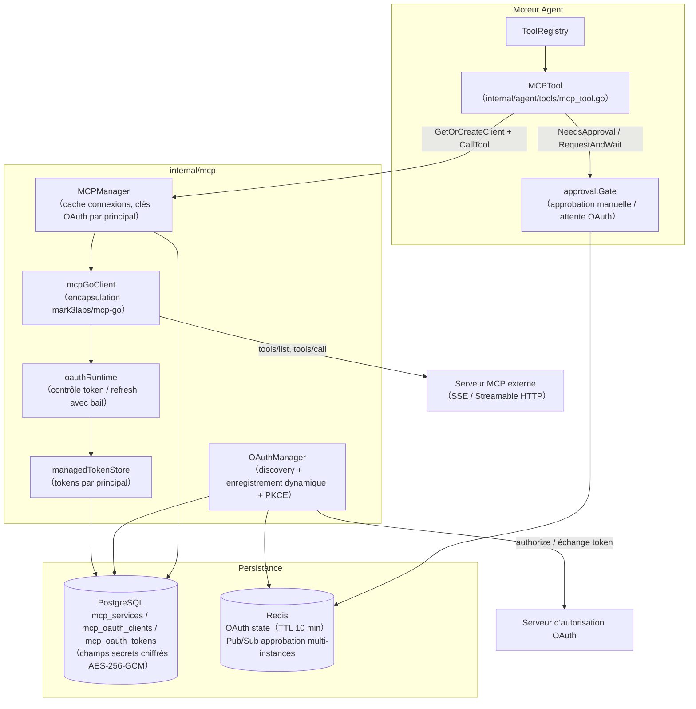
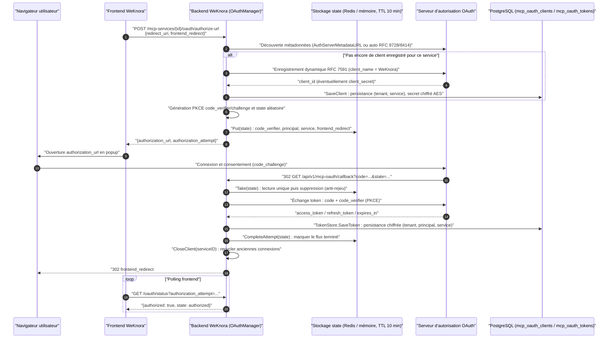
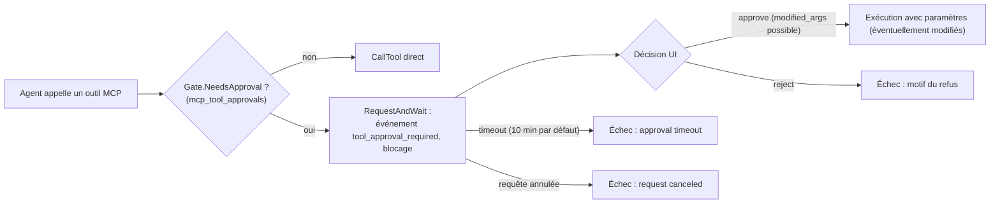
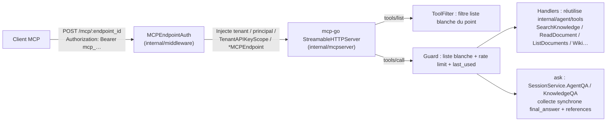

# Intégration MCP (Model Context Protocol)

MCP sert de pont entre les agents et les outils externes. WeKnora peut se connecter à des services MCP distants et exposer un serveur MCP intégré pour d’autres clients :

1. **WeKnora en client MCP** : dans « Boîte à outils → Services MCP », branchez n’importe quel serveur MCP externe (SSE / Streamable HTTP). Les outils sont chargés à la demande via un catalogue, pour que l’Agent les appelle en conversation. Prise en charge de l’authentification API Key / Bearer / OAuth 2.0 (enregistrement dynamique du client et PKCE, ou client pré-enregistré ; assertion JWT Bearer pour obtenir un token au nom de l’utilisateur), activation/désactivation par outil, approbation manuelle et OAuth dans la conversation (in-conversation).
2. **WeKnora en serveur MCP** : dans « Paramètres → Intégrations publiées → MCP Server », créez un ou plusieurs points de terminaison pour l’espace courant, chacun avec son propre jeton, périmètre de bases de connaissances et liste d’outils. Les clients Streamable HTTP avec en-tête Bearer se connectent directement, sans processus relais supplémentaire ; voir ci-dessous pour la configuration. Le service Python du répertoire `mcp-server/` est l’ancienne approche, marquée comme obsolète.

Connecter des services externes enrichit la boîte à outils des agents WeKnora ; exposer le serveur MCP WeKnora permet à des clients externes d’utiliser recherche, Q&R et gestion des bases de connaissances.

Un administrateur d’espace crée un service dans la barre latérale « Boîte à outils → Services MCP » (l’ancien lien « Paramètres → Services MCP » redirige ici), configure la connexion, synchronise les outils et rédige les instructions d’usage, puis sélectionne le service dans l’agent. Pour maîtriser les écritures ou les actions sortantes, activez l’approbation manuelle sur les outils concernés : une carte de confirmation s’affiche avant l’appel.

<Screenshot
  src="/screenshots/mcp-services.png"
  caption="Configuration MCP : connexion aux services d’outils et liste des outils"
  hint="Liste des services MCP, formulaire de configuration (URL, authentification) et outils découverts après test de connectivité." />

Modes de connexion, authentification et périmètre des outils sont détaillés ci-dessous.

---

## Connexion d’outils externes

La page de gestion MCP permet de rechercher par nom de service et par le texte d’usage affiché sur la carte. La recherche est insensible à la casse ; les mots-clés séparés par des espaces doivent tous correspondre. Si le texte d’usage est vide, la description du service est utilisée. En cas d’absence de résultats, videz la recherche.

La création d’un service se fait en deux étapes :

1. **Configuration de connexion** : nom, URL du service, transport SSE ou Streamable HTTP, authentification (aucune / en-têtes personnalisés, API Key / Token, OAuth 2.0), délais et nouvelles tentatives. « Importer depuis le code » accepte un JSON `mcpServers` standard pour préremplir le formulaire ; les configurations stdio avec uniquement `command` / `args` ne sont pas prises en charge. Après enregistrement, testez la connexion ; pour OAuth, « Autoriser » enregistre d’abord automatiquement, puis lance l’autorisation pour l’utilisateur courant.
2. **Outils et instructions d’usage** : une fois connecté, récupérez les Tools ; le système enregistre descriptions et schémas complets. Renseignez ensuite « Instructions d’usage » (rôle du service, cas d’usage, contraintes). Après synchronisation, « Génération IA » peut produire un texte concis à partir des outils activés. Dans la liste, réglez « Activer l’outil » et « Appel soumis à approbation » par outil ; les changements sont immédiats et un rafraîchissement du catalogue ne les écrase pas.

Le modèle lit d’abord les instructions du service, puis charge les outils à la demande : la qualité des instructions conditionne le choix du service par l’Agent. OAuth est autorisé par appelant. Si un outil exige une approbation, les paramètres sont vérifiés dans la conversation avant confirmation ; un outil désactivé n’est pas exécuté à l’exécution. Le client MCP WeKnora ne prend pas en charge le transport stdio.

Après approbation manuelle, si OAuth n’est pas encore accordé ou a expiré, la conversation propose à nouveau l’autorisation OAuth ; approbation d’outil et autorisation tierce restent deux étapes distinctes. Les appelants sans navigateur peuvent utiliser une assertion JWT Bearer pour obtenir un token pour leur principal, si l’amont le supporte — voir [OAuth API](../04-api/02-api-agent-mcp.md).

## Exposition aux clients externes {#clients-externes}

Créez un point de terminaison dans « Paramètres → Intégrations publiées → MCP Server » : nom, bases de connaissances accessibles (vide = toutes), outils exposés, Agent par défaut pour `ask` (vide = réponse rapide intégrée) et plafond d’appels par minute (60 par défaut). À la création, le jeton et l’URL `/mcp/<endpoint_id>` s’affichent une seule fois ; la page fournit le JSON `mcpServers` pour Cursor, le JSON `servers` pour VS Code, une commande Claude Code et une config STDIO de secours. Copiez le JSON VS Code dans `.vscode/mcp.json` du workspace ; fusionnez l’entrée dans `servers` si un fichier existe déjà. La config utilise `type: "http"`, l’URL du point de terminaison et l’en-tête `Authorization`, sans processus relais. Claude Desktop exige une URL HTTPS accessible et, si disponible, « sans connexion » plus Request headers (fonction bêta limitée, non disponible pour toutes les organisations).

Pour les clients stdio-only ou sans HTTP/Bearer natif, utilisez `mcp-remote@0.15.1` (version figée). L’exemple STDIO garde le littéral `Authorization:${WEKNORA_MCP_AUTH}` dans `args` ; placez `Bearer <token>` complet dans `env.WEKNORA_MCP_AUTH` du service, sans mettre le jeton dans les arguments. Le jeton reste dans la config client : traitez-le comme un secret.

Avec un reverse proxy personnalisé, en plus de `/api/`, transférez `/mcp/` vers le backend WeKnora en conservant `Authorization` et les en-têtes MCP, sans buffering de réponse, avec des timeouts adaptés aux connexions longues. Nginx, Vite dev et preview du dépôt incluent déjà ce proxy : utilisez le domaine du site sans exposer le port 8080.

<Screenshot
  src="/screenshots/mcp-server-endpoint.png"
  caption="Intégrations publiées → MCP Server : URL, jeton et config client après création"
  hint="Page de résultat : jeton unique, URL /mcp/<endpoint_id>, configs client et commande Claude Code ; périmètre KB et quatre groupes d’outils en arrière-plan." />

Un espace peut avoir plusieurs points de terminaison — par exemple un pour le support (recherche + Q&R, deux bases) et un pour la rédaction (outils d’écriture). Les jetons se renouvellent à la demande ; un point de terminaison peut être désactivé ; sa suppression déconnecte immédiatement les clients.

Les outils exposés se choisissent en quatre groupes ; seuls les outils en lecture sont activés par défaut :

| Groupe | Outils | Description |
|---|---|---|
| Recherche et lecture | `list_knowledge_bases`, `search_knowledge`, `grep_chunks`, `list_documents`, `read_document` | Les paramètres de base acceptent ID ou nom ; `search_knowledge` utilise `mode` (hybrid / semantic / keyword) et `limit` (10 par défaut, max 30) ; `grep_chunks` conserve une sémantique regex insensible à la casse : mots littéraux extraits du motif pour l’index mots-clés (sinon candidats sémantiques), puis validation regex ; motifs sans mot littéral (ex. `^\d+$`) refusés ; `read_document` sans `query` : pagination `offset` / `limit` ; avec `query` : tokenisation par espaces, insensible à la casse, tous les termes requis dans le chunk |
| Q&R | `ask` | Exécute uniquement l’Agent par défaut du point de terminaison (pas de choix côté client ; sinon réponse rapide intégrée) ; session créée côté serveur ; réponse complète avec citations et `session_id` pour la suite ; pas de recherche web |
| Wiki | `wiki_search`, `wiki_read_page`, `wiki_index` | Bases avec Wiki uniquement ; `wiki_search` : `query` en regex insensible à la casse, texte non regex = littéral ; `regex=false` force le littéral, `regex=true` exige une regex valide |
| Écriture | `add_document`, `update_document`, `delete_document` | Désactivé par défaut ; import Markdown ou URL |

`search_knowledge` accepte un tableau optionnel de chaînes `knowledge_ids` pour limiter la recherche à certains documents ; les trois valeurs de `mode` le supportent. Obtenez d’abord les ID réels via `list_documents` ou les résultats de recherche, puis passez-les : le filtrage par document s’applique avant le rappel et la troncature des candidats ; les autres documents de la même base ne participent pas à cet appel. Si le paramètre est omis, la recherche porte sur toute la base. S’il est fourni, le tableau doit être non vide et ne pas contenir d’ID vides ; les espaces en début et fin d’ID sont retirés, les doublons dédupliqués.

Si `knowledge_base_ids` est aussi fourni, chaque document doit appartenir aux bases sélectionnées ; seuls ces documents sont interrogés, sans recherche supplémentaire dans le reste des bases choisies. Document inexistant, hors périmètre, en conflit avec la sélection de bases, ou sans index vectoriel / mots-clés : erreur ; l’appel ne retombe pas sur une recherche globale. Les bases partagées suivent l’autorisation du point de terminaison et le contrôle de l’espace propriétaire.

Par exemple, si `list_documents` a renvoyé `doc-a` et `doc-b`, les arguments de `tools/call` peuvent être :

```json
{
  "name": "search_knowledge",
  "arguments": {
    "query": "prix du contrat",
    "mode": "hybrid",
    "knowledge_ids": ["doc-a", "doc-b"],
    "limit": 10
  }
}
```

Dans les résultats structurés de `search_knowledge`, `results[].chunk_type` et l’attribut `chunk_type` des résultats texte conservent le type d’origine du fragment (par ex. `text`, `summary`, `image_ocr`, `image_caption` ou `image_vector`). Une chaîne vide signifie type inconnu : ne pas en déduire qu’il s’agit du texte source ; le client peut décider s’il doit relire le corps du document.

Les retours des outils MCP réutilisent la conversion de liens de ressources REST/IM : corps, contenu Wiki et références d’images dans les données structurées deviennent, après contrôle d’accès, des liens HTTP(S) directement utilisables, sans nouvel outil ni modification de la liste d’outils du point de terminaison. `ask` conserve dans `references[].images` l’URL, la légende et le texte OCR ; la liste de références textuelles inclut aussi les liens image, pour ne pas perdre les visuels si le résumé du corps est tronqué.

Pour un stockage local ou privé, configurez `APP_EXTERNAL_URL` accessible aux clients externes et assurez le proxy de `/r/`. Les images `resource://` passent par des liens `/r/<token>` à durée limitée ; les autres backends utilisent l’URL HTTP(S) générée par le service de stockage. Une même ressource n’est convertie qu’une fois par appel d’outil ; les liens renvoyés ne sont pas réécrits dans le document ni la session. Si aucun lien accessible ne peut être produit, la référence d’origine est conservée sans interrompre le résultat texte.

Avant génération de lien, le système revérifie le périmètre KB du point de terminaison, les droits de partage, l’espace de la ressource et la liaison document valide, selon les mêmes règles que l’aperçu d’images en base ; pour un point de terminaison sans KB limitée, c’est l’ensemble des bases visibles par l’appelant. Les images de bases partagées retrouvées via l’Agent dans `ask` peuvent donc aussi être converties ; un fichier uploadé n’obtient pas de lien de téléchargement parce qu’il apparaît dans le texte du résultat. Les chemins de stockage historiques déjà liés restent convertibles. Pour les documents historiques sans liaison image, un administrateur autorisé doit relancer l’analyse du document, puis relancer la recherche ; on ne peut pas accorder automatiquement l’accès fichier via le corps éditable ou `image_info` seul.

Pour `read_document`, `offset` est la position dans l’ordre de lecture du document, à partir de 0, pas un index de chunk. Sans `query`, `limit` vaut 20 par défaut (max 100) ; le budget de sortie peut réduire le nombre de fragments par page. En mode `query`, `limit` n’est pas utilisé : au plus 20 correspondances par appel, avec un chunk de contexte avant et après chaque correspondance ; les contextes qui se chevauchent sont dédupliqués, sous contrainte du budget de sortie. Si `truncated=true`, utilisez `next_offset` de la réponse comme prochain `offset` en conservant le même `query`.

> **Le rappel de `grep_chunks` est plafonné.** Il prend des candidats via l’index (30 max par appel), puis filtre par regex : chaque ligne renvoyée correspond au motif, sans garantie d’exhaustivité — des correspondances présentes en base peuvent ne pas entrer dans le pool. Trois cas favorisent les omissions : motifs combinés comme `foo.*bar`, où les candidats sont triés par pertinence sur foo et bar et les chunks réellement adjacents peuvent rester hors du top 30 ; motifs quasi uniquement symboliques comme `C++`, où le mot littéral extrait est `C`, peu discriminant dans l’index ; bases sans index mots-clés, où l’index sémantique fournit les candidats et la correspondance littérale devient aléatoire. L’ancienne implémentation scannait toute la table chunks en regex (exhaustif mais coûteux à grande échelle) et a été retirée. Pour une recherche exhaustive dans un document, utilisez `read_document` avec `query`, qui parcourt le document séquentiellement.

Les outils réutilisent directement les outils natifs de l’Agent (`internal/agent/tools/`) ; l’authentification reprend le modèle de périmètre des API Key : le point de terminaison est traduit en un périmètre limité aux capacités retrieve / chat / ingest et aux bases autorisées, donc les contrôles backend sont identiques à ceux d’une API Key restreinte. Voir ci-dessous la référence du serveur MCP intégré.

## Tableau comparatif des modes d’accès {#acces-comparatif}

| Dimension | WeKnora client MCP | WeKnora serveur MCP |
|---|---|---|
| Emplacement du code | `internal/mcp/` + handler/service/repository + `internal/agent/tools/` | `internal/mcpserver/` + `internal/middleware/mcp_endpoint_auth.go` + `internal/handler/mcp_endpoint.go` |
| Bibliothèque de protocole | `github.com/mark3labs/mcp-go` (client) | `github.com/mark3labs/mcp-go` (serveur, Streamable HTTP, mode sans état) |
| Transport | SSE, Streamable HTTP (stdio désactivé pour la sécurité) | Streamable HTTP ; secours STDIO via `mcp-remote@0.15.1` si HTTP/Bearer natif indisponible |
| Authentification | API Key / Bearer / OAuth 2.0 (DCR + PKCE, token chiffré AES, isolé par principal) | Entrant `Authorization: Bearer mcp_…`, jeton par point de terminaison (stockage SHA-256, rotation possible) |
| Contrôles de sécurité | Approbation manuelle par outil, validation SSRF, préfixe de sortie non fiable, secrets isolés au niveau DTO | Liste blanche d’outils par point de terminaison (liste + appel), périmètre KB, limite par minute, jeton affiché une seule fois |
| Consommateurs | Agent WeKnora (appels automatiques en conversation) | Claude Desktop / Cursor / Claude Code / VS Code Copilot et tout client MCP |

## Configuration et référence d’implémentation

### Référence client MCP {#partie-1-weknora-client-mcp}

#### Architecture générale {#_1-1-architecture-generale}

Répartition du code client MCP :

| Couche | Chemin | Rôle |
|---|---|---|
| Client protocole | `internal/mcp/client.go`、`types.go`、`errors.go` | Encapsulation de l’interface `MCPClient` via `github.com/mark3labs/mcp-go` (Connect / Initialize / ListTools / CallTool / ListResources / ReadResource) |
| Gestion des connexions | `internal/mcp/manager.go` | `MCPManager` met en cache et réutilise les connexions ; OAuth isole les connexions par principal |
| OAuth | `internal/mcp/oauth_manager.go`、`oauth_lifecycle.go`、`oauth_state.go`、`oauth_tokenstore.go` | Orchestration du flux authorization code, cycle de vie et refresh des tokens, stockage du state en vol, persistance des tokens |
| Modèle de données | `internal/types/mcp.go`、`internal/types/mcp_oauth.go` | `MCPService`、`MCPAuthConfig`、`MCPToolApproval`、`MCPOAuthClient`、`MCPOAuthToken` (hooks de chiffrement AES) |
| Couche HTTP | `internal/handler/mcp_service.go`、`mcp_credentials.go`、`mcp_oauth.go`、`internal/handler/dto/mcp.go` | CRUD services MCP, sous-ressource credentials, OAuth et résolution d’approbation ; DTO sans fuite de secrets |
| Couche métier | `internal/application/service/mcp_service.go`、`mcp_tool_approval_service.go` | CRUD service, test de connexion, recyclage après changement de credentials, politique d’approbation |
| Couche persistance | `internal/application/repository/mcp_service.go`、`mcp_oauth.go`、`mcp_tool_approval_repository.go` | Persistance GORM (`mcp_services` / `mcp_oauth_clients` / `mcp_oauth_tokens` / table d’approbation outils) |
| Intégration Agent | `internal/agent/tools/mcp_tool.go`、`mcp_oauth.go`、`internal/agent/approval/gate.go` | Outils MCP exposés comme Agent Tool, porte d’approbation (Gate), attente OAuth en conversation |



#### Modèle de données et transports {#_1-2-modele-et-transports}

Entité principale `MCPService` dans `internal/types/mcp.go` :

```go
type MCPService struct {
    ID             string             `json:"id"                     gorm:"type:varchar(36);primaryKey"`
    TenantID       uint64             `json:"tenant_id"              gorm:"uniqueIndex:idx_tenant_name"`
    Name           string             `json:"name"                   gorm:"type:varchar(255);not null;uniqueIndex:idx_tenant_name"`
    Enabled        bool               `json:"enabled"                gorm:"default:true;index"`
    TransportType  MCPTransportType   `json:"transport_type"         gorm:"type:varchar(50);not null"`
    URL            *string            `json:"url,omitempty"          gorm:"type:varchar(512)"`
    Headers        MCPHeaders         `json:"headers"                gorm:"type:json"`
    AuthConfig     *MCPAuthConfig     `json:"auth_config"            gorm:"type:json"`
    AdvancedConfig *MCPAdvancedConfig `json:"advanced_config"        gorm:"type:json"`
    IsBuiltin      bool               `json:"is_builtin"             gorm:"default:false"`
    // ... StdioConfig / EnvVars / horodatage / soft delete
}
```

Transports (`MCPTransportType`) :

| Type | Valeur | État | Description |
|---|---|---|---|
| SSE | `sse` | ✅ Pris en charge | Server-Sent Events ; `client.NewSSEMCPClient` / OAuth : `client.NewOAuthSSEClient` |
| Streamable HTTP | `http-streamable` | ✅ Pris en charge | MCP Streamable HTTP ; `client.NewStreamableHttpClient` / OAuth : `client.NewOAuthStreamableHttpClient` |
| Stdio | `stdio` | ❌ **Désactivé** | Refusé pour sécurité (risque d’injection de commande) dans `NewMCPClient`, `MCPManager.GetOrCreateClient`, `CreateMCPService`, `UpdateMCPService` : `"stdio transport is disabled for security reasons"` |

> Note : le type système conserve encore `MCPTransportStdio` et `StdioConfig` (`command` + `args`) ; `mcp_tool.go` a une branche de libération pour stdio, mais toutes les entrées de création client stdio sont bloquées à l’exécution — seuls SSE et Streamable HTTP sont utilisables.

Configuration avancée `MCPAdvancedConfig` (défauts via `types.GetDefaultAdvancedConfig()`) : `timeout` 30 s, `retry_count` 3, `retry_delay` 1 s. `timeout` s’applique au client HTTP et au handshake initialize (plafond initialize 60 s dans `manager.go`). Un appel d’outil Agent a par défaut 60 s ; si le `timeout` du service est supérieur à 60 s, la fenêtre CallTool de ce service est prolongée ; en dessous de 60 s, la fenêtre Agent n’est pas raccourcie (`callToolTimeout` dans `internal/agent/tools/mcp_tool.go`).

#### Stratégies d’authentification {#_1-3-strategies-auth}

`MCPAuthConfig.AuthType` définit quatre stratégies (`internal/types/mcp.go`) :

| `auth_type` | Comportement (`applyAuthHeaders` dans `internal/mcp/client.go`) |
|---|---|
| `""` (none) | Sans auth. Rétrocompatibilité : si d’anciennes données contiennent `api_key` / `token`, les en-têtes historiques sont encore injectés |
| `api_key` | Injection `<APIKeyHeader>: <APIKey>`, en-tête par défaut `X-API-Key`, personnalisable via `api_key_header` (non secret) |
| `bearer` | Injection `Authorization: Bearer <Token>` |
| `oauth` | Flux OAuth 2.0 authorization code par utilisateur (principal), tokens dans `mcp_oauth_tokens`, voir § 1.6 |

Les stratégies sont **mutuellement exclusives** — `applyAuthHeaders` n’injecte que celle choisie via `AuthType` (l’ancienne implémentation envoyait api_key et bearer ensemble). `custom_headers` est structurel, toujours fusionné et peut écraser les en-têtes de stratégie.

**Stockage chiffré des secrets** : `MCPAuthConfig` implémente `driver.Valuer` / `sql.Scanner` — à l’écriture, si `SYSTEM_AES_KEY` est défini, `APIKey` et `Token` passent par AES-256-GCM (préfixe `enc:v1:`) ; lecture avec déchiffrement transparent ; échec de déchiffrement (clé perdue/rotée) traité comme « non configuré » avec log, jamais de ciphertext utilisé comme plaintext.

#### Cycle de vie des connexions et MCPManager {#_1-4-cycle-vie-mcpmanager}

`MCPManager` dans `internal/mcp/manager.go` maintient un cache `map[cacheKey]MCPClient` :

- **Clé de cache** (`cacheKey`) : service non OAuth partagé par `service.ID` ; service OAuth : `service.ID + "\x00" + principal.StorageID()` — **une connexion par identité**, chaque utilisateur avec son token.
- **GetOrCreateClient** : cache d’abord (réutilisation si `IsConnected()`), sinon `NewMCPClient` → `Connect` (context longue durée du manager, SSE nécessite connexion persistante) → `Initialize` (limité par timeout) → mise en cache. OAuth extrait `TenantID` et `MCPOAuthPrincipalFromContext` du ctx (embed → principal visiteur).
- **CloseClient(serviceID)** : coupe et supprime toutes les connexion cache du service, y compris OAuth `serviceID\x00principal`. Appelé après changement de credentials, désactivation/config, OAuth accordé/révoqué pour forcer une reconnexion.
- **Nettoyage** : toutes les 5 minutes, `removeDisconnectedClients()` retire les clients déconnectés.
- **Récupération session** : `checkErrorAndDisconnectIfNeeded` dans `client.go` détecte `"Invalid session ID"` / `"No active connection"` (SSE et Streamable HTTP via `Mcp-Session-Id`), déconnecte pour recréer la session au prochain appel ; idem callback `OnConnectionLost`.

Identité client au handshake `Initialize` :

```go
ClientInfo: mcp.Implementation{ Name: "WeKnora", Version: "1.0.0" }
```

#### Points d’API REST {#_1-5-api-rest}

Routes enregistrées dans `RegisterMCPServiceRoutes` de `internal/router/router.go` (sous `/api/v1`) :

| Méthode | Chemin | Droit | Description |
|---|---|---|---|
| POST | `/mcp-services` | Admin+ | Créer un service MCP (URL validée SSRF `secutils.ValidateURLForSSRF`) |
| GET | `/mcp-services` | Viewer+ | Lister les services MCP de l’espace (y compris builtin) |
| GET | `/mcp-services/{id}` | Viewer+ | Détail du service (DTO masqué) |
| PUT | `/mcp-services/{id}` | Admin+ | Mettre à jour ; le PUT principal **ignore** `auth_config.api_key` / `auth_config.token` (avertissement deprecated) et `auth_config.client_secret` ; `auth_config.client_id` peut être défini ou effacé par chaîne vide |
| DELETE | `/mcp-services/{id}` | Admin+ | Supprimer le service (soft delete, `CloseClient` d’abord) |
| POST | `/mcp-services/{id}/test` | Admin+ | Test de connexion : client temporaire Connect + Initialize, tentative de liste outils/ressources ; échec si le serveur déclare la capacité mais la lecture échoue, sinon avertissement et listes vides. Retourne `MCPTestResult` (dont `oauth_required`) |
| GET | `/mcp-services/{id}/tools` | Viewer+ | Liste des outils du service MCP |
| GET | `/mcp-services/{id}/resources` | Viewer+ | Liste des ressources du service MCP |
| PUT | `/mcp-services/{id}/credentials` | Admin+ | Écrire credentials `api_key` / `token` / `client_secret` (voir ci-dessous) |
| DELETE | `/mcp-services/{id}/credentials/{field}` | Admin+ | Effacer un champ credential (`api_key`, `token` ou `client_secret`), idempotent, 204 si succès |
| GET | `/mcp-services/{id}/tool-approvals` | Viewer+ | Politiques d’approbation des outils du service |
| PUT | `/mcp-services/{id}/tool-approvals/{tool_name}` | Admin+ | Activer/désactiver ou approbation : `{"enabled":bool,"require_approval":bool}`, au moins un champ |
| POST | `/mcp-services/{id}/oauth/authorize-url` | Viewer+ | Démarrer OAuth pour l’utilisateur courant ; retourne `authorization_url` et `authorization_attempt` |
| POST | `/mcp-services/{id}/oauth/assertion` | Viewer+ | Assertion JWT Bearer (RFC 7523) signée par l’appelant pour obtenir un token sans navigateur ; réutilise le client OAuth du service |
| GET | `/mcp-services/{id}/oauth/status` | Viewer+ | Statut d’autorisation ; avec `authorization_attempt`, ne valide que ce flux |
| DELETE | `/mcp-services/{id}/oauth/token` | Viewer+ | Révoquer le token de l’utilisateur pour ce service et recycler la connexion |
| GET | `/mcp-oauth/callback` | **Public** | Callback serveur d’autorisation (`state` à usage unique comme auth), hors groupe `/mcp-services` pour éviter conflit avec `:id` |
| POST | `/agent/tool-approvals/{pending_id}` | Viewer+ | Approuver/rejeter un appel en attente `{"decision": "approve"\|"reject", "reason"?, "modified_args"?}` |
| POST | `/agent/mcp-oauth-resolutions/{pending_id}` | Viewer+ | Reprendre l’Agent après OAuth en conversation `{"service_id", "decision": "authorize"\|"cancel"}` |
| POST | `/agent/mcp-oauth-resolutions/{pending_id}/cancel` | Viewer+ | Ignorer la invite OAuth en conversation |

Le canal embed a des routes au niveau session (`/embed/sessions/{session_id}/mcp-oauth-resolutions/...`, `/embed/sessions/{session_id}/mcp-services/{id}/oauth/...`, voir `internal/handler/embed_channel.go` et router.go).

##### Sous-ressource credentials (`mcp_credentials.go`)

Les secrets (`api_key` / `token` / `client_secret` client pré-enregistré) **ne passent pas par le PUT principal** mais par `/credentials` ; les commentaires de `internal/handler/mcp_credentials.go` en donnent trois raisons :

1. Le body du PUT principal ne transporte jamais de secrets — évite les bugs du type « masque réécrit qui écrase la vraie clé » ;
2. Sauvegarder la modale d’édition (timeout, enabled, etc.) ne peut pas corrompre des credentials déjà configurés ;
3. Les métadonnées « configuré ou non » reviennent avec la ressource principale (`MCPServiceResponse.Credentials` : `{"api_key": {"configured": bool}, "token": {...}}`), sans GET supplémentaire.

Sémantique pointeur dans le body PUT : **absent = conserver**, **chaîne vide = no-op** (suppression via DELETE), **non vide = remplacer**. Après changement, `UpdateMCPCredentials` appelle `CloseClient` ; prochain appel avec les nouveaux credentials. Côté réponse, `MCPServiceResponse` dans `internal/handler/dto/mcp.go` garantit **à la compilation** l’absence de champs secrets (`MCPAuthConfigResponse` sans `APIKey` / `Token`).

#### Flux OAuth 2.0 complet {#_1-6-oauth-complet}

Quand le serveur MCP exige OAuth (`auth_type: "oauth"`), WeKnora implémente le flux authorization code : **découverte RFC 9728 / RFC 8414 → enregistrement dynamique RFC 7591 → Authorization Code + PKCE → persistance chiffrée des tokens → refresh automatique avec bail distribué**. Isolation des tokens par `(tenant_id, principal_type, principal_id, service_id)` — même service, un token par utilisateur (ou visiteur embed, utilisateur IM, etc., voir `internal/types/principal.go`).

##### Séquence d’autorisation



##### Points clés du flux (code source)

- **Découverte et enregistrement dynamique** (`internal/mcp/oauth_manager.go`) : `StartAuthorization` construit `transport.OAuthHandler` (si `AuthServerMetadataURL` est vide, mcp-go découvre le serveur d’auth depuis l’URL MCP) ; client pré-enregistré (`auth_config.client_id`) utilisé tel quel, sinon si `(tenant, service)` n’a pas encore de ligne dans `mcp_oauth_clients`, appel unique `h.RegisterClient(ctx, "WeKnora")` RFC 7591 puis `SaveClient` — tous les utilisateurs réutilisent le même `client_id`.
- **PKCE** : `transport.GenerateCodeVerifier()` / `GenerateCodeChallenge()` / `GenerateState()` ; `code_verifier` secret, **stocké uniquement côté serveur dans le state** (commentaires de `internal/mcp/oauth_state.go` interdisent de l’encoder dans le paramètre state).
- **Stockage du state** (`oauth_state.go`) : avec Redis, clé `weknora:mcp_oauth_state:<state>` (namespace `WEKNORA_REDIS_NAMESPACE`, callback sur n’importe quelle réplica) ; mode Lite : map mémoire avec GC. TTL 10 minutes ; `Take` = consommation unique. Enregistrement `OAuthAttempt` sans secrets ; `CompleteAttempt` ne met `Completed=true` qu’après persistance du token — la requête `status?authorization_attempt=` d’une nouvelle popup **n’est jamais confondue avec un ancien token**.
- **Callback** (`CompleteAuthorization` dans `oauth_manager.go` + `Callback` dans `internal/handler/mcp_oauth.go`) : route publique, auth via state à usage unique ; après redirection navigateur le ctx Gin est annulé, l’échange token utilise `context.WithoutCancel + 60s` (`oauthCallbackTimeout`). Succès → `CloseClientsAfterAuthorization(ctx, tenantID, serviceID, principal)` recycle la connexion du principal autorisé et les connexions obsolètes avec ancien `client_id` dans l’espace ; autres utilisateurs conservent leurs connexions valides. Échec lecture enregistrement → nettoyage conservateur du service ; ctx annulé → nettoyage du principal seulement ; résultat dans le fragment URL (`#mcp_oauth_result=success` / `#mcp_oauth_error=...`).
- **CSRF sur handler reconstruit** : au callback le handler est recréé ; `h.SetExpectedState(state)` réinjecte le state attendu pour la validation CSRF mcp-go.

##### Stockage chiffré des tokens (`oauth_tokenstore.go` + `types/mcp_oauth.go`)

Modèle `MCPOAuthToken` table `mcp_oauth_tokens` : index unique `(tenant_id, principal_type, principal_id, service_id)` ; `AccessToken` / `RefreshToken` chiffrés AES-256-GCM via hooks GORM `BeforeCreate` / `BeforeSave` (`SYSTEM_AES_KEY`), déchiffrement `AfterFind`, champs `json:"-"` jamais en API. `client_secret` de `mcp_oauth_clients` également chiffré.

Deux niveaux dans `internal/mcp/oauth_tokenstore.go` :

- `dbTokenStore` : implémente `transport.TokenStore` mcp-go ; après auth/refresh, callback `SaveToken` (défaut `TokenType` → `Bearer`, `ExpiresIn` → `ExpiresAt`).
- `managedTokenStore` : wrapper runtime — **`GetToken` efface `ExpiresAt`** pour que mcp-go considère le token toujours valide et n’auto-refresh pas ; la décision de refresh reste dans le cycle de vie WeKnora (sinon contournement du bail multi-instances et erreurs génériques authorization-required).

##### Refresh token et bail multi-instances (`oauth_lifecycle.go`)

Chaque opération MCP (Connect / Initialize / ListTools / CallTool / …) passe par le wrapper générique `oauthCall` dans `client.go` :

```go
// Avant opération : ensureFresh(force=false) ;
// Sur 401 : ensureFresh(force=true), un refresh et une retry ;
// Autres erreurs : pas de retry (éviter effets de bord outil en cas d’ambiguïté réseau).
```

Règles de `oauthRuntime.ensureFresh` :

- Anticipation d’expiration avec **skew 30 s** (`oauthRefreshSkew`) : `ExpiresAt` dans les 30 s → refresh ; **sans refresh_token, durée de vie réelle intacte**, le skew ne raccourcit pas.
- Expiré sans refresh_token → suppression de la ligne token et `OAuthReauthorizationRequiredError`.
- Refresh via `refreshWithLease` : colonnes `refresh_lease_id` / `refresh_lease_until` sur `mcp_oauth_tokens` (**bail DB**, défaut 45 s, monte avec timeout HTTP), `TryAcquireTokenRefreshLease` en UPDATE conditionnel ; instances en attente pollent toutes les 100 ms et réutilisent le token mis à jour — **un seul consommateur du refresh_token en multi-instances** (rotation sûre).
- Échecs de refresh (`permanentRefreshFailure`) : `invalid_grant` / `invalid_token` / `bad_refresh_token` / `expired_token` (ou HTTP 400) → échec permanent, suppression token, réauth ; `invalid_client` / `unauthorized_client` (ou HTTP 401) → suppression aussi de l’enregistrement dynamique `mcp_oauth_clients` ; autres (réseau) → `OAuthRefreshTemporaryError`, **token conservé**, pas de nouvelle fenêtre OAuth.

`AuthorizationStatus` expose trois états : `authorized` / `refreshable` / `reauth_required`.

##### Guidage « le serveur exige OAuth »

Si le service **n’est pas** en OAuth mais le serveur MCP renvoie 401 avec métadonnées RFC 9728 protected-resource au handshake, `asOAuthRequired` dans `client.go` produit `OAuthRequiredError` ; `TestMCPService` (`mcpTestFailure` dans `internal/application/service/mcp_service.go`) met `oauth_required: true` pour orienter l’UI vers OAuth plutôt qu’un 401 brut. **Un 401 sans métadonnées ne force pas OAuth** (clé API incorrecte possible).

##### OAuth en conversation (in-conversation OAuth)

En conversation Agent, appel d’un outil MCP OAuth sans autorisation utilisateur : pas d’échec immédiat (`internal/agent/tools/mcp_oauth.go`) :

1. `getOrCreateMCPClientWithOAuthRetry` intercepte les erreurs authorization-required (`isAuthorizationRequired`) ;
2. `approval.Gate.RequestOAuthAndWait` émet `EventMCPOAuthRequired` sur l’EventBus frontend (`pending_id`, service, outil, timeout), **attente bloquante** ; durée = `mcp_auth_wait_timeout` de l’Agent (`internal/types/custom_agent.go`) ou défaut Gate ;
3. Après le flux § 1.6 dans la popup, le frontend appelle `POST /agent/mcp-oauth-resolutions/{pending_id}` ; `ResolveMCPOAuth` (**vérifie token pour `(tenant, principal, service)`** sinon 409) ; `cancel` possible ;
4. Après accord : `CloseClient` + retry une fois ; timeout/annulation → rejet.
5. **Canaux non interactifs** (bot IM, ctx `types.WithMCPOAuthNonInteractive`) : pas de blocage ; `emitMCPOAuthRequiredNotice` envoie `TimeoutSeconds: 0`, invite à autoriser hors bande dans la console Web, l’Agent ignore l’outil.

#### Découverte d’outils et intégration Agent (`mcp_tool.go`) {#_1-7-outils-agent-mcp-tool-go}

Au démarrage de l’Agent, `internal/application/service/agent_service.go` sélectionne les services MCP selon la configuration de l’Agent :

| `mcp_selection_mode` | Comportement |
|---|---|
| `all` (défaut) | Enregistre tous les services MCP activés de l’espace (y compris builtin) |
| `selected` | N’enregistre que ceux listés dans `mcp_services` |
| `none` | N’enregistre aucun outil MCP |

En production, le répertoire persistant et le chargement à la demande sont la norme. S’il n’y a pas d’outils historiques à restaurer, le modèle ne reçoit d’abord que `discover_mcp_tools` et un résumé des sources des services autorisés ; les fonctions correspondantes et `call_mcp_tool` n’apparaissent qu’une fois des définitions complètes disponibles. Les schémas amont ne sont jamais envoyés en bloc au modèle.

1. `PrepareMCPTools` lit d’abord l’instantané persistant, sans ouvrir de connexion amont pour le préchargement ; un répertoire manquant ou obsolète affiche l’état adéquat. L’enrichissement à l’exécution reste soumis aux droits et au principal OAuth.
2. Le modèle localise via `list_tools` / `search`, puis `describe` pour la définition complète et `tool_ref`. Le résumé de liste ne suffit pas pour appeler.
3. Les outils déjà décrits sont publiés comme fonctions ordinaires avant la prochaine requête modèle ; un nouveau moteur peut restaurer depuis l’historique de session ou passer par `call_mcp_tool`.
4. À l’exécution, service, principal, politique d’outil et schéma de paramètres sont revérifiés avant approbation / OAuth / appel distant. Le cache du répertoire ne mémorise pas les décisions d’autorisation.

Les noms de fonction portent un suffixe de hachage stable (ID de service + nom d’outil d’origine) pour éviter les collisions après normalisation ; la référence est liée à un schéma précis — toute évolution impose une nouvelle lecture. La validation de schéma n’accède ni à des URL ni à des fichiers externes ; les paramètres modifiés après approbation sont aussi validés. Instructions de service et résultats d’outil sont traités comme données externes : ils ne peuvent pas outrepasser la demande utilisateur ni élargir les permissions.

Une mention (@) ne fait que prioriser un service, sans changer la portée `all / selected / none` de l’Agent. L’exposition intégrale des fonctions reste un chemin de compatibilité, pas le défaut production.

##### Échecs d’appel d’outil et nouvelles tentatives

L’outil distant peut avoir exécuté l’action alors que la réponse est perdue sur le réseau, ou le serveur renvoie une erreur après coup. WeKnora signale alors un résultat incertain et **ne relance pas automatiquement** le même appel. Vérifiez d’abord côté système distant si l’action a abouti, puis décidez d’un nouvel appel soumis aux mêmes règles d’approbation.

Si le client n’est pas encore connecté, ou si le serveur répond HTTP 404 (session invalide), une reconnexion avec au plus une nouvelle tentative est autorisée ; une requête annulée ne déclenche pas cette retry. Le refresh OAuth sur 401 suit le flux d’autorisation existant.

##### Gestion du répertoire persistant {#mcp-tool-directory}

Dans les paramètres : enregistrer la connexion, puis éditer les instructions d’usage et synchroniser les outils. Un répertoire existant reste consultable hors ligne ; après changement de connexion ou d’auth, l’ancien instantané passe en `stale` et doit être rafraîchi pour l’exécution — un échec de refresh ne remplace pas le dernier instantané complet par un répertoire partiel.

| Contenu | Stockage et mise à jour |
| --- | --- |
| Instructions d’usage rédigées | `mcp_services.usage_instructions` ; non écrasées au refresh. `description` : compatibilité ancienne version |
| Descriptions amont, identité du service, tools/schema complets | `mcp_metadata` ; sauvegarde atomique après pull complet |
| Activation et approbation par outil | `mcp_tool_approvals` ; indépendant du refresh du répertoire |
| Isolation du répertoire | `(tenant_id, service_id, principal)` ; auth statique partagée dans l’espace, OAuth isolé par principal autorisé |

`GET /mcp-services/:id/metadata` lit le cache (`data:null` si jamais synchronisé) ; `POST /mcp-services/:id/metadata/refresh` se connecte explicitement à l’amont. Refresh avec auth statique : Admin ou droit équivalent ; utilisateur OAuth : son propre répertoire. Préfixe `/api/v1`, voir [API MCP](../04-api/02-api-agent-mcp.md).

À l’exécution, `list_tools(refresh=true)` repull l’amont et tente de sauver l’instantané du principal courant, pas seulement relire la base. Timeout et taille de répertoire plafonnés ; en échec l’état d’erreur est conservé — un cache réussi n’implique pas que l’amont est joignable maintenant. Services sans répertoire complet avant migration : première sync obligatoire.

#### Approbation manuelle des outils (issue #1173) {#approbation-manuelle-outils-mcp}

**Granularité** : triplet `(tenant_id, service_id, tool_name)` ; une ligne `MCPToolApproval` avec `enabled` et `require_approval` fixe disponibilité et obligation d’approbation. La liste d’outils vient de MCP `ListTools` ; la table ne stocke que des surcharges (`internal/types/mcp.go`). Le dépôt (`internal/application/repository/mcp_tool_approval_repository.go`) fait un Upsert atomique `ON CONFLICT (tenant_id, service_id, tool_name)` ; `IsRequired` sans ligne ⇒ pas d’approbation.

**Flux d’approbation** (`internal/agent/approval/gate.go`) :



Points d’implémentation :

- **Blocage et reprise** : `RequestAndWait` crée un `pending_id`, publie `EventToolApprovalRequired` (outil, JSON des paramètres, timeout) sur l’EventBus, attend sur un waiter mémoire ; l’utilisateur lève le blocage via `POST /agent/tool-approvals/{pending_id}` avec `decision: approve|reject`. Après approbation, `mcp_tool.go` **recalcule le timeout d’exécution complet** depuis `ApprovalCtx` (l’approbation peut avoir consommé les 60 s initiaux).
- **Modification des paramètres** : `approve` peut inclure `modified_args` (objet JSON non null ; le handler rejette explicitement `"null"`), qui remplace les paramètres d’origine.
- **Autorisation** : Resolve vérifie tenant et propriétaire de session (`ErrTenantMismatch` / `ErrUserMismatch`, userID vide ⇒ mismatch, fail-close) ; résolution dupliquée ⇒ `ErrAlreadyResolved`.
- **Multi-instances** : le waiter vit dans la mémoire de l’instance qui attend ; avec Redis, un Resolve sur une autre réplica passe par Pub/Sub `weknora:mcp_approval:resolve`, l’instance propriétaire applique la décision et ack via canal par pending (fenêtre 3 s) pour des codes HTTP cohérents ; sans Redis : mono-instance (sticky session).
- **Timeout et échecs** : attente 10 min par défaut, configurable via `config.Agent.ToolApprovalTimeoutSeconds`. Contrôle d’approbation **fail-close** par défaut — erreur DB ⇒ approbation requise ; `WEKNORA_AGENT_TOOL_APPROVAL_FAIL_OPEN=true` rétablit l’ancien fail-open.

#### Activation / désactivation par outil

Dans la liste des outils d’un service MCP, un outil peut être désactivé seul. Absence de ligne ⇒ `enabled=true` ; la désactivation affecte l’enregistrement à l’exécution et est revérifiée à l’appel pour empêcher une session ouverte d’utiliser un outil coupé.

`PUT /mcp-services/:id/tool-approvals/:tool_name` exige au moins `enabled` ou `require_approval` ; champs omis inchangés. Désactiver l’approbation manuelle ≠ désactiver l’outil ; voir [référence API](../04-api/02-api-agent-mcp.md).

#### Services MCP intégrés (builtin) {#services-mcp-builtin}

Le drapeau `mcp_services.is_builtin` (migration `migrations/versioned/000017_mcp_builtin.up.sql`) marque un service partagé entre espaces :

- **Visibilité** : requêtes dépôt avec `tenant_id = ? OR is_builtin = true` (`internal/application/repository/mcp_service.go`) — lignes builtin visibles de tous les espaces.
- **Immuabilité** : `UpdateMCPService` / `DeleteMCPService` / `UpdateMCPCredentials` / `ClearMCPCredential` refusés sur les lignes builtin (« builtin MCP services cannot be updated/deleted/have credentials modified »).
- **Réponse assainie** : `dto.NewMCPServiceResponse` retire pour les builtin `URL`, `Headers`, `EnvVars`, `StdioConfig`, `AuthConfig` et métadonnées `Credentials` — champs pouvant révéler la config plateforme amont.

Aucune liste builtin MCP codée en dur (`builtin_agents.yaml` / `builtin_models.yaml.example` sous `config/` ne concernent pas MCP) ; les lignes builtin sont provisionnées en base par l’exploitant (`is_builtin = true`), l’application applique affichage et protection ci-dessus.

---

### Référence du serveur MCP intégré {#serveur-mcp-integre-reference}

#### Compatibilité protocole

Le point `/mcp/:endpoint_id` intégré supporte les clients `2026-07-28` et `2025-11-25` avec la même URL, le même jeton Bearer, la même liste blanche d’outils et le même périmètre de bases. Les clients récents découvrent les capacités via `server/discover`, chaque requête emportant métadonnées de protocole et en-têtes HTTP associés ; les anciens continuent avec `initialize`. Le preflight navigateur autorise `Mcp-Method`, `Mcp-Name`, etc. Découverte et réponses de liste récentes utilisent par défaut `cacheScope=private`, `ttlMs=0` — pas de cache partagé pour un répertoire soumis aux droits.

Un outil hors liste blanche renvoie JSON-RPC `-32602` sans exécution ; ce n’est pas la forme `isError=true` des anciens SDK. Un dépassement de périmètre KB reste refusé par les contrôles de scope existants.

Lorsque WeKnora appelle un MCP externe, `mcp-go v1.1.1` négocie par pair : découverte récente d’abord, puis initialisation legacy. Un service ignoratif ajoute au plus ~5 s de sonde ; 401/503 en sonde déclenchent aussi legacy ; deux échecs ⇒ erreur d’init. Annulation ou timeout de la requête parente n’est pas compté comme init réussie. Cette négociation est indépendante de la version du client qui appelle WeKnora.

Le répertoire d’outils externes conserve le JSON Schema complet ; les appels récents génèrent des en-têtes `Mcp-Param-*` selon `x-mcp-header` du schéma. Un refresh raté ne remplace pas les définitions d’en-têtes du dernier répertoire complet par un résultat partiel ; déconnexion ⇒ effacement de ces définitions.

#### Modèle de données et API de gestion

Table `mcp_endpoints` (PostgreSQL `000102_mcp_endpoints`, SQLite `000022_mcp_endpoints`) — une ligne par point : `tenant_id`, `name`, `description`, `enabled`, `token_hash` (SHA-256), `token_hint` (préfixe affiché), `knowledge_base_ids` (tableau vide = toutes les bases de l’espace), `tools` (liste blanche), `default_agent_id` (vide = Q&R rapide intégrée), `rate_limit_per_minute` (défaut 60, max 6000), `last_used_at`. Types dans `internal/types/mcp_endpoint.go`, catalogue d’outils dans `internal/types/mcp_endpoint_tools.go`.

API de gestion sous `/api/v1/mcp-endpoints` : lecture Viewer+, modification Admin+, clé API avec capacité `manage_channels` (champs et exemples : [API MCP](../04-api/02-api-agent-mcp.md#points-de-termination-mcp-server)) :

| Méthode | Chemin | Description |
|---|---|---|
| GET | `/mcp-endpoints` | Liste |
| GET | `/mcp-endpoints/tools` | Catalogue d’outils (groupes, cases par défaut) |
| POST | `/mcp-endpoints` | Création ; réponse avec `token` à usage unique |
| GET / PUT / DELETE | `/mcp-endpoints/:endpoint_id` | Détail / mise à jour / suppression |
| POST | `/mcp-endpoints/:endpoint_id/rotate-token` | Rotation du jeton ; nouveau `token` dans la réponse |

Le jeton de point de terminaison est un credential distinct : une clé API restreinte ne peut créer, modifier ou faire tourner un point que dans son périmètre — bases du point ⊆ whitelist KB de la clé (si la clé a une whitelist, le point ne peut pas être « toutes les bases » vide), capacités requises par les outils du point (retrieve / chat / ingest, etc.) ⊆ capacités de la clé, sinon 403.

#### Chaîne de requête



- Route publique `/mcp/:endpoint_id` avant le middleware Auth global, au même niveau qu’embed ; `MCPEndpointAuth` parse le jeton puis `applyAuthSession` injecte tenant, utilisateur synthétique, principal `mcp_endpoint` et `TenantAPIKeyScope` dérivé (`types.MCPEndpointScope`) pour les contrôles KB et capacités en aval.
- Une seule instance `MCPServer` enregistre le catalogue complet ; `WithToolFilter` filtre `tools/list` selon le point du contexte ; `WithToolHandlerMiddleware` revérifie la liste blanche sur `tools/call` et applique un rate limit glissant par point (Redis prioritaire, repli local).
- Transport `WithStateLess(true)` : toute réplica peut traiter toute requête, sans conserver `Mcp-Session-Id`.
- Session `ask` : `mcp_endpoint:<tenant>:<endpoint>` ; reprise de chat ⇒ `session_id` du même point ; plafond 4 min par réponse.
- Outils document (liste, lecture, écriture) : `access.ResolveKB` puis exécution dans l’espace propriétaire de la base — bases partagées via l’organisation restent accessibles ; nouveaux documents créés dans l’espace du propriétaire.

#### Exemples de configuration client

```json
{
  "mcpServers": {
    "weknora-docs": {
      "url": "https://your-weknora.example.com/mcp/<endpoint_id>",
      "headers": { "Authorization": "Bearer mcp_xxxxxxxx" }
    }
  }
}
```

Claude Code：

```bash
claude mcp add --transport http weknora-docs https://your-weknora.example.com/mcp/<endpoint_id> --header "Authorization: Bearer mcp_xxxxxxxx"
```

Clients stdio uniquement :

```json
{
  "mcpServers": {
    "weknora-docs": {
      "command": "npx",
      "args": ["-y", "mcp-remote", "https://your-weknora.example.com/mcp/<endpoint_id>", "--header", "Authorization: Bearer mcp_xxxxxxxx"]
    }
  }
}
```

### Serveur MCP Python (legacy, obsolète) {#serveur-mcp-python-legacy}

::: warning Obsolète
Le service Python sous `mcp-server/` précède le serveur MCP intégré : un processus, une clé API, un seul espace, outils alignés sur l’API REST. Les nouveaux déploiements doivent utiliser le serveur intégré ci-dessus ; cette section sert aux installations legacy — le répertoire sera retiré dans une version ultérieure.
:::


`mcp-server/` est un paquet Python autonome, PyPI **`tencent-weknora-mcp`** (1.1.1, Python ≥ 3.10, deps `mcp>=2,<3`, `requests>=2.31.0`, `starlette`, `uvicorn`). Cœur : `mcp-server/weknora_mcp_server.py` — `WeKnoraClient` appelle l’API REST WeKnora avec `X-API-Key` via `requests.Session` ; `MCPServer("weknora-server", version="1.1.1")` enregistre les outils et expose le transport choisi.

::: warning Nom de paquet et API (v1.1.x)
- Paquet officiel `tencent-weknora-mcp` (Trusted Publishing Tencent/WeKnora) ; l’ancien `weknora-mcp` communautaire n’est plus utilisé. Entrées CLI : `weknora-mcp-server` / `weknora-server`.
- Migration vers l’API haut niveau mcp 2.x : fonctions décorées `@mcp.tool()`, schéma JSON dérivé des annotations, descriptions depuis les docstrings, sérialisation auto des retours. Suppression de `handle_list_tools()` / `handle_call_tool()` — ajouter une fonction décorée pour étendre.
- I/O réseau bloquantes (`chat` / `agent_chat`) exécutées dans un pool de threads pour ne pas bloquer la boucle asyncio.
:::

#### Installation {#installation-mcp-python-legacy}

Commandes alignées sur `mcp-server/setup.py`, `pyproject.toml`, `Dockerfile`, `INSTALL.md` :

**Exécution depuis les sources** :

```bash
cd mcp-server
pip install -r requirements.txt
python main.py            # ou python run.py / python run_server.py
```

**Installation PyPI** (entrées console `weknora-mcp-server` et `weknora-server`) :

```bash
pip install tencent-weknora-mcp
weknora-mcp-server

# ou sans installation préalable via uvx
uvx --from tencent-weknora-mcp weknora-mcp-server
```

**Installation développement local** :

```bash
cd mcp-server
pip install -e .          # mode dev ; ou pip install .
weknora-mcp-server
```

**Docker** (`mcp-server/Dockerfile`, image `python:3.11-slim`, Streamable HTTP par défaut, port 8000) :

```dockerfile
ENV MCP_HOST=0.0.0.0
ENV MCP_PORT=8000
ENV WEKNORA_BASE_URL=http://app:8080/api/v1
EXPOSE 8000
CMD ["weknora-mcp-server", "--transport", "http", "--host", "0.0.0.0", "--port", "8000"]
```

Au lancement du conteneur, injecter `MCP_SERVER_AUTH_TOKEN` (obligatoire en HTTP, voir § transport réseau).

Rôles des trois scripts : `main.py` — entrée complète (`--check-only`, `--verbose`, `--transport/--host/--port`) ; `run.py` — wrapper vers `main.sync_main` ; `run_server.py` — `weknora_mcp_server.run` (alias stdio).

::: tip Diagnostics en transport stdio
En stdio, stdout est le canal de protocole : tout `print` superflu corrompt le flux et le client signale un échec de démarrage. Les scripts d’entrée écrivent donc les diagnostics sur stderr (#2371). Respectez la même règle dans vos wrappers.
:::

#### Variables d’environnement {#variables-env-mcp-python-legacy}

Lues par `weknora_mcp_server.py` / `upload_paths.py` :

| Variable | Défaut | Description |
|---|---|---|
| `WEKNORA_BASE_URL` | `http://localhost:8080/api/v1` | URL de base API WeKnora |
| `WEKNORA_API_KEY` | (vide) | Clé API espace, en-tête `X-API-Key` |
| `WEKNORA_CHAT_TIMEOUT` | `300` | Timeout lecture SSE chat / agent_chat (s), valeur invalide ⇒ 300 |
| `WEKNORA_VERIFY_SSL` | `true` | `false` désactive la vérif SSL (dev, certificats auto-signés uniquement) |
| `MCP_TRANSPORT` | `stdio` | `stdio` / `sse` / `http` (CLI `--transport` prioritaire) |
| `MCP_HOST` | `127.0.0.1` | Adresse d’écoute transport réseau |
| `MCP_PORT` | `8000` | Port transport réseau |
| `MCP_SERVER_AUTH_TOKEN` | (vide) | Secret partagé **obligatoire** SSE/HTTP ; absent ⇒ `sys.exit(1)` |
| `MCP_ALLOWED_UPLOAD_DIRS` | (vide) | Liste blanche de répertoires (virgules) pour `create_knowledge_from_file` |

#### Transports et authentification réseau {#transport-reseau-mcp-python-legacy}

`main()` accepte trois transports (priorité : `--transport` CLI > `MCP_TRANSPORT` > stdio par défaut) :

| Transport | Point d’accès | Usage |
|---|---|---|
| `stdio` | pipe stdin/stdout | Clients locaux Claude Desktop, VS Code Copilot, etc. (défaut) |
| `sse` | `http://host:port/sse` (messages `/sse/messages/`) | Clients MCP distants legacy |
| `http` | `http://host:port/mcp` | Streamable HTTP (spec MCP 2025-03-26), `stateless_http` par défaut |

Le chemin de retour SSE est fixé par `SSE_MESSAGE_PATH = "/sse/messages/"` : après migration mcp 2.x, le défaut ne correspond plus au montage réel et provoque des timeouts d’init client.

SSE et HTTP passent par `MCPAuthMiddleware` (ASGI) : le client doit envoyer `Authorization: Bearer <MCP_SERVER_AUTH_TOKEN>` ou `X-MCP-Auth-Token` ; comparaison via `secrets.compare_digest` ; échec ⇒ 401. `require_network_transport_auth` empêche le démarrage réseau sans token.

#### Liste des outils MCP exposés {#liste-outils-mcp-python-legacy}

31 outils, fonctions décorées `@mcp.tool()` dans `weknora_mcp_server.py` (`*` = obligatoire ; `WeKnoraClient.update_knowledge_base` existe mais **n’est pas** enregistré comme outil) :

**Gestion des espaces (tenants)**

| Outil | Paramètres | Description |
|---|---|---|
| `create_tenant` | `name`\*, `description`\*, `business`\*, `retriever_engines` | Crée un espace ; moteurs par défaut postgres keywords + vector si non précisés |
| `list_tenants` | — | Liste tous les espaces |

**Bases de connaissances**

| Outil | Paramètres | Description |
|---|---|---|
| `create_knowledge_base` | `name`\*, `description`\*, `embedding_model_id`, `summary_model_id` | Crée une base ; chunking par défaut : `chunk_size` 1000, `chunk_overlap` 200, séparateurs `["."]`, multimodal activé |
| `list_knowledge_bases` | — | Bases propres à l’espace courant |
| `list_shared_knowledge_bases` | — | Bases partagées via organisation / espace partagé |
| `get_knowledge_base` | `kb_id`\* | Détail d’une base |
| `delete_knowledge_base` | `kb_id`\* | Supprime une base |
| `hybrid_search` | `kb_id`\*, `query`\*, `vector_threshold`(0.5), `keyword_threshold`(0.3), `match_count`(5) | Recherche hybride vecteur + mots-clés ; `kb_id` = UUID **ou nom** (`resolve_kb_id`) |

**Documents / connaissances**

| Outil | Paramètres | Description |
|---|---|---|
| `create_knowledge_from_file` | `kb_id`\*, `file_path`\*, `enable_multimodel`(true), `file_name` | Import depuis fichier local du serveur ; `file_name` peut inclure un chemin (`docs/spec/design.pdf`) ; validation `upload_paths.resolve_upload_file_path` (§ sécurité chemins) |
| `create_knowledge_from_url` | `kb_id`\*, `url`\*, `enable_multimodel`(true) | Import depuis URL web |
| `create_knowledge_from_text` | kb_id, title, content requis ; tag_ids, status | Création manuelle Markdown ; status défaut publish, draft = brouillon seulement |
| `update_knowledge_from_text` | knowledge_id, content requis ; title, status | Mise à jour Markdown ; title vide conserve l’ancien ; publish réindexe, draft enregistre brouillon |
| `list_knowledge` | `kb_id`\*, `page`(1), `page_size`(20), `folder_path`, `folder_scope` | Liste paginée ; `folder_path` filtre par dossier (`""` = racine) |
| `get_knowledge` | `knowledge_id`\* | Détail d’un document |
| `delete_knowledge` | `knowledge_id`\* | Supprime un document |

**Modèles**

| Outil | Paramètres | Description |
|---|---|---|
| `create_model` | `name`\*, `type`\*, `description`\*, `source`("local"), `base_url`, `api_key`, `is_default`(false) | Crée une config modèle ; `type` : KnowledgeQA / Embedding / Rerank |
| `list_models` | — | Liste tous les modèles |
| `get_model` | `model_id`\* | Détail modèle |

**Sessions**

| Outil | Paramètres | Description |
|---|---|---|
| `create_session` | `kb_id`\*, `max_rounds`(5), `enable_rewrite`(true), `fallback_response`, `summary_model_id`, `title`, `description` | Session de chat liée à une base (stratégies intégrées `embedding_top_k` 10, seuils keyword/vector, etc.) |
| `get_session` | `session_id`\* | Détail session |
| `list_sessions` | `page`(1), `page_size`(20) | Liste des sessions |
| `delete_session` | `session_id`\* | Supprime une session |

**Dialogue**

| Outil | Paramètres | Description |
|---|---|---|
| `chat` | `session_id`\*, `query`\*, `knowledge_base_ids`, `web_search_enabled`(false) | Pipeline RAG (`/knowledge-chat/{session_id}`) : retrieval + synthèse LLM ; consomme le SSE en `{answer, references}` ; passer `knowledge_base_ids` (nom ou UUID) est fortement recommandé |
| `agent_chat` | `session_id`\*, `query`\*, `agent_id`\*, `knowledge_base_ids`, `web_search_enabled`(false) | Pipeline Agent (`/agent-chat/{session_id}`) ; précontrôle si `kb_selection_mode` `none`/`selected` sans KB intégrée ni `knowledge_base_ids` — liste les bases disponibles au lieu d’une erreur backend obscure |
| `list_agents` | `page`(1), `page_size`(50) | Agents personnalisés de l’espace |
| `get_agent` | `agent_id`\* | Config complète par UUID ou nom (vérifier `kb_selection_mode`) |

**Fragments (chunks)**

| Outil | Paramètres | Description |
|---|---|---|
| `list_chunks` | `knowledge_id`\*, `page`(1), `page_size`(20) | Fragments texte d’un document |
| `delete_chunk` | `knowledge_id`\*, `chunk_id`\* | Supprime un fragment |

**Wiki (lecture seule)**

| Outil | Paramètres | Description |
|---|---|---|
| `wiki_search` | `kb_id`\*, `query`\*, `limit`(10) | Recherche full-text pages Wiki (titre, slug, résumé, extrait) |
| `wiki_read_page` | `kb_id`\*, `slug`\* | Page Markdown complète, métadonnées et liens |
| `wiki_index_view` | `kb_id`\*, `limit`(50) | Index Wiki structuré par type (entity / concept / summary, etc.) |

Commodités : `resolve_kb_id` / `resolve_agent_id` résolvent noms lisibles (insensible à la casse) en UUID — `hybrid_search`, `chat`, `agent_chat`, `create_session`, `get_agent` acceptent nom ou UUID ; recherche dans bases propres et partagées ; `resolve_agent_id` accepte des identifiants Agent non-UUID. Résultats en JSON formaté dans `TextContent` ; erreurs capturées en texte `Error executing <name>: ...`.

#### Configuration dans Claude Desktop et autres clients {#config-clients-mcp-python-legacy}

Transport stdio (`claude_desktop_config.json` de Claude Desktop) :

```json
{
  "mcpServers": {
    "weknora": {
      "command": "python",
      "args": ["/path/to/WeKnora/mcp-server/main.py"],
      "env": {
        "WEKNORA_BASE_URL": "http://localhost:8080/api/v1",
        "WEKNORA_API_KEY": "your-weknora-api-key"
      }
    }
  }
}
```

Après installation PyPI, `command` peut être `weknora-mcp-server`, ou exécution sans install via `uvx` :

```json
{
  "mcpServers": {
    "weknora": {
      "command": "uvx",
      "args": ["--from", "tencent-weknora-mcp", "weknora-mcp-server"],
      "env": {
        "WEKNORA_BASE_URL": "http://localhost:8080/api/v1",
        "WEKNORA_API_KEY": "your-weknora-api-key"
      }
    }
  }
}
```

Déploiement distant (Docker / `--transport http`) : le client se connecte à `http://<host>:8000/mcp` avec `Authorization: Bearer <MCP_SERVER_AUTH_TOKEN>`.

WeKnora (partie client MCP) peut aussi se brancher sur ce mcp-server : « Boîte à outils → Services MCP », service Streamable HTTP vers `/mcp`, auth « API Key / Token », en-tête `Authorization`, valeur `Bearer <MCP_SERVER_AUTH_TOKEN>`, pour qu’un Agent WeKnora pilote une autre instance WeKnora.

#### Sécurité des chemins d’upload (`upload_paths.py`) {#securite-chemins-upload-mcp-python}

`create_knowledge_from_file` lit un fichier local sur **la machine du processus MCP server** ; `mcp-server/upload_paths.py` applique :

- Refus chemin vide ou contenant `\x00` ; après `os.path.realpath`, fichier régulier existant requis ;
- Liste blanche : si `MCP_ALLOWED_UPLOAD_DIRS` (virgules) est défini, elle prime ; sinon **transport réseau (sse/http) : répertoire de travail courant seulement** (empêche lecture disque arbitraire à distance) ; stdio sans limite par défaut (client local = droits machine) ;
- `_path_within_root` via `os.path.commonpath` pour bloquer `..` et échappement par lien symbolique.

---
