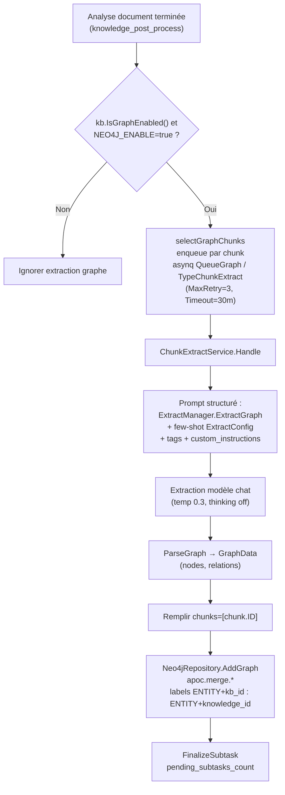
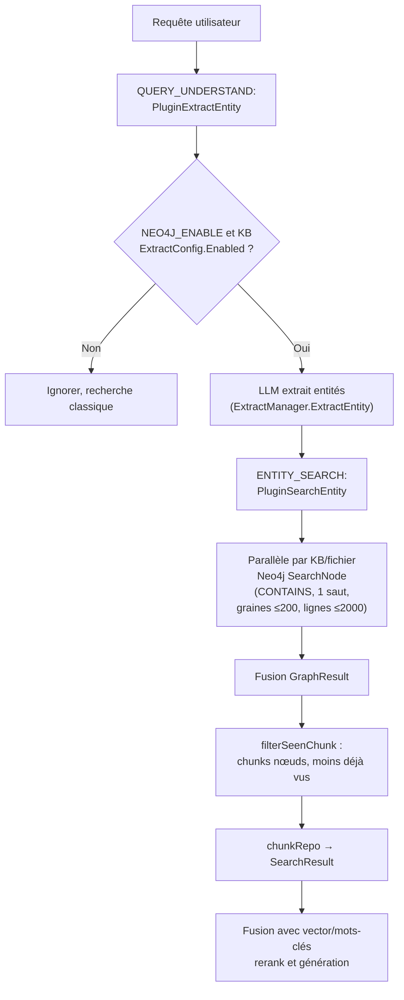

# Graphe de connaissances

Le graphe de connaissances extrait entités et relations à l’ingestion des documents, puis, lors des questions-réponses, parcourt ces liens pour récupérer des fragments supplémentaires. Il peut être combiné à la recherche vectorielle et par mots-clés afin d’enrichir les réponses avec un contexte relationnel.

Cette fonction convient aux corpus où personnes, organisations, produits ou clauses sont fortement interconnectés. Une fois activée, elle augmente les appels modèle à l’ingestion et nécessite le déploiement de Neo4j.

Le stockage du graphe utilise Neo4j et dépend du plugin APOC.

## Activation

Le graphe exige **deux niveaux de bascules** simultanément :

### Bascule globale : variables d’environnement Neo4j {#_1-bascule-globale-variables-neo4j}

`NEO4J_ENABLE` est la seule bascule globale du graphe de connaissances (le commentaire de `docker-compose.yml` précise que `ENABLE_GRAPH_RAG` est remplacé par `NEO4J_ENABLE` depuis v0.1.6 ; l’application Go ne lit plus l’ancienne variable).

| Nom | Type | Défaut | Description |
|------|------|--------|------|
| `NEO4J_ENABLE` | string | vide (désactivé) | Mettre `true` pour activer le graphe ; `initNeo4jClient` dans `internal/container/container.go` ainsi que l’enqueue des tâches et le pipeline de recherche vérifient cette valeur |
| `NEO4J_URI` | string | `bolt://neo4j:7687` | Adresse de connexion Neo4j |
| `NEO4J_USERNAME` | string | `neo4j` | Nom d’utilisateur |
| `NEO4J_PASSWORD` | string | `password` | Mot de passe |

Au démarrage, `initNeo4jClient` retente jusqu’à 30 fois (intervalle 2 s) pour établir et valider la connexion ; si désactivé, il renvoie un driver `nil` : construction, suppression et `SearchNode` interne deviennent des no-op (log `NOT SUPPORT RETRIEVE GRAPH`). L’API publique dédiée renvoie explicitement 503 au lieu de simuler « aucune correspondance » sans backend. `GET /system` indique `"Neo4j"` ou `"Not Enabled"` via `getGraphDatabaseEngine()` (`internal/handler/system.go`).

Le service `neo4j` de docker-compose inclut APOC : `NEO4JLABS_PLUGINS=["apoc"]` (écriture via `apoc.merge.node` / `apoc.merge.relationship`, suppression via `apoc.periodic.iterate`).

### Bascule au niveau base de connaissances : IndexingStrategy + ExtractConfig {#_2-bascule-kb-indexingstrategy-extractconfig}

`internal/types/knowledgebase.go` :

```go
// IsGraphEnabled checks if knowledge graph extraction is enabled.
// Requires both the IndexingStrategy flag and a valid ExtractConfig.
func (kb *KnowledgeBase) IsGraphEnabled() bool {
    return kb != nil && kb.IndexingStrategy.GraphEnabled &&
        kb.ExtractConfig != nil && kb.ExtractConfig.Enabled
}
```

- `IndexingStrategy.GraphEnabled` (`internal/types/indexing_strategy.go`) : bascule graphe dans la stratégie d’indexation, défaut `false` ; l’ancien champ `ExtractConfig.Enabled` est synchronisé unidirectionnellement vers `IndexingStrategy.GraphEnabled` à la lecture (legacy sync dans `knowledgebase.go`).
- `ExtractConfig` (`internal/types/knowledgebase.go`) porte la configuration few-shot d’extraction :

| Nom | Type | Défaut | Description |
|------|------|--------|------|
| `enabled` | bool | false | Activer l’extraction |
| `text` | string | vide | Texte d’exemple few-shot |
| `tags` | []string | nil | Ensemble de labels de types de relation |
| `nodes` | []*GraphNode | nil | Nœuds entité d’exemple (name / attributes) |
| `relations` | []*GraphRelation | nil | Relations d’exemple (node1 / node2 / type) |
| `custom_instructions` | string | vide | Consignes métier (ajoutées au prompt système ; le protocole de sortie structurée reste contrôlé par le système) |

API d’assistance à la configuration (`internal/handler/initialization.go`, routes dans `internal/router/routes_infra.go`, Admin requis ; clé API avec capacité `manage_models`) :

- `POST /initialization/extract/text-relation` (`ExtractTextRelations`) : essai d’extraction relationnelle sur un texte (≤ 5000 caractères) avec labels choisis, pour prévisualisation ;
- `POST /initialization/extract/fabri-text` / `fabri-tag` (`FabriText` / `FabriTag`) : génération LLM de texte d’exemple / suggestion de labels pour monter rapidement un `ExtractConfig`.

## Flux d’extraction entités-relations (construction)

### Déclenchement et orchestration

Après l’analyse documentaire, `internal/application/service/knowledge_post_process.go` sélectionne les entrées via `selectGraphChunks` en phase d’enrichissement fan-out (`graphChunkCount = len(graphChunks)` si `eff.GraphEnabled`), puis appelle `NewChunkExtractTask` dans `internal/application/service/extract.go` pour enqueue chunk par chunk. Règles de sélection :

- Les chunks texte avec corps participent ; les chunks texte ne contenant qu’un lien image sont ignorés ;
- Si le chunk texte parent n’a pas de corps (typique des pages scannées PDF), on utilise le sous-chunk `image_ocr` pour intégrer le texte OCR au graphe ;
- Les sous-chunks `image_caption` sont exclus pour éviter le doublon avec l’OCR.

```go
func NewChunkExtractTask(...) (bool, error) {
    if strings.ToLower(os.Getenv("NEO4J_ENABLE")) != "true" {
        logger.Warn(ctx, "NEO4J is not enabled, skip chunk extract task")
        return false, nil
    }
    ...
    task := asynq.NewTask(types.TypeChunkExtract, payload,
        asynq.Queue(types.QueueGraph), asynq.MaxRetry(3), asynq.Timeout(30*time.Minute))
    ...
}
```

Les tâches passent par la file asynq `QueueGraph`, un appel LLM par chunk (commentaire source : enrichissement fan-out le plus coûteux du pipeline), soumis au limiter de concurrence arrière-plan par modèle ; tâches annulées / supprimées / remplacées (`attemptSuperseded`) sont ignorées et libèrent le compteur `pending_subtasks_count` du parent.

### Exécution d’extraction (ChunkExtractService.Handle)

`internal/application/service/extract.go` :

1. Charger chunk, base de connaissances et `ProcessOverrides` fichier ; `ResolveProcessConfig` produit le `ExtractConfig` effectif (sinon skip).
2. Assembler le template structuré : protocole système depuis `config.ExtractManager.ExtractGraph` (`extract.extract_graph` dans `config/config.yaml`, instructions multi-étapes entités + attributs + relations), plus `custom_instructions`, `tags` et few-shot `Text/Nodes/Relations` du KB.
3. `chatpipeline.NewExtractor(chatModel, template).Extract(ctx, chunk.Content)` appelle le modèle chat (`temperature 0.3`, `max_tokens 8192`, thinking désactivé ; plafond suffisant pour éviter JSON tronqué), puis `Formater.ParseGraph` → `types.GraphData` (`internal/types/extract_graph.go`) :

```go
type GraphNode struct {
    Name       string   `json:"name,omitempty"`
    Chunks     []string `json:"chunks,omitempty"`
    Attributes []string `json:"attributes,omitempty"`
}
type GraphRelation struct {
    Node1 string `json:"node1,omitempty"`
    Node2 string `json:"node2,omitempty"`
    Type  string `json:"type,omitempty"`
}
```

4. Remplir `node.Chunks = []string{chunk.ID}` pour chaque nœud, puis `graphEngine.AddGraph(ctx, NameSpace{KnowledgeBase, Knowledge}, ...)` vers Neo4j.
5. Suivi SpanTracker (`postprocess.graph.chunk[i]`, comptes et échantillons nodes/relations).

### Backend de stockage : Neo4j

`internal/application/repository/retriever/neo4j/repository.go` implémente `interfaces.RetrieveGraphRepository` (`AddGraph` / `DelGraph` / `SearchNode`) :

- **Espace de noms = labels** : `NameSpace{KnowledgeBase, Knowledge}` → labels `ENTITY<kb_id>`, `ENTITY<knowledge_id>` (tirets → underscores), propriétés `name`, `kg` (knowledge_id), `attributes`, `chunks`.
- Écriture APOC idempotente, union des `chunks` pour entités homonymes :

```cypher
UNWIND $data AS row
CALL apoc.merge.node(row.labels, {name: row.name, kg: row.knowledge_id}, row.props, {}) YIELD node
SET node.chunks = apoc.coll.union(node.chunks, row.chunks)
```

- Suppression document / KB (`knowledge_delete.go`, `knowledgebase.go`) via `DelGraph` et `apoc.periodic.iterate` par lots de 1000.
- `SearchNode` a deux plafonds pour éviter qu’un nom court ou fréquent ne ramène tout le graphe :
  - Seules les entités avec au moins une relation servent de graines (max 200) ; tri : correspondance exacte du nom, puis noms plus courts, puis ordre alphabétique ;
  - Max 2000 lignes (entité, relation) avec le même tri ; au plafond, log Warn et troncature du voisinage des graines les mieux classées.

## Enrichissement graphe à la recherche (GraphRAG)

Deux plugins dans le pipeline chat classique (`internal/application/service/chat_pipeline`) :

1. **PluginExtractEntity** (`extract_entity.go`, événement `QUERY_UNDERSTAND`) : si `NEO4J_ENABLE=true`, filtrer les KB avec `ExtractConfig.Enabled` (`EntityKBIDs` / `EntityKnowledge`), puis `ExtractManager.ExtractEntity` + modèle chat extrait les noms d’entités de **la requête utilisateur** → `chatManage.Entity`.
2. **PluginSearchEntity** (`search_entity.go`, événement `ENTITY_SEARCH`) : pour chaque KB/fichier graphe activé, appels parallèles à `graphRepo.SearchNode` — Cypher `n.name CONTAINS nodeText`, voisins à un saut et relations → `chatManage.GraphResult` (limites ci-dessus) ; `filterSeenChunk` récupère les `chunks` des nœuds (hors hits vectoriels), charge le texte via `chunkRepo`, convertit en `SearchResult` : rappel complémentaire « entité → chunks liés ».

En mode Agent, l’outil `query_knowledge_graph` (`internal/agent/tools/query_knowledge_graph.go`) vérifie la config graphe par KB (`ExtractConfig.Nodes/Relations` non vides), recherche multi-KB concurrente, déduplication par chunk, état de config dans la sortie ; KB sans graphe retombent en recherche hybride classique. Capacité requise `all_of: [graph]` ; l’outil n’est exposé au modèle que si le scope Agent contient un KB graphe activé — `agent_service.go` le retire sinon pour éviter des appels dégradés.

## Requête JSON autonome

Les applications externes peuvent appeler `POST /api/v1/knowledge-bases/{id}/graph-search` pour lire entités (sous-chaîne sensible à la casse), relations ciblées et chunks sources valides. API en lecture seule sur un seul KB, sans modèle, sans modifier le pipeline Q/R par défaut, et sans exécution Cypher arbitraire.

Contrat de lecture borné : entités sans relation conservées, marqueurs de troncature résultats/candidats/champs, validation des sources avant attributs et relations. Suppression ou désactivation d’un chunk référencé entraîne l’omission conservative des entités/relations concernées. Permissions, paramètres, champs de réponse et plafonds : [API graph-search](../04-api/02-api-knowledge.md#graph-search).

## Diagrammes

### Construction



### Requête



## Visualisation

- **Génération Mermaid** : `graphBuilder` dans `internal/application/service/graph.go` (implémentation mémoire de `types.GraphBuilder` : LLM entités → relations → poids PMI×0.6 + Strength×0.4 normalisé 1–10 → degrés → graphe chunks) ; `generateKnowledgeGraphDiagram` DFS + sous-graphes Mermaid `graph TD`. `NewGraphBuilder` n’est pas câblé au conteneur (legacy) ; sortie Mermaid dans les logs.
- **API externe** : `POST /knowledge-bases/{id}/graph-search` en JSON pour visualisation externe ; pas de page UI dédiée ; `query_knowledge_graph` reste la sortie outil Agent. `GET /wiki/graph` (`wikiHandler.GetGraph`) est le graphe Wiki, distinct du graphe entités-relations ici.
- **Templates prompt** : `config/prompt_templates/graph_extraction.yaml` (`default_extract_entities`, etc.) résolus via `extract_entities_prompt_id` / `extract_relationships_prompt_id` pour le `graphBuilder` mémoire ; la voie asynchrone production utilise `extract.extract_graph` / `extract.extract_entity` dans `config.yaml` (`ExtractManagerConfig`).
