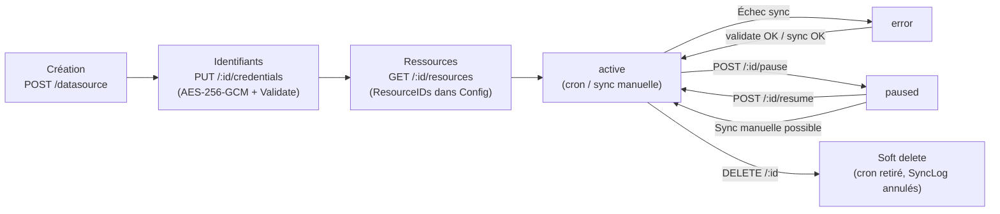
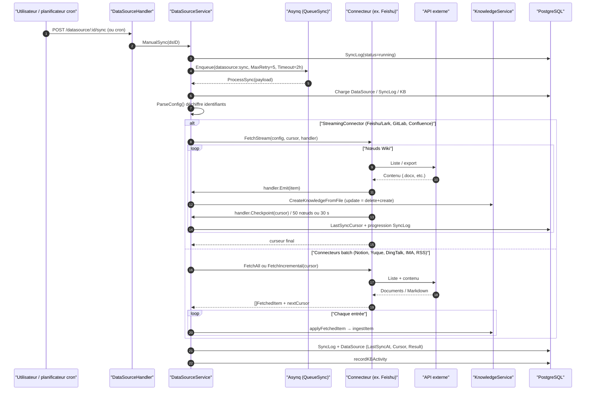

# Import de sources de données (Data Source)

Les sources de données synchronisent en continu le contenu de Feishu, Notion, Confluence, Yuque et d’autres plateformes vers une base de connaissances. Une fois la connexion établie, les ajouts et modifications peuvent être récupérés selon un planning ; les suppressions côté source sont traitées selon la configuration de synchronisation.

La configuration se fait au niveau de la base de connaissances : ouvrez les paramètres d’édition de la cible, onglet « Sources de données », créez une connexion, renseignez les identifiants, puis choisissez le périmètre et la périodicité. La première synchronisation récupère l’intégralité du contenu ; les suivantes s’appuient sur les capacités du connecteur pour une mise à jour incrémentale.

<Screenshot
  src="/screenshots/datasource-sync.png"
  caption="Sources de données : liste des connexions et état de sync"
  hint="Liste des sources configurées (type, base cible, dernière sync, statut) et accès aux journaux de synchronisation." />

Le connecteur lit le contenu externe, le planificateur déclenche la sync, la couche service compare les changements et alimente la base de connaissances.

## Établir une connexion et synchroniser

1. Ouvrez les paramètres « Sources de données » de la base cible en tant qu’administrateur de l’espace.
2. Choisissez un connecteur, renseignez les identifiants et testez la connexion jusqu’à pouvoir lister les ressources voulues.
3. Définissez le périmètre et la planification, enregistrez, puis lancez la première synchronisation.
4. Consultez l’état et les journaux pour vérifier créations, mises à jour, ignorés et échecs.

La mise à jour des identifiants exige une configuration complète, validée en ligne. Mettre en pause arrête les syncs planifiées ; la reprise réenregistre le cron.

`sync_schedule` utilise une expression cron à six champs (avec secondes), par ex. `0 0 */6 * * *` toutes les six heures ; une chaîne vide = sync manuelle uniquement. Création, édition et reprise valident l’expression ; une valeur invalide renvoie HTTP 400 sans modifier la config ni les tâches existantes. Pour une source historique avec expression invalide, corrigez ou videz l’expression avant de reprendre.

## Choisir un connecteur

| Connecteur | Identifiant | Objets synchronisés |
| --- | --- | --- |
| Feishu / Lark Wiki | `feishu` / `lark` | Espaces et nœuds Wiki |
| Feishu Drive / Lark Drive | `feishu_drive` / `lark_drive` | Dossiers cloud, voir [Feishu Drive](24-feishu-drive.md) |
| Notion | `notion` | Pages et bases |
| Confluence | `confluence` | Pages (Server / Data Center ou Cloud) |
| Yuque | `yuque` | Documents de dépôt |
| DingTalk Docs | `dingtalk` | Bases, dossiers et docs en ligne |
| Tencent IMA | `ima` | Fichiers et notes dans la base IMA |
| GitLab | `gitlab` | Répertoires sur branche/tag choisis |
| Seafile | `seafile` | Dossiers et fichiers du dépôt |
| RSS / Atom | `rss` | Articles de flux |

Formats, authentification et détection de suppressions : section référence ci-dessous.

## Vérifier les changements et les échecs

La première sync récupère le périmètre sélectionné ; les suivantes s’appuient sur le curseur et les métadonnées de modification du connecteur. La détection de suppressions dépend du connecteur et de la config ; la rotation naturelle des flux RSS ne compte pas comme suppression source. En cas d’échec, consultez d’abord le journal (identifiants, visibilité des ressources, erreurs d’analyse), retestez la connexion puis relancez.

## Référence connecteurs et API

### Détail des implémentations

#### Comparaison des capacités

| | Feishu / Lark | Notion | Yuque | RSS / Atom |
| --- | --- | --- | --- | --- |
| Code | `internal/datasource/connector/feishu/wiki/` (`feishu/core/`) | `connector/notion/` | `connector/yuque/` | `connector/rss/` |
| Type | `feishu` / `lark` | `notion` | `yuque` | `rss` |
| Auth | App entreprise `app_id` + `app_secret` (tenant_access_token) | Token intégration interne (`api_key`) | Token perso/équipe (`api_token`, en-tête `X-Auth-Token`) | Aucune ou en-têtes `auth_headers` |
| Identifiants | `app_id`, `app_secret`, `base_url` (optionnel) | `api_key` (`base_url` dans Settings) | `api_token`, `base_url` (privé) | `auth_headers` (secret) ; `feed_urls` dans Settings |
| Modèle ressource | Espaces Wiki → arbre (lazy, ID `spaceID:nodeToken`) | Arbre pages/bases (parent en une passe) | Liste plate de books | Une ressource par URL de flux |
| Contenu | Export → docx/xlsx ; fichiers drive bruts | Blocks → MD ; bases → tableaux | Corps Markdown `.md` | Readability → HTML→MD |
| Incrémental | `obj_edit_time` (`SpaceNodeTimes`) | `last_edited_time` (`PageEditTimes`) | `content_updated_at` (`BookDocTimes`) | Empreinte flux + SHA-256 contenu |
| Suppressions | Oui (arbre vs curseur ; skip si liste partielle) | Oui (distinction source vs décochage) | Oui | Non (rotation naturelle du flux) |
| Sync streaming reprise | Oui (checkpoint 50 nœuds / 30 s) | Non | Non | Non |
| Rate limit | 429 + backoff ; 5xx retry | — | 300 ms entre `GetDocDetail` | — |
| Échec partiel | Placeholder par doc | Skip page + log | Placeholder | `PartialFetchError` par flux |

#### Feishu / Lark (`connector/feishu/wiki/`)

Permissions drive, partage dossiers et modes de parsing : [Feishu Drive](24-feishu-drive.md). Sémantique images/pièces `blocks` vs `export` ci-dessous ; avec sync suppressions, les entrées knowledge de cette source sont supprimées.

Feishu et Lark (open.larksuite.com) partagent le **même connecteur** ; `feishu/core/region.go` choisit la région (`RegionFeishu` / `RegionLark`, domaines API distincts). `base_url` peut surcharger (sources historiques).

> **Upgrade** : trois changements si le mode parse est par source :
> 1. `FEISHU_DOCX_PARSE_MODE` obsolète : repli avec avertissement si la source n’a pas de mode ;
> 2. Sources sans mode : défaut `export` → `blocks` ;
> 3. Marqueur resync full one-shot : prochaine sync réindexe tout (embedding/VLM), puis effacement du marqueur.

**Permissions app** (console Feishu/Lark, lecture seule, republier l’app après ajout).

#### Permissions Wiki Feishu / Lark

| Permission | blocks (défaut) | export | Si manquante |
| --- | --- | --- | --- |
| `wiki:wiki:readonly` | Requis | Requis | Arbre ressources KO |
| `docx:document:readonly` | Requis (blocks API) | Non | docx illisible |
| `drive:drive:readonly` | Requis (médias, file) | Si nodes file | Téléchargement KO |
| `drive:export:readonly` | sheet/bitable, repli blocks | Requis export async | Export sheet/doc KO |

Permissions optionnelles (blocks, dégradation gracieuse) : sheets, bitable, whiteboard, contacts (@membre), metadata drive (titres de liens cloud).

#### Permissions Feishu Drive

Sans `wiki:wiki:readonly` ; même logique blocks/export pour dossiers cloud.

Au-delà du minimum, d’autres scopes drive/docs existent — principe du moindre privilège. **Autorisation ressource** : admin Wiki ou partage dossier à l’app ([Feishu Drive](24-feishu-drive.md)).

- **Auth** : token tenant, cache verrouillé ;
- **ListResources** : lazy 3 niveaux (espaces → racine → enfants `spaceID:nodeToken`) ; sync récursive à l’exécution ; `ResolveResourceAncestors` via `parent_node_token` ;
- **Dossiers** : miroir arborescence Wiki/Drive dans `folder_path` (`/` → `_`) ; **racine synchronisée = dossier top-level nommé** pour distinguer plusieurs sources Feishu ; rename/move Wiki via empreintes ; Drive : moves silencieux en incrémental → full manual ; suppressions nodes → delete knowledge si activé ; raccourcis Wiki dédoublonnés si sous-arbre inclus ;
- **Mode docx** (`settings.parse_mode`, défaut `blocks`) : « config serveur » pour legacy ; changement effectif → re-fetch docx au prochain sync ;
  - `blocks` → GFM, tableaux, formules, tâches ; sheet/bitable inline ; types non API → placeholder ;
  - `export` → tâche async `.docx` + parseur générique ;
  - `doc`/`sheet`/`bitable` : toujours export ;
  - **blocks** : rapide, pièces file block ; **export** : lent, sans pièces docx inline, comme upload manuel ;
- **Objets embarqués (blocks)** : images → stockage WeKnora + OCR/VLM si configuré ; whiteboard block 43 ; >30 images → export docx natif ; pièces PDF/Office séparées dédupliquées ; sheet inline ; vidéo : lien seulement ;
- **Mentions** : utilisateur, doc cloud (batch meta), placeholders composants ;
- **fetchNodeContent** par `obj_type` ; mindnote/slides ignorés + tally log ;
- **Incrémental** : curseur `SpaceNodeTimes` (edit times, chemin, mode parse) ; échec fetch ne avance pas le curseur ;
- **FetchStream / FetchFullStream** : checkpoints 50 / 30 s ; full garde baseline suppressions ;
- **Erreurs** : codes i18n `feishu_*` / `sync_failed`.

#### GitLab (`connector/gitlab/`)

`base_url`, `access_token`, projets/branches/chemins dans `settings.projects`. Sync streaming, diff git, suppressions si `sync_deletions`. Fichiers identiques chemins différents = entrées distinctes.

#### Seafile (`connector/seafile/`)

Token API, adresse (+ prefix), SSRF whitelist si privé. Sync `<library>/<path>`, checkpoint 50, fingerprint id+mtime+size. Échec fichier isolé ; scan dossier interrompu si `Retry-After` > 60 s. Voir [Seafile](25-seafile.md).

#### Tencent IMA (`connector/ima/`)

`client_id`, `api_key` ; liste plates de bases ; sync récursive dossiers. Fichiers + URL + notes ; sessions AI/vidéo ignorées. Suppressions après liste complète.

Feishu/Lark : `UpdatedAt` = édition contenu. GitLab/IMA : détection delete. RSS : rotation ≠ delete.

#### Notion (`connector/notion/`)

Token interne, API `2026-03-11`. Search → arbre ; `resolveParentID` pour `data_source`. `fetchPage` récursif, bases en table MD, pièces jointes hors images inline. Incrémental : BFS + `last_edited_time` ; DB entière si un record change. Pages exclues par décochage ≠ deleted.

#### Confluence (`connector/confluence/`)

Server/DC (PAT Bearer ou Basic) ou Cloud (email + API token). Champs credentials vs Settings documentés. Sync espaces publiés, HTML→MD, incrémental par version, streaming checkpoint, garde-fous delete (80 % / 20 pages). Erreurs `confluence_*`.

#### Yuque (`connector/yuque/`)

Token + `base_url`. Repos perso/groupe. Walk docs `Doc` publiés, 300 ms entre détails. `folder_mode` `none`/`toc`, `toc_only` filtre admission (pas purge KB). Sync move TOC-only via full ou edit content.

#### DingTalk (`connector/dingtalk/`)

App Wiki + Union ID. Markdown via Blocks API. `include_uploaded_files` (défaut false, 64 MiB max) ; `preserve_folder_structure`. Incrémental `modifiedTimestamp`, delete reconciliation en full. Blocks niveau 1 + children si présents.

#### RSS / Atom (`connector/rss/`)

`feed_urls` (Settings), `auth_headers` (Credentials). gofeed + readability ; double empreinte ; pas de delete sync ; `PartialFetchError` partiel.

### Cycle de vie et API REST

Routes dans `internal/router/routes_infra.go`, `RegisterDataSourceRoutes` (liste, détail, journaux : Viewer+ ; autres : Admin+ ; clé API : `manage_datasources` ou accès complet) :

| Méthode et chemin | Permission | Description |
| --- | --- | --- |
| `GET /api/v1/datasource/types` | Viewer | Métadonnées des connecteurs (`ListAvailableConnectors`, tri Priority) |
| `POST /api/v1/datasource/validate-credentials` | Admin | Test de connectivité sans persistance (assistant « Tester la connexion ») |
| `POST /api/v1/datasource` | Admin | Création (KB du locataire → type → Validate en ligne → DB → cron) |
| `GET /api/v1/datasource?kb_id=` | Viewer | Liste par KB (+ dernier SyncLog) |
| `GET /api/v1/datasource/:id` | Viewer | Détail |
| `PUT /api/v1/datasource/:id` | Admin | Mise à jour (identifiants ignorés ; Validate si config change ; cron) |
| `DELETE /api/v1/datasource/:id` | Admin | Soft delete + cron + annulation SyncLog en cours |
| `PUT /api/v1/datasource/:id/credentials` | Admin | Remplacement atomique des identifiants (voir [Stockage chiffré des identifiants](#stockage-chiffre-identifiants)) |
| `DELETE /api/v1/datasource/:id/credentials/:field` | Admin | Effacement (`field` = `credentials` uniquement) |
| `POST /api/v1/datasource/:id/validate` | Admin | Test sur source existante ; `status=error` ou clear |
| `GET /api/v1/datasource/:id/resources?parent_id=` | Admin | Ressources externes (lazy load) |
| `POST /api/v1/datasource/:id/resource-ancestors` | Admin | Chaîne d’ancêtres pour sélection profonde |
| `POST /api/v1/datasource/:id/sync` | Admin | Sync manuelle (SyncLog + file Asynq) |
| `POST /api/v1/datasource/:id/pause` / `resume` | Admin | Pause / reprise (+ cron) |
| `GET /api/v1/datasource/:id/logs`, `GET …/logs/:log_id` | Viewer | Historique de sync |

Tous les `:id` passent par `getOwnedDataSource` → `getOwnedKnowledgeBase` (**isolation locataire** + autorisation KB de la clé API).

## Référence synchronisation et stockage

### Planification (`internal/datasource/scheduler.go`)

`Scheduler` + `robfig/cron` (`cron.WithSeconds()`, expression à 6 champs). Au démarrage, `Start()` enregistre toutes les sources `active` avec `SyncSchedule`.

Le cron déclenche à **heure murale fixe** ; en multi-instances, dédoublonnage :

1. **Base** : `syncLogRepo.HasRunningSync` — pas de sync concurrente si la précédente est encore `running`.
2. **Redis** : `asynq.TaskID = "dssync:<dsID>:<yyyyMMddHHmm>"` — une seule file réussie par minute ; les autres → SyncLog `canceled` (« deduplicated »).

File : `types.QueueSync`, `MaxRetry(5)`, `Timeout(2*time.Hour)`, type `types.TypeDataSourceSync`, consommateur `ProcessSync` dans `internal/router/task.go`.

### Exécution et indexation (`datasource_service.go`)

`ProcessSync` (Asynq) — points clés :

- Source ou KB supprimée → SyncLog `canceled`, pas de retry.
- **Streaming** si `StreamingConnector` ; sinon `FetchAll` / `FetchIncremental` selon `ForceFull` / `SyncMode`.
- **Curseur streaming** (`streamStartCursor`) : full manuel sans curseur au 1er essai ; retry Asynq et incrémental reprennent au checkpoint. `FullStreamingConnector` (Feishu/Lark, Seafile, Confluence) : `FetchFullStream` + baseline suppressions.
- **`applyFetchedItem` → `ingestItem`** : delete si `IsDeleted` + `sync_deletions` ; fichier → `CreateKnowledgeFromFile` ; URL → `CreateKnowledgeFromURL` ; **mise à jour = delete puis create** ; doublon → Skipped ; metadata `external_id`, `source_*_at` RFC3339.
- **Auto-tag** du nom de la source (échec non bloquant).
- **Statut** : tout en échec → `failed` ; RSS/flux partiel → `partial` ; sinon `success` (max 100 `SyncItemError`).
- Curseur persisté même en échec partiel si le connecteur le renvoie.

### Stockage chiffré des identifiants {#stockage-chiffre-identifiants}

**1. Écriture — `DataSourceConfig.ToJSON()`** (`internal/types/datasource.go`) : avec `SYSTEM_AES_KEY`, chaque valeur string de `Credentials` est chiffrée AES-256-GCM avant sérialisation (seule voie d’écriture DB).

**2. Lecture — `DataSource.ParseConfig()`** : chaîne vide ; legacy sans préfixe `enc:v1:` ; déchiffrement ou champs vidés si clé perdue (UI « identifiants non configurés »).

**3. Sous-ressource** `internal/handler/datasource_credentials.go` :

- `PUT /api/v1/datasource/:id/credentials` — remplacement total + `Validate` immédiat ;
- `DELETE …/credentials/credentials` — effacement ;
- Réponses sans secret : `{"credentials": {"configured": true/false}}`.

`UpdateDataSource` **conserve** les identifiants en base même si le body en contient ; `StripNonSecretCredentials` retire les champs non secrets (ex. `feed_urls` RSS → Settings).

### Limites de sécurité (`httpclient.go`, `errors.go`)

`ValidateConnectorBaseURL` ; `NewConnectorHTTPClient` avec SSRF sur redirections et dial (`internal/utils/security.go`). Erreurs sentinelles + `PartialFetchError` pour échecs partiels.

### Abstraction `Connector`

Interface dans `internal/datasource/connector.go` : `Type`, `Validate`, `ListResources`, `ResolveResourceAncestors`, `FetchAll`, `FetchIncremental`.

**`StreamingConnector`** : `Emit` + `Checkpoint` (snapshot complet). Timeout 2 h, reprise au checkpoint. Feishu/Lark, GitLab, Confluence en streaming ; Feishu/Lark, Seafile, Confluence aussi `FullStreamingConnector`. DingTalk reste batch — gros espaces : privilégier l’incrémental.

**Registre** (`initConnectorRegistry` dans `container.go`) : `feishu`, `lark`, `feishu_drive`, `lark_drive`, `notion`, `confluence`, `yuque`, `dingtalk`, `ima`, `rss`, `gitlab`, `seafile`. Entrées metadata non implémentées (GitHub, Google Drive, etc.) → `ErrConnectorNotFound`.

### Modèles (`internal/types/datasource.go`)

| Structure | Description |
| --- | --- |
| `DataSource` | Entité `data_sources` : `Type`, `Config` (JSONB chiffré), `SyncSchedule`, `SyncMode`, `Status`, `SyncDeletions`, `LastSyncCursor`, etc. |
| `SyncLog` | Exécution `sync_logs` : `running`/`success`/`partial`/`failed`/`canceled`, compteurs Created/Updated/… |
| `DataSourceConfig` | `Credentials`, `ResourceIDs`, `Settings` |
| `Resource` / `FetchedItem` / `SyncCursor` / `SyncResult` / `SyncItemError` / `DataSourceSyncPayload` | Comme en référence API |

## Références

- Guide connecteurs : `internal/datasource/CONNECTOR_IMPLEMENTATION_GUIDE.md`
- Module : `internal/datasource/README.md`

## Implémentation

- Framework : `internal/datasource/` (`connector.go`, `scheduler.go`, `httpclient.go`, `errors.go`, `connector/…`)
- HTTP : `internal/handler/datasource.go`, `datasource_credentials.go`
- Service : `internal/application/service/datasource_service.go`
- Types : `internal/types/datasource.go`
