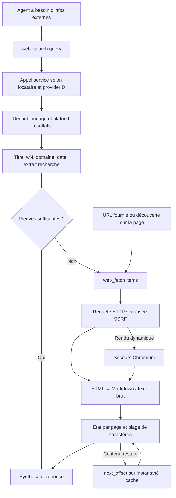

# Recherche web et extraction de pages

La recherche web complète la base de connaissances avec des informations extérieures. L’agent utilise `web_search` pour trouver des résultats, puis `web_fetch` pour lire le corps des pages. Vous pouvez brancher un service de recherche ou déployer SearXNG.

Dans « Paramètres → Recherche web », choisissez le fournisseur, renseignez les identifiants et testez la connexion, puis sélectionnez cette configuration dans l’agent. Le nombre de résultats est plafonné par le réglage maximal de l’agent.

## Moteurs de recherche pris en charge

Les moteurs sont enregistrés dans `registerWebSearchProviders` (`internal/container/container.go`) :

```go
registry.Add(infra_web_search.Spec{Type: "duckduckgo", Search: infra_web_search.NewDuckDuckGoProvider})
// ... google, bing, tavily, ollama, baidu, searxng, keenable, zhipu, exa, metaso, bocha idem
registry.Add(infra_web_search.Spec{Type: "brave", FilteredSearch: infra_web_search.NewBraveProvider})
registry.Add(infra_web_search.Spec{Type: "serply", FilteredSearch: infra_web_search.NewSerplyProvider})
registry.Add(infra_web_search.Spec{
	Type: "deepseek", Search: infra_web_search.NewDeepSeekProvider, Fetch: infra_web_search.NewDeepSeekFetch,
})
```

Le type de fournisseur détermine le flux : les moteurs enregistrés via `FilteredSearch` font passer `country` / `freshness` à `web_search` ; ceux avec `Fetch` lisent la page via leur API ; les autres utilisent la lecture locale.

| Moteur | Fichier source | Clé API requise | Point de terminaison | Remarques |
|------|---------|-----------------|------|------|
| DuckDuckGo | `duckduckgo.go` | Non | HTML en priorité, API en secours | Gratuit ; `proxy_url` possible |
| Google | `google.go` | Oui (+ `engine_id`) | Google Custom Search API (SDK officiel `customsearch/v1`) | |
| Bing | `bing.go` | Oui | `https://api.bing.microsoft.com/v7.0/search` (codé en dur) | |
| Tavily | `tavily.go` | Oui | `https://api.tavily.com/search` (codé en dur) | |
| Ollama Web Search | `ollama.go` | Oui | `https://ollama.com/api/web_search` (codé en dur) | Max. 10 résultats |
| Baidu Qianfan AI Search | `baidu.go` | Oui | `https://qianfan.baidubce.com/v2/ai_search/web_search` (codé en dur) | |
| SearXNG | `searxng.go` | Non | `base_url` saisi par le locataire (instance auto-hébergée) | Seul moteur à adresse personnalisable ; validation SSRF |
| Keenable | `keenable.go` | Optionnelle | `https://api.keenable.ai` (codé en dur) | Sans clé : endpoint public limité ; avec clé : limites levées |
| Zhipu Search | `zhipu.go` | Oui | `https://open.bigmodel.cn/api/paas/v4/web_search` (codé en dur), moteur par défaut `search_std` | |
| Metaso | `metaso.go` | Oui | `https://metaso.cn/api/v1/search` | `extra_config.scope` pour la portée ; défaut `webpage` |
| Exa | `exa.go` | Oui | `https://api.exa.ai/search` | Highlights par défaut ; `extra_config.include_text` pour le corps |
| Bocha | `bocha.go` | Oui | `https://api.bochaai.com/v1/web-search` | `extra_config.freshness`, `summary` |
| Brave Search | `brave.go` | Oui | `https://api.search.brave.com/res/v1/web/search` | `country` / `freshness` par appel |
| Serply | `serply.go` | Oui | `https://api.serply.io/v1/search` | Résultats Google ; `country` / `freshness` par appel (freshness : pd/pw/pm/py uniquement) |
| DeepSeek | `deepseek.go` | Oui | `https://api.deepseek.com/v1/tools/search`, `/v1/tools/fetch` | Requête max. 128 caractères ; API de lecture ; `web_fetch` et `content=true` passent par DeepSeek Fetch |

15 moteurs sont enregistrés au total.

| Config. fournisseur | Valeurs |
| --- | --- |
| Metaso scope | webpage (défaut), document, scholar, podcast, video, image |
| Exa include_text | Booléen chaîne, ex. `"true"` ; corps non récupéré par défaut |
| Bocha freshness | noLimit (défaut), oneDay, oneWeek, oneMonth, oneYear |
| Bocha summary | Résumé demandé par défaut ; `"false"` pour désactiver |
| Filtres Brave par appel | `country` / `freshness` sont des paramètres de l’outil `web_search` (voir ci-dessous) ; sémantique différente des champs fixes Bocha |
| Filtres Serply par appel | Comme Brave ; `country` → `gl` Google ; `freshness` : pd/pw/pm/py uniquement, pas d’intervalle de dates |

Hors SearXNG, tous les points de terminaison sont codés en dur et non configurables par le locataire — première barrière anti-SSRF (commentaire source : `Not configurable by tenants — prevents SSRF`).

## Configuration moteur (entité Provider)

Chaque espace de travail peut créer plusieurs instances de configuration (ex. « Production Bing », « Test Google »), stockées comme `WebSearchProviderEntity` dans `web_search_providers` (`internal/types/web_search_provider.go`), référencées par ID dans l’agent. Structure `WebSearchProviderParameters` :

| Nom | Type | Défaut | Description |
|------|------|--------|------|
| `api_key` | string | vide | Clé du service de recherche, chiffrée AES-GCM en base ; modifiable uniquement via la sous-ressource `/credentials`, jamais renvoyée dans les réponses |
| `engine_id` | string | vide | Requis uniquement pour Google Custom Search |
| `base_url` | string | vide | SearXNG uniquement : URL de l’instance auto-hébergée ; validée par `utils.ValidateURLForSSRF` ; adresses internes via `SSRF_WHITELIST` |
| `proxy_url` | string | vide | Proxy HTTP/HTTPS sortant optionnel (tunnel uniquement, ne remplace pas l’endpoint API) ; validation SSRF |
| `extra_config` | map[string]string | nil | Paramètres spécifiques : scope Metaso, include_text Exa, freshness/summary Bocha, etc. |

Routes CRUD (`RegisterWebSearchProviderRoutes`, `internal/router/routes_infra.go`) : CRUD sous `/web-search-providers`, `POST /test` (essai avec paramètres non enregistrés), `POST /:id/test` (config enregistrée), `PUT /:id/credentials` et `DELETE /:id/credentials/:field` ; tests et écritures réservés aux Admin ; `GET /web-search/providers` renvoie le catalogue des types de moteurs. Détail dans [API infrastructure](../04-api/02-api-infra.md).

## Recherche et lecture côté agent

`web_search` découvre les sources ; `web_fetch` lit les pages choisies. Si l’utilisateur fournit une URL, lecture directe ; pour des infos externes ou en temps réel, recherche directe. L’appel à `search_knowledge` n’est plus imposé en premier : la pertinence de la base dépend de la tâche et des outils disponibles.



### web_search

Exemples d’appel :

```json
{"query":"Python release notes","count":5}
{"query":"Rust release notes","country":"DE","freshness":"pw","content":true}
```

- `count` : nombre de résultats, entre 1 et le maximum de l’agent (20 max.) ; si omis, défaut agent. Au-delà du plafond, troncature + message correctif visible par le modèle, sans échec de l’appel ; valeur strictement inférieure à 1 → erreur de paramètre.
- `country` / `freshness` via Brave et Serply. Région : code à deux lettres ou `ALL` ; fraîcheur : `pd` / `pw` / `pm` / `py` ou `YYYY-MM-DDtoYYYY-MM-DD`. Sans `country`, Brave n’envoie pas le paramètre (défaut US côté Brave) ; `ALL` explicite = mondial. Serply mappe `country` en `gl` Google ; `freshness` : pd/pw/pm/py uniquement. Les autres fournisseurs n’exposent pas ces champs dans le schéma ; le descriptif d’outil invite à inclure lieu et période dans la requête ; si des filtres arrivent quand même au service, erreur (pas d’ignorance silencieuse). Voir [documentation API Brave](https://api-dashboard.search.brave.com/api-reference/web/search/get).
- `content` désactivé par défaut. À `true`, corps des 3 premiers résultats en parallèle (budget 15 s pour le lot, extrait 5 000 caractères max. par page) ; les autres gardent l’extrait de recherche, suite via `web_fetch`. Échec de capture : extrait conservé ; URL du corps complet via `full_output_path`. Recherche et `web_fetch` partagent l’instantané du tour ; un court timeout n’annule pas une capture partagée en cours.
- L’`age` relatif Brave est conservé tel quel (pas de conversion « il y a 2 jours » en date exacte).
- Requêtes vides, URL invalides et doublons filtrés ; plafond depuis la config agent, max. 20.
- Pas de compression RAG agent (`WebResultCompressor`), pas de base temporaire, pas d’embed/rerank/Redis éphémère. La compression RAG du pipeline quick-answer reste gérée par ce pipeline.
- Sortie modèle : titre, domaine, date si disponible, ID de page wN. Extraits et contenu fournisseur = preuves de recherche non vérifiées sur la page ; max. 1 500 caractères par segment, budget preuves 16 000 caractères par lot.

### web_fetch

Exemple d’appel :

```json
{"items":[{"url":"w1"},{"url":"https://example.com/guide","limit":4000}]}
```

- Accepte les ID wN connus et les URL HTTP(S) fournies ou trouvées sur la page. Les ID courts sont résolus aux frontières de contexte modèle ; l’UI et la persistance gardent l’URL réelle.
- Paramètre `prompt` retiré ; schéma : `url`, `offset`, `limit` uniquement. Plus de second modèle pour résumer : l’agent principal analyse le corps.
- HTML : Readability d’abord ; en succès conversion du texte extrait complet ; sinon repli main/article/body (évite la perte de paragraphes adjacents en ciblant `.content`). Markdown : titres, paragraphes, liens, tableaux, code. Liens relatifs résolus depuis l’URL HTTP finale ; ressources embarquées non téléchargées automatiquement.
- Texte brut, Markdown, JSON/XML lus directement (évite de traiter `<...>` comme HTML). Binaires : `unsupported_content`.
- HTTP en priorité, secours Chromium pour pages dynamiques. Requêtes via validation SSRF partagée, client sécurisé et DNS pinning.
- Si le moteur courant a une API de lecture (DeepSeek aujourd’hui), `web_fetch` et `web_search` avec `content=true` passent par cette API. URL validée par `utils.ValidateURLForSSRF` avant envoi ; adresses internes non transmises au tiers ; clé refusée → `provider_auth_failed`. Config moteur indisponible → repli lecture locale.
- Max. 8 éléments par lot ; dédoublonnage URL normalisée + offset + limit. Chaque élément : `success` / `failed` / `skipped` ; échecs partiels, succès conservés.
- `offset` : décalage Unicode depuis 0 ; `limit` défaut et plafond 8 000. Budget de sortie réparti par lot ; retour `offset`, `returned_chars`, `content_length`, `truncated` ; `next_offset` s’il reste du contenu.
- Reprise avec la même URL et `offset=next_offset`. Cache mémoire : max. 8 instantanés de page pour la reprise dans le même run ; après éviction, `full_output_path` pour lire le corps complet sans re-fetch. Ancienne reprise : `snapshot_expired` réessayable (re-fetch offset 0 ou `read_file`) pour éviter de concaténer des versions différentes. Reprises dans un lot attendent la fin du premier fetch.
- Markdown complet enregistré dans le stockage fichiers du locataire de la session ; `full_output_path` au format `web://...`. `read_file` cross-tours sans sandbox. Lié au message assistant générateur ; contrôles locataire, propriétaire session, session, message et liaison web ; pas de lecture web depuis pièces jointes ordinaires. Inaccessible après suppression message/session ; rétention alignée sur les pièces jointes de messages soft-deleted.
- Échec d’enregistrement ne supprime pas le corps déjà capturé : `storage_error`, reprise limitée au cache mémoire du tour. Plafond Markdown enregistré : 8 Mio par fichier.
- `read_file` : `offset` = numéro de ligne à partir de 1 ; `limit` max. 2 000 lignes ; lecture web max. 50 Kio, toujours sous budget de sortie agent. Ligne très longue : `next_offset` et `next_line_offset` ; reprise avec `offset` + `line_offset` sur la même ligne — pas besoin de shell sans sandbox.
- Téléchargement agent max. 2 Mio par page ; au-delà `body_too_large`, pas de HTML tronqué présenté comme page complète. Timeout requête défaut 3 min (`WEKNORA_WEB_FETCH_TIMEOUT`, HTTP et chromedp) ; réponses HTTP 2xx acceptées pour la capture agent.
- Échecs : codes stables et indicateur réessayable. Échec temporaire : retry raisonnable ; permanent : autre source ou signaler le manque. Un lot entièrement en échec ne stoppe pas la recherche ni ne vaut validation.
- Sans accès réseau, les deux outils ne sont pas enregistrés à l’exécution même s’ils figuraient dans l’ancien `allowed_tools`. Les pages en échec ne sont plus citées comme succès.

Le fetcher pipeline quick-answer garde `NewPipelineFetcher` : timeout 15 s, plafond 100 Kio, HTTP seul et extraction texte brut d’origine.

## Rôle de docker/searxng

SearXNG est un méta-moteur auto-hébergé (agrège plusieurs moteurs amont). WeKnora l’embarque comme **backend de recherche optionnel sans clé API** dans les profils `searxng` / `full` de `docker-compose.yml` :

- `docker/searxng/settings.yml` : `search.formats` avec `json` (backend WeKnora : `/search?format=json`), `server.limiter: false` (évite le throttling backend ; réactiver + liste blanche si déploiement public), `secret_key` remplacé par le script d’entrée via `SEARXNG_SECRET`.
- Conteneur auxiliaire `searxng-init` copie le modèle dans un volume dédié pour éviter que sed in-place n’écrive les secrets dans le dépôt.
- Port hôte : `SEARXNG_PORT` (8888 par défaut), `SEARXNG_BIND` (`127.0.0.1` par défaut). Ne pas mettre `SEARXNG_PORT` = `APP_PORT` (8080) : sous Linux, `localhost:8080` peut atteindre SearXNG et la connexion renvoie une 404 HTML SearXNG.
- Le conteneur app ajoute `searxng` au whitelist SSRF par défaut : `SSRF_WHITELIST_EXTRA=searxng,qdrant,...` ; `base_url: http://searxng:8080` fonctionne out of the box.
- Timeout client 12 s (`defaultSearxngTimeout`), légèrement au-dessus de `outgoing.max_request_timeout: 10.0` de SearXNG pour que les moteurs lents échouent côté SearXNG plutôt qu’annulation client. `ValidateSearxngBaseURL` partagé à l’enregistrement et à l’usage.

## Implémentation et extension

### Protection SSRF des requêtes sortantes

`NewSearchHTTPClient` dans `internal/infrastructure/web_search/proxy.go` construit le client HTTP sécurisé commun :

- `DialContext` via `utils.SSRFSafeDialContext` (IP validée à la connexion, anti DNS rebinding) ;
- redirections revalidées par `ssrfSafeRedirect` / `ValidateURLForSSRF`, échec si trop de sauts ;
- `proxy_url` explicite validé SSRF ; sinon `ProxyFromEnvironment`.

Avec `SSRF_DNS_WHITELIST_ONLY`, domaines des services de recherche, hôte SearXNG et domaines lus par `web_fetch` doivent figurer dans `SSRF_WHITELIST`, sinon rejet avant requête DNS — voir [référence configuration](../01-getting-started/04-configuration.md).

### Abstraction d’interface

Deux niveaux (`internal/types/interfaces/web_search.go`) :

```go
// Port implémenté par le driver moteur
type WebSearcher interface {
    Search(ctx context.Context, req types.WebSearchRequest) ([]*types.WebSearchResult, error)
}
type WebFetcher interface {
    Fetch(ctx context.Context, pageURL string) (*types.WebPage, error)
}

// Client résolu : provider enregistré + politique locataire (timeout, liste noire, proxy)
type WebClient interface {
    WebSearcher
    WebFetcher
    Capabilities() types.WebSearchCapabilities
}

type WebSearchService interface {
    Resolve(ctx context.Context, providerID string) (WebClient, error)
}
```

La compression RAG est `WebResultCompressor`, hors service de recherche.

`internal/infrastructure/web_search/registry.go` : registre **type fournisseur → Spec (fabrique + capacités)**, instances créées à l’appel selon les paramètres locataire :

```go
type Spec struct {
    Type    string
    Filters bool          // accepte country / freshness
    Search  SearchFactory
    Fetch   FetchFactory  // optionnel ; lecture locale si absent
}

func (r *Registry) Add(spec Spec)
func (r *Registry) NewSearcher(providerType string, params types.WebSearchProviderParameters) (interfaces.WebSearcher, error)
```

### Ajouter un moteur de recherche

1. Nouveau `<engine>.go` dans `internal/infrastructure/web_search/`, implémenter `interfaces.WebSearcher`, fabrique `func New<Engine>Provider(params types.WebSearchProviderParameters) (interfaces.WebSearcher, error)` ; endpoint officiel en constante, client via `NewSearchHTTPClient(timeout, params.ProxyURL)`.
2. Constante `WebSearchProviderType` dans `internal/types/web_search_provider.go`.
3. Dans `registerWebSearchProviders()` (`internal/container/container.go`) : `infra_web_search.Spec{Type: "<engine>", Search: ...}` ; `Filters: true` si filtres ; `Fetch` si API de lecture intégrée.
4. Validation clé/paramètres extra dans le service provider (modèle `ValidateSearxngBaseURL`) ; métadonnées pour `GET /web-search/providers`.
5. Tests unitaires type `searxng_test.go` / `zhipu_test.go` avec `httptest`.
