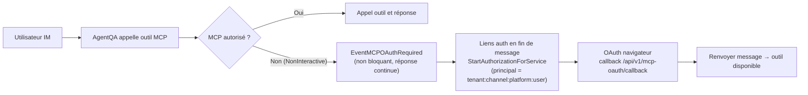
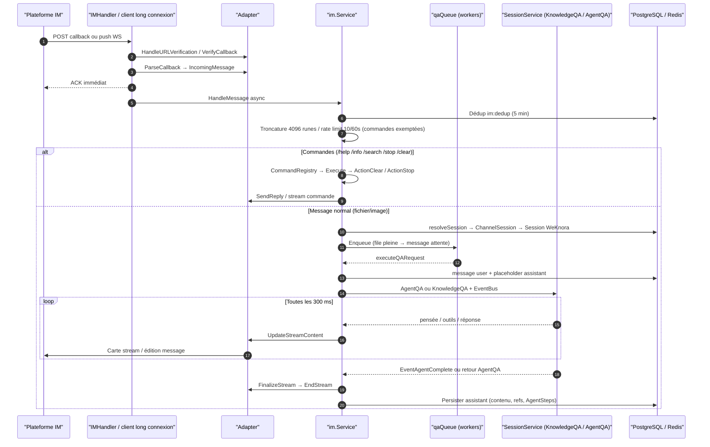

# Intégration messagerie (IM Integration)

L’intégration IM connecte les agents à WeCom, Feishu, DingTalk, Slack, Telegram, etc. Les utilisateurs interrogent le bot sur la plateforme ; WeKnora exécute recherche et réponse selon l’agent lié.

Dans « Paramètres → Intégration IM », créez un canal, choisissez la plateforme, renseignez les identifiants, liez un agent et activez. Mode webhook : URL de callback dans la console plateforme ; longue connexion : pas de callback public pour la réception. « Langue de réponse » par canal fixe la langue de l’agent ; vide = langue par défaut du déploiement.

<Screenshot
  src="/screenshots/im-channels.png"
  caption="Canaux IM : plateforme, identifiants et agent lié"
  hint="Liste des canaux et formulaire (type, identifiants, agent, URL callback)." />

Les plateformes supportées peuvent importer des fichiers reçus en base et exposent des commandes comme `/help`. Comportement selon plateforme et config canal.

## Plateformes et capacités

`validIMPlatforms` dans `internal/handler/im.go` : 10 plateformes. Capacités (assertions compile-time des `factory.go` et adapters) :

| Plateforme | Mode (défaut en gras) | StreamSender | FileDownloader | ThreadID | Identifiants (JSON credentials) |
| --- | --- | --- | --- | --- | --- |
| WeCom `wecom` | **websocket** (bot intelligent) / webhook (app callback) | websocket seulement | les deux | Non | websocket : `bot_id`, `bot_secret`, `ws_endpoint`, `bot_name` ; webhook : `corp_id`, `agent_secret`, `token`, `encoding_aes_key`, `corp_agent_id`, `api_base_url` |
| Feishu `feishu` | **websocket** / webhook | Oui (cartes stream) | Oui | Oui (`root_id`) | `app_id`, `app_secret`, `verification_token`, `encrypt_key` |
| Lark `lark` | Comme Feishu (`RegionLark` → open.larksuite.com) | Oui | Oui | Oui | Comme Feishu |
| Slack `slack` | **websocket** (Socket Mode) / webhook (Events API) | Oui | Oui | Oui (`thread_ts`) | websocket : `app_token` + `bot_token` ; webhook : `bot_token` + `signing_secret` |
| Telegram `telegram` | **websocket** (long poll getUpdates) / webhook | Oui (édition message) | Oui | Oui (`message_thread_id` Forum) | `bot_token` ; webhook + `secret_token` |
| DingTalk `dingtalk` | **websocket** (Stream v0.8.2+ ; migration 000096 webhook→websocket, activer Stream dans la console) | Oui (cartes IA) | Oui | Non | `client_id`, `client_secret`, `card_template_id` |
| Mattermost `mattermost` | **webhook** (Outgoing Webhook + REST) | Oui | Oui | Oui (`root_id`) | `site_url`, `bot_token`, `outgoing_token` (requis), `bot_user_id`, `post_to_main` |
| WeChat `wechat` (iLink) | **longpoll** (forcé ; création impose `mode=longpoll`, `output_mode=full`) | Non (réponse entière) | Oui | Non | `bot_token`, `ilink_bot_id` |
| QQ Bot `qqbot` | **websocket** uniquement | Non | Non | Non | `app_id`, `client_secret`, `api_base_url`, `gateway_url` |
| Yunzhijia `yunzhijia` | **webhook** / websocket (WS dérivé de `send_msg_url`) | Non | Oui | Oui (msgId / replyRootMsgId) | `send_msg_url` (requis), `secret`, `app_id`, `app_secret`, `allowed_webhook_host_suffix`, `timeout_seconds` |

## Commandes intégrées

Framework `command.go` / `command_registry.go` : commandes déclarent l’intention (`CommandResult.Action`), effets exécutés par le Service ; `LooksLikeCommand` distingue tentative commande (`/help`) vs chemin API (`/api/v2/users`) — non enregistrée → « commande inconnue », sinon Q/R.

Commandes enregistrées dans `NewService` :

| Commande | Fichier | Fonction | Effet de bord |
| --- | --- | --- | --- |
| `/help [nom]` | `cmd_help.go` | Liste ou aide détaillée | Aucun |
| `/info` | `cmd_info.go` | Agent lié : mode Agent/RAG, bases (`KBSelectionMode`), Skills, MCP, web, mode sortie | Aucun |
| `/search <mots-clés>` | `cmd_search.go` | Recherche hybride directe sur les KB de l’agent (**sans** résumé IA) ; max 5 résultats, 200 runes, score % ; même portée que `resolveKnowledgeBasesFromAgent` | Aucun |
| `/stop` | `cmd_stop.go` | Interrompt la réponse en cours (ReAct long) | `ActionStop` : file ou annulation locale ; événement stop StreamManager (comme Web StopSession, **multi-instance** via `im:inflight:`) ; Redis `im:stop:` pour requêtes en file |
| `/clear` | `cmd_clear.go` | Efface la mémoire de dialogue | `ActionClear` : soft-delete `ChannelSession`, nouvelle session WeKnora au message suivant |

## Groupes et messages privés

- `ChatType` : `direct` (`ChatID` vide) ou `group`.
- **Feishu/Lark** : en groupe, @bot souvent requis (texte `@_user_N` retiré) ; reply-in-thread, repli message normal si topic indisponible (230071, etc.) ;
- **Slack** : `AppMentionEvent` + `MessageEvent` channel/group (filtre bots, subtype non `file_share`) ; réponse en thread (`thread_ts`) ;
- **Telegram** : group/supergroup, retrait `@botname`, `reply_to_message_id` ;
- **Mattermost** : mot déclencheur Outgoing Webhook = **premier mot** ; `post_to_main` pour canal principal vs thread ;
- Sessions : mode `user` = session distincte par chat privé / groupe ; mode `thread` = session partagée dans le fil.

## Messages fichier

Fichiers et images = pièces jointes Q/R : contenu document au modèle, images si le modèle le supporte. Réponse normale même sans KB fichier configurée sur le canal.

`knowledge_base_id` = sauvegarde **additionnelle** en base (KB du même espace, whitelist clé API restreinte), sinon 400 à la création/màj. Tâche en arrière-plan, sans message « indexé ». Texte parsé : max 500 lignes et 32 Kio, message de troncature générique. Illisible, téléchargement impossible ou fichier de plus de 32 Mio : inviter à décrire ou renvoyer.

## Images externes dans les réponses (rewrite resource://)

Citations d’images KB : `resource://`, `local://`, `minio://` — clients IM ne peuvent pas les charger. `rewriteStorageURLs` (`service.go`) → URL http(s) avant envoi :

- Chaîne commune à tous les canaux IM ; `resource://` selon espace et instance de stockage de la ressource ; images KB partagées = instance de l’espace propriétaire ; instance absente/inactive → WARN, pas de repli global ;
- Cross-espace : vérif binding KB, partage et portée agent avant signature ; citation seule n’accorde pas l’accès ; révocation partage = plus de nouveaux liens ;
- Pièces jointes chat et fichiers générés enregistrent l’instance globale utilisée ; rétro-binding historique si chemin unique ;
- Si le résultat n’est pas http(s) : conserver la référence + WARN ;
- INFO : référence originale ; URL signées en DEBUG seulement.

Affichage images :

1. **Stockage public** : endpoint public objet / `MINIO_ENDPOINT` public → URL présignée ;
2. **`APP_EXTERNAL_URL`** : `<APP_EXTERNAL_URL>/r/<token>`, nginx `location ^~ /r/` ; image frontend officielle inclut ; proxy custom obligatoire.

MinIO interne (`minio:9000`) ou `local` → option 2. Canal IM actif sans `APP_EXTERNAL_URL` : alerte au démarrage (`imImageConfigWarning`).

Dépannage : [Accès externe images et fichiers](21-file-access.md).

## Notification OAuth MCP (identité)

Pas de frontend interactif pour OAuth MCP en IM :

- `withIMIdentity` → `MCPOAuthNonInteractive` : pas de blocage, événement unique `EventMCPOAuthRequired` ;
- `handleMessageStream` collecte (dédoublonnage ServiceID), fin de réponse : `buildIMMCPAuthNotice` en append ; avec `APP_EXTERNAL_URL` + OAuthManager, liens par service (callback `<APP_EXTERNAL_URL>/api/v1/mcp-oauth/callback`, principal `PrincipalIMUser` = tenant+canal+plateforme+user IM) ; sinon admin WeKnora ;
- Après OAuth, **renvoyer le message** pour utiliser le MCP.



## Config et exploitation

### Modèle canal (`internal/im/types.go`)

`IMChannel` (`im_channels`) lie un bot plateforme à un Agent :

| Champ | Description |
| --- | --- |
| `AgentID` | Agent custom : modèle, KB, Skills, MCP, web |
| `Platform` / `Mode` | Défauts : mattermost/yunzhijia → `webhook`, wechat → `longpoll` (+ `output_mode=full` forcé), reste → `websocket` |
| `OutputMode` | `stream` (défaut) ou `full` |
| `Locale` | `zh-CN` / `en-US` / `ja-JP` / `ko-KR` / `ru-RU`, autre → 400. Vide = `WEKNORA_LANGUAGE` (défaut `zh-CN`). `Accept-Language` plateforme ≠ langue utilisateur |
| `KnowledgeBaseID` | KB fichier optionnelle ; fichiers/images toujours téléchargés pour Q/R ; si set → indexation async |
| `SessionMode` | `user` (défaut : plateforme+user+groupe) ou `thread` (plateforme+fil+groupe) |
| `BotIdentity` | Identité unique (`computeBotIdentity`) ; index unique, `duplicate_bot:` → 409 |
| `Credentials` | JSONB ; listes (`IMChannelSummary`) : `credentials_configured` seulement |

`ChannelSession` (`im_channel_sessions`) : `(platform, user_id, chat_id, thread_id, tenant_id)` → `session_id`. Session Web supprimée : `ErrSessionNotFound` → soft-delete mapping, recréation (#1046, #1499).

#### API canaux (`im.go` + `routes_agent.go`)

| Méthode | Chemin | Description |
| --- | --- | --- |
| `POST /api/v1/agents/:id/im-channels` | Créer canal |
| `GET /api/v1/agents/:id/im-channels` | Lister (sans credentials) |
| `GET /api/v1/im-channels` | Vue locataire |
| `PUT /api/v1/im-channels/:id` | Màj partielle ; `knowledge_base_id` vide = délier KB fichier |
| `DELETE /api/v1/im-channels/:id` | Supprimer |
| `POST /api/v1/im-channels/:id/toggle` | Activer/désactiver |
| `POST /api/v1/wechat/qrcode`, `.../status` | WeChat iLink QR |
| `GET/POST /api/v1/im/callback/:channel_id` | Callback plateforme (signature plateforme, pas clé API WeKnora) |

Webhook : `https://<domaine>/api/v1/im/callback/<channel_id>` ; validation URL (`HandleURLVerification`) puis `VerifyCallback`. WebSocket : pas de callback public.

#### Proxy inverse Feishu/Lark

`credentials.api_base_url` remplace l’origin API et le domaine bootstrap long connexion. Vide = cloud Feishu/Lark ; réseau privé ex. `https://feishu-proxy.example.com` (sans path API suffixé). Doit proxifier API + bootstrap WS accessible depuis le serveur WeKnora.

```json
{"platform":"feishu","mode":"websocket","credentials":{"app_id":"<app-id>","app_secret":"<app-secret>","api_base_url":"https://feishu-proxy.example.com"}}
```

Yunzhijia `session_mode=thread` : session par topic. DingTalk rich text extrait ; images Feishu post → traitement image. `output_mode=full` : progression intermédiaire ; `answer_only` : réponse finale.

#### Fiabilité longue connexion : leader et Supervisor

- **Leader multi-instance** (`service.go`) : Redis `SETNX im:ws:leader:<channelID>` TTL 15 s, renew 5 s, retry 10 s ; un seul maintient la connexion. longpoll : lock conservé à l’arrêt jusqu’à TTL. Perte leader : `handleWSLeadershipLoss`, relecture DB avant retry ;
- **Recycle connexion** (`supervisor.go` `RunSupervised`) : recycle 6 h (`defaultRecycleInterval`), backoff 5 s ;
- **Yunzhijia WS** : heartbeat 15 s, 45 s sans data = mort, max 6 h puis rebuild ; backoff 1s→60s.

### Déploiement multi-instance

Clés Redis (`service.go`) :

| Clé | Usage |
| --- | --- |
| `im:ws:leader:<channelID>` | Élection leader WS/long poll |
| `im:dedup:<messageID>` | Dédup messages (5 min) |
| `im:stop:<userKey>` | Marqueur /stop pré-exécution (30 s) |
| `im:inflight:<userKey>` | userKey → sessionID:messageID pour stop cross-instance |
| `im:queue:user:<userKey>` | File par utilisateur |
| `im:ratelimit:<key>` | Rate limit fenêtre glissante (ZSET) |
| `im:global:active` | Workers Q/R globaux (Lua, TTL 5 min) |

Sans Redis (Lite/mono-instance) : mémoire locale, sémantique cross-instance absente.

### Traitement des messages

Callback webhook ou long connexion → `Service.HandleMessage` → file → Q/R :



Détails (`service.go`) :

- **Dédup** : Redis ou `sync.Map` Lite ;
- **Rate limit** : `channelID:userID:chatID[:threadID]`, config `config.IM` ; commandes exemptées ;
- **File Q/R** (`qaqueue.go`) : bornée, workers (défaut 5, queue 50, 3/user, timeout 60 s), Redis pour limites globales ; message « en file » si la position dans la file est supérieure à 0 ;
- **Session** : titres type « Zhang · groupe 1a2b3c4d » ; `GenerateTitleAsync` ;
- **Identité** (`withIMIdentity`) : `system-<tenantID>`, `PrincipalIMUser`, rôle Viewer ; `MCPOAuthNonInteractive` ;
- **Stream** (`handleMessageStream`, `think.go`, `tool_display.go`) : EventBus ; retrait réponse optimiste si nouvel outil (`retractAgentLiveAnswer`) ; flush 300 ms ; `holdbackCutoff` pour URL/images/XML incomplets ; `FinalizeStream` + `cleanIMContent` / `rewriteStorageURLs` ;
- **Fin stream** : AgentQA — `EventAgentComplete` ou retour appel ; KnowledgeQA — fin du flux ;
- **Non-stream** : `output_mode=full`, pas StreamSender, ou échec `StartStream` → `runQA` + `SendReply` ;
- **Quote** (`Quote`, WeCom WS, etc.) : `<quoted_message>` max 500 runes ; média non texte = instruction « contenu non visible ».

### Architecture

#### Interface Adapter (`adapter.go`)

```go
type Adapter interface {
    Platform() Platform
    VerifyCallback(c *gin.Context) error
    ParseCallback(c *gin.Context) (*IncomingMessage, error)
    SendReply(ctx context.Context, incoming *IncomingMessage, reply *ReplyMessage) error
    HandleURLVerification(c *gin.Context) bool
}
```

Extensions optionnelles :

- `StreamSender` — Feishu/Lark, DingTalk (`card_template_id`), Slack, Telegram, Mattermost, WeCom WS ;
- `FileDownloader` — toutes sauf QQ Bot.

`IncomingMessage` : `Platform`, `MessageType`, `UserID`, `ChatID`, `ChatType`, `Content`, `MessageID`, fichiers, `ThreadID`, `Quote`, etc.

#### Service (`service.go`)

1. `IncomingMessage` unifié ;
2. Session WeKnora ;
3. Commandes slash ;
4. Pipeline Q/R ;
5. Stream → Adapter.

Factories (`registerIMAdapterFactories`, `container.go`) :

```go
imService.RegisterAdapterFactory("wecom", wecom.NewFactory())
imService.RegisterAdapterFactory("feishu", feishu.NewFactory(feishu.RegionFeishu))
imService.RegisterAdapterFactory("lark", feishu.NewFactory(feishu.RegionLark))
imService.RegisterAdapterFactory("slack", slack.NewFactory())
imService.RegisterAdapterFactory("telegram", telegram.NewFactory())
imService.RegisterAdapterFactory("dingtalk", dingtalk.NewFactory())
imService.RegisterAdapterFactory("mattermost", mattermost.NewFactory())
imService.RegisterAdapterFactory("wechat", wechat.NewFactory())
imService.RegisterAdapterFactory("qqbot", qqbot.NewFactory())
imService.RegisterAdapterFactory("yunzhijia", yunzhijia.NewFactory())
```

## Référence d’implémentation

- Cœur : `internal/im/` (`adapter.go`, `service.go`, `supervisor.go`, `command*.go`, `qaqueue.go`, session/stream/think/tool_display)
- Adapters : `internal/im/{wecom,feishu,dingtalk,slack,telegram,mattermost,wechat,qqbot,yunzhijia}/`
- HTTP : `internal/handler/im.go`
- Routes : `routes_agent.go` → `RegisterIMRoutes` / `RegisterIMChannelRoutes`
