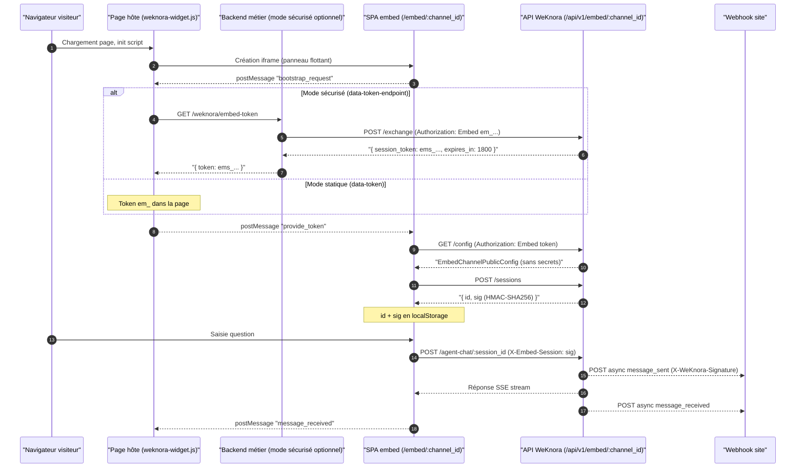

# Intégration web (Embed Channel)

Les canaux d’intégration permettent un widget Q/R base de connaissances sur site vitrine ou centre d’aide. Après création du canal et liaison à un agent, ajoutez le script généré à la page : les visiteurs dialoguent sans compte WeKnora. Portée de recherche et modèle sont entièrement définis par l’agent lié : le serveur ignore les bases, documents, tags, @mentions, skills et remplacements de modèle envoyés dans la requête.

Dans « Paramètres → Intégration web », créez un canal, liez un agent, définissez les domaines autorisés, puis copiez le code d’intégration. En production, configurez la liste blanche de domaines et la limitation de débit.

<Screenshot
  src="/screenshots/embed-channel.png"
  caption="Canal d'intégration : configuration, extrait de code et widget"
  hint="Configuration du canal (agent lié, domaines autorisés, apparence) et extrait script ; idéalement une capture du widget ouvert sur une page." />

Le canal prend en charge token statique et mode sécurisé, ainsi que les webhooks pour les événements de conversation.

Côté visiteur, les images passent par un proxy d’auth propre au canal ; si les images ne s’affichent pas, voir [Accès externe aux images et fichiers](21-file-access.md).

## Intégration du widget frontend

Le SDK est un loader sans dépendance `frontend/public/weknora-widget.js` (servi à la racine WeKnora) : bouton flottant + panneau iframe vers la SPA `/embed/{channel_id}` (`frontend/src/embed-main.ts`).

### Mode 1 : token statique (visible par les visiteurs) {#mode-1-token-statique}

```html
<script
  src="https://your-weknora.example.com/weknora-widget.js"
  data-channel="VOTRE-UUID-CANAL"
  data-token="em_VOTRE_PUBLISH_TOKEN"
  data-position="bottom-right"
  data-primary-color="#07C05F"
  data-title="AI Assistant"
></script>
```

Le publish token est dans le HTML, visible de tous ; rotation = mise à jour de toutes les pages. Adapté aux sites internes ou faible sensibilité.

### Mode 2 : mode sécurisé (Secure Mode, recommandé)

Le publish token reste sur le backend métier ; la page pointe `data-token-endpoint` vers un endpoint d’échange :

```html
<script
  src="https://your-weknora.example.com/weknora-widget.js"
  data-channel="VOTRE-UUID-CANAL"
  data-token-endpoint="https://your-backend.example.com/weknora/embed-token"
  data-position="bottom-right"
></script>
```

Le backend implémente l’endpoint : il détient le token `em_`, appelle `POST /api/v1/embed/{channel_id}/exchange` et renvoie `{ "token": "ems_...", "expiresIn": 1800 }`. Le widget rafraîchit vers ~80 % du TTL (pas avant 30 s — `scheduleRefresh` dans `weknora-widget.js`). **Le publish token n’atteint jamais le navigateur.**

L’endpoint d’échange doit valider session/JWT métier et droit d’accès visiteur ; la seule présence de Cookie ou Authorization ne suffit pas. Côté serveur, envoyer un `Origin` hôte métier aligné sur la whitelist du canal, ex. `Origin: https://shop.example.com` ; ne pas exposer le token admin WeKnora aux visiteurs.

Autres attributs : `data-base-url` (déduit du src du script par défaut), `data-width` / `data-height` (400×600 par défaut), `data-sandbox` (politique iframe ; cross-origin ajoute automatiquement `allow-scripts allow-forms allow-popups allow-modals allow-same-origin`).

### Mode 3 : API programmatique

```html
<script src="https://your-weknora.example.com/weknora-widget.js"></script>
<script>
  WeKnora.init({
    channel: 'VOTRE-UUID-CANAL',
    tokenEndpoint: 'https://your-backend.example.com/weknora/embed-token', // ou token: 'em_...'
    position: 'bottom-right',
    primaryColor: '#07C05F',
    title: 'AI Assistant',
    baseUrl: 'https://your-weknora.example.com',
  });
  WeKnora.setContext({ userId: 'u_123', page: location.pathname }); // contexte injecté à chaque question
  WeKnora.setLocale('en-US');
  WeKnora.openWithQuery('Comment réinitialiser mon mot de passe ?'); // ouvre le panneau et envoie la question
  WeKnora.on('ready', () => console.log('widget ready'));
  // aussi : WeKnora.open() / close() / toggle() / destroy() / off(event, fn)
</script>
```

### iframe direct

Sans loader, iframe directe (token via URL/postMessage — le loader est recommandé) :

```html
<iframe src="https://your-weknora.example.com/embed/VOTRE-UUID-CANAL"
        width="400" height="600" style="border:none"></iframe>
```

### Protocole postMessage Bridge

Communication hôte (loader) ↔ SPA iframe via `postMessage`, validation stricte d’Origin (loader n’envoie qu’à `embedOrigin` dérivé, jamais `*` ; la page embed fige l’origin au premier message de confiance — `frontend/src/composables/useEmbedBridge.ts`) :

- Hôte → iframe (`source: "weknora-host"`) : `provide_token`, `set_context`, `set_locale`, `open_with_query` ;
- iframe → hôte (`source: "weknora-embed"`) : `ready`, `bootstrap_request`, `message_sent`, `message_received`.

## Authentification et sessions anonymes

### Deux types de token

| Token | Préfixe | Durée | Usage |
| --- | --- | --- | --- |
| Publish Token | `em_` | Long (jusqu’à rotation) | Jeton de publication ; page (statique) ou backend seul (sécurisé) |
| Session Token | `ems_` | **30 minutes** (TTL Redis) | Jeton court obtenu via `/exchange` ; utilisé dans le navigateur |

Toutes les API publiques : en-tête `Authorization: Embed <token>` (**pas de query string**). Middleware `EmbedAuth` (`internal/middleware/embed_auth.go`) :

1. Canal par `channel_id` ; token = `publish_token` ou session Redis `embed:session:{token}` pour ce canal ;
2. Canal `enabled` ;
3. API same-origin dans l’iframe autorisées ; cross-origin et exchange sécurisé : `Origin` ∈ `allowed_origins`. Liste vide = tout refusé ; restriction hôte aussi via CSP du HTML embed ;
4. Limitation (Lua Redis, fenêtre glissante) :
   - par IP ≤ `RateLimitPerMinute` / minute ;
   - global canal ≤ `max(RateLimitPerMinute × 20, 120)` — anti contournement par rotation d’IP ;
   - quota journalier canal ≤ `RateLimitPerDay`.

### Origine hôte et déploiement

Site A intègre WeKnora B : whitelist = A. Nginx standard : `/api/v1/embed-frame-policy` pour la politique CSP (sans token, pas de config canal), `frame-ancestors` sur `/embed/:channelId` ; idem Lite. Page non cacheable ; échec politique = pas de HTML embed.

À la mise à niveau, les canaux qui ne listait que B doivent lister l’hôte réel A, frontend et backend. Proxy custom : conserver CSP, Host d’origine (port), protocole, `Sec-Fetch-Site`. Whitelist = embedding navigateur ; pas substitut à l’auth visiteur ni blocage clients non navigateur avec token — utiliser mode sécurisé + rate limit.

#### Sous-domaine dédié (optionnel) {#embed-subdomain}

Par défaut embed et admin partagent le domaine. Pour entrée séparée ou isolation cookies : embed sur `https://embed.example.com`, admin sur `https://app.example.com`, hôte métier `https://shop.example.com`.

Admin : `window.__RUNTIME_CONFIG__.EMBED_BASE_URL` dans `frontend/public/config.js`, ou build `VITE_EMBED_BASE_URL` ; vide = origin de la page courante. Vérifier que widget/iframe pointent la nouvelle URL.

Serveur Nginx dédié : `/embed/*`, `/weknora-widget.js`, `/assets/*`, proxy backend nécessaire ; pas de `index.html` admin. Garder `auth_request`, `/_embed-frame-policy` et en-têtes CSP de `frontend/nginx.conf` pour `/embed/` : échec politique = refus ; pas de cache CDN sur la politique.

Whitelist = hôte métier `https://shop.example.com` ; exchange sécurisé avec le même Origin ; pas besoin d’ajouter l’origin embed pour le chat same-origin habituel. Widget cross-origin ajoute sandbox iframe automatiquement. Tester depuis l’hôte réel (iframe, API, CSP, code généré), pas seulement l’aperçu admin.

### Échange de token (cœur du mode sécurisé)

`POST /api/v1/embed/:channel_id/exchange`, en-tête `Authorization: Embed em_xxx` (**publish token uniquement** ; session refusée). Réponse :

```json
{ "success": true, "data": { "session_token": "ems_...", "expires_in": 1800 } }
```

Implémentation `IssueSessionToken` (`internal/application/service/embed_session.go`) : 32 octets aléatoires base64 + préfixe `ems_`, Redis, TTL 30 min.

### Création de session anonyme

`POST /api/v1/embed/:channel_id/sessions` :

```json
{ "success": true, "data": { "id": "<session_uuid>", "sig": "<HMAC-SHA256 base64>" } }
```

- Session en table `sessions`, `Description` = `embed_channel:{channel_id}`, `UserID` = identifiant visiteur opaque via `EmbedSessionPrincipal(...).StorageID()` ;
- `sig` = `HMAC-SHA256(channel.PublishToken, "{channel_id}|{session_id}")`. Toute requête `/sessions/:session_id/*` exige `X-Embed-Session: <sig>` (comparaison constante — `internal/handler/embed_channel.go`). Empêche l’usurpation par seul `session_id` ; rotation publish token invalide toutes les signatures.

Le frontend peut envoyer `X-Embed-Visitor: <uuid>` pour les stats. id + sig en cache `localStorage` par canal (`useEmbedBridge.ts`).

## Webhook

Canal avec `webhook_url` : POST JSON vers le backend métier (`internal/application/service/embed_webhook.go`) :

| Événement | Moment | Champs |
| --- | --- | --- |
| `message_sent` | Question visiteur | `type`, `channel_id`, `session_id`, `timestamp`, `query` |
| `message_received` | Réponse assistant terminée | `type`, `channel_id`, `session_id`, `timestamp`, `content` |

Sécurité et sémantique :

- Avec `webhook_secret` : `X-WeKnora-Signature: sha256=<hex(HMAC-SHA256(secret, raw_body))>` ;
- URL HTTPS, client SSRF (revalidation à chaque redirection, max 5 sauts), timeout 5 s, UA `WeKnora-Embed-Webhook/1.0` ;
- Livraison async best-effort, échec logué, **pas de retry** ;
- Le frontend peut relayer via `POST /api/v1/embed/:channel_id/sessions/:session_id/events`.

## Référence config et API

### Modèle de données

`EmbedChannel` (`internal/types/embed_channel.go`, table `embed_channels`, soft delete, index partiel unique sur `publish_token`) :

```go
type EmbedChannel struct {
    ID                     string         // clé primaire UUID
    TenantID               uint64         // locataire propriétaire
    AgentID                string         // agent lié (défaut builtin-quick-answer)
    Name                   string         // nom du canal
    Enabled                bool           // activé ou non
    PublishToken           string         // jeton de publication longue durée, préfixe "em_"
    AllowedOrigins         JSON           // liste Origin autorisées (JSONB)
    WelcomeMessage         string         // message d’accueil
    RateLimitPerMinute     int            // limite / IP / minute (défaut 30)
    RateLimitPerDay        int            // limite journalière canal (défaut 10000)
    PrimaryColor           string         // couleur thème
    PageTitle              string         // titre de page
    HeaderTitleMode        string         // "channel" | "session"
    ShowSuggestedQuestions bool           // questions suggérées
    WidgetPosition         string         // position du widget
    AllowWebSearch         bool           // recherche web autorisée
    AllowFileUpload        bool           // upload fichier/image autorisé
    DefaultLocale          string         // langue par défaut
    WebhookURL             string         // webhook sortant (HTTPS)
    WebhookSecret          string         // clé signature HMAC-SHA256
    ...
}
```

#### Options de canal

Création/mise à jour (`embedChannelRequest`, `internal/handler/embed_channel.go`) :

| Option | Type | Défaut | Description |
| --- | --- | --- | --- |
| `name` | string | — | Nom affiché |
| `enabled` | bool | `true` | Fermé = toutes les API publiques refusées |
| `agent_id` | string | `builtin-quick-answer` | Agent lié : portée KB et capacités |
| `allowed_origins` | string[] | — | **Au moins une entrée : hôte embed A, pas l’URL WeKnora B**. Formes : Origin `http(s)://` complet (sans path/query), wildcard sous-domaine `*.example.com` (sous-domaines seulement ; port omis = tous ports), `*` (refusé en `GIN_MODE=release`, dev uniquement) |
| `welcome_message` | string | vide | Message d’accueil |
| `rate_limit_per_minute` | int | `30` | Plafond / IP / minute |
| `rate_limit_per_day` | int | `10000` | Plafond journalier canal |
| `primary_color` | string | — | Couleur thème CSS |
| `page_title` | string | vide | Titre navigateur page embed |
| `header_title_mode` | string | `channel` | `channel` (nom fixe) / `session` (auto par session) |
| `show_suggested_questions` | bool | `true` | Questions suggérées |
| `widget_position` | string | `bottom-right` | `bottom-right` \| `bottom-left` \| `top-right` \| `top-left` |
| `allow_web_search` | bool | `false` | Interrupteur recherche web visiteur |
| `allow_file_upload` | bool | `false` | Upload image/fichier visiteur |
| `default_locale` | string | vide (navigateur) | `zh-CN` \| `en-US` \| `ko-KR` \| `ja-JP` \| `ru-RU` |
| `webhook_url` | string | vide | Callback HTTPS + validation SSRF |
| `webhook_secret` | string | vide | Clé signature (jamais dans les réponses API) |

Canal + agent avec upload image : collage capture dans le champ de saisie, aperçu, envoi ou retrait. Limites communes collage/fichier : JPEG, PNG, GIF, WebP, 10 Mo max./image, 5 max./envoi. Texte seul inchangé ; image + texte dans le presse-papiers → images seules comme le chat principal.

### API d’administration (authentification requise)

`RegisterEmbedChannelRoutes` (`internal/router/routes_agent.go`), clé API capacité `ManageChannels` :

| Méthode | Chemin | Permission | Description |
| --- | --- | --- | --- |
| POST | `/api/v1/agents/:id/embed-channels` | Admin | Créer un canal pour l’agent |
| GET | `/api/v1/agents/:id/embed-channels` | Viewer | Lister les canaux de l’agent |
| GET | `/api/v1/embed-channels` | Viewer | Tous les canaux du locataire |
| GET | `/api/v1/embed-channels/:channel_id` | Viewer | Détail (incl. `publish_token`) |
| PUT | `/api/v1/embed-channels/:channel_id` | Admin | Mise à jour |
| DELETE | `/api/v1/embed-channels/:channel_id` | Admin | Suppression (soft) |
| POST | `/api/v1/embed-channels/:channel_id/rotate-token` | Admin | Rotation `publish_token` (invalidation immédiate sessions/signatures) |
| POST | `/api/v1/embed-channels/:channel_id/preview-session` | Viewer | Token court pour aperçu admin |
| GET | `/api/v1/embed-channels/:channel_id/stats` | Viewer | Statistiques sessions |

### API publiques (Embed auth)

`RegisterEmbedPublicRoutes`, préfixe `/api/v1/embed/:channel_id`, middleware `EmbedAuth` :

```go
embed := r.Group("/api/v1/embed/:channel_id", middleware.EmbedAuth(embedService, tenantService, redisClient))
{
    embed.POST("/exchange", embedHandler.ExchangeEmbedSession)
    embed.GET("/config", embedHandler.GetEmbedConfig)
    embed.GET("/suggested-questions", embedHandler.GetEmbedSuggestedQuestions)
    embed.GET("/chunks/:chunk_id", embedHandler.GetEmbedChunk)
    embed.POST("/sessions", embedHandler.CreateEmbedSession)
    embed.POST("/knowledge-chat/:session_id", embedHandler.EmbedKnowledgeChat)
    embed.POST("/agent-chat/:session_id", embedHandler.EmbedAgentChat)
    embed.GET("/messages/:session_id/load", embedHandler.EmbedLoadMessages)
    embed.POST("/sessions/:session_id/stop", embedHandler.EmbedStopSession)
    embed.POST("/sessions/:session_id/events", embedHandler.EmbedRelayWebhookEvent)
    // routes questions suggérées, OAuth MCP, approbation outils, fichiers, etc. omises
    embed.GET("/files", newFileServeHandler(...))
}
```

#### Config publique

`GET /api/v1/embed/:channel_id/config` → `EmbedChannelPublicConfig` — affichage et capacités widget uniquement :

- Envoyé : `channel_id`, `name`, `display_title` (ordre `PageTitle → Name → AgentName → "AI Assistant"`), `agent_id/agent_name/agent_avatar`, `knowledge_base_ids`, `welcome_message`, `primary_color`, `header_title_mode`, `show_suggested_questions`, `widget_position`, `allow_web_search`, `allow_file_upload`, `agent_web_search_enabled`, `agent_image_upload_enabled`, `default_locale`, etc. ;
- **Jamais** : `publish_token`, `webhook_url`, `webhook_secret`.

### Séquence bout en bout



### Synthèse sécurité

- **Whitelist hôte** : CSP `frame-ancestors` par canal ; API same-origin iframe OK. `allowed_origins` vide = refus ; `*` dev seulement ; wildcard `*.example.com`. Aperçu admin same-origin autorisé.
- **Double token** : mode sécurisé, publish token côté serveur ; navigateur : `ems_` 30 min.
- **Signature session** : `X-Embed-Session` lie (canal, session, publish token) ; rotation = révocation globale.
- **Triple rate limit** : IP/min, canal/min (×20 IP, min 120), canal/jour — Lua Redis atomique.
- **Webhook SSRF** : HTTPS, refus intranet, redirections validées, timeout 5 s.

## Référence d’implémentation

Chemins relatifs à la racine du dépôt :

| Couche | Fichier |
| --- | --- |
| Types | `internal/types/embed_channel.go` |
| HTTP Handler | `internal/handler/embed_channel.go` |
| Service canal | `internal/application/service/embed_channel.go` |
| Session / token | `internal/application/service/embed_session.go` |
| Webhook | `internal/application/service/embed_webhook.go` |
| Middleware auth | `internal/middleware/embed_auth.go` |
| Routes | `internal/router/routes_agent.go` (`RegisterEmbedPublicRoutes` / `RegisterEmbedChannelRoutes` / CSP embed) |
| Règles Origin | `internal/embedpolicy/origin.go` |
| SDK widget | `frontend/public/weknora-widget.js` |
| SPA embed | `frontend/src/embed-main.ts`, `useEmbedBridge.ts`, `useEmbedChatSession.ts` |
| Migration | `migrations/versioned/000060_embed_channels.up.sql` |
