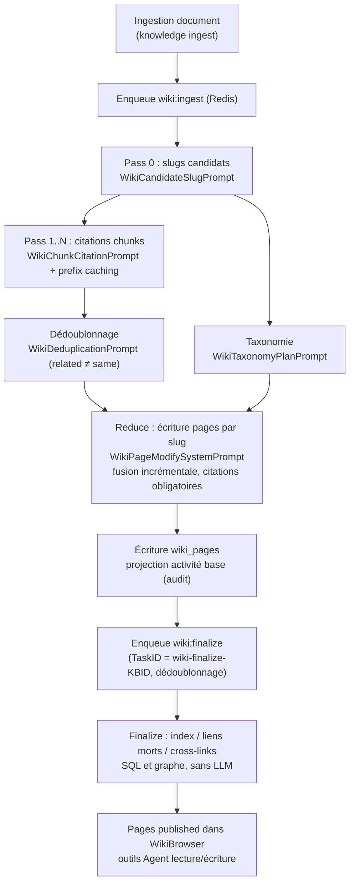

# Wiki

Le Wiki organise les documents de la base en pages Markdown liées entre elles. Après ingestion, le modèle extrait personnes, produits et concepts et génère des pages avec citations sources pour une navigation thématique.

Les utilisateurs peuvent éditer les pages générées, consulter l’historique et revenir en arrière. L’agent peut aussi lire et maintenir le Wiki via des outils dédiés ; la portée reste celle des droits sur la base.

<Screenshot
  src="/screenshots/wiki-browser.png"
  caption="Navigateur Wiki : arborescence à gauche, page d'entrée et sources"
  hint="Arborescence par type à gauche, corps d'une page entité, liens wiki internes et références aux documents sources." />

## Activer et parcourir le Wiki {#activer-parcourir-wiki}

1. Éditer la base → activer **Wiki** dans « Stratégie d’indexation » ;
2. Importer des documents (les existants sont inclus, pas besoin de ré-uploader) ;
3. Attendre la génération (asynchrone ; fil d’Ariane « Indexation en cours » si volumineux) ;
4. Onglet **Wiki** pour parcourir ; onglet **Graphe** pour les liens entre entrées.

La génération Wiki augmente les appels modèle selon volume et densité d’extraction. Granularité `focused`, `standard` ou `exhaustive` dans la config Wiki — voir [Granularité d’extraction](#granularite-extraction).

## Ingestion et révision des pages {#ingest-or-edit}

Rapports, notes ou pages web à conserver durablement : d’abord documents sources en base. Le pipeline chunking + index ; si Wiki activé, pages Wiki avec sources et liens inter-pages.

Avec l’assistant :

| Tâche | Entrée |
| --- | --- |
| Enregistrer texte ou Markdown | `knowledge.create_manual`, corps complet et `status: publish` |
| Importer URL web ou fichier | `knowledge.create_from_url` |
| Réviser ou fusionner des pages Wiki | lire la page, puis `wiki_write_page` (page entière) ou `wiki_replace_text` (remplacement local) |

Sans `status`, document manuel = `draft` (pas d’indexation). Publication et import URL : async, progression via `knowledge.get_parse_progress`.

Écrire directement une page Wiki maintient les liens, le graphe Wiki et la recherche Wiki ; cela ne crée pas de document source, chunks ni index document — ne remplace pas l’ingestion.

## Graphe Wiki {#wiki-graph}

<Screenshot
  src="/screenshots/wiki-graph-groups.png"
  caption="Vue graphe Wiki : liens entre entrées"
  hint="Nouvelle disposition par groupes, thèmes de groupe, focus sur un groupe ; clic nœud pour ouvrir l'entrée." />

Disposition par groupes d’associations et thèmes résumant chaque groupe. Nœuds et titres évitent le chevauchement.

- Clic sur un thème de groupe pour focus ; menu de groupe ; « Retour vue complète » ou Esc.
- Masquer les pages isolées ; recherche et filtre par type.
- Clic nœud pour lire ; suivre les arêtes ; liens vers pages résumé des documents sources.

Ce graphe = liens entre **pages Wiki**, distinct du graphe entités-relations dans les paramètres de base.

## Édition et rollback

Après édition, historique des versions et comparaison. Sources : génération auto, agent, humain, rollback. Le rollback crée une nouvelle version (numéro incrémenté).

Nettoyage prioritaire des versions auto : à 50 versions, snapshots « élagables » ; à 200, plafond dur toutes sources. Archiver ailleurs le contenu à conserver longtemps. Versions antérieures à la mise à niveau ou déjà purgées sans snapshot : panneau d’historique avec message au lieu d’un diff ; comparaison impossible = texte intégral de la version choisie. Autres versions inchangées.

## Activité et état de génération

Créations, mises à jour, suppressions et générations batch : « Base → Paramètres → Activité ». Pendant le traitement document : statut d’indexation ; après redémarrage, reprise des tâches Wiki persistées. Suppression de base = pages Wiki, dossiers, questions et historique supprimés. Compatibilité API et reprise : section référence.

## Versions et exploitation

### Édition manuelle et historique

Corrections utilisateur, provenance par version. Migration `000075`.

#### Source et auteur de chaque version {#source-auteur-version}

Sur `wiki_pages`, `last_edit_source` = type d’auteur de **la version courante** :

| `edit_source` | Signification |
| --- | --- |
| `pipeline` | Pipeline de génération Wiki (chaîne vide legacy = `pipeline`) |
| `agent` | Agent via `wiki_write_page` / `wiki_replace_text`, etc. |
| `user` | Édition manuelle |
| `revert` | Version issue d’un rollback |

`last_editor_id` = opérateur (vide pour le pipeline). Affichage UI par version.

#### Snapshots et rollback

- Avant écrasement, **ancienne version** snapshotée dans `wiki_page_revisions` (titre, corps, résumé, type, statut, alias, auteur/date) ; courante dans `wiki_pages`. Index unique `(page_id, version)` + `ON CONFLICT DO NOTHING` pour idempotence ;
- `GET /revisions/*slug` : liste (sans corps, numéro courant) ; `?version=N` : corps pour diff ;
- `POST /revert` `{slug, version}` : contenu cible → nouvelle version, `edit_source` = `revert`. Rollback sur version courante → 400.

#### Rétention

Plafonds (`internal/types/wiki_page.go`) :

- **50 (soft)** : snapshots « élagables » (`pipeline` ou source vide legacy) ;
- **200 (hard)** : toutes sources, y compris éditions manuelles.

Avant le hard cap, priorité au nettoyage auto.

<Screenshot
  src="/screenshots/wiki-revision-history.png"
  caption="Historique de versions Wiki : liste par source et rollback"
  hint="Tiroir historique : numéro, source (pipeline / humain / Agent / rollback), auteur, date, comparer / rollback." />

### Flux d’activité (activité base)

Ancien journal Wiki (`wiki_log_entries`, `GET /wiki/log`, onglet logs WikiBrowser) retiré en migration `000077_remove_wiki_log` : table DROP, pages `page_type = 'log'` supprimées, `log` plus un type valide.

**Le flux d’activité base est l’unique historique opérationnel** :

- Fin de batch ingest : `wiki_ingest_batch.go` agrège les comptes → `RecordWikiContentActivity()` → activité `wiki_content_changed` ;
- CRUD manuel WikiBrowser : `wiki_page.go` projette `manual_create` / `manual_update` / `manual_delete` ;
- Audit (`kb_activity.go` → `AuditLogService`), visible « Base → Paramètres → Activité », rétention comme les autres logs ([Observabilité et audit](16-observability.md)) ;
- Best-effort : échec d’activité n’annule pas l’édition wiki.

Migration : remplacer `GET /api/v1/knowledgebase/:kb_id/wiki/log` par `GET /api/v1/knowledge-bases/:id/activity`.

### Reprise après échec

`internal/container/recover_pending_wiki_tasks.go` au démarrage (Lite `SyncTaskExecutor` ou file Redis interrompue) :

1. Scan `task_pending_ops`, `scope = knowledge_base`, `task_type ∈ {wiki:ingest, wiki:finalize}` ;
2. Purge lignes orphelines (KB ou locataire supprimé, fail-closed) ;
3. Ré-enqueue : `wiki:ingest` sans TaskID (lots concurrents), `wiki:finalize` avec `"wiki-finalize-" + KB_ID` (dédoublonnage). Re-enqueue sans danger.

Protections en cours d’exécution :

- **Locataire supprimé** : ingest/finalize vérifient avant LLM ; file vidée, plus d’appels ;
- **Wiki inutilisable** : Wiki off, pas de modèle synthèse ou modèle supprimé → purge ops ingest non prises, libération documents (plus bloqués « indexation ») ;
- **Tâche déclencheur perdue** : patrouille ré-enqueue (max une fois par KB par période) ;
- **Retry erreurs transitoires** : 408/429/5xx, timeout, reset, 403 rate limit → backoff ; 403 auth non retenté ;
- **Priorité échecs** : documents avec moins d’échecs pris en premier.

## Pages et API

### Modèle et hiérarchie

#### Types de page (PageType)

6 types (`internal/types/wiki_page.go`) :

| Type | Description |
| --- | --- |
| `summary` | Résumé d’un document source (`summary/<knowledge-uuid>`) |
| `entity` | Entité (personne, org, produit, tech, etc.) |
| `concept` | Concept / thème |
| `index` | Page index wiki (métadonnées) |
| `synthesis` | Synthèse — **Agent uniquement** (`wiki_write_page`) |
| `comparison` | Comparaison — **Agent uniquement** (`wiki_write_page`) |

Statuts (`WikiPageStatus`) : `draft` / `published` (défaut) / `archived`.

#### Arborescence (Folder Hierarchy)

Migration `000061_wiki_page_hierarchy.up.sql`, table `wiki_folders` (adjacency) :

- `WikiFolder` : `ParentID` (racine = chaîne vide) + `Path` matérialisé ; dossiers vides possibles ;
- `WikiPage.FolderID` = source de vérité (FK, vide = racine wiki) ;
- `CategoryPath` / `WikiPath` / `Depth` / `SortOrder` = projection cache ;
- Chemins modèle max 3 niveaux (`WikiCategoryMaxDepth = 3`), `CleanWikiCategoryPath()` normalise séparateurs et retire labels type « entité » ;
- Dossier utilisateur : chemin conservé ; dossiers nommés « Concepts » etc. non traités comme tags de type.

#### Champs clés

- `Slug` : identifiant unique dans la KB ;
- `SourceRefs` : `"<knowledge_id>|<doc_title>"` ; `ChunkRefs` : preuves chunk ;
- `InLinks` / `OutLinks` : wiki-links ; `GET /graph` global ou ego ;
- `Aliases` ; `Version`.

### Publication et accès

Routes sous `/api/v1/knowledgebase/:kb_id/wiki` (`routes_knowledge.go`), **pas d’accès public anonyme**, RBAC + contrôle d’accès KB :

#### Lecture (Viewer + KBAccessRead)

| Méthode | Chemin | Description |
| --- | --- | --- |
| GET | `/pages` | Liste |
| GET | `/pages/*slug` | Page par slug |
| GET | `/folders` | Arborescence |
| GET | `/index` | Index |
| GET | `/graph` | Graphe (global / ego) |
| GET | `/stats` | Statistiques |
| GET | `/search?q=...` | Recherche |
| GET | `/lint` / `/issues` | Qualité / problèmes |
| GET | `/revisions/*slug` | Historique ; `?version=N` corps |

`KBAccessRead` : propriétaire KB, partage org, accès via agent partagé.

#### Écriture (OwnedWikiKBOrAdmin + KBAccessWrite)

| Méthode | Chemin | Description |
| --- | --- | --- |
| POST / PUT / DELETE | `/pages`, `/pages/*slug` | CRUD pages |
| POST / PUT / DELETE | `/folders`, `/folders/:folder_id` | Dossiers |
| PUT | `/move-page` | Déplacer page |
| POST | `/rebuild-links` | Reconstruire graphe liens |
| POST | `/auto-fix` | Auto-réparation |
| PUT | `/issues/:issue_id/status` | Statut problème |
| POST | `/revert` | Rollback `{slug, version}` |

Écriture : contributeur propriétaire de la KB, sinon 403. Clé API : capabilities `ingest` / `retrieve`.

UI : `WikiBrowser.vue` ; `wikiStatusRefresh.ts` poll `parse_status` ; `wikiDirectoryState.ts` conserve l’expansion après refresh via `expandWikiDirectoryPath()`.

### Relation avec l’agent

9 outils Wiki (+ `read_document` pour sources), `internal/agent/tools/definitions.go` :

| Outil | Rôle | Paramètres |
| --- | --- | --- |
| `wiki_read_page` | Lire pages par slug | `slugs: string[]` |
| `wiki_search` | Recherche (titre / slug / alias / résumé / corps ; `query` = regex POSIX insensible à la casse, sinon littéral ex. `C++` ; `regex=false` force littéral) | `query`, `regex?`, `knowledge_base_ids?`, `limit?` (legacy `queries`, `knowledge_base_id`) |
| `wiki_write_page` | Révision / fusion ; reconstruire page dérivée depuis source indexée, pas d’ingestion doc | `slug`, `title`, `summary`, `content`, `page_type`, `aliases?`, `source_refs?` |
| `wiki_replace_text` | Remplacement exact | `slug`, `old_text`, `new_text` |
| `wiki_rename_page` | Renommer slug, met à jour backlinks | `slug`, `new_slug` |
| `wiki_delete_page` | Supprimer + nettoyer liens morts | `slug` |
| `read_document` | Source originale : en-tête + chunks paginés ou `query` (remplace `wiki_read_source_doc`) | `id` (`dN` / `cN`), `offset?`, `limit?`, `query?`, `regex?`, `context?` |
| `wiki_flag_issue` | Signaler problème | `slug`, `issue_type ∈ {mixed_entities, contradictory_facts, out_of_date, other}`, `description` |
| `wiki_read_issue` | Détail problème | ID |
| `wiki_update_issue` | Mettre à jour statut | ID, `status ∈ {pending, ignored, resolved}` |

Ordre recommandé : `wiki_search` → `wiki_read_page` → `read_document`. Sortie XML-like ; `parseWikiToolReferences()` (`wikiToolReferences.ts`) → cartes de citation.

Mécanismes :

- **Wiki Scope** : whitelist KB wiki en session, `@mention` pour restreindre ; filtre `source_refs` (`wiki_tools.go`) ;
- **Écriture** : lecture = portée recherche ; écriture (`wiki_write_page`, `wiki_replace_text`, `wiki_rename_page`, `wiki_delete_page`, `wiki_flag_issue`, `wiki_update_issue`) = KB éditables (espace ou partage org editor+). Rôle Contributor+ ou clé API `ingest`. IM, embed et MCP en Viewer = lecture seule ; outils d’écriture non enregistrés sans KB wiki éditable. Agent partagé = lecture seule ;
- **Wiki Fixer** : agent builtin (`types.BuiltinWikiFixerID`), réparation auto (liens morts, confusion entités). KB partagée cross-tenant : rôle locataire ≥ Editor, contexte locataire source (`wiki_fixer_scope.go`). Config par défaut, une KB, pas MCP/skills/sandbox/web ; modèle = modèle de la KB ;
- **Problèmes** : `wiki_page_issues`, lint, `auto-fix`, humain ou agent.

### Pipeline de génération

Déclenché par **ingestion document**, file Redis async. Types (`internal/types/task.go`) :

```go
TypeWikiIngest   = "wiki:ingest"
TypeWikiFinalize = "wiki:finalize"
```

Quatre phases (Map-Reduce) :

| Phase | Tâche | Action | Prompts (`prompts_wiki.go`) |
| --- | --- | --- | --- |
| Pass 0 : candidats | `wiki:ingest` | Slugs candidats (JSON entities + concepts) | `WikiCandidateSlugPrompt` |
| Pass 1..N : citations chunks | `wiki:ingest` | Citations par chunk `{ citations, new_slugs }` ; prefix caching | `WikiChunkCitationPrompt` |
| Reduce : fusion pages | `wiki:ingest` | Mise à jour/incrément par slug, `SUMMARY:` + Markdown ; ancrage strict | `WikiPageModifySystemPrompt` + `WikiPageModifyUserPrompt` |
| Finalize | `wiki:finalize` | Index, liens morts, cross-links, prune dossiers — SQL/graphe, **sans LLM** | — |

Auxiliaires :

- `WikiTaxonomyPlanPrompt` : chemins dossier unifiés (max 2 niveaux, réutiliser dossiers) ;
- `WikiDeduplicationPrompt` : fusion si même entité — **related ≠ same** ; `{ merges: { "entity/new": "entity/existing" } }`. Alias partagés insuffisants seuls.

Autres règles :

- **Réutilisation cross-type** : même titre normalisé, autre type → mise à jour au lieu de page jumelle ;
- **Images citées** : caption/OCR inline dans Reduce ;
- **Troncature rewrite** : jusqu’à 3 continuations ; sinon abandon avec warning ;
- **Liens auto un seul caractère CJK** : pas de wiki-link automatique sur titre d’un seul caractère.

#### Granularité d’extraction {#granularite-extraction}

`WikiExtractionGranularity` dans `WikiConfig` (`knowledge_bases.wiki_config`) :

| Granularité | Comportement |
| --- | --- |
| `focused` | 3–7 thèmes principaux |
| `standard` (défaut) | Thèmes + entités/concepts discutés substantiellement |
| `exhaustive` | Toutes entités nommées et concepts reconnus |

#### Concurrence et batch

Paramètres `WikiConfig` (`wiki_page.go`) :

| Paramètre | Défaut | Description |
| --- | --- | --- |
| `IngestBatchSize` | 5 | Documents par batch |
| `IngestMapParallel` | 10 | Concurrence Map |
| `IngestReduceParallel` | 10 | Concurrence Reduce |
| `IngestMaxInflight` | 4 | Lots concurrents max / KB |

Embeddings dossier/entrées : batches selon `BATCH_EMBED_SIZE`.

#### Schéma



### Mécanisme Slug

- **Format** : `<type>/<name>`, ex. `entity/acme-corp` ; minuscules, tirets ; romanisation hors latin ;
- **Unicité** :

  ```sql
  CREATE UNIQUE INDEX idx_kb_slug ON wiki_pages (knowledge_base_id, slug) WHERE deleted_at IS NULL
  ```

  Unique **par KB** ;
- **Stabilité** : ré-extraction réutilise les slugs existants (prompt) ;
- **Slug Handle** : slugs à haute entropie → `ref-N` pour le LLM, restauration backend (`wiki_slug_handles.go`) ;
- **Références** : `[[slug|title]]` ; `wiki_rename_page` met à jour les backlinks.

## Référence d’implémentation

| Couche | Fichier |
| --- | --- |
| Types | `internal/types/wiki_page.go` |
| HTTP Handler | `internal/handler/wiki_page.go` |
| Pipeline génération | `wiki_ingest.go`, `wiki_ingest_batch.go`, `wiki_ingest_cite.go`, `wiki_ingest_dedup.go`, `wiki_ingest_taxonomy.go` |
| Service pages | `wiki_page.go`, `wiki_linkify.go`, `wiki_lint.go`, `wiki_slug_handles.go` |
| Prompts LLM | `internal/agent/prompts_wiki.go` |
| Outils Agent | `internal/agent/tools/wiki_*.go` (`definitions.go`) |
| Reprise | `internal/container/recover_pending_wiki_tasks.go` |
| Routes | `routes_knowledge.go` → `RegisterWikiPageRoutes` (`router_wiki_test.go`) |
| Migrations | `000037_wiki_and_indexing.up.sql`, `000061_wiki_page_hierarchy.up.sql`, `000077_remove_wiki_log.up.sql` |
| Frontend | `WikiBrowser.vue`, `frontend/src/api/wiki/`, `wikiToolReferences.ts` |
