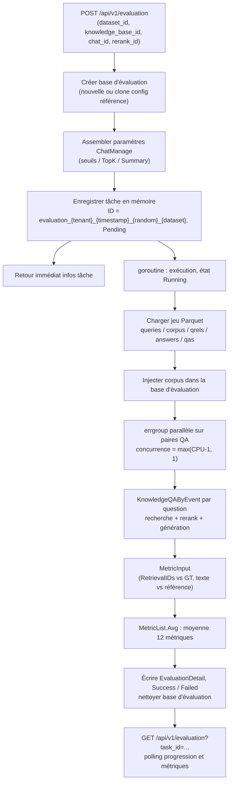

# Évaluation (Evaluation)

L’évaluation compare chunking, modèles et réglages de recherche à l’aide d’un jeu de questions-réponses avec réponses de référence. Le système crée une base de connaissances d’évaluation, importe le corpus, exécute recherche et génération question par question, puis produit Precision, Recall, NDCG, MRR, MAP, BLEU et ROUGE.

::: tip Utilisation via API
Il n’y a pas encore d’interface dédiée : lancer avec `POST /api/v1/evaluation`, interroger avec `GET /api/v1/evaluation?task_id=...` ; création = Admin, lecture = Viewer. Jeu de données au format Parquet (voir ci-dessous).
:::

Pour comparer des configurations, fixez le jeu de données, ne changez qu’une variable à la fois et analysez les mêmes métriques.

## Lancer une évaluation

1. Utiliser le jeu d’exemple intégré, ou préparer des fichiers Parquet selon le format ci-dessous et remplacer les fichiers homonymes sous `dataset/samples/` du répertoire de travail du service (dans le conteneur : `/app/dataset/samples/`).
2. Choisir la base de référence, le modèle de dialogue et le modèle de rerank, puis `POST /api/v1/evaluation`. La base de référence sert à copier la config ; l’évaluation utilise une base séparée.
3. Noter l’ID de tâche retourné ; `GET /api/v1/evaluation?task_id=...` pour statut et progression.
4. En succès, comparer métriques de recherche et de génération ; en échec, lire l’erreur de tâche, ajuster et relancer.

Création : Admin ; lecture : Viewer ; clé API : capacité `run_evaluations` ou full-access.

## Format du jeu de données

Le service dataset (`internal/application/service/dataset.go`) charge 5 fichiers **Parquet** depuis `./dataset/samples/` :

| Fichier | Schéma | Signification |
| --- | --- | --- |
| `queries.parquet` | `id: int64, text: string` | Ensemble de questions |
| `corpus.parquet` | `id: int64, text: string` | Paragraphes du corpus (injectés en base à l’évaluation) |
| `answers.parquet` | `id: int64, text: string` | Réponses de référence |
| `qrels.parquet` | `qid: int64, pid: int64` | Lien question → paragraphes pertinents (ground truth recherche) |
| `qas.parquet` | `qid: int64, aid: int64` | Lien question → réponse (métriques génération) |

Structures Go correspondantes :

```go
type TextInfo struct {
    ID   int64  `parquet:"id"`
    Text string `parquet:"text"`
}
type RelsInfo struct {
    QID int64 `parquet:"qid"`
    PID int64 `parquet:"pid"`
}
type QaInfo struct {
    QID int64 `parquet:"qid"`
    AID int64 `parquet:"aid"`
}
```

Après chargement, assemblage en `QAPair` par échantillon (`internal/types/dataset.go`) :

```go
type QAPair struct {
    QID      int      // ID question
    Question string   // texte de la question
    PIDs     []int    // IDs paragraphes pertinents (ground truth)
    Passages []string // texte des paragraphes
    AID      int      // ID réponse
    Answer   string   // texte de la réponse de référence
}
```

Le service lit toujours ces 5 fichiers dans `./dataset/samples/` ; `dataset_id` sert surtout à composer l’ID de tâche, sans changer de répertoire. Jeu personnalisé : remplacer le contenu du dossier (montage Docker possible sur `/app/dataset/samples/`). Statistiques imprimées au chargement (nombre de questions, taille du corpus, moyenne de paragraphes pertinents, couverture des réponses, etc.).

## Consultation des résultats

`GET /api/v1/evaluation?task_id=<ID retourné à la création>` renvoie `EvaluationDetail` :

```json
{
  "success": true,
  "data": {
    "task": {
      "id": "evaluation_1_1758600000000_1a2b3c4d_default",
      "dataset_id": "default",
      "status": 2,
      "total": 100,
      "finished": 100
    },
    "params": { "...": "instantané des paramètres ChatManage d’évaluation" },
    "metric": {
      "retrieval_metrics": {
        "precision": 0.85, "recall": 0.92,
        "ndcg3": 0.88, "ndcg10": 0.86,
        "mrr": 0.95, "map": 0.87
      },
      "generation_metrics": {
        "bleu1": 0.72, "bleu2": 0.65, "bleu4": 0.58,
        "rouge1": 0.78, "rouge2": 0.71, "rougel": 0.75
      }
    }
  }
}
```

Pendant l’exécution, interroger pour `finished / total` ; `status = 3` : raison dans `err_msg`.

> **Note** : les résultats sont en **mémoire** (`evaluationMemoryStorage` : `map[string]*EvaluationDetail` + `sync.RWMutex`, voir `internal/application/service/evaluation.go`) ; redémarrage du service = perte des tâches et résultats, relancer l’évaluation.

## Liste des métriques

Registre dans `internal/application/service/metric_hook.go`, 12 métriques en deux groupes. Tokenisation préalable dans `metric/common.go` : chinois Jieba, anglais par espaces, phrases sur `。` / `.`.

### Métriques de recherche (Retrieval Metrics)

| Métrique | Champ | Fichier | Signification |
| --- | --- | --- | --- |
| Precision | `precision` | `metric/precision.go` | Précision : documents pertinents retrouvés / total retourné, moyenne sur l’ensemble GT |
| Recall | `recall` | `metric/recall.go` | Rappel : pertinents retrouvés / total pertinents |
| NDCG@3 | `ndcg3` | `metric/ndcg.go` | Gain cumulé décroissant normalisé (top 3), favorise le bon rang |
| NDCG@10 | `ndcg10` | `metric/ndcg.go` | Idem, top 10 |
| MRR | `mrr` | `metric/mrr.go` | Rang inverse du premier pertinent : `sum(1/rank) / N` |
| MAP | `map` | `metric/map.go` | Précision moyenne : `Precision@k` cumulée à chaque hit puis normalisée |

Calcul NDCG (`metric/ndcg.go`) :

Le tri idéal utilise tous les documents pertinents dédupliqués, max. k premiers, sans limite du rappel effectif. v0.9.0 corrige un dénominateur trop petit avec peu de rappel ; comparer avant/après upgrade sur la même version relancée.

```go
// DCG = sum((2^rel_i - 1) / log2(i+2)), rel vaut 0/1
dcg += (math.Pow(2, float64(relevance)) - 1) / math.Log2(float64(i+2))
// NDCG = DCG / IDCG (DCG du tri idéal)
```

MRR (`metric/mrr.go`) :

```go
for i, predID := range ids {
    if _, ok := gtSet[predID]; ok {
        sumRR += 1.0 / float64(i+1) // inverse du rang du premier hit
        break
    }
}
```

### Métriques de génération (Generation Metrics)

| Métrique | Champ | Fichier | Signification |
| --- | --- | --- | --- |
| BLEU-1 | `bleu1` | `metric/bleu.go` | Précision 1-gram (`[1.0, 0, 0, 0]`) |
| BLEU-2 | `bleu2` | `metric/bleu.go` | 1/2-grams à 50 % (`[0.5, 0.5, 0, 0]`) |
| BLEU-4 | `bleu4` | `metric/bleu.go` | 1–4-grams égaux + brevity penalty |
| ROUGE-1 | `rouge1` | `metric/rouge.go` | F1 recouvrement unigrammes |
| ROUGE-2 | `rouge2` | `metric/rouge.go` | F1 bigrammes |
| ROUGE-L | `rougel` | `metric/rouge.go` | F1 plus longue sous-séquence commune (LCS) |

BLEU : moyenne géométrique pondérée des précisions n-gram corrigées × `bp * exp(sum(w_i * log(p_i)))`. ROUGE F1 : `F1 = 2PR / (P + R + 1e-8)` (`metric/rouge_score.go`).

Sans lissage, si une précision n-gram pondérée > 0 vaut zéro, BLEU doit valoir zéro. v0.9.0 corrige l’omission de ces termes qui gonflait le score.

## Référence API et exécution

### API

`internal/router/routes_infra.go` :

```go
evaluationRoutes := g.apiKeyGroup(r.Group("/evaluation"), apiKeyRunEvaluations(apiKeyFullAccess()))
{
    evaluationRoutes.POST("", g.Admin(), handler.Evaluation)
    evaluationRoutes.GET("", g.Viewer(), handler.GetEvaluationResult)
}
```

| Méthode | Chemin | Permission | Description |
| --- | --- | --- | --- |
| POST | `/api/v1/evaluation` | Admin (clé API : `run_evaluations` ou full-access) | Crée une tâche, renvoie immédiatement les infos tâche |
| GET | `/api/v1/evaluation?task_id=...` | Viewer | Statut, progression et métriques |

#### Création de tâche

Corps (`internal/handler/evaluation.go`) :

```go
type EvaluationRequest struct {
    DatasetID       string `json:"dataset_id"`        // ID jeu de données, défaut "default"
    KnowledgeBaseID string `json:"knowledge_base_id"` // base de référence (réutilise sa config)
    ChatModelID     string `json:"chat_id"`           // modèle chat
    RerankModelID   string `json:"rerank_id"`         // modèle rerank
}
```

| Paramètre | Obligatoire | Comportement par défaut |
| --- | --- | --- |
| `dataset_id` | Non | `default` si absent ; sert à l’ID de tâche, données toujours depuis `dataset/samples/` |
| `knowledge_base_id` | Non | Sans valeur : nouvelle base dédiée ; avec : clone la config de référence |
| `chat_id` | Non | Modèle Chat par défaut si absent |
| `rerank_id` | Non | Modèle Rerank par défaut si absent |

ID via `utils.GenerateTaskID` : `evaluation_{tenantID}_{timestamp_ms}_{8 aléatoires}_{datasetID}` ; unique à chaque création — interroger avec l’ID de la réponse. Objet tâche (`internal/types/evaluation.go`) :

```go
type EvaluationTask struct {
    ID        string           `json:"id"`
    TenantID  uint64           `json:"tenant_id"`
    DatasetID string           `json:"dataset_id"`
    StartTime time.Time        `json:"start_time"`
    Status    EvaluationStatue `json:"status"`
    ErrMsg    string           `json:"err_msg,omitempty"`
    Total     int              `json:"total,omitempty"`    // nombre total d’échantillons
    Finished  int              `json:"finished,omitempty"` // nombre terminé
}
```

Énumération d’état (orthographe source `EvaluationStatue`) :

```go
const (
    EvaluationStatuePending EvaluationStatue = iota // 0 en attente
    EvaluationStatueRunning                          // 1 en cours
    EvaluationStatueSuccess                          // 2 succès
    EvaluationStatueFailed                           // 3 échec
)
```

### Flux d’évaluation

Dans `internal/application/service/evaluation.go`, le POST **prépare de façon synchrone, exécute l’évaluation en async** :

1. **Base** : création (ou clone depuis la base de référence) de la base d’évaluation ; modèles Embedding et LLM par défaut ;
2. **Paramètres** : `ChatManage` d’évaluation depuis la config système — seuils vector/keyword, `EmbeddingTopK`, `RerankTopK`, `RerankThreshold`, `MaxRounds`, `SummaryConfig` (MaxTokens / TopK / TopP / RepeatPenalty / Prompt / ContextTemplate, etc.), `FallbackResponse`, prompts de reformulation, etc. ;
3. **Enregistrement** : tâche en stockage mémoire, état `Pending`, réponse immédiate ;
4. **Exécution** (goroutine) : injection du corpus dans la base → évaluation parallèle de chaque paire QA → agrégation métriques → nettoyage.

Concurrence : `max(GOMAXPROCS - 1, 1)` (errgroup) :

```go
var g errgroup.Group
metricHook := NewHookMetric(len(dataset))
g.SetLimit(max(runtime.GOMAXPROCS(0)-1, 1))
for i, qaPair := range dataset {
    g.Go(func() error {
        // 1. cloner la config ChatManage
        // 2. pipeline KnowledgeQAByEvent complet (retrieval + rerank + génération)
        // 3. enregistrer MetricInput (passage IDs, texte généré, GT)
        // 4. mettre à jour finished sous verrou
    })
}
g.Wait()
```

Chaque échantillon produit un `MetricInput` (`internal/types/evaluation.go`) :

```go
type MetricInput struct {
    RetrievalGT    [][]int // ground truth retrieval (listes d’IDs passage pertinents)
    RetrievalIDs   []int   // IDs passage effectivement retournés
    GeneratedTexts string  // texte généré par le modèle
    GeneratedGT    string  // réponse de référence
}
```

`metric_hook.go` applique chaque calculateur enregistré par échantillon ; `Avg()` moyenne par métrique sur tous les échantillons → `MetricResult`.

::: warning Sémantique de RetrievalIDs
`RetrievalIDs` doivent être les **passage ID du jeu de données**, pas le `ChunkIndex` brut — indice de chunk en base, sans correspondance 1:1 avec pid ; sinon toutes les métriques de recherche valent 0. `recordFinish` fait une correspondance bidirectionnelle corps ↔ passages GT pour retrouver les pid et dédupliquer. Rerank vide → repli sur la recherche brute. L’injection du corpus doit **attendre la fin de l’indexation** (`CreateKnowledgeFromPassageSync`) : async = requêtes avant index → métriques à 0. Liste passages dimensionnée `maxPID + 1`, pid 0-based incluant le dernier.
:::

#### Schéma du flux



## Référence d’implémentation

Chemins relatifs à la racine du dépôt :

| Couche | Fichier |
| --- | --- |
| HTTP Handler | `internal/handler/evaluation.go` |
| Service évaluation | `internal/application/service/evaluation.go` |
| Registre et agrégation | `internal/application/service/metric_hook.go` |
| Implémentation métriques | `internal/application/service/metric/` (`precision.go`, `recall.go`, `ndcg.go`, `mrr.go`, `map.go`, `bleu.go`, `rouge.go`, `rouge_score.go`, `common.go`) |
| Chargement dataset | `internal/application/service/dataset.go` |
| Types | `internal/types/evaluation.go`, `internal/types/dataset.go` |
| Jeu d’exemple | `dataset/samples/` (Parquet) |
| Routes | `internal/router/routes_infra.go` → `RegisterEvaluationRoutes` |
