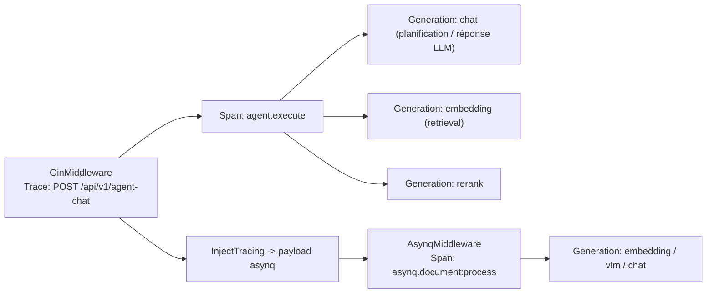
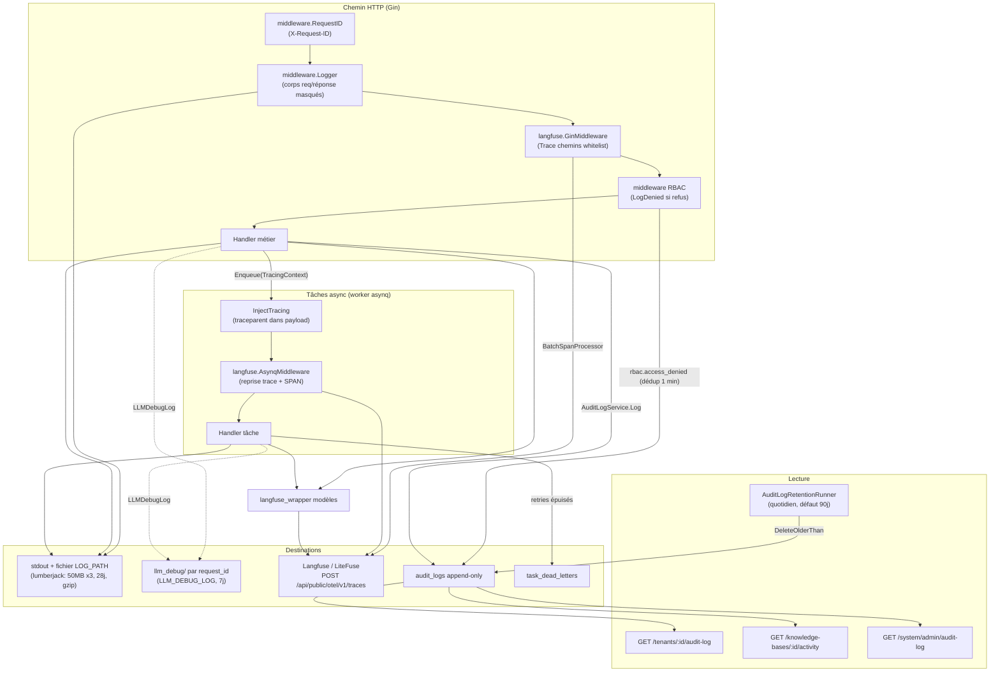

# Observabilité et audit

Journaux et traces d’appels servent à analyser erreurs, latence et usage modèle ; le journal d’audit enregistre les changements de ressources ; le tableau de bord des files inspecte l’arriéré, les échecs et les retries des tâches de fond.

| Objectif | Où regarder |
| --- | --- |
| Ce qu’une Q&R a récupéré, combien d’appels modèle, tokens consommés | Chaîne complète dans Langfuse après branchement |
| Changements base, membres ou paramètres système | « Activité » des paramètres de base ; « Paramètres → Journal d’audit » |
| Parse, résumé, Wiki en file ou en échec | « Paramètres → Files runtime » |
| Service vivant | `GET /health` |
| Relier les logs au même request | Filtrer logs par `X-Request-ID` (en-tête de réponse) |

<Screenshot
  src="/screenshots/queue-dashboard.png"
  caption="Files runtime : arriéré, échecs et retries par file"
  hint="Panneau files avec nom, compteurs en attente/en cours/échec et actions sur tâches mortes." />

<Screenshot
  src="/screenshots/observability-langfuse.png"
  caption="Trace Langfuse : chaîne complète d’une Q&R"
  hint="Trace Langfuse développée : spans retrieval, rerank, génération et usage tokens." />

Pour un incident request : récupérer `X-Request-ID` dans les en-têtes, puis corréler logs et traces.

## Aide-mémoire exploitation {#_8-aide-memoire-exploitation}

| Besoin | Où |
| --- | --- |
| Chaîne complète d’un request | `grep` logs app avec `X-Request-ID` ; avec `LLM_DEBUG_LOG` → `llm_debug/<request_id>.log` |
| Arbre appels LLM et tokens (chat/parse) | UI Langfuse (trace `POST /api/v1/agent-chat` ou `asynq.document:process`) |
| Qui a changé quoi et quand | Audit espace `/tenants/:id/audit-log` ; activité KB `/knowledge-bases/:id/activity` ; audit plateforme `/system/admin/audit-log` |
| Pourquoi un document échoue en boucle | Table `task_dead_letters` (scope=knowledge/knowledge_base) + `last_error` des tâches archivées dans le panneau runtime |
| Service vivant | `GET /health` (200 `{"status":"ok"}`) |
| Config chargée comme prévu | Bannière démarrage `[startup-env]` (`internal/runtime/startup.go`, secrets = longueur seulement) |

## Health check {#_6-health-check}

`internal/router/router.go` enregistre une sonde sans auth (liste blanche publique dans `internal/middleware/auth.go` inclut `/health`) :

```go
// internal/router/router.go
r.GET("/health", func(c *gin.Context) {
    c.JSON(200, gin.H{"status": "ok"})
})
```

Sonde **liveness** pure (sans DB/Redis), adaptée conteneur / LB. `langfuse.shouldTrace` et l’échantillonnage des logs l’ignorent aussi. Uptime via `MarkServerStarted`/`ServerUptime` dans `internal/runtime/server.go` pour le panneau ops.

## Référence logs, traces et audit

### Système de logs (`internal/logger`) {#_2-systeme-logs-internal-logger}

#### Format et niveau {#_2-1-format-et-niveau}

- Instance logrus **privée** (`appLogger`, évite perte si global modifié), `CustomFormatter`.
- Ligne par défaut : `LEVEL[timestamp] [request_id…] caller | message`, caller `fichier:ligne[fonction]` (`addCaller`).
- Template via `WEKNORA_LOG_FORMAT` : `%d` temps, `%level`, `%thread` goroutine (lazy), `%logger`, `%traceId` request_id, `%msg`. `%msg` obligatoire si template non vide ; `json` non supporté comme mot-clé. Rétrocompat `LOG_FORMAT` (déprécié) si nouvelle var absente.
- Niveau `LOG_LEVEL` (`debug`/`info`/`warn`/`error`/`fatal`, **défaut debug** si absent/invalide).
- Couleurs ANSI si stdout TTY ; désactivées hors TTY (Docker) ; fichier via `ansiStripWriter`.
- Champs structurés : `WithField`/`WithFields` dans le context (`types.LoggerContextKey`) ; `WarnWithFields` pour audit (sondage cross-tenant, invariant).
- `CloneContext` : copie tenant/user/request_id/rôle/langue + trace Langfuse et **span OTel actif** pour goroutines filles.

#### Sortie et rotation {#_2-2-sortie-et-rotation}

`ConfigureFromEnv()` (init + rappel après `.env` dans `main`) : toujours stdout ; si `LOG_PATH` (ou macOS `.app` → `~/Library/Logs/<App>/<App>.log`) → lumberjack :

```go
// internal/logger/logger.go openLogFile()
return &lumberjack.Logger{
    Filename:   logPath,
    MaxSize:    50, // megabytes
    MaxBackups: 3,
    MaxAge:     28, // days
    Compress:   true,
}, nil
```

#### Logs debug LLM (`internal/logger/llm_logger.go`) {#_2-3-logs-debug-llm}

`LLM_DEBUG_LOG=true|1|<dir>` : chaque appel modèle (Chat / Stream / Embedding / Rerank / VLM) écrit entrées/sorties/outils/erreurs **complets** dans `llm_debug/`, **un fichier par request_id** (`<request_id>.log`). Nettoyage fichiers >7 jours au démarrage (`cleanupOldDebugFiles`).

#### Middleware logs requête (`internal/middleware/logger.go`) {#_2-4-middleware-logs-requete}

- `RequestID()` : lit ou génère `X-Request-ID`, en-tête réponse, context gin + `http.Request` — corrélation workers asynq.
- `Logger()` : method, path (query `sanitizeQuery` masque token/code/state OAuth), status, latence, IP, taille, corps req/réponse ≤10KB. `sensitiveFieldRegex` masque password/token/api_key/secret/private_key (`"***"`) ; SSE → `[réponse SSE streaming, ignorée]` ; skip `/assets/` et stats wiki poll.
- Proxies de confiance : `SetTrustedProxies` (`WEKNORA_TRUSTED_PROXIES`) contre `X-Forwarded-For` forgé.

### Traces Langfuse (`internal/tracing/langfuse`) {#_3-traces-langfuse}

OpenTelemetry Go SDK, attributs sémantiques Langfuse (`langfuse.observation.*`), export OTLP/HTTP `POST <host>/api/public/otel/v1/traces` (Langfuse v3+, LiteFuse). Traces off par défaut ; pas d’export si désactivé.

#### Configuration (env, `config.go`) {#_3-1-configuration-env}

| Variable | Défaut | Description |
| --- | --- | --- |
| `LANGFUSE_ENABLED` | auto si clés | Interrupteur (aligné SDK Python) |
| `LANGFUSE_HOST` | `https://cloud.langfuse.com` | Base Langfuse/LiteFuse |
| `LANGFUSE_PUBLIC_KEY` / `LANGFUSE_SECRET_KEY` | — | Basic Auth projet |
| `LANGFUSE_RELEASE` / `LANGFUSE_ENVIRONMENT` | — | Filtres UI trace |
| `LANGFUSE_FLUSH_AT` | 15 | Taille lot export (`MaxExportBatchSize`) |
| `LANGFUSE_FLUSH_INTERVAL` | 3s | Intervalle max lot (`BatchTimeout`) |
| `LANGFUSE_QUEUE_SIZE` | 2048 | Tampon mémoire |
| `LANGFUSE_REQUEST_TIMEOUT` | 10s | Timeout HTTP ingestion |
| `LANGFUSE_SAMPLE_RATE` | 1.0 | `ParentBased(TraceIDRatioBased)` 0..1 |
| `LANGFUSE_DEBUG` | false | Logs erreurs batch |

#### Exporteur (`exporter.go`) {#_3-2-exporteur}

OTLP/HTTP, `Authorization: Basic base64(public:secret)` ; client HTTP dédié (hors garde SSRF ; pas de whitelist si `SSRF_DNS_WHITELIST_ONLY`). En-têtes `x-langfuse-ingestion-version: 4` (requis v3/LiteFuse OTel), `x-langfuse-sdk-name/version`. `Manager` (`manager.go`) : `TracerProvider` isolé (`service.name=weknora`), pas de mutation globale OTel ; propagateur W3C `TraceContext` privé au package.

#### Modèle d’observation et instrumentation {#_3-3-modele-observation-instrumentation}

Trois handles (`tracer.go`) : `Trace` (racine request), `Span` (unité non-LLM), `Generation` (appel modèle + `TokenUsage`, streaming `MarkCompletionStart`). Hiérarchie via context span OTel ; auto-trace si absent pour éviter orphelins.

Principaux points :

| Point | Source | Produit |
| --- | --- | --- |
| Entrée HTTP | `middleware.go` `GinMiddleware` | Trace racine sur chemins `shouldTrace` (knowledge-chat / agent-chat / knowledge-search / ingestion POST/PUT / import FAQ / wiki auto-fix / evaluation / init…), nom `METHOD /path`, metadata http + request_id, sortie status/size ; hérite `traceparent` W3C |
| Worker asynq | `asynq.go` `AsynqMiddleware` | Reprend traceparent payload ou `asynq.<task_type>` ; SPAN + metadata task_id/queue/retry… ; payload preview 1KB |
| Injection enqueue | `asynq.go` `InjectTracing` + `internal/types/tracing.go` | traceparent + tags user/session en `lf_*` dans payload |
| Appels modèle | `internal/models/{chat,embedding,rerank,vlm,asr}/langfuse_wrapper.go` | Generation par appel |
| Résumé retrieval | `retrieval_obs.go` | Top-25 preview (rank/chunk_id/score/160 car.) |
| Agent | `internal/agent/engine.go`, `act.go` | SPAN agent.execute, `CloneContext` même arbre HTTP |

Attributs span (`events.go`) : types Langfuse, input/output/metadata, `usage_details`, `user.id` (user ou `tenant:<id>`), `session.id`, environment/release.



#### Nœuds retrieval et diagnostic

`embedding.embed`, `retrieve`, `rerank` chronomètrent requête, retrieval et rerank. Nœuds `diagnostics.*` : stats/filtres sur résultats existants, pas d’appel retrieval/modèle supplémentaire.

| Nœud diagnostic | Signification |
| --- | --- |
| `diagnostics.retrieval.vector.result_pool.initial` | Pool initial vecteur |
| `diagnostics.retrieval.keywords.result_pool.initial` | Pool initial mots-clés |
| `diagnostics.retrieval.<vector/keywords>.result_pool.refill` | Pool après refill (si refill) |
| `diagnostics.retrieval.<vector/keywords>.filter_decision` | Pool avant filtre + décision |
| `diagnostics.retrieval.fusion.candidate_selection` | Troncature fusion |
| `diagnostics.rerank.selection` | Décision post-rerank |

Pools : texte, résumé, légendes image, OCR, vecteurs image selon requête. `image_samples` = échantillon vecteurs image ; metadata `observation_kind=diagnostic`, `sample_scope=image_vectors`. Sans refill, `initial` et `filter_decision` peuvent montrer le même lot observé à deux étapes.

Renommages n’affectent que les traces nouvelles ; historique garde `retrieval.image_*`, `rerank.selection`. Ajuster dashboards filtrés par nom de nœud.

#### Usage par tour, finalité d’appel et cache

Chaque appel = Generation ; usage message = agrégat tour ; événement fin agent via turn_usage ; historique relu. `cached_tokens` alias de cache_read ; cache_read/write/miss = détail entrée, ne pas additionner à `prompt_tokens`. `cache_reported` / `cache_status` : hit, miss, unreported, unsupported. Metadata `call_purpose` + empreinte préfixe prompt.

Prompt : instructions stables en tête, session dynamique en queue ; marqueurs cache si provider supporte. Hit dépend protocole/modèle/préfixe. Sandbox : spans Langfuse pour ops instance/outils ; maintenance sandbox = spans enfants si trace parente ; install skills ouvre sa trace. Export off si tracing désactivé.

### Journal d’audit {#_4-journal-audit}

#### Modèle (`internal/types/audit_log.go`) {#_4-1-modele-audit-log}

Table `audit_logs` **append-only** (pas UpdatedAt/soft delete), id monotone = PK + curseur :

| Champ | Type | Description |
| --- | --- | --- |
| `id` | uint64 auto | PK + curseur `WHERE id < after_id ORDER BY id DESC` |
| `tenant_id` | uint64 | Espace ; `0` = système |
| `actor_user_id` / `actor_role` | varchar | Acteur et rôle au moment de l’action |
| `action` | varchar(64) | `<area>.<event>` (§4.2) |
| `scope_type` / `scope_id` | varchar | Portée ressource (ex. `knowledge_base` + kbID) |
| `target_type` / `target_id` / `target_user_id` | varchar | Cible |
| `request_path` / `request_method` | varchar | Template route (pas URL brute ; brute dans Details.raw_path) |
| `outcome` | varchar(16) | `success` / `accepted` / `denied` / `failed` / `partial` / `canceled` |
| `details` | jsonb | Payload action ; **jamais** secrets en clair ; activité KB via clé API → `api_key_id` / `api_key_name` |
| `created_at` | timestamp | Rétention |

#### Actions audit {#_4-2-actions-audit}

| Groupe | Actions |
| --- | --- |
| RBAC / membres | `rbac.member_added`, `rbac.member_removed`, `rbac.member_role_changed`, `rbac.member_left`, `rbac.access_denied`, `rbac.invitation_sent`, `rbac.invitation_accepted`, `rbac.invitation_declined`, `rbac.invitation_revoked`, `rbac.invitation_expired` |
| Vector store | `vector_store.created`, `vector_store.updated`, `vector_store.deleted` |
| OpenSearch | `opensearch.index_created`, `opensearch.index_deleted`, `opensearch.reindex_executed` |
| Système (tenant_id=0) | `system.setting_changed`, `system.admin_promoted`, `system.admin_revoked`, `system.user_created`, `system.user_password_reset`, `system.api_key_created`, `system.api_key_revoked` |
| Files (tenant_id=0) | `system.queue_task_retried`, `system.queue_task_deleted`, `system.queue_task_run_now`, `system.queue_task_cancelled`, `system.queue_archived_purged` |
| Base | `kb.created`, `kb.updated`, `kb.deleted`, `kb.duplicated`, `kb.clone_started`, `kb.clone_completed`, `kb.clone_failed`, `kb.share_added`, `kb.share_permission_changed`, `kb.share_removed` |
| Connaissance | `knowledge.created`, `knowledge.updated`, `knowledge.deleted`, `knowledge.batch_deleted`, `knowledge.reparse_started`, `knowledge.parse_canceled`, `knowledge.move_started`, `knowledge.move_completed`, `knowledge.move_failed` |
| Tags / datasource | `tag.created`, `tag.updated`, `tag.deleted`, `datasource.created`, `datasource.updated`, `datasource.deleted`, `datasource.sync_started`, `datasource.sync_completed`, `datasource.sync_failed`, `datasource.paused`, `datasource.resumed` |
| Wiki / FAQ | `wiki.content_changed`, `faq.import_started`, `faq.import_completed`, `faq.import_failed` |

#### Écriture (service + middleware) {#_4-3-ecriture-audit}

- `auditLogService.Log` : défaut `outcome=success` ; **échec écriture = ERROR log seulement**, jamais d’interruption métier.
- `LogDenied` : **dédoublonnage 1 min** glissant `(tenant, actor, rbac.access_denied, template route)` via `denyDedupWindow` ; template route (pas URL brute). Log stderr `[rbac] role insufficient` à chaque refus.
- `AuditServiceProvider` dans gin context ; nil-safe (mode Lite sans audit).

#### API lecture (`internal/handler/audit_log.go`) {#_4-4-api-lecture-audit}

| Route | Permission | Description |
| --- | --- | --- |
| `GET /api/v1/tenants/:id/audit-log` | PathTenantMatch + Admin | Flux espace ; `UnscopedOnly` (`scope_type=''`) |
| `GET /api/v1/knowledge-bases/:id/activity` | Créateur KB ou Admin espace, espace owner (pas consommateur org partagée) | Projection activité KB |
| `GET /api/v1/system/admin/audit-log` | SystemAdmin (+ clé `system.audit_read`) | Événements `tenant_id=0` |

Params : `after_id`, `limit` 1–100 (défaut 50, max 100), filtres `action` / `outcome` / `actor`. Réponse `next_cursor` (min id page, 0 = fin).

#### Rétention (`internal/application/service/audit_log_retention.go`) {#_4-5-retention-audit}

- `audit.retention_days` / `WEKNORA_AUDIT_RETENTION_DAYS` ; défaut **90 jours** si section `audit:` absente ; `0` = pas de purge (archivage externe) ; négatif = erreur validation.
- `AuditLogRetentionRunner` : ticker goroutine, délai démarrage 10 min, puis **24h** `Purge` → `DeleteOlderThan` (DELETE indexé, timeout 30s). Enregistré dans `internal/container/container.go` avec arrêt gracieux.

### Limitation de débit (`internal/ratelimit` + middleware) {#_5-limitation-debit}

#### Limiteur fenêtre glissante (`internal/ratelimit/limiter.go`) {#_5-1-limiteur-fenetre-glissante}

- Redis prioritaire : Lua ZSET atomique ; member `<instanceID>:<ms>`.
- Fallback `localLimiter` si Redis indisponible / Lite sans Redis.
- `max` par appel `Allow` ; usages : embed web (minute + 24h par channel+IP), IM (`internal/im/service.go`).

#### Auth publique par IP (`internal/middleware/auth_public_ratelimit.go`) {#_5-2-auth-publique-ip}

`PublicAuthRateLimit()` : invitations lookup/register-by-invite, **30/min/IP** partagé, 429. Local only ; commentaire : Redis `internal/ratelimit` pour scale horizontal.

### Statistiques de **référence** modèle (`internal/application/repository/model_usage.go`) {#_7-stats-reference-modele}

Requêtes **usage-by-reference** (« quelles ressources utilisent ce modèle ») pour garde-fou suppression, **pas** facturation tokens :

- `scopeKnowledgeBasesByModelID` : champs embedding, summary, image, vlm, asr, wiki, auto_tag… (Postgres `->>`, SQLite `json_extract`).
- `scopeCustomAgentsByModelID` : `custom_agents.config` model/rerank/vlm/asr/query_understand/suggestions…
- Mémoire long terme : `memory_config` extract + embedding dans `long_term_memory.bindings`.
- Consommateurs : `ListModelUsages`, limite 50 ; garde suppression dans `model.go` avec détails HTTP 400.

Usage tokens : Langfuse Generation `usage_details` (`TokenUsage`), agrégation UI par modèle / `tenant:<id>` / session.

### Vue d’ensemble des flux d’observabilité {#_1-flux-observabilite}



## Référence d’implémentation

Chemins relatifs à la racine du dépôt :

| Capacité | Chemin source |
| --- | --- |
| Logs application | `internal/logger/logger.go` |
| Debug appels LLM | `internal/logger/llm_logger.go` |
| Logs requête / RequestID | `internal/middleware/logger.go` |
| Traces Langfuse (OTel) | `internal/tracing/langfuse/` |
| Porteur trace inter-processus | `internal/types/tracing.go` |
| Audit handler / service / repo | `internal/handler/audit_log.go`, `internal/application/service/audit_log.go`, `internal/application/repository/audit_log.go` |
| Rétention audit | `internal/application/service/audit_log_retention.go`, `internal/config/config.go` (`applyAuditDefaults`) |
| Actions / modèles audit | `internal/types/audit_log.go` |
| Rate limit | `internal/ratelimit/limiter.go`, `internal/middleware/auth_public_ratelimit.go` |
| Health check | `internal/router/router.go` (`GET /health`) |
| Références modèle | `internal/application/repository/model_usage.go` |
