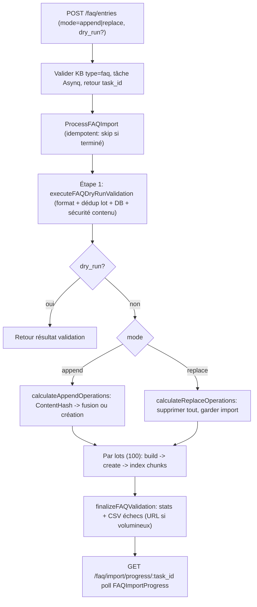
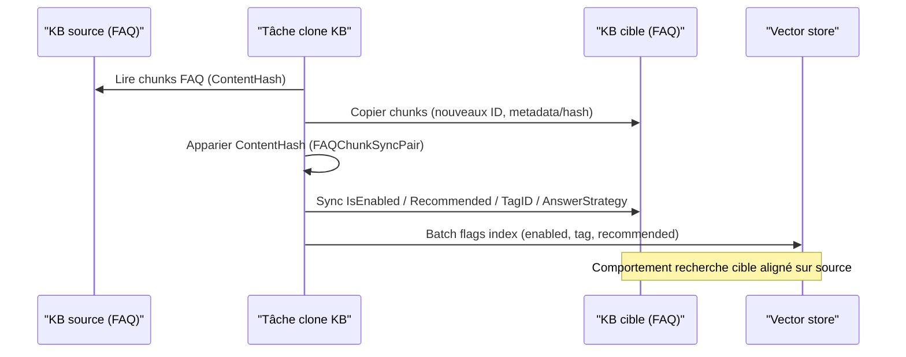

# Capacité FAQ

Une base FAQ sert à maintenir des Q&R standard (retours, remboursements, dépannage courant). Chaque entrée comprend question standard, questions similaires, contre-exemples et réponses ; la recherche matche les questions et applique une stratégie de réponse selon le type de hit.

Après création d’une base de type FAQ : import Excel/CSV en lot, puis enrichissement similaires/contre-exemples. Une base FAQ peut être combinée à des bases documentaires pour la récupération agent ; avec priorité FAQ et seuil de réponse directe, la réponse standard peut être renvoyée telle quelle.

<Screenshot
  src="/screenshots/faq-management.png"
  caption="Gestion FAQ : liste, filtres et import en lot"
  hint="Liste d’entrées (question standard, nombre de similaires, tags, état) avec entrée d’import et retour de résultat." />

Gestion, import et réglages de recherche ci-dessous ; dédoublonnage et sync en section référence.

## Créer et maintenir les Q&R

Pour chaque entrée : question standard et réponse(s). Les similaires couvrent d’autres formulations ; les contre-exemples écartent les faux positifs. Plusieurs réponses possibles, toutes ou une au hasard.

Catégories, désactivation d’entrées inutilisées, exclusion des recommandations. Catégorie FAQ = étiquette unique (distincte du multi-tag documentaire).

### Mode d’expansion de la liste

Basculer développer/replier : parcours des questions vs inspection ligne à ligne. Affichage seulement, sans impact sur entrées, activation ou stratégie de recherche.

## Import et export

Modèle : question standard, similaires, contre-exemples, réponses ; valeurs multiples séparées par `##`. Import append ou replace : append fusionne par hash de contenu ; replace supprime l’ancien et ne garde que le lot. Validation seule via `dry_run` sur l’API.

Résultats : succès, échec, partiel, ignoré avec motifs. Export CSV/JSON pour sauvegarde, édition et réimport.

## Vérifier les hits

Recherche FAQ : vecteur, mots-clés et priorité de tags ; match exact sur un contre-exemple → exclusion. Scores, type de hit et question matchée aident à ajuster similaires, contre-exemples et seuils.

## Référence import et recherche

### Import en lot {#_4-import-en-lot}

`internal/application/service/knowledge_faq_import.go`. Entrée `POST /knowledge-bases/:id/faq/entries` :

```go
type FAQBatchUpsertPayload struct {
    Entries     []FAQEntryPayload `json:"entries" binding:"required"` // aussi via EntriesURL depuis object storage
    Mode        string            `json:"mode" binding:"oneof=append replace"`
    KnowledgeID string            `json:"knowledge_id"`
    TaskID      string            `json:"task_id"` // optionnel, auto si absent ; custom [A-Za-z0-9_-], ≤128 car.
    DryRun      bool              `json:"dry_run"` // validation sans persistance
}
```

Colonnes CSV (symétriques à l’export, multi-valeurs `##`) : question standard (requis), similaires, contre-exemples, réponses (requis), répondre à toutes, désactivé, hors recommandation, catégorie (défaut « non classé »).



`FAQImportProgress` : `success_count` / `failed_count` / `partial_failed_count` / `skipped_count` / `merged_count` / `added_count`, `failed_entries[]`, `failed_entries_url`, `import_mode`, `processing_time` ; statut `pending → processing → completed / failed`.

Export CSV (BOM UTF-8 pour Excel) ou JSON (`FAQExportEntry`, compatible import).

### Stratégie de hit en recherche {#_6-strategie-hit-recherche}

`internal/handler/faq.go` `SearchFAQ` + `internal/application/service/knowledgebase_search_faq.go` :

```go
type FAQSearchRequest struct {
    QueryText            string  `binding:"required"`
    VectorThreshold      float64 // seuil similarité vecteur (défaut 0.7)
    MatchCount           int     // défaut 10, max 50
    FirstPriorityTagIDs  []int64 // tags priorité 1
    SecondPriorityTagIDs []int64 // priorité 2
    OnlyRecommended      bool    // entrées recommandables seulement
}
```

Flux :

1. **Rappel hybride** : texte normalisé → vecteur + BM25, fusion dédoublonnée ;
2. **Priorité tags** : `FirstPriorityTagIDs` puis `SecondPriorityTagIDs` ;
3. **Filtre négatif** (`filterByNegativeQuestions`) : match exact (minuscules) sur un contre-exemple → entrée retirée ;
4. **Rappel itératif** (`applyFAQPostProcessing`) : si entrées uniques < `match_count` et une liste vecteur saturée → `iterativeRetrieveWithDeduplication` (max 5 itérations, TopK ×2 depuis 2× profondeur initiale, plafond 500) ;
5. Résultat avec `score`, `match_type`, `matched_question` ; réponses selon `answer_strategy` (all / random).

Sans base FAQ dans le périmètre : post-traitement ignoré. Contre-exemples dès qu’une FAQ est dans le scope (partage org inclus) ; itération seulement si KB principale = FAQ. Chaîne agent : même post-traitement sur bases FAQ.

## Référence entrées et API

### Modèle de données {#_1-modele-donnees}

#### Stockage : entrée FAQ = un Chunk {#_1-1-stockage-chunk-faq}

Chaque entrée = `Chunk` (`chunk_type = "faq"`), `Knowledge` type `faq` (créé au premier ajout). Contenu structuré dans `Chunk.Metadata` (JSON) :

```go
// internal/types/faq.go
type FAQChunkMetadata struct {
    StandardQuestion  string         `json:"standard_question"`
    SimilarQuestions  []string       `json:"similar_questions,omitempty"`
    NegativeQuestions []string       `json:"negative_questions,omitempty"` // filtrage si hit
    Answers           []string       `json:"answers,omitempty"`
    AnswerStrategy    AnswerStrategy `json:"answer_strategy,omitempty"`    // all | random
    Version           int            `json:"version,omitempty"`
    Source            string         `json:"source,omitempty"`
}

const (
    AnswerStrategyAll    AnswerStrategy = "all"
    AnswerStrategyRandom AnswerStrategy = "random"
)
```

Champs chunk : `SeqID` (ID API), `TagID` (catégorie, défaut `UntaggedTagName` en source), `IsEnabled`, `Flags` (bit0 `ChunkFlagRecommended`), `ContentHash` (voir [Normalisation et hash](#_3-normalisation-hash)).

#### Projection API : FAQEntry {#_1-2-projection-faqentry}

```go
type FAQEntry struct {
    ID                int64          `json:"id"`
    ChunkID           string         `json:"chunk_id"`
    KnowledgeID       string         `json:"knowledge_id"`
    KnowledgeBaseID   string         `json:"knowledge_base_id"`
    TagID             int64          `json:"tag_id"`
    TagName           string         `json:"tag_name"`
    IsEnabled         bool           `json:"is_enabled"`
    IsRecommended     bool           `json:"is_recommended"`
    StandardQuestion  string         `json:"standard_question"`
    SimilarQuestions  []string       `json:"similar_questions"`
    NegativeQuestions []string       `json:"negative_questions"`
    Answers           []string       `json:"answers"`
    AnswerStrategy    AnswerStrategy `json:"answer_strategy"`
    IndexMode         FAQIndexMode   `json:"index_mode"`
    Score             float64        `json:"score,omitempty"`
    MatchType         MatchType      `json:"match_type,omitempty"`
    MatchedQuestion   string         `json:"matched_question,omitempty"`
}
```

#### Config FAQ au niveau KB (FAQConfig) {#_1-3-faqconfig-kb}

| Config | Valeurs | Défaut | Description |
| --- | --- | --- | --- |
| `index_mode` | `question_only` / `question_answer` | `question_answer` | Index inclut ou non les réponses |
| `question_index_mode` | `combined` / `separate` | `combined` | Une entrée d’index combinée ou une par question |

Mode `separate` : `SourceID = fmt.Sprintf("%s-%s", chunk.ID, hashQuestion(similarQ))` pour ajouts/suppressions fines.

### Endpoints API {#_2-endpoints-api}

`internal/handler/faq.go` (`internal/router/routes_knowledge.go`, lecture `KBAccessRead`, écriture `KBAccessWrite` ; clé API `ingest` / `retrieve`) :

| Méthode | Chemin | Rôle |
| --- | --- | --- |
| GET | `/knowledge-bases/:id/faq/entries` | Liste (pagination / tag / mot-clé / activé) |
| GET | `/knowledge-bases/:id/faq/entries/:entry_id` | Détail |
| POST | `/knowledge-bases/:id/faq/entry` | Création synchrone |
| PUT | `/knowledge-bases/:id/faq/entries/:entry_id` | Mise à jour (index incrémental) |
| POST | `/knowledge-bases/:id/faq/entries` | Import batch async |
| POST | `/knowledge-bases/:id/faq/entries/:entry_id/similar-questions` | Ajouter similaires |
| PUT | `/knowledge-bases/:id/faq/entries/fields` | Batch champs (activé / recommandé / stratégie) |
| PUT | `/knowledge-bases/:id/faq/entries/tags` | Batch tags |
| DELETE | `/knowledge-bases/:id/faq/entries` | Suppression batch |
| POST | `/knowledge-bases/:id/faq/search` | Recherche hybride FAQ |
| GET | `/knowledge-bases/:id/faq/entries/export` | Export CSV / JSON |
| GET | `/faq/import/progress/:task_id` | Progression import |
| PUT | `/knowledge-bases/:id/faq/import/last-result/display` | Panneau résultat import (open/close) |

Liste : `page` / `page_size`, `tag_id` ou `tag_ids` (UUID, OR), `keyword` + `search_field`, `sort_order`, `is_enabled`.

**Validation écriture** (`sanitizeFAQEntryPayload` + `checkFAQQuestionDuplicate`) : question standard requise ; ≥1 réponse ; `answer_strategy` all/random ; dédup ; contrôle doublons similaires/contre-exemples/DB.

### Normalisation et hash de contenu {#_3-normalisation-hash}

« **Texte brut en base, égalité sur texte normalisé** » :

```go
func (c *Chunk) SetFAQMetadata(meta *FAQChunkMetadata) error {
    meta.Sanitize()
    c.Metadata, _ = json.Marshal(meta)
    normalized := meta.Normalize()
    c.ContentHash = CalculateFAQContentHash(normalized)
    return nil
}
```

`NormalizeQuestion` : trim → URLs → minuscules → ponctuation bords → **trad. → simpl.** → **pleine → demi largeur** → espaces (CN sans espace inter-mot, EN/chiffres conservés).

`CalculateFAQContentHash` = SHA256(question standard normalisée + similaires/contre/réponses triés). Tests dans `internal/types/faq_test.go`. Hash pour import et appariement clone.

### Différence avec Document {#_5-diff-document}

| Dimension | FAQ | Document |
| --- | --- | --- |
| Type KB | `faq` | `document` |
| Knowledge.Type | `faq` | fichier / `manual` / URL |
| Source chunk | saisie structurée | parseur |
| Chunk.ChunkType | `faq` | `text` / `image_ocr` / `summary`… |
| Metadata | `FAQChunkMetadata` | métadonnées doc |
| Chunk.Content | `buildFAQChunkContent` ; contre-exemples **jamais** dans Content | fragment source |
| ContentHash | hash normalisé | rarement |
| Granularité index | selon `question_index_mode` | 1 chunk = 1 index (parent/enfant à part) |
| Pipeline | sync / import async | DocReader async |
| Post-recherche | négatif + itération | fusion/rerank classique |
| États | `is_enabled`, `is_recommended`, `answer_strategy` | `enable_status` |

Mise à jour : **index incrémental** (`incrementalIndexFAQEntry`) — embedding seulement sur deltas ; `SourceID` pour suppression d’index obsolètes.

### Clone / sync partagé {#_7-clone-sync-partage}

`internal/application/service/faq_clone_sync.go`. Clone de base ou sync contenu partagé : appariement par `ContentHash` → `FAQChunkSyncPair` ; sync `IsEnabled`, `ChunkFlagRecommended`, `TagID`, `AnswerStrategy` ; refresh flags dans le vector store.



## Référence d’implémentation

Chemins relatifs à la racine du dépôt :

| Couche | Fichier |
| --- | --- |
| Types FAQ, normalisation, hash | `internal/types/faq.go` (+ tests) |
| Handler FAQ | `internal/handler/faq.go` |
| CRUD / export | `internal/application/service/knowledge_faq.go` |
| Import async | `internal/application/service/knowledge_faq_import.go` |
| Clone / sync | `internal/application/service/faq_clone_sync.go` |
| Post-traitement recherche | `internal/application/service/knowledgebase_search_faq.go` |
| Config FAQ KB | `internal/types/knowledgebase.go` (`FAQConfig`) |
