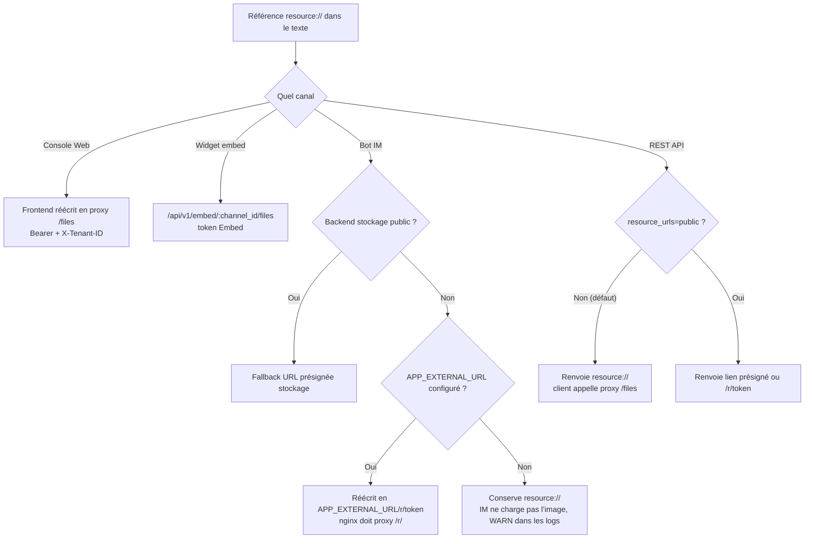

# Accès externe aux images et fichiers

Les images et fichiers sont accessibles différemment selon le canal. La console Web et le widget d’intégration peuvent appeler des proxys avec identifiants ; les plateformes IM exigent des liens publics à durée limitée ; les clients API choisissent entre références internes ou liens externes selon l’usage.

Lors de l’intégration, vérifiez simultanément la forme de référence, les droits de l’appelant et l’accessibilité des URL. Si une image ne s’affiche pas, consultez le tableau de dépannage en fin de page.

## Références fichiers et modes d’accès {#_1-quatre-formes}

Les images et pièces jointes de la base de connaissances sont stockées dans le backend fichiers. Le corps du texte utilise des références internes stables ; à la réponse ou au rendu, elles sont converties en URL selon le canal :

| Forme | Exemple d’URL | Condition d’accès | Validité |
| --- | --- | --- | --- |
| **Référence interne** | `resource://<handle>` | Handle stable résolu côté serveur, pas utilisable directement comme URL | — |
| **Proxy authentifié** | `/files`, `/api/v1/knowledge-bases/:id/files`, `/api/v1/embed/:channel_id/files`, niveau message `/api/v1/sessions/:id/messages/:message_id/files` | Client avec identifiants adaptés (session / droit KB / token Embed) | Tant que l’identifiant est valide |
| **Lien court signé** | `/r/<token>` | Toute personne disposant du lien (**lecture anonyme**) | Grant émis par WeKnora, 2 h |
| **Présignature stockage** | Lien http(s) du backend | Toute personne disposant du lien (**lecture anonyme**) | Dépend du stockage ; MinIO par défaut 24 h |

Les liens courts signés et les URL présignées permettent une lecture anonyme pendant leur validité. Lors du partage ou de l’archivage de ces liens, traitez-les selon la sensibilité du fichier. Révoquer un partage organisationnel ou quitter une organisation n’invalide pas les liens déjà émis : ils restent valides jusqu’à expiration (lien court 2 h, présignature stockage jusqu’à 24 h).

::: tip Mode d’accès par défaut
Par défaut le système renvoie des références internes ; les clients authentifiés les lisent via le proxy. Les liens externes exigent un endpoint stockage reachable depuis Internet, ou `APP_EXTERNAL_URL` pour que WeKnora émette des liens d’accès. L’adresse MinIO par défaut `minio:9000` n’est reachable que dans le réseau des conteneurs.
:::

## Accès aux fichiers par canal {#_2-acces-par-canal}

### Console Web

Le frontend Web convertit les références `resource://` et `provider://` en URL de proxy authentifié. Les ressources courantes passent par `/files` avec Bearer token et `X-Tenant-ID` ; une base partagée entre espaces utilise `/api/v1/knowledge-bases/:id/files`, en lisant les fichiers de l’espace source selon les droits KB, sans configuration supplémentaire.

Pour les images dans les réponses d’un Agent partagé ou d’une KB partagée au niveau organisation, privilégier `/api/v1/sessions/:id/messages/:message_id/files?file_path=...`. Le serveur vérifie que l’appelant peut lire le message, que la ressource est bien citée par le message, et revalide l’autorisation sur la KB ou l’Agent partagé. Après révocation du partage, les messages historiques ne continuent pas d’accorder l’accès aux ressources. La navigation KB classique peut toujours utiliser le proxy au niveau KB ; les deux contextes restent distincts.

### Bot IM {#im-bot-cas-frequents}

Les plateformes IM ne peuvent pas transporter les identifiants WeKnora : il faut des URL HTTP(S) publiquement accessibles. Avant l’envoi du message, le système génère un lien externe selon le stockage et le déploiement :

`resource://` utilise l’instance de stockage réellement liée à la ressource ; une ressource partagée utilise l’instance de l’espace propriétaire. Si la KB est déjà liée à OSS ou autre objet, inutile de modifier globalement `STORAGE_TYPE`. Si l’instance liée est indisponible, la référence originale est conservée avec alerte ; aucune autre instance ni le stockage global ne la remplace.

Avant de générer un lien externe pour une image inter-espaces, le système vérifie la liaison KB, le partage actuel et le périmètre KB de l’agent. Les pièces jointes de chat et fichiers générés enregistrent l’instance globale utilisée à l’écriture ; les ressources historiques non liées ne sont complétées que si l’emplacement est unique, sinon la référence reste inchangée.

1. **Backend stockage reachable publiquement** — endpoint public pour l’objet, ou `MINIO_ENDPOINT` en host public. Fallback vers URL présignée stockage, sans config extra ;
2. **Configurer `APP_EXTERNAL_URL`** — la référence devient `<APP_EXTERNAL_URL>/r/<token>`, requête proxifiée via nginx `location ^~ /r/` vers app. L’image frontend officielle inclut cette location ; un reverse proxy maison doit l’ajouter, sinon la requête tombe dans le fallback SPA (page blanche).

Un MinIO interne par défaut et le stockage `local` exigent `APP_EXTERNAL_URL`. Sans conditions de lien externe, le système conserve la référence et journalise une alerte ; l’IM ne peut pas afficher l’image. Si un canal IM est actif et `APP_EXTERNAL_URL` est vide, une alerte est aussi émise au démarrage.

### Widget d’intégration

Le widget utilise le proxy fichiers canal `/api/v1/embed/:channel_id/files`. Le token Embed fixe l’espace ; le serveur vérifie l’appartenance du chemin. Le canal embed renvoie toujours des références internes ; `RESOURCE_URL_MODE=public` et `?resource_urls=public` ne changent pas ce comportement, pour garantir une lecture sous authentification canal.

### REST API et SDK

L’API renvoie par défaut `resource://` ; le client récupère le fichier via le proxy authentifié. Pour un rendu direct avec lien externe :

- Requête unique : `?resource_urls=public`
- Déploiement entier : `RESOURCE_URL_MODE=public`

Le paramètre de requête prime sur la variable d’environnement : même avec `public` par défaut, `?resource_urls=handle` permet de revenir au mode handle. Sémantique complète, périmètre et limites de sécurité : section « Formes de référence fichier » de la [vue d’ensemble API](../04-api/01-api-overview.md).

Une clé API limitée à une KB renvoie 403 avec `public` ; ce type de clé n’accède pas non plus au proxy générique `/files`. Sans conditions de lien externe, la réponse garde `resource://` ; un client autorisé peut utiliser le proxy authentifié.

## Dépannage des problèmes d’accès {#_3-depannage-par-symptome}

| Symptôme | Cause probable | Action |
| --- | --- | --- |
| Image invisible dans l’IM | Pas de `APP_EXTERNAL_URL` et stockage non public | Configurer `APP_EXTERNAL_URL`, vérifier le proxy nginx `/r/` ; chercher WARN `rewriteStorageURLs no-op` dans les logs app |
| Lien IM s’ouvre mais page blanche | nginx sans `location ^~ /r/`, requête en fallback SPA | Ajouter la location (incluse dans l’image frontend officielle), voir [Frontend Web](../05-clients/01-frontend.md) |
| `APP_EXTERNAL_URL` en adresse interne ou `localhost` | L’IM est côté public, inaccessible | Adresse reachable par la plateforme IM ; dev local : ngrok / cloudflared / frp |
| L’API renvoie `resource://` pour l’image | Comportement par défaut (référence interne) | Ajouter `?resource_urls=public`, ou appeler le proxy `/files` |
| `resource_urls=public` renvoie encore `resource://` | Déploiement sans capacité lien externe (`local` sans `APP_EXTERNAL_URL`) | Ajouter les conditions de lien externe, ou utiliser le proxy `/files` |
| `resource_urls=public` renvoie 403 | Clé API limitée à une KB | Mode `handle`, ou clé full-access autorisée |
| Image absente dans le widget mais OK sur le Web | Proxy canal distinct des identifiants du site | Vérifier un token Embed valide sur la page widget ; `resource_urls=public` n’a pas d’effet sur embed |
| Image réponse partagée 403/404 | Contexte message manquant, ressource non liée ou partage révoqué | Proxy niveau message et droits de partage actuels ; ne pas composer une URL `/files` du tenant propriétaire |
| Liens déjà émis invalides après upgrade ou rotation de clé | Clé de signature (`SYSTEM_SIGNING_KEY`, ou repli `SYSTEM_AES_KEY`) changée | Régénérer les liens ; multi-réplicas : même clé sur toutes les instances |
| Lien externe expire après un moment | Liens limités dans le temps (grant 2 h / présignature MinIO 24 h) | Ne pas mettre en cache le lien ; le refetch à la demande ; même fichier réutilise le même lien pendant la validité |
| Image Web 404, logs tenant mismatch | Image d’une KB partagée inter-tenant stockée chez le tenant propriétaire | Utiliser `/api/v1/knowledge-bases/:id/files` ; vérifier que le frontend reçoit l’URL proxy au niveau KB |

## Référence de configuration {#_4-configuration}

| Configuration | Rôle |
| --- | --- |
| `APP_EXTERNAL_URL` | URL externe reachable pour les liens image IM ; prérequis pour réécrire `resource://` en `<APP_EXTERNAL_URL>/r/<token>` |
| `RESOURCE_URL_MODE` | Forme par défaut des références fichier dans les réponses API (`handle` / `public`) |
| `MINIO_ENDPOINT` et autres endpoints stockage | En adresse publique, les liens externes peuvent venir de la présignature stockage sans `APP_EXTERNAL_URL` |
| `SYSTEM_SIGNING_KEY` (repli `SYSTEM_AES_KEY` si absent) | Clé de signature. Liens présignés `/api/v1/files/presigned` ; réutilisation des grants `/r/<token>` pendant la validité, URL stables, moins de pression en écriture sur les lectures. Si absente, longueur < 16 ou valeur d’exemple : pas de présignature ; rotation invalide les liens déjà émis |

## Documentation associée {#_5-documentation-liee}

- [Intégration IM](12-im-integration.md) : logique de réécriture et alertes au démarrage
- [Intégration Web](13-embed-channel.md) : authentification canal et sessions anonymes
- [Vue d’ensemble API](../04-api/01-api-overview.md) : sémantique complète de `resource_urls`
- [Configuration détaillée](../01-getting-started/04-configuration.md) : variables d’environnement ci-dessus
- [Frontend Web](../05-clients/01-frontend.md) : proxys nginx `/files` et `/r/`

## Référence d’implémentation

- `frontend/src/utils/protectedFileAccess.ts` : références fichiers Web et chemins proxy.
- Avant envoi message IM, conversion des liens externes via `rewriteStorageURLs()`.
