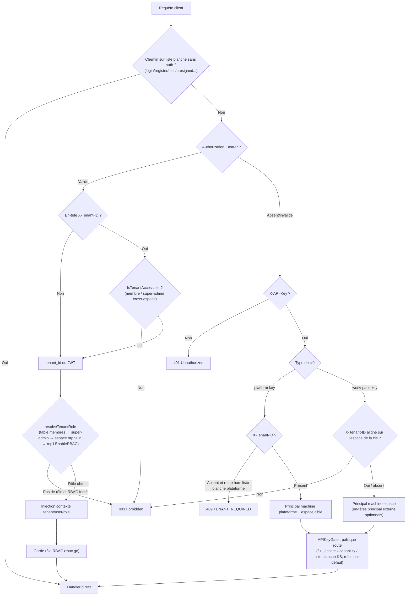

# Vue d'ensemble de l'API

L’API HTTP WeKnora utilise le préfixe `/api/v1`, avec authentification JWT, clé API et jeton Embed ; les points d’entrée du serveur MCP intégré emploient un jeton d’endpoint distinct. Avant d’appeler les ressources, choisissez les identifiants selon le type de client et respectez les conventions communes de réponse, d’erreurs, de pagination et d’événements en flux.

Plans d’automatisation, historique d’exécution et notifications internes : [API Automatisations](02-api-automations.md) ; ces interfaces sont réservées aux utilisateurs connectés pour gérer leurs propres tâches et n’acceptent pas de clé API.

## URL de base et préfixe de version

- Toutes les API métier sont montées sous `/api/v1` (`r.Group("/api/v1")` dans `router.go`).
- Santé : `GET /health` (sans authentification), renvoie `{"status":"ok"}`.
- Swagger UI : `/swagger/index.html` côté backend, enregistré uniquement hors mode `release` (`GIN_MODE != release`). Docker Compose utilise `release` par défaut ; activation, port backend et page blanche : [Guide de développement](../06-development/01-dev-guide.md#gin-mode-et-swagger).
- Chemins particuliers hors auth : `GET|HEAD /r/:token` (URL courte d’autorisation ressource), `GET /files` (proxy fichiers après auth), `GET|HEAD /api/v1/files/presigned` (URL signée HMAC, sans auth), `GET /api/v1/files/presigned-preview` (diagnostic Admin).

```
BASE=http://localhost:8080
```

## Authentification

L’auth est centralisée dans le middleware `Auth` (`internal/middleware/auth.go`), essayée dans l’ordre suivant :

### JWT Bearer (utilisateur Web) {#jwt-bearer-utilisateur-web}

```
Authorization: Bearer <access_token>
```

- Obtenir `token` et `refresh_token` via `POST /api/v1/auth/login` (ou register / OIDC ; application bureau native : auto-setup) ; `POST /api/v1/auth/refresh` pour renouveler.
- En-tête optionnel `X-Tenant-ID: <tenant_id>` : basculer vers un espace autre que celui du JWT (membre actif de cet espace, ou super-admin cross-espace avec `CanAccessAllTenants`). Valeur mal formée ou `0` → 400.
- Si le JWT ne résout aucun espace et que la route n’est pas sur la liste blanche « sans espace » (ex. `/auth/me`, `/me/invitations`), réponse 409 `{"code":"TENANT_REQUIRED"}`.

### Clé API (principal machine) {#cle-api-principal-machine}

```
X-API-Key: <api_key>
```

- Clé d’espace (workspace) : créée via `POST /api/v1/tenants/:id/api-keys`, liée à un seul espace ; `X-Tenant-ID` pointant ailleurs → 403.
- Clé plateforme (platform) : créée via `POST /api/v1/system/admin/api-keys`, doit porter `X-Tenant-ID` pour choisir l’espace cible (sauf `/system/admin/*`, `/tenants/all|search`, `POST /tenants`), sinon 409 `TENANT_REQUIRED`.
- Modèle d’autorisation (`internal/middleware/api_key_gate.go`, refus par défaut) : chaque route `/api/v1` doit déclarer explicitement une politique clé API ; route non déclarée → 403 pour toute clé.
  - Clé `full_access` : plein accès dans l’espace (équivalent Owner machine).
  - Clé restreinte (scoped) : autorisée par capability, contrainte par liste blanche `knowledge_base_ids`. Constantes dans `internal/types/tenant_api_key.go` : `retrieve`, `ingest`, `chat`, `read_agents`, `manage_kbs`, `manage_agents`, `message_history`, `manage_models`, `manage_mcp_services`, `manage_datasources`, `manage_channels`, `manage_vector_stores`, `manage_storage_backends`, `manage_web_search`, `run_evaluations`, `manage_members`, `manage_spaces`, `manage_tenant_settings` ; plateforme : `system_tenants_read/manage`, `system_settings_read/manage`, `system_runtime_read/manage`, `system_audit_read`.
- Principal utilisateur externe (optionnel, config espace `api-principal-config`) :
  - Mode `direct` : `X-External-User-ID: <ID utilisateur externe>` (≤128 caractères).
  - Mode `signed_token` : `X-External-User-Token: <JWT HS256>`, exige `aud=weknora`, `exp` (durée de vie ≤24 h), claim `tenant_id` aligné sur l’espace cible, `sub` = ID utilisateur externe.

### Jeton de publication Embed (client embed anonyme) {#jeton-publication-embed}

Les routes publiques `/api/v1/embed/:channel_id/*` passent par le middleware `EmbedAuth` (`internal/middleware/embed_auth.go`) :

```
Authorization: Embed <publish_token ou session_token>
```

- `POST /embed/:channel_id/exchange` échange le publish token contre un session token court ; les opérations de session exigent aussi `X-Embed-Session: <sig>` (poignée signée renvoyée à la création de session).
- Les callbacks IM (`/api/v1/im/callback/:channel_id`) sont enregistrés avant le middleware auth global et utilisent la vérification de signature propre à chaque plateforme IM.

### Jeton d’endpoint MCP (serveur MCP intégré)

`/mcp/:endpoint_id` (sans préfixe `/api/v1`) est le point MCP Streamable HTTP exposé par l’espace, validé par `internal/middleware/mcp_endpoint_auth.go` :

```
Authorization: Bearer <endpoint_token>
```

Le jeton est affiché une seule fois à la création dans Paramètres → Intégrations de publication → Serveur MCP, et peut être roté. La requête s’exécute comme principal machine de l’espace de l’endpoint, limité aux outils et bases de connaissances cochés. Gestion : `/api/v1/mcp-endpoints` (Viewer+ lecture, Admin+ modification ; clé API : `manage_channels`), usage : [Intégration MCP](../03-features/08-mcp.md).

### Schéma du flux d’authentification



## Rôles et modèle de permissions (RBAC)

`internal/middleware/rbac.go` + `internal/middleware/access.go` :

| Rôle | Description |
| --- | --- |
| `owner` | Propriétaire de l’espace : cycle de vie, clés API, membres |
| `admin` | Admin espace : modèles, infra, canaux, etc. |
| `contributor` | Contributeur : créer KB/Agent, modifier les ressources **qu’il a créées** |
| `viewer` | Membre lecture seule : consultation et sessions |
| SystemAdmin | Admin plateforme (`User.IsSystemAdmin`), indépendant du rôle espace, garde `/system/admin/*`, toujours appliqué |

- « Viewer+ / Contributor+ / Admin+ / Owner » dans la doc = rôle minimum ; « créateur OU Admin+ » = `RequireOwnershipOrRole` (Contributor ne modifie que ses KB/Agent/contenus).
- Si `cfg.Tenant.EnableRBAC=false`, les gardes rôle journalisent sans bloquer (fail-open rollout) ; SystemAdmin ignore ce commutateur.
- Gardes accès KB `KBAccessRead/Write` (`internal/middleware/kb_access.go`) : résout accès propre / partage org / visibilité via Agent partagé, et réécrit le tenant du contexte vers l’espace propriétaire de la KB.
- Un principal clé API contourne les gardes rôle JWT ; permissions réelles entièrement via APIKeyGate (capability + liste blanche KB).
- Refus journalisés en audit (`middleware.AuditServiceProvider`, déduplication fenêtre glissante 1 min).

## Format de réponse commun et codes d’erreur

La plupart des handlers renvoient :

```json
{ "success": true, "data": { ... } }
```

Listes : souvent `total`, `page`, `page_size`. Exceptions : certaines lectures `/system/admin/*` renvoient lignes/tableaux bruts ; `/system/info` etc. utilisent `{"code":0,"msg":"success","data":...}`.

Erreurs via `internal/middleware/error_handler.go` (`AppError` dans `internal/errors/errors.go`) :

```json
{ "success": false, "error": { "code": 1003, "message": "...", "details": null } }
```

Couche middleware (auth/RBAC) : `{"error": "..."}` directement (parfois `"code"` chaîne, ex. `TENANT_REQUIRED`).

| Code | Signification | HTTP |
| --- | --- | --- |
| 1000 | ErrBadRequest | 400 |
| 1001 | ErrUnauthorized non authentifié | 401 |
| 1002 | ErrForbidden | 403 |
| 1003 | ErrNotFound | 404 |
| 1004 | ErrMethodNotAllowed | 405 |
| 1005 | ErrConflict | 409 |
| 1006 | ErrTooManyRequests quota / limite | 429 |
| 1007 | ErrInternalServer | 500 |
| 1008 | ErrServiceUnavailable | 503 |
| 1009 | ErrTimeout | — |
| 1010 | ErrValidation | 400 |
| 2000-2005 | Espace : inexistant / existe / désactivé / nom requis / statut invalide / création autonome désactivée | 404/409/403/… |
| 2100-2103 | Agent : modèle de réflexion manquant / outils autorisés manquants / itérations invalides (1-20) / température invalide (0-2) | 400 |
| 2200-2201 | Liaison VectorStore invalide / indisponible | 400 |

Autres erreurs non codées : `types.StorageQuotaExceededError` (quota stockage), `types.DuplicateKnowledgeError` (fichier/URL en double, upload → 409 avec `data` contenant la Knowledge existante).

## Pagination

`internal/handler/list_pagination.go` :

| Paramètre | Type | Obligatoire | Description |
| --- | --- | --- | --- |
| `page` | int | non | Numéro de page, défaut 1, ≥1 |
| `page_size` | int | non | Taille de page, défaut 20, plage 1-100 |

Hors plage ou invalide → erreur de validation (code 1010). Réponse liste avec `total/page/page_size`. Certaines routes en curseur : journaux d’audit (`after_id`+`limit`, `next_cursor`), tâches runtime système (`cursor`+`page_size`, `next_cursor/has_more`), index/log Wiki (`cursor`+`limit`).

## Protocole des interfaces en flux (SSE)

Chat (`POST /api/v1/knowledge-chat/:session_id`, `POST /api/v1/agent-chat/:session_id`, `GET /api/v1/sessions/continue-stream/:session_id`, et routes embed équivalentes) renvoient Server-Sent Events :

```
Content-Type: text/event-stream
Cache-Control: no-cache
Connection: keep-alive
X-Accel-Buffering: no
```

Chaque événement : `event: message`, `data:` = JSON `types.StreamResponse` :

| Champ | Type | Description |
| --- | --- | --- |
| `id` | string | ID de requête |
| `response_type` | string | `answer` / `references` / `thinking` / `tool_call` / `tool_result` / `command_output` / `reflection` / `session_title` / `agent_query` / `artifacts_pending` / `memory_recalled` / `user_message_injected` / `context_compacted` / `tool_approval_required` / `tool_approval_resolved` / `mcp_oauth_required` / `mcp_oauth_resolved` / `error` / `complete` ; flux d’installation de skill : aussi `install_prompt` / `install_output` |
| `content` | string | Texte incrémental |
| `done` | bool | Fin pour ce type d’événement |
| `knowledge_references` | []SearchResult | Citations pour événement `references` |
| `tool_calls` | []LLMToolCall | Appels d’outils |
| `data` | object | Métadonnées (ex. `success` sur résultat d’outil, `truncated` sur réponse) |
| `session_id` / `assistant_message_id` | string | Événement `agent_query` |
| `usage` | TokenUsage | `prompt_tokens/completion_tokens/total_tokens/cache_*` |
| `finish_reason` | string | Raison de fin |

`SearchResult` (`knowledge_references`, résultats de recherche) : `source_locators` = position du fragment dans le fichier source (vide pour documents indexés avant cette fonctionnalité) :

| Champ | `type` concerné | Description |
| --- | --- | --- |
| `type` | — | `pdf` / `docx` / `slide` / `sheet` / `text` / `time` / `section` |
| `page`, `bbox` | `pdf` | Page (à partir de 1) ; `bbox` = `[x0,y0,x1,y1]` relatif à la page, origine coin supérieur gauche, optionnel |
| `block` | `docx` | Nième paragraphe ou tableau dans le corps (à partir de 1) |
| `slide` | `slide` | Nième diapositive (à partir de 1) |
| `sheet`, `row_start`, `row_end` | `sheet` | Nom de feuille (vide pour CSV) et lignes (à partir de 1, comme Excel) |
| `start`, `end` | `text` | Intervalle de caractères dans le texte source (points de code Unicode) |
| `start_ms`, `end_ms` | `time` | Intervalle audio en millisecondes |
| `section`, `title` | `section` | Nième entrée dans la tranche EPUB (à partir de 1) et titre de chapitre |
| `quote` | tous | Texte cité, max 300 caractères |

Les champs numériques à 0 sont omis. Résultats fusionnés : union des emplacements des fragments fusionnés.

Le flux se termine par `response_type:"complete"` (`done:true`) ; en erreur par `response_type:"error"` (`done:true`). Échec d’outil → `tool_result` (`data.success=false`) ; `error` = échec de tout le tour. Réponse tronquée par limite de sortie → `answer` avec `data.truncated=true`. `continue-stream` : relecture + polling 100 ms pour reprise (`?message_id=` obligatoire).

## Formes de référence fichier (`resource_urls`)

Images/pièces jointes citées dans les réponses et résultats de recherche sont renvoyées par défaut en poignée interne `resource://<handle>` ; le client doit rappeler le proxy `/files` authentifié. Pour des liens directement utilisables par une app tierce :

| Portée | Usage |
| --- | --- |
| Requête unique | `?resource_urls=public` dans l’URL |
| Déploiement entier | Variable d’environnement `RESOURCE_URL_MODE=public` |

Valeurs : `handle` (défaut) et `public` ; autre valeur → 400. Le paramètre de requête prime sur la variable ; avec défaut déploiement `public`, `?resource_urls=handle` permet de revenir au mode poignée.

Interfaces concernées : `POST /knowledge-chat/{session_id}`, `POST /agent-chat/{session_id}`, `GET /sessions/continue-stream/{session_id}`, `GET /messages/{session_id}/load`, `POST /knowledge-search`, `POST /knowledge-bases/{id}/hybrid-search` (GET compatible). Réécriture du corps de réponse, `content` / `image_info` des résultats, `knowledge_references`, étapes Agent et résultats d’outils, pièces jointes image sur messages ; en flux, citations coupées entre chunks sont mises en buffer puis réécrites en liens complets.

Points à connaître :

- **Capacité lien externe requise** : lien direct = présigné backend stockage, ou `APP_EXTERNAL_URL` + `/r/<token>`. Si aucun (ex. stockage local sans `APP_EXTERNAL_URL`), la référence reste `resource://` ; repli `/files` possible ;
- **Liens directs lisibles anonymement et limités dans le temps** (grant WeKnora 2 h, présigné MinIO 24 h) : toute personne avec le lien peut lire avant expiration — ne pas logger ni transférer à des tiers non autorisés ;
- **Canaux embed non supportés** : routes `/api/v1/embed/...` imposent `handle` ; images visiteur via proxy auth au niveau canal ;
- **Clé API KB restreinte + `public` → 403** : ces clés ne peuvent pas accéder au proxy `/files` ; un lien anonyme contournerait la même restriction ;
- **Réutilisation du lien direct pour le même fichier** pendant la validité ; pas de réémission répétée de credentials, cache client/CDN efficace.

Quelle forme par canal (Web / IM / widget embed / API) et dépannage chargement d’images : [Accès externe aux images et fichiers](../03-features/21-file-access.md).

## Choisir une interface de recherche {#retrieval-api}

Deux interfaces de recherche externes, toutes deux exigent capability `retrieve` (ou full) sur la clé API, et renvoient une liste `SearchResult`.

**Par défaut : `POST /knowledge-search`.** Même pipeline que le Q&R produit (rappel → rerank → fusion → troncature) ; fragments identiques à ceux utilisés dans l’UI. `POST /knowledge-bases/{id}/hybrid-search` est le rappel bas niveau : pas de rerank par défaut, scores = scores de rappel ; pour voir ou contrôler le rappel brut.

### Par scénario

| Besoin | Interface | Corps de requête |
| --- | --- | --- |
| Résultats RAG / agent alignés sur le Q&R UI | `knowledge-search` | `query` + `knowledge_base_ids`, reste par défaut |
| Plusieurs KB avec modèles d’embedding différents | `knowledge-search` | `knowledge_base_ids` |
| Limiter à certains documents ou tags | `knowledge-search` | `knowledge_ids` / `tag_ids` ; pour documents précis, ne pas aussi passer `knowledge_base_ids` qui les contiennent — union des deux |
| Ajuster nombre ou seuils de rappel, avec rerank | `knowledge-search` | `match_count`, `vector_threshold`, `keyword_threshold` |
| Changer modèle ou seuil de rerank | `knowledge-search` | `rerank.model_id`, `rerank.threshold` |
| Sans rerank, rappel direct | `knowledge-search` ou `hybrid-search` | premier : `"rerank":{"enabled":false}` ; second : ne pas envoyer `rerank` |
| Résultat vide, comprendre pourquoi | `knowledge-search` | `meta.rerank.outcome` dans la réponse |
| Vecteur de requête déjà calculé | `hybrid-search` | `query_embedding` + `disable_keywords_match: true` |
| Évaluer qualité de rappel : KB fixe, paramètres fixes, scores bruts | `hybrid-search` | sans `rerank` |
| Même évaluation + comparer avec rerank | `hybrid-search` | même requête + `rerank` |
| Blocs parent/voisins comme lignes séparées, pas fusionnés dans le corps | `hybrid-search` | par défaut ; `skip_context_enrichment: true` pour désactiver |

### Différences

| | `knowledge-search` | `hybrid-search` |
| --- | --- | --- |
| rerank | Activé par défaut (config espace), objet `rerank` peut surcharger ou désactiver | Désactivé par défaut, activer avec objet `rerank` |
| Multi-KB | Oui, embeddings différents possibles | `knowledge_base_ids` possible, même modèle d’embedding obligatoire ; `{id}` du chemin doit être inclus |
| Vecteur précalculé | Non | `query_embedding` |
| Blocs de contexte | Fusionnés dans `content` | Lignes de résultat supplémentaires |
| `match_count` omis | `rerank_top_k` espace (défaut 10) | 50 |
| `meta.rerank` | Toujours présent | Seulement si `rerank` dans la requête |

Paramètres de rappel communs (`vector_threshold`, `keyword_threshold`, `match_count`, `disable_keywords_match`, `disable_vector_match`) et objet `rerank` ; paramètres omis sur `knowledge-search` reprennent la config de recherche espace (`GET /tenants/kv/retrieval-config`).

### Objet `rerank`

Structure identique sur les deux interfaces :

| Champ | Type | Défaut | Description |
| --- | --- | --- | --- |
| `enabled` | bool | `true` | `false` désactive le rerank, ordre de rappel conservé |
| `model_id` | string | voir ci-dessous | ID modèle rerank (`GET /models`, `type` = `Rerank`). ID absent, inactif ou non rerank → 400, pas de substitution silencieuse |
| `top_k` | int | nombre de résultats de l’interface | Max après rerank ; négatif ou > 200 → 400 |
| `threshold` | float | `rerank_threshold` config espace (0,2 si absent) | Seuil score modèle ; `0` et négatif valides |

Sans `model_id` : `rerank_model_id` config espace → premier modèle rerank de l’espace. Si aucun : pas de rerank, ordre de rappel, `meta.rerank.outcome` = `no_model`.

Le rerank partage l’implémentation avec la chaîne Q&R et l’outil `search_knowledge` (`internal/reranking`) :

1. Texte candidat pour le modèle = titre document + corps de fragment sans Markdown + description image et OCR + questions générées. Entrées FAQ sans titre. Limites longueur modèle (`max_document_chars` / `max_request_chars`) : troncature par la fin avant envoi (texte image et questions générées en premier) ; un texte trop long ne fait pas échouer tout le lot.
2. Conserver scores ≥ `threshold`. Si aucun et `threshold` > 0,3, abaisser à `max(threshold×0,7, 0,3)` et refiltrer. Sinon, si score max ≥ 0,15, garder une seule ligne ; sinon liste vide.
3. Score tri = `0,6×score modèle + 0,3×score rappel + 0,1×poids source` ; `metadata` avec `model_score` et `base_score`.
4. MMR (λ=0,7) pour choisir `top_k` lignes, moins de redondance.

Rerank visuel possible sur hits image vectorielle : modèle rerank avec entrée image ; rerank texte classique utilise le texte ; modèle dialogue vision peut recevoir les images retenues. Règles de conservation contexte image : [Pipeline RAG](../02-architecture/04-rag-pipeline.md).

Avec rerank sur `hybrid-search`, profondeur de rappel ≥ `top_k`, pool = top `max(top_k, 50)` après fusion — `match_count` faible suffit pour alimenter le modèle.

Échec chargement ou appel modèle rerank : requête OK, ordre de rappel, raison dans `meta.rerank`.

### Diagnostic `meta.rerank`

`knowledge-search` inclut toujours `meta.rerank` ; `hybrid-search` seulement si objet `rerank` présent.

```json
{
  "success": true,
  "data": [],
  "meta": {
    "rerank": {
      "applied": true,
      "outcome": "all_below_threshold",
      "model_id": "rr-1",
      "model_source": "tenant",
      "threshold": 0.3,
      "effective_threshold": 0.3,
      "top_score": 0.08,
      "candidate_count": 24,
      "result_count": 0
    }
  }
}
```

| Champ | Description |
| --- | --- |
| `applied` | Le score rerank a-t-il déterminé l’ordre retourné |
| `outcome` | Voir tableau ci-dessous |
| `model_id` / `model_source` | Modèle utilisé et origine : `request`, `tenant`, `auto` |
| `threshold` / `effective_threshold` | Seuil demandé et seuil effectif après dégradation |
| `top_score` | Meilleur score modèle parmi candidats |
| `candidate_count` / `result_count` | Candidats envoyés au rerank / lignes retournées |
| `error` | Message si `model_error`, `model_unavailable` |

| `outcome` | Signification |
| --- | --- |
| `ok` | Résultats au-dessus du seuil |
| `threshold_degraded` | Rien au seuil initial, seuil abaissé |
| `fallback_top1` | Aucun seuil passé, une ligne au score max conservée |
| `all_below_threshold` | Modèle juge tout non pertinent, liste vide. Reformuler ou baisser `rerank.threshold` |
| `model_error` | Appel modèle échoué, ordre de rappel |
| `model_unavailable` | Chargement modèle échoué (config credentials, URL), ordre de rappel |
| `no_model` | Pas de modèle rerank dans l’espace, ordre de rappel |
| `disabled` | `rerank.enabled` = `false` dans la requête |
| `no_candidates` | Aucun résultat au rappel |

## Limitation de débit

| Surface | Limite | Source |
| --- | --- | --- |
| Liens de partage publics (`/auth/invitations/lookup`, `/auth/register-by-invite`) | 30/min par IP (quota partagé), dépassement → 429 (code 1006) | `internal/middleware/auth_public_ratelimit.go` |
| Routes embed publiques | Par (channel, IP) `rate_limit_per_minute` (défaut 30)/min ; par channel `rate_limit_per_minute*20` (min 120)/min ; par channel `rate_limit_per_day` (défaut 10000)/jour ; dépassement → 429 | `internal/middleware/embed_auth.go` |
| Confiance proxy | Seul `X-Forwarded-For` des proxies `WEKNORA_TRUSTED_PROXIES` (défaut boucle + RFC1918) compte, anti-spoof IP | `router.go` `trustedProxies()` |

Pas de limite globale sur le reste ; refus quota (ex. création autonome d’espace) → 429 (code 1006).

## Navigation par groupes d’API

| Groupe | Document | Préfixes principaux |
| --- | --- | --- |
| Auth et utilisateur | [02-api-auth.md](./02-api-auth.md) | `/auth`, `/me/invitations` |
| Locataire (espace) et membres | [02-api-tenant.md](./02-api-tenant.md) | `/tenants` |
| Organisation et partage | [02-api-org.md](./02-api-org.md) | `/organizations`, `/shared-*`, `/knowledge-bases/:id/shares`, `/agents/:id/shares` |
| Bases de connaissances et connaissances | [02-api-knowledge.md](./02-api-knowledge.md) | `/knowledge-bases`, `/knowledge`, dossiers KB, galerie, `/image-attrs/schema` |
| Fragments et tags | [02-api-chunks.md](./02-api-chunks.md) | `/chunks`, `/knowledge-bases/:id/tags`, `/chunker/preview` |
| FAQ et Wiki | [02-api-faq-wiki.md](./02-api-faq-wiki.md) | `/knowledge-bases/:id/faq`, `/faq`, `/knowledgebase/:kb_id/wiki`, `/wiki-search` |
| Sessions, messages et chat | [02-api-chat.md](./02-api-chat.md) | `/sessions`, `/messages`, `/knowledge-chat`, `/agent-chat`, `/knowledge-search` |
| Modèles et initialisation | [02-api-model-system.md](./02-api-model-system.md) | `/models`, `/initialization`, `/evaluation`, `/weknoracloud` |
| Système et admin plateforme | [02-api-system.md](./02-api-system.md) | `/system`, `/system/admin` |
| Infrastructure et sources de données | [02-api-infra.md](./02-api-infra.md) | `/vector-stores`, `/storage-backends`, `/web-search-providers`, `/datasource` |
| Agent et MCP | [02-api-agent-mcp.md](./02-api-agent-mcp.md) | `/agents`, `/mcp-services`, `/agent`, `/user/favorites` |
| Serveur MCP intégré | [Intégration MCP](../03-features/08-mcp.md) | `/mcp-endpoints`, `/mcp/:endpoint_id` |
| Navigateur local | [Navigateur local](../05-clients/09-local-browser.md) | `/me/browser`, `/local-browser` |
| Sandbox, skills et variables perso | [02-api-sandbox-skills.md](./02-api-sandbox-skills.md) | `/sandbox-configs`, `/skills`, `/me/env-vars` |
| Mémoire long terme | [02-api-memory.md](./02-api-memory.md) | `/memory`, `/tenants/kv/memory-config` |
| IM, Embed et fichiers | [02-api-channels.md](./02-api-channels.md) | `/im`, `/im-channels`, `/wechat`, `/embed-channels`, `/embed`, `/files`, `/r/:token` |

Nouvelles interfaces config et personnelles : [Sandbox, skills et variables personnelles](02-api-sandbox-skills.md), [Mémoire long terme](02-api-memory.md) ; liste et téléchargement des fichiers générés : [Sessions et chat](02-api-chat.md).
