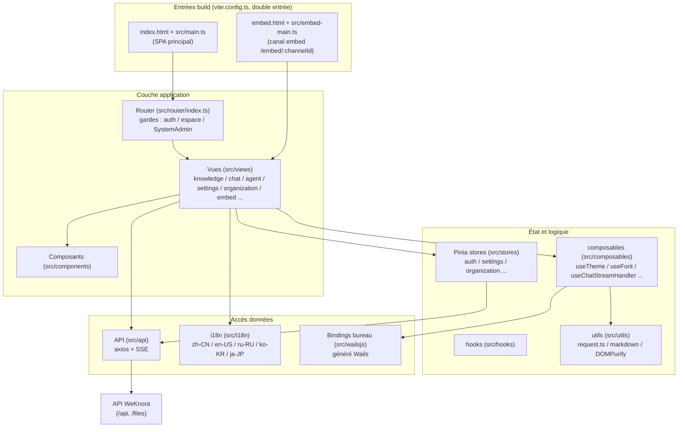

# Frontend Web (frontend/)
Le frontend Web de WeKnora est une application monopage (SPA) basée sur **Vue 3 + TypeScript + Vite**, comprenant toutes les interfaces interactives pour la gestion de la base de connaissances, les dialogues avec les agents, la collaboration organisationnelle et les paramètres du système. Le même code sert simultanément trois formes :

1. **Déploiement Web standard** : Les produits construits par Vite sont hébergés par un conteneur nginx, avec `/api` proxy inverse vers le backend ;
2. **Intégration Web (Embed)** : Entrée légère indépendante `frontend/embed.html` + `frontend/src/embed-main.ts`, pour permettre aux sites tiers d'intégrer la conversation de l'agent via iframe / fenêtre flottante ;
3. **Bureau (Wails)** : Communication côté Go avec le processus de bureau via la liaison générée automatiquement sous `frontend/src/wailsjs/`, supportant les fonctionnalités de bureau telles que la zone de glisser-déposer `--wails-draggable` et la synchronisation du thème clair/sombre de la fenêtre.

## Aperçu de la pile technologique
Selon `frontend/package.json` (version 0.8.3) :

| Catégorie | Sélection | Version | Description |
| --- | --- | --- | --- |
| Framework | Vue | ^3.5.34 | API de composition, style `<script setup>` |
| Langage | TypeScript | ~6.0.3 | `vue-tsc` pour la vérification des types (`npm run type-check`) |
| Outil de build | Vite | ^7.3.5 | Plugins : `@vitejs/plugin-vue`, `@vitejs/plugin-vue-jsx` |
| Bibliothèque de composants UI | TDesign (tdesign-vue-next) | ^1.19.2 | Compatible avec `tdesign-icons-vue-next` 0.4.4 (version verrouillée par overrides) |
| Gestion d'état | Pinia | ^3.0.4 | Tous les stores sont situés dans `frontend/src/stores/` |
| Routeur | Vue Router | ^4.5.0 | `createWebHistory`, voir `frontend/src/router/index.ts` |
| Multilingue | vue-i18n | ^11.4.2 | zh-CN / en-US / ru-RU / ko-KR / ja-JP |
| HTTP | axios | ^1.16.0 | Instance unifiée dans `frontend/src/utils/request.ts` |
| SSE flux | @microsoft/fetch-event-source | ^2.0.1 | Chat stream, voir `frontend/src/api/chat/streame.ts` |
| Rendu Markdown | marked / marked-katex-extension / katex / highlight.js / mermaid | — | Réponses enrichies (formules, code, diagrammes) |
| Sécurité | dompurify | ^3.4.11 | Désinfection v-html (`frontend/src/utils/markdownDomPurify.ts`) |
| Aperçu documents | docx-preview / @vue-office/pptx / xlsx / papaparse | — | Aperçu Word / PPT / Excel / CSV |
| Longues listes | vue-virtual-scroller | 2.0.0-beta.8 | Défilement virtuel des messages |
| Style | Less + variables CSS | less ^4.6.4 | Thème dans `frontend/src/assets/theme/theme.css` |

Détails de dépendance à noter :

- `xlsx` : version SheetJS figée `0.20.2` dans `package-lock.json` (intégrité complète) ; build hors ligne = cache npm préparé ;
- `frontend/pnpm-workspace.yaml` : pas de sous-paquet workspace, seulement la liste blanche `allowBuilds` (`@vue-office/pptx`, `esbuild`, `vue-demi`) ;
- `overrides` / `resolutions` : `lightningcss` désactivé, versions unifiées pour `esbuild` et `serialize-javascript`.

## Structure du module

### Aperçu du contenu
| Contenu | Responsabilité |
| --- | --- |
| `frontend/src/main.ts` | Entrée principale SPA : installer TDesign / Pinia / Router / i18n, initialiser le thème et les polices, enregistrer la protection hors ligne des icônes TDesign (`installTDesignIconOfflineGuard`, éviter les requêtes à l'exécution `tdesign.gtimg.com`), attendre `router.isReady()` avant de monter pour éviter le clignotement de l'écran initial |
| `frontend/src/embed-main.ts` | Entrée intégrée : application Vue indépendante avec routage indépendant (uniquement `/embed/:channelId`), montage `#embed-app`, utilisation de i18n indépendante (`src/i18n/embed.ts`) |
| `frontend/src/views/` | Composants au niveau des pages, classés par domaine métier (voir tableau de routage ci-dessous) |
| `frontend/src/components/` | Composants communs inter-pages (bulle de message, masque de téléchargement, panneau de commandes, etc.) |
| `frontend/src/stores/` | État Pinia (voir tableau store ci-dessous) |
| `frontend/src/api/` | Encapsulation API backend (voir tableau des modules API ci-dessous) |
| `frontend/src/composables/` | Fonctions compositionnelles : thème, polices, gestion du flux de chat, couche de citation, pont Embed, etc. |
| `frontend/src/hooks/` | Hooks métier (ex. `useKnowledgeBase`) |
| `frontend/src/utils/` | Axios, pipeline markdown, DOMPurify, affichage outils Agent, etc. |
| `frontend/src/i18n/` | Configuration vue-i18n et packs de langues |
| `frontend/src/assets/theme/` | Variables CSS thème clair / sombre |
| `frontend/src/wailsjs/` | Bindings Wails générés (ne pas modifier) |
| `frontend/src/directives/`, `types/`, `config/` | Directives, types, configuration |
| `frontend/public/` | Statiques : `weknora-widget.js`, `config.js` (runtime), icônes TDesign hors ligne |

## Liste des routes de page
Les routes sont définies à `frontend/src/router/index.ts`, utilisées à `createWebHistory`, tous les composants de page sont importés dynamiquement (chargement paresseux par paquetage selon la route).

### Routes principales
| Chemin | Nom | Composant | Fonction |
| --- | --- | --- | --- |
| `/` | — | Redirection | Rediriger vers `/platform/knowledge-bases` |
| `/login` | `login` | `src/views/auth/Login.vue` | Page de connexion (incluant OIDC, changement de langue, arrière-plan animé) |
| `/register` | `registerByInvite` | `src/views/auth/Login.vue` | Page de destination pour l'inscription par invitation — réutilise le composant Login, détecter `?token=xxx` à l'affichage pour passer en mode inscription par invitation |
| `/onboarding/workspace` | `workspaceOnboarding` | `src/views/auth/WorkspaceOnboarding.vue` | Page d'orientation de l'espace de travail pour les utilisateurs sans locataire (créer ou attendre une invitation), nécessite une connexion mais ne requiert pas de locataire existant |
| `/join` | `joinOrganization` | Redirection | Lien d'invitation pour rejoindre l'organisation, transformer `?code=` en paramètre `invite_code` et passer à `/platform/organizations` |
| `/knowledgeBase` | `home` | `src/views/knowledge/KnowledgeBase.vue` | Détails de la base de connaissances (chemin principal hérité) |
| `/platform` | `Platform` | `src/views/platform/index.vue` | Layout principal (menu, router-outlet, modale paramètres, drag-and-drop upload), défaut → liste des bases |
| `/platform/dev/markdown` | `markdownTest` | `src/views/dev/MarkdownTestPage.vue` | Régression visuelle Markdown, dev uniquement (`import.meta.env.DEV`) |

### `/platform` Sous-routeur
| Chemin | Nom | Composant | Fonctionnalité |
| --- | --- | --- | --- |
| `/platform/knowledge-bases` | `knowledgeBaseList` | `src/views/knowledge/KnowledgeBaseList.vue` | Liste des bases de connaissances : barre latérale de l'espace (Tout / Le Mien / Par Organisation / Favoris / Récents), liste de cartes, entrée de création ; prend en charge le tri par date de mise à jour / date de création / nom (`components/ResourceSortControl.vue`, applicable également à la liste des agents intelligents) |
| `/platform/knowledge-bases/:kbId` | `knowledgeBaseDetail` | `src/views/knowledge/KnowledgeBase.vue` | Détails de la base de connaissances : liste des documents (peut être triée par date de mise à jour / date de création / nom de fichier, le tri est effectué côté serveur, tri par défaut : date de création décroissante), téléchargement, état de l'analyse, entrée de session, Wiki, etc. |
| `/platform/agents` | `agentList` | `src/views/agent/AgentList.vue` | Liste et gestion des agents intelligents (Agent), l'édition se fait via `AgentEditorModal.vue` ; nécessite la capacité de déploiement `agents` |
| `/platform/toolbox/:section?` | `toolbox` | `src/views/toolbox/Toolbox.vue` | Boîte à outils : `skills`, `mcp`, `browserconnection` — voir § Boîte à outils |
| `/platform/artifacts` | `artifactLibrary` | `src/views/artifacts/ArtifactLibrary.vue` | Fichiers produits par les agents ; capacité `settings.sandbox` |
| `/platform/creatChat` | `globalCreatChat` | `src/views/creatChat/creatChat.vue` | Nouvelle page de conversation : poser des questions recommandées, choisir la base de connaissances/Agent/modèle avant de lancer la session |
| `/platform/knowledge-bases/:kbId/creatChat` | `kbCreatChat` | `src/views/creatChat/creatChat.vue` | Lancer une nouvelle conversation à partir du contexte d’une certaine base de connaissances (même composant) |
| `/platform/chat/:chatid` | `chat` | `src/views/chat/index.vue` | Page de session : flux de messages (rendu en flux SSE, écran squelette, défilement virtuel), panneau de références, aperçu des pièces jointes |
| `/platform/organizations` | `organizationList` | `src/views/organization/OrganizationList.vue` | Liste des organisations : créer/rejoindre une organisation, gestion des membres et des ressources partagées (en lien avec `OrganizationSettingsModal.vue`) ; nécessite la capacité de déploiement `organizations`, la version Lite est toujours masquée. Lors de l’ajout de membres, rechercher précisément par ID complet de l’espace, plus de recherche approximative par nom d’espace |
| `/platform/settings` | `settings` | `src/views/settings/Settings.vue` | Centre des paramètres (mode plein écran modale), partitions voir ci-dessous « Partitions et visibilité du centre des paramètres » |
| `/platform/tenant` | — | Redirection | Ancien chemin → `/platform/settings` |
| `/platform/knowledge-search` | — | Redirection | Recherche globale legacy → liste KB + panneau ⌘K (`?cmdk=`) |
| `/platform/integrations` | — | Redirection | → `/platform/settings?section=integration-im` (l'ancien `?tab=` sera unifié en `integration-<tab>` ; vue dans `src/views/integrations/`) |
| `/platform/system`, `/platform/system/settings`, `/platform/system/admins` | `systemSettings` / `systemAdmins` | Redirection | Ancien chemin de gestion système → `/platform/settings?section=system-global`, nécessite `requiresSystemAdmin` (vue dans `src/views/system/` : `SystemSettings.vue`, `SystemAuditLog.vue`, `PlatformAPIKeys.vue`, etc.) |
| `/platform/system/queues` | `systemQueues` | Redirection | → `/platform/settings?section=runtime-queues` (file d'attente des tâches à l'exécution `src/views/system/RuntimeQueues.vue`) |

### Entrée indépendante : page intégrée
`/embed/:channelId` n'appartient pas à la route principale du SPA, mais constitue une entrée indépendante composée de `frontend/embed.html` + `frontend/src/embed-main.ts` (nginx et le serveur de développement Vite redirigeront tous les `/embed/*` vers `embed.html`), le composant est `src/views/embed/EmbedPage.vue` (avec le support de `EmbedChatView.vue` / `EmbedChatCore.vue` / `EmbedBotMessage.vue`, etc.), utilisant le token Embed pour l'authentification, destiné à être intégré dans un iframe de sites tiers.

### Sections et visibilité du centre de réglages
`Settings.vue` Présenter toutes les sections en sept groupes, localiser avec `?section=` :

| Groupe | Partition (valeur `section`) |
| --- | --- |
| Compte | `general` (préférences personnelles), `userprofile`, `mymemory` (mémoire personnelle), `envvars` (variables personnelles) |
| Espace | `tenant` (informations spatiales), `members` (membres), `chathistory`, `memory` (mémoire spatiale) |
| Modèle et exécution | `models`, `ollama`, `weknoracloud` |
| Intégration de publication | `integration-im`, `integration-embed`, `integration-api`, `integration-mcpserver`, `integration-cli`, `integration-chrome`, `integration-claw` |
| Données et extensions | `vectorstore`, `parser`, `storage`, `sandbox`, `websearch` |
| Gestion du système | `system-global`, `runtime-queues`, `platform-api-keys`, `system-audit-log` |
| Plateforme | `system` (informations sur la version) |

L'onglet intégré publié est enregistré par `frontend/src/config/integrations.ts` de `INTEGRATION_TABS` / `INTEGRATION_PREVIEW_ITEMS`, la valeur de la partition est uniformisée à `integration-<tab>` ; l'ancien `/platform/integrations?tab=<tab>` sera normalisé dans la partition correspondante.

Depuis la version v0.8.2, les compétences, les services MCP et la connexion au navigateur ne sont plus configurés par section, mais déplacés dans [Boîte à outils](#boite-a-outils). Les anciens signets `/platform/settings?section=skills|mcp|browserconnection` seront redirigés par le gardien de route vers `/platform/toolbox/<section>` (`skills` conservera le paramètre `sandboxId`).

La visibilité est déterminée par trois ensembles de règles, et **le front-end ne fait qu'afficher de manière convergente, c'est le gardien de route back-end qui est l'autorité** :

- **Seuil des rôles dans l'espace** : `frontend/src/config/settingsAccess.ts` de `SETTINGS_SECTION_MIN_ROLE` fixe le rôle minimum pour chaque zone. `general` / `models` / `system` / `userprofile` / `tenant` / `members` / `mymemory` / `envvars` sont `viewer` et plus (lecture seule visible), `ollama`, `weknoracloud`, `websearch`, `chathistory`, `memory`, `vectorstore`, `parser`, `storage`, `sandbox` nécessitent `admin` ; pour la publication intégrée, `integration-api` nécessite `owner` (`INTEGRATION_TAB_MIN_ROLE`). Il existe aussi `SETTINGS_MANAGEMENT_SHORTCUT_MIN_ROLE` : dans le menu de l'avatar, les raccourcis étiquetés « Gestion » ont un seuil plus élevé (gestion des membres nécessite `owner`, gestion des modèles nécessite `admin`), afin d’éviter de faire passer des pages en lecture seule pour des entrées de gestion.
- **Capacité de déploiement** : `SETTINGS_SECTION_CAPABILITY` / `INTEGRATION_TAB_CAPABILITY` dans `deploymentCapabilities.ts` mappent les sections sur `GET /api/v1/system/capabilities` ; si `supported: false`, l’entrée est masquée (voir § navigation et capacités).
- **Administrateurs système** : sections `system-global`, `runtime-queues`, `platform-api-keys`, `system-audit-log` visibles seulement pour SystemAdmin — voir [Auth et locataires](../03-features/01-tenant-auth.md).

### Boîte à outils {#boite-a-outils}
Le « Boîte à outils » du menu de gauche (`/platform/toolbox/:section?`, `src/views/toolbox/Toolbox.vue`) gère de manière centralisée les outils disponibles pour l'agent, les onglets sont définis dans `frontend/src/config/toolbox.ts` de `TOOLBOX_ITEMS` :

| Onglet (`section`) | Contenu | Condition de visibilité |
| --- | --- | --- |
| `skills` | Gestion des compétences (réutilise `SkillSettings.vue`), peut inclure la configuration du sandbox pour `?sandboxId=` | À partir de `admin`, et le déploiement prend en charge `settings.sandbox` |
| `mcp` | Service MCP (réutilise `McpSettings.vue`) | À partir de `admin`, et le déploiement prend en charge `settings.mcp` |
| `browserconnection` | Connexion au navigateur (réutilise `BrowserConnectionSettings.vue`), affiche l'état de la connexion sur l'onglet | À partir de `viewer` |

Les onglets conservent le rôle et le seuil de capacité de déploiement de la partition des paramètres d'origine (`canAccessToolboxSection`) ; lorsque l'espace actuel ne contient aucun onglet visible, un état vide est affiché. Lorsqu'un élément du menu de la barre latérale est survolé, les outils disponibles sont prévisualisés, et l'état de la connexion du navigateur est également affiché dans la barre latérale. L'utilisation de la connexion du navigateur est expliquée dans [Navigateur local](09-local-browser.md).

<Screenshot
  src="/screenshots/toolbox.png"
  caption="Boîte à outils : skills, services MCP et connexion navigateur sur une seule page"
  hint="Entrée Boîte à outils dans le menu gauche (aperçu au survol), trois onglets en tête (skills / MCP / navigateur avec compteurs et état de connexion), onglet skills actif." />

### Sections de la fenêtre contextuelle d'édition de la base de connaissances
De nombreuses configurations **ne se trouvent pas dans le centre de paramètres, mais dans la fenêtre contextuelle d'édition de la base de connaissances** (`KnowledgeBaseEditorModal.vue`), car elles s'appliquent par base. Les sections de la barre latérale sont organisées en cinq groupes, dont trois n'apparaissent que lors de l'« édition d'une base de connaissances existante » :

| Groupe | Partition (`key`) | Remarques |
| --- | --- | --- |
| Base | `basic`, `models` | Nom, type, modèle de dialogue / vecteur / résumé |
| Traitement | `parser`, `multimodal`, `asr`, `chunking` | Moteur d'analyse et en-tête de première ligne, compréhension des images, transcription vocale, paramètres de segmentation |
| Données | `vectorStore`, `storage`, `faq` | `faq` uniquement bibliothèque de type FAQ ; `vectorStore` ne peut pas être modifié après liaison |
| Intégration | `datasource` | **Mode édition uniquement**, Feishu / Lark (base de connaissances et cloud), Notion, Confluence, Yuque, documents DingTalk, Tencent IMA, RSS / Atom, GitLab, etc. La synchronisation se configure ici, pas dans les paramètres globaux (définition du connecteur voir `views/knowledge/settings/DataSourceEditorDialog.vue`) |
| Gestion | `graph`, `advanced`, `share`, `activity` | Graphique de connaissances, options avancées, partage à l'organisation, flux d'activité ; les deux derniers sont uniquement en mode édition |

### Panneau de commande global (⌘K / Ctrl+K)
`components/GlobalCommandPalette.vue` est la deuxième principale voie de navigation en dehors de la barre latérale :

- Rechercher dans la base de connaissances, les documents et les conversations, avec la possibilité de restreindre la portée à une certaine base de connaissances (scope chip) avant de rechercher ;
- Afficher les recherches récentes et les actions rapides (créer une base, télécharger, créer une nouvelle conversation, etc.) lorsqu’il n’y a pas de contenu ;
- L’entrée en haut à droite ouvre le **tiroir des paramètres de recherche** (`views/settings/RetrievalSettings.vue`). C’est l’endroit pour ajuster TopK, le seuil vectoriel/de mots-clés et les paramètres de réordonnancement — il **n’est pas dans le centre de paramètres**, et si vous ne le trouvez pas, c’est ici.

### Garde de navigation
Chaîne dans `frontend/src/router/index.ts` :

1. **Callback OIDC** : hash `oidc_result=` / `oidc_error=` → laisser `App.vue` traiter ;
2. **Signets boîte à outils** : `/platform/settings?section=skills|mcp|browserconnection` → `/platform/toolbox/<section>` ;
3. **Deep link Lite / bureau** : après reload, restaurer le sous-chemin `/platform` depuis `sessionStorage` ;
4. **Session** : si déconnecté, tenter `getCurrentUser()` avec `weknora_token` (memberships à jour) ;
5. **Auto-login bureau** : sinon une fois `autoSetup()` via Wails `GetAutoSetupToken()` + en-tête `X-WeKnora-Desktop-Token` (v0.8.2+, natif uniquement) ;
6. **Locataire** : connecté sans espace → `/onboarding/workspace` ;
7. **Capacités** : `meta.requiredCapability` non supportée → message puis liste KB (échec de détection = laisser passer) ;
8. **SystemAdmin** : `requiresSystemAdmin` → redirection si non admin (UI seulement ; le serveur impose aussi).

## Gestion d'état (Pinia)
Stores sous `frontend/src/stores/` :

| Fichier | ID / Type de Store | Responsabilités |
| --- | --- | --- |
| `stores/auth.ts` | `useAuthStore` | Cœur de l'authentification : user / token / refreshToken / tenant / memberships / vérification des rôles (`hasRole`, `isSystemAdmin`), marqueur du mode Lite ; lors de la déconnexion, nettoyer en cascade le cache au niveau de l'espace des autres stores et recharger les préférences utilisateur (thème / police) |
| `stores/chatResources.ts` | `useChatResourcesStore` | Cache des ressources au niveau de l'espace (TTL 60s) : base de connaissances, Agent, modèles, liste des fournisseurs de recherche Web, pour réutilisation par le chat / le sélecteur de nouvelles conversations |
| `stores/editorResources.ts` | `useEditorResourcesStore` | Cache éditeur / paramètres (TTL 60s) : stockage, prompts, parseur, MCP, skills, presets Agent, retrieval |
| `stores/commandPalette.ts` | `useCommandPaletteStore` | Panneau ⌘K : recherche et recherches récentes scoping (user, tenant) |
| `stores/organization.ts` | `useOrganizationStore` | Collaboration organisationnelle : liste d'organisations, membres, partage de bases de connaissances/Agent, demandes d'adhésion et approbation, promotion de rôle, etc. |
| `stores/organizationState.ts` | Module de fonctions pures | Upsert / fusion de la liste d'organisations, impact de l'approbation d'adhésion sur le nombre de membres et autres logiques pures (tests unitaires associés `organizationState.test.ts`) |
| `stores/settings.ts` | Store de paramètres | Configuration de la session et de l'Agent : base de connaissances/fichiers/étiquettes/MCP/Compétences/Outils sélectionnés, configuration du modèle, configuration Ollama, activation de la recherche Web, etc. |
| `stores/settingsStorage.ts` | Module de fonctions pures | Lecture de la persistance des paramètres (clé `WeKnora_settings`), clonage et correction du mode Agent intégré (test associé `settingsStorage.test.mjs`) |
| `stores/menu.ts` | `useMenuStore` | Menu gauche et titres i18n |
| `stores/knowledge.ts` | `knowledgeStore` | Liste légère des cartes KB |
| `stores/ui.ts` | `useUIStore` | État global de l'interface utilisateur : fenêtres modales de paramètres, fenêtre modale d'édition de la base de connaissances, éditeur de documents manuel, basculement et paramètres de la barre latérale repliable |
| `stores/uploadConfirm.ts` | Store de confirmation de téléchargement | État de la boîte de dialogue de confirmation des paramètres avant le téléchargement / importation via URL / saisie manuelle / re-analyse |
| `stores/versionedRequest.ts` | Module de fonction pure | `createVersionedRequestCoordinator` : Coordinateur de requêtes mises en cache avec numéro de version, empêchant les anciennes réponses d’écraser les nouvelles écritures (avec `versionedRequest.test.ts`) |
| `stores/deploymentCapabilities.ts` | `useDeploymentCapabilitiesStore` | Instantané des capacités de déploiement (`GET /api/v1/system/capabilities`), utilisé par les gardes de route, la barre latérale, les paramètres et la boîte à outils pour déterminer si l’entrée doit s’afficher |
| `stores/modelProviders.ts` | `useModelProvidersStore` | Cache de l'annuaire des fournisseurs de modèles (`GET /api/v1/models/providers`, chargé selon le type de modèle), l'éditeur de modèles et les cartes de modèles lisent unifiées les informations des fournisseurs à partir d’ici |
| `stores/uploadTasks.ts` (+ queue/core/state) | `useUploadTasksStore` | Upload KB : concurrence, annulation, progression analyse, panneau flottant |
| `stores/browserConnection.ts` | `useBrowserConnectionStore` | Connexion navigateur local (boîte à outils / barre latérale) |
| `stores/sessionActivity.ts` | `useSessionActivityStore` | Sessions en cours dans la barre latérale |

## Encapsulation API (`frontend/src/api/`)
### Requêtes
- **Axios** : `frontend/src/utils/request.ts`, `baseURL` via `getApiBaseUrl()` et `BASE_URL` Vite ; timeout 30 s ; `postUpload` avec timeout adapté à la taille (`uploadTimeoutMs`, min 5 min).
- **Requête** : `Authorization`, `Accept-Language`, `X-Request-ID`, `X-Tenant-ID` (token Embed préservé).
- **Réponse** : 2xx → `data` ; 401 → refresh single-flight (`utils/authRefresh.ts`) ; endpoints publics (`PUBLIC_AUTH_PATHS`) sans redirect login ; embed jamais vers `/login`.
- **`$httpStatus`** : sur JSON `WithStatus<T>` (ex. création user 201 vs 200 idempotent), non énumérable.
- **SSE** : `api/chat/streame.ts` + `useChatStreamHandler.ts` ; 401 stream partage le refresh axios.

### Liste des modules
| Module | Responsabilités |
| --- | --- |
| `api/auth/` | Connexion, inscription, OIDC, `autoSetup` (uniquement pour le bureau natif, avec `X-WeKnora-Desktop-Token` fourni par Wails), reprise de session `getCurrentUser` |
| `api/tenant/` (`index` / `members` / `invitations` / `audit-log`) | Informations sur le locataire (espace de travail), gestion des membres, invitations, journal d'audit |
| `api/organization/` | CRUD sur l'organisation, membres, bases de connaissances/Agents partagés, demandes d'adhésion |
| `api/knowledge-base/` | CRUD sur les bases de connaissances et gestion des fichiers/entrées de connaissances |
| `api/chat/` (`index` / `streame` / `steer` / `temporary-attachments`) | CRUD sur les sessions, génération de titres, questions-réponses en flux SSE, ajout de messages aux tours des agents en cours d'exécution (`steer`), pièces jointes temporaires |
| `api/artifacts.ts` | Liste et suppression des produits (`/api/v1/artifacts`) |
| `api/memory.ts` / `api/env-vars.ts` | Mémoire d'espace / personnelle, variables personnelles |
| `api/mcp-endpoint.ts` | Points de terminaison MCP intégrés |
| `api/chat-history.ts` | Historique de chat |
| `api/agent/` | CRUD Agent, presets, placeholders (Quick Answer / Smart Reasoning) |
| `api/model/` | Modèles |
| `api/retrieval.ts` | Retrieval tenant |
| `api/vector-store.ts` / `storage-backend.ts` / `chunker/` | Vector store, stockage, chunker |
| `api/datasource/` | Sources de données |
| `api/embed/` | Canaux embed |
| `api/initialization/` | Initialisation système |
| `api/system/` | Infos système, stockage, prompts, parseur |
| `api/mcp-service.ts` / `api/skill/` | MCP et skills |
| `api/web-search.ts` / `web-search-provider.ts` | Recherche web |
| `api/wiki/` | Wiki |
| `api/message-suggestion.ts` | Questions suggérées |
| `api/user-favorites.ts` | Favoris KB / Agent |

## L'état d'attente de la timeline de dialogue
La progression visualisée du pipeline RAG (`views/chat/components/RagPipelineProgress.vue`) connaît un silence entre « toutes les étapes visibles terminées » et « le modèle génère le premier caractère ». Cette pause est décrite par `utils/rag-pipeline-state.ts` :

- `getRagPipelineWaitKind()` Détermination du type d'attente : seules les étapes de recherche réellement terminées sont appelées `model` (génération de réponse en cours) ; pour les questions-réponses purement en pièces jointes, les tours sans étapes de recherche reçoivent une `preparing` neutre, et non l'absence totale de retour ;
- `createRagWaitController()` Responsable de l'affichage des détails : délai `RAG_WAIT_REVEAL_DELAY_MS` (250 ms) avant affichage, pour éviter un clignotement lorsque le modèle répond très rapidement ; dépassement de `RAG_WAIT_STALL_DELAY_MS` (60 s) pour passer à l'état « stagnation » — lorsque la connexion SSE est interrompue, l'arrière-plan n'enverra plus `is_completed`, sans cette limite la barre de progression afficherait toujours « presque prêt » ;
- Les changements d'état sont annoncés via une zone permanente `aria-live`, les utilisateurs de lecteurs d'écran ne manqueront pas la lecture lorsque le nœud est entièrement remplacé.

## Multilingue (i18n)
Implémenté en `frontend/src/i18n/index.ts`, basé sur `vue-i18n` (le modèle de composition de `legacy: false`, `globalInjection: true`) :

- **Langues prises en charge** (`frontend/src/i18n/locales/`) :
  - `zh-CN` (chinois simplifié, par défaut et fallback)
  - `en-US` (anglais)
  - `ru-RU` (russe)
  - `ko-KR` (coréen)
  - `ja-JP` (japonais)
- La sélection de la langue est persistée dans la clé `locale` de `localStorage` ; l'intercepteur axios écrit la langue actuelle dans l'en-tête de requête `Accept-Language`, permettant au backend de retourner le contenu localisé.
- Certaines traductions contiennent des balises `<strong>` intégrées (rendu v-html après désinfection par DOMPurify), avec `warnHtmlMessage: false` configuré pour désactiver l'alerte HTML de vue-i18n.
- **i18n indépendant pour l'embed** : la page embarquée côté visiteur utilise un `frontend/src/i18n/embed.ts` séparé (chargé par `embed-main.ts`), le texte « Web Embed » côté gestion reste dans le paquet de langue principal ; `frontend/src/i18n/locales/embed/index.ts` réexporte uniformément l'assistant de normalisation de langue (supporte la synchronisation de la langue embed à partir des paramètres URL).
- **Outils d'audit et de découpage** : les paquets de langue sont volumineux et peuvent accumuler des clés mortes non référencées ou des nouvelles clés non traduites, donc trois scripts accompagnent (`frontend/package.json`) :

| Commande | Fonction |
  | --- | --- |
  | `npm run check-i18n` | Exécuter `src/i18n/localeKeyAudit.test.ts`, vérifier que les ensembles de clés de chaque paquet de langue sont cohérents et qu'aucune référence n'est manquante |
  | `npm run scan-i18n-gaps` | Scanner les clés réellement utilisées dans le code source et les comparer avec le paquet de langue, signaler les clés non définies et non utilisées |
  | `npm run regenerate-i18n-locales` | Régénérer le paquet de langue réduit selon les résultats du scan |

Le nom de l'action du journal d'audit utilise un registre séparé (`i18n/auditActionRegistry.ts` + `auditActionLocaleDefaults.ts`). Lors de l'ajout d'une action d'audit, il suffit d'ajouter une entrée dans le registre pour éviter que l'outil de découpage ne les supprime en les considérant comme des clés mortes non référencées.

## Thème et apparence
- **Mode thème** : `frontend/src/composables/useTheme.ts` fournit `light | dark | system` trois états. Le mode actif se définit en configurant l'attribut `theme-mode` sur `document.documentElement` ; le mode `system` écoute les requêtes médias `prefers-color-scheme` et suit automatiquement.
- **Variables CSS** : `frontend/src/assets/theme/theme.css` définit deux ensembles de variables, `:root[theme-mode="light"]` et `:root[theme-mode="dark"]`, selon le système de tokens TDesign (`--td-brand-color-*`, `--td-bg-color-*`, `--td-text-color-*`, police/arrondi/ombre, etc.), avec la couleur de la marque en vert ; les styles des composants utilisent systématiquement les variables pour un changement de thème en un clic.
- **Persistation des préférences** : les préférences de thème et de police sont stockées via `frontend/src/composables/preferenceStorage.ts` dans `localStorage` sous l'espace de noms de l'id utilisateur ; elles sont rechargées par `reloadThemeFromStorage()` / `reloadFontFromStorage()` lors de la connexion/déconnexion/changement de compte (déclenché dans `stores/auth.ts`).
- **Police** : `frontend/src/composables/useFont.ts` gère la sélection de la police dans l'interface, `main.ts` au démarrage + `initTheme()` + `initFont()`.
- **Synchronisation sur desktop** : `syncWailsNativeChrome()` dans `useTheme.ts` appelle le runtime Wails via `WindowSetDarkTheme / WindowSetLightTheme / WindowSetBackgroundColour`, pour que la couleur de fond de la fenêtre native corresponde au thème web, réduisant le flash blanc lors du rafraîchissement.

## Construction et déploiement
### Développement et construction (vite.config.ts)
`frontend/vite.config.ts` :

- **Double entrée** : `rollupOptions.input` pour `index.html` et `embed.html` ; dev : plugin `embedHtmlDevFallback()` réécrit `/embed/:channelId` vers `/embed.html`.
- **Code splitting** : `manualChunks` → `vendor-mermaid`, `vendor-markdown`, `vendor-highlight` ; embed filtre les chunks chat lourds au preload.
- **Versions** : `__FRONTEND_VERSION__` et `__FRONTEND_COMMIT__` injectés au build.
- **Serveur de dev** : ports 5173 / 4173 ; proxy `/api`, `/files`, `/mcp/` vers `VITE_DEV_PROXY_TARGET` (défaut `http://localhost:8080`) ; WS 180 s, MCP 1 h.
- **Alias** : `@` → `frontend/src` ; correction entrée `@vue-office/pptx`.
- Scripts : `npm run dev` / `build` / `preview` / `type-check` / `test`.

### Production de l'image (Dockerfile + nginx)
`frontend/Dockerfile`：

- Depuis v0.8.2, construction en deux étapes : le digest verrouillé `node:24-bookworm-slim` est exécuté avec `$BUILDPLATFORM` + `npm run build`, puis `dist/` est copié dans la couche d'exécution. Pendant la construction, il n'est plus nécessaire d'installer Node / npm sur l'hôte, ni de générer préalablement `dist/` (`scripts/build_frontend_dist.sh` reste utilisé pour Lite / packaging de bureau) ;
- L'image de base de la couche d'exécution est fixée au digest verrouillé `nginx:1.30.3-alpine` (le commentaire interdit expressément de revenir à un tag flottant — les versions Alpine 3.24+ mises à jour ne peuvent pas démarrer sur un ancien noyau CentOS 7, ce qui avait causé des dysfonctionnements en v0.7.0) ;
- `nginx.conf` est placé comme modèle dans `/etc/nginx/templates/default.conf.template` ; `/api/`, `/mcp/` et les paramètres proxy partagés avec le téléchargement de compétences se trouvent dans `nginx-api-proxy.conf` (copiés tels quels dans `/etc/nginx/api-proxy.conf`), les fragments http se trouvent dans `nginx-http.conf` (en supprimant le format de journalisation `api_no_query` de la chaîne de requête). Le port 80 est exposé, l'entrée est `docker-entrypoint.sh`.

Paramètres de construction de l'image :

| Nom | Type | Valeur par défaut | Description |
| --- | --- | --- | --- |
| `NPM_REGISTRY` | build-arg | vide | `npm ci` Source de l'image à utiliser, vide utilisera la source par défaut de npm |
| `NODE_MAX_OLD_SPACE_SIZE` | build-arg | `4096` | Limite maximale du tas Node à l'étape de construction (MB), pour éviter un OOM lors de la construction avec Vite |
| `VITE_FRONTEND_COMMIT` | build-arg | `unknown` | Commit front-end injecté dans la page ; déclaré après `npm ci`, le modifier n'invalidera pas le cache des dépendances |

`frontend/docker-entrypoint.sh` (Injection de configuration d'exécution) :

1. Générer `/usr/share/nginx/html/config.js`, écrire `MAX_FILE_SIZE_MB`, `MAX_SKILL_BUNDLE_SIZE_MB` et `DEFAULT_LOCALE` dans `window.__RUNTIME_CONFIG__` pour lecture à l'exécution côté front-end ;
2. Utiliser `envsubst` pour rendre le modèle nginx ;
3. Lancer nginx sur le front-end.

| Nom | Type | Valeur par défaut | Description |
| --- | --- | --- | --- |
| `MAX_FILE_SIZE_MB` | Entier (MB) | `50` | Limite du corps de toutes les requêtes et limite de téléchargement côté front |
| `MAX_SKILL_BUNDLE_SIZE_MB` | Entier (MB) | `256` | Ne s'applique qu'à la route de téléchargement ZIP des compétences ; si inférieur à `MAX_FILE_SIZE_MB`, il est élevé à cette valeur, maximum 512 |
| `DEFAULT_LOCALE` | Chaîne | Vide | Langue de l'interface par défaut, seules les valeurs `zh-CN` / `en-US` / `ru-RU` / `ko-KR` / `ja-JP` sont autorisées, les autres valeurs sont rejetées |
| `APP_HOST` | Chaîne | `app` | Nom d'hôte backend |
| `APP_PORT` | Entier | `8080` | Port du backend |
| `APP_SCHEME` | Chaîne | `http` | Protocole backend, pour un backend HTTPS distant, peut être défini sur `https` |

`frontend/nginx.conf` — comportements clés :

- **Fallback SPA** : `try_files` → `index.html`, `index.html` en `no-cache` ; `/assets/*` hashés cache 1 an immutable ;
- **Proxy API** : `/api/` et `/files` vers le backend ; SSE sans buffering, timeouts 3600 s, 3 retries upstream ;
- **MCP `/mcp/`** : même proxy que `/api/` ; clients externes via le domaine du site ;
- **WebSocket** : sandbox terminal/desktop et extension BrowserSkill ; logs sans query string ; `/api/v1/local-browser/internal` → 404 ;
- **Upload skills** : `/api/v1/skills/catalog` et `/api/v1/sandbox-configs/<id>/skills` avec `MAX_SKILL_BUNDLE_SIZE` ;
- **Lien `/r/`** : proxy backend pour images IM (voir [Intégration IM](../03-features/12-im-integration.md)) ;
- **Embed `/embed/*`** : `embed.html` + politique `/_embed-frame-policy` ; `/weknora-widget.js` pour sites tiers ;
- gzip et en-têtes de sécurité par location (`add_header` non hérité).

## Association avec le bureau (Wails)
`frontend/src/wailsjs/` est le code de liaison généré automatiquement par le framework Wails (en-tête du fichier indiqué "automatically generated. DO NOT EDIT") :

- `wailsjs/go/main/App.d.ts` / `App.js` : mises à jour, URLs API, HTTP desktop, `GetAutoSetupToken` pour `auto-setup` ;
- `wailsjs/runtime/` : contrôle fenêtre ; en navigateur, appels no-op via try/catch (`useTheme.ts`).

Le contenu de la fenêtre de l'application de bureau est ce code frontend ; la connexion automatique sur le bureau, la restauration des liens profonds et la zone de titre déplaçable marquée `--wails-draggable` sont tous des adaptations préparées pour le format de bureau.

## Configurer la navigation et les capacités de déploiement
Configurer les entrées par groupe de tâches, la publication intégrée comprend des pages d’accès IM, intégration web, API, serveur MCP, CLI, extension Chrome, Claw Skill, etc. ; la configuration du bac à sable, les variables personnelles et l’espace / mémoire personnelle ont chacun une interface de gestion dans le centre de paramètres ; les compétences, les services MCP et la connexion au navigateur se trouvent dans la boîte à outils. Réutiliser `integrations.ts`, `toolbox.ts`, `settingsAccess.ts` et le regroupement barre latérale.

`GET /api/v1/system/capabilities` renvoie `edition` et `supported` / `reason`. Le front masque les entrées selon le même instantané (route, menu, paramètres, boîte à outils) ; échec de détection ou backend ancien → visible par défaut ; `organizations` masqué en Lite ; sandbox docker/host seulement si `supported: true`. Le backend reste autoritaire. Voir [API système](../04-api/02-api-system.md).