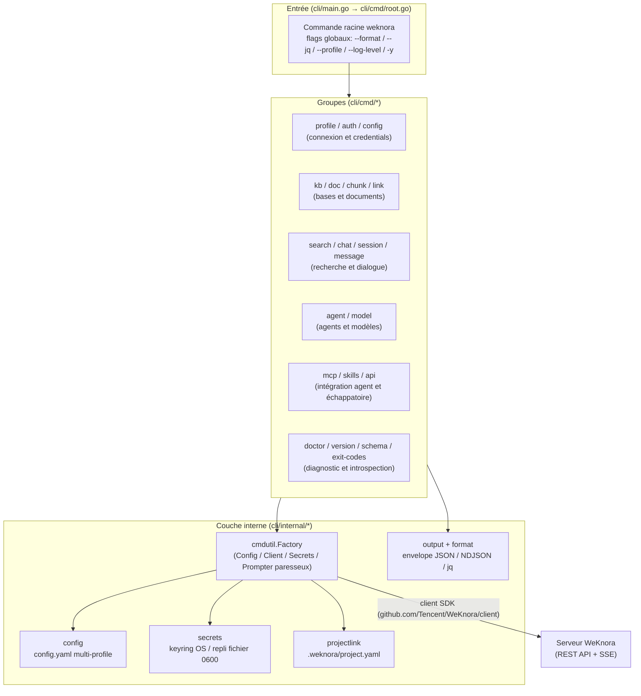

# CLI WeKnora (outil en ligne de commande `weknora`)

WeKnora CLI (commande `weknora`) gère bases de connaissances et documents, exécute la recherche et la Q&R en flux. En interactif, sortie lisible optionnelle ; pour scripts et agents IA : JSON, erreurs typées, prévisualisation `--dry-run` et contrat `weknora schema` ; `weknora mcp serve` expose un serveur MCP.

Sources : `cli/`, module Go indépendant (`github.com/Tencent/WeKnora/cli`), build source Go 1.26+. Entrée : `cli/cmd/root.go`.

Depuis v0.8.2, « Paramètres → Intégrations de publication → CLI » propose un guide avec commandes copiables pour le déploiement courant :

1. **Installation** : build depuis les sources (Git + Go 1.26+, exemples macOS / Linux) ;
2. **Connexion** : `weknora profile add weknora --host '<adresse du service>' --use && weknora auth login` — profile nommé `weknora`, connexion email/mot de passe. Conserver le préfixe de chemin du reverse proxy ; pas de `/api/v1` en suffixe ; renommer le profile s’il existe déjà ;
3. **Vérification** : `weknora doctor` et `weknora kb list`.

Le panneau droit liste aussi des commandes courantes (upload, recherche, Q&R, agents) et un exemple MCP (`"args": ["--profile", "weknora", "mcp", "serve"]`).

<Screenshot
  src="/screenshots/integration-cli.png"
  caption="Paramètres → Intégrations de publication → CLI : installation, connexion et vérification"
  hint="Groupe Intégrations de publication avec CLI sélectionné, trois étapes (installer / connecter / vérifier avec l’adresse du service), commandes fréquentes et exemple config client MCP." />

## Architecture globale



---

## Installation

### Build depuis les sources (mode supporté actuellement)

Pas de binaire précompilé ni `go install` officiel pour l’instant.

```bash
git clone https://github.com/Tencent/WeKnora.git
cd WeKnora/cli
go build -o weknora .
sudo mv weknora /usr/local/bin/   # ou tout répertoire du $PATH
```

### `cli/Makefile`

| target | Rôle |
|---|---|
| `make build` | Compile `./bin/weknora`, ldflags Version/Commit/Date |
| `make test` | `go test ./...` |
| `make test-coverage` | Couverture |
| `make lint` | `go vet ./...` |
| `make tidy` | `go mod tidy` |
| `make clean` | Supprime `./bin` et coverage.out |

Pas de cible `install` — déplacer le binaire manuellement dans `$PATH`.

---

## Configuration et profiles

### Fichier et chemins

`cli/internal/config/config.go` : `$XDG_CONFIG_HOME/weknora/config.yaml` (sinon `~/.config/weknora/config.yaml` ; `cli/internal/xdg/xdg.go`, XDG aussi sur macOS). Écriture atomique, mode 0600.

Schéma disque (`config.Config` / `config.Profile`) :

```yaml
current_profile: prod
profiles:
  prod:
    host: https://kb.example.com
    tenant_id: 42
    user: user@example.com
    api_key_ref: keychain://...
    token_ref: keychain://...
    refresh_token_ref: keychain://...
    default_kb_id: "..."
defaults:
  format: json
  no_version_check: true
```

### Secrets

Les credentials **ne sont pas** dans `config.yaml`, seulement des refs. `cli/internal/secrets/` :

- **KeyringStore** : keyring OS, espace `weknora:<profile>:<key>` (`access` / `refresh` / `api_key`) ;
- **FileStore** : repli `$XDG_CONFIG_HOME/weknora/secrets/<profile>/<key>` (0600) ; avertissement stderr unique à `auth login`.

### Priorité de résolution du profile

`Factory.ActiveProfile` (`cli/internal/cmdutil/factory.go`) :

1. `--profile <name>` (session, non persisté) ;
2. `WEKNORA_PROFILE` ;
3. `current_profile` dans `config.yaml` (`weknora profile use`).

### Credentials par variables d’environnement (CI / agent)

`buildClientFromEnv` :

| Variable | Rôle |
|---|---|
| `WEKNORA_TOKEN` | JWT Bearer (prioritaire sur API key) |
| `WEKNORA_API_KEY` | Clé API |
| `WEKNORA_HOST` | Hôte (sinon profile actif) |
| `WEKNORA_PROFILE` | Override profile |
| `WEKNORA_KB_ID` | ID base explicite |
| `WEKNORA_FORMAT` | text / json / ndjson |
| `WEKNORA_LOG_LEVEL` | error / warn / info / debug |
| `WEKNORA_AGENT_HELP=1` | `--help` → JSON AgentHelp |

### Chaîne de résolution `--kb`

`Factory.ResolveKB` (4 niveaux) :

1. `--kb` (UUID ou nom → `ListKnowledgeBases`, `cli/internal/cmdutil/kb.go`) ;
2. `WEKNORA_KB_ID` ;
3. `.weknora/project.yaml` (`weknora link`, remontée max 64 niveaux) ;
4. sinon `local.kb_id_required`.

Profile JWT : `AuthRetryTransport` sur 401 → `/api/v1/auth/refresh` ; pas de refresh pour clé API / env seuls.

---

## Flags globaux, sortie et scripts

### Flags globaux (`addGlobalFlags`)

| Flag | Alias | Description |
|---|---|---|
| `--format` | | `text` \| `json` \| `ndjson`. **Défaut `json`** (agent-first). Priorité : `--format` > `WEKNORA_FORMAT` > json |
| `--jq` | `-q` | Filtre jq (json/ndjson uniquement) |
| `--profile` | | Override profile (non persisté) |
| `--log-level` | | Logs SDK |
| `--yes` | `-y` | Sans confirmation destructive |
| `--version` | | = `weknora version` |

`--dry-run` sur la plupart des mutations : `meta.dry_run=true` + `meta.plan`.

### Envelope JSON (`cli/internal/output/envelope.go`)

Succès stdout :

```json
{"ok": true, "data": ..., "meta": {"count": 2, "total_count": 2, "has_more": false}, "profile": "prod"}
```

Erreur stderr :

```json
{"ok": false, "error": {"type": "auth.unauthenticated", "message": "...", "exit_code": 3,
  "hint": "...", "retry_argv": ["weknora","auth","login"], "retryable": false}}
```

Types : `auth.*`, `resource.*`, `input.*`, `server.*`, `network.error`, `operation.*`, `local.*`, `internal.error`.

`ndjson` pour `chat` / `session ask` / `session resume` : ligne `init` CLI puis événements SSE.

### Codes de sortie (`weknora exit-codes`)

| Code | Signification | Types | Action agent |
|---|---|---|---|
| 0 | Succès | — | Continuer |
| 1 | Erreur locale / opération | `local.*`, `operation.*`, etc. | Lire stderr |
| 2 | Erreur parsing flags | `input.invalid_argument` | `--help` |
| 3 | Auth | `auth.*` | `auth login` |
| 4 | Introuvable | `resource.not_found` | Vérifier id |
| 5 | Entrée invalide | `input.*` | Corriger params |
| 6 | Rate limit | `server.rate_limited` | Backoff |
| 7 | Serveur / réseau | `server.*`, `network.*` | Retry |
| 10 | Confirmation requise | `input.confirmation_required` | Humain + `-y` |
| 124 | Timeout | `operation.timeout` | `--timeout` |
| 130 | Signal | — | Arrêter |

**Protocole exit-10** : suppressions, `kb config set`, `api -X DELETE/PUT/PATCH`, `message delete`, `session tool-approval resolve` sans `-y` en non-TTY → 10, aucune mutation.

### Introspection machine

- `weknora schema` : index ou contrat d’une commande ;
- `WEKNORA_AGENT_HELP=1 weknora <cmd> --help` ;
- Sous-commande inconnue → `input.unknown_subcommand` + suggestions.

---

## Groupes de commandes

### profile (`cli/cmd/profile/`)

| Sous-commande | Use | Description |
|---|---|---|
| list | `list` | Lister profiles |
| add | `add <name>` | Nouveau profile (host seulement) |
| use | `use <name>` | Profile par défaut persisté |
| remove | `remove <name>` | Supprimer profile + refs secrets |

`add` : `--host` (requis), `--user`, `--use`.

```bash
weknora profile add prod --host=https://kb.example.com --use
weknora profile list --format json
```

### auth (`cli/cmd/auth/`)

| Sous-commande | Use | Description |
|---|---|---|
| login | `login` | Profile actif : interactif ou `--with-token` (stdin API key, vérif `/auth/me`) |
| logout | `logout` | Effacer credentials ; `--all` |
| list | `list` | Profiles authentifiés |
| status | `status` | Profile, principal, état token |
| refresh | `refresh` | Nouvel access JWT |
| token | `token` | Credential brut sur stdout |

```bash
weknora auth login
echo "$WEKNORA_API_KEY" | weknora auth login --with-token
weknora auth status --format json
```

`auth login` n’accepte pas `--host` — `profile add ... --use` d’abord.

### config (`cli/cmd/config/`)

| Sous-commande | Use | Description |
|---|---|---|
| view | `view` | Config résolue + **source** de chaque valeur, sans requête réseau |

```bash
weknora config view --format json --jq '.data.kb_source'
```

### link / unlink (`cli/cmd/link/`)

| Commande | Use | Description |
|---|---|---|
| link | `link [kb]` | `.weknora/project.yaml` ; `--kb` ou arg ; interactif si TTY ; `--dry-run` |
| unlink | `unlink` | Supprime le lien |

```bash
weknora link engineering
weknora link --kb a32a63ff-fb36-4874-bcaa-30f48570a694
```

### kb (`cli/cmd/kb/`)

| Sous-commande | Use | Description |
|---|---|---|
| list | `list` | Bases visibles ; `--pinned`, `--limit/-L` (30) |
| view | `view <kb-id>` | Détail |
| create | `create <name>` | `--description`, `--embedding-model`, `--chat-model`, `--storage-provider` |
| update | `update <kb-id>` | `--name`, `--description` |
| delete | `delete <kb-id>` | exit-10, `-y` |
| pin / unpin | `pin` / `unpin` | Idempotent |
| status | `status <kb-id>` | Healthcheck léger |
| check | `check <kb-id>` | E2E + docs en échec |
| config | `config <kb-id>` | Modèles en lecture seule, `retrieval_ready`, pas de clés API |
| config set | `set <kb-id>` | `--chat-model` + `--embedding-model` requis ; exit-10 |

```bash
weknora kb create docs --embedding-model text-embedding-3 --chat-model gpt-4o
weknora kb config set <kb-id> --chat-model <id> --embedding-model <id> -y
```

### doc (`cli/cmd/doc/`)

| Sous-commande | Use | Description |
|---|---|---|
| upload | `upload <file>` | `--name`, `--recursive` + `--glob`, `--metadata`, `--enable-multimodel`, `--channel` |
| fetch | `fetch <url>` | `--name`, `--title`, `--file-type`, `--tag-id`, `--channel` |
| create | `create` | Markdown inline : `--text`, `--title`, etc. |
| list | `list` | Filtres status, keyword, dates RFC3339, pagination |
| view / update / delete | | Détail, MAJ, suppression batch / `--all --kb=` |
| download | `download <doc-id>` | `-O`, `--clobber` |
| reparse | `reparse` | Re-analyse |
| wait | `wait` | Poll index ; `--timeout` (déf. 10m, code 124), `--interval` |

```bash
weknora doc upload ./design.pdf --kb docs
weknora doc wait <doc-id> --timeout 5m && weknora search chunks "RRF" --kb docs
```

### chunk (`cli/cmd/chunk/`)

| Sous-commande | Use | Description |
|---|---|---|
| list | `list` | Debug : `--doc` requis |
| view | `view <chunk-id>` | Contenu |
| delete | `delete ... --doc <doc-id>` | exit-10 |

### search (`cli/cmd/search/`)

| Sous-commande | Use | Description |
|---|---|---|
| chunks | `chunks "<query>"` | Hybride ; `--kb`, `--limit` (8), seuils, `--no-vector` / `--no-keyword` |
| docs | `docs "<query>"` | Docs par mot-clé |
| kb | `kb "<query>"` | Bases (match client) |
| sessions | `sessions "<query>"` | Sessions (match client) |

```bash
weknora search chunks "rate limiting design" --kb docs --limit 5 --format json --jq '.data[].content'
```

### chat (`cli/cmd/chat/chat.go`)

`chat "<text>"` — json (défaut, envelope bufferisé), text (flux lisible), ndjson (SSE + init).

Flags : `--kb`, `--session`, `--reference`, `--verbose`.

```bash
weknora chat "What is RRF?" --kb a32a63ff-fb36-4874-bcaa-30f48570a694
weknora chat "Continue" --session sess_abc --format ndjson
```

### session (`cli/cmd/session/`)

| Sous-commande | Use | Description |
|---|---|---|
| list | `list` | `--since` (7d, 24h, …) |
| view | `view <session-id>` | `--full` |
| ask | `ask "<text>"` | Agent serveur : `-a/--agent` requis |
| resume | `resume <session-id>` | `-m/--message` |
| stop | `stop` | `-m/--message` |
| delete | `delete` | Batch, exit-10 |
| tool-approval resolve | `resolve <pending-id>` | `--reject`, `--reason`, `--modified-args` |

```bash
weknora session ask "Résumer cette base" --agent agt_123 --format ndjson
weknora session tool-approval resolve <pending-id> --reject --reason "Écriture non autorisée" -y
```

### message (`cli/cmd/message/`)

| Sous-commande | Use | Description |
|---|---|---|
| list | `list --session <id>` | Pagination `--before` |
| search | `search "<query>"` | Historique ; `--mode keyword|vector|hybrid` |
| delete | `delete <message-id> --session <id>` | exit-10 |

### agent (`cli/cmd/agent/`)

CRUD + `status` / `check` ; `create` avec `--model`, prompts, `--attach-kb`, `--config-file`, `--generate-skeleton`, etc.

```bash
weknora agent create researcher --model gpt-4o --attach-kb <kb-id> --system-prompt-file ./prompt.md
weknora agent update agt_123 --add-kb <kb-id2> --temperature 0.3
```

### model (`cli/cmd/model/`)

list / view / create / update / delete ; types Embedding, Rerank, KnowledgeQA, etc. ; `--api-key-stdin`.

```bash
weknora model create bge-m3 --type Embedding --source local --base-url http://localhost:11434 --dimension 1024
echo "$OPENAI_KEY" | weknora model create gpt-4o --type chat --source remote --provider openai --api-key-stdin
```

### api (`cli/cmd/api/api.go`)

`api <path>` avec auth du profile.

| Flag | Alias | Description |
|---|---|---|
| `--method` | `-X` | GET par défaut ; body → POST auto |
| `--data` | `-d` | JSON inline |
| `--input` | | Fichier body |
| `--field` | `-F` | Objet JSON key=value |
| `--paginate` | | Fusion pages |

DELETE exit-10 ; PUT/PATCH confirmation ; `--dry-run` (non-GET).

```bash
weknora api /api/v1/knowledge-bases
weknora api /api/v1/knowledge-bases -d '{"name":"foo"}'
weknora api /api/v1/knowledge-bases/<id> -X DELETE -y
```

### mcp (`cli/cmd/mcp/`)

| Sous-commande | Use | Description |
|---|---|---|
| serve | `serve` | MCP JSON-RPC stdio ; logs stderr ; échec immédiat sans profile |

10 outils (`cli/internal/mcp/tools.go`) : lecture + `chat` / `session_ask` (créent session/message).

```json
{
  "mcpServers": {
    "weknora": { "command": "weknora", "args": ["mcp", "serve"] }
  }
}
```

### skills (`cli/cmd/skills/skills.go`)

| Sous-commande | Use | Description |
|---|---|---|
| list | `list` | Skills embarqués (`cli/skills/embed.go`) |
| install | `install` | `--dir` (déf. `~/.claude/skills`), `--force`, `--dry-run` |

### doctor (`cli/cmd/doctor/doctor.go`)

4 checks : URL, auth, version, stockage secrets. `--no-cache`, `--offline`.

```bash
weknora doctor --format json --jq '.data.summary.all_passed'
```

### Commandes racine

| Commande | Use | Description |
|---|---|---|
| version | `version` | Métadonnées build |
| schema | `schema [command...]` | Contrat machine |
| exit-codes | `exit-codes` | Matrice codes |

---

## Tests d’acceptation (`cli/acceptance/`)

Surface de contrat — « change with care ».

### contract/

- **`wire_test.go`** : golden JSON dans `testdata/wire/` (version, auth, doctor, kb_list, search, …).
- **`errorcodes_test.go`** : ast scan → registre `cmdutil.AllCodes()`.

### e2e/

Tag `acceptance_e2e` :

```bash
cd cli
WEKNORA_E2E_HOST=https://kb.example.com WEKNORA_E2E_TOKEN=eyJ... \
  go test -tags=acceptance_e2e -v ./acceptance/e2e/...
```

`TestRAGFullLoop` : kb create → upload → wait → search → chat via env credentials.

Tests transverses dans `cli/cmd/` : positional, dry-run, agenthelp, unknown subcommand.

---

## Démarrage rapide {#demarrage-rapide}

```bash
# 1. Profile serveur
weknora profile add prod --host https://kb.example.com --use

# 2. Auth
weknora auth login

# 3. Doctor
weknora doctor

# 4. Base, modèles, document, index
weknora kb create docs --embedding-model <emb> --chat-model <llm>
weknora doc upload ./design.pdf --kb docs
weknora doc wait <doc-id>

# 5. Recherche et Q&R
weknora search chunks "rate limiting" --kb docs
weknora chat "Résumer ce document de conception" --kb docs
```
