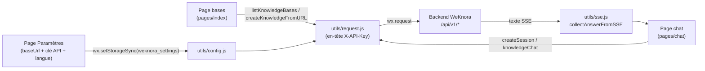

# Client WeChat Mini Program

La mini program WeChat offre un accès mobile à la gestion des bases de connaissances et à la Q&R, ainsi qu’à l’import de pages web, en se connectant à une instance WeKnora existante. Les sources se trouvent dans `miniprogram/`. Après configuration de l’adresse API et de la clé API, l’utilisateur choisit une base de connaissances pour :

- importer une URL web dans la base sélectionnée ;
- poser des questions sur le contenu de cette base.

## Adresse backend et authentification

La mini program **n’intègre pas d’adresse backend en dur** : l’utilisateur renseigne tout dans la page « Paramètres », stocké localement sous la clé `weknora_settings` via `wx.setStorageSync`, avec quatre champs :

```js
{
  baseUrl: "http://localhost:8080",   // valeur par défaut écrite dans app.js onLaunch
  apiKey: "",
  selectedKnowledgeBaseId: "",
  locale: "zh"                        // langue UI : zh | en
}
```

- **Valeurs par défaut** : `miniprogram/app.js` écrit à `onLaunch`, si aucun réglage local n’existe, `baseUrl: "http://localhost:8080"`, `apiKey` vide et `locale: "zh"`. Ces valeurs servent au développement local ; en usage réel, il faut saisir l’adresse réelle dans Paramètres.
- **Lecture/écriture et normalisation** : `miniprogram/utils/config.js` expose `getSettings()` / `saveSettings()`, avec `normalizeBaseUrl()` (trim et suppression du `/` final) et `normalizeLocale()` (toute valeur autre que `en` devient `zh`).
- **Authentification par clé API** : `miniprogram/utils/request.js` ajoute à chaque requête :
  - `X-API-Key: <clé saisie>` (obtenue dans WeKnora « Paramètres → Intégrations de publication → Intégration API », forme `sk-...`) ;
  - `X-Request-ID: mp-<timestamp>-<aléatoire>` (traçabilité côté serveur) ;
  - `Content-Type: application/json`.
- **Contrôles préalables** : si `baseUrl` ou `apiKey` manque, la requête est rejetée avec un message selon la langue (ex. « Veuillez configurer l’adresse API WeKnora. ») ; `pages/index/index.js` `onShow` affiche aussi un guide vers Paramètres.
- **AppID** : copier `miniprogram/project.private.config.json.example` vers `project.private.config.json` et y mettre votre AppID (exemple : `{"appid": "your-wechat-mini-program-appid"}`). Le `project.config.json` partagé contient un champ `appid` ; votre AppID privé le remplace.

API backend appelées (définies dans `miniprogram/utils/request.js`) :

| Fonction | Méthode et chemin |
| --- | --- |
| `listKnowledgeBases()` | `GET /api/v1/knowledge-bases` |
| `createKnowledgeFromURL(kbId, url, enableMultimodel)` | `POST /api/v1/knowledge-bases/{kbId}/knowledge/url` |
| `createSession(kbId)` | `POST /api/v1/sessions` |
| `knowledgeChat(sessionId, query, kbId)` | `POST /api/v1/knowledge-chat/{sessionId}` |

## Langues et paramètres locaux

Depuis v0.8.2, Paramètres permet Chinois ou English, Chinois par défaut ; le choix est persisté en `locale` (`zh` / `en`). Au changement, libellés, titre de barre de navigation (`wx.setNavigationBarTitle`) et onglets du tab bar (`wx.setTabBarItem`) se mettent à jour ; les onglets ont des icônes (`assets/tab/*.png`). Les chaînes sont centralisées dans `utils/i18n.js` ; les nouvelles pages doivent réutiliser ce module.

La page chat parse aujourd’hui l’intégralité du texte SSE après la réponse, sans rendu bloc par bloc en temps réel. En production, le domaine API doit figurer dans la liste des domaines request autorisés.

## Build et publication

Pas de chaîne de build (mini program native, sans outil de bundling) : ouvrir le dossier avec WeChat DevTools.

1. **Importer le projet** : dans WeChat DevTools, « Importer », répertoire `miniprogram/`. Lecture de `project.config.json` (nom « WeKnora Mini Program »).
2. **Configurer l’AppID** : copier l’exemple vers `project.private.config.json`, remplacer `appid`. Ce fichier est ignoré par `.gitignore`, ne pas le committer.
3. **Connexion backend** : onglet Paramètres, API Base URL (ex. `https://weknora.example.com`) et clé API WeKnora, langue au besoin, enregistrer.
4. **Debug local** : `project.config.json` a `urlCheck: true` ; DevTools bloque `localhost` par défaut. Cocher « Ne pas vérifier les domaines » ou exposer WeKnora en HTTPS.
5. **Publication** : ajouter le domaine API (HTTPS obligatoire) dans la console WeChat ; « Upload » dans DevTools, puis revue et publication.

### Tests

`miniprogram/package.json` définit :

```bash
cd miniprogram
npm test    # exécute node --test ../tests/miniprogram/*.test.js
```

Tests Node (`tests/miniprogram/miniprogram.test.js`) : parsing SSE, normalisation URL, i18n, en-têtes et corps de requête, chargement page bases — sans dépendances npm.

### Compatibilité base library

Le code pages et `utils/` n’utilise pas l’optional chaining `?.` ni le nullish coalescing `??` (certaines versions de base library provoquent un écran blanc — corrigé v0.8.2 sur la page bases). Les bindings WXML restent plats. Conserver cette contrainte à l’édition.

## Référence d’implémentation

### Stack technique

Client **mini program WeChat native**, sans Taro / uni-app / mpvue, sans dépendance npm runtime :

- `miniprogram/app.js` — entrée `App({...})`, défauts locaux à `onLaunch` ;
- `miniprogram/app.json` — config globale (`pages`, `window`, `tabBar`) ;
- `miniprogram/app.wxss` — styles globaux ; pages en quartet `js / wxml / wxss / json` ;
- `miniprogram/package.json` — nom `weknora-miniprogram` (version `0.1.0`), description « WeChat Mini Program plugin for WeKnora », **pas de `dependencies`**, script de test uniquement ;
- `miniprogram/project.config.json` — `compileType: "miniprogram"`, `libVersion: "latest"`, options ES6/enhance/postcss/minify, `urlCheck: true`. Champ `appid` présent ; AppID personnel via config privée.

Barre de navigation globale : titre `WeKnora`, fond `#0d3b2a`, texte blanc.

### Pages

3 pages dans `miniprogram/app.json`, toutes dans le `tabBar` (couleur sélection `#07c05f`, icônes normal/sélection). Libellés par défaut en chinois, basculables :

| Chemin | Onglet (zh / English) | Rôle |
| --- | --- | --- |
| `pages/index/index` | Bases / Knowledge | Accueil : vérifie baseUrl / clé API, liste bases via `GET /api/v1/knowledge-bases`, sélection persistée ; import URL via `POST .../knowledge/url` (`enable_multimodel: false`) |
| `pages/chat/chat` | Q&R / Chat | Q&R : session lazy `POST /api/v1/sessions`, puis `POST /api/v1/knowledge-chat/{sessionId}` ; SSE parsé par `utils/sse.js`, fragments `response_type === "answer"` concaténés |
| `pages/settings/settings` | Réglages / Settings | URL API, clé API (masquée), langue → `weknora_settings` |

### Modules `utils/`

| Fichier | Rôle |
| --- | --- |
| `miniprogram/utils/config.js` | Persistance : `STORAGE_KEY = "weknora_settings"`, `getSettings()`, `saveSettings()`, `normalizeBaseUrl()`, `normalizeLocale()` |
| `miniprogram/utils/i18n.js` | Traductions, `t()`, locale, `applyTabBar()`, `applyNavTitle()` |
| `miniprogram/utils/request.js` | HTTP Promise sur `wx.request`, en-têtes, erreurs ; 4 fonctions API ci-dessus |
| `miniprogram/utils/sse.js` | `parseSSE(raw)`, `collectAnswerFromSSE(raw)` — pas de streaming UI, parsing après réponse complète |

### Flux de données


