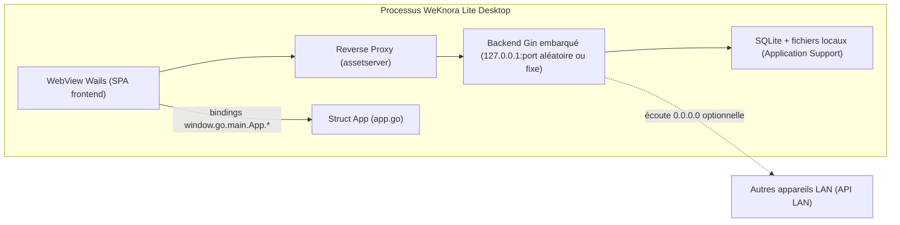

# Client bureau (WeKnora Lite Desktop)

::: warning Pas encore publié officiellement
Aucun installeur n’accompagne les releases pour l’instant ; construire l’application selon [Installation](../01-getting-started/02-installation.md).
:::

WeKnora Lite Desktop repose sur [Wails v2](https://wails.io) : backend Go dans le processus bureau, SQLite et stockage fichiers local. Après lancement, gestion des bases et Q&R sans Docker ni base externe. Sources : `cmd/desktop/`, même socle que le [binaire Lite](../01-getting-started/02-installation.md) ; le bureau ajoute démarrage sans connexion et, sur macOS, [sandbox hôte](../03-features/22-skills-sandbox.md#lite-host) pour les commandes agent.

Depuis v0.8.3, la version bureau macOS peut installer, mettre à jour et exécuter des skills hôte via la boîte à outils — voir [Skills hôte](../03-features/22-skills-sandbox.md#lite-host).

Depuis v0.9.0, le répertoire de session temporaire par défaut est `~/.weknora/sessions/session-*`. Les suppressions locales et l’élargissement du périmètre sandbox peuvent déclencher une approbation (carte décrivant commande, chemins et impact). Cette approbation n’est pas la même chose que `approval_mode=auto` dans les préférences ; les modes `ask` et `full` ne sont pas des options globales. Voir [Sandbox hôte](../03-features/22-skills-sandbox.md#lite-host).

## Architecture globale {#architecture-globale}

Trois composants dans un même processus :

1. **Backend embarqué** : `container.BuildContainer()` dans `cmd/desktop/main.go`, même DI que le serveur ; `http.Server` (routeur Gin) dans une goroutine dédiée.
2. **Fenêtre Wails (WebView)** : `wails.Run()` ; le SPA est servi via un **reverse proxy** (`httputil.NewSingleHostReverseProxy`) sur le backend embarqué (`./web`).
3. **Couche de binding Go** : `App` dans `cmd/desktop/app.go`, exposée au JS (`window.go.main.App.*`).



### Port et écoute

`desktopBackendListenAddr()` dans `main.go` :

- Par défaut `127.0.0.1`, port `http_port` dans `desktop-prefs.json` ; si 0, port libre `:0` avec retry exponentiel (`listenWithRetry`, max 10).
- Si `http_bind_public` est `true`, écoute `0.0.0.0` ; `desktopPreferredLANIPv4()` choisit une IPv4 non loopback (priorité réseau privé) → `http://<LAN-IP>:<port>/api/v1` pour le LAN.
- Proxy et WebView utilisent toujours `http://127.0.0.1:<port>`, jamais `0.0.0.0` comme cible de connexion.

### Emplacement des données (macOS .app)

`configureDesktopStorage()` dans `main.go` si lancement depuis `.app/Contents/MacOS` :

- Données : `~/Library/Application Support/WeKnora Lite/` (nom du bundle).
- SQLite : `.../data/weknora.db` (`DB_PATH`).
- Fichiers : `.../data/files` (`LOCAL_STORAGE_BASE_DIR`).
- `migrateLegacyDesktopData()` migre l’ancien `.app/Contents/Resources/data` vers Application Support.
- Répertoire de travail : `.app/Contents/Resources` pour `config/config.yaml`, `.env`, `migrations/sqlite`, `web/`.

## Fichiers sources principaux {#fichiers-sources-principaux}

| Fichier | Rôle |
|------|------|
| `cmd/desktop/main.go` | Entrée (`//go:build !bindings`) : Gin embarqué, menu macOS, fenêtre Wails, proxy, injection DomReady |
| `cmd/desktop/main_bindings.go` | Génération bindings (`//go:build bindings`) : compile avec `-tags bindings`, `Bind` sans Gin/DB |
| `cmd/desktop/app.go` | `App` et méthodes Wails |
| `cmd/desktop/prefs.go` | Préférences `desktop-prefs.json`, répertoires projet approuvés sandbox hôte |
| `cmd/desktop/signing_key.go` | Clé de signature au premier lancement |
| `cmd/desktop/update.go` | Mises à jour GitHub Releases |
| `cmd/desktop/wails.json` | Config build Wails |
| `cmd/desktop/build/` | Ressources : `appicon.png`, `darwin/Info.plist`, `windows/installer/project.nsi` |

## Fenêtre et injection frontend {#fenetre-et-injection-frontend}

Options clés de `wails.Run(&options.App{...})` (`cmd/desktop/main.go`) :

- Titre `WeKnora Lite`, **1280 × 800**, redimensionnable, visible au démarrage.
- `AssetServer.Handler` = proxy vers backend — **pas d’embed Go** ; SPA depuis `./web` (`.app/Contents/Resources/web`).
- macOS : `mac.TitleBarHiddenInset()`, WebView opaque.
- Menu : About (lien GitHub `https://github.com/Tencent/WeKnora`), Check for Updates, Quit (Cmd+Q), Edit, View > Reload (Cmd+R, événement `app:reload`).

`OnDomReady` injecte :

1. `wailsThemeSyncJS` : thème clair/sombre depuis `localStorage` `WeKnora_theme`.
2. `dragHandlerJS` : drag fenêtre (zone titre 38px, pont WKWebView) ; liens externes et `window.open` → navigateur système (`BrowserOpenURL`).
3. `window.__WEKNORA_API_BASE__` et optionnellement `window.__WEKNORA_API_LAN_BASE__`.

## Méthodes Wails (appelables depuis le frontend) {#methodes-wails-appelables-depuis-le-frontend}

Bindings générés dans `frontend/src/wailsjs/go/main/App.d.ts` :

| Méthode | Signature (JS) | Description |
|------|--------------|------|
| `GetAPIBaseURL` | `(): Promise<string>` | Racine API locale, ex. `http://127.0.0.1:PORT/api/v1` |
| `GetAPILanBaseURL` | `(): Promise<string>` | URL API suggérée pour le LAN ; vide si pas bind-public ou échec IP |
| `GetDesktopHTTPPortSetting` | `(): Promise<number>` | Port préféré (0 = aléatoire à chaque lancement) |
| `SetDesktopHTTPPortSetting` | `(port: number): Promise<void>` | Enregistre le port ; redémarrage requis |
| `GetDesktopHTTPBindPublicSetting` | `(): Promise<boolean>` | Écoute publique (`0.0.0.0`) |
| `SetDesktopHTTPBindPublicSetting` | `(v: boolean): Promise<void>` | Idem ; redémarrage requis |
| `GetDesktopListenPublicActive` | `(): Promise<boolean>` | Écoute réellement sur toutes les interfaces (session courante) |
| `CheckForUpdates` | `(): Promise<void>` | Vérification manuelle avec dialogue |
| `AutoCheckForUpdates` | `(): Promise<void>` | Vérification silencieuse + téléchargement |
| `GetAutoSetupToken` | `(): Promise<string>` | Jeton auto-setup pour `POST /api/v1/auth/auto-setup` |
| `PickProjectDir` | `(): Promise<string>` | Sélecteur de dossier → liste approuvée sandbox |
| `GetProjectDirs` | `(): Promise<string[]>` | Dossiers projet approuvés |
| `RemoveProjectDir` | `(dir: string): Promise<void>` | Retire un dossier |
| `GetApprovalMode` / `SetApprovalMode` | `(): Promise<string>` / `(mode: string): Promise<void>` | Mode approbation sandbox ; seul `auto` accepté |

## Préférences (`cmd/desktop/prefs.go`) {#preferences-desktop-prefs}

Fichier JSON `desktop-prefs.json` dans `os.UserConfigDir()/WeKnora Lite/` :

- macOS : `~/Library/Application Support/WeKnora Lite/desktop-prefs.json`
- Windows : `%AppData%\WeKnora Lite\desktop-prefs.json`
- Linux : `~/.config/WeKnora Lite/desktop-prefs.json`

Permissions `0600` :

| Champ | Type | Défaut | Description |
|------|------|--------|------|
| `http_port` | int | 0 | Port API embarquée ; 0 ou invalide → port libre |
| `http_bind_public` | bool | false | Écoute `0.0.0.0` |
| `project_dirs` | string[] | [] | Chemins absolus approuvés pour lier des sessions |
| `approval_mode` | string | `auto` | Sandbox ; `ask`/`full` non supportés à l’enregistrement |

API : `LoadDesktopPrefsHTTPPort()`, `LoadDesktopHTTPBindPublic()`, `SaveDesktopHTTPPortPreference()`, etc. Les chemins manuels ne comptent pas comme autorisés — uniquement via `PickProjectDir` ou `POST /api/v1/system/host-project-dir`.

## Démarrage sans connexion et clé de signature

Pas d’inscription obligatoire :

- Jeton aléatoire par lancement, exposé via `GetAutoSetupToken` ; en-tête `X-WeKnora-Desktop-Token` sur `POST /api/v1/auth/auto-setup` crée `admin@weknora.local` et l’espace par défaut. Sans jeton Wails, refus (navigateur, LAN).
- Si `SYSTEM_SIGNING_KEY` / `SYSTEM_AES_KEY` invalides, création de `signing.key` (0600) dans le dossier préférences pour liens signés et embed — persistant au redémarrage ; distinct de la clé AES des secrets stockés.

## Mises à jour automatiques (`cmd/desktop/update.go`) {#mises-a-jour-automatiques-cmd-desktop-update-go}

`checkUpdate(ctx, currentVersion, showUpToDate, autoDownload)` :

1. Version : ldflags `handler.Version` ou fichier `VERSION` à la racine.
2. GET `https://api.github.com/repos/Tencent/WeKnora/releases/latest` (10s, UA `WeKnora-Lite-Desktop-App`, `GITHUB_TOKEN` optionnel), comparaison `semver`.
3. `findBestAsset()` selon GOOS/GOARCH (mots-clés mac/win/linux, amd64/arm64, repli .dmg/.exe).
4. Téléchargement temporaire ; dialogue ou mode silencieux ; Restart Now / Later.
5. `applyUpdateAndRestart()` : batch Windows `/S`, script macOS hdiutil + cp .app (sudo osascript si besoin), Linux `xdg-open`.

Déclencheurs : menu macOS, `CheckForUpdates()`, `AutoCheckForUpdates()` (`frontend/src/App.vue`).

## Config Wails (`cmd/desktop/wails.json`) {#config-wails-cmd-desktop-wails-json}

```json
{
  "name": "WeKnora Lite",
  "outputfilename": "WeKnora Lite",
  "frontend:dir": "../../frontend",
  "wailsjsdir": "../../frontend/src",
  "build:tags": "desktop",
  "info": { "companyName": "Tencent", "productName": "WeKnora Lite", "productVersion": "1.0.0" },
  "mac": { "category": "public.app-category.productivity", "titlebar": "hiddenInset" }
}
```

- Tag `desktop` requis pour sandbox hôte Lite.
- Bindings dans `frontend/src/wailsjs/` ; pas de `frontend:build` dans Wails — build frontend séparé.
- Sortie : `cmd/desktop/build/bin/` ; ressources dans `cmd/desktop/build/`.

## Détection environnement bureau côté frontend {#detection-environnement-bureau-cote-frontend}

- Classe `wails-desktop` sur `document.documentElement`.
- `window.go.main.App.*`, `window.runtime` — détection par capacité (`useApiBaseUrlDisplay.ts`, `App.vue`, `GeneralSettings.vue`, `ApiIntegrationSettings.vue`).

## Build {#build}

Script macOS : `scripts/package-mac-app.sh` (pas de cible desktop dans le Makefile racine) :

```bash
./scripts/package-mac-app.sh
SKIP_FRONTEND=1 ./scripts/package-mac-app.sh
```

Étapes :

1. `cd frontend && npm ci && npm run build` → sync `frontend/dist` vers `web/` à la racine.
2. Wails CLI, `EDITION=lite`, `GOLANG_PROTOBUF_REGISTRATION_CONFLICT=warn`, ldflags version :

   ```bash
   cd cmd/desktop && wails build -clean -tags "sqlite_fts5" -ldflags="$LDFLAGS" -o "WeKnora Lite"
   ```

   Tags effectifs : `desktop` + `sqlite_fts5`. Phase bindings : `-tags bindings` sur `main_bindings.go`.
3. Copie vers `dist/`, licences, `.env.lite.example`, `config/`, migrations SQLite, `web/`.

Produit : `dist/WeKnora Lite.app`. Windows/Linux : `wails build` possible ; script macOS et ressources `build/darwin` fournis pour macOS.
