# Base de données et migrations

WeKnora maintient le schéma de base de données via des migrations versionnées, avec un répertoire dédié pour PostgreSQL et un autre pour SQLite. Les migrations peuvent s’exécuter automatiquement au démarrage de l’application ou manuellement via des scripts ; toute nouvelle colonne ou table doit être maintenue sur les deux chemins.

## Bases de données prises en charge {#bases-de-donnees-prises-en-charge}

L’application principale se connecte à la base via GORM ; le pilote est déterminé par la variable d’environnement `DB_DRIVER`. Le switch dans `initDatabase()` de `internal/container/container.go` **n’accepte que deux valeurs** :

| `DB_DRIVER` | Description |
| --- | --- |
| `postgres` | Mode standard. Compatible avec PostgreSQL natif (+ pgvector) et **ParadeDB** (fork PostgreSQL avec `pg_search`/BM25 intégrés ; l’image compose officielle par défaut est `paradedb/paradedb:v0.25.11-pg17`). Le DSN GORM est assemblé à partir de `DB_HOST`/`DB_PORT`/`DB_USER`/`DB_PASSWORD`/`DB_NAME`, avec `sslmode=disable` et `TimeZone=UTC` imposés |
| `sqlite` | Mode Lite. Le chemin vient de `DB_PATH` (par défaut `./data/weknora.db`) ; le DSN ajoute `_journal_mode=WAL&_busy_timeout=5000&_foreign_keys=on`, et l’extension `sqlite-vec` (`sqlite_vec.Auto()`) est chargée pour la recherche vectorielle |
| Autre valeur | Erreur directe `unsupported database driver` |

**MySQL n’est pas une option pour la base principale** : `go-sql-driver/mysql` dans `go.mod` sert à enregistrer le pilote de protocole pour le moteur de recherche Doris (protocole MySQL, `database/sql`) — voir le commentaire d’import dans `container.go`. `migrations/mysql/00-init-db.sql` est un script MySQL ponctuel de création des 10 tables cœur (`tenants`/`models`/`knowledge_bases`/`knowledges`/`sessions`/`messages`/`message_suggestion_sets`/`message_suggestion_events`/`chunks`/`chunk_revisions`) ; **aucun code Go ni script ne le référence**, il n’est pas branché au démarrage de l’application ; considérez-le comme legacy / initialisation externe.

Le moteur de recherche (stockage des index vectoriels / full-text) est découplé de la base principale et piloté par `RETRIEVE_DRIVER` (postgres / elasticsearch / qdrant / milvus / sqlite, etc. — voir le guide des points d’extension). Lorsque `RETRIEVE_DRIVER` ne contient pas `postgres`, le DSN de migration inclut `options=-c app.skip_embedding=true` et les migrations liées à la table `embeddings` sont ignorées via ce GUC.

## Structure des répertoires de migration {#structure-des-repertoires-de-migration}

```text
migrations/
├── versioned/     # Migrations versionnées PostgreSQL/ParadeDB : 000000-000134, 135 versions (270 fichiers .up/.down.sql)
├── sqlite/        # Migrations SQLite : 000000_init (schéma complet aplati) + 000001-000051 incrémental
├── paradedb/      # Scripts ParadeDB additionnels : 00-init-db.sql, 01-migrate-to-paradedb.sql (bascule d’une base existante)
└── mysql/         # 00-init-db.sql, script MySQL legacy ponctuel (non branché au code)
```

- PostgreSQL `versioned/` va de `000000_init` à `000134_tenant_default_settings` ;
- `sqlite/` utilise `000000_init` comme initialisation complète aplatie (JSONB→TEXT, SERIAL→AUTOINCREMENT, etc.), puis des versions incrémentales (actuellement jusqu’à `000051_tenant_default_settings`), exécutées dans l’ordre par golang-migrate ;
- Les extensions `uuid-ossp`, `vector`, `pg_trgm`, `pg_search`, etc. sont créées par les migrations `versioned/` (000000, 000002) ; l’index BM25 sur `embeddings.content` utilise le tokenizer Lindera pour le chinois ;
- `paradedb/00-init-db.sql` contient en plus des extensions d’anciennes instructions de création de tables — **non référencé par compose ni par le code**. Ne l’utilisez pas comme script initdb : les anciennes tables qu’il crée d’abord feront échouer `000000_init`.

### Aperçu de l’historique versioned/ (par thème) {#apercu-de-l-historique-versioned-par-theme}

| Plage de versions | Thème | Tables / colonnes clés introduites |
| --- | --- | --- |
| 000000 | Initialisation cœur | `tenants`, `models`, `knowledge_bases`, `knowledges`, `chunks`, `sessions`, `messages` |
| 000001 | Authentification + Agent + MCP | `users`, `auth_tokens`, `custom_agents`, `mcp_services`, `knowledge_tags` |
| 000002-000011 | Vecteurs / recherche | `embeddings` (HNSW + BM25, gated par `app.skip_embedding`), `chunks.flags`, `seq_id`, index BM25 ParadeDB |
| 000012-000018 | Collaboration inter-espaces | `organizations`, `organization_members`, `kb_shares`, `agent_shares`, `organization_join_requests` |
| 000019-000028 | Messages / IM | Colonnes étendues sur `messages` (images, rendered_content, agent_duration_ms), `im_channels`, `im_channel_sessions` |
| 000029-000036 | Sources de données et abstraction vector store | `data_sources`, `sync_logs`, `web_search_providers`, `vector_stores`, asr_config/vector_store_id sur KB |
| 000037-000041 | Wiki et file de tâches | `wiki_pages`, `wiki_folders`, `wiki_page_issues`, `wiki_log_entries` (supprimé en 000077), `task_pending_ops`, `task_dead_letters` |
| 000042-000054 | RBAC / audit / invitations / paramètres système | `mcp_tool_approvals`, `tenant_members`, `audit_logs`, `organization_tenant_members` (renommé/archivé depuis `organization_members`), `user_resource_favorites`, `tenant_invitations`, `user_kb_pins`, `system_settings` et `users.is_system_admin` (000053), colonnes de lien d’invitation `tenant_invitations.token`/`accepted_count` (000054) |
| 000055-000060 | Pipeline de traitement et canaux d’embedding | `knowledge_processing_spans`, `knowledges.pending_subtasks_count` (000056, compteur en état `finalizing`), `embed_channels`, index HNSW 1024 dimensions |
| 000061-000067 | Hiérarchie Wiki / OAuth / multi-tags documents / identité principal / questions suggérées | Colonnes hiérarchiques `wiki_pages`, `mcp_oauth_clients`, `mcp_oauth_tokens`, `knowledge_tag_relations`, colonnes identité principal (000064 : `tenants.api_principal_config`, `mcp_oauth_tokens.principal_type`/`principal_id`), `tenant_api_keys` (000065, suppression de `tenants.api_key`), `message_suggestion_sets`, `message_suggestion_events` |
| 000068-000074 | Stockage / ressources / documents temporaires | `storage_backends`, `resources`, `resource_bindings`, `resource_access_grants`, `temporary_documents`, clés API plateforme, lease de refresh OAuth |
| 000075-000076 | Historique de versions Wiki et index | `wiki_page_revisions`, `wiki_pages.last_edit_source`/`last_editor_id`, index préfixe sur `knowledges.metadata->>'external_id'` |
| 000077 | Suppression du journal Wiki | DROP `wiki_log_entries` et pages legacy `page_type = 'log'` ; les changements Wiki passent par le flux d’activité de la base de connaissances |
| 000078 | Édition de chunks et métadonnées personnalisées | `chunks` : `source_content`/`content_revision`/`index_status`/`last_editor_id`/`context_header`, nouvelle table `chunk_revisions`, `knowledges.custom_metadata` |
| 000079 | Arborescence de dossiers KB | `knowledges.folder_path` avec backfill des uploads par répertoire (chemin auparavant dans `file_name`), index `(tenant_id, knowledge_base_id, folder_path)` |

### Migrations après 000080 {#migrations-apres-000080}

| Version | Changement |
| --- | --- |
| 000080 | knowledge_bases.auto_tag_config |
| 000081 | messages.artifacts, fichiers générés persistés (depuis 000103 dans la table `message_artifacts`) |
| 000082 | tenant_sandbox_configs, plusieurs backends nommés et lease de changement de config |
| 000083 | sessions.sandbox_config_id |
| 000084 | Six tables mémoire personnelle, tenants.memory_config, messages.used_memories |
| 000085 | messages.usage |
| 000086 | tenant_skills, tenant_skill_snapshots, registre d’installation et snapshots |
| 000087 | install_session_id / install_message_id sur les skills, journal de conversation d’installation |
| 000088 | planned_name sur les snapshots, nom planifié avant création |
| 000089 | envs sur les skills, tenant_user_env_vars |
| 000090 | tenant_skill_catalog ; tenant_skills.catalog_id, backfill des installations existantes |
| 000091 | mcp_tool_approvals.enabled, true par défaut |
| 000092 | mcp_services.usage_instructions ; table `mcp_metadata`, snapshot du catalogue d’outils MCP |
| 000093 | `browser_devices`, `browser_pairings`, `browser_task_interruptions`, autorisation et appairage des extensions navigateur |
| 000094 | memory_subjects.extraction_state, memory_items.replaces_id, table `memory_extraction_sessions` (progression d’extraction par session) ; correction de données où des inférences en attente remplaçaient trop tôt des souvenirs actifs |
| 000095 | memory_item_embeddings.embedding (halfvec, ajouté seulement si l’extension `vector` est installée) et index de recherche |
| 000096 | Migration de données : mode canal DingTalk de webhook vers websocket (Stream). Activer le mode Stream dans la console développeur DingTalk ; down = no-op |
| 000097 | Fork de session : sessions.parent_session_id / forked_from_message_id / fork_bootstrap, messages.sandbox_checkpoint |
| 000098 | Table `fork_snapshot_leases`, snapshots sandbox avant persistance du fork, pour recyclage |
| 000099 | Mise à niveau pg_search 0.22.2–0.22.5 vers 0.22.6 ; ignoré si l’image n’offre pas 0.22.6, autre version, ou `app.skip_embedding=true` |
| 000100 | Suppression de trois index ralentissant les écritures sur chunks : `idx_chunks_chunk_type`, `idx_chunks_content_hash`, `idx_chunks_tenant_kg` |
| 000101 | knowledges.profile (portrait document), knowledge_bases.profile_config / generated_profile (description KB par IA) |
| 000102 | Table `mcp_endpoints`, endpoints MCP publiés par l’espace |
| 000103 | Table `message_artifacts`, backfill depuis `messages.artifacts` ; ensuite lecture/écriture uniquement sur la nouvelle table. Lignes avec contenu dans l’ancienne colonne mises à NULL après backfill (colonne conservée pour rolling upgrade) ; `file_size`/`created_at` non parseables → 0 et heure de création du message. Le down réécrit la nouvelle table dans l’ancienne colonne |
| 000104 | tenant_skills.served, version encore servie dans l’image pendant une installation ou échec de nouvelle version |
| 000105 | messages.context_checkpoint, résumé de compression du contexte Agent |
| 000106 | Index messages `(session_id, created_at DESC, id DESC)` `idx_messages_session_created_id`, créé avec `CREATE INDEX CONCURRENTLY` ; interruption laisse un index INVALID — `DROP INDEX` puis relancer la migration |
| 000107 | message_artifacts.deleted_at, fichiers supprimés par l’utilisateur conservés en tombstone |
| 000108 | sessions.sandbox_config_tenant_id (BIGINT, défaut 0), espace propriétaire de la config sandbox de la session ; backfill des sessions utilisant un Agent partagé |
| 000109 | sessions.host_workspace_dir (VARCHAR(1024)), répertoire projet sandbox hôte en Lite desktop, immuable après création |
| 000110 | im_channels.locale (VARCHAR(16), défaut chaîne vide), langue fixe des réponses IM, vide = défaut du déploiement |
| 000111 | `model_catalog_configs`, overrides admin du catalogue et historique de versions récentes |
| 000112 | Index knowledge_id, chunk_id sur embeddings ; index classique ; sur grosses tables, CONCURRENTLY préalable possible |
| 000113 | Table projection `chunk_images` et triggers de sync, backfill galerie depuis image_info |
| 000114 | chunks.source_locators, localisation dans le fichier source |
| 000115 | Mise à niveau pg_search / vector vers 0.25.11 / 0.8.4 sur versions applicables ; changer l’image base de données associée d’abord |
| 000116 | Écriture de listes d’outils explicites par défaut pour les Agents de raisonnement historiques avec allowed_tools vide |
| 000117 | Index GIN sur messages.attachments pour les messages utilisateur valides, requêtes de rétention des pièces jointes |
| 000118 | Timestamps MCP OAuth token/client en timestamptz, anciennes valeurs interprétées en UTC |
| 000119 | Approbations persistées `agent_prompts`, suspensions `agent_run_suspensions` liées aux messages |
| 000120–000121 | Config assistant locataire, kind de session |
| 000122 | Planification resync sources Feishu / Lark |
| 000123 | Index hash de contenu sur resources |
| 000124 | `agent_collaborations`, collaboration multi-agents persistée |
| 000125 | Nettoyage des chunks image vides historiques éligibles |
| 000126–000127 | Risque outils MCP, autorisations `agent_grants` |
| 000128 | Tâches d’automatisation, exécutions et notifications in-app |
| 000129 | Source d’authentification du propriétaire de session |
| 000130 | Attribution sandbox de session et machines partagées utilisateur |
| 000131–000133 | Durée d’exécution automatisation, override modèle, exécution unifiée par assistant |
| 000134 | `tenants.default_settings` (JSONB), IDs de modèles par défaut de l’espace ; comportement de repli du déploiement si non défini |

Les numéros de version SQLite évoluent indépendamment et ne correspondent pas un à un à PostgreSQL :

| Version SQLite | Changement |
| --- | --- |
| 000001–000002 | Suppression journal Wiki, chemin dossiers |
| 000003–000004 | Auto-tag, mémoire long terme |
| 000005 | Pièces jointes messages et champs invitation |
| 000006–000008 | Tâches / dead letter, admin système et settings, spans traitement / compteur sous-tâches en attente |
| 000009 | Colonne legacy Embed memory ; l’interface canal actuelle n’expose plus ce champ |
| 000010–000011 | Relations multi-tags, modèle principal |
| 000012–000013 | Usage messages, MCP tool enabled (équivalent 000085, 000091) |
| 000014–000016 | Autorisation navigateur, cohérence mémoire, index recherche vectorielle mémoire (équivalent 000093–000095 ; SQLite sans colonne vectorielle, tri en application) |
| 000017 | Canal DingTalk en websocket (équivalent 000096) |
| 000018–000019 | Fork session, leases snapshot fork (équivalent 000097–000098) |
| 000020–000022 | Suppression index redondants chunks, portrait connaissance, endpoints MCP (équivalent 000100–000102) |
| 000023 | Table `message_artifacts`, backfill et vidage ancienne colonne (équivalent 000103) |
| 000024–000026 | messages.context_checkpoint, index session/temps messages, message_artifacts.deleted_at (équivalent 000105–000107) |
| 000027 | sessions.sandbox_config_tenant_id (équivalent 000108 ; Lite sans espaces partagés, pas de backfill) |
| 000028 | Création `tenant_skills`, `tenant_skill_snapshots`, `tenant_skill_catalog`, `tenant_user_env_vars` (équivalent 000086–000090 et 000104). Lite manquait ces quatre tables → `no such table` à la lecture des identifiants skills |
| 000029–000030 | sessions.host_workspace_dir, im_channels.locale (équivalent 000109–000110) |
| 000031 | `model_catalog_configs` (équivalent 000111) |
| 000032–000033 | `chunk_images` et source_locators (équivalent 000113–000114) |
| 000034 | Complétion MCP usage_instructions et mcp_metadata (équivalent 000092) |
| 000035 | Outils par défaut explicites Agent (équivalent 000116) |
| 000036 | Index requête pièces jointes messages utilisateur valides (équivalent 000117, index classique SQLite) |
| 000037–000039 | Approbations persistées, config assistant locataire, kind session (équivalent 000119–000121) |
| 000040 | Resync Feishu / Lark (équivalent 000122) |
| 000041–000044 | Collaboration, nettoyage chunks image vides, risque MCP et grants (équivalent 000124–000127) |
| 000045–000047 | Automatisation, source auth session, attribution sandbox (équivalent 000128–000130) |
| 000048–000050 | Durée automatisation, override modèle, exécution assistant (équivalent 000131–000133) |
| 000051 | `tenants.default_settings` (TEXT, JSON ; équivalent 000134) |

PostgreSQL 000099, 000112, 000115, 000118, 000123 n’ont pas d’équivalent SQLite.

Le schéma de base et les incréments ultérieurs déterminent le résultat final pour une base neuve ou existante ; ne déduisez pas la présence d’une table en Lite du seul nom d’un fichier de migration récent.

## Schéma final des tables {#schema-final-des-tables}

Ci-dessous la **structure effective finale** après cumul de toutes les migrations up (ALTER des migrations ultérieures fusionnés). La plupart des tables métier ont `created_at` / `updated_at`, beaucoup `deleted_at` (soft delete GORM) — non répétés ligne par ligne.

### Locataires et utilisateurs {#locataires-et-utilisateurs}

| Table | Rôle | Champs clés |
| --- | --- | --- |
| `tenants` | Locataire (espace de travail), racine multi-tenant | `id` (SERIAL, départ 10000), `name`, `retriever_engines` (JSONB), `status`, `storage_quota`/`storage_used`, `agent_config`/`context_config`/`conversation_config`/`web_search_config`/`credentials`/`api_principal_config`/`memory_config`/`default_settings` (JSONB), `default_storage_backend_id`. Ancienne colonne `api_key` migrée vers `tenant_api_keys` et supprimée en 000065 |
| `users` | Utilisateur connecté | `id` (UUID), `username` (unique), `email` (unique), `password_hash`, `tenant_id` (FK→tenants, ON DELETE SET NULL), `is_active`, `can_access_all_tenants`, `is_system_admin` (000053), `preferences` (JSON) |
| `auth_tokens` | Jetons de connexion | `id`, `user_id` (FK→users, CASCADE), `token`, `token_type` (access/refresh), `expires_at` (TIMESTAMPTZ depuis 000072), `is_revoked` |
| `tenant_members` | RBAC au niveau locataire | `user_id`+`tenant_id` (unique sous soft delete), `role` (owner/admin/contributor/viewer), `status`, `invited_by`, `joined_at` |
| `tenant_invitations` | Invitations in-app et liens | `tenant_id`, `invitee_user_id`, `role`, `status` (pending/accepted/rejected), `expires_at` ; contrainte unique pending ; `token` (lien, unique)/`accepted_count` (000054) |
| `tenant_api_keys` | Clés API locataire/plateforme | `tenant_id` (NULL si scope platform), `scope_type` (tenant/platform, CHECK), `key_hash` (unique), `full_access`, `knowledge_base_ids`, `capabilities`, `expires_at`/`revoked_at` |
| `user_kb_pins` | Épinglage KB par utilisateur | PK (`tenant_id`,`user_id`,`kb_id`) + `pinned_at` |
| `user_resource_favorites` | Favoris utilisateur | PK (`user_id`,`tenant_id`,`resource_type`,`resource_id`) |
| `system_settings` | Paramètres système (000053) | `key`, `value`/`value_type`, `category`, `is_secret`, `requires_restart`, `last_modified_by` |
| `audit_logs` | Journal d’audit (000044) | `tenant_id`, `actor_user_id`/`actor_role`, `action`, `target_type`/`target_id`/`target_user_id`, `request_path`/`request_method`, `outcome` (success/denied), `scope_type`/`scope_id`, `details` (JSONB) |

`model_catalog_configs` (v0.8.3) stocke les overrides admin au niveau déploiement (ligne unique id=1), version et historique ; `chunk_images` est une projection interrogeable de `chunks.image_info`, synchronisée par triggers sur écriture/suppression/changement d’état des chunks. La rétention des pièces jointes dépend des références par messages de session valides ; `expires_at` ne nettoie que les pièces jointes expirées déjà non référencées.

### Modèles et bases de connaissances {#modeles-et-bases-de-connaissances}

| Table | Rôle | Champs clés |
| --- | --- | --- |
| `models` | Config modèles IA (LLM/embedding/rerank, etc.) | `id`, `tenant_id` (FK→tenants, CASCADE), `name`/`display_name`, `type` (`KnowledgeQA` / `Embedding` / `Rerank` / `VLLM` / `ASR`), `source`, `parameters` (JSONB ; depuis v0.8.2 option `spec` pour override protocole/capacités sans migration), `is_default`, `is_builtin`, `managed_by`, `status` |
| `knowledge_bases` | Base de connaissances | `id` (UUID), `tenant_id`, `name`, `type` (document/faq/wiki), `chunking_config`/`image_processing_config`/`vlm_config`/`faq_config`/`asr_config`/`wiki_config`/`indexing_strategy`/`auto_tag_config`/`profile_config`/`generated_profile` (JSONB), `embedding_model_id`/`summary_model_id` (FK→models), `vector_store_id` (FK→vector_stores), `storage_backend_id` (FK→storage_backends), `creator_id` (FK→users), `is_temporary`, `activity_scope` |
| `knowledges` | Entrée de connaissance (document/web/FAQ, etc.) | `id`, `tenant_id`, `knowledge_base_id` (FK), `type`, `title`, `source` (VARCHAR(2048)), `parse_status` (pending/processing/finalizing/completed/failed/cancelled/deleting), `pending_subtasks_count` (000056, sous-tâches d’enrichissement restantes en `finalizing`), `enable_status`, `file_name`/`file_type`/`file_size`/`file_path`/`file_hash`, `metadata` (état interne), `custom_metadata` (JSONB, métadonnées utilisateur, 000078), `folder_path` (arborescence, 000079), `summary_status`, `profile` (JSONB, portrait : gist/thèmes/type/questions typiques, 000101), `channel`, `processed_at`/`error_message`. **Pas de colonne `tag_id`** — depuis 000063 les tags passent par `knowledge_tag_relations` |
| `chunks` | Chunk (unité minimale de recherche) | `id`, `tenant_id`, `knowledge_base_id`, `knowledge_id` (FK), `content`, `source_content` (sortie parseur, immuable), `content_revision`, `index_status` (ready/processing/failed), `last_editor_id`, `context_header` (fil d’Ariane pour l’index), `chunk_index`, `start_at`/`end_at`, `pre_chunk_id`/`next_chunk_id` (liste chaînée), `parent_chunk_id` (auto-référence parent/enfant), `chunk_type` (text/image/…), `image_info`/`video_info`, `relation_chunks`/`indirect_relation_chunks` (JSONB), `source_locators` (JSONB, position dans le fichier source, 000114), `is_enabled`, `flags`, `status`, `content_hash`, `seq_id`, `tag_id` |
| `chunk_revisions` | Historique de versions de chunk (000078) | `id`, `tenant_id`, `knowledge_base_id`, `knowledge_id`, `chunk_id`+`revision` (index unique), `content`, `is_enabled`, `editor_id`, `edit_source`, `edited_at` |
| `embeddings` | Index vectoriel + BM25 (Postgres/ParadeDB uniquement, gated par `app.skip_embedding`) | `id`, `source_id`+`source_type` (unique, chunk/page wiki, etc.), `chunk_id`/`knowledge_id`/`knowledge_base_id`, `content` (full-text BM25), `dimension`, `embedding` (halfvec, index HNSW par dimension 768/1024/3584), `is_enabled`, `tag_id` |
| `knowledge_tags` | Tags (catégories FAQ, etc.) | `id`, `tenant_id`, `knowledge_base_id`, `name`, `seq_id` |
| `knowledge_tag_relations` | Many-to-many document ↔ tag (000063) | PK composite (`knowledge_id`,`tag_id`) + `created_at` ; index des deux côtés. **Suppression de `knowledges.tag_id`** (données mono-tag migrées). Tags des entrées FAQ restent sur `chunks.tag_id` mono-tag |
| `vector_stores` | Config connexion vector store externe (000032) | `id`, `tenant_id`, `name` (unique par locataire), `engine_type`, `connection_config`/`index_config` (JSONB) |

### Sessions et messages {#sessions-et-messages}

| Table | Rôle | Champs clés |
| --- | --- | --- |
| `sessions` | Session (contexte de dialogue et snapshot paramètres de recherche) | `id`, `tenant_id`, `title`, `knowledge_base_id`, `agent_id` (FK→custom_agents), `user_id`, `max_rounds`, `enable_rewrite`, `fallback_strategy`/`fallback_response`, `keyword_threshold`/`vector_threshold`, `embedding_top_k`/`rerank_top_k`/`rerank_threshold`, `rerank_model_id`/`summary_model_id`, `agent_config`/`context_config` (JSONB), `sandbox_config_id`/`sandbox_config_tenant_id` (config sandbox et espace propriétaire, 0 = espace de la session, 000108), `parent_session_id`/`forked_from_message_id`/`fork_bootstrap` (fork, 000097 ; sans FK), `host_workspace_dir` (répertoire projet Lite desktop, 000109) |
| `messages` | Message | `id`, `request_id`, `session_id` (FK), `role`, `content`/`rendered_content`, `knowledge_references` (JSONB), `agent_steps` (JSONB, trace Agent), `mentioned_items`/`images` (JSONB), `is_completed`/`is_fallback`, `channel` (web/IM), `agent_id`+`agent_tenant_id`, `model_id`, `knowledge_id`, `agent_duration_ms`, `execution_context`, `attachments`, `used_memories`/`usage` (JSONB), `sandbox_checkpoint` (checkpoint sandbox au fork, 000097), `context_checkpoint` (résumé compression contexte Agent, 000105). Colonne `artifacts` plus lue/écrite depuis 000103 et vidée (conservée pour rollback et rolling upgrade) ; fichiers générés dans `message_artifacts` |
| `message_artifacts` | Fichiers générés par skills, un par ligne (000103) | `session_id`, `message_id`, `position` (ordre dans le message, index API téléchargement ; unique avec `message_id`), `url` (stockage ou resource://, non renvoyé au client), `file_name`/`file_type`/`file_size`, `content_hash`, `source_path` (même chemin même session = versions du même fichier), `mod_time` (texte RFC 3339, précision ns pour le collecteur), `created_at`, `deleted_at` (000107, tombstone après suppression utilisateur, `position` stable, pas de re-collecte). Soft delete du message masque ses fichiers |
| `message_suggestion_sets` | Jeux de questions suggérées (000067) | `tenant_id`, `session_id`, `assistant_message_id`, `placement` (starter/follow_up), `config_hash`+`locale` (clé cache, unique), `status`, `questions` (JSONB), stats tokens/latence, `lease_until` |
| `message_suggestion_events` | Événements impression/clic suggestions | `suggestion_set_id` (FK, CASCADE), `question_id`, `event_type`, `actor_id` |
| `temporary_documents` | Documents temporaires en session (000070) | `tenant_id`, `session_id`, `resource_ref`, `file_name`/`file_type`/`file_size`, `status` (uploaded/processing/ready/failed), `content`, `chunks` (JSONB), `expires_at` |

### Agent et MCP {#agent-et-mcp}

| Table | Rôle | Champs clés |
| --- | --- | --- |
| `custom_agents` | Agent personnalisé | **PK composite (`id`,`tenant_id`)**, `name`, `is_builtin`, `created_by` (FK→users), `runnable_by_viewer`, `config` (JSONB : mode/modèle/outils/périmètre connaissance) |
| `mcp_services` | Config service MCP | `id`, `tenant_id`, `name`, `enabled`, `transport_type` (stdio/sse/…), `url`/`headers`/`auth_config`/`advanced_config`/`stdio_config`/`env_vars` (JSONB), `is_builtin`, `usage_instructions` (000092) |
| `mcp_metadata` | Snapshot catalogue outils MCP (000092) | PK (`tenant_id`,`service_id`,`principal`) — `principal` vide en auth statique, une ligne par principal OAuth ; `config_fingerprint`, `tools` (JSONB), `instructions`, `server_name`/`server_version`/`server_description`, `synced_at` ; CASCADE à la suppression du service |
| `mcp_endpoints` | Endpoints MCP publiés par l’espace (000102) | `tenant_id`, `name`/`description`, `enabled`, `token_hash` (SHA-256 Bearer, unique si non supprimé, plaintext affiché une fois)/`token_hint`, `knowledge_base_ids` (JSONB, [] = toutes les KB), `tools` (JSONB whitelist), `default_agent_id`, `rate_limit_per_minute` (défaut 60), `last_used_at` |
| `mcp_tool_approvals` | Politique d’approbation outils MCP (000042) | (`tenant_id`,`service_id`,`tool_name`) unique, `require_approval`, `enabled` (défaut true) |
| `mcp_oauth_clients` | Client OAuth MCP (000062) | (`tenant_id`,`service_id`) unique, `client_id`/`client_secret`/`redirect_uri` |
| `mcp_oauth_tokens` | Jetons OAuth MCP | (`tenant_id`,`principal_type`,`principal_id`,`service_id`) unique (depuis 000064 par principal, avant `user_id`), `access_token`/`refresh_token`, `expires_at`, `refresh_lease_id`/`refresh_lease_until` (000074, anti refresh concurrent) |

### Connexion navigateur

| Table | Rôle et champs clés |
| --- | --- |
| `browser_devices` | Appareil extension navigateur autorisé (000093), un par utilisateur et espace ; label, token_hash/previous_hash (SHA-256 uniquement, rotation avec grâce), expires_at/renew_after, last_seen_at, revoked_at, lease en ligne owner/lease_until |
| `browser_pairings` | Hash jeton d’appairage à usage unique et expiration |
| `browser_task_interruptions` | Tâches interrompues nécessitant reprise explicite (scope_key + session) |

### Sandbox et skills

| Table | Rôle et champs clés |
| --- | --- |
| `tenant_sandbox_configs` | id, tenant_id, name, sandbox_type, config (JSONB), cordoned_at ; nom unique par espace si non supprimé |
| `tenant_skill_catalog` | Définition skill d’espace ; name/version/description/instructions, bundle_ref/bundle_sha256, nom unique par espace |
| `tenant_skills` | catalog_id et sandbox_config_id pour une installation ; enabled/status/error, installed_snapshot_id, installing_since, install_session_id/install_message_id, envs, served (000104) |
| `tenant_skill_snapshots` | sandbox_config_id, skill_id, snapshot_id/parent_snapshot_id, generation, trigger/state, planned_name, superseded_at |
| `tenant_user_env_vars` | tenant_id, principal_type/principal_id, sandbox_config_id, skill_id, name, value chiffrée ; skill_id vide = variable niveau config |
| `fork_snapshot_leases` | snapshot_id (PK), tenant_id, sandbox_config_id, created_at ; snapshot sandbox noté au fork, recyclage en arrière-plan si échec ou crash (000098) |

Catalogue et installation sont séparés ; désactiver un skill change seulement la visibilité. Les variables personnelles utilisent l’identité principal complète, pas de fusion par user_id synthétique IM partagé. Variables d’espace et valeurs personnelles chiffrées ; les réponses ne renvoient pas le plaintext des valeurs personnelles.

### Mémoire long terme

| Table | Rôle et champs clés |
| --- | --- |
| `memory_subjects` | (tenant_id,subject_id) unique ; enabled personnel, block_text résident, item_count, extract_cursor/pending_sessions/extract_scheduled_at, extraction_state (000094), horodatage consolidation |
| `memory_extraction_sessions` | PK (tenant_id,subject_id,session_id) ; curseur d’extraction, pending et plages d’échec par session (000094) |
| `memory_items` | kind/content/topic/normalized_key, importance/origin/status, session/message source, valid_from/invalid_at/expires_at, superseded_by, replaces_id (000094) |
| `memory_tombstones` | Empreintes sujet/contenu pour supprimer/rejeter, anti ré-extraction, sans corps original |
| `memory_topic_stats` | topic/aliases, hits, last_seen_at/promoted_at |
| `memory_doc_affinity` | knowledge_id/knowledge_base_id/title, hits/last_used_at |
| `memory_item_embeddings` | item_id, model_id, dims, vector ; sur PostgreSQL avec extension `vector`, embedding halfvec (000095) pour recherche en base ; SQLite tri en app ; séparé des items |

subject_id utilise Principal.StorageID(), isolé avec tenant_id. Les vecteurs ne figurent pas dans la liste d’items et ne modifient pas les droits sur les KB d’origine.

### Collaboration inter-locataires (organisations) {#collaboration-inter-locataires-organisations}

| Table | Rôle | Champs clés |
| --- | --- | --- |
| `organizations` | Organisation (unité de collaboration, 000012) | `id`, `name`, `owner_id` (FK→users), `owner_tenant_id`, `invite_code` (unique) + expiration, `require_approval`, `searchable`, `member_limit` |
| `organization_members_pre_plan3` | Ancienne table membres utilisateur (000045 renommé depuis `organization_members`, rollback uniquement) | `organization_id`, `user_id`, `tenant_id`, `role` ; membres désormais via `organization_tenant_members` |
| `organization_tenant_members` | Membres locataire de l’organisation (000045) | (`organization_id`,`tenant_id`) unique, `role` (admin/editor/viewer), `representative_user_id` |
| `organization_join_requests` | Demandes d’adhésion / upgrade | `organization_id`, `user_id`, `status` (unique pending), `requested_role`, `request_type` (join/upgrade), champs approbation |
| `kb_shares` | Partage KB vers organisation | (`knowledge_base_id`,`organization_id`) unique sous soft delete, `source_tenant_id`, `permission` |
| `agent_shares` | Partage Agent vers organisation | FK (`agent_id`,`source_tenant_id`)→PK composite custom_agents, `organization_id`, `permission` |
| `tenant_disabled_shared_agents` | Désactivation d’un Agent partagé par locataire | PK (`tenant_id`,`agent_id`,`source_tenant_id`) |

### Wiki {#_3-6-wiki}

| Table | Rôle | Champs clés |
| --- | --- | --- |
| `wiki_pages` | Page Wiki générée par IA (000037) | `id`, `tenant_id`, `knowledge_base_id`, `slug` (unique dans KB), `title`, `page_type` (summary/index/…), `status`, `content`/`summary`, colonnes hiérarchie (000061 : `parent_slug`, `folder_id`, `category_path`, `wiki_path`, `depth`, `sort_order`), `source_refs`/`chunk_refs`/`in_links`/`out_links` (JSONB), `version` ; index GIN/tsvector + trigram full-text |
| `wiki_folders` | Arborescence dossiers Wiki | `knowledge_base_id`, `parent_id` (adjacency), `name` (unique même parent), `path` (chemin matérialisé), `depth`, `sort_order` |
| `wiki_page_issues` | Signalement de problème page | `knowledge_base_id`, `slug`, `issue_type`, `description`, `suspected_knowledge_ids`, `status`, `reported_by` |
| `wiki_page_revisions` | Historique versions page Wiki (000075) | `page_id`+`version` (index unique), snapshot titre/corps/résumé/type/statut/alias, `edit_source` (pipeline/agent/user/revert), `editor_id`, `edited_at` ; double plafond : soft 50 (pipeline et source vide) / hard 200 |

### Sources de données / canaux / recherche {#sources-de-donnees-canaux-recherche}

| Table | Rôle | Champs clés |
| --- | --- | --- |
| `data_sources` | Connexion source externe (Feishu/Lark KB et drive, Notion, Confluence, Yuque, DingTalk, IMA, RSS, GitLab, 000029) | `id`, `tenant_id`, `knowledge_base_id`, `type`, `config` (JSONB credentials), `sync_schedule` (cron), `sync_mode` (incremental/full), `conflict_strategy`, `sync_deletions`, `last_sync_at`/`last_sync_cursor`/`last_sync_result` |
| `sync_logs` | Enregistrement de chaque sync | `data_source_id` (FK, CASCADE), `status`, `started_at`/`finished_at`, `items_total/created/updated/deleted/skipped/failed`, `error_message` |
| `im_channels` | Config canal IM (WeCom/Feishu/Slack, etc.) | `tenant_id`, `platform`, `agent_id`, `knowledge_base_id`, `mode` (websocket/webhook ; DingTalk websocket seulement depuis 000096), `output_mode`, `session_mode`, `bot_identity`, `credentials`, `locale` (000110) |
| `im_channel_sessions` | Mapping utilisateur/thread IM ↔ session | `im_channel_id`, `session_id`, `agent_id`, identifiants plateforme |
| `embed_channels` | Widget chat embarqué web (000060) | `tenant_id`, `agent_id`, token public / config domaine |
| `web_search_providers` | Config moteur recherche web (000030) | `id`, `tenant_id`, `name`, `provider` (bing/google/tavily/searxng…), `parameters` (JSONB clé API), `is_default` |

### Stockage / ressources / tâches / observabilité {#stockage-ressources-taches-observabilite}

| Table | Rôle | Champs clés |
| --- | --- | --- |
| `storage_backends` | Config backend objet (000068) | `id`, `tenant_id`, `name` (unique locataire), `provider` (local/minio/cos/oss/s3/obs/tos/ks3), `config` (JSONB), `source` (user/system), `legacy_alias` |
| `resources` | Registre unifié ressources (000069) | `id`, `handle` (22 car., unique), `tenant_id`, `storage_backend_id`, `provider`, `physical_path`, `location_hash` (unique locataire), `mime_type`/`original_name`/`size`/`content_hash`, `lifecycle` (persistent/temporary)+`expires_at`, `state` |
| `resource_bindings` | Liaison polymorphe ressource ↔ propriétaire (message/connaissance/session) | (`resource_id`,`owner_type`,`owner_id`,`relation`) unique |
| `resource_access_grants` | Jetons d’accès temporaire ressource | `token_hash` (unique), `resource_id`, `access_scope`, `expires_at`/`revoked_at` |
| `task_pending_ops` | File de tâches générique (000041) | `tenant_id`, `task_type`, `scope`+`scope_id`, `op`, `dedup_key`, `payload` (JSONB), `fail_count`, `enqueued_at`/`claimed_at` |
| `task_dead_letters` | Archive dead letter | `task_type`, `scope`/`scope_id`/`related_id`, `payload`, `last_error`, `fail_count`, `failed_at` |
| `knowledge_processing_spans` | Trace pipeline document (000055) | (`knowledge_id`,`attempt`,`span_id`) unique, `parent_span_id`, `name` (DocReader/Chunking/Embedding…), `kind`, `status`, `input`/`output`/`metadata` (JSONB), `error_code`/`error_message`, `duration_ms` |
| `schema_migrations` | État golang-migrate (automatique) | `version`, `dirty` |

## Diagramme ER (tables cœur) {#diagramme-er-tables-cur}

```mermaid
erDiagram
    tenants ||--o{ users : "tenant_id (SET NULL)"
    tenants ||--o{ tenant_members : "membres locataire"
    users ||--o{ tenant_members : "user_id"
    users ||--o{ auth_tokens : "jetons connexion"
    tenants ||--o{ models : "config modèles"
    tenants ||--o{ knowledge_bases : "bases de connaissances"
    tenants ||--o{ tenant_api_keys : "API Key"
    tenants ||--o{ audit_logs : "audit"
    users ||--o{ audit_logs : "actor_user_id"

    knowledge_bases ||--o{ knowledges : "documents"
    knowledge_bases }o--|| models : "embedding_model_id"
    knowledge_bases }o--o| vector_stores : "vector_store_id"
    knowledge_bases }o--o| storage_backends : "storage_backend_id"
    knowledge_bases }o--o| users : "creator_id"
    knowledges ||--o{ chunks : "chunks"
    chunks ||--o| chunks : "parent_chunk_id (parent/enfant)"
    chunks ||--o| embeddings : "source_id (vecteur/BM25)"
    knowledge_bases ||--o{ knowledge_tags : "tags"
    knowledge_tags ||--o{ knowledge_tag_relations : "multi-tags"
    knowledges ||--o{ knowledge_tag_relations : "knowledge_id"

    tenants ||--o{ sessions : "sessions"
    sessions ||--o{ messages : "messages"
    sessions ||--o{ sessions : "parent_session_id (fork)"
    messages ||--o{ message_artifacts : "fichiers générés"
    sessions }o--o| custom_agents : "agent_id"
    sessions }o--o| knowledge_bases : "knowledge_base_id"
    messages }o--o| knowledges : "knowledge_id"
    messages ||--o{ message_suggestion_sets : "questions suggérées"
    message_suggestion_sets ||--o{ message_suggestion_events : "événements"
    sessions ||--o{ temporary_documents : "documents temporaires"

    tenants ||--o{ custom_agents : "Agents personnalisés"
    tenants ||--o{ mcp_services : "services MCP"
    mcp_services ||--o{ mcp_tool_approvals : "approbation outils"
    mcp_services ||--o{ mcp_oauth_clients : "clients OAuth"
    mcp_services ||--o{ mcp_oauth_tokens : "jetons OAuth"
    mcp_services ||--o{ mcp_metadata : "snapshot catalogue outils"
    tenants ||--o{ mcp_endpoints : "endpoints MCP publics"

    users ||--o{ organizations : "owner_id"
    organizations ||--o{ organization_tenant_members : "membres locataire"
    organizations ||--o{ kb_shares : "partage KB"
    organizations ||--o{ agent_shares : "partage Agent"
    organizations ||--o{ organization_join_requests : "demandes adhésion"
    knowledge_bases ||--o{ kb_shares : "partagée"
    custom_agents ||--o{ agent_shares : "partagé (id, tenant_id)"

    knowledge_bases ||--o{ wiki_pages : "pages Wiki"
    wiki_pages }o--o| wiki_folders : "folder_id"
    wiki_folders ||--o{ wiki_folders : "parent_id (arbre)"
    knowledge_bases ||--o{ wiki_page_issues : "signalements"

    knowledge_bases ||--o{ data_sources : "sources de données"
    data_sources ||--o{ sync_logs : "journaux sync"
    tenants ||--o{ web_search_providers : "recherche web"
    tenants ||--o{ im_channels : "canaux IM"
    im_channels ||--o{ im_channel_sessions : "mapping canal-session"
    im_channel_sessions }o--|| sessions : "session_id"
    tenants ||--o{ embed_channels : "canaux embed"

    tenants ||--o{ storage_backends : "backends stockage"
    tenants ||--o{ resources : "ressources"
    resources }o--o| storage_backends : "storage_backend_id"
    resources ||--o{ resource_bindings : "liaison polymorphe (message/knowledge/session)"
    resources ||--o{ resource_access_grants : "grants accès"

    tenants ||--o{ task_pending_ops : "file de tâches"
    tenants ||--o{ task_dead_letters : "dead letter"
    knowledges ||--o{ knowledge_processing_spans : "trace traitement"
```



## Mécanisme de migration (golang-migrate) {#mecanisme-de-migration-golang-migrate}

L’outil est **golang-migrate/migrate v4** (`go.mod` : `github.com/golang-migrate/migrate/v4 v4.19.1`) ; l’état est dans `schema_migrations` (`version` + `dirty`). Deux chemins d’exécution :

### Migration automatique au démarrage (défaut) {#migration-automatique-au-demarrage-defaut}

`initDatabase()` dans `internal/container/container.go` :

- Si `AUTO_MIGRATE != "false"` (**activé par défaut**), appelle `database.RunMigrationsWithOptions(migrateDSN, opts)` ;
- Si `AUTO_RECOVER_DIRTY != "false"` (**activé par défaut**), `MigrationOptions.AutoRecoverDirty = true` pour tenter une récupération en état dirty ;
- Échec de migration **logué en Warn sans bloquer le démarrage** (migrations possiblement gérées à l’extérieur) — consultez les logs au diagnostic ;
- Le DSN migrate postgres inclut `options=-c app.skip_embedding=<true|false>` selon que `RETRIEVE_DRIVER` contient `postgres`, pour gate les migrations `embeddings`.

Logique de chemin dans `internal/database/migration.go` :

```go
// internal/database/migration.go
migrationsPath := "file://migrations/versioned"
if strings.HasPrefix(dsn, "sqlite3://") {
    migrationsPath = "file://migrations/sqlite"
}
```

postgres/ParadeDB → `migrations/versioned/`, SQLite → `migrations/sqlite/`.

### Exécution manuelle : scripts/migrate.sh {#execution-manuelle-scripts-migrate-sh}

`scripts/migrate.sh` encapsule la CLI `migrate` (cibles Makefile `migrate-*`) :

- Charge automatiquement `.env` à la racine ;
- DSN prioritaire : `DB_URL` (`sslmode=require/prefer` forcé en `disable`), sinon assemblage `DB_HOST/DB_PORT/DB_USER/DB_PASSWORD/DB_NAME` (défaut `localhost:5432/postgres/WeKnora`), mot de passe encodé URL via Python `urllib.parse.quote` ;
- Répertoire par défaut `MIGRATIONS_DIR=migrations/versioned` ;
- Si `migrate` absent : `go install -tags 'postgres' github.com/golang-migrate/migrate/v4/cmd/migrate@latest`.

```bash
make migrate-up                    # Appliquer toutes les migrations en attente
make migrate-down                  # Rollback
make migrate-version               # Version courante et flag dirty
make migrate-create name=add_xxx   # Prochain numéro libre : add_xxx.up.sql / .down.sql
make migrate-force version=74      # Forcer la version (récupération dirty)
make migrate-goto version=60       # Migrer / rollback vers une version
```

## Ajouter une migration {#ajouter-une-migration}

1. **Créer les fichiers** : `make migrate-create name=add_my_feature`, génère le prochain numéro dans `migrations/versioned/` (vérifier le répertoire, utiliser le prochain numéro libre pour up/down) ;
2. **SQL up** : dialecte PostgreSQL (JSONB, index partiels, `TIMESTAMP WITH TIME ZONE`) ; pour `embeddings`, conditionner avec le GUC `app.skip_embedding` comme les migrations existantes (`SELECT current_setting('app.skip_embedding', true)`) pour les déploiements sans moteur postgres ;
3. **SQL down** : doit être réversible (drop column/table/index), sinon la chaîne de rollback se brise ;
4. **Synchroniser SQLite** : incrément dans `migrations/sqlite/` au prochain numéro libre, même changement (JSONB→TEXT, SERIAL→INTEGER AUTOINCREMENT, TIMESTAMPTZ→DATETIME, etc.). Les bases Lite existantes ne rejouent pas `000000_init` — modifier seulement la base laisse les anciennes bases incomplètes. Mettre à jour `internal/database/migration_sqlite_versioned_schema_test.go` (listes tables/colonnes et version attendue) ;
5. **Modèle GORM** : champs correspondants dans `internal/types/` (GORM = mapping ORM uniquement, **pas d’AutoMigrate** en prod, schéma entièrement piloté par SQL) ;
6. **Vérifier** : `make migrate-up` → `make migrate-down` → `make migrate-up` ; côté SQLite, démarrage Lite avec `DB_DRIVER=sqlite` pour valider l’init.

## Dépannage migrations courant {#depannage-migrations-courant}

Ordre de diagnostic en déploiement, vérifications d’extensions et limites de récupération : [Dépannage migrations base de données](../01-getting-started/05-troubleshooting.md#database-migrations). `force` ne modifie que le marqueur de version, n’annule pas le SQL ; sauvegardez et vérifiez le schéma réel — n’ supposez pas un rollback complet après échec.

### État dirty (le plus fréquent) {#etat-dirty-le-plus-frequent}

Après échec ou kill en cours de migration, `schema_migrations.dirty = true` et les migrations suivantes refusent de s’exécuter.

```bash
# 1. Confirmer l’état
make migrate-version            # ex. "74 (dirty)"
# ou requête directe
# SELECT version, dirty FROM schema_migrations;

# 2. Arrêter les écritures, sauvegarder, comparer schéma réel et point d’échec du SQL

# 3. Uniquement si le schéma correspond à la version 73 et que la migration échouée peut être relancée
# 73 est un exemple, ne pas appliquer mécaniquement version_échouée - 1
make migrate-force version=73
make migrate-up
```

Par défaut `AUTO_RECOVER_DIRTY` est activé (`container.go`) ; si `false`, les logs indiquent un `force` manuel.

### Migration « réussie » mais tables absentes {#migration-reussie-mais-tables-absentes}

Vérifier les logs de démarrage : échec auto-migration = Warn seulement (`Database migration failed ... Continuing with application startup`), le processus continue. Les objets `embeddings` sont gated par `app.skip_embedding` — sans `postgres` dans `RETRIEVE_DRIVER`, absence d’index `embeddings` est attendue.

### Échec connexion à cause de caractères spéciaux dans le mot de passe {#echec-connexion-a-cause-de-caracteres-speciaux-dans-le-mot-de-passe}

La CLI `migrate` exige un DSN URL ; `@ # !` etc. doivent être encodés. `scripts/migrate.sh` et `container.go` le font (Python `quote` et Go `url.QueryEscape`) ; pour un `DB_URL` manuel, encoder vous-même.

### ParadeDB vs Postgres natif {#paradedb-vs-postgres-natif}

Index BM25 (`USING bm25`, tokenizer Lindera chinois) uniquement sur ParadeDB ; sur Postgres natif, branches conditionnelles des migrations ou moteur externe (Elasticsearch, etc.). Bascule Postgres natif → ParadeDB : `migrations/paradedb/01-migrate-to-paradedb.sql`.

Image officielle `paradedb/paradedb:v0.25.11-pg17` (v0.8.2 utilisait `v0.22.6-pg17`). Migration 000115 met à niveau pg_search 0.22.0–0.25.10 → 0.25.11 et pgvector 0.8.0–0.8.3 → 0.8.4 si le serveur fournit les paquets ; 000099 ne s’applique qu’avec l’image `v0.22.6-pg17`. Pas de upgrade/downgrade automatique sur d’autres lignes. Le catalogue d’extensions doit correspondre à l’image, sinon certains appels peuvent crasher la base ; upgrade manuel : voir la doc de migration ParadeDB pour bases existantes ; ne pas exécuter `ALTER EXTENSION pg_search UPDATE TO '0.22.6'` sur la nouvelle image.

### Conflit de numéros de version {#conflit-de-numeros-de-version}

Deux branches créant le même numéro (même préfixe) : golang-migrate trie par numéro et exige l’unicité — doublon = répertoire non chargeable, échec partout. Le second merge doit renommer up/down au prochain numéro libre. `internal/database/migration_versions_test.go` charge `versioned/` et `sqlite/` ; la CI détecte ces conflits (000105 renommé depuis 000104 pour cette raison).
