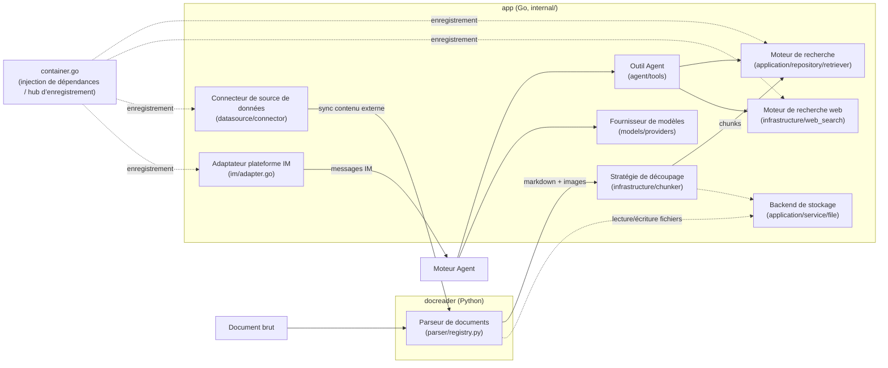

# Guide des points d’extension

Les parseurs, stratégies de découpage, moteurs de recherche, fournisseurs de modèles, moteurs de recherche web, connecteurs de sources de données, adaptateurs IM, outils Agent et backends de stockage de WeKnora s’intègrent tous via des interfaces. Pour ajouter une implémentation, implémentez l’interface correspondante, branchez-la au point d’enregistrement, puis validez la chaîne d’appels existante. Ci-dessous, par type d’extension : interfaces, implémentations existantes et étapes d’intégration.

## Aperçu des points d’extension {#apercu-des-points-d-extension}



Côté Go, le **hub d’enregistrement** de la plupart des points d’extension est `internal/container/container.go` (conteneur d’injection de dépendances) : moteurs de recherche `initRetrieveEngineRegistry()`, recherche web `registerWebSearchProviders()`, adaptateurs IM `registerIMAdapterFactories()`, connecteurs de sources de données `initConnectorRegistry()`.

---

## Nouveau parseur de documents (docreader, Python) {#nouveau-parseur-documents-docreader-python}

### Définition de l’interface

La classe de base est dans `docreader/parser/base_parser.py`. Après refactorisation allégée, `BaseParser` se limite à convertir le document en texte markdown + références d’images brutes (découpage, stockage d’images, OCR, légendes VLM sont entièrement côté Go) :

```python
# docreader/parser/base_parser.py
class BaseParser(ABC):
    """Base parser interface."""

    def __init__(self, file_name: str = "", file_type: Optional[str] = None, **kwargs):
        self.file_name = file_name
        self.file_type = file_type or os.path.splitext(file_name)[1].lstrip(".")

    @abstractmethod
    def parse_into_text(self, content: bytes) -> Document:
        """Parse document content into markdown text.

        Returns:
            Document with ``content`` (markdown string) and optional
            ``images`` dict mapping storage-relative paths to base64 data.
        """
```

La valeur de retour `Document` (`docreader/models/document.py`, modèle pydantic) expose surtout `content: str` (markdown) et `images: Dict[str, str]` (chemin → base64).

### Mécanisme d’enregistrement

Dans `docreader/parser/registry.py`, `ParserEngineRegistry` gère les parseurs via une double table « nom de moteur → { extension de fichier → classe Parser } » ; si le moteur demandé ne prend pas en charge le type de fichier, repli automatique sur le moteur `builtin`. Le registre par défaut est construit par `_build_default_registry()` ; singleton au niveau module `registry = _build_default_registry()`.

```python
# docreader/parser/registry.py (extrait)
class ParserEngineRegistry:
    def register(self, name: str, file_types: Dict[str, Type[BaseParser]],
                 description: str = "", check_available: Callable = None,
                 unavailable_hint: str = ""): ...
    def get_parser_class(self, engine: str, file_type: str) -> Type[BaseParser]: ...
```

### Implémentations existantes

| Moteur | Parser | Fichier |
| --- | --- | --- |
| `builtin` | `Docx2Parser` / `DocParser` / `PDFParser` / `MarkdownParser` / `ExcelParser` / `EPUBParser` / `HTMLParser` / `MHTMLParser` / `ImageParser` (jpg/png/gif/bmp/tiff/webp, etc.) | `docreader/parser/docx2_parser.py`, `doc_parser.py`, `pdf_parser.py`, `markdown_parser.py`, `excel_parser.py`, `epub_parser.py`, `html_parser.py`, `mhtml_parser.py`, `image_parser.py` |
| `markitdown` | `MarkitdownParser` (Microsoft MarkItDown, multi-format) | `docreader/parser/markitdown_parser.py` |
| `opendataloader` | `OpenDataLoaderParser` (analyse de mise en page PDF, Java 11+ requis, avec sonde `check_available`) | `docreader/parser/opendataloader_parser.py` |

### Étapes d’ajout

1. Créer `my_parser.py` dans `docreader/parser/`, hériter de `BaseParser`, implémenter `parse_into_text(content: bytes) -> Document` ;
2. **Point d’enregistrement : `docreader/parser/registry.py`** — ajouter dans `_build_default_registry()` :

```python
reg.register(
    "my_engine",
    {"myext": MyParser},
    description="Mon moteur d'analyse",
    check_available=lambda overrides: (True, ""),   # optionnel : sonde de disponibilité des dépendances
    unavailable_hint="Message si dépendance manquante",
)
```

3. Pour remplacer l’implémentation d’une extension déjà prise en charge, ajouter une ligne `"ext": MyParser` dans le mapping `builtin` ;
4. Ajouter des tests unitaires dans `docreader/tests/` (voir `test_parser_routing.py`), valider avec `uv run python -m unittest`.

---

## Nouvelle stratégie de découpage (internal/infrastructure/chunker) {#nouvelle-strategie-decoupage-chunker}

### Définition de l’interface

Le découpage n’utilise pas d’interface `interface`, mais un modèle **tiers de stratégie (tier) + variables de fonction au niveau du package**. L’entrée publique est dans `internal/infrastructure/chunker/strategy.go` :

```go
// internal/infrastructure/chunker/strategy.go
// Strategy values for SplitterConfig.Strategy.
const (
    StrategyAuto      = "auto"
    StrategyHeading   = "heading"
    StrategyHeuristic = "heuristic"
    StrategyRecursive = "recursive"
    StrategyLegacy    = "legacy"
)

func Split(text string, cfg SplitterConfig) []Chunk
func SplitWithDiagnostics(text string, cfg SplitterConfig) ([]Chunk, *Diagnostics)
func SplitParentChild(text string, parentCfg, childCfg SplitterConfig) ParentChildResult
```

Les types de configuration et de résultat sont dans `internal/infrastructure/chunker/splitter.go` :

```go
// internal/infrastructure/chunker/splitter.go
type Chunk struct {
    Content       string
    ContextHeader string
    Seq           int
    Start         int
    End           int
}

type SplitterConfig struct {
    ChunkSize    int
    ChunkOverlap int
    Separators   []string
    Strategy     string   // vide = legacy (rétrocompatibilité)
    TokenLimit   int      // limite de taille en tokens approx., 0 = ChunkSize en caractères
    Languages    []string // indices multilingues ; vide = détection auto
}
```

La dispatch des stratégies passe par `runTier()` ; les implémentations heading / heuristic remplacent des variables de fonction au niveau du package dans leur `init()` respectif :

```go
// internal/infrastructure/chunker/strategy.go
func runTier(tier StrategyTier, text string, cfg SplitterConfig, profile *DocProfile) []Chunk {
    switch tier {
    case TierHeading:
        return splitByHeadings(text, cfg, profile)
    case TierHeuristic:
        return splitByHeuristics(text, cfg, profile)
    case TierLegacy:
        return SplitText(text, cfg)
    }
    return SplitText(text, cfg)
}

var splitByHeadings = func(text string, cfg SplitterConfig, _ *DocProfile) []Chunk {
    return SplitText(text, cfg) // remplacé par init() de heading_splitter.go
}
var splitByHeuristics = func(text string, cfg SplitterConfig, _ *DocProfile) []Chunk {
    return SplitText(text, cfg) // remplacé par init() de heuristic_splitter.go
}
```

### Implémentations existantes

| Tier de stratégie | Description | Fichier |
| --- | --- | --- |
| `TierHeading` | Découpage par niveaux de titres Markdown | `internal/infrastructure/chunker/heading_hierarchy.go`, etc. |
| `TierHeuristic` | Découpage heuristique multilingue | `internal/infrastructure/chunker/heuristic_splitter.go` |
| `TierLegacy` (= `recursive`) | Découpage récursive par séparateurs (implémentation d’origine) | `SplitText()` dans `internal/infrastructure/chunker/splitter.go` |
| Validateur | Chaque sortie de tier passe par `ValidateChunks` ; échec → repli le long de la chaîne | `internal/infrastructure/chunker/validator.go` |

### Étapes d’ajout

1. Créer `my_splitter.go` dans `internal/infrastructure/chunker/`, implémenter `func(text string, cfg SplitterConfig, profile *DocProfile) []Chunk` ;
2. **Point d’enregistrement : `internal/infrastructure/chunker/strategy.go`** —
   - ajouter une constante de stratégie (ex. `StrategyMine = "mine"`) et un nouveau `StrategyTier` ;
   - dans le `switch` de `resolveChain` / `resolveChainWithProfile`, renvoyer la chaîne de tiers pour la nouvelle stratégie (recommandé : repli sur `TierLegacy`) ;
   - ajouter un `case` dans `runTier()` ;
3. Aucun changement côté appelant : `chunking_config.strategy` de la base de connaissances (JSONB) est transmis via `buildSplitterConfigFromChunking` dans `internal/application/service/knowledge_process.go` ;
4. Écrire des tests unitaires avec `SplitWithDiagnostics` pour valider le choix de tier et le comportement de `ValidateChunks`.

---

## Nouveau moteur de recherche (Retriever Engine) {#nouveau-moteur-recherche-retriever-engine}

### Définition de l’interface

Les interfaces sont dans `internal/types/interfaces/retriever.go` (trois niveaux : moteur → dépôt → service + registre) :

```go
// internal/types/interfaces/retriever.go
type RetrieveEngine interface {
    EngineType() types.RetrieverEngineType
    Retrieve(ctx context.Context, params types.RetrieveParams) ([]*types.RetrieveResult, error)
    Support() []types.RetrieverType // types de retrieval supportés (vecteur / mots-clés)
}

type RetrieveEngineRepository interface {
    Save(ctx context.Context, indexInfo *types.IndexInfo, params map[string]any) error
    BatchSave(ctx context.Context, indexInfoList []*types.IndexInfo, params map[string]any) error
    EstimateStorageSize(ctx context.Context, indexInfoList []*types.IndexInfo, params map[string]any) int64
    DeleteByChunkIDList(ctx context.Context, indexIDList []string, dimension int, knowledgeType string) error
    DeleteBySourceIDList(ctx context.Context, sourceIDList []string, dimension int, knowledgeType string) error
    CopyIndices(ctx context.Context, sourceKnowledgeBaseID string,
        sourceToTargetKBIDMap map[string]string,
        sourceToTargetChunkIDMap map[string]string,
        targetKnowledgeBaseID string, dimension int, knowledgeType string) error
    DeleteByKnowledgeIDList(ctx context.Context, knowledgeIDList []string, dimension int, knowledgeType string) error
    BatchUpdateChunkEnabledStatus(ctx context.Context, chunkStatusMap map[string]bool) error
    BatchUpdateChunkTagID(ctx context.Context, chunkTagMap map[string]string) error
    RetrieveEngine
}

type RetrieveEngineRegistry interface {
    Register(indexService RetrieveEngineService) error
    GetRetrieveEngineService(engineType types.RetrieverEngineType) (RetrieveEngineService, error)
    GetAllRetrieveEngineServices() []RetrieveEngineService
    GetByStoreID(storeID string) (RetrieveEngineService, error)
}
```

L’énumération des types de moteur est dans `internal/types/retriever.go` :

```go
// internal/types/retriever.go
const (
    PostgresRetrieverEngineType        RetrieverEngineType = "postgres"
    ElasticsearchRetrieverEngineType   RetrieverEngineType = "elasticsearch"
    InfinityRetrieverEngineType        RetrieverEngineType = "infinity"
    ElasticFaissRetrieverEngineType    RetrieverEngineType = "elasticfaiss"
    QdrantRetrieverEngineType          RetrieverEngineType = "qdrant"
    MilvusRetrieverEngineType          RetrieverEngineType = "milvus"
    WeaviateRetrieverEngineType        RetrieverEngineType = "weaviate"
    DorisRetrieverEngineType           RetrieverEngineType = "doris"
    SQLiteRetrieverEngineType          RetrieverEngineType = "sqlite"
    TencentVectorDBRetrieverEngineType RetrieverEngineType = "tencent_vectordb"
    OpenSearchRetrieverEngineType      RetrieverEngineType = "opensearch"
)
```

### Implémentations existantes

Toutes sous `internal/application/repository/retriever/` : `postgres/` (pgvector + BM25/ParadeDB), `elasticsearch/v7/`, `elasticsearch/v8/`, `qdrant/`, `milvus/`, `weaviate/`, `doris/`, `sqlite/` (sqlite-vec + FTS5), `tencentvectordb/`, `opensearch/`.

### Étapes d’ajout

1. Ajouter une constante `RetrieverEngineType` dans `internal/types/retriever.go` ;
2. Créer le package `internal/application/repository/retriever/myengine/` et implémenter `RetrieveEngineRepository` (voir `qdrant/` ou `sqlite/`) ;
3. **Point d’enregistrement : `initRetrieveEngineRegistry()` dans `internal/container/container.go`** — enregistrement conditionnel selon la variable d’environnement `RETRIEVE_DRIVER` (liste séparée par des virgules) :

```go
// internal/container/container.go (extrait)
retrieveDriver := strings.Split(os.Getenv("RETRIEVE_DRIVER"), ",")
if slices.Contains(retrieveDriver, "postgres") {
    postgresRepo := postgresRepo.NewPostgresRetrieveEngineRepository(db)
    if err := registry.Register(
        retriever.NewKVHybridRetrieveEngine(postgresRepo, types.PostgresRetrieverEngineType),
    ); err != nil { ... }
}
```

   Ajouter une branche pour le nouveau moteur sur le même modèle, l’envelopper avec `retriever.NewKVHybridRetrieveEngine(repo, typeMoteur)` puis enregistrer ;
   pour réutiliser les vecteurs existants lors du déplacement de documents entre bases de connaissances, implémenter en option l’interface `KnowledgeIndexMover` (`MoveKnowledgeIndices` : conserver les ID de chunks et les vecteurs, ne changer que la base de connaissances, avec reprise sûre) ; sans cela, le déplacement avec réutilisation des vecteurs est refusé et seul le mode re-analyse reste possible ;
4. Si le moteur nécessite un déploiement dédié, ajouter un service avec profile dans `docker-compose.dev.yml` (voir `qdrant` / `opensearch`) et compléter les variables de connexion dans `.env.example`.

---

## Nouveau fournisseur de modèles (internal/models/providers) {#nouveau-fournisseur-modeles-internal-models-providers}

L’intégration des modèles comporte quatre niveaux : protocole, fournisseur, catalogue, runtime (aperçu dans [Modèles](../03-features/06-models.md#structure-hierarchique)). Pour la plupart des nouveaux fournisseurs, il suffit d’ajouter une définition de fournisseur et d’enrichir le catalogue des modèles en réutilisant un protocole existant.

### Définition de l’interface

La définition d’un fournisseur est une structure, pas une implémentation d’interface, dans `internal/models/providers/definition.go` :

```go
// internal/models/providers/definition.go (extrait)
type Definition struct {
    ID           string            // identifiant stable dans models.parameters.provider
    Name         string
    Names        map[string]string // libellés par locale, ex. "zh-CN"
    Website      string
    Icon         []byte            // SVG
    API          api.API           // protocole de chat par défaut
    RerankAPI    api.RerankAPI     // défaut cohere-rerank si absent
    EmbeddingAPI api.EmbeddingAPI  // défaut openai-embeddings si absent
    TranscriptionAPI api.TranscriptionAPI // défaut openai-transcriptions si absent
    DefaultBaseURLs  map[types.ModelType]string
    ModelTypes       []types.ModelType
    RequiresAuth     bool
    Auth             AuthStyle          // bearer / api-key / x-api-key / x-goog-api-key / none / signed
    URLPatterns      []string           // lignes legacy sans provider : reconnaissance par URL
    ExtraFields      []ExtraField       // champs extra rendus dynamiquement dans l'éditeur
    CredentialLabels []CredentialLabel  // libellés des champs credentials (API signées)
    Compat           VendorCompat       // valeurs compat par protocole
    ThinkingLevels   api.ThinkingLevelMap
    Order            int                // ordre dans la liste des fournisseurs
    // hooks optionnels
    Endpoint  func(req EndpointRequest) (url string, query map[string]string)
    PreferAPI func(baseURL string, spec models.ModelSpec) api.API
    Signer    func(creds api.Credentials) api.AuthFunc
}
```

Chaque capacité a une interface minimale au niveau protocole ; implémentez-la pour brancher un nouveau protocole :

```go
// internal/models/api/rerank.go
type Reranker interface {
    Rerank(ctx context.Context, query string, documents []string) ([]RerankResult, error)
}

// internal/models/api/embeddings.go
type Embedder interface {
    Embed(ctx context.Context, texts []string, kind EmbedInputType) ([][]float32, error)
}

// internal/models/api/transcriptions.go
type Transcriber interface {
    Transcribe(ctx context.Context, req TranscriptionRequest) (*Transcription, error)
}
```

Le client du protocole de dialogue implémente l’interface `Chat` de `internal/models/chat` (`Chat` / `ChatStream` / `GetModelName` / `GetModelID`).

### Implémentations existantes

- **Fournisseurs** : `internal/models/providers/` définit 30 fournisseurs intégrés, un fichier par fournisseur (`aliyun.go`, `deepseek.go`, `generic.go`, `weknoracloud.go`, etc.), listés explicitement dans `Builtins()` de `builtin.go` ; icônes dans `providers/assets/<id>.svg`.
- **Protocoles** : `internal/models/api/<protocol>`. Dialogue : `openaicompletions`, `openairesponses`, `anthropicmessages`, `googlegenai` ; embeddings : `openaiembeddings`, `dashscopeembeddings`, `arkembeddings`, `googleembeddings` ; rerank : `cohererank`, `dashscoperank`, `nimrerank`, `tencentlkeap`, `volcengineknowledge`, `teirank`, `pineconerank` ; voix : `openaitranscriptions`, `openaichataudio`.
- **Catalogue de modèles** : `internal/models/catalog/data/seed.json` (métadonnées) + `overrides.json` (protocole, mapping « thinking », corrections compat) → génération par script de `models.generated.json`, embarqué à la compilation.
- **Runtime** : `internal/models/runtime` combine définition fournisseur et catalogue (`New()`), l’application superpose `config/models.json` au déploiement et résout protocole, endpoint et réglages compat pour chaque ligne de modèle.

### Étapes d’ajout

1. **Nouvelle définition de fournisseur** : `internal/models/providers/<id>.go`, déclarer nom, types de modèles supportés, URL par défaut par type, mode d’authentification, protocoles par défaut et hooks d’endpoint spéciaux ; documenter la source officielle dans le commentaire de package ;
2. **Point d’enregistrement 1 : `internal/models/providers/builtin.go`** — ajouter `new<Id>Provider()` dans `Builtins()` ; placer l’icône dans `providers/assets/<id>.svg` ;
3. **Point d’enregistrement 2 : catalogue de modèles** — ajouter une entrée pour ce fournisseur dans `internal/models/catalog/data/seed.json` (même sans modèle pour l’instant, liste vide ; le runtime lit le catalogue par ID fournisseur), maintenir les métadonnées ; protocole, mapping thinking et compat dans `overrides.json`. La clé de modèle inclut type et id / match ; dialogue et embedding peuvent coexister sous le même nom ;
4. **Générer le catalogue** : exécuter `make model-catalog-generate`. Ne pas modifier les fichiers générés à la main ;
5. **Nouveau protocole (optionnel)** : réutiliser un protocole existant si possible ; sinon créer `internal/models/api/<protocol>` et brancher dans la factory (dialogue : `NewRemoteChat` dans `internal/models/chat/chat.go`, embeddings : `internal/models/embedding/protocol.go`, rerank : `internal/models/rerank/reranker.go`, ASR : `internal/models/asr/protocol.go`) ;
6. **Validation** : exécuter `make model-catalog-check`.

`make model-catalog-check` vérifie d’abord que les données générées ne sont pas périmées, puis lance tous les tests de `internal/models/...` : enregistrement et icônes dans `providers` ; résolution et superposition dans `runtime` ; **invariants** du package `parity` (validité des champs par entrée de modèle, clés compat décodables, cohérence contexte / sortie max) et **contrôle requête sortante par modèle** (pour chaque modèle de dialogue, un seul champ de limite de sortie en mode thinking activé / désactivé ; pas de `temperature` si l’échantillonnage n’est pas supporté ; pas de switch « off » pour un modèle toujours en mode thinking, etc.). Toute violation pour un nouveau fournisseur ou modèle fait échouer les tests sans cas dédié.

Aucun changement frontend requis : liste déroulante des fournisseurs, icônes, champs supplémentaires et catalogue sont rendus dynamiquement via `GET /api/v1/models/providers`. Les lignes de modèles intégrés prêtes à l’emploi sont déclarées par les ops dans `config/builtin_models.yaml`, indépendamment de la définition fournisseur.

### Maintenance d’un fournisseur existant

**Ajouter ou ajuster des métadonnées de modèle** (nouvel id, fenêtre de contexte, tarifs) : générer d’abord un rapport de diff, mettre à jour `seed.json` d’après la doc du fournisseur, puis régénérer le catalogue.

```bash
make model-catalog-diff                 # tous les fournisseurs
make model-catalog-diff VENDOR=deepseek # un seul fournisseur
```

Le rapport compare les métadonnées publiques de [models.dev](https://models.dev/api.json) : `+` = modèle présent en amont mais absent du catalogue, `~` = écart de valeurs, `?` = entrée non référencée en amont (fréquent pour fournisseurs domestiques et alias, pas forcément une erreur). Le script est en lecture seule et n’est jamais appelé au runtime. Les faits comportementaux (noms de champs, format thinking, etc.) ne se synchronisent pas automatiquement : les maintenir à la main d’après la doc du fournisseur.

**Changement de comportement d’API côté fournisseur** (autre champ de limite de sortie, nouvelles valeurs d’effort, format du switch thinking) : modifier `Compat` dans `providers/<id>.go` ou `compat` du modèle dans `overrides.json`, régénérer le catalogue, mettre à jour le lien doc dans les commentaires. Les tests snapshot comme `internal/models/api/openaicompletions/golden_test.go` figent le JSON sortant ; adapter les attentes avant de modifier le code.

**Correctif urgent** : sans attendre une release, utiliser d’abord le [déploiement superposé `config/models.json`](../03-features/06-models.md#deploiement-superpose-config-models-json) côté déploiement, valider, puis reporter le changement dans le code.

---

## Nouveau moteur de recherche web (internal/infrastructure/web_search) {#nouveau-moteur-recherche-web}

### Définition de l’interface

```go
// internal/types/interfaces/web_search.go
type WebSearcher interface {
    Search(ctx context.Context, req types.WebSearchRequest) ([]*types.WebSearchResult, error)
}

type WebFetcher interface {
    Fetch(ctx context.Context, pageURL string) (*types.WebPage, error)
}
```

Le registre enregistre des factories par type de fournisseur (instanciation à la demande avec paramètres locataire) et des déclarations de capacités :

```go
// internal/infrastructure/web_search/registry.go
type SearchFactory func(params types.WebSearchProviderParameters) (interfaces.WebSearcher, error)
type FetchFactory func(params types.WebSearchProviderParameters) (interfaces.WebFetcher, error)

type Spec struct {
    Type    string
    Filters bool          // Search accepte filtres country / freshness
    Search  SearchFactory
    Fetch   FetchFactory  // optionnel ; vide = lecture locale ; si moteur échoue, repli lecture locale
}

func (r *Registry) Add(spec Spec)
func (r *Registry) Capabilities(providerType string) (types.WebSearchCapabilities, error)
func (r *Registry) NewSearcher(providerType string, params types.WebSearchProviderParameters) (interfaces.WebSearcher, error)
func (r *Registry) NewFetcher(providerType string, params types.WebSearchProviderParameters) (interfaces.WebFetcher, error)
```

Les moteurs supportant filtre par région et fraîcheur lisent `WebSearchRequest.Filters` et s’enregistrent avec `Filters: true` ; l’outil `web_search` expose alors un schéma avec `country` / `freshness`. Sans `Filters`, le moteur ne reçoit pas de filtres : la couche service rejette explicitement les requêtes filtrées au lieu de les ignorer silencieusement.

La couche application obtient via `WebSearchService.Resolve(ctx, providerID)` un `WebClient` lié aux politiques locataire (timeout, liste noire, proxy), qui implémente `WebSearcher`, `WebFetcher` et `Capabilities()`.

### Implémentations existantes

Répertoire `internal/infrastructure/web_search/` : `duckduckgo.go`, `google.go`, `bing.go`, `brave.go`, `tavily.go`, `ollama.go`, `baidu.go`, `searxng.go`, `keenable.go`, `zhipu.go`, `exa.go`, `metaso.go`, `bocha.go`, `serply.go` (plus `proxy.go` pour le proxy sortant). Constantes de type dans `internal/types/web_search_provider.go` (`WebSearchProviderTypeXxx`, en correspondance 1:1 avec l’ID d’enregistrement).

### Étapes d’ajout

1. Ajouter une constante `WebSearchProviderType` dans `internal/types/web_search_provider.go` ;
2. Créer `mysearch.go` dans `internal/infrastructure/web_search/`, implémenter `WebSearcher` et exposer la factory `func NewMySearchProvider(params types.WebSearchProviderParameters) (interfaces.WebSearcher, error)` ;
3. **Point d’enregistrement : `registerWebSearchProviders()` dans `internal/container/container.go`** :

```go
func registerWebSearchProviders(registry *infra_web_search.Registry) {
    for _, spec := range []infra_web_search.Spec{
        {Type: "duckduckgo", Search: infra_web_search.NewDuckDuckGoProvider},
        {Type: "google", Search: infra_web_search.NewGoogleProvider},
        // ... ajouter ici :
        {Type: "mysearch", Search: infra_web_search.NewMySearchProvider},
    } {
        registry.Add(spec)
    }
}
```

4. Pour afficher le nouveau moteur dans la liste déroulante et le formulaire de paramètres, mettre à jour les composants de configuration correspondants dans `frontend/` ; la config locataire est persistée dans la table `web_search_providers`.

---

## Nouveau connecteur de source de données (internal/datasource/connector) {#nouveau-connecteur-source-donnees}

> Un guide d’implémentation est joint au répertoire : `internal/datasource/CONNECTOR_IMPLEMENTATION_GUIDE.md`.

### Définition de l’interface

```go
// internal/datasource/connector.go
type Connector interface {
    // Type returns the connector type identifier (e.g., "feishu", "notion")
    Type() string

    // Validate verifies that the provided configuration is valid by testing
    // connectivity and checking credentials.
    Validate(ctx context.Context, config *types.DataSourceConfig) error

    // ListResources lists available resources that can be synced.
    // parentID pour lazy-load hiérarchique : "" = racine, sinon enfants directs.
    ListResources(ctx context.Context, config *types.DataSourceConfig, parentID string) ([]types.Resource, error)

    // ResolveResourceAncestors : chaîne d’ancêtres pour sélection existante (O(depth)).
    ResolveResourceAncestors(
        ctx context.Context, config *types.DataSourceConfig, resourceIDs []string,
    ) ([]string, error)

    // FetchAll performs a full sync of the specified resources.
    FetchAll(ctx context.Context, config *types.DataSourceConfig, resourceIDs []string) ([]types.FetchedItem, error)

    // FetchIncremental performs an incremental sync based on the provided cursor.
    FetchIncremental(ctx context.Context, config *types.DataSourceConfig, cursor *types.SyncCursor) ([]types.FetchedItem, *types.SyncCursor, error)
}
```

Interface optionnelle en flux (pagination par checkpoint pour gros volumes, un seul item en mémoire) :

```go
// internal/datasource/connector.go
type StreamHandler interface {
    Emit(ctx context.Context, item types.FetchedItem) error
    Checkpoint(ctx context.Context, cursor *types.SyncCursor) error
}

type StreamingConnector interface {
    Connector
    FetchStream(ctx context.Context, config *types.DataSourceConfig,
        cursor *types.SyncCursor, h StreamHandler) (*types.SyncCursor, error)
}
```

Deux interfaces optionnelles pour la réconciliation des suppressions en sync complète : `FullStreamingConnector` (`FetchFullStream`) et `FullSyncWithCursor` (`FetchAllFromCursor`), qui relancent tous les éléments en sync forcée ou `sync_mode=full` tout en conservant le curseur précédent pour détecter les documents supprimés. Sans implémentation, la sync complète ne produit pas d’événements de suppression.

Registre dans le même fichier : `ConnectorRegistry` (`NewConnectorRegistry()` / `Register(connector)` / `Get(type)` / `List()`) ; métadonnées UI du connecteur (nom, AuthType, capabilities) dans la map `ConnectorMetadataRegistry` du même fichier.

### Implémentations existantes

| Type | Répertoire | Description |
| --- | --- | --- |
| `feishu` / `lark` | `internal/datasource/connector/feishu/wiki/` | Base de connaissances Feishu / Lark, même implémentation selon la région |
| `feishu_drive` / `lark_drive` | `internal/datasource/connector/feishu/drive/` | Drive cloud Feishu / Lark |
| `notion` | `internal/datasource/connector/notion/` | Pages et bases |
| `confluence` | `internal/datasource/connector/confluence/` | Confluence |
| `yuque` | `internal/datasource/connector/yuque/` | Yuque |
| `dingtalk` | `internal/datasource/connector/dingtalk/` | Documents DingTalk |
| `ima` | `internal/datasource/connector/ima/` | Base de connaissances Tencent ima |
| `rss` | `internal/datasource/connector/rss/` | Flux RSS |
| `gitlab` | `internal/datasource/connector/gitlab/` | Dépôt GitLab |
| `seafile` | `internal/datasource/connector/seafile/` | Bibliothèque, répertoires et fichiers |

`internal/types/datasource.go` contient aussi des constantes de type (`github`, `google_drive`, etc.) sans implémentation enregistrée pour l’instant.

### Étapes d’ajout

1. Créer le package `internal/datasource/connector/mysource/`, implémenter `Connector` (pour gros volumes, implémenter aussi `StreamingConnector`), fournir `NewConnector()` ;
2. **Point d’enregistrement 1 : `initConnectorRegistry()` dans `internal/container/container.go`** :

```go
if err := registry.Register(mysourceConnector.NewConnector()); err != nil {
    errs = errors.Join(errs, fmt.Errorf("register mysource connector: %w", err))
}
```

3. **Point d’enregistrement 2 : `ConnectorMetadataRegistry` dans `internal/datasource/connector.go`** — ajouter la constante de type (`ConnectorTypeXxx` dans `internal/types`) et l’entrée de métadonnées (Name / Description / AuthType / Capabilities) ;
4. Aligner la structure de config : si `types.DataSourceConfig` nécessite de nouveaux champs d’identifiants, respecter la convention de chiffrement ; la page d’intégration des sources côté frontend se base sur les métadonnées ;
5. Réutiliser les utilitaires communs de `internal/datasource` : les URL API saisies par l’utilisateur passent d’abord par `ValidateConnectorBaseURL` (contrôle SSRF), les requêtes HTTP utilisent `NewConnectorHTTPClient` (redirections et protection SSRF à la connexion), les noms de fichiers via `SanitizeFileName`.

---

## Nouvel adaptateur de plateforme IM (internal/im) {#nouvel-adaptateur-im}

### Définition de l’interface

```go
// internal/im/adapter.go
type Platform string // "wecom" / "feishu" / "lark" / "slack" / "telegram" / "dingtalk" /
                     // "mattermost" / "wechat" / "qqbot" / "yunzhijia"

// Adapter is the interface every IM platform must implement.
type Adapter interface {
    // Platform returns the platform identifier.
    Platform() Platform

    // VerifyCallback verifies the signature/token of an incoming callback request.
    VerifyCallback(c *gin.Context) error

    // ParseCallback parses the raw IM callback request into a unified IncomingMessage.
    // Returns nil message for non-message events (e.g., URL verification).
    ParseCallback(c *gin.Context) (*IncomingMessage, error)

    // SendReply sends a reply back to the IM platform.
    SendReply(ctx context.Context, incoming *IncomingMessage, reply *ReplyMessage) error

    // HandleURLVerification handles the initial URL verification challenge.
    HandleURLVerification(c *gin.Context) bool
}
```

Deux interfaces de capacités optionnelles :

```go
// internal/im/adapter.go
// StreamSender : une fois implémenté, l’IM pousse les réponses stream (cartes Feishu, édition Telegram, etc.)
type StreamSender interface {
    StartStream(ctx context.Context, incoming *IncomingMessage) (string, error)
    UpdateStreamContent(ctx context.Context, incoming *IncomingMessage, streamID string, fullContent string) error
    FinalizeStream(ctx context.Context, incoming *IncomingMessage, streamID string, finalContent string) error
    EndStream(ctx context.Context, incoming *IncomingMessage, streamID string) error
}

// FileDownloader : avec knowledge_base_id, les fichiers reçus sur le canal sont ingérés en base
type FileDownloader interface {
    DownloadFile(ctx context.Context, msg *IncomingMessage) (io.ReadCloser, string, error)
}
```

Les adaptateurs sont instanciés par factory par canal (`internal/im/service.go`) :

```go
// internal/im/service.go
type AdapterFactory func(ctx context.Context, channel *IMChannel,
    msgHandler func(ctx context.Context, msg *IncomingMessage) error,
) (Adapter, context.CancelFunc, error)

func (s *Service) RegisterAdapterFactory(platform string, factory AdapterFactory)
```

### Implémentations existantes

Un sous-package par plateforme sous `internal/im/` : `wecom/`, `feishu/` (Lark réutilise `feishu.NewFactory(RegionLark)`), `slack/`, `telegram/`, `dingtalk/`, `mattermost/`, `wechat/`, `qqbot/`, `yunzhijia/`.

### Étapes d’ajout

1. Ajouter une constante `Platform` dans `internal/im/adapter.go` ;
2. Créer `internal/im/myplatform/`, implémenter `Adapter` (ajouter `StreamSender` / `FileDownloader` si besoin) et `NewFactory() im.AdapterFactory` ;
3. **Point d’enregistrement : `registerIMAdapterFactories()` dans `internal/container/container.go`** :

```go
func registerIMAdapterFactories(imService *imPkg.Service) {
    imService.RegisterAdapterFactory("wecom", wecom.NewFactory())
    // ... ajouter ici :
    imService.RegisterAdapterFactory("myplatform", myplatform.NewFactory())
    if err := imService.LoadAndStartChannels(); err != nil { ... }
}
```

4. La config des canaux est persistée dans `im_channels`, le mapping des sessions dans `im_channel_sessions` ; ajouter le formulaire de configuration de la plateforme dans la page de gestion des canaux côté frontend.

---

## Nouvel outil Agent (internal/agent/tools) {#nouvel-outil-agent}

### Définition de l’interface

L’interface outil est définie dans `internal/types/agent.go` :

```go
// internal/types/agent.go
type Tool interface {
    // Name returns the unique identifier for this tool
    Name() string

    // Description returns a human-readable description of what the tool does
    Description() string

    // Parameters returns the JSON Schema for the tool's parameters
    Parameters() json.RawMessage

    // Execute runs the tool with the given arguments
    Execute(ctx context.Context, args json.RawMessage) (*ToolResult, error)
}
```

Le registre runtime est dans `internal/agent/tools/registry.go` :

```go
// internal/agent/tools/registry.go
type ToolRegistry struct {
    tools             map[string]types.Tool
    maxToolOutputSize int
}

// RegisterTool adds a tool to the registry.
// first-wins sur nom d’outil identique (GHSA-67q9-58vj-32qx).
func (r *ToolRegistry) RegisterTool(tool types.Tool)
func (r *ToolRegistry) GetTool(name string) (types.Tool, error)
func (r *ToolRegistry) ListTools() []string
```

### Implémentations existantes

Les constantes de noms d’outils sont centralisées dans `internal/agent/tools/definitions.go` : `thinking`, `todo_write`, outils de recherche dans la base (`search_knowledge`, `read_document`, `list_documents`, `query_knowledge_graph`), `database_query`, `data_analysis`, `data_schema`, `web_search`, `web_fetch`, outils MCP à la demande (`discover_mcp_tools`, `call_mcp_tool`), sandbox / skills (`shell_exec`, `read_file`, `list_sandbox_files`, `write_sandbox_file`, `edit_sandbox_file`, `write_skill_file`, `edit_skill_file`), mémoire (`search_memory`, `search_conversations`), wiki (`wiki_read_page`, `wiki_write_page`, `wiki_replace_text`, `wiki_rename_page`, `wiki_delete_page`, `wiki_search`, `wiki_flag_issue`, `wiki_read_issue`, `wiki_update_issue`) ; l’outil navigateur local `local_browser` est dans `browserskill*.go`. Les fichiers d’implémentation portent en général le nom de l’outil (ex. `search_knowledge.go`, `read_document.go`, `list_documents.go`, `data_analysis.go` ; `mcp_tool.go` / `mcp_catalog.go` pour la découverte et l’appel d’outils distants MCP).

Les noms d’outils sandbox retirés (`execute_skill_script`, `read_skill`, `read_sandbox_file`) restent pour décoder l’historique, sans enregistrement ; les noms de recherche retirés (`knowledge_search`, `grep_chunks`, `list_knowledge_chunks`, `get_document_info`, `wiki_read_source_doc`) restent en constantes `LegacyTool*` : `legacyToolSuccessors` les mappe vers `search_knowledge` / `read_document`, `NormalizeAllowedTools` réécrit automatiquement les anciens noms dans la config Agent enregistrée à l’enregistrement des outils, `SuccessorToolName` / `IsLegacyRetrievalTool` pour les autres services. Lors d’un renommage ou fusion d’outils, réutiliser ce mécanisme plutôt qu’une migration de données.

### Étapes d’ajout

1. Créer `my_tool.go` dans `internal/agent/tools/`, implémenter les quatre méthodes de `types.Tool` (`Parameters()` renvoie un JSON Schema ; limite OpenAI : nom d’outil ≤ 64 caractères, voir `maxFunctionNameLength` dans `definitions.go`) ;
2. **Point d’enregistrement 1 : `internal/agent/tools/definitions.go`** — ajouter la constante `ToolMyTool = "my_tool"` et l’outil dans `AvailableToolDefinitions()` (liste des outils optionnels pour l’UI ; le commentaire exige la synchro avec les outils enregistrés) ;
3. **Point d’enregistrement 2 : assemblage des outils dans le moteur Agent** — lors de l’initialisation de session Agent, instancier et `RegisterTool` le nouvel outil selon la liste autorisée dans la config Agent ; si nettoyage de ressources requis, implémenter `Cleanup` (`types.Cleanable`) ;
4. Pour les outils à grosse sortie, tenir compte de la troncature `maxToolOutputSize` de `ToolRegistry` ; ajouter un `_test.go` (nombreux exemples dans le même répertoire, ex. `search_knowledge_test.go`, `scope_authorization_test.go`).

---

## Nouveau backend de stockage (stockage objet) {#nouveau-backend-stockage-objet}

### Définition de l’interface

L’interface de service fichier est dans `internal/types/interfaces/file.go` :

```go
// internal/types/interfaces/file.go
type FileService interface {
    CheckConnectivity(ctx context.Context) error
    SaveFile(ctx context.Context, file *multipart.FileHeader, tenantID uint64, knowledgeID string) (string, error)
    SaveBytes(ctx context.Context, data []byte, tenantID uint64, fileName string, temp bool) (string, error)
    GetFile(ctx context.Context, filePath string) (io.ReadCloser, error)
    GetFileURL(ctx context.Context, filePath string) (string, error)
    DeleteFile(ctx context.Context, filePath string) error
    CopyFile(ctx context.Context, srcPath string, tenantID uint64, knowledgeID string) (string, error)
}
```

La résolution multi-backend (config table `storage_backends` par locataire → instance `FileService`) passe par `internal/types/interfaces/storagebackend.go` :

```go
// internal/types/interfaces/storagebackend.go
type StorageBackendService interface {
    Create(ctx context.Context, backend *types.StorageBackend) error
    Update(ctx context.Context, backend *types.StorageBackend) error
    Delete(ctx context.Context, tenantID uint64, id string) error
    SetDefault(ctx context.Context, tenantID uint64, id string) error
    Test(ctx context.Context, backend *types.StorageBackend) error
}

type StorageBackendResolver interface {
    ResolveFileService(ctx context.Context, tenant *types.Tenant, backendID, provider, localBaseDir string) (FileService, string, error)
    ResolveBackend(ctx context.Context, tenant *types.Tenant, backendID, provider string) (*types.StorageBackend, error)
}
```

### Implémentations existantes

Toutes dans `internal/application/service/file/` :

| provider | Fichier | Description |
| --- | --- | --- |
| `local` | `local.go` | Système de fichiers local |
| `minio` | `minio.go` | MinIO / compatible S3 |
| `cos` | `cos.go` | Tencent Cloud COS |
| `tos` | `tos.go` | Volcano Engine TOS |
| `s3` | `s3.go` | AWS S3 et services compatibles |
| `obs` | `obs.go` | Huawei Cloud OBS |
| `oss` | `oss.go` | Alibaba Cloud OSS |
| `ks3` | `ks3.go` | Kingsoft Cloud KS3 |

### Étapes d’ajout

1. Créer `mystore.go` dans `internal/application/service/file/`, implémenter toutes les méthodes de `FileService` (`CheckConnectivity` sert au bouton « Tester la connexion » du frontend, via `StorageBackendService.Test`) ;
2. **Point d’enregistrement : `NewFileServiceFromStorageConfig()` dans `internal/application/service/file/factory.go`** — ajouter un `case` dans le `switch` provider :

```go
switch p {
case "local":  // NewLocalFileService(...)
case "minio":  // NewMinioFileService(...)
// ... ajouter ici :
case "mystore":
    return NewMyStoreFileService(cfg), p, nil
default:
    return nil, p, fmt.Errorf("unsupported storage provider: %s", p)
}
```

3. Si le nouveau provider exige des champs de config (endpoint / bucket / region, etc.), étendre `StorageEngineConfig` / `StorageBackend.config` (JSONB) dans `internal/types` ;
4. Ajouter les champs de formulaire correspondants dans la page de gestion des backends de stockage ; la config locataire est dans `storage_backends` (colonne `provider` = clé du `switch`).

---

## Annexe : tableau de référence des points d’extension

| Point d’extension | Interface principale | Fichier d’interface | Point d’enregistrement |
| --- | --- | --- | --- |
| Parseur de documents | `BaseParser.parse_into_text` | `docreader/parser/base_parser.py` | `_build_default_registry()` dans `docreader/parser/registry.py` |
| Stratégie de découpage | fonction tier `func(text, cfg, profile) []Chunk` | `internal/infrastructure/chunker/strategy.go` | même fichier : `runTier()` + constantes de stratégie |
| Moteur de recherche | `RetrieveEngineRepository` | `internal/types/interfaces/retriever.go` | `initRetrieveEngineRegistry()` dans `container.go` (piloté par `RETRIEVE_DRIVER`) |
| Fournisseur de modèles | `providers.Definition` (+ protocoles `Reranker` / `Embedder` / `Transcriber`, `chat.Chat`) | `internal/models/providers/definition.go` | `Builtins()` dans `internal/models/providers/builtin.go` + `internal/models/catalog/data/seed.json` |
| Recherche web | `WebSearchProvider` | `internal/types/interfaces/web_search.go` | `registerWebSearchProviders()` dans `container.go` |
| Connecteur de source de données | `Connector` / `StreamingConnector` | `internal/datasource/connector.go` | `initConnectorRegistry()` dans `container.go` + `ConnectorMetadataRegistry` |
| Adaptateur IM | `Adapter` (+ `StreamSender` / `FileDownloader`) | `internal/im/adapter.go` | `registerIMAdapterFactories()` dans `container.go` |
| Outil Agent | `types.Tool` | `internal/types/agent.go` | `internal/agent/tools/definitions.go` + `ToolRegistry.RegisterTool` |
| Backend de stockage | `FileService` | `internal/types/interfaces/file.go` | `switch` dans `internal/application/service/file/factory.go` |
