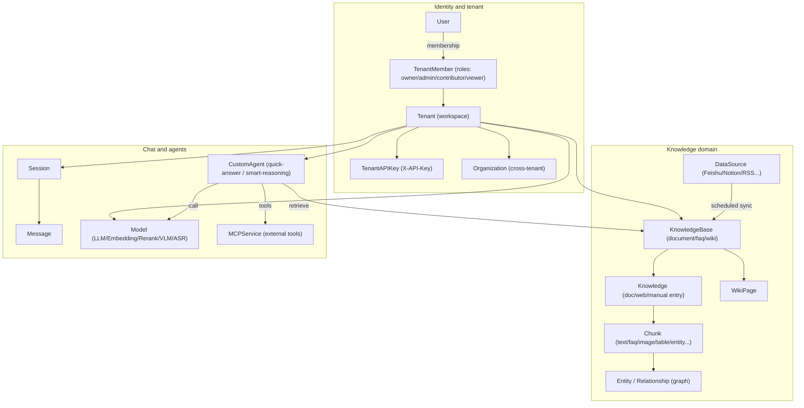
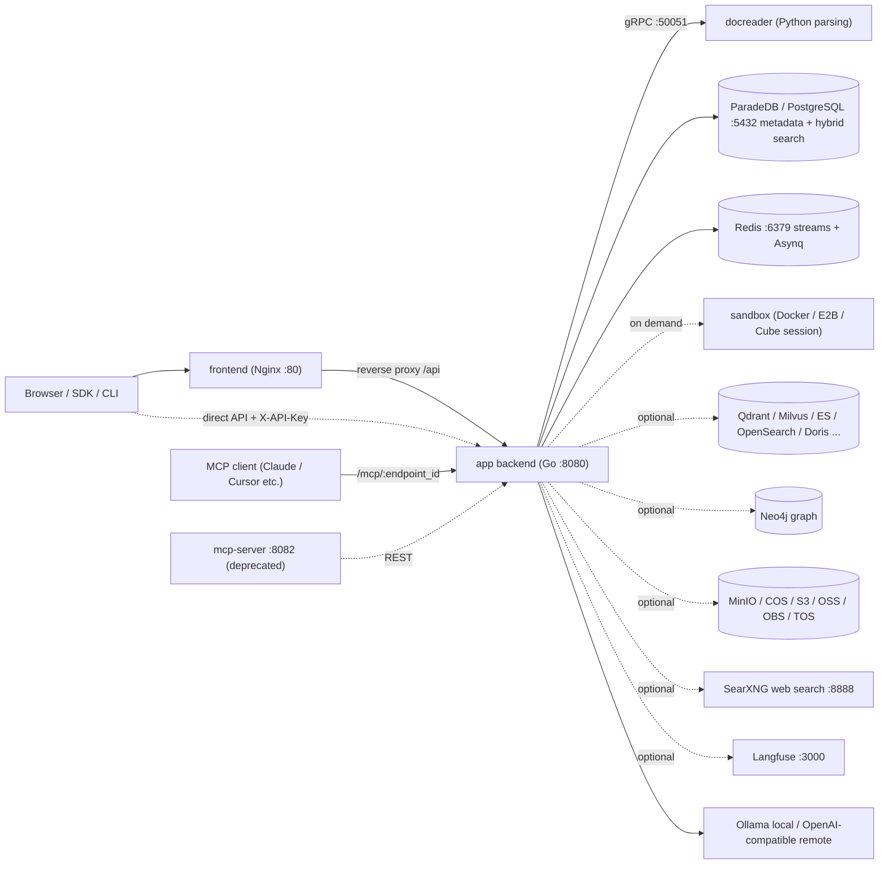

# WeKnora product overview

WeKnora is an open source knowledge-base Q&A system from Tencent. Import PDFs, Word, web pages, and content from Feishu, Notion, Confluence, Yuque, DingTalk, and similar platforms. Users ask questions over those sources and open citations to the original text in answers.

The system uses retrieval-augmented generation (RAG): documents are parsed and indexed, relevant passages are retrieved for each question, and a large language model generates the answer.

The stack is a Go backend, Vue 3 frontend, and Python docreader service for document parsing. Deploy with Docker Compose, Helm, a Lite single binary, or a desktop app.

<Screenshot
  src="/screenshots/introduction-overview.png"
  caption="WeKnora main UI: knowledge bases and sessions on the left, Q&A on the right"
  hint="Post-login overview: sidebar (knowledge bases, agents, settings) and one Q&A turn with citations." />

## What's new in v0.9.0

- [WeKnora Assistant](../03-features/26-weknora-assistant.md): answers on versions, features, and configuration, aware of the current page, retrieves and runs tasks with your identity.
- [Multi-agent collaboration](../03-features/26-weknora-assistant.md#collaboration): independent sub-tasks, then aggregated results.
- [Automations](../03-features/27-automations.md): one-off or scheduled repetitive work.
- [Execution permissions and approvals](../03-features/28-agent-permissions.md): read-only, confirm before changes, or auto-run, with scoped grants.

Full changes and upgrade requirements: [v0.9.0 release notes](../07-releases/v0.9.0.md).

## Use cases {#use-cases}

| Need | Capability |
| --- | --- |
| Mixed formats; hard-to-structure PDFs, scans, tables | Document pipeline: PDF layout, OCR, Office conversion, web capture, image description; optional OpenDataLoader/Docling hybrid parsing |
| Unstable recall with vector search alone | Hybrid vector + keyword (BM25), RRF fusion, rerank; optional knowledge graph (GraphRAG) and Wiki navigation |
| Locked to one model vendor | Model abstraction: local Ollama plus many built-in providers (OpenAI-compatible, Anthropic Messages, native Gemini, etc.); LLM / Embedding / Rerank / VLM / ASR; see [Model management](../03-features/06-models.md) |
| Data security and private deployment | Fully self-hostable stack; sensitive credentials (API keys, etc.) encrypted at rest with AES-256 (`SYSTEM_AES_KEY`); multi-tenant isolation + RBAC |
| Multi-step tasks and tools | Built-in Agent (ReAct), MCP tools, Agent Skills in sandbox, web search (SearXNG, etc.), data analysis (SQL on CSV/Excel) |
| Team collaboration | Tenants (workspaces), member roles, organizations to share knowledge bases and agents across tenants, invitations |

## Core concepts

Knowledge bases hold source material; workspaces manage members and permissions; agents choose models and tools for answers. Terms below match the UI; full type definitions live in `internal/types/`.

### Tenants and identity

| Concept | Description |
| --- | --- |
| Tenant | Workspace: knowledge bases, models, agents, sessions, storage quota. See [Workspace and permissions](../03-features/01-tenant-auth.md) |
| User | Login account; one user can join multiple workspaces |
| TenantMember | Membership in a workspace, with role and status |
| TenantRole | Owner, Admin, Contributor, Viewer — workspace permissions |
| API Key (TenantAPIKey) | Programmatic access with scoped capabilities and optional knowledge-base limits; workspace vs platform keys managed separately |
| Organization | Links multiple workspaces; shares knowledge bases and agents by org role |

### Knowledge domain

| Concept | Description |
| --- | --- |
| KnowledgeBase | Groups related sources; models, chunking, and indexing. Types: document, FAQ, Wiki |
| Knowledge | One file, web page, or hand-written entry in a base; parse status after ingestion |
| Chunk | Retrieval unit after parsing: text, image OCR, tables, etc. |
| FAQ | Standard, similar, and counter-example questions with answers; see [FAQ](../03-features/17-faq.md) |
| WikiPage | Thematic page from documents, with citations and links; edit and version |
| Entity / Relationship | Graph entities and relations in Neo4j for associated retrieval |
| DataSource | Continuous sync from external sources: Feishu/Lark, Notion, Confluence, Yuque, DingTalk docs, Tencent IMA, GitLab, RSS; see [Data sources](../03-features/10-datasource.md) |
| RetrievalConfig | Candidate counts, thresholds, fusion weights, rerank; see [Retrieval engines](../03-features/05-retrieval-engines.md) |

### Chat and agents

| Concept | Description |
| --- | --- |
| Session | Multi-turn Q&A with chosen agent, models, knowledge scope, and tools |
| Message | One question or answer; images, attachments, citations, tool results |
| Model | LLM, embedding, rerank, vision, or speech connection; see [Model management](../03-features/06-models.md) |
| CustomAgent | Task-specific models, sources, and tools; quick Q&A or smart reasoning |
| Built-in agents | Quick Q&A, smart reasoning, data analysis, Wiki; see [Agent engine](../03-features/07-agent.md) |
| Skills and sandbox | Workspace skill catalog, install per sandbox config, bind to agents; Docker/Cube/E2B, personal vars; see [Skills and sandbox](../03-features/22-skills-sandbox.md) |
| Long-term memory | Per-workspace and caller facts/preferences; off by default; see [Long-term memory](../03-features/23-memory.md) |
| MCPService | External tools for agents; SSE and Streamable HTTP; optional API Key, Bearer, or OAuth 2.0 |

### Relationship diagram

## Feature list

- **Ingestion**: upload (PDF/Office/Markdown/HTML/EPUB/XMind/images/audio…), URL fetch, Markdown entry, whole directories; scheduled sync from Feishu/Lark, Notion, Confluence, Yuque, DingTalk, IMA, GitLab, RSS.
- **Document understanding**: layout analysis, scan OCR, tables, multimodal image captions (VLM), audio ASR, per-type parser engines (`ParserEngineRules`, MinerU / OpenDataLoader).
- **Indexing**: configurable chunking (parent/child, adaptive), vector and full-text indexes, FAQ, Wiki generation, graph extraction, question generation.
- **Retrieval**: vector + BM25 hybrid, RRF, rerank, query rewrite and expansion, intent routing (greeting, chitchat, web_search… — `config/prompt_templates/intent_prompts.yaml`).
- **Q&A and Agent**: streaming SSE, context compression, citations; ReAct agent (tools: `search_knowledge`, `read_document`, `list_documents`, `wiki_search`, `data_analysis`, etc.), MCP, Agent Skills (Docker/Cube/E2B), web search.
- **Chat experience**: follow-up while answering, branch or rollback from history (sandbox checkpoints), thinking intensity per session, cross-session “artifacts” page; see [Chat experience](../03-features/18-chat-experience.md).
- **Multi-tenant and security**: RBAC (`WEKNORA_TENANT_ENABLE_RBAC`), audit logs (90 days default), registration modes (open, `invite_register`, `invite_only` / `DISABLE_REGISTRATION=true`), OIDC SSO, SSRF (`SSRF_DNS_WHITELIST_ONLY`), AES-256 field encryption. UI: Simplified/Traditional Chinese, English, Japanese, Korean, Russian.
- **Observability**: Langfuse tracing, health checks, Swagger when `GIN_MODE=debug`.
- **Ecosystem**: REST `/api/v1` + API key, built-in MCP server per workspace ([MCP](../03-features/08-mcp.md)), CLI, WeChat mini program, browser extension, [local browser](../05-clients/09-local-browser.md). Lite (macOS) runs agent commands in a local sandbox.

## System components

| Component | Stack | Source | Default port | Role |
| --- | --- | --- | --- | --- |
| app (backend) | Go / Gin | `cmd/server`, `internal/` | 8080 | REST API, retrieval Q&A, Agent engine, async jobs (Asynq) |
| frontend | Vue 3 + Nginx | `frontend/` | 80 | Web console; Nginx proxies `/api` to app |
| docreader | Python / gRPC | `docreader/` | 50051 (container network only) | Files to Markdown, web fetch, images |
| postgres | ParadeDB (PostgreSQL 17 + BM25/vector) | `paradedb/paradedb` image | 5432 | Primary DB + default hybrid retrieval (`RETRIEVE_DRIVER=postgres`) |
| redis | Redis 7 | — | 6379 | Stream management (SSE resume), Asynq queue |
| sandbox | Python 3.12 + Node 20 | `docker/Dockerfile.sandbox` | — | Agent Skills session sandbox image |
| Optional: qdrant / milvus / weaviate / doris | — | `docker-compose.yml` profiles | 6334 / 19530 / 9035 / 9030 | Alternative or additional vector engines (`RETRIEVE_DRIVER`) |
| Optional: opensearch | — | `docker-compose.dev.yml` only | 9200 | Dev; production needs your own cluster |
| Optional: elasticsearch / tencent_vectordb | — | Not in compose | — | Supported in code; deploy and set `RETRIEVE_DRIVER` |
| Optional: neo4j | Neo4j | profile `neo4j` | 7474 / 7687 | Knowledge graph (GraphRAG) |
| Optional: minio | MinIO | profile `minio` | 9000 / 9001 | S3-compatible object storage (`STORAGE_TYPE=minio`) |
| Optional: searxng | SearXNG | profile `searxng` | 8888 | Self-hosted web search |
| Optional: langfuse stack | Langfuse 3 + ClickHouse + MinIO | profile `langfuse` | 3000 | LLM observability |
| Optional: mcp (deprecated) | Python | `mcp-server/`, profile `full` | 8082 | Legacy standalone MCP; new installs use app built-in MCP endpoints |
| Optional: odl-hybrid | Docling | profile `odl-hybrid` | 5002 | OpenDataLoader PDF hybrid backend |

## Next steps

- [Installation](./02-installation.md): choose a deployment mode and start services.
- [Quick start](./03-quickstart.md): create a knowledge base, upload documents, first Q&A.
- [Configuration](./04-configuration.md): deployment parameters and configuration priority.
