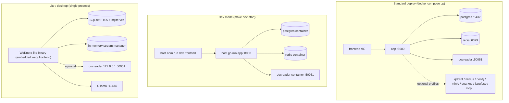
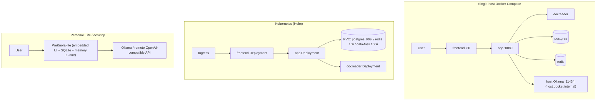

# Installation

WeKnora supports Docker Compose, Kubernetes Helm, a Lite single binary, and a desktop app. Use Compose or Helm on servers, Lite locally, and a separate dev stack for development. Dependencies, start commands, and data directories for each mode are below.

## Deployment options

| Mode | Entry | Database | Queue / streams | Use case |
| --- | --- | --- | --- | --- |
| Docker Compose (standard) | `docker-compose.yml` | ParadeDB (PostgreSQL) | Redis + Asynq | Production / team self-host (recommended) |
| Docker Compose (dev) | `docker-compose.dev.yml` | Same (infra only in containers) | Same | Local dev: app / frontend on host |
| Helm | `helm/` | ParadeDB (in chart) | Redis (in chart) | Kubernetes >= 1.25 |
| Lite binary | `make build-lite` / `scripts/package-lite.sh` | SQLite (FTS5 + sqlite-vec) | In-memory (no Redis) | Personal / offline / low resources |
| Desktop app (**not officially released**) | `cmd/desktop` (Wails v2) + `scripts/package-mac-app.sh` | SQLite | In-memory | Desktop single-user, GUI and local data dir |



## Hardware and dependencies

- **Standard Docker**: Docker 20.10+ and Docker Compose v2 (v1 `docker-compose` also works; `scripts/start_all.sh` auto-detects). Start with 4 CPU cores / 8 GB RAM (docreader includes LibreOffice and Playwright and is memory-heavy). Disk for Postgres volume + `/data/files`. Optional Milvus / OpenSearch / Langfuse need more RAM.
- **Models**: Local inference needs [Ollama](https://ollama.com) (default `http://host.docker.internal:11434`; with `OLLAMA_OPTIONAL=true`, unavailable Ollama warns but does not block), or any OpenAI-compatible API (DeepSeek, Tongyi, Zhipu, SiliconFlow, etc.). The 8 GB baseline excludes Ollama model weights. Neo4j is off by default (enable `neo4j` profile).
- **Build from source**: Go 1.26 (`docker/Dockerfile.app` builder `golang:1.26-bookworm`), CGO (`libsqlite3-dev`), Node.js + npm, Python 3.10 + uv (docreader).
- **Kubernetes**: >= 1.25.0 (`helm/Chart.yaml`).

Default ParadeDB images from `v0.22.6-pg17` use x86 baseline `x86-64-v2` (SSE4.2, POPCNT), not AVX2; see ParadeDB release notes for newer tags. Not all ARM CPUs or optional services are guaranteed compatible.

## 1. Standard Docker Compose (`docker-compose.yml`)

Fastest path:

```bash
git clone https://github.com/Tencent/WeKnora.git && cd WeKnora
cp .env.example .env              # Edit required: DB_USER/DB_PASSWORD/DB_NAME, REDIS_PASSWORD, JWT_SECRET, SYSTEM_AES_KEY
make start-all                # Same as ./scripts/start_all.sh (pulls latest images by default)
# Or directly:
docker compose pull           # Images matching WEKNORA_VERSION
docker compose up -d
docker compose ps                 # Wait until healthy/running
```

`JWT_SECRET` and `SYSTEM_AES_KEY` in `.env.example` are empty—generate once on first deploy and store safely: `JWT_SECRET` with `openssl rand -hex 32`, `SYSTEM_AES_KEY` must be 32 bytes (`openssl rand -hex 16`). On upgrade, keep the same `SYSTEM_AES_KEY` or encrypted credentials cannot decrypt. Key roles: [Configuration](./04-configuration.md).

Stop with `docker compose down` (`-v` deletes volumes—use with care). `make start-all` wraps the same flow (`scripts/start_all.sh`, plus Ollama check, `.env` fallback, sandbox image pre-pull)—pick one.

Open `http://localhost` for the frontend (`FRONTEND_PORT`, default 80); first visit shows registration. Nginx proxies `/api/` to the backend, so APIs use `http://localhost/api/v1`; port `8080` is also mapped—`curl http://localhost:8080/health` checks readiness.

> Note: app uses `env_file: [.env]`; missing `.env` breaks compose parse. `make docker-run` / `start_all.sh` copies `.env.example` or `touch .env`.

### Version upgrade

For an existing deploy with a newer release:

> If the database is still ParadeDB `v0.22.2-pg17`, follow [ParadeDB upgrade](06-paradedb-upgrade.md): stop writes, backup, keep the volume, change image, upgrade `pg_search`, then restore app. Image swap alone does not update extension SQL; migration `000099` handles WeKnora DB `0.22.2–0.22.5` when eligible—check other databases separately.

```bash
# Set WEKNORA_VERSION in .env (e.g. 0.9.0) or keep latest
docker compose pull
docker compose up -d
```

> `docker compose up -d` alone may reuse cached images and show a UI version mismatch with the downloaded release.

### Core services (default)

| Service | Image | Port (host:container) | Depends on | Notes |
| --- | --- | --- | --- | --- |
| `frontend` | `wechatopenai/weknora-ui:${WEKNORA_VERSION:-latest}` | `${FRONTEND_PORT:-80}:80` | app (healthy) | Nginx SPA + proxy to app; `APP_HOST`/`APP_BACKEND_PORT`/`APP_SCHEME` for remote backend |
| `app` | `wechatopenai/weknora-app` | `${APP_PORT:-8080}:8080` | postgres (healthy), redis, docreader (healthy) | Go backend; mounts `./config/config.yaml`, `data-files`; health `GET /health` |
| `docreader` | `wechatopenai/weknora-docreader` | `expose: 50051` only | — | gRPC parsing; `grpc_health_probe`; shares `docreader-tmp` with app for images |
| `postgres` | `paradedb/paradedb:v0.25.11-pg17` | not published to host | — | PostgreSQL 17 + BM25/vector; default retrieval |
| `redis` | `redis:7.0-alpine` | not published | — | `--appendonly yes --requirepass ${REDIS_PASSWORD}` |

### Optional services and profiles

Enable with `docker compose --profile <name> up -d`:

| profile | Services | Ports | Purpose |
| --- | --- | --- | --- |
| `searxng` (in `full`) | `searxng-init` + `searxng` | `127.0.0.1:8888` (`SEARXNG_BIND`/`SEARXNG_PORT`) | Self-hosted web search; loopback by default; rotate `SEARXNG_SECRET` before exposure |
| `minio` (in `full`) | `minio` | 9000 (S3) / 9001 (console) | S3 storage (`STORAGE_TYPE=minio`); default `minioadmin/minioadmin` |
| `neo4j` (in `full`) | `neo4j` | 7474 / 7687 | Graph (`NEO4J_ENABLE=true`); default `neo4j/password` |
| `qdrant` (in `full`) | `qdrant` | 6333 REST / 6334 gRPC | Vectors (`RETRIEVE_DRIVER=qdrant`) |
| `milvus` | `milvus` | 19530 / 9091 | Vectors (standalone, embedded etcd) |
| `weaviate` | `weaviate` | 9035 HTTP / 50052 gRPC | Vectors |
| `doris` | `doris-fe` + `doris-be` | 8030 / 9030 / 8040 | Apache Doris 4.1 (>= 3.0, HNSW ANN) |
| `dex` (in `full`) | `dex` | 5556 | OIDC test IdP (`misc/dex-config.yaml`) |
| `langfuse` (in `full`) | langfuse stack | 3000 UI / 9100–9101 MinIO | Self-hosted Langfuse; shares WeKnora postgres (`langfuse` DB) and redis (DB 1) |
| `odl-hybrid` | `odl-hybrid` | expose 5002 | OpenDataLoader/Docling PDF hybrid (local build; `DOCREADER_ODL_HYBRID`) |
| `full` | `sandbox`, `mcp`, and services marked full | mcp `${MCP_PORT:-8082}:8000` | `sandbox` for build/pull only (`command: ["true"]`). Docker sandbox off by default—`WEKNORA_SANDBOX_DOCKER_ENABLED=true` + `docker.sock` (host root). Cube/E2B need no local daemon. `mcp` = MCP Server |

Full app `environment` list (DB, vectors, storage, docreader, tenant, OIDC, etc.): [04-configuration.md](./04-configuration.md).

## 2. Dev mode (`docker-compose.dev.yml` + `scripts/dev.sh`)

Dev compose runs **infrastructure** in containers (postgres, redis, docreader ports on host); app and frontend run on the host with hot reload:

```bash
make dev-start          # ./scripts/dev.sh start; DEV_ARGS=--odl-hybrid / --minio / --qdrant / --neo4j / --dex / --full
make dev-app            # Go backend on host (DB_HOST/REDIS_ADDR → localhost)
make dev-frontend       # Vue dev server
make dev-logs / dev-status / dev-stop / dev-restart
```

Differences from production:

- postgres `5432`, redis `6379`, docreader `50051` published for local processes;
- optional single-node `opensearch` (9200) and dashboards (5601, profile `opensearch-ui`, security off);
- `dev.sh` loads `.env` and `.env.local` (override); `DEV_REMOTE_HOST` for remote infra.

## 3. Image build (`docker/`)

| Dockerfile | Image | Notes |
| --- | --- | --- |
| `docker/Dockerfile.app` | `wechatopenai/weknora-app` | Three stages: BrowserSkill `bsk` + Chrome extension (`/opt/weknora/browserskill/`, [local browser](../05-clients/09-local-browser.md)); `golang:1.26-bookworm` build (`make build-prod`, `WITH_ANYDOC=1`, DuckDB ext); `debian:12.12-slim` runtime (migrate, python3/node/uvx, ffmpeg, gosu, licenses). Entry `scripts/docker-entrypoint.sh`: fix mount ownership; docker.sock GID group for appuser; run `./WeKnora` as appuser. `EXPOSE 8080` |
| `docker/Dockerfile.docreader` | `wechatopenai/weknora-docreader` | Python 3.10 + uv; protobuf; LibreOffice, OpenJDK 17, antiword, Playwright webkit, `grpc_health_probe`. Lite build without PaddleOCR. Build args `APT_MIRROR`, `PLAYWRIGHT_*` |
| `docker/Dockerfile.odl-hybrid` | `weknora-odl-hybrid:local` | `opendataloader-pdf[hybrid]`, port 5002, default `--no-ocr`; local only |
| `docker/Dockerfile.sandbox` | `wechatopenai/weknora-sandbox` | Agent sandbox: Python 3.12-slim + Node 20; targets `sandbox`, `cube`, `desktop`; see [Sandbox deployment](../06-development/04-sandbox-deployment.md) |
| `frontend/Dockerfile` | `wechatopenai/weknora-ui` | Multi-stage Node 24 build + pinned `nginx:1.30.3-alpine`; no host `dist/` required |

Build all from source:

```bash
make build-images        # ./scripts/build_images.sh --app/--docreader/--frontend/--sandbox/--clean
make docker-build-app
make docker-build-docreader
make docker-build-frontend
```

For docreader behind mirrors:

```bash
APT_MIRROR=https://your-apt-mirror.example.com \
PLAYWRIGHT_WEBKIT_DOWNLOAD_HOST=https://your-playwright-mirror.example.com \
./scripts/build_images.sh --docreader
```

`APT_MIRROR` must preserve `/debian` and `/debian-security` layout; Playwright mirrors must preserve artifact paths. `PLAYWRIGHT_WEBKIT_DOWNLOAD_HOST` overrides `PLAYWRIGHT_DOWNLOAD_HOST` for WebKit.

## 4. Makefile deployment targets

| Target | Purpose |
| --- | --- |
| `make start-all` / `stop-all` | `scripts/start_all.sh` full stack (Ollama check, `.env`, sandbox pull) |
| `make start-ollama` / `start-docker` | Ollama only / Docker only |
| `make docker-run` / `docker-stop` / `docker-restart` | compose up/down/restart (`.env` fallback) |
| `make build-images*` / `clean-images` / `pull-images` | Build / clean / pull |
| `make check-env` / `list-containers` / `show-platform` | Env check / containers / amd64|arm64 |
| `make migrate-*` | DB migrations (`AUTO_MIGRATE=true` in container) |
| `make dev-*` | Dev mode |
| `make build` / `run` / `build-prod` | Local `cmd/server` |
| `make build-lite` / `run-lite` / `package-lite` | Lite (`.env.lite`) |
| `make package-mac-app` | macOS desktop bundle |
| `make docs` / `install-swagger` | Swagger at `:8080/swagger` (debug only) |
| `make clean-db` | Delete postgres/minio/redis volumes (**destructive**) |

## 5. `scripts/` helpers

| Script | Role |
| --- | --- |
| `scripts/start_all.sh` | One-shot start/stop; compose v1/v2 detect; `PLATFORM`; sandbox pre-pull |
| `scripts/dev.sh` | Dev orchestration |
| `scripts/check-env.sh` | Required `.env` and toolchain |
| `scripts/build_images.sh` | Versioned image build, multi-arch |
| `scripts/build_frontend_dist.sh` | Host `frontend/dist` for Lite/desktop |
| `scripts/migrate.sh` | golang-migrate wrapper |
| `scripts/docker-entrypoint.sh` | App container entry |
| `scripts/package-lite.sh` / `package-mac-app.sh` | Lite tarball / macOS .app |

## 6. Helm (`helm/`)

`helm/Chart.yaml`: apiVersion v2, name `weknora`, appVersion e.g. v0.9.0, Kubernetes >= 1.25.0.

Chart: `app`, `frontend`, `docreader`, `postgresql` (default ParadeDB `v0.18.9-pg17`, differs from Compose), `redis`; optional `minio`, `neo4j`.

Key `helm/values.yaml`:

```yaml
app:
  replicaCount: 1
  env:
    GIN_MODE: release
    RETRIEVE_DRIVER: postgres      # postgres / elasticsearch_v7 / elasticsearch_v8 / qdrant ...
    STORAGE_TYPE: local            # local / minio / cos / tos / s3
    STREAM_MANAGER_TYPE: redis
postgresql:
  enabled: true
  persistence: { enabled: true, size: 10Gi }
redis:
  enabled: true
  persistence: { enabled: true, size: 1Gi }
dataFiles:
  persistence: { enabled: true, size: 10Gi }
global:
  maxFileSizeMB: 50                 # Upload limit (frontend / app / docreader)
secrets:                            # Required, or existingSecret
  dbPassword: ""
  redisPassword: ""
  jwtSecret: ""
  systemAesKey: ""                  # 32-byte AES-256 master key
```

`global.maxFileSizeMB` matches Compose `MAX_FILE_SIZE_MB`. Optional MinIO image: community `pgsty/minio`.

```bash
helm install weknora ./helm -n weknora --create-namespace \
  --set secrets.dbPassword=xxx --set secrets.redisPassword=xxx \
  --set secrets.jwtSecret=xxx --set secrets.systemAesKey=$(openssl rand -hex 16)
```

## 7. Desktop (Lite / desktop app)

Same Lite runtime (single process + SQLite + in-memory queue); distribution differs: **binary** (CLI/background) vs **desktop app** (GUI). Knowledge-base features match; skip registration, local sandbox, and project bind only in the desktop app.

### Lite runtime (zero external deps) {#lite-runtime-zero-external-deps}

Compile `EDITION=lite` + runtime `.env.lite`:

- **DB**: `DB_DRIVER=sqlite`, `DB_PATH=./data/weknora.db`, `-tags "sqlite_fts5"`;
- **Retrieval**: `RETRIEVE_DRIVER=sqlite`, FTS5 + sqlite-vec, no vector DB;
- **Queue/streams**: `STREAM_MANAGER_TYPE=memory`; Asynq in-memory/no-op;
- **Frontend**: `make build-lite` copies `frontend/dist` to `web/`; served via `WEKNORA_WEB_DIR` / embedded static;
- **Docreader**: optional `DOCREADER_ADDR=127.0.0.1:50051`;
- **Sandbox**: configure per workspace in settings (Docker, CubeSandbox, E2B); desktop uses OS sandbox when no remote sandbox—[Desktop client](../05-clients/05-desktop.md).

```bash
cp .env.lite.example .env.lite      # SYSTEM_AES_KEY (openssl rand -hex 16) and JWT_SECRET
make run-lite
make package-lite
```

Browser access to the binary still requires register/login. Desktop app uses native bridge + `POST /auth/auto-setup` (no anonymous HTTP).

### Desktop app (`cmd/desktop`, Wails v2) {#desktop-app-cmd-desktop-wails-v2}

GUI, embedded backend/SQLite, app data directory, port/LAN/update settings. Same runtime as [Lite runtime](#lite-runtime-zero-external-deps).

::: warning Not officially released
No release installers yet—build locally. `release-lite.yml` has cross-platform jobs but tag trigger is disabled; latest release has no artifacts.
:::

- Entry `cmd/desktop/main.go`, `wails.json`; `app.go` exposes `GetAPIBaseURL`, port, LAN bind, `CheckForUpdates`.
- `scripts/package-mac-app.sh`: frontend → `web/`, `wails build -tags "sqlite_fts5"`, `.app` with embedded config/migrations/web; data under `~/Library/Application Support/WeKnora Lite/data/`.

```bash
make package-mac-app
```

## 8. Build and run from source

```bash
# Backend (needs local postgres/redis/docreader — dev mode)
go mod download
make build && ./WeKnora                       # or make build-prod

# Frontend
cd frontend && npm ci && npm run dev

# docreader
cd docreader && uv sync --locked && bash scripts/generate_proto.sh && uv run -m docreader.main
```

Config search order (`LoadConfig`): cwd → `./config` → `$HOME/.appname` → `/etc/appname/`, file `config.yaml`.

### Optional embedded frontend (standard edition)

Standard edition serves API only by default. Set `WEKNORA_WEB_DIR` to a built frontend directory (must contain `index.html`) to serve Web UI from the same process:

```bash
(cd frontend && npm ci && npm run build)
make build-prod
SERVER_HOST=127.0.0.1 WEKNORA_WEB_DIR="$PWD/frontend/dist" ./WeKnora
```

Visit `http://127.0.0.1:8080` (default `SERVER_PORT`). Only static build output in `WEKNORA_WEB_DIR`—no secrets. API routes (including `/mcp/`) take precedence over SPA fallback.

This does not replace DB/Redis dependencies. For minimal no-Docker deploy, see [Lite runtime](#lite-runtime-zero-external-deps).

## Common topologies



## Next steps

After deploy, read [03-quickstart.md](./03-quickstart.md) for setup and first Q&A.
