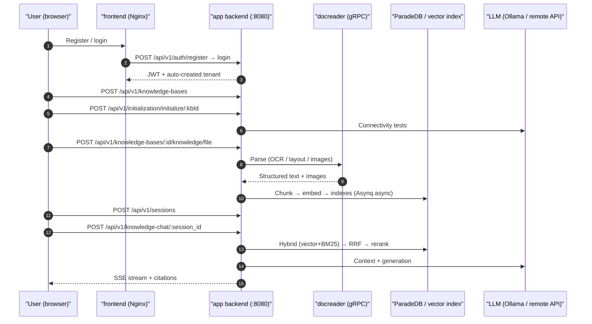

# Quick start

Register, create a knowledge base, configure models, upload documents, and ask a question to complete your first knowledge-base Q&A with citations to sources. Steps below use the web UI; API examples are at the end.

Finish [installation](02-installation.md) first and have a working chat model and embedding model.

::: tip Need help?
Open the [WeKnora Assistant](../03-features/26-weknora-assistant.md) in the sidebar to search product docs, check parse results, or get configuration guidance. On first use, choose “read-only” or “confirm before changes” to review scope.
:::

## Before you begin {#before-you-begin}

- **Start services**: after [installation](./02-installation.md), frontend is at `http://localhost`, backend at `http://localhost:8080`;
- **Model credentials**: local Ollama (default in container `http://host.docker.internal:11434`) or any OpenAI-compatible `base_url` + `api_key`. You need at least one chat model and one embedding model;
- **Health check**: `curl http://localhost:8080/health` should return `{"status":"ok"}`.

## Register and sign in {#register-and-sign-in}

First visit shows the login page. When public registration is allowed (`self_serve`), the register tab appears; there is no default account. By default, registration creates a personal workspace and makes you Owner.

<Screenshot
  src="/screenshots/quickstart-register.png"
  caption="Registration page on first visit"
  hint="Register form (username / email / password) and link to login." />

Rules and deployment differences:

- Username 2–50 characters; password 8–32 with letters and numbers. With complex password policy enabled, uppercase, lowercase, and special characters are required (UI and API use the same rules);
- For team deployments with invite-only signup, a system admin sets `auth.registration_mode` to `invite_register` under Settings → System (immediate effect). `invite_only` / `DISABLE_REGISTRATION=true` disables password registration; invites cannot create accounts either—existing accounts can only join after login;
- If `auth.default_tenant_mode` is `tenantless`, registration **does not** create a workspace; you are sent to `/onboarding/workspace` to create or join one;
- The desktop app skips registration and auto-creates a local account on launch; Lite single binary in the browser still requires register and login.

::: tip Workspace vs platform
Workspace Owners manage members, models, and knowledge bases in their space. Global system settings, platform job queues, and cross-tenant audit require system administrator—separate grants.

For the first system admin: register, then set `WEKNORA_BOOTSTRAP_SYSTEM_ADMIN_EMAIL=<that email>` on app and restart. Applies only while no system admin exists. See [Platform admin](../03-features/20-platform-admin.md).
:::

## Create a knowledge base and configure models {#create-a-knowledge-base-and-configure-models}

On Knowledge bases, create a base; the init wizard guides model selection per base.

1. New base: name and type `document` (documents) or `faq` (Q&A pairs);
2. In the wizard:
   - **LLM**: generates answers;
   - **Embedding**: document vectors; changing it requires re-indexing;
   - Rerank, VLM, ASR, graph extraction, and question generation as needed;
3. Use **Test** in the wizard to verify connectivity, then save.

<Screenshot
  src="/screenshots/quickstart-init-wizard.png"
  caption="Init wizard: choose LLM and embedding for the knowledge base"
  hint="Model source (Ollama / remote API), name, Base URL, successful connectivity test." />

::: tip Ollama from a container
Inside the backend container, `localhost` is the container itself. For Ollama on the host, use `http://host.docker.internal:11434`.
:::

## Upload documents {#upload-documents}

Open the knowledge base, drag files or paste a URL. The upload dialog lets you set tags and parsing options for the batch.

Supported formats include PDF, Office, Markdown, HTML, EPUB, images, audio, etc.—full list in [Document parsing](../03-features/03-document-parsing.md).

<Screenshot
  src="/screenshots/quickstart-upload.png"
  caption="Upload dialog: files, tags, parsing options"
  hint="Pending files, tags, parser engine options." />

Parsing is async: `pending → processing → finalizing → completed`. Scanned PDFs and large files take longer; the list refreshes progress.

<Screenshot
  src="/screenshots/quickstart-document-list.png"
  caption="Document list: three documents parsed"
  hint="Name, type, status completed, chunk count." />

## Ask a question {#ask-a-question}

Open chat, select the knowledge base, and ask. The default **Quick answer** agent retrieves passages and answers; click citations for sources.

<Screenshot
  src="/screenshots/quickstart-chat.png"
  caption="Q&A with clickable citation sources"
  hint="One Q&A turn, citation markers, expanded source panel." />

If the answer shows and citations open, ingestion and Q&A succeeded.

## Go further {#go-further}

- [Configure agents](../03-features/07-agent.md): smart reasoning for multi-step questions, web search, MCP tools.
- [Chunking](../03-features/04-chunking.md) and [retrieval](../03-features/05-retrieval-engines.md).
- [Data sources](../03-features/10-datasource.md): Feishu, Notion, Yuque, RSS sync.
- [IM](../03-features/12-im-integration.md) or [web embed](../03-features/13-embed-channel.md).

## Same flow via API {#same-flow-via-api}

Examples in order: register, login, create base, init models, upload, chat. Paths use `/api/v1`; needs Bash, curl, jq. The account must belong to a workspace; if login has no `active_tenant`, create or join a workspace and log in again.

```bash
BASE=http://localhost:8080/api/v1

# 1) Register (first deploy; username 2–50; password 8–32 with letters and numbers)
curl -s -X POST $BASE/auth/register -H "Content-Type: application/json" \
  -d '{"username":"admin","email":"admin@example.com","password":"pass123456"}'

# 2) Login — save JWT and active workspace ID (for API key creation)
LOGIN_RESPONSE=$(curl -s -X POST $BASE/auth/login -H "Content-Type: application/json" \
  -d '{"email":"admin@example.com","password":"pass123456"}')
TOKEN=$(printf '%s\n' "$LOGIN_RESPONSE" | jq -r '.token')
TENANT_ID=$(printf '%s\n' "$LOGIN_RESPONSE" | jq -r '.active_tenant.id')
AUTH="Authorization: Bearer $TOKEN"

# 3) Create knowledge base
KB_ID=$(curl -s -X POST $BASE/knowledge-bases -H "$AUTH" -H "Content-Type: application/json" \
  -d '{"name":"My knowledge base","description":"demo","type":"document"}' | jq -r '.data.id')

# 4) Initialize (local Ollama example; remote: change source/baseUrl/apiKey)
curl -s -X POST $BASE/initialization/initialize/$KB_ID -H "$AUTH" -H "Content-Type: application/json" -d '{
  "llm":       {"source":"local","modelName":"qwen3:8b"},
  "embedding": {"source":"local","modelName":"bge-m3","dimension":1024},
  "rerank":    {"enabled":false},
  "multimodal":{"enabled":false},
  "documentSplitting":{"chunkSize":512,"chunkOverlap":50,"separators":["\n\n","\n","."]},
  "nodeExtract":{"enabled":false},
  "questionGeneration":{"enabled":false}}'

# 5) Upload (multipart, field name file)
curl -s -X POST $BASE/knowledge-bases/$KB_ID/knowledge/file -H "$AUTH" \
  -F "file=@./demo.pdf"
# Poll: GET /knowledge-bases/$KB_ID/knowledge until parse_status=completed

# 6) Create session
SESSION_ID=$(curl -s -X POST $BASE/sessions -H "$AUTH" -H "Content-Type: application/json" \
  -d '{"title":"First chat"}' | jq -r '.data.id')

# 7) Knowledge chat (SSE stream)
curl -N -X POST $BASE/knowledge-chat/$SESSION_ID -H "$AUTH" -H "Content-Type: application/json" \
  -d '{"query":"What is this document about?","knowledge_base_ids":["'$KB_ID'"]}'

# 7b) Agent chat (SSE; e.g. builtin-smart-reasoning)
curl -N -X POST $BASE/agent-chat/$SESSION_ID -H "$AUTH" -H "Content-Type: application/json" \
  -d '{"query":"Summarize key points with sources","agent_enabled":true,"agent_id":"builtin-smart-reasoning","knowledge_base_ids":["'$KB_ID'"]}'

# 8) Search only (JSON)
curl -s -X POST $BASE/knowledge-search -H "$AUTH" -H "Content-Type: application/json" \
  -d '{"query":"keyword","knowledge_base_ids":["'$KB_ID'"]}'
```

Chat bodies also support `knowledge_ids`, `web_search_enabled`, `summary_model_id`, `mcp_service_ids`, `skill_names`, `images` / `attachment_uploads`—see [API: sessions and chat](../04-api/02-api-chat.md).

### Three authentication modes

| Mode | Header | Use |
| --- | --- | --- |
| JWT | `Authorization: Bearer <token>` | Browser / interactive, from login |
| API Key | `X-API-Key: <key>` | Server integration; create under workspace settings or `POST /api/v1/tenants/:id/api-keys` with capabilities (`retrieve`/`chat`/`ingest`/`manage_kbs`, etc.) |
| Explicit workspace | `X-Tenant-ID: <id>` | Switch workspace for multi-tenant users |

For server integration, prefer API keys over JWT:

```bash
# Create API key as workspace Owner (TENANT_ID from login)
curl -s -X POST $BASE/tenants/$TENANT_ID/api-keys -H "$AUTH" -H "Content-Type: application/json" \
  -d '{"name":"ci-bot","full_access":true}'
# Then:
curl -s $BASE/knowledge-bases -H "X-API-Key: <key from create response>"
```

### Init wizard endpoints

Each wizard step has an API for custom admin UIs:

| Step | Endpoint | Notes |
| --- | --- | --- |
| Read config | `GET /api/v1/initialization/config/:kbId` | llm, embedding, rerank, multimodal, documentSplitting, nodeExtract, questionGeneration, `hasFiles` (limits embedding change when files exist) |
| Ollama | `GET /api/v1/initialization/ollama/status`, `GET /api/v1/initialization/ollama/models` | Availability and installed models |
| Download Ollama model | `POST /api/v1/initialization/ollama/models/download` → `GET /api/v1/initialization/ollama/download/progress/:taskId` | Async download + poll |
| Test remote models | `POST /api/v1/initialization/remote/check`, `/initialization/embedding/test`, `/initialization/rerank/check`, `/initialization/asr/check`, `/initialization/multimodal/test` | Pre-save connectivity |
| Graph trial extract | `POST /api/v1/initialization/extract/text-relation` (with `fabri-text` / `fabri-tag` sample) | Preview entities/relations |
| Save | `POST /api/v1/initialization/initialize/:kbId` (first) / `PUT /api/v1/initialization/config/:kbId` (update) | Creates/updates Model records and KnowledgeBase config |

`source` is `local` (Ollama) or a remote provider id (`openai`, `deepseek`, `aliyun`, `zhipu`, `siliconflow`, etc.). Valid `chunkSize`: 100–10000.

### End-to-end sequence



## Stuck? {#stuck}

| Symptom | What to check |
| --- | --- |
| Upload stuck in `processing` | `docker logs WeKnora-docreader`; limits `MAX_FILE_SIZE_MB` (default 50), `WEKNORA_DOCUMENT_PROCESS_TIMEOUT` (default 2h) |
| Ollama check fails at init | Container default `http://host.docker.internal:11434` (`OLLAMA_BASE_URL`); on Linux confirm `extra_hosts: host.docker.internal:host-gateway` |
| No citations / empty recall | Parse `completed`; lower `vector_threshold`; embedding matches indexing |
| Register tab missing | `GET /auth/config` → `registration_mode` (may come from DB in Settings → System, not only `DISABLE_REGISTRATION`) |
| API Key 403 | Key capabilities or `knowledge_base_ids` whitelist |

Next: [Configuration](./04-configuration.md) for tuning, [Architecture overview](../02-architecture/01-overview.md) for how the system works.
