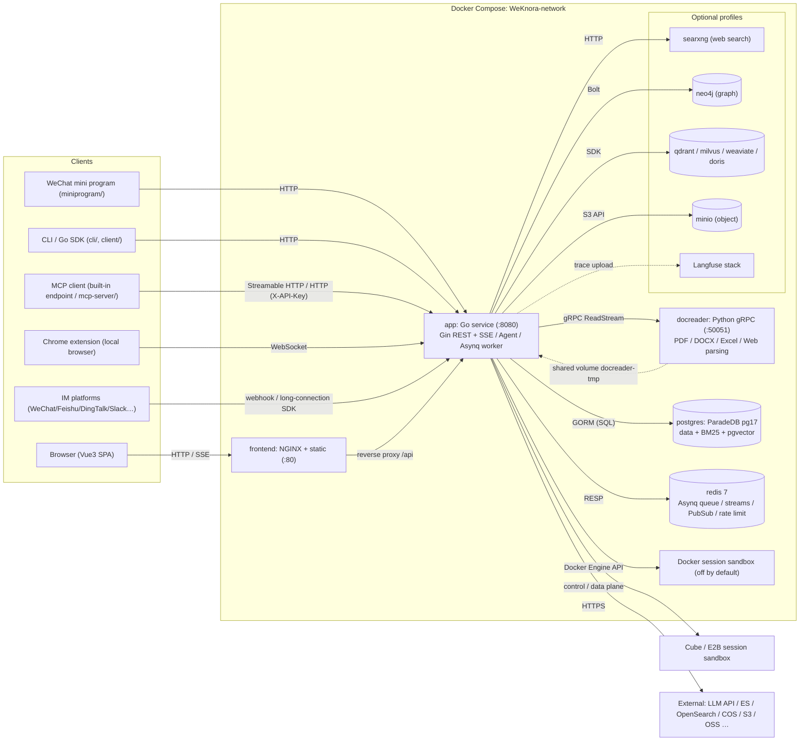
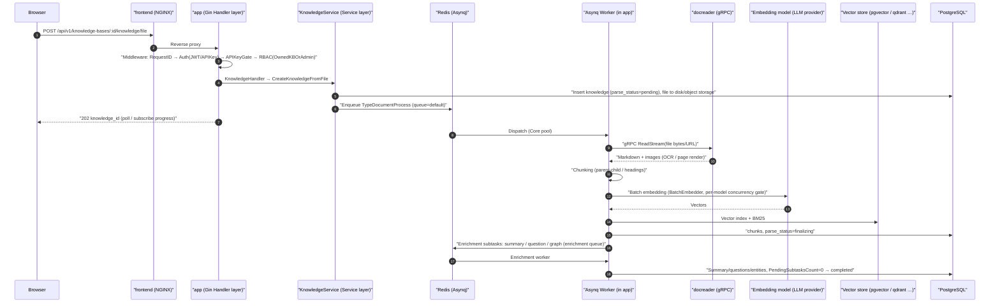

# Overall architecture
WeKnora consists of a Web UI, a Go main service, and a Python document parsing service. Business data is persisted in a database; Redis schedules asynchronous tasks. Vector storage, object storage, the knowledge graph, and model services are configurable per deployment.

## Assistant and persistent tasks
The built-in WeKnora Assistant builds on the existing Agent engine, an admin operations catalog, and product documentation shipped with the application. Page context helps interpret the task; actual operations still go through role and resource authorization. Collaboration instances, approvals, and run suspensions are persisted; the automation scheduler starts assistant sessions on behalf of the task owner and records runs and in-app notifications.

User entry points: [WeKnora Assistant](../03-features/26-weknora-assistant.md), [Automations](../03-features/27-automations.md), and [Execution permissions](../03-features/28-agent-permissions.md).

## System composition {#system-composition}
WeKnora uses a three-process core architecture—main service, frontend, and document parsing microservice—plus two infrastructure dependencies, PostgreSQL and Redis. Other components (vector database, knowledge graph, web search, etc.) are optional and enabled via Docker Compose profiles.

### Core services (default startup) {#core-services-default-startup}
| Service | Image / build | Port | Role |
| --- | --- | --- | --- |
| `app` | `wechatopenai/weknora-app` (`docker/Dockerfile.app`, Go) | `8080` | Main backend: REST API, RAG retrieval, Agent engine, async task workers, IM/Embed channels. Health check `GET /health` |
| `frontend` | `wechatopenai/weknora-ui` (`frontend/`, NGINX + Vue3 static assets) | `80` | Web UI; NGINX also reverse-proxies `/api` to `app` (`APP_HOST` / `APP_BACKEND_PORT` / `APP_SCHEME` can target a remote backend) |
| `docreader` | `wechatopenai/weknora-docreader` (`docker/Dockerfile.docreader`, Python) | `50051` (expose on compose network only, not mapped on host) | Parsing microservice: gRPC server, parsing and page rendering for PDF/DOCX/Excel/EPUB/Web and 25+ formats. Health check `grpc_health_probe` |
| `postgres` | `paradedb/paradedb:v0.25.11-pg17` | `5432` (internal network) | Primary database. ParadeDB includes BM25 and pgvector; **default deployment does not require a separate vector database** (`RETRIEVE_DRIVER=postgres`) |
| `redis` | `redis:7.0-alpine` (`appendonly` + `requirepass`) | `6379` (internal network) | Asynq queue, SSE stream management (multi-instance), `system_settings` pub/sub, rate limiting, and distributed per-model concurrency gates |
| `sandbox` | `wechatopenai/weknora-sandbox` (`docker/Dockerfile.sandbox`) | — | Standard WeKnora runtime image; used directly for workspace Docker backend, or registered via template API when integrating CubeSandbox/E2B for Agent Skills |

`app` and `docreader` share volume `docreader-tmp` (mounted at `/tmp/docreader`) for parsed images; `app` local file storage volume is `data-files` (`/data/files`).

### Optional components (Compose profile) {#optional-components-compose-profile}
| Service | profile | Purpose |
| --- | --- | --- |
| `searxng` (+ one-shot `searxng-init`) | `searxng` / `full` | Self-hosted metasearch for Agent web search (default bind `127.0.0.1:8888`) |
| `neo4j` | `neo4j` / `full` | Knowledge graph storage (GraphRAG), switch `NEO4J_ENABLE`, Bolt `7687` |
| `minio` | `minio` / `full` | Object storage (`STORAGE_TYPE=minio`) |
| `qdrant` / `milvus` / `weaviate` | same-name profile | Dedicated vector stores (`RETRIEVE_DRIVER`) |
| `doris-fe` + `doris-be` | `doris` | Apache Doris 4.1 retrieval (FE MySQL 9030 / FE HTTP 8030 Stream Load / BE 8040) |
| `odl-hybrid` | `odl-hybrid` | OpenDataLoader PDF hybrid backend (docreader calls HTTP `:5002`) |
| `dex` | `dex` / `full` | OIDC test IdP (with `OIDC_AUTH_ENABLE`) |
| `langfuse-*` (web/worker/clickhouse/minio/db-init) | `langfuse` | Self-hosted LLM observability stack; reuses WeKnora postgres (new `langfuse` DB) and redis (DB 1) |

The Go backend can also connect directly to external engines not in compose: Elasticsearch v7/v8, OpenSearch, Tencent Cloud VectorDB, and eight object storage backends (local/MinIO/COS/TOS/S3/OSS/KS3/OBS).

### Deployment forms {#deployment-forms}
Besides standard Docker Compose, the repository supports:

- **Lite mode**: `DB_DRIVER=sqlite` (built-in sqlite-vec) + no `REDIS_ADDR` (Asynq falls back to in-process `SyncTaskExecutor`), single binary, embedded frontend static assets (served by Go when `handler.Edition == "lite"`);
- **Desktop edition**: `cmd/desktop` packaged with Wails v2; sessions can run in a local OS sandbox (macOS only for now, via Seatbelt);
- **Kubernetes**: `helm/` chart; **bare metal**: `deploy/` systemd units.

## Technology stack {#technology-stack}
| Layer | Technology | Version / notes |
| --- | --- | --- |
| Backend language | Go | `go.mod` declares `go 1.26.0` |
| Web framework | `github.com/gin-gonic/gin` | v1.12.0 |
| ORM | `gorm.io/gorm` + postgres/sqlite drivers | v1.31.1; SQLite with `sqlite-vec` |
| Dependency injection | `go.uber.org/dig` | v1.19.0 (constructor injection; see backend design) |
| Async tasks | `github.com/hibiken/asynq` | v0.26.0 (Redis-based, 6 worker pools) |
| Cache / queues | `github.com/redis/go-redis/v9` | v9.14.1 |
| Authentication | `github.com/golang-jwt/jwt/v5` + OIDC | JWT Bearer / X-API-Key / OIDC (three modes) |
| DB migrations | `github.com/golang-migrate/migrate/v4` | `migrations/versioned/*.up.sql`, run at startup when `AUTO_MIGRATE` |
| Logging | `github.com/sirupsen/logrus` + lumberjack rotation | Custom formatter, `request_id` propagated |
| Configuration | `github.com/spf13/viper` + `config/config.yaml` + env vars | — |
| Observability | OpenTelemetry + Langfuse (`internal/tracing/langfuse`) | LLM-level traces |
| gRPC | `google.golang.org/grpc` v1.81.0 | Calls docreader |
| LLM integration | In-house protocol layer `internal/models/api` (one package per OpenAI / Anthropic / Gemini / DashScope wire format, etc.), Ollama, Tencent LKE SDK, etc. | 27 providers in `internal/models/providers`; see [Model management](../03-features/06-models.md) |
| Vector / retrieval | pgvector, ES v7/v8, OpenSearch, Qdrant, Milvus, Weaviate, Doris, Tencent VectorDB, sqlite-vec | Dynamic assembly via `RETRIEVE_DRIVER` and `vector_stores` table |
| Knowledge graph | `neo4j-go-driver/v6` | optional |
| Data analysis | DuckDB (`duckdb-go/v2`), SQL validation `pg_query_go` | Agent data analysis tools |
| Goroutine pool | `panjf2000/ants/v2` | Document processing concurrency (`CONCURRENCY_POOL_SIZE`) |
| MCP | `mark3labs/mcp-go` v0.52.0 | External MCP tools for Agent (OAuth included) |
| API docs | swaggo/gin-swagger | `/swagger` exposed outside release mode |
| Frontend framework | Vue 3 (^3.5) + TypeScript + Vite 7 | `frontend/package.json` |
| Frontend UI / state | TDesign Vue Next, Pinia, Vue Router 4, vue-i18n | Rich text via Marked/KaTeX/Mermaid/highlight.js |
| Parsing service | Python + grpcio | `docreader/main.py`; parsers in `docreader/parser/` (pdf/docx/excel/epub/web/image/markitdown/opendataloader, etc.) |
| Desktop | Wails v2 | `cmd/desktop` |

## Inter-process communication {#inter-process-communication}
| Link | Protocol | Description |
| --- | --- | --- |
| Browser → `frontend` (NGINX) → `app` | HTTP/HTTPS (REST + SSE) | NGINX reverse-proxies `/api`; chat uses streaming SSE |
| `app` → `docreader` | **gRPC** (default `docreader:50051`, `DOCREADER_TRANSPORT=grpc`, TLS/mTLS and `GRPC_AUTH_TOKEN` supported) | proto in `docreader/proto/`; large files via streaming `ReadStream` |
| `app` → `postgres` | PostgreSQL wire (GORM/pgx) | Business data + BM25 + pgvector |
| `app` ↔ `redis` | RESP (TLS supported) | ① Asynq queue (document parsing/enrichment/Wiki/memory, etc.); ② SSE Stream Manager for resume (`STREAM_MANAGER_TYPE`); ③ `system_settings` change pub/sub; ④ Embed rate limits; ⑤ distributed per-model concurrency semaphores |
| `app` → `neo4j` | Bolt (`bolt://neo4j:7687`) | GraphRAG entity/relationship access |
| `app` → `searxng` / web search provider | HTTP | SSRF whitelist validation (`SSRF_WHITELIST_EXTRA` defaults to compose `searxng,qdrant,milvus,weaviate,doris-fe,doris-be,minio`; with `SSRF_DNS_WHITELIST_ONLY`, only whitelisted outbound) |
| `app` → vector DB / object storage / LLM providers | Respective SDKs (HTTP/gRPC/MySQL protocol) | Doris via MySQL + Stream Load HTTP |
| `app` → sandbox backend | Docker Engine API / Cube/E2B control and data planes | Session execution, skill install, file artifacts; per workspace sandbox config |
| MCP client → `app` | Streamable HTTP (`/mcp/:endpoint_id`, distinct Bearer token per endpoint) | Built-in MCP server exposing knowledge-base search, etc., to external MCP clients; see [MCP integration](../03-features/08-mcp.md) |
| Chrome extension ↔ `app` | WebSocket (`/api/v1/local-browser/extension`, WSS required for remote deploy) | Local browser: app hosts BrowserSkill daemon, extension runs web tasks in the user browser; see [Local browser](../05-clients/09-local-browser.md) |
| `app` ↔ IM platforms | HTTP webhook / long-connection SDK | WeChat, WeCom, Feishu, DingTalk, Slack, Telegram, QQ, Mattermost, Cloud Hub (`internal/im/`) |

## Overall architecture diagram {#overall-architecture-diagram}

## Typical request path: document upload and indexing {#typical-request-path-document-upload-and-indexing}
The diagram below shows the full path from upload to searchable document, covering most component interactions (sync API, Asynq tasks, gRPC parsing, embedding, vector writes, enrichment subtasks):

The chat path (`POST /api/v1/knowledge-chat/:session_id` or agent-chat) is synchronous SSE: Handler → `SessionService` → `chat_pipeline` plugin pipeline (query understanding → parallel retrieval → rerank → merge → prompt assembly → streaming LLM completion) → tokens pushed via Stream Manager (Redis/memory). See the backend design article.

## Top-level repository directory guide {#top-level-repository-directory-guide}
| Directory | Role |
| --- | --- |
| `cmd/` | Executable entry points. `cmd/server`: main service (main/bootstrap/listen + platform signals); `cmd/desktop`: Wails desktop edition; `cmd/download`: model/resource download helper |
| `internal/` | All Go backend business code (layered structure; see backend design): `handler`, `application/service`, `application/repository`, `container` (DI), `router`, `middleware`, `types`, `agent`, `im`, `mcp`, `stream`, `sandbox`, etc. |
| `frontend/` | Vue3 + Vite + TDesign Web frontend; assets served by NGINX or embedded in Lite mode |
| `docreader/` | Python gRPC parsing microservice: `main.py`, `parser/` (25+ parsers), `splitter/`, `proto/`, `Dockerfile.docreader` build |
| `cli/` | `weknora` CLI: knowledge bases, documents, retrieval, sessions, agents, models, MCP, skills, `doctor`; see [CLI](../05-clients/02-cli.md) |
| `client/` | Go SDK wrapping WeKnora API as HTTP client |
| `mcp-server/` | Python MCP server (`weknora_mcp_server.py`) exposing WeKnora API as MCP tools |
| `miniprogram/` | WeChat mini program client (WXML/WXSS/JS) |
| `migrations/` | golang-migrate: `versioned/` (Postgres `NNNNNN_*.up/down.sql`), `sqlite/` (Lite), `paradedb/`, `mysql/` |
| `config/` | Runtime config: `config.yaml`, `builtin_agents.yaml`, `agent_type_presets.yaml`, `builtin_models.yaml.example`, `models.json.example`, `prompt_templates/` |
| `docker/` | Dockerfiles (app/docreader/sandbox/odl-hybrid) and searxng config |
| `deploy/` | Bare-metal resources (systemd units, etc.) |
| `helm/` | Kubernetes Helm chart |
| `examples/` | API usage examples; `examples/skills/` for Agent Skill packs |
| `dataset/` | Evaluation QA datasets and generation scripts |
| `scripts/` | Build/start/migration scripts (`start_all.sh`; `build_frontend_dist.sh` for Lite/desktop; UI image via multi-stage `frontend/Dockerfile`) |
| `tests/`, `testdata/` | Integration tests and test data |
| `misc/` | Miscellaneous (`dex-config.yaml` OIDC test, etc.) |
| `packages/` | Separately published integration packages, e.g. DeepSeek Harness plugin `packages/dsh-weknora`; see [DeepSeek Harness](../05-clients/08-deepseek-harness.md) |
| `docs/` | Unmaintained legacy docs; Swagger staging, release assets, historical images |

> Note: Go module path is `github.com/Tencent/WeKnora`; root also has `docker-compose.yml` (prod), `docker-compose.dev.yml` (dev), `Makefile`, `VERSION`, etc.

The next article, [Go backend design](./02-backend-design.md), goes deeper into `internal/`: layering, dig injection, startup, routing and RBAC, middleware, domain model, errors, and logging.
