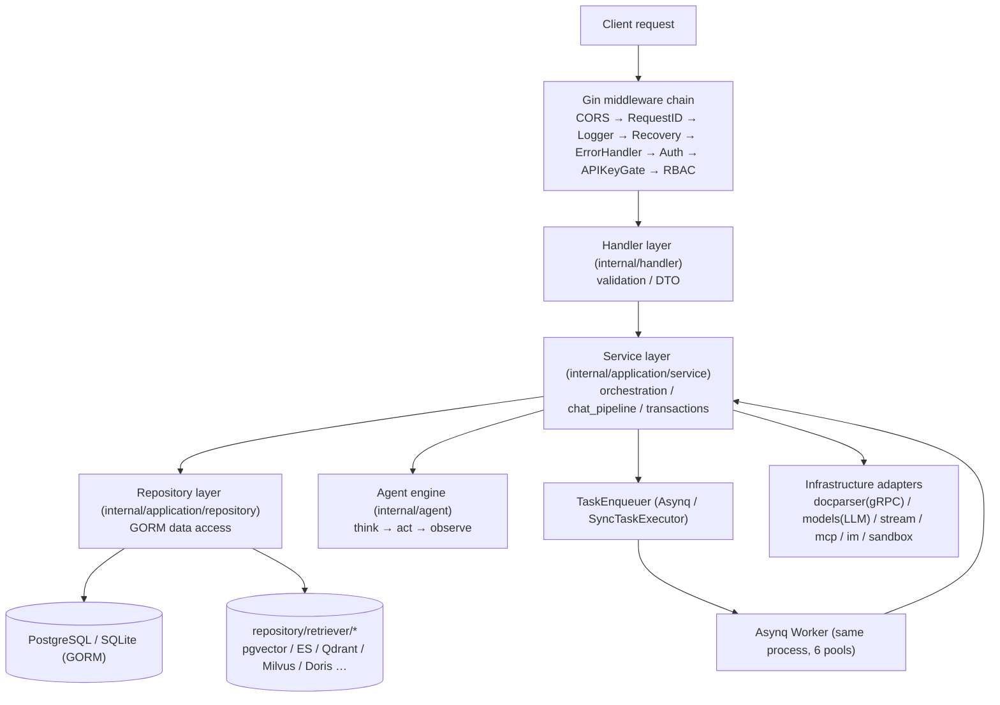
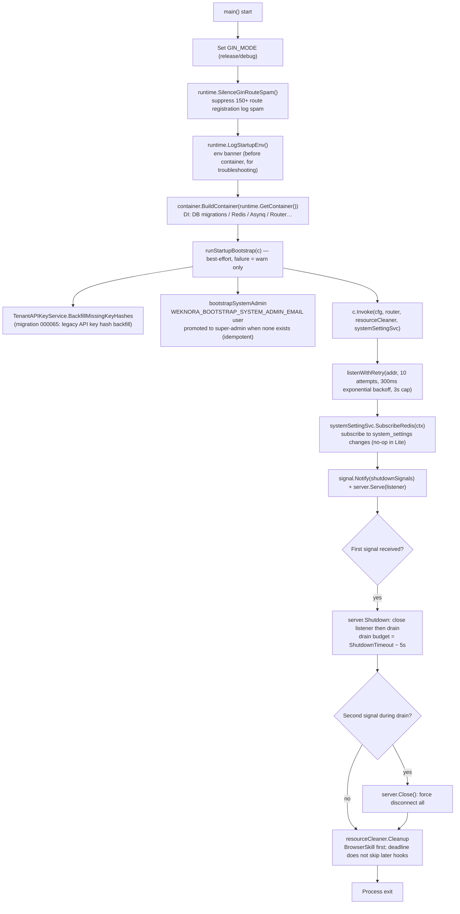

# Go backend design
The Go backend organizes request handling in Handler, Service, Repository, and infrastructure layers, with dependencies assembled via uber/dig. `cmd/server` handles startup and shutdown; `internal/` implements routing, authentication, business services, and data access.


## Assistant and task runtime modules
`internal/agent/policy` unifies read, probe, write, and destructive operation decisions; `agent_prompts` and `agent_run_suspensions` store resumable human interactions; `agent_grants` stores scoped grants. `agent_collaborations` records sub-agent state; the automation service maintains schedules, runs, and notifications. Background shell uses a distinct work ID with wait/cancel APIs, separate from an interactive terminal process.

These runtime capabilities have a different scope than the normal document ingestion queue: resuming a pending-approval state does not mean arbitrarily re-running external writes.

## Layered architecture {#layered-architecture}
The backend follows the classic **Handler → Service → Repository → database** structure. Cross-layer dependencies go through interfaces (`internal/types/interfaces/`), wired at startup by the DI container:

| Layer | Location | Role |
| --- | --- | --- |
| Router / Middleware | `internal/router/`, `internal/middleware/` | Route registration, auth, RBAC, rate limiting, logging, error envelope |
| Handler | `internal/handler/` (sessions in `internal/handler/session/`) | Parse requests (DTOs in `internal/handler/dto/`), call Service, write response; no business logic |
| Access control | `internal/application/access/` | Shared authorization rules outside Gin: three-layer KB access resolution, org sharing, shared Agent KB scope, file and message artifact auth, cross-KB clone/move auth |
| Service | `internal/application/service/` (~160+ files) | Orchestration: KB/knowledge/chunks, sessions and `chat_pipeline/`, Agent, tenant and members, models, data source sync, Wiki, audit, etc. |
| Repository | `internal/application/repository/` (~60 files) | Data access via **GORM** (`type knowledgeRepository struct { db *gorm.DB }`, operations via `r.db.WithContext(ctx)`); retrieval engine implementations per package under `repository/retriever/{postgres,elasticsearch,qdrant,milvus,weaviate,doris,opensearch,tencentvectordb,sqlite,neo4j}` |
| Domain model | `internal/types/` | GORM entities, enums, context keys, interfaces (`types/interfaces`) |
| Infrastructure | `internal/infrastructure/` (docparser gRPC client, web_search), `internal/models/`, `internal/stream/`, `internal/sandbox/`, `internal/mcp/`, `internal/im/` | External system adapters |



Key conventions:

- Handlers depend only on Service interfaces (e.g. `interfaces.KnowledgeService`); Services depend only on Repository interfaces and other Services;
- All interfaces are declared in `internal/types/interfaces/` and bound via dig;
- Asynq workers and the HTTP server run in **the same process**; task handlers reuse the same Services.

## Dependency injection: internal/container (uber/dig) {#dependency-injection-internal-container-uber-dig}
WeKnora uses **`go.uber.org/dig` v1.19.0** (constructor injection container, not code-generated wire). Entry point: `BuildContainer` in `internal/container/container.go`:

```go
// cmd/server/main.go
c := container.BuildContainer(runtime.GetContainer())

// internal/container/container.go
func BuildContainer(container *dig.Container) *dig.Container {
    must(container.Provide(NewResourceCleaner, dig.As(new(interfaces.ResourceCleaner))))
    must(container.Provide(config.LoadConfig))
    must(container.Provide(initDatabase))     // *gorm.DB
    must(container.Provide(initRedisClient))  // *redis.Client (may be nil: Lite mode)
    ...
    must(container.Provide(repository.NewTenantRepository))
    must(container.Provide(service.NewTenantService))
    ...
    must(container.Provide(router.NewRouter)) // final *gin.Engine
    return container
}
```

`runtime.GetContainer()` (`internal/runtime/container.go`) holds the global singleton `dig.Container`; `must(err)` panics on registration failure—DI assembly errors are fatal at startup.

### dig features used {#dig-features-used}
| Feature | Example |
| --- | --- |
| `dig.As` | Bind implementation to interface: `container.Provide(NewResourceCleaner, dig.As(new(interfaces.ResourceCleaner)))`; `router.NewAsyncqClient` bound to `interfaces.TaskEnqueuer` |
| Named deps `dig.Name` | Multiple instances of one interface: 4 extract services, 6 Asynq servers, `wikiIngest` |
| Param struct `dig.In` | `router.RouterParams` with `dig.In`, ~60 handlers/services injected |
| `container.Invoke` for side effects | Components started at registration: pool cleanup, web search providers, schedulers, `chatpipeline` plugins, `router.RunAsynqServer`, etc. |
| Adapter Provide | Interface conversion closures; `RetrieveEngineRegistry` also exposed as `StoreRegistry` |

### Registration order and conditional wiring {#registration-order-and-conditional-wiring}
`BuildContainer` has nine phases (matching logs in source): ① core infra → ② retrieval engine registry → ③ external clients → ④ Repository → ⑤ Service → ⑥ **conditional task executor** → ⑦ chat_pipeline plugins → ⑧ Handlers + IM → ⑨ Router and Asynq startup.

Step ⑥ is the most important branch—**Redis present or not**:

```go
redisAvailable := os.Getenv("REDIS_ADDR") != ""
if redisAvailable {
    must(container.Provide(router.NewAsyncqClient, dig.As(new(interfaces.TaskEnqueuer))))
    must(container.Provide(router.NewCoreAsynqServer, dig.Name("coreAsynqServer")))
    ... // 6 worker pools + AsynqInspector
    must(container.Invoke(registerModelConcurrencyLimiter))   // Redis: distributed per-model concurrency gate
} else {
    syncExec := router.NewSyncTaskExecutor()                  // Lite mode: in-process sync executor
    must(container.Provide(func() interfaces.TaskEnqueuer { return syncExec }))
    must(container.Provide(router.NewNoopTaskInspector))
    must(container.Invoke(registerLiteModelConcurrencyLimiter)) // in-process semaphore
}
```

Concurrency of the 6 Asynq pools is adjustable via system settings / env (defaults Core=8, PostProcess=2, Enrichment=12, Maintenance=4, Shared=6, Wiki=8, `WEKNORA_ASYNQ_*_CONCURRENCY`); queue topology in `internal/types/task.go`.

### Resource cleanup and factories {#resource-cleanup-and-factories}
- `ResourceCleaner`: register destructors, `Cleanup(ctx)` on shutdown;
- `EngineFactory`: runtime engine creation from `vector_stores`;
- `initDatabase`: migrations, backfill, builtin model UPSERT; SQLite `SetMaxOpenConns(1)`.

## cmd/server startup flow {#cmd-server-startup-flow}
`cmd/server`: `main.go`, `bootstrap.go`, `listen.go`, signals in `signals_unix.go` / `signals_windows.go`.



Key points:

- **Bootstrap failure does not block startup**: `logger.Warnf`; system admin promotion only when none exists yet;
- **Two-phase graceful shutdown**: first SIGTERM/SIGINT → `server.Shutdown`; second signal → forced `Close`;
- **Port-in-use retry**: `listenWithRetry`, 10 attempts, exponential backoff from 300 ms.

## Route organization and RBAC (internal/router) {#route-organization-and-rbac-internal-router}
### NewRouter assembly order {#newrouter-assembly-order}
`NewRouter(params RouterParams)` in `internal/router/router.go`—**order is security semantics**:

1. `gin.New()` + `MultipartFormCleanup` + `SetTrustedProxies` (`WEKNORA_TRUSTED_PROXIES`);
2. Global middleware: cors → RequestID → Language → Logger → Recovery → ErrorHandler;
3. Unauthenticated endpoints: `GET /health`; `/swagger` outside release;
4. Embed CSP; Lite static assets if `handler.Edition == "lite"`;
5. **Before auth**: IM callbacks, public Embed routes, MCP Server, URL grants, sandbox/desktop WebSocket ticket, local browser extension;
6. `middleware.Auth`; authenticated file proxy; presigned; Langfuse; `AuditServiceProvider`;
7. `v1 := r.Group("/api/v1")`: `apiKeyAuthorizer` then ~30 `RegisterXxxRoutes`;
8. Self-check: `assertAPIKeyPoliciesMatchRoutes`—panic if API Key policy points at a non-existent route.

### Route groups overview {#route-groups-overview}
| Prefix | Register | Example API Key policy |
| --- | --- | --- |
| `/auth`, `/me` | RegisterAuthRoutes / RegisterMyInvitationRoutes | often no key |
| `/tenants`, `/tenants/:id/*` | RegisterTenantRoutes | `manage_members` / `manage_spaces`; `PathTenantMatch()` |
| `/knowledge-bases`… | RegisterKnowledgeBaseRoutes, etc. | `retrieve` / `ingest` |
| `/knowledge`, `/chunks` | RegisterKnowledgeRoutes / RegisterChunkRoutes | `ingest` |
| sessions, chat, search, messages | RegisterSessionRoutes / RegisterChatRoutes, etc. | `chat` / `retrieve` |
| `/models`, `/evaluation` | RegisterModelRoutes / RegisterEvaluationRoutes | `manage_models` / `run_evaluations` |
| sandbox, `/me/*` | RegisterSandboxConfigRoutes, etc. | `full_access`; `/me/*` JWT user only |
| `/system`, `/system/admin` | RegisterSystemRoutes / RegisterSystemAdminRoutes | admin: `g.SystemAdmin()` |
| MCP, agent, web-search | various | `manage_mcp_services` / `manage_web_search` |
| vector-stores, storage-backends | RegisterVectorStoreRoutes, etc. | `manage_vector_stores` / `manage_storage_backends` |
| agents, organizations, skills | various | `full_access` / `manage_spaces`, etc. |
| IM/embed/MCP/wechat channels | various | `manage_channels` |
| datasource, wiki, chunker preview | various | `manage_datasources` / `ingest` |

### rbacGuards: centralized matrix {#rbacguards-centralized-matrix}
`internal/router/rbac.go`—three guard families:

```go
kb.PUT("/:id", g.OwnedKBOrAdmin(), handler.UpdateKnowledgeBase)
```

- **Role guards**: `Viewer()` / `Contributor()` / `Admin()` / `Owner()` / `SystemAdmin()`, etc.;
- **Ownership guards**: `OwnedKBOrAdmin()`, `OwnedAgentOrAdmin()`, URL lookups to `creator_id`;
- **KB access**: `KBAccessRead|Write` and From*ID variants;
- **Tenant boundary**: `CrossTenant()`, `PathTenantMatch()`.

All respect `cfg.Tenant.EnableRBAC` (grace mode with log when disabled).

**API Key policies** are orthogonal: `apiKeyGroup`, 17 capabilities; undeclared routes → **fail-closed** for API keys.

## Middleware list (internal/middleware) {#middleware-list-internal-middleware}
Pass order:

| Middleware | File | Role |
| --- | --- | --- |
| `MultipartFormCleanup()` | multipart_cleanup.go | Remove multipart temp files after request |
| `cors.New` | router.go | Allowed headers include MCP Streamable HTTP |
| `RequestID()` | logger.go | UUID or reuse `X-Request-ID` |
| `Language()` | language.go | Document processing language: `WEKNORA_LANGUAGE` > `Accept-Language` > default `zh-CN` |
| `Logger()` | logger.go | Request/response logs, secret redaction, 10 KB limit |
| `Recovery()` | recovery.go | Panic → 500 |
| `ErrorHandler()` | error_handler.go | Envelope `{success:false, error:{code,message,details}}` for `*errors.AppError` |
| `EmbedAuth` / `MCPEndpointAuth` | embed_auth.go, mcp_endpoint_auth.go | Public channel auth |
| `AttachAuthenticatedUser` | ws_auth.go | Short ticket for WebSocket |
| `PublicAuthRateLimit()` | auth_public_ratelimit.go | 30 req/60s/IP in memory |
| `Auth(...)` | auth.go | JWT, API Key, whitelist; tenant/role context |
| `langfuse.GinMiddleware()` | tracing | LLM trace or no-op |
| `AuditServiceProvider()` | audit_provider.go | Audit injection |
| `APIKeyRouteAuthorizer` | api_key_gate.go | Per-route gateway for API keys |
| `RequireRole`, KB access, etc. | rbac.go, kb_access.go | RBAC; rewrite `TenantIDContextKey` for shared KB |
| `asynqdl.Middleware()` | asynqdl/ | Asynq dead letter |

## Domain model (internal/types) {#domain-model-internal-types}
~26 persisted GORM entities. Core relationships:

```mermaid
erDiagram
    TENANT ||--o{ USER : "primary tenant (users.tenant_id)"
    TENANT ||--o{ TENANT_MEMBER : "members"
    USER ||--o{ TENANT_MEMBER : "joins multiple workspaces"
    TENANT ||--o{ TENANT_API_KEY : "API key (empty tenant_id = platform level)"
    TENANT ||--o{ KNOWLEDGE_BASE : "owns"
    TENANT ||--o{ MODEL : "model config"
    TENANT ||--o{ CUSTOM_AGENT : "custom Agent"
    TENANT ||--o{ VECTOR_STORE : "vector instance"
    TENANT ||--o{ STORAGE_BACKEND : "storage backend"
    TENANT ||--o{ DATA_SOURCE : "external data source"
    TENANT ||--o{ SESSION : "session"
    TENANT ||--o{ AUDIT_LOG : "audit (tenant_id=0 = system level)"
    KNOWLEDGE_BASE ||--o{ KNOWLEDGE : "document (knowledge.knowledge_base_id)"
    KNOWLEDGE_BASE ||--o{ KNOWLEDGE_TAG : "tags"
    KNOWLEDGE_BASE ||--o| VECTOR_STORE : "bound at create vector_store_id"
    KNOWLEDGE_BASE ||--o| STORAGE_BACKEND : "bound at create storage_backend_id"
    KNOWLEDGE_BASE ||--o{ WIKI_PAGE : "Wiki page"
    KNOWLEDGE_BASE ||--o{ WIKI_FOLDER : "Wiki folder tree"
    KNOWLEDGE ||--o{ CHUNK : "chunk (chunk.knowledge_id)"
    DATA_SOURCE ||--o{ SYNC_LOG : "sync log"
    SESSION ||--o{ MESSAGE : "message (message.session_id)"
    MESSAGE }o--|| CUSTOM_AGENT : "agent_id"
    MESSAGE }o--|| MODEL : "model_id"

    TENANT {
        uint64 id PK
        string name
        int64 storage_quota
        json retriever_engines
        json credentials_config "AES-256 encrypted"
    }
    USER {
        string id PK "UUID"
        string username UK
        string email UK
        uint64 tenant_id FK
        bool is_system_admin
        bool can_access_all_tenants
    }
    TENANT_MEMBER {
        uint64 id PK
        string user_id FK "uniq(user_id,tenant_id)"
        uint64 tenant_id FK
        string role "owner/admin/contributor/viewer"
        string status "active/invited/suspended"
    }
    KNOWLEDGE_BASE {
        string id PK "UUID"
        uint64 tenant_id FK
        string creator_id FK "RBAC ownership"
        string type "document/faq/wiki"
        json chunking_config
        json indexing_strategy "vector/keyword/wiki/graph — 4 pipelines"
        string embedding_model_id FK
    }
    KNOWLEDGE {
        string id PK "UUID"
        string knowledge_base_id FK
        string parse_status "pending→processing→finalizing→completed — 7 states"
        string channel "web/api/wechat/feishu… — 14 values"
        int pending_subtasks_count
    }
    CHUNK {
        string id PK "UUID"
        string knowledge_id FK
        string chunk_type "text/parent_text/faq/entity/wiki_page… — 12 types"
        string parent_chunk_id "parent/child chunk"
        string content_hash
    }
    SESSION {
        string id PK "UUID"
        uint64 tenant_id FK
        string user_id "user / API subject / embed visitor"
        json last_request_state
    }
    MESSAGE {
        string id PK "UUID"
        string session_id FK
        string role "user/assistant/system"
        json knowledge_references "retrieval citations"
        json agent_steps "Agent reasoning trace"
        text rendered_content "full RAG-augmented prompt"
    }
    MODEL {
        string id PK
        uint64 tenant_id FK
        string type "Embedding/Rerank/KnowledgeQA/VLLM/ASR"
        string source "local / remote / provider id"
        json parameters "APIKey AES encrypted"
    }
```



Design notes:

- **Multi-tenant isolation**: `TenantID` on almost all entities; `tenant_id=0` = system;
- **Static encryption**: AES-256-GCM via `SYSTEM_AES_KEY` on sensitive fields;
- **Immutable create-time bindings**: `VectorStoreID`, `StorageBackendID`;
- **Async state machine**: seven `ParseStatus` values + `PendingSubtasksCount`;
- **Append-only audit**: 50+ `AuditAction` values;
- Non-entity types: `SearchResult`, `Task`, JSONB configs, context helpers.

## Error handling (internal/errors) {#error-handling-internal-errors}
```go
// internal/errors/errors.go
type AppError struct {
    Code     ErrorCode // business code
    Message  string
    Details  any
    HTTPCode int       // HTTP status mapping
}
```

- **Segmented codes**: 1000–1999 HTTP semantics; 2000+ tenant; 2100+ Agent; 2200+ vector store;
- Constructors `NewBadRequestError`, etc.;
- Handler: `c.Error(appErr)` → `ErrorHandler` → frontend i18n via `error.code`;
- Document parsing codes in `parse_error_codes.go` → `Knowledge.ErrorMessage`.

## Logging (internal/logger) {#logging-internal-logger}
- **logrus**, custom formatter, `LOG_PATH` rotation;
- **request_id** via context;
- **LLM debug** (`llm_logger.go`) when `LLM_DEBUG_LOG=true`, 7-day retention.

## Utilities (internal/common, internal/utils) {#utilities-internal-common-internal-utils}
| Location | Tool | Use |
| --- | --- | --- |
| `common/tools.go` | Deduplicate, ParseLLMJsonResponse, etc. | RAG, UTF-8 |
| `common/db_retry.go` | `WithDeadlockRetry` | DB deadlock |
| `common/redis_tls.go` | `RedisTLSConfig()` | Redis TLS |
| `utils/crypto.go` | AES-GCM `enc:v1:` | Secrets |
| `utils/security.go` | SanitizeHTML, ValidateFilePath | XSS, path traversal |
| `utils/inject.go` | `ValidateSQL` | Agent SQL |
| `utils/presign.go` | HMAC file URLs | 2 h default |
| `utils/oidc_state.go` | OIDC state 10 min | CSRF |
| others | taskid, fileutil, httputil, json | misc |

---

The full chain from startup to persistence is closed. Later chapters detail the RAG pipeline (`chat_pipeline`), the Agent engine (`internal/agent`), and docreader.
