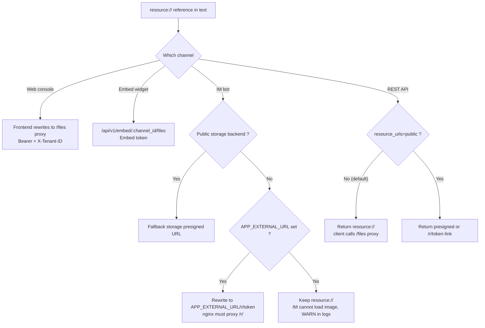

# External access to images and files

Images and files are accessed differently by channel. The web console and embed widget can call authenticated proxies; IM platforms require time-limited public links; API clients choose internal references or external links depending on use.

When integrating, check reference form, caller permissions, and URL reachability together. If an image does not display, see the troubleshooting table at the end.

## File references and access modes {#file-references-and-access-modes}

Knowledge base images and attachments live in the file backend. Body text uses stable internal references; at response or render time they convert to URLs by channel:

| Form | Example URL | Access condition | Validity |
| --- | --- | --- | --- |
| **Internal reference** | `resource://<handle>` | Stable handle resolved server-side, not usable directly as URL | — |
| **Authenticated proxy** | `/files`, `/api/v1/knowledge-bases/:id/files`, `/api/v1/embed/:channel_id/files`, message-level `/api/v1/sessions/:id/messages/:message_id/files` | Client with suitable credentials (session / KB rights / Embed token) | While credential valid |
| **Short signed link** | `/r/<token>` | Anyone with the link (**anonymous read**) | Grant issued by WeKnora, 2 h |
| **Storage presign** | Backend http(s) link | Anyone with the link (**anonymous read**) | Storage-dependent; MinIO default 24 h |

Short signed links and presigned URLs allow anonymous read for their lifetime. When sharing or archiving these links, treat them according to file sensitivity. Revoking org sharing or leaving an organization does not invalidate links already issued—they stay valid until expiry (short link 2 h, storage presign up to 24 h).

::: tip Default access mode
By default the system returns internal references; authenticated clients read via proxy. External links require a storage endpoint reachable from the Internet, or `APP_EXTERNAL_URL` for WeKnora-issued access links. Default MinIO address `minio:9000` is reachable only on the container network.
:::

## File access by channel {#file-access-by-channel}

### Web console

The web frontend converts `resource://` and `provider://` references to authenticated proxy URLs. Common resources use `/files` with Bearer token and `X-Tenant-ID`; a knowledge base shared across workspaces uses `/api/v1/knowledge-bases/:id/files`, reading files from the source workspace per KB rights, without extra configuration.

For images in responses from a shared Agent or org-shared knowledge base, prefer `/api/v1/sessions/:id/messages/:message_id/files?file_path=...`. The server verifies the caller can read the message, that the resource is cited by the message, and revalidates authorization on the shared KB or Agent. After share revocation, historical messages do not continue granting resource access. Classic KB browsing can still use KB-level proxy; the two contexts stay distinct.

### IM bot {#im-bot}

IM platforms cannot carry WeKnora credentials: they need publicly reachable HTTP(S) URLs. Before sending a message, the system generates an external link from storage and deployment:

`resource://` uses the storage instance actually bound to the resource; a shared resource uses the owner workspace’s instance. If the knowledge base is already bound to OSS or another object store, you need not change global `STORAGE_TYPE`. If the bound instance is unavailable, the original reference is kept with alert; no other instance or global storage replaces it.

Before generating an external link for a cross-workspace image, the system checks KB binding, active sharing, and agent KB scope. Chat attachments and generated files record the global instance used at write time; historical unbound resources are backfilled only if location is unique, otherwise the reference stays unchanged.

1. **Storage backend publicly reachable** — public endpoint for the object, or `MINIO_ENDPOINT` as public host. Fallback to storage presigned URL, no extra config;
2. **Configure `APP_EXTERNAL_URL`** — reference becomes `<APP_EXTERNAL_URL>/r/<token>`, request proxied via nginx `location ^~ /r/` to app. Official frontend image includes this location; custom reverse proxy must add it, otherwise request hits SPA fallback (blank page).

Default internal MinIO and `local` storage require `APP_EXTERNAL_URL`. Without external link conditions, the system keeps the reference and logs an alert; IM cannot display the image. If an IM channel is active and `APP_EXTERNAL_URL` is empty, startup also emits a warning.

### Embed widget

The widget uses channel file proxy `/api/v1/embed/:channel_id/files`. The Embed token fixes the workspace; the server verifies path ownership. The embed channel always returns internal references; `RESOURCE_URL_MODE=public` and `?resource_urls=public` do not change this, to guarantee channel-authenticated reads.

### REST API and SDK

The API returns `resource://` by default; the client fetches via authenticated proxy. For direct render with external link:

- Single request: `?resource_urls=public`
- Whole deployment: `RESOURCE_URL_MODE=public`

Query parameter overrides environment: even with default `public`, `?resource_urls=handle` returns to handle mode. Full semantics, scope, and security limits: “File reference forms” in [API overview](../04-api/01-api-overview.md).

An API key limited to one knowledge base returns 403 with `public`; that key type also cannot use generic proxy `/files`. Without external link conditions, the response keeps `resource://`; an authorized client can use authenticated proxy.

## Troubleshooting access issues {#troubleshooting-access-issues}

| Symptom | Likely cause | Action |
| --- | --- | --- |
| Image invisible in IM | No `APP_EXTERNAL_URL` and storage not public | Set `APP_EXTERNAL_URL`, verify nginx `/r/` proxy; search app logs for WARN `rewriteStorageURLs no-op` |
| IM link opens but blank page | nginx missing `location ^~ /r/`, request hits SPA fallback | Add location (included in official frontend image), see [Web frontend](../05-clients/01-frontend.md) |
| `APP_EXTERNAL_URL` is internal or `localhost` | IM is public-side, unreachable | Address reachable by IM platform; local dev: ngrok / cloudflared / frp |
| API returns `resource://` for image | Default behavior (internal reference) | Add `?resource_urls=public`, or call `/files` proxy |
| `resource_urls=public` still returns `resource://` | Deploy without external link capability (`local` without `APP_EXTERNAL_URL`) | Add external link conditions, or use `/files` proxy |
| `resource_urls=public` returns 403 | API key limited to one KB | Use `handle` mode, or full-access key |
| Image missing in widget but OK on web | Channel proxy distinct from site credentials | Verify valid Embed token on widget page; `resource_urls=public` has no effect on embed |
| Shared response image 403/404 | Missing message context, unlinked resource, or revoked share | Message-level proxy and current share rights; do not compose owner-tenant `/files` URL |
| Issued links invalid after upgrade or key rotation | Signing key changed (`SYSTEM_SIGNING_KEY`, or fallback `SYSTEM_AES_KEY`) | Regenerate links; multi-replica: same key on all instances |
| External link expires after a while | Time-limited links (grant 2 h / MinIO presign 24 h) | Do not cache link; refetch on demand; same file reuses link while valid |
| Web image 404, tenant mismatch logs | Shared KB image stored at owner tenant | Use `/api/v1/knowledge-bases/:id/files`; verify frontend receives KB-level proxy URL |

## Configuration reference {#configuration-reference}

| Setting | Role |
| --- | --- |
| `APP_EXTERNAL_URL` | Externally reachable URL for IM image links; required to rewrite `resource://` to `<APP_EXTERNAL_URL>/r/<token>` |
| `RESOURCE_URL_MODE` | Default file reference form in API responses (`handle` / `public`) |
| `MINIO_ENDPOINT` and other storage endpoints | With public address, external links can come from storage presign without `APP_EXTERNAL_URL` |
| `SYSTEM_SIGNING_KEY` (fallback `SYSTEM_AES_KEY` if absent) | Signing key. Presigned links `/api/v1/files/presigned`; reuse of `/r/<token>` grants while valid, stable URLs, less write pressure on reads. If absent, length < 16 or example value: no presign; rotation invalidates issued links |

## Related documentation {#related-documentation}

- [IM integration](12-im-integration.md): rewrite logic and startup alerts
- [Web embed](13-embed-channel.md): channel auth and anonymous sessions
- [API overview](../04-api/01-api-overview.md): full `resource_urls` semantics
- [Configuration reference](../01-getting-started/04-configuration.md): environment variables above
- [Web frontend](../05-clients/01-frontend.md): nginx `/files` and `/r/` proxies

## Implementation reference

- `frontend/src/utils/protectedFileAccess.ts`: web file references and proxy paths.
- Before IM message send, external link conversion via `rewriteStorageURLs()`.
